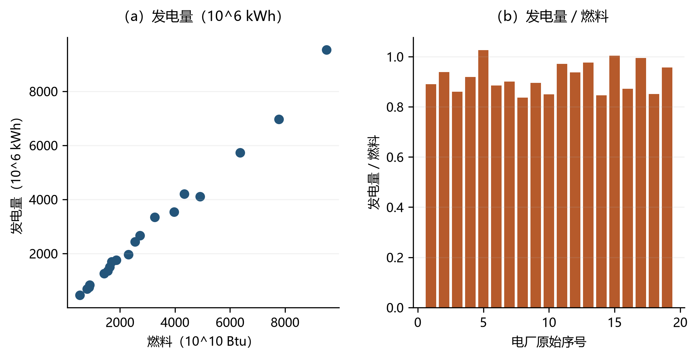

# 绪论 {#sec-1}

当前，全球正面临严峻的资源环境约束：全球变暖、生物多样性丧失、水资源短缺、关键矿产资源耗竭与各类污染相互叠加。从极端气候事件到生态系统功能退化，从能源资源的紧张约束到污染排放的持续累积，这些问题彼此交织，对经济社会的长期发展构成实质性压力。如何在有限的资源储量与环境容量约束下维持经济增长、增进社会福利，已成为各国政府、产业界与学术界共同面对的重要问题。回答这一问题的前提，是科学地评估“资源利用是否高效、环境代价是否可控、发展方式是否可持续”——这正是资源环境绩效评估所要处理的核心议题，也是本书的出发点。

## 全球资源环境危机与评估需求 {#sec-1-1}

在气候变化领域，政府间气候变化专门委员会（IPCC）第六次评估报告综合报告指出：2011—2020年全球地表温度较1850—1900年约升高1.1°C；大气、海洋、冰冻圈和生物圈均已发生广泛而迅速的变化，气候变化正在加剧全球各地区的极端天气气候事件，给自然生态系统与人类社会造成广泛的不利影响、损失与损害（IPCC, 2023）。世界气象组织《2024年全球气候状况》进一步显示，2024年全球平均海平面（卫星观测记录）与海洋热含量均再创新高（WMO, 2025）。

气候系统还存在临界风险。一旦某些子系统越过临界点，其状态可能发生难以迅速逆转的转变（IPCC, 2023）。Lenton 等（2008）在政策相关尺度上给出了9个气候临界要素的短名单，并另列若干未进入短名单的候选系统。Lenton 等（2019）的评论指出，这类临界过程的发生概率、影响及其相互关联可能高于以往的通行判断，并以亚马孙雨林、北极海冰、格陵兰冰原等为例发出警告，但并未对全部临界要素作出“已经触发”的系统判定。后续研究发现，地球系统中若干临界要素之间存在遥相关，某一要素的变化可能提高其他要素越过临界点的风险，从而形成级联（Liu 等, 2023）。

气候危机并非孤立发生。Ceballos 等（2015）指出，当代物种灭绝速度已远超自然背景速率，地球可能正在经历第六次物种大灭绝。Ceballos 和 Ehrlich（2023）进一步估计，在栖息地破坏、过度捕捞和狩猎等人类活动影响下，自公元1500年以来已有73个陆生脊椎动物属（不含鱼类）灭绝；若按过去百万年的背景灭绝速率，这一规模的属丧失大约需要18,000年才会发生。

生态系统退化与气候变化相互叠加，也反映在资源消耗与污染上。全球城市固体废物规模已达数十亿吨量级，并仍呈增长趋势（Kaza 等, 2018）；空气污染造成的过早死亡会带来以万亿美元计的福利损失（World Bank, 2016）。上述问题并非彼此孤立：人口、资源、环境与经济子系统之间存在复杂相互作用，任一子系统的持续失衡都可能外溢至其他子系统。

在此背景下，对资源环境绩效进行科学、系统且可比的评估，有助于识别风险、追踪进展并讨论资源配置。评估本身并不唯一对应于某一种方法。本书选择数据包络分析（Data Envelopment Analysis，DEA）与 Python，是因为前者能够在缺乏价格信息的条件下处理多投入、多产出（含环境结果）的相对效率问题，后者则便于把模型写成可复现的计算流程。二者构成全书的方法主线，而非对其他评估工具的替代性否定。

## 可持续发展的核心要义与多维度挑战 {#sec-1-2}

可持续发展的经典表述来自世界环境与发展委员会：既满足当代人的需要，又不对后代人满足其需要的能力构成危害（WCED, 1987）。经济、环境与社会维度需要统筹，但“最大化代际整体福利”并不是上述定义的原文，也不应写成已经形成共识的操作性公式。自联合国2030年议程及可持续发展目标（SDGs）获193个成员国通过以来，全球在监测进展方面投入了大量努力，实际进展却并不均衡。Fuso Nerini 等（2024）指出，全球 SDGs 进展已明显偏离2030年轨道，大量指标停滞甚至倒退。《自然》杂志社论在议程过半时写道：17项目标中可能无一能如期完全实现，在当时可评估的靶标中仅约12%走在正轨（Nature Editorial, 2023）。联合国《2024年可持续发展目标报告》更新后的判断是：在可评估靶标中，仅约17%进展足以在2030年达标，近半数偏离轨迹，超过三分之一停滞或相对2015年基线倒退（United Nations, 2024）。Xing 等（2025）基于多国指标时间序列的预测则表明，若按既有轨迹外推，全球 SDG 综合得分到2030年大约只能达到63%左右；若要在综合得分意义上接近总体目标，各国 SDG 得分需达到约4%的年均增速。后一组数字来自学术预测，用来补充而非代替联合国官方进度评估。

可持续发展评估还面临方法论困难。常见做法可大致对应三种理论视角：三支柱视角强调经济、环境与社会维度的协调（United Nations, 2005），覆盖面宽，但容易遇到量纲不一、权重外生和可比性不足的问题；生态视角更关注人类活动对资源和环境系统的压力，接近强可持续性立场（Daly, 1990），直观但口径较窄，数据约束也更强；资本视角以人造资本、自然资本等存量变化衡量可持续性（Pearce 和 Atkinson, 1993），便于加总比较，却高度依赖货币化与替代性假设。若把这些维度拆开、用单一比率或主观加权指数分别打分，结论容易片面。

在需要同时处理多投入、多产出且往往缺乏可靠价格信息时，数据包络分析（DEA）作为一种基于线性规划的非参数效率前沿方法，因此在环境与可持续性评估中得到持续使用。DEA 不必预先设定生产函数形式，也不必外生给定全部权重，能够识别样本内的相对最佳实践。Song 等（2012）综述了 DEA 在环境效率评价中的应用，覆盖径向与非径向、单期与多期等方向；Patel 等（2025）则从文献计量角度梳理了 DEA 用于企业可持续性测量的研究脉络。需要强调的是：这些优势成立的前提是投入产出变量已经给定；变量选择本身仍是研究设定，不能由 DEA 自动证明为“正确”。

## 资源环境绩效评估的必要性与复杂性 {#sec-1-3}

第一，没有可用的度量，管理就缺少可核对的依据。生态环境政策绩效评估是政策周期中的重要环节，用来反映实施效果，为调整、优化或退出提供证据，而不是代替政治决策本身。

第二，评估有助于识别相对较好的实践、追踪改善并讨论资源配置。面对资源约束、环境污染和生态系统退化，只有对不同地区、行业或企业的资源利用效率与环境绩效作口径清楚的量化比较，才可能指出效率较低的环节，并讨论把有限资源投向何处。这里的“最佳实践”是相对于所设技术与样本而言的，不宜直接等同于因果意义上的政策成功。

第三，评估可以服务于可持续发展目标的监测，但二者并不等同。DEA 已被用于生态效率评价及相关指标体系研究。现有文献显示，网络 DEA、动态 DEA、DEA-Malmquist 以及与机器学习结合的混合方法，常被用来讨论能源系统与碳减排中的相对效率问题（Song 等, 2012; Patel 等, 2025）。这些工作提供的是样本内相对效率框架，不能自动回答某一国家或地区是否“实现了 SDG”。

资源环境绩效评估的复杂性，来自人口、资源、环境与经济子系统之间的耦合。当前 SDG 全球指标框架的设计也存在明显张力：偏重数据供给而相对忽视实施问题，指标内容存在缺口，政治目标与测量内容可能脱节，部分指标甚至会因其测量方式改写目标本身，从而削弱2030议程的实施效果（Koerber, 2024）。SDG 指标还普遍面临数据不足、指标冗余、覆盖不完整以及与地方情境和优先事项错位等挑战（Sato, 2025）。如果评估工具不能说明低效率相对于何种技术、何种样本、何种导向而言，政策讨论就容易偏离可检验的对象。本书关注的，正是一套口径可陈述、步骤可复现的绩效评估工具。

## 传统评估方法的局限性与数据包络分析 {#sec-1-4}

在资源环境绩效评估中，单一比率和主观加权指数往往难以同时刻画多投入与多产出。DEA 最初是运筹学中的相对效率测量方法，由 Farrell（1957）的效率概念发展而来，经 Charnes 等（1978）形式化为可计算的线性规划模型，其后才被广泛引入环境与能源绩效研究。它并非为应对当代全球环境危机而“应运而生”，但其多投入多产出结构与无需求价格的特点，使它适合作为该领域的一种评估工具。本节先说明传统方法的不足，再概述 DEA 的原理、优势与应用中的限制。

### 传统评估方法的不足 {#sec-1-4-1}

传统绩效评估常依赖单一比率（如单位投入的产出）或简单加总指标。这类指标直观，但把多种投入、多种产出压缩到一个比例上，无法描述要素之间的替代与联合生产。即便列出产值、利润、资金、设备等多个可量化项目，若仍停留在分项比较，也得不到一个口径一致的综合效率测度。至于自然条件、制度环境等难以观测或难以进入生产账户的因素，传统比率处理不了，标准 DEA 同样不能把未观测因素自动纳入前沿；正确的做法是在模型外讨论它们对结果解释的影响，而不是宣称某一种方法已经克服了不可测问题。

许多多准则方法还需要事先为各指标指定权重。权重若来自经验或专家打分，就可能偏离真实的运营约束，也难以反映非线性关系。例如，若在地区能源效率评价中把经济产出权重设得过高、环境代价过低，排序就会被设定本身主导。Krivonozhko 等（2011）从数学上指出，比率分析相当于把多维观测反复投影到不同子空间，可能显著扭曲绩效比较。这一结果为改用前沿方法提供了形式依据，而不是证明 DEA 没有设定问题。

此外，单一综合得分往往缺少对低效率来源的分解：它通常不能指出改进应主要来自哪一类投入或产出，也难以在异质样本中给出可核对的参照单元。在资源环境问题中，生产同时涉及能源、资本、劳动等投入以及经济产出与环境结果，单一比率或主观加权指数很难同时兼顾这些维度。

### 数据包络分析（DEA）的核心原理与优势 {#sec-1-4-2}

DEA 是一种非参数相对效率测量技术，用于评估决策单元（decision making unit, DMU）相对于样本前沿的表现。它根据观测数据构造分段线性的效率前沿。思想渊源可追溯至 Farrell（1957）；作为可计算方法论的确立，则以 Charnes 等（1978）的 CCR（Charnes–Cooper–Rhodes）模型为标志。该模型通过线性规划，在约束下最大化加权产出与加权投入之比，为每个决策单元计算效率得分：落在前沿上的单元为相对有效，前沿内部的单元为相对无效，得分表示与样本内最佳实践的差距。Banker 等（1984）将模型拓展到规模报酬可变（Variable Returns to Scale，VRS），得到 BCC（Banker–Charnes–Cooper）模型。规模报酬不变（Constant Returns to Scale，CRS）设定更常用于讨论长期潜在效率或跨规模比较，VRS 则更常用于短期运营效率与规模效率识别。二者都是相对于样本与变量设定的相对效率，而不是绝对的技术真理。

DEA 的一个主要优点，是能够同时处理多个投入和多个产出，并且不必事先外生指定全部权重。它也不要求预先设定投入与产出之间的参数化函数形式。线性规划会为每个决策单元寻找一组对该单元最有利的权重，从而避免把一套专家权重强加给所有单元（Charnes 等, 1978）。但“最有利”并不等于“没有研究者判断”：投入产出清单、规模报酬假设、导向（投入、产出或方向距离）以及是否加入权重约束，仍然由研究设定决定。若不对权重加以限制，某些变量可能获得极端权重，解释时需要谨慎。

在资源环境绩效评估中，这一结构可以直接容纳资源消耗（投入）、经济产出（期望产出）与污染排放（非期望产出）。例如，评价地区碳排放效率时，可以把能源、资本、劳动作为投入，把 GDP 作为期望产出、CO2 作为非期望产出，在给定技术假设下识别样本前沿。非期望产出如何进入模型（弱可处置、方向距离、物质平衡等），将在后续章节专门讨论。

DEA 还具有基准化含义：它可以指出参照单元，以及低效率单元在既定方向上的改进幅度。这使分析从单一得分扩展到可核对的差距来源。实践中可用于比较地区或企业相对于样本前沿的位置，也可以作为政策讨论的描述性证据；若要评估规制的因果效应，仍需额外的识别策略。方法层面，Chen 和 Wang（2024）讨论了在比较生态效率与生产效率时，因模型维度不同而可能出现的得分膨胀，并给出校正思路，而不是一劳永逸地取消维数问题。Emrouznejad 等（2023）则从文献计量角度梳理了生态效率 DEA 与净零相关议题的研究脉络。

### DEA应用的考量与挑战 {#sec-1-4-3}

DEA 应用中的一个关键限制是维数问题。当投入产出个数相对于决策单元数目过高时，模型容易把过多单元判为有效，区分度下降。例如，样本很小却放入数十个指标时，几乎每个单元都可能在某一维度上显得“有效”。Chen 和 Wang（2024）也指出，高维设定会削弱判别力。因此，尽管 DEA 在形式上能容纳多指标，变量仍须按研究问题筛选，并报告稳健性。

传统 DEA 把前沿以外的偏差全部记为无效率，因而对测量误差和随机扰动敏感。Kuosmanen 和 Kortelainen（2012）提出的随机非参数数据包络（Stochastic Nonparametric Envelopment of Data，StoNED），在形状约束下引入由无效率项与噪声项构成的复合误差，试图在保留非参数结构的同时分离噪声。Lin 和 Lu（2024）比较了机会约束 DEA、StoNED 与 Bootstrap 在城市文化再生绩效中的表现，说明三者在不确定性处理、函数假设和计算负担上并不相同，方法选择应随问题而定。

结果还依赖于样本与数据质量。Simar 和 Wilson（1998）表明，非参数前沿上的效率得分会随抽样变异而显著波动，可用自助法评估其敏感性。应用于资源环境问题时应交代数据来源、异常值处理和样本边界，避免把一次点估计写成稳健事实。

模型设定同样关键。DEA 本身不能检验“所选投入产出是否正确”；不同变量组合可以改变排名。是否把环境规制强度当作投入、是否用物质平衡来约束非期望产出，都会改变结论的含义。需要结合理论、数据与研究问题选择变量，并做对照设定。

DEA 作为确定性前沿，不能区分无效率与噪声；随机前沿分析（Stochastic Frontier Analysis，SFA）则用复合误差做这种分解，但依赖函数形式与分布假设。Kang 和 Kim（2018）对中国产业层面数据的比较发现，DEA 与 SFA 的效率得分正相关，全要素生产率趋势相近，而 SFA 的分解路径更平滑。该研究样本与期刊覆盖有限，宜视为一项对照证据，而不是“SFA 一律优于 DEA”或相反。研究者应按目标与数据在二者之间选择，或并行报告。

随着维度增加，结果解释也更依赖对行业与制度背景的理解。使用 DEA 的关键不在于“跑通模型”，而在于说清楚技术假设、样本和得分的含义。

总体而言，DEA 适合处理多投入多产出、避免外生赋权的相对效率问题，同时也受数据质量、变量选择和统计推断的约束。把它与稳健性检验、必要时与 SFA 或其他方法对照，才能更好支撑资源环境绩效评估。

## Python在资源环境绩效评估中的应用优势 {#sec-1-5}

要把 DEA 写成可核对的计算过程，需要能处理表格数据、求解线性规划并绘图的工具。Python 语法相对直观，科学计算库完整，在数据科学和科研计算中使用广泛，因此本书用它实现模型。它是该领域常用工具之一，而不是物理、生物或天文研究中唯一的“主流语言”。以下从易用性、科学计算生态和 DEA 实现三个方面说明。

### Python的易用性与广泛适用性 {#sec-1-5-1}

Python 语法可读性较高，有利于把公式转成可检查的代码，也便于没有长期编程训练的研究者上手。与 Java 或 C++ 相比，同样的数据处理流程通常更短，这有助于降低本书读者的入门成本。易用并不等于可以省略对模型假设的理解。

Python 的另一个条件是社区与文档：开源库、教程和问答平台使常见计算问题较容易查到已有实现。这对数据科学中快速变化的工具链是实际便利，而不是质量保证。

其应用范围覆盖统计、经济、工程和自然科学中的数据分析任务。研究人员常用它完成收集、清洗、建模与可视化（Castro 等, 2024）。掌握 Python 既服务于本书的 DEA 实现，也可以迁移到其他数据分析工作。

### 强大的科学计算与数据处理生态系统 {#sec-1-5-2}

Python 的库生态为表格处理、数值计算、优化和绘图提供了现成组件。在资源环境绩效评估中，它们可以覆盖从读入数据到报告图形的流程。Pandas、NumPy、SciPy 和 Matplotlib 是其中最常用的基础组合。

Pandas 提供 DataFrame 和 Series，面向统计分析中常见的结构化表（McKinney, 2010）。投入产出数据多以表格存储，清洗、缺失值、合并与分组都可以在同一对象上完成，并做初步的描述统计。

NumPy 提供多维数组 ndarray 及相应的向量化运算，是科学计算的底层依赖；Harris 等（2020）指出，它出现在包括引力波探测和黑洞成像在内的科研软件栈中。与 Python 列表相比，ndarray 在大规模数值运算上更有效，线性代数等函数可直接作用于数组。

SciPy 在 NumPy 之上提供优化、插值、积分、稀疏矩阵等算法。Virtanen 等（2020）将其视为 Python 科学算法的事实标准之一。其中 `linprog` 等例程可用于中小规模线性规划，从而支撑入门级 DEA 求解；更大规模或带整数约束的问题则通常交给专门建模层。SciPy 与 Pandas、NumPy 可以在同一脚本中衔接。

Matplotlib 用于折线、散点、柱状等常规图形，接口接近 MATLAB，便于控制出版所需的坐标轴与标注（Hunter, 2007）。Seaborn 在其之上提供更省默认样式的统计绘图接口，并与 DataFrame 配合较好（Waskom, 2021）。

四者分工大致是：NumPy 做数组运算，Pandas 做表，SciPy 做算法，Matplotlib 做图。统一环境减少了在多种商业软件之间反复导数据的成本，也便于把代码和结果一并存档。

### Python助力DEA模型实现与调试 {#sec-1-5-3}

DEA 需要整理投入产出表、求解线性规划并报告效率与权重。Python 可以把这几步写在同一流程里。

数据准备阶段，Pandas 适合从 Excel、CSV 或数据库读入 DMU 表，做筛选、缺失值与异常值处理，再整理成求解器所需的矩阵。

求解阶段，SciPy 的 `linprog` 适合中小规模问题；规模更大或约束更复杂时，可用 Pyomo 等建模库书写线性、整数或非线性规划。专门面向本领域的包也在增加，例如 pyStoNED 提供凸回归、StoNED 及部分 DEA 相关例程。

亦有应用研究在 Python 中调用 PyDEA 等接口。Radovilsky 等（2021）在建筑能源效率比较中使用了包括 PyDEA 在内的工具，并报告 CCR 设定下结果较为一致。这类研究说明相关接口可以完成计算，但样本与问题都较特定，不足以把某一软件包写成已经过普遍验证的“标准可靠工具”。本书后续章节以可阅读的线性规划与 `deabook` 流程为主，读者应能不依赖黑箱包核对模型。

从预处理、求解到作图，Python 可以减少在不同软件间转换数据的步骤。Jupyter Notebook 把代码与中间图放在同一文档中，便于逐步检查约束、目标值和效率得分。典型步骤是：用 Pandas 组织数据，用 SciPy、PuLP 或 Pyomo 写规划，调用求解器，再提取效率与权重。Python 中的 DEA 实现正从零散脚本转向可复用库，但理解模型仍优先于调用封装。

因此，选择 Python 是为了把 DEA 的数学形式落成可检查、可修改的代码，而不是因为某种语言具有方法上的特权。NumPy、Pandas、SciPy、Pyomo 与 Matplotlib 构成全书示例的主要工具链。

## 一个贯穿全书的问题：投入多是否意味着效率低 {#sec-1-case}

美国19家燃煤电厂中，燃料消耗与发电量共同上升，但这条关系本身不能识别效率。两家电厂可能有相似的燃料生产率，却使用不同数量的劳动和装机容量。图中的点对应真实电厂，表中仅汇总发电量与燃料的比值；这个单要素比值用于提出问题，不能替代第3章的多投入DEA。数据来自Färe、Grosskopf和Kokkelenberg（1989），公开版本见deaR的Electric_plants。

```python
from deabook.example.book_cases.run import FUN
FUN[1]()  # 重新计算本章，输出完整CSV、摘要表与PNG/PDF图
```


| 电厂          |      劳动 |       燃料 |       装机 |      发电量 |   发电燃料比 |
|:------------|--------:|---------:|---------:|---------:|--------:|
| Coffeen     | 179.000 | 3969.100 | 1005.500 | 3531.400 |   0.890 |
| Grant Tower |  96.000 |  896.320 |  194.600 |  841.300 |   0.939 |
| Gudsonville |  94.000 |  803.170 |  200.000 |  690.500 |   0.860 |
| Meredosia   | 141.000 | 1629.900 |  564.100 | 1498.100 |   0.919 |
| Newton      | 147.000 | 3264.400 |  617.400 | 3347.700 |   1.026 |
| Fisk        | 261.000 | 1427.500 |  347.100 | 1263.200 |   0.885 |
| Joliet      | 448.000 | 6365.300 | 1680.400 | 5734.000 |   0.901 |
| Kinkaid     | 223.000 | 4911.000 | 1319.400 | 4107.700 |   0.836 |


: 一个贯穿全书的问题：投入多是否意味着效率低：结果摘要 {#tbl-case-1}

{#fig-case-1 width=95%}

<!-- expanded-exhibit-note -->
表中按原文件顺序列出前8家电厂，供读者核对劳动、燃料、装机与发电量的量纲，并比较发电燃料比。同样的单项比率可能对应不同投入组合，不能直接替代多投入效率。图左显示投入产出的规模关系，图右展示全部19家电厂的单项比率。
<!-- /expanded-exhibit-note -->

燃料生产率高的电厂未必在考虑劳动和装机后仍然有效。后续章节用同一生产技术中的多投入约束回答这个问题；绪论不据单个比值给电厂排序。

配套程序 `deabook/example/book_cases/run.py` 保存全部观测到 `results/ch01_full.csv`。表中P10和P90为第10和第90百分位数（如适用），展示分布而不占用逐个决策单元的行数。

## 本书结构与内容概览 {#sec-1-6}

### 章节安排与知识体系 {#sec-1-6-1}

全书按“计算基础—DEA 理论—程序实现”递进，分为三个部分：第一部分（第[-@sec-2]章）为 Python 基础；第二部分（第[-@sec-3]章至第[-@sec-10]章）为 DEA 理论与方法；第三部分（第[-@sec-11]章至第[-@sec-13]章及附录）为程序实现与应用拓展。各章安排如下。

第[-@sec-2]章 Python基础知识 介绍数据分析与 DEA 实现所需的语法、数据结构、控制流程以及 NumPy、Pandas 等库的基本用法，使不同编程背景的读者能够阅读后续代码。

第[-@sec-3]章 数据包络分析的经典模型 讨论生产技术设定、产出/投入/方向距离函数，以及 CCR、BCC 模型的数学形式与估计，为后面各章提供共同语言。

第[-@sec-4]章 传统生产率测度方法 介绍基于 DEA 的 Malmquist 生产率指数及其分解，包括产出导向、投入导向以及方向距离函数对应的指数，并用 OECD 国家与中国省份案例说明动态效率的计算与读图口径。

第[-@sec-5]章 能源效率与能源生产率测度方法 讨论同时缩减能源与其他投入、仅缩减能源、同时调整投入与产出等测度方式，并引入 Malmquist 指数做动态能源生产率分析。

第[-@sec-6]章 环境绩效测度方法（非期望产出） 在含非期望产出的生产技术下，比较谢泼德距离函数、双曲距离函数、方向距离函数与非径向方向距离函数，并用 OECD 国家和中国省份案例做实证对照。

第[-@sec-7]章 包含非期望产出的生产率 把静态环境效率扩展到跨期变化，引入 Malmquist 指数、Malmquist-Luenberger 指数、Luenberger 指标与非径向方向距离函数，并将生产率变化分解为效率变化与技术变化。

第[-@sec-8]章 基于松弛测度的效率模型 针对径向模型忽略松弛导致的高估，介绍不含与含非期望产出的 SBM（投入导向、产出导向与非导向），并结合 deabook 说明方向向量、规模报酬与结果口径。

第[-@sec-9]章 基于物质平衡的环境绩效测度方法 把物质平衡原则写入效率评估，说明其与距离函数的关系，给出符合物质守恒的非参数模型，并用中国火电行业案例说明分解指标的读法。

第[-@sec-10]章 随机非参数数据包络分析 介绍凸非参数最小二乘（CNLS）与 StoNED 的统一框架，说明如何把 DEA 的公理化结构与噪声分解结合起来，并讨论多产出及非期望产出情形。

第[-@sec-11]章 DEA模型编程的基本思路 说明如何把 DEA 写成求解器可识别的线性规划、如何在数据集上循环，以及如何封装为 Python 函数。

第[-@sec-12]章 DEA程序编写的实战演练 给出 SBM、含非期望产出的 SBM、方向距离函数（DDF）、非径向方向距离函数（NDDF）、Malmquist 指数与 Malmquist-Luenberger 指数等模型的编程示例。

第[-@sec-13]章 基于DEA对偶问题的影子价格估计 由对偶问题讨论影子价格，包括线性规划对偶、SBM 与 NDDF 的对偶及其 Python 实现，用于讨论资源和污染的隐含估值。

附录 Python编写的DEA程序的调试 介绍阅读报错、打印变量以及 Pyomo 模型检查等调试方法。

### 理论与实践的融合 {#sec-1-6-2}

各章以数学表达和图形说明概念，并配以可运行的 Python 示例，便于对照公式与代码。融合大致分三层。方法层：介绍一种模型时给出线性规划形式和求解框架。案例层：第[-@sec-3]章至第[-@sec-10]章中的多数理论章使用真实或公开整理的数据（如 OECD 国家、中国省份或行业样本）演示读入、求解与作图；第[-@sec-2]章以语言与库的基础练习为主，第[-@sec-11]章以程序结构为主，并不各配一套完整实证。实战层：第12、13章提供可改写的函数代码，附录处理调试。

这样安排是为了同时回答方法“是什么、为什么”以及计算“如何做”。案例选自资源环境场景，用于说明口径和步骤，而不是对所涉国家或行业作政策鉴定。

## 本书的读者对象与价值 {#sec-1-7}

### 目标读者 {#sec-1-7-1}

本书面向需要把资源环境绩效写成可计算问题的读者，主要包括三类。

一是学术与研究界。环境科学、环境经济学、运筹学、工业工程、能源研究、可持续发展以及管理科学的研究生、高年级本科生和科研人员，若需要一套从模型到代码的相对效率工具，可以把本书作为教材或手册。

二是从业者与政策分析人员。生态环境、能源、发展改革等部门，以及咨询机构中从事基准比较、减排测算或报告编制的人员，可以使用书中的模型和代码做描述性评估。结论应连同样本、变量和技术假设一起报告。

三是数据科学与分析背景的读者。若希望把 Python 与优化用于效率和环境问题，可以把各章案例当作领域模板。

### 本书的独特价值 {#sec-1-7-2}

本书把 DEA 的模型表述与 Python 实现放在同一条线索里，区别于只讲定理或只给软件操作的读物。

第一，它处理多投入（资本、劳动、能源）与多产出（经济产出、环境结果）的相对效率，并给出可改写的代码，使读者能把问题写成规划而不是停留在单一比率。

第二，它强调诊断：Malmquist 分解、影子价格、非径向方向距离函数等，用来讨论差距更可能来自哪一类变化。这些结果仍是相对效率分解，需要额外设计才能支持因果评价。

第三，代码以开源 Python 编写，便于复现和改用到读者自己的数据，也避免对昂贵商业许可的依赖。公开可获取不等于免除对数据授权与引用的责任。

第四，内容从语法与经典 DEA 递进到 StoNED 与影子价格，附录补充调试，以便不同程度的读者选择入口。

本书的目标，是让读者能够完成口径清楚、步骤可核对的数据驱动评估，为资源管理和环境政策讨论提供可检验的描述证据。

## 参考文献 {.unnumbered}

Banker R D, Charnes A, Cooper W W, 1984. Some Models for Estimating Technical and Scale Inefficiencies in Data Envelopment Analysis[J]. Management Science, 30(9): 1078-1092.

Castro O, Bruneau P, Sottet J S, et al., 2024. Landscape of High-Performance Python to Develop Data Science and Machine Learning Applications[J]. ACM Computing Surveys, 56(3): 1-30.

Ceballos G, Ehrlich P R, Barnosky A D, et al., 2015. Accelerated modern human-induced species losses: Entering the sixth mass extinction[J]. Science Advances, 1(5): e1400253.

Ceballos G, Ehrlich P R, 2023. Mutilation of the tree of life via mass extinction of animal genera[J]. Proceedings of the National Academy of Sciences, 120(39): e2306987120.

Charnes A, Cooper W W, Rhodes E, 1978. Measuring the efficiency of decision making units[J]. European Journal of Operational Research, 2(6): 429-444.

Chen C M, Wang H, 2024. Comparing eco-efficiency with productive efficiency: Addressing the dimensionality issue[J]. European Journal of Operational Research, 313(3): 1170-1179.

Daly H E, 1990. Toward some operational principles of sustainable development[J]. Ecological Economics, 2(1): 1-6.

Emrouznejad A, Marra M, Yang G L, et al., 2023. Eco-efficiency considering NetZero and data envelopment analysis: a critical literature review[J]. IMA Journal of Management Mathematics, 34(4): 599-632.

Farrell M J, 1957. The Measurement of Productive Efficiency[J]. Journal of the Royal Statistical Society. Series A (General), 120(3): 253-281.

Fuso Nerini F, Mazzucato M, Rockström J, et al., 2024. Extending the Sustainable Development Goals to 2050 — a road map[J]. Nature, 630(8017): 555-558.

Harris C R, Millman K J, Van Der Walt S J, et al., 2020. Array programming with NumPy[J]. Nature, 585(7825): 357-362.

Hunter J D, 2007. Matplotlib: A 2D Graphics Environment[J]. Computing in Science & Engineering, 9(3): 90-95.

IPCC, 2023. Climate Change 2023: Synthesis Report. Contribution of Working Groups I, II and III to the Sixth Assessment Report of the Intergovernmental Panel on Climate Change[R]. Geneva: Intergovernmental Panel on Climate Change.

Kang Z N, Kim T H, 2018. A Comparative Study of DEA-SFA for Industry-level in China[J]. The Journal of International Trade & Commerce, 14(3): 17-31.

Kaza S, Yao L, Bhada-Tata P, et al., 2018. What a Waste 2.0: A Global Snapshot of Solid Waste Management to 2050[R]. Washington, DC: World Bank.

Koerber W, 2024. Eyes on the data—How the methodology of the 2030 Agenda contributes to its probable failure[J]. World Development Sustainability, 5: 100188.

Krivonozhko V E, Piskunov A A, Lychev A V, 2011. On comparison of ratio analysis and data envelopment analysis as performance assessment tools[J]. IMA Journal of Management Mathematics, 22(4): 357-370.

Kuosmanen T, Kortelainen M, 2012. Stochastic non-smooth envelopment of data: semi-parametric frontier estimation subject to shape constraints[J]. Journal of Productivity Analysis, 38(1): 11-28.

Lenton T M, Held H, Kriegler E, et al., 2008. Tipping elements in the Earth’s climate system[J]. Proceedings of the National Academy of Sciences, 105(6): 1786-1793.

Lenton T M, Rockström J, Gaffney O, et al., 2019. Climate tipping points — too risky to bet against[J]. Nature, 575(7784): 592-595.

Lin S W, Lu W M, 2024. A comparison of chance-constrained data envelopment analysis, stochastic nonparametric envelopment of data and bootstrap method: A case study of cultural regeneration performance of cities[J]. European Journal of Operational Research, 316(3): 1179-1191.

Liu T, Chen D, Yang L, et al., 2023. Teleconnections among tipping elements in the Earth system[J]. Nature Climate Change, 13(1): 67-74.

McKinney W, 2010. Data Structures for Statistical Computing in Python[C]//Proceedings of the 9th Python in Science Conference. Austin, Texas: 56-61.

Nature Editorial, 2023. The world’s plan to make humanity sustainable is failing. Science can do more to save it[J]. Nature, 618(7966): 647.

Patel G, Cvetkoska V, Kitanovikj B, 2025. Measuring Corporate Sustainability with Data Envelopment Analysis: A Multi-Technique Bibliometric Review and Future Research Agenda[M]//Emrouznejad A, Ray S C, Patel G. Advances in the Theory and Practice of Data Envelopment Analysis. Cham: Springer Nature Switzerland: 77-94.

Pearce D W, Atkinson G D, 1993. Capital theory and the measurement of sustainable development: an indicator of “weak” sustainability[J]. Ecological Economics, 8(2): 103-108.

Radovilsky Z, Taneja P, Sahay P, 2021. Data Envelopment Analysis and Analytics Software for Optimizing Building Energy Efficiency[J]. International Journal of Business Analytics, 9(1): 1-17.

Sato I, 2025. An indicator framework for post-2030 international development goals[J]. Communications Earth & Environment, 6: 816.

Simar L, Wilson P W, 1998. Sensitivity analysis of efficiency scores: How to bootstrap in nonparametric frontier models[J]. Management Science, 44(1): 49-61.

Song M, An Q, Zhang W, et al., 2012. Environmental efficiency evaluation based on data envelopment analysis: A review[J]. Renewable and Sustainable Energy Reviews, 16(7): 4465-4469.

United Nations, 2005. 2005 World Summit Outcome[R]. A/RES/60/1. New York: United Nations.

United Nations, 2024. The Sustainable Development Goals Report 2024[R]. New York: United Nations.

Virtanen P, Gommers R, Oliphant T E, et al., 2020. SciPy 1.0: fundamental algorithms for scientific computing in Python[J]. Nature Methods, 17(3): 261-272.

Waskom M, 2021. seaborn: statistical data visualization[J]. Journal of Open Source Software, 6(60): 3021.

World Bank, 2016. The Cost of Air Pollution: Strengthening the Economic Case for Action[R]. Washington, DC: World Bank.

World Commission on Environment and Development, 1987. Our Common Future[M]. Oxford: Oxford University Press.

World Meteorological Organization, 2025. State of the Global Climate 2024[R]. WMO-No. 1368. Geneva: World Meteorological Organization.

Xing Q, Lu L, Wang L, et al., 2025. Country-specific progress toward the Sustainable Development Goals: Past, present, and prospects[J]. Proceedings of the National Academy of Sciences, 122(52): e2524299122.
