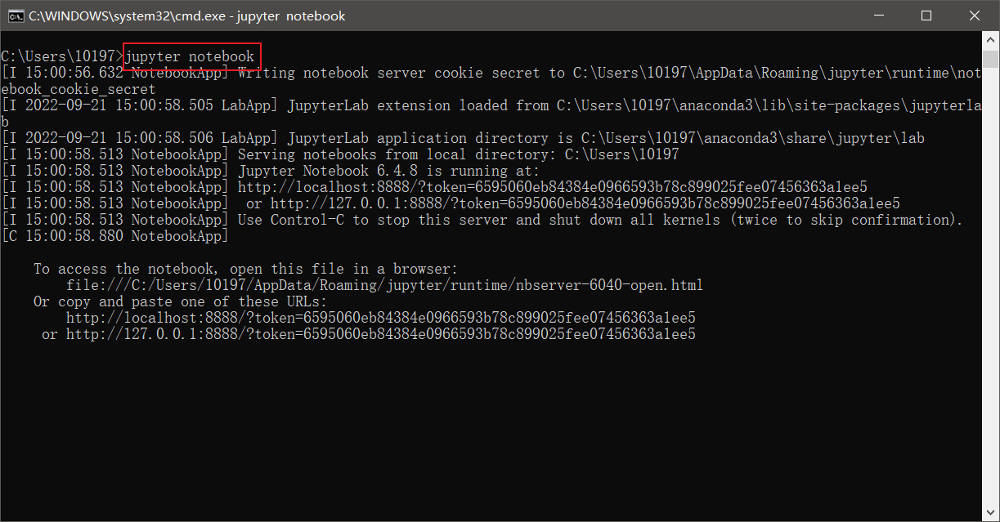
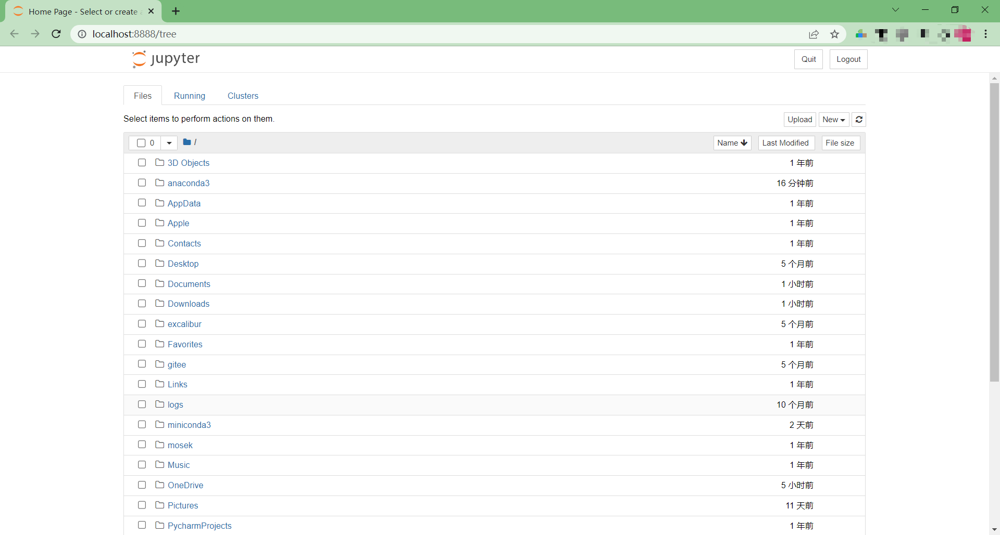
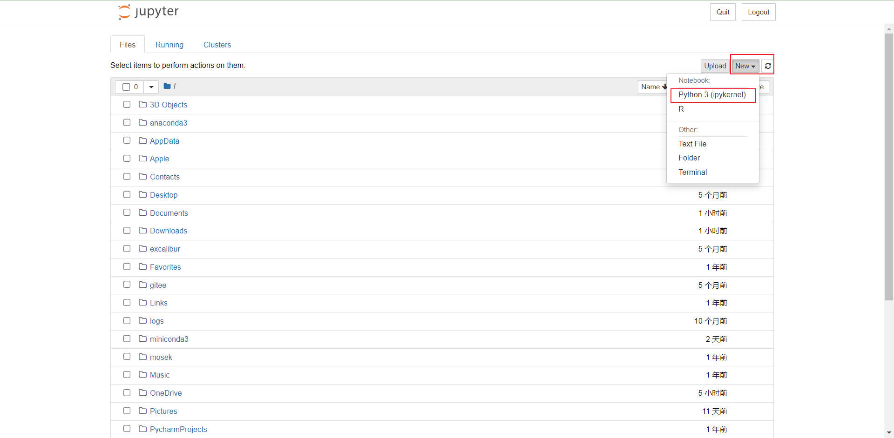
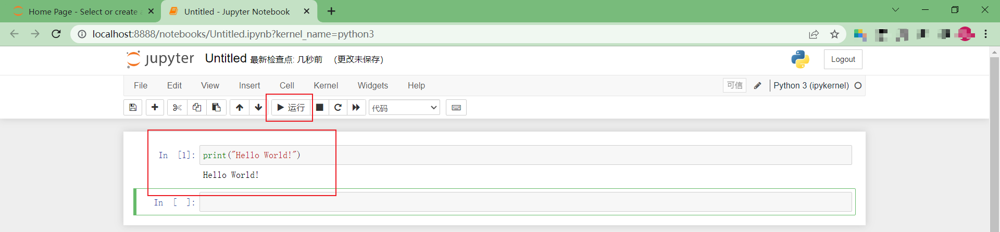
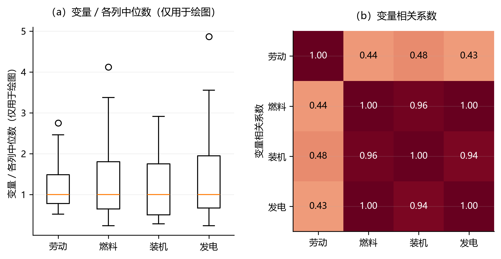

# Python基础知识 {#sec-2}


Python是一种通用编程语言，功能与扩展性均十分强大。本章不打算系统介绍Python编程，而是聚焦于编写DEA程序所需的Python基础知识，为后续的DEA程序开发做必要的知识准备[^1]。与一般的Python入门教程不同，本章始终围绕DEA编程的实际需求展开，每个知识点均说明其在DEA编程中的具体用法。需要强调的是，本章并非独立的编程教程，而是方法论正文的"工具箱"：本书自第 3 章起即进入 DEA 模型的实证实现，所有案例都建立在 NumPy 数组、pandas 数据框与 Pyomo 线性规划建模这三项能力之上，而本章结尾的 @sec-2-9 与 @sec-2-10 将进一步把这些能力收束为 `deabook` 工具包的统一调用约定，作为进入后续章节的方法论钥匙。

[^1]: 本章面向已具备任意一门编程语言基础（如R、MATLAB、C或Java）的读者。如果读者完全没有编程基础，建议先阅读以下资源之一：Python官方Tutorial（https://docs.python.org/3/tutorial/），完成第1—5章；Jake VanderPlas 著《Python数据科学手册》第1—2章。


## Python的安装与环境配置 {#sec-2-1}

DEA 实证研究的起步往往不在建模，而在把数据、求解器与运行环境理顺——一旦环境不一致，同一段 `deabook` 代码在不同机器上就可能产生不可复现的结果。本节先确立一套可复现、可移植的 Python 环境，作为后续各章案例运行的共同前提。

推荐使用 Anaconda（或体积更小的 Miniconda）发行版，它自带 Python 解释器、包管理器 `conda` 以及常用的科学计算库，可一次性配齐 DEA 编程所需的基础环境，后续只需按需安装本书用到的少量扩展包即可。下面分 Windows 与 macOS 两种系统，介绍下载、安装、环境变量配置、虚拟环境管理与包安装的全过程；Linux 用户的步骤与 macOS 基本一致（仅安装包格式不同，可用 `bash Anaconda-*.sh` 脚本安装）。

### Anaconda下载与安装 {#sec-2-1-1}

**（1）下载安装包**

打开 Anaconda 官网 <https://www.anaconda.com/download>；页面会自动识别操作系统并给出对应安装包，也可在 "Downloads" 区域手动选择：

- **Windows**：选择 **Windows** → **64-Bit (x86) Installer**，得到 `.exe` 文件。
- **macOS**：在 "macOS" 下先确认芯片类型——Apple 芯片（M1/M2/M3 等）选 **Apple Silicon (arm64)**，Intel 芯片选 **x86_64**，得到 `.pkg` 文件。若磁盘空间紧张，可改用 **Miniconda**（仅含 Python 与 `conda`，约几十 MB，下载与安装步骤相同）。

**（2）安装**

- **Windows**：双击 `.exe` 启动安装向导，依次点击 **Next** → **I Agree**；"Install For" 一步建议选 **Just Me**（仅当前用户，可避免权限问题）；"Choose Install Location" 一步**安装路径不要包含中文或空格**（例如 `C:\Users\<你的用户名>\Anaconda3`）。关键一步是 **Advanced Options**，其中两项建议都勾选：
  - **Add Anaconda3 to my PATH environment variable**：勾选后可在任意命令行直接使用 `conda`/`python`（若不勾选，则需通过开始菜单的 "Anaconda Prompt" 使用）。
  - **Register Anaconda3 as my default Python 3.x**：将其设为系统默认 Python。
  然后点击 **Install**，等待进度条完成，最后 **Next** → **Finish**。

- **macOS**：双击 `.pkg` 启动安装向导，依次 **Continue** → 阅读并 **Agree** 许可协议 → 选择安装位置（默认即可）→ **Install**，按提示输入系统登录密码，完成后 **Close**。安装程序会自动把 `conda` 初始化到当前用户的 shell（Apple 芯片默认 zsh，对应 `~/.zshrc`；Intel 芯片多为 `~/.bash_profile`），使新开终端即可识别 `conda`。

**（3）验证安装**

安装完成后，打开一个**全新**的终端窗口验证（Windows 可用 "Anaconda Prompt"、PowerShell 或 cmd；macOS 用 "终端" Terminal）：

```bash
conda --version      # 应输出类似 conda 24.x.x
python --version     # 应输出 Anaconda 自带的 Python 版本
```

若能正常输出版本号，说明 Anaconda 已安装成功并可被调用。

**（4）配置系统环境变量（将 conda 加入 PATH）**

若安装时未勾选 "Add to PATH"，或在新终端中输入 `conda` 提示"不是内部或外部命令 / command not found"，需手动把 Anaconda 加入系统 PATH。

- **Windows（图形界面）**：右键"此电脑"→ **属性** → **高级系统设置** → **环境变量**；在"用户变量"（仅当前用户）或"系统变量"（所有用户）中找到 **Path**，点击 **编辑** → **新建**，依次添加以下三项（用户名与安装目录按实际情况修改）：

  ```
  C:\Users\<你的用户名>\Anaconda3
  C:\Users\<你的用户名>\Anaconda3\Scripts
  C:\Users\<你的用户名>\Anaconda3\Library\bin
  ```

  确认后**重新打开**终端，再执行 `conda --version` 验证。

- **macOS / Linux（修改 shell 配置）**：在终端中用文本编辑器打开 shell 配置文件（`~/.zshrc` 或 `~/.bash_profile`），在末尾追加一行（路径按实际安装目录修改）：

  ```bash
  export PATH="$HOME/opt/anaconda3/bin:$PATH"
  ```

  保存后执行 `source ~/.zshrc`（或 `source ~/.bash_profile`）使配置生效，再运行 `conda --version` 验证。也可直接执行 `conda init zsh`（或 `conda init bash`）让 conda 自动写入初始化代码。

**（5）用 conda 创建与管理虚拟环境**

DEA 项目往往依赖特定版本的 NumPy、pandas、Pyomo 与求解器；为避免不同项目间的版本冲突、保证结果可复现，推荐为每个项目（或本书）单独创建一个虚拟环境。

```bash
# 创建名为 dea、Python 版本为 3.11 的虚拟环境
conda create -n dea python=3.11

# 激活环境（激活后命令行前缀会出现 (dea)）
conda activate dea   # 若在普通 cmd 中报错，先运行 conda init cmd.exe，或改用 Anaconda Prompt

# 查看本机所有环境（带 * 的为当前激活环境）
conda env list

# 退出当前环境
conda deactivate

# 删除环境（谨慎）
conda env remove -n dea
```

激活环境后安装的所有包都只存在于该环境内，互不干扰。**强烈建议**本书全部案例都在同一个 `dea` 环境中运行：先 `conda activate dea`，再安装下一节的 DEA 相关包。

**（6）安装 Python 包（conda 与 pip）**

`conda` 与 `pip` 都可安装 Python 包，但分工不同：`conda` 能管理二进制依赖（含 glpk、cbc 等需要系统可执行文件的求解器），`pip` 则面向 PyPI 上的纯 Python 包。务必在**已激活的 `dea` 环境**中安装：

```bash
# conda 安装（必要时加 -c conda-forge 指定社区源）
conda install numpy pandas scipy

# pip 安装
pip install highspy
```

为完整复现本书环境，可直接导出/导入环境清单：

```bash
conda env export > environment.yml     # 导出当前环境
conda env create -f environment.yml    # 在另一台机器上据此重建
```

> **本书专用包清单**：上面只是通用方法。本书第 3–10 章所需的核心包（`deabook`、`pyomo`、求解器 `highs`/`glpk`/`cbc`、`amplpy` 等）及验证命令，见下一节 [-@sec-2-1-2]。

### 安装DEA相关Python包 {#sec-2-1-2}

本书后续章节需要以下核心包，建议在开始之前统一安装：

```bash
# 本书配套的 deabook 工具包（第 3–10 章全部案例均依赖此包）
pip install deabook        # 也可：conda install -c conda-forge deabook

# 基础科学计算
conda install numpy pandas scipy

# 线性规划建模（Pyomo）
conda install -c conda-forge pyomo

# 求解器（按用途区分）：
#   · 经典 / 能源 / 动态 DEA（第 3–9 章）—— 开源 LP 求解器即可
pip install highspy                       # HiGHS：Pyomo 的 appsi_highs 纯 Python 接口
conda install -c conda-forge coincbc     # cbc（COIN-OR 分支定界）
conda install -c conda-forge glpk        # glpk（GNU 线性规划工具包）
#   · 随机非参数前沿 CNLS（第 10 章）—— 需商业求解器 mosek 或 knitro（学术许可，见附录 A.1）
#   · 凸非参数分位数回归 CQR（第 10 章）—— 需 amplpy
pip install amplpy

# 验证安装
python -c "import numpy, pandas, pyomo, deabook; print('所有包安装成功')"
```

三个开源求解器均可免费使用。其中 `highs`（即 Pyomo 的 `appsi_highs`）依赖纯 Python 包 `highspy`、安装最省事，也是本书第 3–9 章的默认调用名（`solver="highs"`）；`glpk` 与 `cbc` 则需系统可执行文件，通常通过 conda 安装。三者可按 `highs → glpk → cbc` 的顺序回退（ @tbl-2-1）：

> **求解器的分工**：第 3–9 章的全部 DEA 模型（含 SBM、Malmquist 动态指数、含非期望产出的环境效率）都属于线性/凸规划，用上述任一开源求解器即可。第 10 章的随机非参数前沿（CNLS）需要商业求解器 **mosek** 或 **knitro**，凸非参数分位数回归（CQR）需要 **amplpy**；这两者需单独的许可证，安装方式见附录 A.1，第 10 章也会再次说明。

| 求解器 | 类型 | 安装方式 | 说明 |
|--------|------|----------|------|
| `highs`（即 `appsi_highs`） | 开源 LP/MIP | `pip install highspy` | HiGHS 求解器；本书第 3–9 章统一以 `solver="highs"` 调用 |
| `glpk` | 开源 LP/MIP | `conda install -c conda-forge glpk` | GNU 线性规划工具包，Pyomo 经典备选求解器 |
| `appsi_highs` | 开源 LP/MIP | `pip install highspy` | HiGHS 求解器的 Pyomo appsi 接口，纯 Python 安装、无需外部可执行文件 |
| `cbc` | 开源 LP/MIP | `conda install -c conda-forge coincbc` | COIN-OR 分支定界求解器 |

: 开源求解器对照 {#tbl-2-1}

## 开发环境选择与Jupyter Notebook最佳实践 {#sec-2-2}

DEA 研究兼具"探索"与"封装"两类活动：前者是在真实数据上快速试算模型、观察效率分布，后者是把验证过的模型沉淀为可复用的分析流程。开发环境的选择，本质上服务于这两种活动之间的切换——交互式探索适合 Jupyter，而生产级的函数与包封装更适合成熟的 IDE。

### Jupyter Notebook基础 {#sec-2-2-1}

在运行窗口中输入jupyter notebook并回车，即可在浏览器中打开Jupyter Notebook。



下图为Google Chrome中的Jupyter Notebook界面。

  

要新建一个Notebook，点击按钮New，选择"Python3"。



首次使用时，点击单元格并输入一行Python代码，然后按Shift-Enter或点击上方的"运行"按钮执行。



### Jupyter Notebook最佳实践（DEA编程场景） {#sec-2-2-2}

Jupyter Notebook是交互式数据分析与DEA模型原型开发的首选工具，但在实际使用中需注意以下几个问题。

**（1）单元格执行顺序管理**

Jupyter的一个常见陷阱是**单元格的乱序执行**：可以先执行单元格10，再回头执行单元格5，这会导致变量状态混乱。DEA编程中的一个典型场景是：修改了投入产出数据后，忘记重新执行数据加载单元格，便直接运行模型求解单元格，结果使用的仍是旧数据。

**建议**：
- 使用菜单 **Kernel → Restart & Run All** 定期从头运行整个Notebook
- 在关键步骤之间使用 `print()` 确认变量状态
- 使用魔法命令 `%whos` 查看当前所有变量：

```python
from deabook import data_path, PANEL
from deabook.constant import CONTEMPORARY
# 查看当前命名空间中的所有变量
%whos
```

**（2）重启Kernel的时机**

以下情况建议重启Kernel（Kernel → Restart）：
- 安装了新的Python包
- 变量状态混乱、结果不可复现
- 遇到难以解释的`NameError`（可能是之前的变量已被删除）
- 运行大样本DEA计算后需要释放内存

**（3）Notebook版本控制**

Jupyter的`.ipynb`文件为JSON格式，在Git中会产生大量无意义的diff。建议：
- 将Notebook转换为`.py`脚本进行版本控制：**File → Download as → Python (.py)**
- 或使用`jupytext`工具实现Notebook与Python脚本的双向同步

### 其他IDE选择：VS Code与PyCharm {#sec-2-2-3}

对于大型DEA项目或Python包的封装，以下IDE比Jupyter Notebook更为适合：

| 特性 | Jupyter Notebook | VS Code + Python插件 | PyCharm |
|------|-----------------|----------------------|---------|
| 交互式探索 | ★★★ 优秀 | ★★☆ 良好（支持Notebook） | ★☆☆ 一般 |
| 代码调试 | ★☆☆ 仅打印 | ★★★ 断点调试 | ★★★ 断点调试 |
| 代码重构 | ★☆☆ 无 | ★★★ 重命名、提取函数 | ★★★ 智能重构 |
| 项目管理 | ★☆☆ 单个文件 | ★★★ 工作区 | ★★★ 项目 |
| DEA原型开发 | ★★★ 推荐 | ★★☆ 可用 | ★★☆ 可用 |
| 生产级开发 | ★☆☆ 不推荐 | ★★★ 推荐 | ★★★ 推荐 |

**建议**：学习阶段使用Jupyter Notebook，项目封装阶段切换到VS Code或PyCharm。

## Python语法精粹 {#sec-2-3}

本节简明介绍DEA编程中最常用的Python语法要点。鉴于读者已有编程基础，解释从简。需要留意的是，DEA 代码中若干易错点正源于 Python 语法本身——例如线性规划里惯用的强度变量符号 λ 在 Python 中是保留字、必须改用 `intensity`，又如本书全程使用的 `sent` 公式字符串依赖对字符串与切片的准确理解。因此本节在交代语法的同时，也直接以 DEA 场景说明每一处约定的来由，而非泛泛罗列。

### 缩进与注释 {#sec-2-3-1}

Python使用空白字符（4个空格）组织代码，而不像R、C++和Java那样使用括号。

```python
# Python使用缩进标识代码块（推荐4个空格）
for x in data_array:
    if x < threshold:
        less.append(x)
    else:
        greater.append(x)
```

Python使用`#`进行单行注释，使用`'''`或`"""`进行多行注释。本书约定：**函数使用docstring（三重引号）注释**，代码行使用`#`注释。

```python
# 单行注释
de = 0.85  # 决策单元A的效率值（注释在代码后面）

'''
多行注释：下面是DEA数据的说明
- x1, x2: 投入指标
- y1: 产出指标
'''
```

函数的 docstring 用于说明函数用途、参数与返回值，可通过 `help(函数名)` 或 `函数名.__doc__` 查看：

```python
def calc_efficiency(x, y):
    """计算单个 DMU 的产出导向技术效率，返回 (0, 1] 之间的效率值。"""
    # 函数体略
    ...
```

注释的良好实践是**解释"为什么"而非"是什么"**：代码本身已说明"做了什么"，注释应补充设计意图、口径约定或易错点。在 DEA 编程中，尤其应注释投入产出变量的含义、方向向量的口径以及规模报酬假设，以免后续读者误解。

### 代码换行 {#sec-2-3-2}

Python 一行代码过长时需换行以保持可读性（本书约定单行不超过 88 个字符）。Python 提供两种换行方式。

**方式一：隐式换行（推荐）**。在圆括号 `()`、方括号 `[]`、花括号 `{}` 内部可直接换行，无需任何续行符号，Python 会自动将其视为同一语句。DEA 编程中最常见的是超长函数调用与链式方法调用：

```python
from deabook.example.book_cases.loaders import plants
from deabook import DEA
data = (
    plants()
    .sort_values("Plant")
    .reset_index(drop=True)
)
model = DEA.ccr(
    data, sent="Labor Fuel Capital=Output"
).optimize(solver="highs")
```

**方式二：显式换行（反斜杠 `\`）**。在行尾加反斜杠 `\` 表示续行。注意反斜杠后**不能有任何字符（包括空格）**，否则会报语法错误，因此本书不推荐使用。

```python
# 显式续行（不推荐：反斜杠后若误留空格会报错）
total = x1 + x2 + x3 + x4 + \
        x5 + x6 + x7
```

字符串的换行有两种常用做法：用三重引号直接跨行，或在括号内利用相邻字符串字面量自动拼接：

```python
# 三重引号跨行
note = """这是一段跨越多行的说明文字，
可以自然地换行书写。"""

# 相邻字符串字面量自动拼接（常用于较长的提示信息）
message = (
    "DMU 的效率值为 "
    f"{efficiency:.4f}"
)
```

> **与本书的关系**：第 6–13 章的大量 DEA 模型调用（如 `SBM(...)`、`DEAweak(...)`、`MQDDFweak(...)`）均采用"方式一"的圆括号内换行。阅读或复现这些代码时，请把括号内的多行内容视为一条完整的调用语句。

### 基本数据类型 {#sec-2-3-3}

| 类型 | 说明 | DEA编程示例 |
|------|------|------------|
| `int` | 整数（无限精度） | `num_dmus = 20` |
| `float` | 浮点数（可能有精度误差） | `efficiency = 0.8537` |
| `bool` | 布尔值（`True`/`False`） | `is_efficient = True` |
| `str` | 字符串 | `formula = "Y=K L"` |

```python
# 浮点数精度问题在DEA中尤为重要
efficiency = 1.0 / 3.0
print(f"原始值: {efficiency}")
print(f"四舍五入到4位: {efficiency:.4f}")  # DEA结果通常保留4位小数
```

### 列表与字典（DEA场景） {#sec-2-3-4}

**列表**用于存储有序数据，在DEA中最常见的用途是存储决策单元名称或效率值列表。

```python
# 决策单元名称列表
dmu_names = ['DMU_A', 'DMU_B', 'DMU_C', 'DMU_D']
print(dmu_names[0])       # 索引从0开始 → 'DMU_A'
print(dmu_names[1:3])     # 切片 → ['DMU_B', 'DMU_C']

# 效率值列表
efficiencies = [0.85, 1.00, 0.72, 0.93]
```

> **命名说明**：变量名使用`snake_case`（小写下划线分隔），如`dmu_names`而非`dmuNames`。这是Python的PEP 8标准命名规范。

**字典**用于存储键值对数据，在DEA中常用于存储DMU的效率结果。

```python
# 用字典存储各DMU的效率值
dea_results = {
    "DMU_A": 0.85,
    "DMU_B": 1.00,
    "DMU_C": 0.72,
    "DMU_D": 0.93
}
print(dea_results["DMU_A"])   # 通过键访问值 → 0.85

# 遍历效率结果
for dmu, eff in dea_results.items():
    print(f"{dmu}: {eff:.4f}")
```

### 控制结构 {#sec-2-3-5}

**条件判断**：DEA中常用于根据效率值判断DMU是否有效。

```python
efficiency = 0.85
if efficiency >= 1.0:          # 径向模型下，效率值等于1为样本内有效
    status = "DEA有效"
else:
    status = "DEA无效"
print(status)
```

> **口径提醒**：CCR/BCC 等径向模型只有"有效（效率值等于1）"与"无效（效率值小于1）"两档，不存在"0.8以上即相对有效"这样的中间等级。

**for循环**：DEA中用于遍历所有决策单元进行效率评价。

```python
dmu_list = ['A', 'B', 'C', 'D', 'E']
for dmu in dmu_list:
    print(f"正在评价决策单元: {dmu}")

# range()的用法
for i in range(5):        # 0, 1, 2, 3, 4
    print(i)
```

**列表推导式**（DEA批量计算利器）：

```python
# 传统循环方式
efficiency_list = []
for i in range(5):
    efficiency_list.append(1.0 / (i + 1))

# 列表推导式（更简洁，推荐）
efficiency_list = [1.0 / (i + 1) for i in range(5)]

# 带条件的列表推导式
dmu_names = [f"DMU_{i}" for i in range(1, 6)]
efficient_dmus = [name for name, eff in zip(dmu_names, [0.85, 1.0, 0.72, 1.0,
    0.93])
                  if eff >= 1.0]
```

### 函数定义与调用 {#sec-2-3-6}

函数是DEA编程的核心工具。第[-@sec-11]章将把DEA模型封装为可复用函数。

> **本章的导向与符号约定**：本章与第[-@sec-11]章一致，默认采用**产出导向**。此时线性规划中的 $\theta$ 是产出的**扩张因子**（$\theta\geqslant 1$），技术效率为 $\mathrm{TE}=1/\theta$。若改用投入导向，则 $\theta$ 是投入的**收缩比**（$0<\theta\leqslant 1$），此时 $\theta$ 本身即技术效率，不要再取一次倒数。下文所有示例均为产出导向。

```python
def calculate_efficiency_score(theta):
    """
    根据产出导向模型的theta值计算技术效率得分
    
    Parameters
    ----------
    theta : float
        产出导向模型中的theta值，即产出的扩张因子（theta >= 1）
    
    Returns
    -------
    float
        技术效率TE（technical efficiency），等于1/theta，取值在(0, 1]
    """
    return 1.0 / theta

# 调用函数
te = calculate_efficiency_score(1.176)
print(f"技术效率: {te:.4f}")
```

> **命名说明**：函数命名使用`snake_case`（小写+下划线），如`calculate_efficiency_score`。函数名应清晰表达其功能，参数名应使用描述性名称而非缩写。函数必须具有完整的docstring文档（包含Parameters和Returns说明），这是本书的强制规范。

### 模块导入 {#sec-2-3-7}

Python程序可以调用一组基本的内建函数，也可以导入外部模块。本书约定使用`import`语句在文件顶部统一导入所有模块。

```python
# 推荐：文件顶部统一导入
import numpy as np          # 科学计算
import pandas as pd         # 数据处理
from pyomo.environ import *  # 线性规划建模

# 不推荐：函数内部导入（除非解决循环导入问题）
```

## 面向DEA的Python编程范式 {#sec-2-4}

本节是本章的核心——建立从"Python基础"到"DEA编程"的直接桥梁。以下三个编程范式是后续所有DEA代码的基础。

### 向量化思维：告别Python循环 {#sec-2-4-1}

DEA模型涉及大量矩阵运算。Python原生的`for`循环速度较慢，而NumPy的向量化运算（底层由C实现）可达到数十倍甚至上百倍的加速。

**示例场景**：计算5个DMU的投入加权平均值（DEA中构造参考集的常见操作）。

```python
import numpy as np
import time

# DEA数据集：5个DMU，2个投入，1个产出
# 列: [x1, x2, y1]
data = np.array([
    [3.0, 2.0, 5.0],   # DMU_A
    [4.0, 3.0, 7.0],   # DMU_B
    [5.0, 4.0, 9.0],   # DMU_C
    [6.0, 5.0, 11.0],  # DMU_D
    [7.0, 6.0, 13.0]   # DMU_E
])

# 强度变量（lambda值）
intensity = np.array([0.2, 0.3, 0.1, 0.2, 0.2])

# 方法1: Python原生循环（慢）
def weighted_sum_loop(data, intensity):
    """使用Python循环计算加权投入"""
    n_inputs = 2
    result = []
    for k in range(n_inputs):           # 对每个投入指标
        weighted_sum = 0.0
        for i in range(len(data)):      # 对每个DMU
            weighted_sum += intensity[i] * data[i, k]
        result.append(weighted_sum)
    return result

# 方法2: NumPy向量化运算（快）
def weighted_sum_vectorized(data, intensity):
    """使用NumPy矩阵乘法计算加权投入"""
    x = data[:, :2]         # 投入矩阵 (5×2)
    return intensity @ x    # 矩阵乘法 (1×5) @ (5×2) = (1×2)

# 验证结果一致
result_loop = weighted_sum_loop(data, intensity)
result_vec = weighted_sum_vectorized(data, intensity)
print(f"循环方法结果: {result_loop}")
print(f"向量化方法结果: {result_vec}")

# 性能对比
%timeit weighted_sum_loop(data, intensity)
%timeit weighted_sum_vectorized(data, intensity)
```

**性能对比结果**（典型值；绝对数值随硬件与NumPy版本而异，量级供参考）：

| 方法 | 5个DMU | 100个DMU | 1000个DMU |
|------|--------|----------|-----------|
| Python循环 | ~3μs | ~54μs | ~0.57ms |
| NumPy向量化 | ~2μs | ~2μs | ~3μs |
| **加速比** | **2x** | **30x** | **200x** |

> **DEA编程原则**：能用矩阵运算的地方，绝不用Python循环。DEA模型中的加权求和 $\sum_{i} \lambda_i X_{ki}$ 应写成`intensity @ x_matrix`。注意向量化在小规模下的优势有限（函数调用与临时数组开销占比高），其收益随DMU数量增大而显著扩大。

### 函数封装：从脚本到可复用工具 {#sec-2-4-2}

第[-@sec-11]章将从单个DMU的求解脚本出发，逐步封装为通用DEA函数。本节先展示函数封装的基本思路。

**示例**：将"求解单个DMU的CCR模型"封装为函数。本示例采用与第[-@sec-11]章一致的**产出导向**口径：目标为最大化产出扩张因子 $\theta$，约束为 $\boldsymbol\lambda\boldsymbol X\leqslant\boldsymbol x^{\ast}$、$\boldsymbol\lambda\boldsymbol Y\geqslant\theta\boldsymbol y^{\ast}$，技术效率为 $\mathrm{TE}=1/\theta$。

```python
import numpy as np
from pyomo.environ import *

def solve_ccr_for_one_dmu(x_eval, y_eval, x_ref, y_ref):
    """
    求解单个DMU的CCR产出导向模型（CRS）
    
    这是DEA函数封装的最小示例。第11章将在此基础上逐步扩展功能。
    模型为：max theta, s.t. lambda·X <= x_eval, lambda·Y >= theta·y_eval,
    lambda >= 0。theta为产出扩张因子，技术效率TE = 1/theta。
    
    Parameters
    ----------
    x_eval : np.ndarray
        被评价DMU的投入向量 (n_inputs,)
    y_eval : np.ndarray
        被评价DMU的产出向量 (n_outputs,)
    x_ref : np.ndarray
        参照DMU的投入矩阵 (n_dmus, n_inputs)
    y_ref : np.ndarray
        参照DMU的产出矩阵 (n_dmus, n_outputs)
    
    Returns
    -------
    float
        被评价DMU的技术效率TE，等于1/theta，取值在(0, 1]
    """
    n_ref = x_ref.shape[0]       # 参照DMU数量
    n_inputs = x_ref.shape[1]    # 投入指标数量
    n_outputs = y_ref.shape[1]   # 产出指标数量
    
    model = ConcreteModel()
    model.I = Set(initialize=range(n_ref))
    model.K = Set(initialize=range(n_inputs))
    model.L = Set(initialize=range(n_outputs))
    
    # 决策变量：theta（产出扩张因子）和强度变量
    model.theta = Var(bounds=(0.0, None), doc='产出扩张因子')
    model.intensity = Var(model.I, bounds=(0.0, None), doc='强度变量')
    
    # 目标函数：最大化theta（产出导向）
    def obj_rule(m):
        return m.theta
    model.obj = Objective(rule=obj_rule, sense=maximize)
    
    # 投入约束：参照单元的加权投入不超过被评价单元投入
    def input_rule(m, k):
        return sum(m.intensity[i] * x_ref[i, k] for i in m.I) <= x_eval[k]
    model.input_con = Constraint(model.K, rule=input_rule)
    
    # 产出约束：参照单元的加权产出不低于theta倍被评价单元产出
    def output_rule(m, l):
        return sum(m.intensity[i] * y_ref[i,
            l] for i in m.I) >= m.theta * y_eval[l]
    model.output_con = Constraint(model.L, rule=output_rule)
    
    # 求解
    opt = SolverFactory('highs')   # 开源 LP 求解器；第 10 章商业前沿模型改用 mosek / knitro
    solution = opt.solve(model)
    
    return 1.0 / value(model.theta)     # 技术效率TE = 1/theta

# 调用示例
data = np.array([
    [3.0, 2.0, 5.0],
    [4.0, 3.0, 7.0],
    [5.0, 4.0, 9.0],
    [6.0, 5.0, 11.0],
    [7.0, 6.0, 13.0]
])
x_ref = data[:, :2]    # 投入矩阵 (5×2)
y_ref = data[:, 2:]    # 产出矩阵 (5×1)

# 评价第1个DMU (DMU_A)
te = solve_ccr_for_one_dmu(x_ref[0], y_ref[0], x_ref, y_ref)
print(f"DMU_A的技术效率: {te:.4f}")
```

> **若要改为投入导向**：把目标函数改为 `sense=minimize`，把 $\theta$ 从产出约束右端移到投入约束右端（即 `<= m.theta * x_eval[k]` 与 `>= y_eval[l]`），并直接返回 `value(model.theta)`——投入导向下 $\theta$ 本身就是技术效率，不要再取倒数。第[-@sec-11]章 `dea8` 用一个 `orient` 参数统一了这两种写法。

**函数封装的价值**：
- **可复用**：一次编写，可评价任意DMU
- **可测试**：在小数据集上验证正确性后，即可批量使用
- **可扩展**：后续章节在此基础上增加VRS、方向选择等功能

### 矩阵构建：用NumPy构造DEA数据矩阵 {#sec-2-4-3}

DEA模型本质上是一系列矩阵运算，正确构造投入矩阵`X`和产出矩阵`Y`是DEA编程的第一步。

**示例**：3个DMU、2投入1产出的小型DEA数据集

```python
import numpy as np

# === DEA数据集构建 ===
# 3个DMU (A, B, C)，2个投入 (x1, x2)，1个产出 (y1)

# 方法1：从Python列表构建
x_list = [[3.0, 2.0],    # DMU_A的投入
          [4.0, 3.0],    # DMU_B的投入
          [5.0, 4.0]]    # DMU_C的投入
y_list = [[5.0],         # DMU_A的产出
          [7.0],         # DMU_B的产出
          [9.0]]         # DMU_C的产出

x_matrix = np.array(x_list)   # 投入矩阵 X (3×2)
y_matrix = np.array(y_list)   # 产出矩阵 Y (3×1)

print("投入矩阵 X:")
print(x_matrix)
print(f"\nX的维度: {x_matrix.shape}")  # (n_dmus, n_inputs)

print("\n产出矩阵 Y:")
print(y_matrix)
print(f"\nY的维度: {y_matrix.shape}")  # (n_dmus, n_outputs)

# 方法2：从合并的数据矩阵中提取
data = np.array([
    [3.0, 2.0, 5.0],   # DMU_A: [x1, x2, y1]
    [4.0, 3.0, 7.0],   # DMU_B
    [5.0, 4.0, 9.0]    # DMU_C
])

num_inputs = 2
x_matrix = data[:, :num_inputs]   # 所有行，前2列 → 投入矩阵
y_matrix = data[:, num_inputs:]   # 所有行，第2列后 → 产出矩阵

# DEA约束的矩阵表示（产出导向 CRS：max θ）
# 投入约束: λ @ X ≤ X_eval
# 产出约束: λ @ Y ≥ θ * Y_eval
# （投入导向则为 λ @ X ≤ θ * X_eval、λ @ Y ≥ Y_eval）
lambda_vec = np.array([0.5, 0.3, 0.2])  # 强度变量

weighted_input = lambda_vec @ x_matrix   # 加权投入 (1×3 @ 3×2 = 1×2)
weighted_output = lambda_vec @ y_matrix  # 加权产出 (1×3 @ 3×1 = 1×1)

print(f"\n加权投入: {weighted_input}")
print(f"加权产出: {weighted_output}")
```

> **命名说明**：`x_matrix`（或简称`x`）表示投入矩阵，维度为`(n_dmus, n_inputs)`；`y_matrix`（或简称`y`）表示产出矩阵，维度为`(n_dmus, n_outputs)`。`x_eval`表示被评价单元的投入向量，`xref`表示参照单元的投入矩阵。

## 错误处理与调试入门 {#sec-2-5}

DEA 程序的脆弱点通常不在语法，而在运行期——缺失值、零值、求解器未就绪、矩阵维度错位都会让一次批量评价中途崩溃。对面向真实面板数据的分析而言，稳健的错误处理与输入校验不是锦上添花，而是结果可信度的前提。

### 异常处理：try-except-finally {#sec-2-5-1}

在DEA编程中，求解器未安装、数据维度不匹配、线性规划无可行解等情况均会导致程序崩溃。使用`try-except`块可以优雅地处理这些异常。

```python
import numpy as np
from pyomo.environ import *

def safe_solve_ccr(x_eval, y_eval, x_ref, y_ref):
    """
    带异常处理的CCR产出导向模型求解
    
    Parameters
    ----------
    x_eval, y_eval, x_ref, y_ref : np.ndarray
        DEA投入产出数据
    
    Returns
    -------
    float or None
        技术效率TE（=1/theta），求解失败返回None
    """
    try:
        n_ref = x_ref.shape[0]
        n_inputs = x_ref.shape[1]
        n_outputs = y_ref.shape[1]
        
        model = ConcreteModel()
        model.I = Set(initialize=range(n_ref))
        model.K = Set(initialize=range(n_inputs))
        model.L = Set(initialize=range(n_outputs))
        
        model.theta = Var(bounds=(0.0, None))
        model.intensity = Var(model.I, bounds=(0.0, None))
        
        def obj_rule(m):
            return m.theta
        model.obj = Objective(rule=obj_rule, sense=maximize)
        
        def input_rule(m, k):
            return sum(m.intensity[i] * x_ref[i, k] for i in m.I) <= x_eval[k]
        model.input_con = Constraint(model.K, rule=input_rule)
        
        def output_rule(m, l):
            return sum(m.intensity[i] * y_ref[i,
                l] for i in m.I) >= m.theta * y_eval[l]
        model.output_con = Constraint(model.L, rule=output_rule)
        
        # 依次尝试可用求解器：开源优先，商业求解器（mosek）兜底
        solver = None
        for name in ('highs', 'glpk', 'cbc', 'mosek'):
            opt = SolverFactory(name)
            if opt.available():
                solver = name
                print(f"使用求解器: {name}")
                break
        if solver is None:
            raise RuntimeError("未找到可用的求解器（highs/glpk/cbc/mosek）")
        
        solution = opt.solve(model)
        return 1.0 / value(model.theta)
        
    except ValueError as e:
        print(f"数据错误: {e}")
        print("请检查投入产出矩阵维度是否匹配")
        return None
    except Exception as e:
        print(f"求解失败: {e}")
        return None

# 测试：正常数据
x_ref = np.array([[3.0, 2.0], [4.0, 3.0], [5.0, 4.0]])
y_ref = np.array([[5.0], [7.0], [9.0]])
result = safe_solve_ccr(x_ref[0], y_ref[0], x_ref, y_ref)
print(f"技术效率: {result}")

# 测试：维度不匹配的错误数据
try:
    wrong_y = np.array([[5.0, 6.0], [7.0, 8.0]])  # 2列而非1列
    result = safe_solve_ccr(x_ref[0], wrong_y[0], x_ref, wrong_y)
except Exception as e:
    print(f"捕获异常: {e}")
```

### DEA编程常见错误排查表 {#sec-2-5-2}


| 错误现象 | 可能原因 | 解决方案 |
|----------|----------|----------|
| `SolverFactory('highs')`/`'mosek'`报错 | 求解器未安装 | 开源 LP 模型改用 `'highs'`/`'glpk'`/`'cbc'`（需 `pip install highspy` 或 conda 安装）；mosek/knitro 需申请学术许可（见附录 A.1） |
| `ValueError: shapes not aligned` | 矩阵维度不匹配 | 检查`x_ref.shape[1]`与`x_eval.shape[0]`是否一致 |
| `KeyError: 'Y'` | DataFrame列名不存在 | 检查列名拼写，使用`df.columns`查看所有列名 |
| `TypeError: 'NoneType'` | 函数返回None被误用 | 检查输入数据是否有缺失值（NaN） |
| 效率值全为1.0 | 指标过多而DMU过少（维数灾难），或各单元均具独特投入产出组合，样本内无法区分 | 增加样本量、合并或删减指标；检查参照集是否过小（是否误把每个DMU当作自己的唯一参照） |
| `IndexError: list index out of range` | 索引超出范围 | Python索引从0开始，检查循环范围 |
| 模型无可行解或求解失败 | 数据含0、负值，或产出全为0 | 检查并处理非正值；确认模型对零值的假设 |
| 变量名`lambda`报错 | `lambda`是Python关键字 | 使用`intensity`代替 |
: DEA编程常见错误与解决方案 {#tbl-2-2}

### 防御性编程：输入数据检查 {#sec-2-5-3}

```python
def validate_dea_data(x, y):
    """
    验证DEA投入产出数据的合法性
    
    Parameters
    ----------
    x : np.ndarray
        投入矩阵 (n_dmus, n_inputs)
    y : np.ndarray
        产出矩阵 (n_dmus, n_outputs)
    
    Returns
    -------
    bool
        数据合法返回True，否则抛出异常
    """
    # 检查是否为numpy数组
    if not isinstance(x, np.ndarray) or not isinstance(y, np.ndarray):
        raise TypeError("投入和产出数据必须是numpy.ndarray类型")
    
    # 检查维度
    if x.ndim != 2 or y.ndim != 2:
        raise ValueError("投入和产出数据必须是二维矩阵")
    
    # 检查DMU数量是否一致
    if x.shape[0] != y.shape[0]:
        raise ValueError(f"投入矩阵行数({x.shape[0]})与产出矩阵行数({y.shape[0]})不一致")
    
    # 检查是否有缺失值
    if np.isnan(x).any() or np.isnan(y).any():
        raise ValueError("数据中存在缺失值(NaN)，请先清洗数据")
    
    # 检查是否有非正值（本章径向模型的约定：投入产出为正）
    if (x <= 0).any() or (y <= 0).any():
        raise ValueError("本章的径向模型要求投入产出为正数，数据中包含0或负值")
    
    print(f"数据验证通过: {x.shape[0]}个DMU, {x.shape[1]}个投入, {y.shape[1]}个产出")
    return True

# 使用示例
x = np.array([[3.0, 2.0], [4.0, 3.0], [5.0, 4.0]])
y = np.array([[5.0], [7.0], [9.0]])
validate_dea_data(x, y)
```

## NumPy模块及其在DEA中的应用 {#sec-2-6}

NumPy（Numerical Python）是Python数值计算最重要的基础包，大多数科学计算包均以NumPy数组作为构建基础。在DEA编程中，NumPy用于构造投入产出矩阵、执行矩阵运算、存储效率结果。

### NumPy模块的导入 {#sec-2-6-1}

```python
import numpy as np
```

习惯上在导入NumPy包后将其重命名为`np`。因此，代码中出现`np.`即表示NumPy。

### ndarray数组的创建 {#sec-2-6-2}

NumPy最重要的特点是其N维数组对象（即ndarray），它是一个快速而灵活的大数据集容器。

```python
# 从列表创建数组（DEA常用）
data_list = [6, 7.5, 8, 0, 1]
arr1 = np.array(data_list)

# 创建二维数组（DEA投入产出矩阵）
data2 = [[1, 2, 3, 4],
         [5, 6, 7, 8]]
arr2 = np.array(data2)
print(arr2)

# 常用数组创建方法
arr3 = np.arange(0, 5, 1)       # [0, 1, 2, 3, 4]
arr4 = np.ones((3, 2))          # 3×2的全1矩阵
arr5 = np.zeros((3, 2))         # 3×2的全0矩阵
arr6 = np.empty((3, 2))         # 3×2的空矩阵（未初始化）
arr7 = np.random.rand(4, 2)     # 4×2的随机数矩阵
arr8 = np.linspace(0, 1, 5)     # [0, 0.25, 0.5, 0.75, 1.0]
```

### ndarray数组的索引与切片（DEA场景） {#sec-2-6-3}

数组索引与切片是DEA编程中最频繁的操作——提取投入矩阵、产出矩阵、被评价单元数据等。

```python
data = np.array([
    [3.0, 2.0, 5.0, 10.0],   # DMU_A: [x1, x2, y1, y2]
    [4.0, 3.0, 7.0, 12.0],   # DMU_B
    [5.0, 4.0, 9.0, 14.0],   # DMU_C
    [6.0, 5.0, 11.0, 16.0],  # DMU_D
    [7.0, 6.0, 13.0, 18.0]   # DMU_E
])

# DEA关键切片操作
n_inputs = 2
x_matrix = data[:, :n_inputs]        # 所有行，前2列 → 投入矩阵 (5×2)
y_matrix = data[:, n_inputs:]        # 所有行，第2列后 → 产出矩阵 (5×2)

x_eval_a = data[0, :n_inputs]        # 第1行（DMU_A）的投入向量
y_eval_a = data[0, n_inputs:]        # 第1行（DMU_A）的产出向量

print("投入矩阵 X:")
print(x_matrix)
print("\n产出矩阵 Y:")
print(y_matrix)
print(f"\nDMU_A的投入: {x_eval_a}")
print(f"DMU_A的产出: {y_eval_a}")
```

### ndarray数组的属性与矩阵运算 {#sec-2-6-4}

```python
arr = np.array([[1, 2, 3, 4],
                [5, 6, 7, 8],
                [9, 10, 11, 12]])

# 常用属性
print(f"维度: {arr.shape}")        # (3, 4) —— DEA中用于确认(n_dmus, n_vars)
print(f"数据类型: {arr.dtype}")    # int64
print(f"元素个数: {arr.size}")     # 12

# 矩阵运算（DEA核心）
a = np.array([[1, 2], [3, 4]])
b = np.array([[5, 6], [7, 8]])

print(a + b)           # 逐元素相加
print(a * 2)           # 标量乘法
print(a @ b)           # 矩阵乘法（DEA加权求和用）
print(a.T)             # 转置
print(np.dot(a, b))    # 矩阵乘法（等价于a @ b）

# DEA常用：矩阵乘法表示加权求和
intensity = np.array([0.2, 0.3, 0.1, 0.2, 0.2])  # 5个DMU的强度
x_matrix = np.array([[3, 2], [4, 3], [5, 4], [6, 5], [7, 6]])  # 5×2
weighted = intensity @ x_matrix  # (1×5) @ (5×2) = (1×2)
print(f"加权投入向量: {weighted}")
```

## pandas模块及其在DEA中的应用 {#sec-2-7}

pandas提供了使数据清洗与分析更快、更简便的数据结构和操作工具。与NumPy不同，pandas专为处理表格和混杂数据而设计，而NumPy更适合处理统一的数值数组。在DEA编程中，pandas用于读取数据、组织数据集、处理面板数据、输出结果。

### pandas模块的导入 {#sec-2-7-1}

```python
import pandas as pd
```

习惯上将pandas重命名为`pd`。因此，代码中出现`pd.`即表示pandas。

### Series数据结构 {#sec-2-7-2}

Series是一种类似于一维数组的对象，由一组数据（可为各种NumPy数据类型）以及一组与之对应的数据标签（即索引）组成。

```python
# 从字典创建Series（DEA效率结果常用）
efficiency_data = {'DMU_A': 0.85, 'DMU_B': 1.00, 'DMU_C': 0.72,
                   'DMU_D': 0.93, 'DMU_E': 1.00}
eff_series = pd.Series(efficiency_data)
print(eff_series)

# 按索引查询
print(eff_series['DMU_A'])       # 0.85
print(eff_series[['DMU_A', 'DMU_C']])  # 批量查询
```

### DataFrame数据结构 {#sec-2-7-3}

DataFrame是一种表格型数据结构，也是DEA数据组织的主要形式。标准DEA数据集格式为：**每行一个DMU，列分为投入与产出**。

```python
# === 标准DEA数据集格式 ===
# 创建标准DEA数据集（每行一个DMU，列分投入/产出）
de_data = {
    'dmu': ['A', 'B', 'C', 'D', 'E'],
    'x1': [3.0, 4.0, 5.0, 6.0, 7.0],   # 投入1
    'x2': [2.0, 3.0, 4.0, 5.0, 6.0],   # 投入2
    'y1': [5.0, 7.0, 9.0, 11.0, 13.0]  # 产出1
}
df = pd.DataFrame(de_data)
print("标准DEA数据集:")
print(df)

# 提取投入矩阵和产出矩阵（NumPy格式，用于DEA计算）
x = df[['x1', 'x2']].values    # 投入矩阵 (5×2)
y = df[['y1']].values           # 产出矩阵 (5×1)
print(f"\n投入矩阵维度: {x.shape}")
print(f"产出矩阵维度: {y.shape}")
```

### DEA面板数据处理 {#sec-2-7-4}

面板数据（多个时期、多个DMU）是DEA Malmquist指数分析的基础，pandas提供了便捷的面板数据处理方法。

```python
# === DEA面板数据示例 ===
# 5个DMU，3个时期的面板数据
panel_data = {
    'dmu': ['A', 'A', 'A', 'B', 'B', 'B', 'C', 'C', 'C'],
    'year': [2020, 2021, 2022, 2020, 2021, 2022, 2020, 2021, 2022],
    'x1': [3.0, 3.2, 3.5, 4.0, 4.2, 4.5, 5.0, 5.5, 6.0],
    'x2': [2.0, 2.1, 2.3, 3.0, 3.2, 3.4, 4.0, 4.3, 4.6],
    'y1': [5.0, 5.5, 6.0, 7.0, 7.8, 8.5, 9.0, 10.0, 11.0]
}
df_panel = pd.DataFrame(panel_data)
print("面板数据:")
print(df_panel)

# 按年份分组计算各年效率
grouped = df_panel.groupby('year')
for year, group in grouped:
    x_year = group[['x1', 'x2']].values
    y_year = group[['y1']].values
    print(f"\n{year}年: {x_year.shape[0]}个DMU, "
          f"{x_year.shape[1]}个投入, {y_year.shape[1]}个产出")

# 选取特定年份的数据
df_2022 = df_panel[df_panel['year'] == 2022]
print("\n2022年数据:")
print(df_2022)

# 使用query方法筛选数据（第11章大量使用）
df_selected = df_panel.query("year==2022 and dmu in ['A', 'B']")
print("\n筛选结果 (2022年, DMU A和B):")
print(df_selected)
```

### 使用pandas读写数据 {#sec-2-7-5}

pandas提供了一系列用于将表格型数据读取为DataFrame对象的函数。

```python
# 读取数据（DEA常用格式）
df_csv = pd.read_csv(data_path("dea_data.csv"))       # CSV文件
df_excel = pd.read_excel(data_path("dea_data.xlsx"))  # Excel文件
df_stata = pd.read_stata(data_path("dea_data.dta"))   # Stata文件

# 写入数据
df.to_csv("dea_results.csv", index=False)       # 不保存行索引
df.to_excel("dea_results.xlsx", index=False)    # Excel格式

# 将DEA结果合并回原始数据
eff_df = pd.DataFrame({
    'dmu': ['A', 'B', 'C', 'D', 'E'],
    'efficiency': [0.85, 1.00, 0.72, 0.93, 1.00]
})
df_merged = df.merge(eff_df, on='dmu')  # 按dmu列合并
print("合并结果:")
print(df_merged)
```

### loc与iloc索引（DEA关键操作） {#sec-2-7-6}

`loc`使用标签索引，`iloc`使用位置索引，DEA编程中需要频繁在两种索引方式之间切换。

```python
de_data = {
    'dmu': ['A', 'B', 'C', 'D', 'E'],
    'x1': [3.0, 4.0, 5.0, 6.0, 7.0],
    'x2': [2.0, 3.0, 4.0, 5.0, 6.0],
    'y1': [5.0, 7.0, 9.0, 11.0, 13.0]
}
df = pd.DataFrame(de_data)

# loc: 使用标签索引
df_indexed = df.set_index('dmu')        # 将dmu列设为索引
print(df_indexed.loc['A', ['x1', 'x2']])    # DMU_A的投入
print(df_indexed.loc['B':'D', 'y1'])        # DMU_B到D的产出

# iloc: 使用位置索引（从0开始）
print(df.iloc[0, 1:3])      # 第1行，第2-3列（DMU_A的投入）
print(df.iloc[1:4, 1:])     # 第2-4行，第2列以后

# DEA中的典型用法：提取被评价单元的数据
dmu_id = 'C'  # 要评价的DMU
x_eval = df_indexed.loc[dmu_id, ['x1', 'x2']].values
y_eval = df_indexed.loc[dmu_id, ['y1']].values
print(f"\n{dmu_id}的投入: {x_eval}")
print(f"{dmu_id}的产出: {y_eval}")
```

## deabook 模块组成 {#sec-2-9}

至此，本章已备齐 DEA 编程的全部底层能力；本节起，视线从"通用 Python"转向"本书专属的工具包"，为随后各章逐一定位接口。

`deabook` 是本书配套的数据包络分析（DEA）Python 工具包，第 3–10 章的全部案例均通过它实现。它采用"一个模型族对应一个模块"的组织方式：每个模块对外暴露一批**函数式接口**（如 `DEA.ccr`、`DEAweak.ddf`）和对应的**面向对象类**（如 `DEA.CCR`、`DEAweak.DDFweak`）；函数式接口在后台构造并返回模型对象，调用 `.optimize()` 即可得到结果 `DataFrame`。下面按"模型族 → 模块 → 主要接口 → 对应章节"给出包内各模块的构成。

### 模块组成一览表

| 模块 | 主要函数（函数式接口） | 主要类（面向对象） | 功能定位 | 对应章节 |
| :--- | :--- | :--- | :--- | :--- |
| `deabook.DEA` | `ccr`、`bcc`、`hyperbolic`、`ite`、`ddf`、`sbm`、`mq`、`mqddf`、`mqfgnz`、`mqrd`、`gmqdecom`、`ep`、`epddf` | `CCR`、`BCC`、`Hyperbolic`、`ITE`、`DDF`、`_SBM` | 经典径向/方向距离 DEA、SBM，以及能源专项与 Malmquist 系列动态指数 | 第 3、4、5、8 章 |
| `deabook.DEAweak` | `ushephard`、`hyper`、`ddf`、`nddf`、`dep`、`depddf`、`lddf`、`sbmu` | `DEAweak`、`DEAweakRho`、`DDFweak`、`DDFweakRho`、`NDDFweak`、`NDDFweakRho` | 含非期望产出的环境效率（弱可处置）与动态环境生产率指数 | 第 6、7、8 章 |
| `deabook.DEAmb` | — | `MB`、`MBx`、`MBx2`、`MBxy`、`MBxy2`、`MB2` | 基于物质平衡约束的环境绩效测度 | 第 9 章 |
| `deabook.CNLSSDFDDFweak` | — | `CNLSSDweak`、`CNLSSDweakG`、`CNLSDDFweak`、`CNLSDDFweakG` | 含非期望产出的随机非参数前沿（Shephard / 方向距离函数） | 第 10 章 |
| `deabook.CQERDFDDFweak` | — | `CQRweak`、`CERweak`、`CQRDDFweak`、`CERDDFweak`（及其 `G` 变体 `CQRweakG`、`CERweakG`、`CQRDDFweakG`、`CERDDFweakG`） | 含非期望产出的凸非参数分位数/期望回归 | 第 10 章 |
| `deabook.StoNED` | — | `StoNED`、`StoNEDContext` | CNLS 前沿上的随机非参数效率恢复（JLMS 条件无效率） | 第 10 章 |
| `deabook.PANEL` | `tech`（面板求解器构造器 `PANEL.tech(...)`，等价于面向对象类 `PANEL.tech`） | `tech`（`PANEL.tech`，`Panel` 子类，作为构造器）、`Panel`（`PANEL.Panel`，基础面板类）、`StoNEDPanel`（`PANEL.StoNEDPanel`） | 面板数据估计器：把任意静态效率工厂（如 `DEA.ccr`、`DEAweak.ddf`）注入后，按所选参照技术（`tech=CONTEMPORARY` / `GLOBAL` / `SEQUENTIAL` / `WINDOW`）在各 DMU×各期上循环求解 | 第 3–10 章 |
| `deabook.constant` | — | — | 全局常量：规模报酬 `RTS_CRS/RTS_VRS/RTS_VRS1/RTS_VRS2`、复合误差 `CET_ADDI/CET_MULT`、前沿类型 `FUN_PROD/FUN_COST`、求解方式 `OPT_LOCAL/OPT_DEFAULT`、参照技术（前沿技术） `CONTEMPORARY/SEQUENTIAL/WINDOW/GLOBAL`、导数方向 `LEFT/RIGHT` | 全书 |

> **说明**：除上表所列"对外"模块外，`deabook` 还包含若干**内部支撑模块**，它们不直接面向读者调用，而是被上述模块在底层复用——`core`（数据解析 `parse_sent`/`prepare_dea_data` 与 CNLS 求解）、`mqcore`（Malmquist 引擎 `MalmquistModel`）、`utils.tools`（数据校验 `assert_*` 与物质平衡拆分 `split_MB`）。

### 在书中如何导入

各章开头的导入语句与上述模块一一对应，例如：

```python
from deabook import DEA, PANEL
from deabook.constant import CONTEMPORARY, GLOBAL, SEQUENTIAL, WINDOW
from deabook import DEAweak, PANEL
from deabook.constant import CONTEMPORARY, GLOBAL, SEQUENTIAL, WINDOW
from deabook import DEAmb, PANEL
from deabook.constant import CONTEMPORARY, GLOBAL, SEQUENTIAL, WINDOW
from deabook import CNLSSDFDDFweak, StoNED, PANEL
from deabook.constant import CONTEMPORARY, GLOBAL, SEQUENTIAL, WINDOW
from deabook.CQERDFDDFweak import CQRweak, CQRDDFweak  # 第 10 章：凸分位数回归
from deabook.constant import RTS_CRS, RTS_VRS1, CET_ADDI, FUN_PROD, OPT_LOCAL
```

掌握这张"模块—章节"地图后，读者即可按章节定位到对应的 `deabook` 接口，跟随正文逐章展开。

## 从 Python 到 deabook：DEA 程序标准工作流（预览） {#sec-2-10}

上一节的"模块—章节"地图告诉读者每个模型族落在何处；本节则把分散的接口收束为一条贯穿全书的统一调用流程，作为连接本章基础与后续方法论章节的最后一座桥。

第 3 章起，本书所有案例都通过 `deabook` 工具包完成，而不再手写 Pyomo 模型（那种"从零搭建"的写法留待第 11–13 章讲解）。理解下面这条**标准四步工作流**，就能读懂后续每一章的代码骨架：

1. **载入数据**：投入、产出（以及含非期望产出模型中的非期望产出）放进同一个 `pandas.DataFrame`，每行一个决策单元（DMU）。
2. **用 `sent` 声明变量角色**：`sent` 是一个字符串，用 `=` 分隔"投入"与"产出"，多个变量以空格分隔；当模型含非期望产出时，用 `:` 引出非期望产出部分，例如 `"K L E=Y:CO2"` 表示投入为 `K, L, E`、期望产出为 `Y`、非期望产出为 `CO2`。
3. **调用函数式接口构造模型**：如 `DEA.ccr(...)`、`DEAweak.ddf(...)`，后台返回模型对象（与之等价的面向对象类为 `DEA.CCR`、`DEAweak.DDFweak`，二者可互换）。
4. **`.optimize()` 求解并取结果**：调用 `model.optimize(solver="highs")`，返回一个 `DataFrame`，效率值通常位于 `rho` 列。

```python
import pandas as pd
from deabook import DEA, PANEL
from deabook.constant import CONTEMPORARY, GLOBAL, SEQUENTIAL, WINDOW
from deabook.constant import RTS_CRS

# 1) 美国19家电厂：同一数据，仅为函数调用重命名列
from deabook.example.book_cases.loaders import plants
data = plants().rename(columns={"Plant":"firm", "Output":"output", "Capital":"capital", "Labor":"labour", "Fuel":"fuel"})

# 2) sent 声明变量角色："投入=产出"（多变量以空格分隔）
sent = "capital labour=output"

# 3) 函数式接口构造模型（后台返回模型对象）
model = DEA.ccr(data, sent=sent, orient="oo", rts=RTS_CRS)

# 4) .optimize() 求解（开源 LP 求解器 highs / cbc / glpk），返回结果 DataFrame
res = model.optimize(solver="highs")
print(res[["rho"]])        
```

> **不同模型族的细微差异**（后续章节会逐一展开）：
> - **含非期望产出**（第 6–8 章）的 `sent` 用 `:` 引出非期望产出，例如 `DEAweak.ddf(data, sent="K L E=Y:CO2", rts=RTS_CRS)`。
> - **动态 / 面板模型**（`mq`、`dep`、`lddf` 等 Malmquist 类指数）的数据还需 `id` 与 `year` 两列，调用时额外传入 `id="firm"`、`year="year"`，`.optimize()` 返回的是跨期指数分解。
> - **物质平衡模型**（第 9 章 `DEAmb.MB`）在 `sent` 中用 `+` 区分产生污染的投入变量，例如 `"K L+F=E:CO2"`。
> - 第 10 章的 CNLS 与 CQR 属于随机 / 分位数前沿，需要 mosek/knitro 或 amplpy 等求解器，调用方式略有不同，详见对应章节。

## 案例应用：读取并检查美国电厂数据 {#sec-2-case}

本章只用美国19家电厂练习数据读取、选列、数组转换和检查。Labor、Fuel、Capital分别为年平均就业人数、燃料消耗（10^10 Btu）和装机容量（MW），Output为发电量（10^6 kWh）。四列均严格为正且无缺失。表中按变量列出范围，图中各列除以自身中位数仅为比较离散程度；DEA计算仍使用原值或按列正比例换单位后的值，不做中心化。

```python
from deabook.example.book_cases.run import FUN
FUN[2]()  # 重新计算本章，输出完整CSV、摘要表与PNG/PDF图
```


| 统计量   |      劳动 |       燃料 |       装机 |      发电量 |
|:------|--------:|---------:|---------:|---------:|
| 有效样本数 |  19 |   19 |   19 |   19 |
| 均值    | 218.947 | 3106.814 |  785.453 | 2884.411 |
| 标准差   | 118.550 | 2502.175 |  555.111 | 2392.710 |
| 最小值   |  94.000 |  540.610 |  182.300 |  457.200 |
| P10   |  95.800 |  865.562 |  198.920 |  738.340 |
| 中位数   | 182.000 | 2307.500 |  650.100 | 1961.000 |
| P90   | 383.200 | 6648.100 | 1701.440 | 5980.040 |
| 最大值   | 500.000 | 9509.200 | 1892.100 | 9539.900 |


: 读取并检查美国电厂数据：结果摘要 {#tbl-case-2}

{#fig-case-2 width=95%}

<!-- expanded-exhibit-note -->
表中报告四个原始变量的有效样本数、均值、标准差及分位数，供读者检查数据尺度和极端值。图左比较各列除以自身中位数后的离散程度，保留离群点；图右显示四个变量的样本相关系数。相关性高不代表变量在生产技术中可以互相替代，绘图缩放也不改变原始数据。
<!-- /expanded-exhibit-note -->

运行时先核对行数、列名和正值，再把三个投入列与一个产出列转为NumPy数组。图中的缩放不写回原始数据；变量量纲不能通过中心化处理。

配套程序 `deabook/example/book_cases/run.py` 保存全部观测到 `results/ch02_full.csv`。表中P10和P90为第10和第90百分位数（如适用），展示分布而不占用逐个决策单元的行数。

## 本章小结 {#sec-2-8}

本章从"面向 DEA 的 Python 准备"视角出发，逐层铺垫了后续建模所需的底层能力：先是 Anaconda 与 Jupyter 的开发环境、Python 语法精粹（列表、字典、函数与控制结构），再到面向 DEA 的编程范式——向量化思维、函数封装与矩阵构建这三块基石，以及错误处理、防御性编程与常见错误排查；随后用 NumPy 与 pandas 把上述能力落到 DEA 数据上，覆盖数据矩阵构造、标准数据集格式与面板数据处理。前面的 @sec-2-9 给出了 `deabook` 工具包的"模块—章节"地图，@sec-2-10 则提炼出贯穿全书的"数据 → `sent` → 接口 → `.optimize()`"四步工作流。
