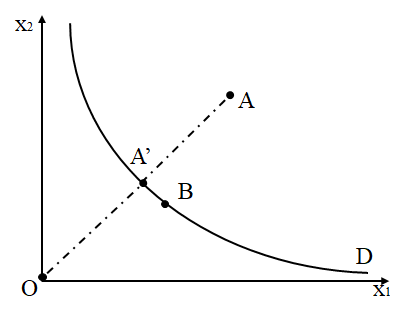
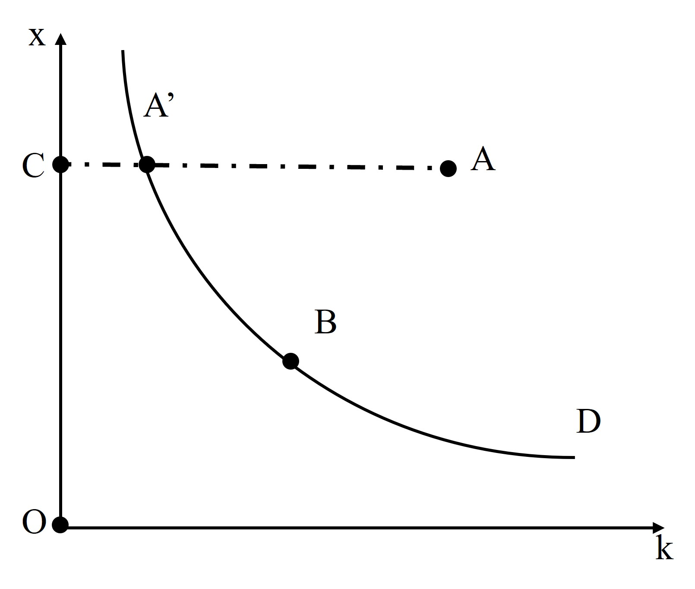
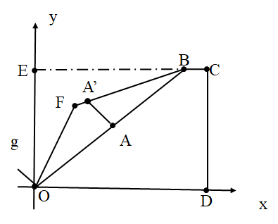
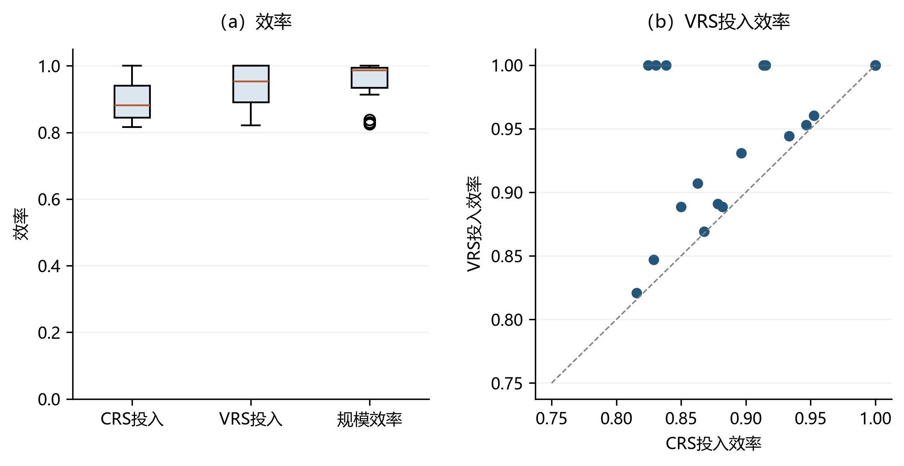

# 数据包络分析的经典模型 {#sec-3}

数据包络分析（Data Envelopment Analysis）是一种基于线性规划的效率评价方法，用于评估生产或服务系统的效率和生产率水平。自 Charnes, Cooper and Rhodes (1978) 提出以来，DEA 在经济效率估计中得到广泛应。例如，Färe, Grosskopf and Lee (1990) 分析了加州 82 个水稻农场，同年 Ferrier and Lovell (1990) 将其用于银行业，随后 Sueyoshi (1991)、Chavas and Aliber (1993)、Ray and Kim (1995)、Yunos and Hawdon (1997) 分别考察了美国 AT&T、美国农场、美国钢铁行业与马来西亚国家电力局。

1998 年后，该方法的覆盖面进一步扩展。Ray, Seiford and Zhu (1998)、Goto and Tsutsui (1998)、Linna (1998) 分别将其应用于中国钢铁、日美电力与芬兰卫生部门。Camanho, Silva and Piran (2024) 的综述显示，1999–2020 年间相关论文数量持续上升，应用涵盖制造业、食品、农业、卫生、能源、交通、电信、教育等领域。

与传统参数方法相比，DEA 模型具有以下优点：

（1）不需要对生产函数进行假设：传统参数方法需预设生产函数形式，若函数形式与实际不符，估计可能产生偏误；DEA 则不作此类假设，可直接基于实际投入产出数据评价。

（2）能够评价多种输入和输出因素：DEA 模型可同时处理多种投入与多种产出，适用于联合生产与竞争性生产情形。

（3）不依赖需求曲线和价格信息：DEA 模型无需需求曲线与价格信息，可在缺乏这些数据时评价效率，对新兴或市场经验不足的企业尤其适用。

在实际应用中，DEA 模型广泛用于评估企业、行业、地区和国家等各类经济单位的效率水平。例如，可用于评估单一企业的生产效率与要素利用情况，识别效率提升空间；也可对比不同企业的最优生产方式以指导决策；此外还可评价地区或国家的经济发展水平，以及行业的竞争力与发展趋势。

本章围绕经典 DEA 模型展开。[-@sec-3-1] 节用技术集、产出集与投入集三种等价形式刻画生产技术；[-@sec-3-2] 节定义产出距离、投入距离、hyperbolic 距离与方向距离四类效率测度；[-@sec-3-3] 节介绍对应的 DEA 线性规划与效率指数；[-@sec-3-4] 节讨论面板数据下技术参照集的构造，给出当期、Window、时序与全局四类参照技术的数学表达式；[-@sec-3-5] 节介绍 Python 程序包 `deabook` 的统一调用接口；[-@sec-3-6] 节以 OECD 国家与中国省份的技术效率为例进行应用演示。


## 生产技术的设定 {#sec-3-1}

效率测度可以分为两步：第一步刻画生产技术并确定前沿形状，第二步选定距离函数度量实际生产与前沿的偏离。不同的距离函数对应不同的评估标准，因而得到不同的效率衡量。

对于生产过程中投入与产出之间的关系，我们可以从三个角度描述生产技术：技术集、产出集和投入集。这三种表征方式在数学意义上等价，只是观测视角不同。

### 技术集 {#sec-3-1-1}

考虑一个使用 $K$ 种投入要素 $\boldsymbol{x}=\left(x_1, x_2, \cdots, x_K\right)^{\mathrm{T}} \in \Re_{+}^K$ 生产 $L$ 种产出 $\boldsymbol{y}=\left(y_1, y_2, \cdots, y_L\right)^{\mathrm{T}} \in \Re_{+}^L$ 的生产过程。生产技术可用集合 $T$ 表示为：

$$
T=\{(\boldsymbol{x}, \boldsymbol{y}): \boldsymbol{x} \text { 能生产 }\boldsymbol{y}\}
$$ {#eq-3-1}
技术集包含了生产技术的前沿和生产技术内部的所有投入产出组合。也就是说，所有观察值都满足 $(\boldsymbol{x}, \boldsymbol{y}) \in T$。该生产技术满足如下标准假设：

(1) 对于任意 $\boldsymbol{x}$，$(\boldsymbol{x}, \boldsymbol{0}) \in T$；

(2) 若 $(\boldsymbol{x}, \boldsymbol{y}) \in T$，且 $\boldsymbol{x}=\boldsymbol{0}$，则 $\boldsymbol{y}=\boldsymbol{0}$；

(3) 若 $(\boldsymbol{x}, \boldsymbol{y}) \in T$，且 $\boldsymbol{y}^{\prime} \leqslant \boldsymbol{y}$，则 $\left(\boldsymbol{x}, \boldsymbol{y}^{\prime}\right) \in T$；

(4) 若 $(\boldsymbol{x}, \boldsymbol{y}) \in T$，且 $\boldsymbol{x^{\prime}} \geqslant \boldsymbol{x}$，则 $\left(\boldsymbol{x^{\prime}}, \boldsymbol{y}\right) \in T$；

(5) 封闭性；

(6) 凸性；


其中，(1) 表明在有投入的情况下可以没有产出；(2) 表明没有投入便没有产出；(3) 和 (4) 分别为产出和投入的强可处置性：一定投入所能生产的产出组合，也一定能生产其任意更小的产出（产出强可处置性）；能生产一定产出的投入组合，使用更多投入同样可行（投入强可处置性）。

(5) 表明技术集合是封闭的，即包含自身的边界。需要注意的是，标准公理只要求 $T$ **封闭**，而**有界性**是针对给定投入下的产出集 $P(\boldsymbol{x})$ 而言的（稀缺性：有限的投入不能生产无限的产出，见 [-@sec-3-1-2] 节性质 (5)）。$T$ 本身一般不有界：在 crs 假设下 $T$ 是一个锥，沿射线方向无界；投入强可处置时投入也可任意加大。(6) 的凸性起到扩大技术集的作用，在只有少数观测数据可用时尤为重要：若两个生产计划均可行，通常也假定二者的加权平均可行。

在前面6个假设的基础上，文献还通常加上规模报酬的技术假设。例如，规模报酬不变（crs）指 $(\boldsymbol{x},\boldsymbol{y}) \in T \Rightarrow \theta(\boldsymbol{x},\boldsymbol{y}) \in T$ 对任意 $\theta>0$ 成立，即投入产出可按同一比例任意放大或缩小；规模报酬可变（vrs）则由观测点的凸组合生成技术，不允许对观测点任意缩放，对应 [-@sec-3-3] 节 LP 中的约束 $\sum_{i=1}^{N}\lambda_i=1$。技术集 $T$ 是定义同时调整投入与产出类测度（hyperbolic 距离函数、方向距离函数）的自然基础，将在 3.2.3、[-@sec-3-2-4] 节用到。

### 产出集 {#sec-3-1-2}

生产技术还可以使用产出集合来表示。产出集表示给定投入向量 $\boldsymbol{x}$ 所能生产的全部产出向量 $\boldsymbol{y}$ 的集合，数学上可定义为：
$$
P(x)=\{\boldsymbol{y}: \boldsymbol{x} \text { 能生产 }\boldsymbol{y}\}=\{\boldsymbol{y}:(\boldsymbol{x}, \boldsymbol{y}) \in T\}
$$ {#eq-3-2}
产出集的性质满足以下标准假设：

(1) 可以在有投入的情况下而没有产出：对于任意 $\boldsymbol{x}$，$\boldsymbol{0} \in P(\boldsymbol{x})$；

(2) 没有投入就没有产出：若 $\boldsymbol{y} \in P(\boldsymbol{x})$，且 $\boldsymbol{x}=\boldsymbol{0}$, 则 $\boldsymbol{y}=\boldsymbol{0}$；

(3) 产出的强可处置性：若 $\boldsymbol{y} \in P(\boldsymbol{x})$，且 $\boldsymbol{y}^{\prime} \leqslant \boldsymbol{y}$，则 $\boldsymbol{y^{\prime}} \in P(\boldsymbol{x})$；

(4) 投入的强可处置性：若 $\boldsymbol{y} \in P(\boldsymbol{x})$，且 $\boldsymbol{x}^{\prime} \geqslant \boldsymbol{x}$，则 $\boldsymbol{y} \in P(\boldsymbol{x^\prime})$；

(5) $P(\boldsymbol{x})$ 是封闭有界的（有界性即稀缺性：有限的投入不能生产无限的产出）；

(6) $P(\boldsymbol{x})$ 是凸的。


其中，（6）要求：若两种产出水平均可被生产出来，则其任意加权平均也可以被生产出来。产出集 $P(\boldsymbol{x})$ 把视角聚焦于"给定投入下的产出可能集"，是 [-@sec-3-2-1] 节产出距离函数的定义基础。

### 投入集 {#sec-3-1-3}

生产技术也可以使用投入集合来表示。投入集表示生产给定产出向量 $\boldsymbol{y}$ 所需要的所有投入向量 $\boldsymbol{x}$ 的集合，数学上可定义为：
$$
L(\boldsymbol{y})=\{\boldsymbol{x}: \boldsymbol{x} \text { 能生产 }\boldsymbol{y}\}=\{\boldsymbol{x}:(\boldsymbol{x}, \boldsymbol{y}) \in T\}
$$ {#eq-3-3}
投入集的性质满足以下标准假设：

(1) 可以在有投入的情况下而没有产出：$\boldsymbol{0} \in L(\boldsymbol{0})$；

(2) 没有投入就没有产出：若 $\boldsymbol{x} \in L(\boldsymbol{y})$，且 $\boldsymbol{x}=\boldsymbol{0}$, 则 $\boldsymbol{y}=\boldsymbol{0}$；

(3) 产出的强可处置性：若 $\boldsymbol{x} \in L(\boldsymbol{y})$，且 $\boldsymbol{y}^{\prime} \leqslant \boldsymbol{y}$，则 $\boldsymbol{x} \in L(\boldsymbol{y^{\prime}})$；

(4) 投入的强可处置性：若 $\boldsymbol{x} \in L(\boldsymbol{y})$，且 $\boldsymbol{x}^{\prime} \geqslant \boldsymbol{x}$，则 $\boldsymbol{x}^{\prime} \in L(\boldsymbol{y})$；

(5) $L(\boldsymbol{y})$ 是封闭的（注意：投入集一般不有界——投入强可处置时可行投入可任意加大，"有限投入不能生产无限产出"是对产出集 $P(\boldsymbol{x})$ 的要求）；

(6) $L(\boldsymbol{y})$ 是凸的。

其中，（6）要求：若两种投入组合均可生产给定产出，则其任意加权平均也可用于生产该产出。投入集 $L(\boldsymbol{y})$ 对应"给定产出下的投入需求集"，是 [-@sec-3-2-2] 节投入距离函数的定义基础。

## 效率的测量 {#sec-3-2}

技术效率的概念可以追溯到Debreu (1951) 和 Farrell (1957)。他们最先提出效率的定义方法：在固定投入下测量产出的最大扩张比例，或在固定产出下测量投入的最大收缩比例，借助距离函数估计效率。随后，Färe, Grosskopf and Lovell (1985) 提出同时缩小投入和扩大产出的 hyperbolic 效率测度。在此基础上，研究者发展了距离函数的一般形式——方向距离函数，以实现对效率更为广义的衡量。下面依次定义产出距离、投入距离、hyperbolic 距离与方向距离四类测度。

### 产出距离函数 {#sec-3-2-1}

产出距离函数（Shephard, 1970）度量给定投入下产出的最大扩张程度，其通过产出集定义：
$$
D_O(\boldsymbol{x},\boldsymbol{y})=\inf\{\theta:   \boldsymbol{y}/\theta \in P(\boldsymbol{x})\}
$$ {#eq-3-4}
式中，$\theta$ 是产出距离函数的值。当 $\theta=1$ 时，表示被评价的决策单元位于生产前沿上；当 $\theta<1$ 时，表示被评价的决策单元位于生产前沿内部，产出有扩张的空间。

{#fig-3-1}

如 @fig-3-1 所示，曲线为生产前沿，给定投入水平下，被评价 DMU 的实际产出 $y$ 位于前沿内部。沿产出方向将 $y$ 径向扩张至前沿上的 $y/\theta$（$\theta$ 为产出距离函数值），扩张比例 $1/\theta$ 即度量了产出的无效程度。$\theta=1$ 表示 DMU 已在前沿上。

易知，产出距离函数具有以下性质：

(1) 对所有非负投入 $\boldsymbol{x}$，$D_O(\boldsymbol{x},\boldsymbol{0})=0$；

(2) $D_O(\boldsymbol{x},\boldsymbol{y})$ 在 $\boldsymbol{y}$ 上非递减，在 $\boldsymbol{x}$ 上非递增；

(3) $D_O(\boldsymbol{x},\boldsymbol{y})$ 在 $\boldsymbol{y}$ 上是线性齐次的；

(4) $D_O(\boldsymbol{x},\boldsymbol{y})$ 在 $\boldsymbol{x}$ 上是拟凸的，在 $\boldsymbol{y}$ 上是凸的；

(5) 生产集上的决策单元的产出距离函数的取值范围为 $[0,1]$；且生产前沿上的决策单元的产出距离函数为 1。

### 投入距离函数 {#sec-3-2-2}

与产出距离函数对偶，投入距离函数刻画给定产出下投入的最大可缩减比例，从投入缩减的视角衡量效率。

**（一）所有投入同时变化**：投入距离函数通过投入集定义：
$$
D_I(\boldsymbol{x},\boldsymbol{y})=\sup\{\phi: \boldsymbol{x}/\phi \in L(\boldsymbol{y})\}
$$ {#eq-3-5}
式中，$\phi$ 是投入距离函数的值。当 $\phi=1$ 时，表示被评价的决策单元位于生产前沿上；当 $\phi>1$ 时，表示被评价的决策单元位于生产前沿内部，投入有缩小的空间。 

{#fig-3-2}

如 @fig-3-2 所示，在固定产出水平下，被评价 DMU 的实际投入 $x$ 位于前沿外。沿投入方向将 $x$ 径向缩减至前沿上的 $x/\phi$（$\phi$ 为投入距离函数值），缩减比例 $\phi$ 即度量了投入的无效程度。$\phi=1$ 表示 DMU 已在前沿上。

投入距离函数具有以下性质：

(1) 对所有非负产出 $\boldsymbol{y}$，$D_I(\boldsymbol{0},\boldsymbol{y})=0$；

(2) $D_I(\boldsymbol{x},\boldsymbol{y})$ 在 $\boldsymbol{y}$ 上非递增，在 $\boldsymbol{x}$ 上非递减；

(3) $D_I(\boldsymbol{x},\boldsymbol{y})$ 在 $\boldsymbol{x}$ 上是线性齐次的；

(4) $D_I(\boldsymbol{x},\boldsymbol{y})$ 在 $\boldsymbol{y}$ 上是拟凹的，在 $\boldsymbol{x}$ 上是凹的；

(5) 生产集上的决策单元的投入距离函数的取值范围为 $[1,\infty)$；且生产前沿上的决策单元的投入距离函数为 1。


**（二）单个投入变化**：投入距离函数也可只对单个投入定义，用于考察特定投入的利用效率。以资本为例，若只关心资本这一项投入的利用状况，可把投入向量拆分为资本 $k$ 与其他投入 $\boldsymbol{x}$，只让资本沿投入方向径向缩减，其余投入与产出保持不变。

具体而言，谢泼德资本距离函数度量给定产出与其他投入下资本投入的最大缩减程度，其通过投入集定义：
$$
D_I(\boldsymbol{x},k,\boldsymbol{y})=\sup\{\phi: (\boldsymbol{x},k/\phi) \in L(\boldsymbol{y})\}
$$ {#eq-3-6}
式中，$\boldsymbol{x}$ 代表其他投入，$k$ 代表资本投入，$\boldsymbol{y}$ 代表产出，$\phi$ 是谢泼德资本距离函数的值。当 $\phi=1$ 时，表示被评价的决策单元位于生产前沿上；当 $\phi>1$ 时，表示被评价的决策单元位于生产前沿内部，资本投入有缩小的空间。

与 ([-@eq-3-5]) 让全部投入等比例缩减不同，([-@eq-3-6]) 只让资本 $k$ 按比例缩减、其余投入固定不动，因此 $\phi$ 衡量的是**资本利用的无效程度**：在维持现有产出与其他投入不变的前提下，资本最多可压缩至当前的 $1/\phi$。@fig-3-3 给出了对应的几何示意：被评价单元位于 $A$ 点（资本 $k_A$、其他投入 $x_A$），生产前沿（产出 $\boldsymbol{y}$ 对应的等产量面）是一条过原点单调递减的曲线；保持其他投入 $x_A$ 不变，将资本沿水平方向向左投影到前沿上的 $A'$ 点（资本 $k_{A'}$），则 $\phi = k_A/k_{A'}$，相应的资本利用效率为 $1/\phi = k_{A'}/k_A$。当 $A=A'$（即 $k_A=k_{A'}$）时 $\phi=1$，资本利用是有效的。

{#fig-3-3}


### 同时缩小投入和扩张产出的 Hyperbolic 距离函数 {#sec-3-2-3}

传统的效率衡量方法往往单独关注扩张产出或缩小投入，而实际生产中通常需要同时考虑二者，hyperbolic 距离函数即基于技术集对此作综合度量。

$$
G(\boldsymbol{x},\boldsymbol{y})=\inf\{G:(G\boldsymbol{x},\boldsymbol{y}/G)\in T\}
$$ {#eq-3-8}
式中，$G$ 是 hyperbolic 距离函数的值。当 $G=1$ 时，表示被评价的决策单元位于生产前沿上；当 $G<1$ 时，表示被评价的决策单元位于生产前沿内部，有缩小投入和扩大产出的空间。

{#fig-3-5}

如 @fig-3-5 所示，hyperbolic 距离函数同时沿投入缩减与产出扩张两个方向移动：投入乘以 $G$、产出除以 $G$，沿一条双曲路径逼近生产前沿。$G=1$ 表示 DMU 已在前沿上，$G<1$ 表示存在同时缩减投入与扩张产出的空间。这一测度自然引出更一般的方向距离函数（见 [-@sec-3-2-4] 节）。

### 方向距离函数 {#sec-3-2-4}

Hyperbolic 距离函数要求投入与产出按同一比例 $G$ 反向调整，方向固定。方向距离函数（Directional Distance Function, DDF）则允许通过方向向量 $(\boldsymbol{g}_x,\boldsymbol{g}_y)$ 自由设定改进方向，把谢泼德投入距离与产出距离作为精确特例包含在内。根据 Chambers, Chung and Färe (1998) 的定义，同时缩小投入和扩张产出的方向距离函数可表示为：
$$
\vec{D}\left(\boldsymbol{x}, \boldsymbol{y} ; \boldsymbol{g}_x, \boldsymbol{g}_y\right)=\sup \left\{\beta:\left(\boldsymbol{x}-\beta \boldsymbol{g}_x, \boldsymbol{y}+\beta \boldsymbol{g}_y\right) \in T\right\}
$$ {#eq-3-9}
式中，$T$ 为技术集；$\boldsymbol{g}_x=\left(g_{x_1}, g_{x_2}, \cdots, g_{x_K}\right)^{\mathrm{T}} \in \Re_{+}^K$，$\boldsymbol{g}_y= \left(g_{y_1}, g_{y_2}, \cdots, g_{y_L}\right)^{\mathrm{T}} \in \Re_{+}^L$ 用于设定被评价决策单元的生产改进方向；$\beta$ 是方向距离函数的取值，表示扩张期望产出同时缩减投入的最大比例。

方向距离函数满足以下性质：

(1) 非负性：若 $(\boldsymbol{x}, \boldsymbol{y}) \in T$, 则 $\vec{D}\left(\boldsymbol{x}, \boldsymbol{y} ; \boldsymbol{g}_x, \boldsymbol{g}_y\right) \geqslant 0$；

(2) 平移性：$\vec{D}\left(\boldsymbol{x}-\alpha \boldsymbol{g}_{x}, \boldsymbol{y}+\alpha \boldsymbol{g}_y ; \boldsymbol{g}_{x}, \boldsymbol{g}_y\right)=\vec{D}\left(\boldsymbol{x}, \boldsymbol{y} ; \boldsymbol{g}_{x}, \boldsymbol{g}_y\right)-\alpha$；

(3) 在方向向量上的负一次齐次性：$\vec{D}\left(\boldsymbol{x}, \boldsymbol{y} ; \lambda \boldsymbol{g}_x, \lambda \boldsymbol{g}_y\right)=(1/\lambda)\vec{D}\left(\boldsymbol{x}, \boldsymbol{y} ; \boldsymbol{g}_x, \boldsymbol{g}_y\right)$, $\lambda>0$；

(4) 如果 $\boldsymbol{y}^{\prime} \geqslant \boldsymbol{y}$, 则 $\vec{D}\left(\boldsymbol{x}, \boldsymbol{y} ; \boldsymbol{g}_{x}, \boldsymbol{g}_y\right) \geqslant \vec{D}\left(\boldsymbol{x}, \boldsymbol{y}^{\prime} ; \boldsymbol{g}_{x}, \boldsymbol{g}_y\right) \geqslant 0$；

(5) 如果 $\boldsymbol{x}^{\prime} \geqslant \boldsymbol{x}$, 则 $\vec{D}\left(\boldsymbol{x}, \boldsymbol{y} ; \boldsymbol{g}_x, \boldsymbol{g}_y\right) \leqslant \vec{D}\left(\boldsymbol{x}^{\prime}, \boldsymbol{y} ; \boldsymbol{g}_x, \boldsymbol{g}_y\right) \geqslant 0$；

(6) 如果 $T$ 是凸的, 那么 $\vec{D}\left(\boldsymbol{x}, \boldsymbol{y} ; \boldsymbol{g}_x, \boldsymbol{g}_y\right)$ 对于 $(\boldsymbol{x}, \boldsymbol{y})$ 是凹的。


其中，性质 (4) 与 (5) 表明：期望产出增大时，方向距离函数值减小；投入增大时，方向距离函数值增加。二者均反映方向距离函数值随无效程度的上升而增大。性质 (6) 表明，当技术集为凸时，方向距离函数是凹函数。

以 @fig-3-6 所示的单投入单产出生产函数为例。当取方向向量为 $\boldsymbol{g}=(\boldsymbol{1},\boldsymbol{1})$ 时，$A$ 点将沿 $(\boldsymbol{-1},\boldsymbol{1})$ 的方向投影至 $A^{\prime}$ 点。当方向向量取特定值时，方向距离函数可以精确地表为谢泼德距离函数。当取方向向量为 $\boldsymbol{g}=(\boldsymbol{x}, \boldsymbol{0})$ 时，投入方向距离函数与方向距离函数之间的关系为 $\vec{D}(\boldsymbol{x}, \boldsymbol{y} ; \boldsymbol{x}, \boldsymbol{0})=1-1 / D_I(\boldsymbol{x}, \boldsymbol{y})$。当方向向量为 $\boldsymbol{g}=(\boldsymbol{0}, \boldsymbol{y})$ 时，产出方向距离函数与方向距离函数之间的关系为 $\vec{D}(\boldsymbol{x}, \boldsymbol{y} ; \boldsymbol{0}, \boldsymbol{y})=1 / D_O(\boldsymbol{x}, \boldsymbol{y})-1$。这两条关系都是恒等式。

> **hyperbolic 不是 DDF 的特例**：hyperbolic 测度的投影路径是双曲线 $(G\boldsymbol{x},\boldsymbol{y}/G)$，而 DDF 的投影路径是直线 $(\boldsymbol{x}-\beta\boldsymbol{g}_x,\boldsymbol{y}+\beta\boldsymbol{g}_y)$，二者不是同一条路径，因此 hyperbolic 测度不能写成 DDF 的特例。取 $\boldsymbol{g}=(\boldsymbol{x},\boldsymbol{y})$ 时，只有在 $\beta$ 很小时才近似有 $G(\boldsymbol{x},\boldsymbol{y})\approx 1/(1+\vec{D}(\boldsymbol{x}, \boldsymbol{y} ; \boldsymbol{x}, \boldsymbol{y}))\approx 1-\vec{D}(\boldsymbol{x}, \boldsymbol{y} ; \boldsymbol{x}, \boldsymbol{y})$，这是一阶近似而非恒等式。Färe, Margaritis, Rouse and Roshdi (2016) 正是利用双曲距离与 DDF 的联系，给出用至多两个线性规划**精确**计算双曲距离函数的算法（尤其解决 vrs 下双曲问题非线性、难以直接线性化的困难）。

{#fig-3-6}

## DEA 模型的估计 {#sec-3-3}

在 3.1、[-@sec-3-2] 节刻画生产技术并定义各类距离函数之后，本节将其转化为可求解的 DEA 线性规划。DEA 模型无需对生产前沿的函数形式做出参数假设，可直接基于实际投入产出数据估计各决策单元相对于前沿的效率。

### 基于产出距离函数的技术效率估计 {#sec-3-3-1}

产出导向在固定投入下径向扩张产出。需注意，本节 LP 中的决策变量 $\phi$ 是产出扩张倍数（$\phi\geqslant 1$），与 3.2.1 中产出距离函数 $\theta\in[0,1]$ 互为倒数：$\phi=1/\theta=1/D_O$。本节统一记号：下标 $0$ 标识被评价 DMU，$i=1,\ldots,N$ 标识参考集中的 DMU，$\lambda_i$ 为强度变量。可用下面的 DEA 程序估计 $\text{DMU}_0$ 的效率：
$$
\begin{aligned}
& \max _{\phi, \lambda_1, \ldots, \lambda_N} \phi \\
&   \text { s.t. }  \sum_{i=1}^N \lambda_i x_{ki} \leq  x_{k0}, \quad k=1, \ldots, K \\
&   \sum_{i=1}^N \lambda_i y_{li} \geq  \phi y_{l0},  \quad l=1, \ldots, L \\
& \lambda \in \Lambda^N(\gamma).
\end{aligned}
$$ {#eq-3-10}
式中，$\gamma$ 表示不同的规模报酬假设，$\gamma \in \{crs, vrs\}$，$\Lambda^N(\gamma)$ 隐含 $\lambda_i\geqslant 0$。当 $\gamma=crs$ 时，对应规模报酬不变的生产技术，即著名的 CCR 模型（Charnes, Cooper and Rhodes, 1978 ）。相应的 DEA 程序为：
$$
\begin{aligned}
& \max _{\phi, \lambda_1, \ldots, \lambda_N} \phi \\
&   \text { s.t. }  \sum_{i=1}^N \lambda_i x_{ki} \leq  x_{k0}, \quad k=1, \ldots, K \\
&   \sum_{i=1}^N \lambda_i y_{li} \geq  \phi y_{l0},  \quad l=1, \ldots, L \\
& \lambda_i \geq 0.
\end{aligned}
$$ {#eq-3-11}
当 $\gamma=vrs$ 时，对应规模报酬可变的生产技术，即著名的 BCC 模型 (Banker, Charnes and Cooper, 1984 )。相应的 DEA 程序为：
$$
\begin{aligned}
& \max _{\phi, \lambda_1, \ldots, \lambda_N} \phi \\
&   \text { s.t. }  \sum_{i=1}^N \lambda_i x_{ki} \leq  x_{k0}, \quad k=1, \ldots, K \\
&   \sum_{i=1}^N \lambda_i y_{li} \geq  \phi y_{l0},  \quad l=1, \ldots, L \\
& \sum_{i=1}^N \lambda_i =1, \\
& \lambda_i \geq 0.
\end{aligned}
$$ {#eq-3-12}

以上模型在保持投入不变的情况下，径向扩张所有产出。若目标函数值为 $\phi^*$，则最佳期望产出量为 $\phi^*y$，纯产出效率（PEO）为：
$$
PEO=\frac{y}{\phi^*y}=\frac{1}{\phi^*}.
$$
仅当 $\phi^*=1$ 时，$PEO=1$，代表产出位于生产前沿上；否则，当 $\phi^*>1$ 时，$PEO<1$，表明产出效率存在提升空间。

### 基于投入距离函数的技术效率估计 {#sec-3-3-2}

与产出导向对偶，投入导向在固定产出下径向缩减投入。此处 LP 的决策变量 $\theta$ 是投入收缩比（$\theta\leqslant 1$），与 3.2.2 中投入距离函数 $\phi\in[1,\infty)$ 互为倒数：$\theta=1/\phi=1/D_I$。注意勿将本式中的 $\theta$ 与 ([-@eq-3-4]) 中的产出距离 $\theta$ 混淆。可用下面的 DEA 程序估计 $\text{DMU}_0$ 的效率：
$$
\begin{aligned}
& \min _{\theta, \lambda_1, \ldots, \lambda_N} \theta \\
& \text { s.t. } \sum_{i=1}^N \lambda_i x_{ki} \leq \theta x_{k0}, \quad k=1, \ldots, K \\
& \sum_{i=1}^N \lambda_i y_{li} \geq y_{l0}, \quad l=1, \ldots, L \\
& \lambda \in \Lambda^N(\gamma).
\end{aligned}
$$ {#eq-3-13}
式中，$\gamma$ 表示不同的规模报酬假设，$\gamma \in \{crs, vrs\}$。以上模型在保持产出不变的情况下，径向缩减所有投入。若目标函数值为 $\theta^*$，则最佳投入量为 $\theta^*x$，纯投入效率（PEI）为
$$
PEI=\frac{\theta^*x}{x}=\theta^*.
$$
当且仅当 $\theta^*=1$ 时，$PEI=1$，表示投入利用是有效的；否则，当 $\theta^*<1$ 时，$PEI<1$，表明投入效率存在提升空间。

若只关心某一项投入（如资本）的利用状况，则可沿用 ([-@eq-3-13]) 的框架，但**只让该项投入按比例收缩、其余投入与产出保持不变**。设被考察的投入为 $x_1$，其 DEA 程序为：
$$
\begin{aligned}
& \min _{\theta, \lambda_1, \ldots, \lambda_N} \theta \\
& \text { s.t. } \sum_{i=1}^N \lambda_i x_{1 i} \leq \theta x_{10} \\
& \sum_{i=1}^N \lambda_i x_{k i} \leq x_{k0}, \quad k=2, \ldots, K \\
& \sum_{i=1}^N \lambda_i y_{l i} \geq y_{l0}, \quad l=1, \ldots, L \\
& \lambda \in \Lambda^N(\gamma).
\end{aligned}
$$ {#eq-3-13b}
与 ([-@eq-3-13]) 让全部投入等比例缩减不同，([-@eq-3-13b]) 只沿**单个投入**方向收缩，对应 3.2.2.2 节定义的单投入谢泼德距离函数 ([-@eq-3-6])。若最优值为 $\theta^*$，则该项投入的利用效率为
$$
PEI_1=\theta^*,
$$
对应的谢泼德单投入距离函数为 $D_I=1/\theta^*$。当且仅当 $\theta^*=1$ 时，$PEI_1=1$，表示该项投入已无压缩空间；否则 $\theta^*<1$ 表明该项投入存在节约潜力。由于其余投入被固定，([-@eq-3-13b]) 的效率值不会低于全投入情形 ([-@eq-3-13]) 的 $\theta^*$——约束更少，可行域更大。

### 基于双曲距离函数的技术效率估计 {#sec-3-3-3}

产出导向与投入导向分别只在单侧（产出或投入）做径向调整。若希望 DMU 沿双曲路径同时缩减投入并扩张产出，则需引入 Hyperbolic 距离函数。在 crs 技术中，参考 Färe, Grosskopf and Lovell (1985) ，可用下面的 DEA 程序估计同时调整投入和产出的 $\text{DMU}_0$ 的效率：
$$
\begin{aligned}
& \min _{\eta, \lambda_1, \ldots, \lambda_N} \eta \\
& \text { s.t. } \sum_{i=1}^N \lambda_i x_{ki} \leq \eta x_{k0}, \quad k=1, \ldots, K \\
& \sum_{i=1}^N \lambda_i y_{li} \geq \frac{y_{l0}}{\eta}, \quad l=1, \ldots, L \\
& \lambda_i \geq 0.
\end{aligned}
$$ {#eq-3-14}

该非线性问题可按下述方法线性化：在每个约束中乘 $\eta$，并令 $\eta^2=\eta^\prime$，$\lambda_i\eta=\lambda_i^\prime$（由 $\eta>0$ 保证代换等价），得到下面的 LP 模型：

$$
\begin{aligned}
& \min _{\eta^\prime, \lambda_1^\prime, \ldots, \lambda_N^\prime} \eta^\prime \\
& \text { s.t. } \sum_{i=1}^N \lambda_i^\prime x_{ki} \leq \eta^\prime x_{k0}, \quad k=1, \ldots, K \\
& \sum_{i=1}^N \lambda_i^\prime y_{li} \geq y_{l0}, \quad l=1, \ldots, L \\
& \lambda_i^\prime \geq 0.
\end{aligned}
$$ {#eq-3-15}
求解上述线性规划模型，若目标函数值为 $\eta^{\prime*}$，由代换 $\eta^2=\eta^\prime$ 得 $\eta^*=\sqrt{\eta^{\prime*}}$，则混合投入效率（$MEI$）或混合产出效率（$MEO$）为：
$$
MEI = MEO = \eta^* = \sqrt{\eta^{\prime*}}.
$$
当且仅当 $\eta^*=1$ 时，$MEI=MEO=1$，表示产出或投入利用有效；否则，当 $\eta^*<1$ 时，$MEI=MEO<1$，表明存在提升空间。


对于 vrs 技术，([-@eq-3-14]) 的上述代换不再成立（$\sum_i\lambda_i=1$ 在代换后变为 $\sum_i\lambda_i^\prime=\eta$），因而无法用同样的方法线性化。一种常见的折中做法是用一阶（泰勒）近似，把双曲路径近似为方向向量 $\boldsymbol{g}=(\boldsymbol{x},\boldsymbol{y})$ 的方向距离函数，从而求解下面的 LP：

$$
\begin{array}{ll}
 &\max _{\lambda_1, \ldots, \lambda_N, \beta}\ \beta \\
\text { s.t. }
& \sum_{i=1}^{N} \lambda_{i} y_{li} \geqslant y_{l0}+\beta g_{ly}, l=1, \cdots, L \\
& \sum_{i=1}^{N} \lambda_{i} x_{ki} \leqslant x_{k0}-\beta g_{kx}, k=1, \cdots, K \\
& \sum_{i=1}^N \lambda_i =1, \\
& \lambda_{i} \geqslant 0, i=1, \cdots, N
\end{array}
$$ {#eq-3-16}

求解上述线性规划模型，若目标函数值为 $\beta^{*}$，则混合投入效率（$MEI$）或混合产出效率（$MEO$）的**一阶近似**分别为：
$$
MEI \approx \exp\{-\beta^*\}\approx 1-\beta^*,\quad MEO \approx \frac{1}{\exp\{\beta^*\}}\approx\frac{1}{1+\beta^*}.
$$
当且仅当 $\beta^*=0$ 时，$MEI=MEO=1$，表示决策单元位于生产前沿；否则，当 $\beta^*>0$ 时，$MEI=MEO<1$，表明存在提升空间。

> **注意**：([-@eq-3-16]) 求出的是方向向量 $\boldsymbol{g}=(\boldsymbol{x},\boldsymbol{y})$ 的**方向距离函数**，$1-\beta^*$ 与 $1/(1+\beta^*)$ 只是双曲效率的一阶近似，$\beta^*$ 较大时误差不可忽略；它与 [-@sec-3-3-4] 节 $\boldsymbol{g}=(\boldsymbol{x},\boldsymbol{y})$ 的 DDF 是同一个线性规划，因此二者不构成相互独立的稳健性对照。若需要 vrs 下**精确**的双曲距离，应采用 Färe, Margaritis, Rouse and Roshdi (2016) 的算法：借助双曲距离与 DDF 的联系，用至多两个线性规划精确求解，而不是用 $1-\beta^*$ 代替。

### 基于方向距离函数的技术效率估计 {#sec-3-3-4}

3.3.3 的 VRS 双曲距离已借助方向距离函数 ([-@eq-3-16]) 作泰勒近似。事实上，方向距离函数本身是一类更灵活的测度——它允许沿任意预设方向 $\boldsymbol{g}$ 同时调整投入与产出，是上述径向、双曲测度的推广。[-@sec-3-2-4] 节已给出 $\boldsymbol{g}=(\boldsymbol{x},\boldsymbol{y})$、$(\boldsymbol{x},\boldsymbol{0})$、$(\boldsymbol{0},\boldsymbol{y})$ 三种方向设定，本节将它们转化为可求解的 LP ([-@eq-3-17])–([-@eq-3-19])，并给出对应的绩效指数。

当设定 $\boldsymbol{g}=(\boldsymbol{x},\boldsymbol{y})$ 时，对应同时缩小投入和扩张产出的方向距离函数，其 DEA 程序为：

$$
\begin{array}{ll}
 & \vec{D}\left(\boldsymbol{x}, \boldsymbol{y}; \boldsymbol{g}_{x}, \boldsymbol{g}_{y}\right)=\max\ \beta \\
\text { s.t. }
& \sum_{i=1}^{N} \lambda_{i} y_{li} \geq y_{l0}+\beta g_{ly}, \quad l=1, \cdots, L \\
& \sum_{i=1}^{N} \lambda_{i} x_{ki} \leq x_{k0}-\beta g_{kx}, \quad k=1, \cdots, K \\
& \lambda \in \Lambda^N(\gamma).
\end{array}
$$ {#eq-3-17}
式中，$\gamma \in \{crs, vrs\}$ 表示不同的规模报酬假设；下标 $0$ 标识被评价 DMU，$i=1,\ldots,N$ 标识参考集中的 DMU。

当设定 $\boldsymbol{g}=(\boldsymbol{x}, \boldsymbol{0})$ 时，表示通过缩小投入达到生产前沿，对应的 DEA 程序为：
$$
\begin{array}{ll}
 & \vec{D}\left(\boldsymbol{x}, \boldsymbol{y}; \boldsymbol{g}_{x}, \boldsymbol{0}\right)=\max\ \beta \\
\text { s.t. }
& \sum_{i=1}^{N} \lambda_{i} y_{li} \geq y_{l0}, \quad l=1, \cdots, L \\
& \sum_{i=1}^{N} \lambda_{i} x_{ki} \leq x_{k0}-\beta g_{kx}, \quad k=1, \cdots, K \\
& \lambda \in \Lambda^N(\gamma).
\end{array}
$$ {#eq-3-18}
同理，对方向 $\boldsymbol{g}=(\boldsymbol{0},\boldsymbol{g_y})$，对应的 DEA 程序为：
$$
\begin{array}{ll}
 & \vec{D}\left(\boldsymbol{x}, \boldsymbol{y}; \boldsymbol{0}, \boldsymbol{g}_{y}\right)=\max\ \beta \\
\text { s.t. }
& \sum_{i=1}^{N} \lambda_{i} y_{li} \geq y_{l0}+\beta g_{ly}, \quad l=1, \cdots, L \\
& \sum_{i=1}^{N} \lambda_{i} x_{ki} \leq x_{k0}, \quad k=1, \cdots, K \\
& \lambda \in \Lambda^N(\gamma).
\end{array}
$$ {#eq-3-19}

在同时调整投入与产出的方向 $\boldsymbol{g}=(\boldsymbol{x},\boldsymbol{y})$（([-@eq-3-17])）下，假定最优解为 $\beta^*$，可同时定义投入端与产出端的绩效指数：
$$
EI = 1-\beta^*, \qquad EO = \frac{1}{1+\beta^*}.
$$
二者刻画了同一 $\beta^*$ 在投入与产出两端的对应效率——$EI$ 是投入经投影后实际保留的比例，$EO$ 是产出经扩张后实际达到的倍数的倒数。把两端综合，即得到同时反映投入缩减与产出扩张的环境绩效指数
$$
EEI = EI \cdot EO = \frac{1-\beta^*}{1+\beta^*}.
$$
三个指数均落在 $(0,1]$，越接近 1 表示越有效。

若仅作单侧调整——投入方向 $\boldsymbol{g}=(\boldsymbol{x},\boldsymbol{0})$（([-@eq-3-18])）或产出方向 $\boldsymbol{g}=(\boldsymbol{0},\boldsymbol{y})$（([-@eq-3-19])）——相应的 $\beta$ 与上面的 $\beta^*$ 一般不同（三种方向的前沿互不相同），投入效率仍为 $1-\beta$、产出效率仍为 $1/(1+\beta)$，只是 $\beta$ 取自各自方向的 LP。

## 面板数据的技术参照集构造 {#sec-3-4}

通常而言，数据包络分析（DEA）模型在评估决策单元的效率时，主要集中在截面维度的分析。然而，在处理面板数据时，加入了时间这一重要维度，从而丰富了信息含量。当前文献中提出了多种不同的处理方法，大致可以归类为四种：当期（contemporaneous）DEA 模型、Window DEA 模型、时序（sequential）DEA 模型与全局（global）DEA 模型。本节先说明**为什么必须先构造技术参照集**，再依次给出四类参照集的**数学表达式**、各自对应的技术演变假设，以及它们所回答的经济问题。

### 为什么需要构造技术参照集 {#sec-3-4-1}

DEA 不预设生产函数的参数形式，前沿直接由样本观测"包络"而成。因此，在用 DEA 度量效率之前，必须先回答一个前置问题：**用哪些观测点来构造被比较的前沿？** 这些观测点的集合称为**技术参照集**（reference set），由它包络出的技术称为**参照技术**。

在截面数据中，这个问题没有歧义：参照集就是当期全部 $N$ 个决策单元，[-@sec-3-3] 节的线性规划 ([-@eq-3-10])–([-@eq-3-19]) 正是按此写出的（求和下标均为 $i=1,\ldots,N$）。一旦引入时间维度，全部观测增加到 $N\times T$ 个，参照集的选取就成为必须显式说明的建模决定。其重要性体现在三方面：

（1）**效率总是相对于特定技术而言的**。"某决策单元是否有效"这一问法本身并不完整，必须补上"相对于哪一套技术"。参照集不同，前沿位置不同，同一观测点的效率值也随之改变；由下文 ([-@eq-3-21]) 的单调性可知，**不同参照集下得到的效率值不可直接比较**。

（2）**参照集体现了对技术随时间变化方式的假设**。允许每期各有前沿（当期）、假定窗口内技术不变（Window）、假定技术只进不退（时序）、假定全样本技术不变（全局），对应四种不同的技术演变假设，回答的是四个不同的经济问题，不可混用。

（3）**参照集规模决定估计的自由度**。DEA 存在"维度灾难"：观测数相对投入产出维数 $K+L$ 过少时，大量决策单元会被判为有效，前沿估计也容易受异常值影响。扩大参照集是缓解该问题的主要手段，但代价是更强的技术不变假设——这构成参照集选择的核心权衡。

### 参照集与参照技术的一般形式 {#sec-3-4-2}

设面板包含 $N$ 个决策单元、$T$ 个时期，第 $i$ 个决策单元在第 $t$ 期的投入、产出向量分别为 $\boldsymbol{x}_{i}^{t}=\left(x_{1i}^{t},\ldots,x_{Ki}^{t}\right)^{\mathrm{T}}\in\Re_{+}^{K}$ 与 $\boldsymbol{y}_{i}^{t}=\left(y_{1i}^{t},\ldots,y_{Li}^{t}\right)^{\mathrm{T}}\in\Re_{+}^{L}$。记参照集为观测下标对 $(j,s)$ 的集合 $\mathcal{R}\subseteq\{1,\ldots,N\}\times\{1,\ldots,T\}$，其元素个数记为 $|\mathcal{R}|$。由 $\mathcal{R}$ 包络出的参照技术定义为：
$$
T(\mathcal{R})=\left\{(\boldsymbol{x},\boldsymbol{y})\in\Re_{+}^{K+L}:\ \sum_{(j,s)\in\mathcal{R}}\lambda_{js}\,x_{kj}^{s}\leqslant x_{k},\ k=1,\ldots,K,\quad \sum_{(j,s)\in\mathcal{R}}\lambda_{js}\,y_{lj}^{s}\geqslant y_{l},\ l=1,\ldots,L,\quad \boldsymbol{\lambda}\in\Lambda^{|\mathcal{R}|}(\gamma)\right\}
$$ {#eq-3-20}
式中 $\lambda_{js}$ 为赋予第 $j$ 个决策单元第 $s$ 期观测的强度变量；$\Lambda^{n}(\gamma)$ 的设定与 [-@sec-3-3] 节一致——$\gamma=crs$ 时仅要求强度变量非负，$\gamma=vrs$ 时另加 $\sum_{(j,s)\in\mathcal{R}}\lambda_{js}=1$。([-@eq-3-20]) 是 [-@sec-3-1] 节技术集 $T$ 的样本估计版本：它以观测点的非负（及 vrs 下的凸）组合外推可行生产计划，并继承 [-@sec-3-1-1] 节 (1)–(7) 的全部公理。当 $\mathcal{R}$ 只含单一时期 $t$ 的观测时，([-@eq-3-20]) 即退化为 [-@sec-3-3] 节各线性规划所隐含的技术。

参照集的一个基本性质是**单调性**：若 $\mathcal{R}_{A}\subseteq\mathcal{R}_{B}$，则把 $\mathcal{R}_{B}\backslash\mathcal{R}_{A}$ 的强度变量取零即可得到 $\mathcal{R}_{A}$ 的任一可行组合，故
$$
T\left(\mathcal{R}_{A}\right)\subseteq T\left(\mathcal{R}_{B}\right),\qquad \text{进而}\qquad PE\left(\mathcal{R}_{B}\right)\leqslant PE\left(\mathcal{R}_{A}\right).
$$ {#eq-3-21}
即扩大参照集只会为包络提供更多观测，前沿**不会内移**，被评价点相对前沿的偏离不会变小，因而测得的径向效率（[-@sec-3-3] 节的 $PEO$ 与 $PEI$）**单调不增**。这既是扩大参照集能提高区分度的原因，也是不同参照集下效率值不可直接比较的根源。

### 当期 DEA 模型 {#sec-3-4-3}

当期参照集只使用与被评价观测**同一时期**的截面数据，即
$$
\mathcal{R}^{t}=\left\{(i,t):\ i=1,\ldots,N\right\},\qquad \left|\mathcal{R}^{t}\right|=N.
$$
相应的当期技术为：
$$
T^{t}=\left\{(\boldsymbol{x},\boldsymbol{y})\in\Re_{+}^{K+L}:\ \sum_{i=1}^{N}\lambda_{i}^{t}x_{ki}^{t}\leqslant x_{k},\ \sum_{i=1}^{N}\lambda_{i}^{t}y_{li}^{t}\geqslant y_{l},\ \boldsymbol{\lambda}^{t}\in\Lambda^{N}(\gamma)\right\}
$$ {#eq-3-22}
它回答的问题是：**该决策单元相对于同期最佳实践是否有效？** 由于每期各有一条前沿，当期参照集不施加任何跨期的技术不变假设，前沿可以自由地前进或后退，因而最贴合"同期可比"的效率概念，也是 [-@sec-3-3] 节各线性规划的默认设定。

其局限在于两点。其一，每期只有 $N$ 个观测用于包络，样本量最小，维度灾难与异常值敏感问题最为突出。其二，由于允许前沿后退，某决策单元效率的"改善"可能仅仅源于**前沿自身的内移**（例如经济下行年份的最佳实践退化），而非该单元的真实进步；这正是下述时序参照集的出发点。

### Window DEA 模型 {#sec-3-4-4}

Window DEA（Charnes, Clark, Cooper and Golany, 1985）把**连续若干期**的观测合并为一个参照集。令窗口宽度为 $w$，以向后窗口为例，第 $t$ 期的窗口期集合为
$$
W(t)=\left\{s\in\{1,\ldots,T\}:\ t-w+1\leqslant s\leqslant t\right\},
$$ {#eq-3-23}
实践中也常用中心窗口 $W(t)=\left\{t-\lfloor w/2\rfloor,\ldots,t+\lfloor w/2\rfloor\right\}\cap\{1,\ldots,T\}$，两种设定的差别仅在于窗口的对齐方式。相应的窗口参照集与窗口技术为
$$
\mathcal{R}^{t,w}=\left\{(i,s):\ i=1,\ldots,N,\ s\in W(t)\right\},\qquad \left|\mathcal{R}^{t,w}\right|=N\cdot|W(t)|,
$$
$$
T^{t,w}=\left\{(\boldsymbol{x},\boldsymbol{y})\in\Re_{+}^{K+L}:\ \sum_{s\in W(t)}\sum_{i=1}^{N}\lambda_{i}^{s}x_{ki}^{s}\leqslant x_{k},\ \sum_{s\in W(t)}\sum_{i=1}^{N}\lambda_{i}^{s}y_{li}^{s}\geqslant y_{l},\ \boldsymbol{\lambda}\in\Lambda^{N|W(t)|}(\gamma)\right\}.
$$ {#eq-3-24}
Window DEA 的关键做法是**把同一决策单元在不同时期的观测视为不同观测**：窗口内每个决策单元贡献 $w$ 个观测点，参照集规模由 $N$ 扩大到 $N\cdot w$，从而在较弱的跨期假设下提高估计自由度、缓解维度灾难。其假设是**窗口内技术不变**，而不同窗口之间技术可以不同。

由此产生的权衡十分直接：窗口越宽，观测越多、区分度越高，但"窗口内技术不变"的假设越强；$w=1$ 时 ([-@eq-3-24]) 退化为当期技术 ([-@eq-3-22])。此外，由于相邻窗口相互重叠，同一决策单元—年份组合会出现在多个窗口中并得到多个效率值，实践中通常取其均值作为该组合的效率。

### 时序 DEA 模型 {#sec-3-4-5}

时序参照集使用**从第一期到当期**的全部观测，即
$$
\mathcal{R}^{t,S}=\left\{(i,s):\ i=1,\ldots,N,\ s=1,\ldots,t\right\},\qquad \left|\mathcal{R}^{t,S}\right|=N\cdot t,
$$
相应的时序技术为
$$
T^{t,S}=\left\{(\boldsymbol{x},\boldsymbol{y})\in\Re_{+}^{K+L}:\ \sum_{s=1}^{t}\sum_{i=1}^{N}\lambda_{i}^{s}x_{ki}^{s}\leqslant x_{k},\ \sum_{s=1}^{t}\sum_{i=1}^{N}\lambda_{i}^{s}y_{li}^{s}\geqslant y_{l},\ \boldsymbol{\lambda}\in\Lambda^{Nt}(\gamma)\right\}.
$$ {#eq-3-25}
时序参照集的核心性质是**技术嵌套**：由 $\mathcal{R}^{t,S}\subseteq\mathcal{R}^{t+1,S}$ 及 ([-@eq-3-21]) 的单调性，立即得到
$$
T^{1,S}\subseteq T^{2,S}\subseteq\cdots\subseteq T^{t,S}\subseteq T^{t+1,S}\subseteq\cdots\subseteq T^{T,S}.
$$ {#eq-3-26}
即技术**只进不退**：历史上出现过的最佳实践在后续各期始终可行。这正对应于 Tulkens and Vanden Eeckaut (1995) 为排除"技术退步"而提出的时序参照技术。

这一设定解决的是当期参照集的第二个局限：在当期参照集下，经济下行年份的前沿可能位于往年前沿之内，从而被解释为技术退步；时序参照集则把这种"退步"排除在模型之外，将其重新解释为效率变化。代价是时序参照集对技术进步的识别较为保守——本会被判定为技术退步的情形都被吸收为效率恶化。

### 全局 DEA 模型 {#sec-3-4-6}

全局参照集使用**全样本、全时期**的全部观测，即
$$
\mathcal{R}^{G}=\left\{(i,s):\ i=1,\ldots,N,\ s=1,\ldots,T\right\},\qquad \left|\mathcal{R}^{G}\right|=N\cdot T,
$$
相应的全局技术为
$$
T^{G}=\left\{(\boldsymbol{x},\boldsymbol{y})\in\Re_{+}^{K+L}:\ \sum_{s=1}^{T}\sum_{i=1}^{N}\lambda_{i}^{s}x_{ki}^{s}\leqslant x_{k},\ \sum_{s=1}^{T}\sum_{i=1}^{N}\lambda_{i}^{s}y_{li}^{s}\geqslant y_{l},\ \boldsymbol{\lambda}\in\Lambda^{NT}(\gamma)\right\}.
$$ {#eq-3-27}
全局参照集为整个样本期设定**唯一一条共同前沿**（Pastor and Lovell, 2005）。所有决策单元—年份组合都相对同一套技术评价，因而跨期距离值可直接比较，由此构造的跨期比值即第 [-@sec-4] 章的全局 Malmquist 指数 $mqpi=D^{G}(\boldsymbol{x}^{t},\boldsymbol{y}^{t})/D^{G}(\boldsymbol{x}^{t-1},\boldsymbol{y}^{t-1})$（对应 `tech=GLOBAL`）。它有三方面便利：其一，指数满足循环性（circularity），不受基期选择影响；其二，观测数最多（$N\cdot T$），区分度最高；其三，各期观测均属同一参照集，被评价观测自身即可构成可行解，因此不会出现当期参照集下跨期距离函数可能无可行解的问题。

其代价是假设最强：全局参照集要求**全样本期内技术不变**，真实的跨期技术进步被吸收进唯一的前沿之中，因而在该口径下直接得到的是相对固定前沿的效率变化，而不再单独给出"前沿移动"这一分量。

在向后窗口下，四类参照集满足包含关系 $\mathcal{R}^{t}\subseteq\mathcal{R}^{t,w}\subseteq\mathcal{R}^{t,S}\subseteq\mathcal{R}^{G}$，由 ([-@eq-3-21]) 即得 $T^{t}\subseteq T^{t,w}\subseteq T^{t,S}\subseteq T^{G}$，而效率值则按相反方向排序；若改用中心窗口，$\mathcal{R}^{t,w}$ 因含 $t$ 之后的时期而不再被 $\mathcal{R}^{t,S}$ 包含，上述链式包含关系不再成立。下表汇总四者的差异：

| 参照集 | 观测数 | 技术演变假设 | 回答的问题 | 主要局限 |
|--------|--------|--------------|------------|----------|
| 当期 $T^{t}$ ([-@eq-3-22]) | $N$ | 每期各有前沿，可进可退 | 相对同期最佳实践是否有效 | 样本量最小；前沿可能内移 |
| Window $T^{t,w}$ ([-@eq-3-24]) | $N\cdot w$ | 窗口内不变，窗口间可变 | 相对近期（窗口内）最佳实践是否有效 | 窗口宽度需主观设定 |
| 时序 $T^{t,S}$ ([-@eq-3-25]) | $N\cdot t$ | 技术只进不退 | 相对截至当期的最好实践是否有效 | 对技术进步的识别偏保守 |
| 全局 $T^{G}$ ([-@eq-3-27]) | $N\cdot T$ | 全样本期技术不变 | 相对全样本共同前沿是否有效 | 吸收跨期技术进步 |

综上，参照集的选择不是技术细节，而是**对技术演变方式的声明**：它决定效率值相对于哪一套前沿而言、能否跨期比较，以及动态分析中技术变化与效率变化如何分离。

上述参照集的构造最终都要落实为对求解样本的限定，[-@sec-3-5] 节将说明 `deabook` 如何用 `evalindex`/`refindex` 两个参数把这一选择参数化，并统一调用 [-@sec-3-3] 节的各类线性规划。


## 经典DEA模型的Python实现 {#sec-3-5}

[-@sec-3-3] 节将四类效率测度统一表述为可在给定参照技术上求解的线性规划 ([-@eq-3-10])–([-@eq-3-19])，并补充了单投入情形 ([-@eq-3-13b])。这些 LP 在实证研究中呈现三点共性，构成了统一软件实现的基础：其一，它们共享同一套数据接口——投入产出数据框、规模报酬假设与技术参照集设定；其二，尽管不同距离函数对应不同的调整方向与目标，底层求解框架相同；其三，导向、方向向量与规模报酬等"建模开关"可以参数化，而无须为每种模型单独编写求解代码。

基于这一结构，`deabook` 在 `DEA` 模块下提供五个并列接口，分别对应于 [-@sec-3-3] 节的各类测度：`DEA.ccr()` 实现规模报酬不变（CRS）下的径向 DEA，`DEA.bcc()` 实现规模报酬可变（VRS）下的径向 DEA，二者通过 `orient` 区分投入与产出导向；`DEA.hyperbolic()` 同时缩减投入并扩张产出，刻画双曲距离函数；`DEA.ite()` 仅缩减 `sent` 左侧第一个投入，度量单投入技术效率；`DEA.ddf()` 沿用户指定的方向向量 `gx`/`gy` 移动，实现方向距离函数。这种分组方式的经济含义在于：径向 DEA 回答"在产出（或投入）固定时，投入（或产出）能等比例压缩（或扩张）到何种程度"；而 hyperbolic 与 DDF 放松了单侧约束，允许投入缩减与产出扩张同步进行，从而更贴近"既节约要素又扩大产出"的现实改进路径。

为将 [-@sec-3-3] 节的数学符号与代码参数一一对应，表 @tbl-3-1 给出关键映射。


| 数学符号 | 代码参数 | 含义 |
|----------|----------|------|
| $\boldsymbol{x}=(K,L,E)$ | `sent` 左侧 | 投入向量 |
| $\boldsymbol{y}=(Y)$ | `sent` 右侧 | 产出向量 |
| $\boldsymbol{g}_x$ | `gx`（仅 `DEA.ddf()`；如 `[1,1,1]` 表全部投入等比例方向） | 投入方向向量 |
| $\boldsymbol{g}_y$ | `gy`（仅 `DEA.ddf()`；如 `[0]` 表不调整产出） | 产出方向向量 |
| $\gamma\in\{crs,vrs\}$ | `rts`（`RTS_CRS`/`RTS_VRS`） | 规模报酬假设 |
| $\phi^*,\theta^*,\eta^{\prime*},\beta^*$ | `rho`（求解器返回的原始最优值） | 各 LP 的目标最优值（双曲 CRS 为线性化目标 $\eta^{\prime*}$，由 `te`$=\sqrt{\rho}$ 还原 $\eta^*$） |
| $PEO,PEI,MEI,MEO,EI,EO$ | `te`、`rho` | 经转换后的效率指数（径向与单投入接口直接给 `te`；`hyperbolic`/`ddf` 给 `rho`，按 @tbl-3-6 换算） |
: 数学符号与代码参数映射 {#tbl-3-1}

下文围绕这五个接口的设计逻辑展开：先说明模块的导入与基本依赖，再分析各接口的建模语义与共享参数的经济含义，进而阐释返回值中各效率列对应的效率口径，最后以与 [-@sec-3-6] 节案例一致的调用方式收束。

### 模块的导入与依赖 {#sec-3-5-1}

在 `deabook` 中估计 DEA 模型之前，需为生产数据的读写与数值计算建立基础的 Python 环境。除 `DEA` 主类外，规模报酬、求解方式等建模常数亦需从 `constant` 子模块显式导入，以便在调用时以 `RTS_CRS`/`RTS_VRS` 等符号声明技术假设——这种显式声明并非语法细节，而是把 [-@sec-3-1] 节关于规模报酬的抽象假设落到具体估计的必要环节：

```python
from deabook import data_path
from deabook.constant import GLOBAL
from deabook import DEA
from deabook.constant import RTS_VRS, RTS_CRS, OPT_LOCAL
import pandas as pd
import numpy as np
```

### 五类效率测度的统一接口 {#sec-3-5-2}

五个接口的分工由其建模语义决定，表 @tbl-3-1b 汇总了各自的规模报酬、导向与调整方式。径向 DEA（`ccr`/`bcc`）在固定产出的前提下等比例缩减投入（或反之），因而最适于回答单一维度的效率缺口；`hyperbolic` 放松方向约束，使投入缩减与产出扩张同时发生；`ite` 将改进限定于单一投入，刻画要素结构内部的配置效率；`ddf` 则通过方向向量 `gx`/`gy` 把改进路径完全交由研究者指定。这种"同一求解内核、多组建模开关"的安排，使不同效率口径可在同一数据上直接对照：

| 接口 | 规模报酬 | 导向 | 调整方式 |
|------|----------|------|------------------|
| `DEA.ccr()` | CRS（固定） | `orient`，默认 `"oo"`（产出导向） | 产出导向时扩张产出，投入导向时缩减投入 |
| `DEA.bcc()` | VRS（固定） | `orient`，默认 `"oo"` | 同上 |
| `DEA.hyperbolic()` | `rts`（默认 CRS） | 无 `orient` 选项 | 同时缩减投入与扩张产出 |
| `DEA.ite()` | `rts`（默认 CRS） | 投入导向（固定） | 只缩减 `sent` 左侧第一个投入，其余投入与产出不变 |
| `DEA.ddf()` | `rts`（默认 CRS） | 由 `gx`/`gy` 决定 | 沿给定的方向向量 `gx`/`gy` 移动 |

: 五个接口与各自的调整方式 {#tbl-3-1b}

五者共享参数 `data`、`sent`、`rts`、`evalindex`、`refindex`；`ccr`/`bcc` 另取 `orient` 控制导向（也可写作 `"output"`/`"input"`），`hyperbolic` 无 `orient` 选项，`ite` 按 `sent` 中投入的书写顺序确定被缩减的那一项——把要考察的投入写在最左侧第一位即可，只有 `ddf` 还需显式给定方向参数 `gy`、`gx`。

```python
# CCR（CRS，投入导向）
model = DEA.ccr(data, sent="K L E=Y", orient="io")
res = model.optimize(solver="glpk")

# BCC（VRS，投入导向）
model = DEA.bcc(data, sent="K L E=Y", orient="io")
res = model.optimize(solver="glpk")

# hyperbolic（同时缩减投入、扩张产出，CRS）
model = DEA.hyperbolic(data, sent="K L E=Y", rts=RTS_CRS)
res = model.optimize(solver="glpk")

# ite（单投入技术效率：只缩减资本 K）
model = DEA.ite(data, sent="K L E=Y", rts=RTS_CRS)
res = model.optimize(solver="glpk")

# ddf（方向距离函数：沿给定方向 gx/gy 移动）
model = DEA.ddf(data, sent="K L E=Y", gy=[0], gx=[1,1,1], rts=RTS_CRS)
res = model.optimize(solver="glpk")
```

> `ccr`/`bcc`/`ite` 直接返回效率列 `te`，值域 $(0,1]$，越接近 1 越有效；`hyperbolic` 与 `ddf` 只返回线性规划值 `rho`，需按 @tbl-3-6 换算为相应口径的效率。其中 `ite` 度量的是**单个投入**的利用效率：它对应 3.2.2.2 节的单投入谢泼德距离函数 ([-@eq-3-6]) 及其线性规划 ([-@eq-3-13b])，只沿该投入方向收缩，其余投入与产出固定；`ddf` 的调用细节见 [-@sec-3-5-5]。

### 参数语义与规模报酬设定 {#sec-3-5-3}

五个接口虽建模语义不同，却共享同一组参数（ @tbl-3-2），这正体现了它们源自同一求解内核。`data` 与 `sent` 描述数据与变量映射：`sent` 以 `=` 分隔投入与产出，其书写顺序本身也携带信息——`ite` 即按此顺序确定被缩减的投入。`rts` 声明规模报酬假设，是连接 [-@sec-3-1] 节凸性公理与具体估计的开关。`evalindex` 与 `refindex` 则把 [-@sec-3-4] 节技术参照集的选择参数化：前者限定被评价单元，后者限定参考前沿，二者共同决定效率值相对于哪一套技术而言。方向向量 `gy`、`gx` 仅 `DEA.ddf()` 需显式给定，用于设定方向距离函数的调整方向；`ccr`/`bcc`/`hyperbolic` 不提供方向向量参数，其调整方式见 @tbl-3-1b。各参数的类型与可选值如下：


| 参数 | 类型 | 可选值 | 含义 |
|------|------|--------|------|
| `data` | DataFrame | — | 包含 `sent` 中指定列的数据，如 K, L, E, Y |
| `sent` | str | `"投入1 投入2 ...=产出1 产出2 ..."` | `=` 左边为投入变量，`=`右边为产出变量。多个变量用空格分隔 |
| | | |
| `gy` | list[int] | `[0]` | 不沿该产出方向调整 |
| | list[int] | `[1]` | 沿该产出方向扩大产出；与 `gx`≥1 同时使用时（双曲模式），表示沿产出方向同步扩大 |
| | | |
| `gx` | list[int] | `[0]` | 不沿该投入方向调整 |
| | list[int] | `[1]` | 沿该投入方向缩减 |
| | | |
| `rts` | str | `RTS_CRS` | 规模报酬不变 |
| | str | `RTS_VRS` | 规模报酬可变 |
| | | |
| `email` | str | `OPT_LOCAL` | 本地求解 |
| | str | 邮箱地址 | 远程求解完成后发送通知 |
| | | |
| `evalindex` | str | `None` | 被评价 DMU 筛选条件，如 `"t==2019"`，`None` 表示全部评价 |
| | str | `"t=[2017,2018,2019]"` | 仅评价指定时期 |
| `refindex` | str | `None` | 参考技术筛选条件，如 `"t==2019"`，`None` 表示使用全部 DMU 构建前沿 |
| | str | `"t=[2017,2018,2019]"` | 仅用指定时期构建参考前沿 |
| | | |
| `solver` | str | `"mosek"` | 商业求解器，速度快、精度高 |
| | str | `"glpk"` | 开源求解器 |
| | str | `"cbc"` | 开源求解器 |
: `ccr`/`bcc`/`hyperbolic`/`ite` 与 `ddf` 的参数说明（`gy`/`gx` 仅 `ddf` 使用） {#tbl-3-2}

### 返回结构与效率列的经济含义 {#sec-3-5-4}

`optimize()` 的返回结构统一为 DataFrame，通用列包括 `optimization_status`（求解状态）、`rho`（求解器返回的原始最优值）与 `objective_value`（目标函数值）。`rho` 是各 LP 目标函数的直接取值，其经济含义随模型而异；理解返回值的关键，在于区分"径向与单投入接口直接给出效率列"和"hyperbolic 与 ddf 仅给出 `rho`、需二次换算"两类情形。

**径向与单投入接口**（`ccr`/`bcc`/`ite`）的口径唯一，故除 `rho` 外直接给出效率列 `te`（ @tbl-3-5）：

| 接口与导向 | RTS | `te` 与 `rho` 的关系 | 对应 LP |
|---|---|---|---|
| `ccr`/`bcc` 投入导向 | CRS / VRS | $te = \rho$（$=\theta^*$） | ([-@eq-3-13]) |
| `ccr`/`bcc` 产出导向 | CRS / VRS | $te = 1/\rho$（$\rho=\phi^*$） | ([-@eq-3-10])–([-@eq-3-12]) |
| `ite` 单投入 | CRS / VRS | $te = \rho$（该项投入的收缩比 $\theta^*$） | ([-@eq-3-13b]) |

: `ccr`/`bcc`/`ite` 的效率列 {#tbl-3-5}

**`hyperbolic` 与 `ddf`** 则只返回 `rho`，不直接给出效率列：二者的效率取值取决于规模报酬设定或所给定的方向向量，需按 @tbl-3-6 由 `rho` 换算。这样处理避免了用固定列名表达"投入端/产出端"两种口径。

| 接口 | 设定 | `rho` 的含义 | 效率换算 |
|---|---|---|---|
| `hyperbolic` | CRS | $\rho=\eta^{\prime*}$（线性化目标） | $te=\sqrt{\rho}$，即 ([-@eq-3-15]) 的 $\eta^*$ |
| `hyperbolic` | VRS | $\rho=\beta^*$ | 投入端 $tei=1-\rho$；产出端 $teo=1/(1+\rho)$ |
| `ddf` | 投入方向（$\boldsymbol{g}_y=\boldsymbol{0}$） | $\rho=\beta^*$ | $te=1-\rho$ |
| `ddf` | 产出方向（$\boldsymbol{g}_x=\boldsymbol{0}$） | $\rho=\beta^*$ | $te=1/(1+\rho)$ |
| `ddf` | 双向（hyperbolic 方向） | $\rho=\beta^*$ | $tei=1-\rho$ 与 $teo=1/(1+\rho)$ |

: `hyperbolic` 与 `ddf` 由 `rho` 换算效率 {#tbl-3-6}

所有效率指数均落在 $(0,1]$，越接近 1 表示越有效。其中 `hyperbolic` 在 CRS 下的 $te=\sqrt{\rho}$ 要求全部投入沿双曲路径缩减，而 `DEA.hyperbolic()` 恒对全部投入做双曲缩减（不支持只缩减部分投入），故该式始终成立；VRS 下 $tei$、$teo$ 只是一阶泰勒近似，$\beta^*$ 较大时误差不可忽略（见 ([-@eq-3-16]) 处的说明）。

### 调用示例与实证研究的衔接 {#sec-3-5-5}

下面以 `sent="K L E=Y"` 为例，演示 [-@sec-3-6] 节案例将用到的几类调用，其变量设定与后文 OECD 及中国省份数据完全一致：投入导向径向 DEA（资本 K、劳动 L、能源 E 三类投入等比例缩减，对应模型 ([-@eq-3-13]) 的径向投入形式——即 [-@sec-3-2-2] 节谢泼德投入距离函数 ([-@eq-3-5])，得到技术效率 PEI）、双曲（hyperbolic）DEA（对应模型 ([-@eq-3-15])/([-@eq-3-16])，得到混合技术效率 TEI/TEO）与投入导向 DDF（对应模型 ([-@eq-3-18])，得到技术方向的 DDF 效率 DI）。

**投入导向径向 DEA（技术效率）**：用 `DEA.ccr()`（CRS）与 `DEA.bcc()`（VRS）两个接口。`orient="io"` 表示投入导向（三类投入等比例缩减），对应模型 ([-@eq-3-13])。调用如下：

```python
# CCR（CRS，投入导向）
model = DEA.ccr(data, sent="K L E=Y", orient="io")
res = model.optimize(solver="glpk")

# BCC（VRS，投入导向）
model = DEA.bcc(data, sent="K L E=Y", orient="io")
res = model.optimize(solver="glpk")
```

**双曲 DEA（hyperbolic）**：用 `DEA.hyperbolic()` 接口，该接口同时缩减投入与扩张产出，对应模型 ([-@eq-3-15])/([-@eq-3-16])。调用如下：

```python
# hyperbolic（CRS）
model = DEA.hyperbolic(data, sent="K L E=Y", rts=RTS_CRS)
res = model.optimize(solver="glpk")

# hyperbolic（VRS）
model = DEA.hyperbolic(data, sent="K L E=Y", rts=RTS_VRS)
res = model.optimize(solver="glpk")
```

**方向距离函数（投入导向）**：用 `DEA.ddf()` 接口，需显式给定方向向量 `gx=[1,1,1]`、`gy=[0]`（投入等比例缩减、产出固定）：

```python
# CRS
model = DEA.ddf(data, sent="K L E=Y", gy=[0], gx=[1,1,1], rts=RTS_CRS)
res = model.optimize(solver="glpk")

# VRS
model = DEA.ddf(data, sent="K L E=Y", gy=[0], gx=[1,1,1], rts=RTS_VRS)
res = model.optimize(solver="glpk")
```

**单投入技术效率（ite）**：用 `DEA.ite()` 接口估计模型 ([-@eq-3-13b])——只缩减被考察的投入，其余投入与产出固定。把要考察的投入写在 `sent` 左侧**第一位**即可；下例把资本 K 置于首位，故只缩减资本，而劳动 L 与能源 E 保持不变：

```python
# 只缩减资本 K（sent 左侧第一位为被缩减的投入）
model = DEA.ite(data, sent="K L E=Y", rts=RTS_CRS)
res = model.optimize(solver="glpk")

# VRS 情形
model = DEA.ite(data, sent="K L E=Y", rts=RTS_VRS)
res = model.optimize(solver="glpk")
```

返回的 `te` 即 ([-@eq-3-13b]) 的 $\theta^*$，对应 3.2.2.2 节单投入谢泼德距离函数 ([-@eq-3-6]) 的倒数（$D_I=1/\theta^*$）。

以上示例展示了 `ccr`/`bcc`/`hyperbolic`/`ite` 与 `ddf` 五个接口的最小调用方式。为说明这些模型在实证研究中的实际表现，[-@sec-3-6] 节以 2016–2019 年 33 个 OECD 国家为样本，依次评估其技术效率、混合技术效率与技术方向的 DDF 效率，并通过中国省级数据进一步演示区域比较。

## 案例应用：美国燃煤电厂的技术效率 {#sec-3-6}

Färe、Grosskopf和Kokkelenberg（1989）研究了美国伊利诺伊州燃煤电厂；Simar和Wilson（1998）也使用了这一数据来源。公开文件包含1978年19家电厂。本节以劳动、燃料和装机容量为投入，以发电量为产出，比较投入和产出导向下的CRS、VRS效率。这里允许全部投入参与调整，是使用公开数据开展的教材重估，不是原论文固定资本产能模型的逐表复现。

```python
from deabook.example.book_cases.run import FUN
FUN[3]()  # 重新计算本章，输出完整CSV、摘要表与PNG/PDF图
```


| 统计量   |   CRS投入 |   VRS投入 |   CRS产出 |   VRS产出 |   规模效率 |
|:------|--------:|--------:|--------:|--------:|-------:|
| 有效样本数 |  19 |  19 |  19 |  19 | 19 |
| 均值    |   0.897 |   0.942 |   0.897 |   0.941 |  0.953 |
| 标准差   |   0.062 |   0.061 |   0.062 |   0.061 |  0.060 |
| 最小值   |   0.816 |   0.821 |   0.816 |   0.825 |  0.825 |
| P10   |   0.828 |   0.865 |   0.828 |   0.866 |  0.837 |
| 中位数   |   0.882 |   0.953 |   0.882 |   0.954 |  0.986 |
| P90   |   1.000 |   1.000 |   1.000 |   1.000 |  1.000 |
| 最大值   |   1.000 |   1.000 |   1.000 |   1.000 |  1.000 |


: 美国燃煤电厂的技术效率：结果摘要 {#tbl-case-3}

{#fig-case-3 width=95%}

<!-- expanded-exhibit-note -->
表中同时给出两种导向、两种规模报酬设定及规模效率的样本数与分布统计。比较均值和中位数可判断差异是否集中于少数低效率电厂，结合P10、P90和极值观察分布范围。规模效率采用投入导向CRS与VRS效率之比。
<!-- /expanded-exhibit-note -->

CRS投入效率均值为0.897，VRS为0.942；规模效率均值为0.953。规模假设影响部分电厂的可达前沿。CRS下投入与产出效率相同，VRS下两种导向一般不同；表中不逐家排列，分布和对应关系由图展示。

配套程序 `deabook/example/book_cases/run.py` 保存全部观测到 `results/ch03_full.csv`。表中P10和P90为第10和第90百分位数（如适用），展示分布而不占用逐个决策单元的行数。

## 本章小结 {#sec-3-7}

CRS投入效率均值为0.897，VRS为0.942；规模效率均值为0.953。规模假设影响部分电厂的可达前沿。CRS下投入与产出效率相同，VRS下两种导向一般不同；表中不逐家排列，分布和对应关系由图展示。

## 参考文献 {.unnumbered}

BANKER R D, CHARNES A, COOPER W W. Some models for estimating technical and scale inefficiencies in data envelopment analysis [J]. Management Science, 1984, 30(9): 1078-1092. DOI: 10.1287/mnsc.30.9.1078.

CAMANHO A S, SILVA M C, PIRAN F S. A literature review of economic efficiency assessments using data envelopment analysis [J]. European Journal of Operational Research, 2024, 315(1): 1-18. DOI: 10.1016/j.ejor.2024.01.040.

CHAMBERS R G, CHUNG Y, FÄRE R. Profit, directional distance functions, and Nerlovian efficiency [J]. Journal of Optimization Theory and Applications, 1998, 98(2): 351-364. DOI: 10.1023/A:1022637501082.

CHARNES A, CLARK C T, COOPER W W, GOLANY B. A developmental study of data envelopment analysis in measuring the efficiency of maintenance units in the U.S. Air Forces [J]. Annals of Operations Research, 1985, 2(1): 95-112. DOI: 10.1007/BF01874734.

CHARNES A, COOPER W W, RHODES E. Measuring the efficiency of decision making units [J]. European Journal of Operational Research, 1978, 2(6): 429-444. DOI: 10.1016/0377-2217(78)90138-8.

CHAVAS J-P, ALIBER M. An analysis of economic efficiency in agriculture: a nonparametric approach [J]. Journal of Agricultural and Resource Economics, 1993, 18(1): 1-16.

DEBREU G. The coefficient of resource utilization [J]. Econometrica, 1951, 19(3): 273-292. DOI: 10.2307/1906835.

DU K, LI J. Towards a green world: how do green technology innovations affect total-factor carbon productivity [J]. Energy Policy, 2019, 131: 240-250. DOI: 10.1016/j.enpol.2019.04.013.

FARRELL M J. The measurement of productive efficiency [J]. Journal of the Royal Statistical Society Series A (General), 1957, 120(3): 253-290. DOI: 10.2307/2343100.

FEENSTRA R C, INKLAAR R, TIMMER M P. The next generation of the Penn World Table [J]. American Economic Review, 2015, 105(10): 3150-3182. DOI: 10.1257/aer.20130954.

FERRIER G D, LOVELL C A K. Measuring cost efficiency in banking: econometric and linear programming evidence [J]. Journal of Econometrics, 1990, 46(1): 229-245. DOI: 10.1016/0304-4076(90)90052-Z.

FÄRE R, GROSSKOPF S, LEE H. A nonparametric approach to expenditure-constrained profit maximization [J]. American Journal of Agricultural Economics, 1990, 72(3): 574-581. DOI: 10.2307/1242588.

FÄRE R, GROSSKOPF S. Nonparametric productivity analysis with undesirable outputs: comment [J]. American Journal of Agricultural Economics, 2003, 85(4): 1070-1074. DOI: 10.1111/1467-8276.00510.

FÄRE R, GROSSKOPF S, LOVELL C A K. Hyperbolic graph efficiency measures [M]//Färe R, Grosskopf S, Lovell C A K. The measurement of efficiency of production. Dordrecht: Springer Netherlands, 1985: 107-130. DOI: 10.1007/978-94-015-7681-6.

FÄRE R, MARGARITIS D, ROUSE P, ROSHDI I. Estimating the hyperbolic distance function: a directional distance function approach [J]. European Journal of Operational Research, 2016, 254(1): 312-319. DOI: 10.1016/j.ejor.2016.03.039.

GLOBAL CARBON ATLAS [DB/OL]. Global Carbon Project. http://www.globalcarbonatlas.org (访问日期：2026-07-03).

GOTO M, TSUTSUI M. Comparison of productive and cost efficiencies among Japanese and US electric utilities [J]. Omega, 1998, 26(2): 177-194. DOI: 10.1016/S0305-0483(97)00035-1.

HAILU A, VEEMAN T S. Non-parametric productivity analysis with undesirable outputs: an application to the Canadian pulp and paper industry [J]. American Journal of Agricultural Economics, 2001, 83(3): 605-616. DOI: 10.1111/0002-9092.00181.

LIN B, DU K. Modeling the dynamics of carbon emission performance in China: a parametric Malmquist index approach [J]. Energy Economics, 2015, 49: 550-557. DOI: 10.1016/j.eneco.2015.02.005.

LIN B, DU K. Technology gap and China's regional energy efficiency: a parametric metafrontier approach [J]. Energy Economics, 2013, 40: 529-536. DOI: 10.1016/j.eneco.2013.07.015.

LINNA M. Measuring hospital cost efficiency with panel data models [J]. Health Economics, 1998, 7(5): 415-427. DOI: 10.1002/(SICI)1099-1050(199808)7:5<415::AID-HEC349>3.0.CO;2-O.

PASTOR J T, LOVELL C A K. A global Malmquist productivity index [J]. Economics Letters, 2005, 88(2): 266-271. DOI: 10.1016/j.econlet.2005.02.013.

RAY S C, KIM H J. Cost efficiency in the US steel industry: a nonparametric analysis using data envelopment analysis [J]. European Journal of Operational Research, 1995, 80(3): 654-671. DOI: 10.1016/0377-2217(95)90011-X.

RAY S C, SEIFORD L M, ZHU J. Market entity behavior of Chinese state-owned enterprises [J]. Omega, 1998, 26(2): 263-278. DOI: 10.1016/S0305-0483(97)00038-7.

SHEPHARD R W. Theory of cost and production functions [M]. Princeton: Princeton University Press, 1970.

SUEYOSHI T. Estimation of stochastic frontier cost function using data envelopment analysis: an application to the AT&T divestiture [J]. Journal of the Operational Research Society, 1991, 42(6): 463-477. DOI: 10.1057/jors.1991.84.

TULKENS H, VANDEN EECKAUT P. Non-frontier measures of efficiency, progress and regress for time series data [J]. International Journal of Production Economics, 1995, 39(1-2): 83-97. DOI: 10.1016/0925-5273(95)00002-6.

U.S. ENERGY INFORMATION ADMINISTRATION. International energy statistics [DB/OL]. Washington, D.C.: EIA. https://www.eia.gov/international/data/world (访问日期：2026-07-03).

YUNOS J M, HAWDON D. The efficiency of the National Electricity Board in Malaysia: an intercountry comparison using DEA [J]. Energy Economics, 1997, 19(2): 255-269. DOI: 10.1016/S0140-9883(96)01014-5.

ZHOU P, ANG B W, HAN J Y. Total factor carbon emission performance: A Malmquist index analysis [J]. Energy Economics, 2010, 32(1): 194-201. DOI: 10.1016/j.eneco.2009.10.003.

ZHOU P, ANG B W, ZHOU D Q. Measuring economy-wide energy efficiency performance: a parametric frontier approach [J]. Applied Energy, 2012, 90(1): 196-200. DOI: 10.1016/j.apenergy.2011.01.024.
