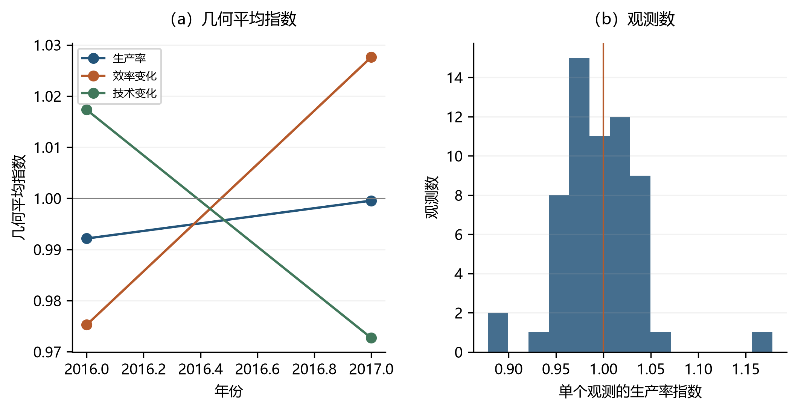

# 全要素生产率测度方法 {#sec-4}

第[-@sec-3]章介绍了经典DEA模型的基本构成、生产技术的设定以及静态效率测度方法，分析了投入、产出距离函数及其在评价企业运行中的应用。然而，随着时间推移，企业的行为与业绩会发生变化：既包括一般技术进步带来的外部效应，也包括企业相对于现有技术采取特定改进措施所产生的差异。为刻画这种动态变化，需构建能够反映企业生产率随时间变动的评价指标。Malmquist 指数是基准评估文献中最流行的动态效率测度方法，可在不依赖价格信息的条件下对多种投入与产出加以汇总，是度量企业生产率变化的基本工具。

Färe, Grosskopf, Lindgren and Roos (1992) 和 Färe, Grosskopf, Norris and Zhang (1994) 提出使用 Malmquist 指数衡量生产率变化，奠定了后续生产率测度文献的基础。该指数由 Caves, Christensen and Diewert (1982) 根据 Malmquist (1953) 的观点提出，用于衡量生产率随时间的变化。Färe, Grosskopf, Lindgren and Roos (1992) 研究了 42 家瑞典药店的生产率变化，并展示了如何将 Malmquist 指数衡量的生产率变化分解为技术效率变化和技术变化的指标；Färe, Grosskopf, Norris and Zhang (1994) 研究了 1979 年至 1988 年间经济合作与发展组织（OECD）17 个成员国的生产率变化，并将 Malmquist 指数分解为技术效率、规模效率和技术变化的指标。Malmquist 指数可乘法分解为各个分量（Färe, Grosskopf, Norris and Zhang，1994）。相关应用可参见 Kevork, Pange, Tzeremes and Tzeremes (2017)、Pastor, Lovell and Aparicio (2020)、Simar and Wilson (2023)。

作为与 Malmquist 指数并列的另一条路线，Chambers, Färe and Grosskopf (1996) 基于方向距离函数（DDF）定义了 Luenberger 指标。与 Malmquist 指数采用乘法分解不同，Luenberger 指标在加法形式下同时刻画产出扩张和投入收缩（其精确性与超等性质的研究见 Chambers (2002)），其最新应用包括 Aparicio, Pastor and Vidal (2016)、Aparicio, Garcia-Nové, Kapelko and Pastor (2017)。本章聚焦于 Malmquist 指数（乘法分解）及其在 DDF 形式下的等价表达，Luenberger 指标的加法分解留待后续章节展开。

本章按以下顺序展开：[-@sec-4-1] 节在谢泼德距离函数与方向距离函数两条路径下推导 Malmquist 指数及其效率变化—技术变化分解，并建立两类距离函数的等价关系；[-@sec-4-2] 节说明 `deabook` 包中 `DEA.mq` 与 `DEA.mqddf` 接口的参数、返回值与调用方式；[-@sec-4-3] 节将上述模型应用于 33 个 OECD 国家与中国 30 个省份 2016–2019 年的面板数据，数值上印证等价性并刻画动态产出效率的贡献结构；[-@sec-4-4] 节给出总结。

## 经典DEA模型的生产率指数 {#sec-4-1}

为解释 Malmquist 指数的概念，令 $D^i(s, t)$ 为衡量第 $i$ 个决策单元（decision making unit, DMU）在 $s$ 时期相对于 $t$ 时期技术表现的指标。例如，它可以是投入方向的谢泼德距离函数，即
$$
D^i(s, t)=\sup \left\{\lambda>0 \mid\left(x^{i s}/\lambda, y^{i s}\right) \in T^t\right\},
$$
该距离函数取值范围为 $[1,+\infty)$，在前沿上取值为 1，越远离前沿取值越大，其倒数即 Farrell 投入效率。它也可以是其他衡量标准——产出方向的距离函数 $D_o\in(0,1]$ 本身即为效率值（越接近 1 越有效）；只要所选指标能反映"越接近前沿绩效越好"即可。需要说明的是，这里开始按技术与生产数据所处的时期对二者加以区分；后文统一采用上标表示参考技术所在时期、括号内自变量表示生产计划所在时期的记号（如 $D_o^t(x^s,y^s)$），不再使用 $D^i(s,t)$ 这一过渡记号。

### 谢泼德距离函数对应的Malmquist指数 {#sec-4-1-1}

**（一）产出方向的谢泼德距离函数**为更好地捕捉决策单元在产出扩张方面的改进，首先从产出角度构建谢泼德距离函数，其定义为：
$$
D_{o}(\boldsymbol{x}, \boldsymbol{y})=\inf \left\{\theta:(\boldsymbol{x},\boldsymbol{y} / \theta) \in T\right\}
$$ {#eq-4-1}
式中，$T$ 为生产技术。设 $t$ 时期和 $s\,(s>t)$ 时期决策单元观测值分别为 $\left(x^{t}, y^{t}\right)$ 和 $\left(x^{s}, y^{s}\right)$，则基于 $t$ 时期生产技术的 Malmquist 生产率指数定义为 $s$ 时期距离函数与 $t$ 时期距离函数之比，即：
$$
M_{o}^{t}=\frac{D_{o}^{t}\left(\boldsymbol{x^{s}}, \boldsymbol{y^{s}}\right)}{D_{o}^{t}\left(\boldsymbol{x^{t}}, \boldsymbol{y^{t}}\right)}
$$ {#eq-4-2}
类似地，基于 $s$ 时期生产技术的 Malmquist 生产率指数定义为：
$$
M_{o}^{s}=\frac{D_{o}^{s}\left(\boldsymbol{x^{s}}, \boldsymbol{y^{s}}\right)}{D_{o}^{s}\left(\boldsymbol{x^{t}},\boldsymbol{y^{t}}\right)}
$$ {#eq-4-3}
若企业从 $t$ 期到 $s$ 期（$s>t$）靠近前沿，则 $D_{o}^{s}(x^{t},y^{t}) \leq D_{o}^{s}(x^{s},y^{s})$，故 $M_{o}^{s} > 1$；若远离前沿，则 $M_{o}^{s} < 1$。例如，某 DMU 在 $s$ 期技术下的产出效率由 $t$ 期的 40% 升至 80%（即 $s$ 期计划比 $t$ 期计划更接近前沿），则 $M_{o}^{s}=0.8/0.4=2$，表示其相对于 $s$ 期前沿的接近程度翻倍。当投入产出组合同时变化时，该比值仍刻画两期计划相对于同一参考前沿的接近程度之比，解释逻辑不变。

$M^s$ 衡量的是相对于技术 $s$ 的改进，也可以选择以 $t$ 期技术作为固定参照。为消除时期选择对生产率指数的影响，产出导向的 Malmquist 生产率指数最终定义为两个时期生产率指数的几何平均值，即
$$
M_{o}=\left[\frac{D_{o}^{t}\left(\boldsymbol{x^{s}},\boldsymbol{y^{s}}\right)}{D_{o}^{t}\left(\boldsymbol{x^{t}}, \boldsymbol{y^{t}}\right)} \times \frac{D_{o}^{s}\left(\boldsymbol{x^{s}}, \boldsymbol{y^{s}}\right)}{D_{o}^{s}\left(\boldsymbol{x^{t}}, \boldsymbol{y^{t}}\right)}\right]^{1 / 2}
$$ {#eq-4-4}
上式包含 4 个产出方向谢泼德距离函数：其中两个是**同期距离**（技术与被评价生产计划属同一时期）$D_{o}^{t}(\boldsymbol{x^t},\boldsymbol{y^t})$ 与 $D_{o}^{s}(\boldsymbol{x^s},\boldsymbol{y^s})$，另两个是**跨期距离** $D_{o}^{t}(\boldsymbol{x^s},\boldsymbol{y^s})$ 与 $D_{o}^{s}(\boldsymbol{x^t},\boldsymbol{y^t})$；同期与跨期在乘号两侧交叉出现，而非乘号前一对同期、乘号后一对跨期。取几何平均的目的是不单独依赖 $t$ 期或 $s$ 期技术作为参照。Malmquist 指数衡量决策单元从时期 $t$ 到时期 $s$ 的业绩改进程度。然而，业绩变化源于两个可能相互强化或抵消的因素：一是所有企业共同面临的一般性技术进步（或退步），二是决策单元特有的管理方式，后者使其业绩相对于其他 DMU 发生变化。将两个同期距离函数提取至中括号外，上式即可分解为两个部分，即
$$
\begin{aligned}
M_{o} &=\frac{D_{o}^{s}\left(\boldsymbol{x^{s}}, \boldsymbol{y^{s}} \right)}{D_{o}^{t}\left(\boldsymbol{x^{t}}, \boldsymbol{y^{t}} \right)} \times\left[          \frac{D_{o}^{t}\left(\boldsymbol{x^{t}},\boldsymbol{y^{t}} \right)}{D_{o}^{s}\left(\boldsymbol{x^{t}}, \boldsymbol{y^{t}}\right)}\times   \frac{D_{o}^{t}\left(\boldsymbol{x^{s}}, \boldsymbol{y^{s}} \right)}{D_{o}^{s}\left(\boldsymbol{x^{s}},\boldsymbol{y^{s}} \right)}        \right]^{1 / 2} \\
&=\text { MEFFCH } \times \text { MTECHCH }
\end{aligned}
$$ {#eq-4-5}
式中，效率指数 $MEFFCH$ 以当期技术为基准，衡量决策单元相对于产出技术前沿的追赶效应，即企业是否在逐步靠近现有的最佳技术状态。若企业的同期距离满足 $D_{o}^{t}(x^{t},y^{t}) < D_{o}^{s}(x^{s},y^{s})$，则该比率大于 1，表明企业正在有效追赶前沿水平。

另一方面，技术变化指数 $MTECHCH$ 通过两个比率的几何平均值衡量生产技术边界的变动：两个比率分别将决策单元在 $t$ 时期和 $s$ 时期的生产计划固定为参照点，据以观察技术的进步情况。具体而言，若技术进步（前沿上移），则在固定 $t$ 时期生产计划 $(x^{t},y^{t})$ 时，会出现 $D_{o}^{t}(x^{t},y^{t}) > D_{o}^{s}(x^{t},y^{t})$ 的情形（上标为参考技术所在时期，括号内为被评价生产计划所在时期），即同一计划在更先进的 $s$ 期技术下显得离前沿更远、效率得分更低，这恰好反映 $s$ 期前沿相对于 $t$ 期外移（此时几何平均值中的第一个比率大于 1）；第二个比率的逻辑类似，只是固定的是 $s$ 期的生产计划。

综上，$MTECHCH$ 衡量的是技术变化，其数值大于 1 时代表技术进步，即以更少的资源生产出更多的产品。

 @fig-4-1 给出含有一个投入和一个产出的 Malmquist 指数的图形示意。设区域 $OABCD$ 和 $OA′B′C′D′$ 分别代表 $t$ 和 $s$ 时期的 DEA 技术；进一步假设某 DMU 在 $t$ 和 $s$ 时期使用相同数量的投入生产不同数量的产出，分别由 $M$ 点和 $N$ 点表示。效率变化部分为 $\frac{DN/DF}{CM/CB}$，即 ([-@eq-4-5]) 式中的 MEFFCH，衡量 DMU 从 $t$ 期到 $s$ 期相对于各自当期技术的追赶效应。技术变化部分为$\left[\frac {DN/DE}{DN/DF}\cdot\frac {CM/CB}{CM/CA}\right]^{1/2}=\left[\frac {GE}{GF'}\cdot\frac {G'F}{G'E'}\right]^{1/2}$，即 ([-@eq-4-5]) 式中的 MTECHCH，衡量在投入 $x$ 水平上生产前沿从 $OC$ 到 $OD$ 的上移。

{#fig-4-1}

**（二）投入方向的谢泼德距离函数**以下从投入角度构建谢泼德距离函数，以捕捉决策单元在资源配置与利用上的调整效果。投入方向的谢泼德距离函数定义为：

$$
D_{i}(\boldsymbol{x}, \boldsymbol{y})=\sup \left\{\theta:(\boldsymbol{x}/ \theta,\boldsymbol{y}) \in T\right\}
$$ {#eq-4-6}
式中，$T$ 为生产技术。设 $t$ 时期和 $s\,(s>t)$ 时期决策单元观测值分别为 $\left(x^{t}, y^{t}\right)$ 和 $\left(x^{s}, y^{s}\right)$。由于投入方向的谢泼德距离函数取值范围为 $[1,+\infty)$，其倒数为效率值，故基于 $t$ 时期生产技术的 Malmquist 生产率指数定义为 $t$ 时期距离函数与 $s$ 时期距离函数之比，即：
$$
M_{i}^{t}=\frac{D_{i}^{t}\left(\boldsymbol{x^{t}}, \boldsymbol{y^{t}}\right)}{D_{i}^{t}\left(\boldsymbol{x^{s}}, \boldsymbol{y^{s}}\right)}
$$ {#eq-4-7}
类似地，基于 $s$ 时期生产技术的 Malmquist 生产率指数定义为：
$$
M_{i}^{s}=\frac{D_{i}^{s}\left(\boldsymbol{x^{t}}, \boldsymbol{y^{t}}\right)}{D_{i}^{s}\left(\boldsymbol{x^{s}},\boldsymbol{y^{s}}\right)}
$$ {#eq-4-8}
为消除时期选择对生产率指数的影响，投入导向的 Malmquist 生产率指数最终定义为两个时期生产率指数的几何平均值，即
$$
M_{i}=\left[\frac{D_{i}^{t}\left(\boldsymbol{x^{t}},\boldsymbol{y^{t}}\right)}{D_{i}^{t}\left(\boldsymbol{x^{s}}, \boldsymbol{y^{s}}\right)} \times \frac{D_{i}^{s}\left(\boldsymbol{x^{t}}, \boldsymbol{y^{t}}\right)}{D_{i}^{s}\left(\boldsymbol{x^{s}}, \boldsymbol{y^{s}}\right)}\right]^{1 / 2}
$$ {#eq-4-9}
上式包含 4 个投入方向的谢泼德距离函数：其中两个是**同期距离** $D_{i}^{t}(\boldsymbol{x^t},\boldsymbol{y^t})$ 与 $D_{i}^{s}(\boldsymbol{x^s},\boldsymbol{y^s})$，另两个是**跨期距离** $D_{i}^{t}(\boldsymbol{x^s},\boldsymbol{y^s})$ 与 $D_{i}^{s}(\boldsymbol{x^t},\boldsymbol{y^t})$，同期与跨期同样在乘号两侧交叉出现。将两个同期距离函数提取至中括号外，上式即可分解为两个部分，即
$$
\begin{aligned}
M_{i} &=\frac{D_{i}^{t}\left(\boldsymbol{x^{t}}, \boldsymbol{y^{t}}\right)}{D_{i}^{s}\left(\boldsymbol{x^{s}}, \boldsymbol{y^{s}}\right)} \times\left[\frac{D_{i}^{s}\left(\boldsymbol{x^{s}}, \boldsymbol{y^{s}}\right)}{D_{i}^{t}\left(\boldsymbol{x^{s}},\boldsymbol{y^{s}}\right)} \times \frac{D_{i}^{s}\left(\boldsymbol{x^{t}},\boldsymbol{y^{t}}\right)}{D_{i}^{t}\left(\boldsymbol{x^{t}}, \boldsymbol{y^{t}}\right)}\right]^{1 / 2} \\
&=\text { MEFFCH } \times \text { MTECHCH }
\end{aligned}
$$ {#eq-4-10}
其中，$MEFFCH$ 衡量观测值相对于投入技术前沿的追赶效应，$MTECHCH$ 衡量生产技术边界的变动。

 @fig-4-2 给出含有一个投入和一个产出的 Malmquist 指数在投入方向上的图形示意。设射线 $t$ 和射线 $s$ 分别代表 $t$ 和 $s$ 时期的 DEA 技术；进一步假设某 DMU 在 $t$ 和 $s$ 时期使用不同数量的投入生产相同数量的产出，分别由 $M$ 点和 $N$ 点表示。其中 $A$、$E$ 分别是 $t$ 期前沿与 $s$ 期前沿在各自产出水平上的最小投入（即当期参照点），$B$、$F$ 是跨期参照点（$B$ 在 $s$ 期前沿上、$F$ 在 $t$ 期前沿上）。于是两期的投入 Farrell 效率为 $\mathrm{TE}_t=CA/CM$、$\mathrm{TE}_s=DE/DN$，效率变化部分为 $\frac{DE/DN}{CA/CM}$，对应 ([-@eq-4-10]) 式中的 MEFFCH（$=D_i^t(x^t,y^t)/D_i^s(x^s,y^s)=\mathrm{TE}_s/\mathrm{TE}_t$），衡量 DMU 在投入缩减意义上的追赶效应。技术变化部分为$\left[\frac {DN/DE}{DN/DF}\cdot\frac {CM/CB}{CM/CA}\right]^{1/2}=\left[\frac {DF}{DE}\cdot\frac {CA}{CB}\right]^{1/2}$，对应 ([-@eq-4-10]) 式中的 MTECHCH，衡量了在产出 $y$ 水平上生产前沿的左移（前沿左移时该值大于 1）。

{#fig-4-2}

**（三）Malmquist指数的分解**[-@sec-4-1-1] 节（一）与（二）给出的两要素分解 $M_o=\mathrm{MEFFCH}\times\mathrm{MTECHCH}$（式 ([-@eq-4-5])）与 $M_i=\mathrm{MEFFCH}\times\mathrm{MTECHCH}$（式 ([-@eq-4-10])）将生产率变化归因于"效率变化"与"技术变化"两部分。然而该分解存在两点不足：其一，效率变化 $\mathrm{MEFFCH}$ 同时混杂了管理层面的纯效率改进与规模层面的效率变化，无法区分二者；其二，"技术变化"究竟是相对于规模报酬不变（CRS）前沿还是规模报酬可变（VRS）前沿度量，并未明确。Färe、Grosskopf、Norris 与 Zhang（1994，以下简称 FGNZ）提出的三要素分解，通过同时引入 CRS 与 VRS 两类谢泼德距离函数，将效率变化进一步拆解为纯效率变化与规模效率变化，并将技术变化明确置于 CRS 前沿上度量。Ray 与 Desli（1997）则指出该三要素分解并不唯一，并提出以 VRS 前沿度量技术变化的替代方案。Pastor 与 Lovell（2005）从另一思路出发，构造跨期不变的全局技术，给出满足循环性的全局 Malmquist 指数。以下分别介绍。

记 $D_o^{t,c}(\cdot)$ 与 $D_o^{t,v}(\cdot)$ 分别为以 $t$ 期技术为参考、在 CRS 与 VRS 假设下的产出方向谢泼德距离函数（输入方向同理，将下标 $o$ 换为 $i$）；上标 $c$、$v$ 分别表示 CRS、VRS。

**1. FGNZ（1994）三要素分解**

FGNZ 将产出导向 Malmquist 指数分解为纯效率变化、规模效率变化与技术变化三个乘积项：

$$
\mathrm{PEFFCH}=\frac{D_o^{t,v}(x^t,y^t)}{D_o^{s,v}(x^s,y^s)}
$$ {#eq-4-11}

$$
\mathrm{SEFFCH}=\frac{D_o^{t,c}(x^t,y^t)\big/ D_o^{t,v}(x^t,y^t)}{D_o^{s,c}(x^s,y^s)\big/ D_o^{s,v}(x^s,y^s)}
$$ {#eq-4-12}

$$
\mathrm{TECHCH}=\left[\frac{D_o^{t,c}(x^t,y^t)}{D_o^{s,c}(x^t,y^t)}\cdot \frac{D_o^{t,c}(x^s,y^s)}{D_o^{s,c}(x^s,y^s)}\right]^{1/2}
$$ {#eq-4-13}

三项相乘即还原为 Malmquist 指数：

$$
M_o=\mathrm{PEFFCH}\times\mathrm{SEFFCH}\times\mathrm{TECHCH}
$$ {#eq-4-14}

其中，$\mathrm{PEFFCH}$（纯效率变化，pure efficiency change）以 VRS 前沿为基准，刻画 DMU 相对于"最佳实践边界"的管理追赶效应，剔除了规模因素；$\mathrm{SEFFCH}$（规模效率变化，scale efficiency change）为两期 CRS 效率与 VRS 效率之比的比值，衡量 DMU 是否向最优规模移动；$\mathrm{TECHCH}$（技术变化）在 CRS 前沿上度量生产边界外移，其形式与式 ([-@eq-4-5]) 中的 $\mathrm{MTECHCH}$ 一致。易见，两要素分解满足 $\mathrm{MEFFCH}=\mathrm{PEFFCH}\times\mathrm{SEFFCH}$ 且 $\mathrm{MTECHCH}=\mathrm{TECHCH}$，故三要素分解是 ([-@eq-4-5]) 在同时拥有 CRS、VRS 距离函数时的细化。各分量大于 1 分别表示纯效率改善、趋近最优规模、技术进步。

**2. Ray 与 Desli（1997）的替代分解**

Ray 与 Desli（1997）指出，FGNZ 的三要素分解并非唯一：若将 $\mathrm{TECHCH}$ 中的一部分规模相关因子转移进 $\mathrm{SEFFCH}$，可得到形式上不同的分解，且不同分解给出的规模效率变化与技术变化解读并不一致。他们主张技术变化应相对于 VRS 前沿（而非 CRS 前沿）度量，因为 VRS 前沿才是与决策单元实际所处规模相对应的生产边界。其分解将效率变化直接取为 FGNZ 的纯效率变化：

$$
\mathrm{EFFCH}=\frac{D_o^{t,v}(x^t,y^t)}{D_o^{s,v}(x^s,y^s)}=\mathrm{PEFFCH}
$$ {#eq-4-15}

技术变化则改在 VRS 前沿上度量：Ray 与 Desli 把 FGNZ 中挂在 CRS 前沿上的规模相关因子并入 `SEFFCH`，于是技术变化等于综合效率变化（SEFFCH）与技术变化（TECHCH）的乘积，等价地写成 Malmquist 指数对效率变化的比值：

$$
\mathrm{TECHCH}^{\mathrm{RD}}=\mathrm{SEFFCH}\times\mathrm{TECHCH}=\frac{M_o}{\mathrm{EFFCH}}
$$ {#eq-4-16}

于是 Malmquist 指数可写为：

$$
M_o=\mathrm{EFFCH}\times\mathrm{TECHCH}^{\mathrm{RD}}
$$ {#eq-4-17}

与 FGNZ 分解相比，Ray–Desli 分解的效率变化分量完全相同（均为 VRS 基准的纯效率变化），差异仅在于技术变化的"归属"——FGNZ 将技术变化挂在 CRS 前沿上，Ray–Desli 将其挂在 VRS 前沿上，二者对技术变化的数值结论可能相反。需要强调的是，两种分解给出**同一个** Malmquist 指数 $M_o$，只是把它拆分为不同的因子组合：FGNZ 为 $\mathrm{PEFFCH}\times\mathrm{SEFFCH}\times\mathrm{TECHCH}$，Ray–Desli 为 $\mathrm{EFFCH}\times\mathrm{TECHCH}^{\mathrm{RD}}$，且 $\mathrm{EFFCH}=\mathrm{PEFFCH}$，故必有 $\mathrm{TECHCH}^{\mathrm{RD}}=\mathrm{SEFFCH}\times\mathrm{TECHCH}$。因此，在报告三要素分解结果时，应同时说明所采用的前沿基准。

**3. Pastor 与 Lovell（2005）全局 Malmquist 指数**

前述分解均依赖相邻两期技术的几何平均；当考察多期序列时，式 ([-@eq-4-4]) 中跨期距离函数的参考技术随期而变，可能导致指数不满足循环性（即 $M(t,s)\times M(s,r)\neq M(t,r)$）。Pastor 与 Lovell（2005）提出以跨期不变的全局技术 $T^G$ 为统一参考：

$$
T^G=\left\{(x,y):\sum_{t=1}^{T}\sum_{j=1}^{N_t}\lambda_j^t y_j^t\ge y,\ \sum_{t=1}^{T}\sum_{j=1}^{N_t}\lambda_j^t x_j^t\le x,\ \lambda_j^t\ge 0\right\}
$$ {#eq-4-18}

即把各期所有观测值汇集到同一参考集下构造前沿。基于全局技术的 Malmquist 指数定义为相邻两期到全局前沿距离之比：

$$
\mathrm{mqpi}=\frac{D^G(x^t,y^t)}{D^G(x^{t-1},y^{t-1})}
$$ {#eq-4-19}

该指数天然满足循环性与传递性，且因参考技术固定，只需对每期计算一次全局距离即可，无需跨期距离函数。在 `deabook` 包中，将 `DEA.mq`/`DEA.mqddf` 的 `tech` 参数设为 `GLOBAL` 即对应此全局技术（返回列 `mqpi`，见 [-@sec-4-2] 节全局技术组）；而前述 FGNZ 与 Ray–Desli 分解所需的 CRS、VRS 距离函数，可分别调用 `rts=RTS_CRS` 与 `rts=RTS_VRS` 两次运行 `DEA.mq`，再按式 ([-@eq-4-11])–式 ([-@eq-4-17]) 组合得到。在 `deabook` 中，这一组合已由独立接口 `DEA.mqfgnz`（FGNZ 三要素分解）、`DEA.mqrd`（Ray–Desli 分解）与 `DEA.gmqdecom`（跨期不变全局前沿分解）自动完成，见 [-@sec-4-2-5] 节；三者的输入、返回列与 [-@sec-4-2] 节的 `DEA.mq` 完全对应，区别仅在于将 CRS 与 VRS 两个径向距离函数组合成三要素分解。


### 基于方向距离函数的Malmquist指数 {#sec-4-1-2}

[-@sec-4-1-1] 节构建的谢泼德距离函数属于径向测度——产出方向只能沿 $y$ 等比例扩张、投入方向只能沿 $x$ 等比例收缩，调整方向单一。当决策单元希望同时扩张产出、缩减投入，或仅沿某一子向量调整时，径向测度不再适用。方向距离函数（DDF）通过引入方向向量 $g=(g_x,g_y)$，允许沿任意方向同时调整产出与投入，弥补了这一局限。本节在 DDF 框架下重新表述 Malmquist 指数，并建立其与 [-@sec-4-1-1] 节谢泼德形式的对应关系。

为简化记号，本节将沿方向 $g$、参考技术 $T^t$、生产计划 $(x^s,y^s)$ 的方向距离函数简记为 $\vec{D}^t(s)$，即 $\vec{D}^t(s)\equiv\vec{D}(x^s,y^s;g)$ 以 $T^t$ 为参考技术；上标为参考技术所在时期，括号内为待估生产计划所在时期。下文涉及两个方向：投入方向 $g=(\boldsymbol{x},\boldsymbol{0})$（对应 ([-@eq-4-20])、([-@eq-4-22])、([-@eq-4-23])）与产出方向 $g=(\boldsymbol{0},\boldsymbol{y})$（对应 ([-@eq-4-21])、([-@eq-4-24])、([-@eq-4-25])）。

特定方向的方向距离函数与谢泼德距离函数之间存在确定的关系（Chambers, Chung and Färe, 1998；产出方向的对应形式见 Chung, Färe and Grosskopf, 1997），据此可以使用投入或产出方向的方向距离函数构建 Malmquist 指数。具体做法是依据公式
$$
\vec{D}(\boldsymbol{x}, \boldsymbol{y}; \boldsymbol{x}, \boldsymbol{0})=1-1 / D_i(\boldsymbol{x}, \boldsymbol{y})
$$ {#eq-4-20}
将 Malmquist 指数计算公式中的投入距离函数替换为沿 $g=(\boldsymbol{x},\boldsymbol{0})$ 方向的方向距离函数；或者，依据公式
$$
\vec{D}(\boldsymbol{x}, \boldsymbol{y}; \boldsymbol{0}, \boldsymbol{y}) = \frac{1}{D_o(\boldsymbol{x}, \boldsymbol{y})} - 1
$$ {#eq-4-21}

将公式中的产出距离函数替换为沿 $g=(\boldsymbol{0},\boldsymbol{y})$ 方向的方向距离函数。当采用 $g=(\boldsymbol{x},\boldsymbol{0})$ 方向的方向距离函数衡量效率时，Malmquist 指数可计算为：
$$
M(s, t)=\sqrt{M^s M^t}=\sqrt{\frac{1-\vec{D}^t(s)}{1-\vec{D}^t(t)} \frac{1-\vec{D}^s(s)}{1-\vec{D}^s(t)}}
$$ {#eq-4-22}
式中，上标 $t,s$ 表示参考技术所在时期，括号内 $t,s$ 表示待估计的 DMU 所在时期。该指数可分解为：
$$
\begin{aligned}
M(s, t) &= \frac{1-\vec{D}^s(s)}{1-\vec{D}^t(t)} \cdot \sqrt{\frac{1-\vec{D}^t(s)}{1-\vec{D}^s(s)} \cdot \frac{1-\vec{D}^t(t)}{1-\vec{D}^s(t)}} \\
        &= MEFFCH(s, t) \cdot MTECHCH(s, t)
\end{aligned}
$$ {#eq-4-23}
同理，采用 $g=(\boldsymbol{0},\boldsymbol{y})$ 方向的方向距离函数计算效率时，Malmquist 指数为：
$$
M(s, t)=\sqrt{M^s M^t}=\sqrt{\frac{1+\vec{D}^t(t)}{1+\vec{D}^t(s)} \frac{1+\vec{D}^s(t)}{1+\vec{D}^s(s)}}
$$ {#eq-4-24}
同样可分解为：
$$
\begin{aligned}
	M(s, t) &= \frac{1+\vec{D}^t(t)}{1+\vec{D}^s(s)} \cdot \sqrt{\frac{1+\vec{D}^s(s)}{1+\vec{D}^t(s)} \cdot \frac{1+\vec{D}^s(t)}{1+\vec{D}^t(t)}} \\
	        &= MEFFCH(s, t) \cdot MTECHCH(s, t)
\end{aligned}
$$ {#eq-4-25}

至此，本节已在 DDF 框架下重新表述了 Malmquist 指数。当方向向量取 $g=(0,y)$ 或 $g=(x,0)$ 时，由 ([-@eq-4-21]) 与 ([-@eq-4-20]) 可知，DDF 形式的 Malmquist 指数与 [-@sec-4-1-1] 节基于谢泼德距离函数的 Malmquist 指数在数值上等价，差异仅在于表述形式——前者以加性冗余 $\vec{D}$ 度量，后者以径向比值 $D_o$、$D_i$ 度量。这一等价性将在 [-@sec-4-3] 节的实证中通过数值对照加以印证（其代数依据见 ([-@sec-4-3])）。下一节介绍如何用 `deabook` 包实现上述全部模型。


## 生产率测度的Python实现 {#sec-4-2}

[-@sec-4-1] 节已分别从谢泼德距离函数([-@sec-4-1-1] 节)与方向距离函数([-@sec-4-1-2] 节)两条路径，将 Malmquist 指数及其效率变化—技术变化分解归结为若干组线性规划。这些距离函数本质上是第 [-@sec-3-5] 章 CCR、BCC 与方向距离函数(DDF)模型的特例：产出（或投入）导向的谢泼德距离对应 `DEA.ccr`/`DEA.bcc` 的径向距离，DDF 形式则直接对应 `DEA.ddf`。因此，生产率的 Python 实现并非引入新的求解引擎，而是以既有的 CCR/BCC/DDF 模型为计算内核，按式 ([-@eq-4-4])–式 ([-@eq-4-10]) 与式 ([-@eq-4-22])–式 ([-@eq-4-25]) 的代数结构，对相邻期与跨期的一组距离值加以组合与分解。循此逻辑，`deabook` 以 `DEA.mq()` 封装径向谢泼德形式、`DEA.mqddf()` 封装 DDF 形式；二者通过 `orient` 区分产出与投入导向，通过 `rts` 在 CCR 与 BCC 间切换，并通过 `tech` 参数与第 [-@sec-3-4] 章的四种技术参照集——当期 `CONTEMPORARY`（默认）、窗口 `WINDOW`、时序 `SEQUENTIAL`、全局 `GLOBAL`——一一对应（其数学定义分别见 [-@sec-3-4-3] 节当期、[-@sec-3-4-4] 节 Window、[-@sec-3-4-5] 节时序、[-@sec-3-4-6] 节全局，及式 ([-@eq-3-22])–([-@eq-3-27])）。这一设计使理论部分的参考集口径与实现部分完全一致，第三章建立的 LP 框架可直接复用于生产率测度，下文仅在组合方式上做相应调整。

与第 [-@sec-3-5] 章的 `DEA.ccr(...).optimize(...)` 一致，本节接口采用**惰性求解**：`DEA.mq(...)` 等工厂只构造模型、不立即计算，需调用 `.optimize(email, solver)` 才真正求解并返回结果；`email`、`solver` 也随之从构造参数移到了 `.optimize(...)` 的参数上。五个接口全部只基于 [-@sec-3-5] 节的 `DEA.ccr`、`DEA.bcc` 与 `DEA.ddf` 实现，不再使用任何旧接口；`DEA.mqddf()` 的效率换算遵循 [-@tbl-3-6] 的规则（投入方向 $te=1-\rho$、产出方向 $te=1/(1+\rho)$）。下文围绕各接口的经济含义与组合逻辑展开，而非以说明书式顺序罗列；读者可由此理解每一组距离值所对应的生产率分量，再辅以可运行示例把握调用约定。


### 接口导入与模块组织 {#sec-4-2-1}

`deabook` 的全部 Malmquist 计算由 `DEA` 模块下的五个并列接口完成，其导入与依赖如以下代码所示；这些接口共享同一套 CCR/BCC/DDF 求解后端，差异仅在于将所得距离值按不同公式组合。

```python
from deabook import data_path, PANEL
from deabook.constant import CONTEMPORARY, GLOBAL, SEQUENTIAL, WINDOW
from deabook import DEA, PANEL
from deabook.constant import CONTEMPORARY, GLOBAL, SEQUENTIAL, WINDOW
from deabook.constant import RTS_VRS, RTS_CRS, OPT_LOCAL
import pandas as pd
```

其中，`DEA.mq()`（径向谢泼德形式）与 `DEA.mqddf()`（DDF 形式）给出两要素分解（效率变化×技术变化）；`DEA.mqfgnz()`（FGNZ 1994）、`DEA.mqrd()`（Ray–Desli 1997）与 `DEA.gmqdecom()`（Pastor–Lovell 全局前沿）进一步给出三要素分解。导入的常量按功能分三组：`RTS_VRS`/`RTS_CRS` 控制规模报酬假设，`CONTEMPORARY`/`WINDOW`/`SEQUENTIAL`/`GLOBAL` 控制技术参照集（对应第 [-@sec-3-4] 章四种参照技术），`OPT_LOCAL` 与 `solver` 控制求解方式。后三个三要素接口内部各自以 `RTS_CRS` 与 `RTS_VRS` 两次调用 `DEA.mq` 的径向距离，再按式 ([-@eq-4-11])–式 ([-@eq-4-17]) 组合，故用户无需手动拼接；它们与 `DEA.mq`、`DEA.mqddf` 共用同一套距离函数与求解后端，返回列亦在同一 `data` 上追加。

### 模型参数与参考集设定 {#sec-4-2-2}

五个接口共享同一组构造参数，其含义可从"测什么"与"以何参照"两个维度理解。`data`、`id`、`year`、`sent` 四项界定面板数据本身：`sent` 以等号分隔投入与产出变量，刻画第 [-@sec-4-1] 节生产技术 $T$ 的要素构成；`id` 与 `year` 则用于在跨期参考集中识别同一决策单元、排序相邻时期，从而构造式 ([-@eq-4-4]) 所需的同期与跨期距离。`orient` 决定生产率的度量方向——产出导向 `oo` 刻画在投入不变下扩张全部产出（对应谢泼德产出距离 $D_o$），投入导向 `io` 刻画在产出不变下缩减全部投入（对应谢泼德投入距离 $D_i$）。`rts` 在规模报酬不变（`RTS_CRS`，底层调用 `DEA.ccr`）与可变（`RTS_VRS`，底层调用 `DEA.bcc`）之间切换，直接决定距离函数所参照的前沿形状。`tech` 则决定参考集的跨期构成，与第 [-@sec-3-4] 章的四种参照技术一一对应，其具体取值与含义汇总于表 @tbl-4-1。

| 参数 | 类型 | 可选值 | 含义 |
|------|------|--------|------|
| `data` | DataFrame | — | 面板数据，需包含 `sent` 中指定的列、`id` 列和 `year` 列 |
| `id` | str | 列名（如 `dmuname`） | DMU 标识列名，用于分组计算跨期效率 |
| `year` | str | 列名（如 `"year"`） | 时间列名，需可排序 |
| `sent` | str | `"投入1 投入2 ...=产出1 产出2 ..."` | `=` 左边为投入变量，右边为产出变量 |
| | | |
| `orient` | str | `"oo"` | 产出导向：扩大全部产出，投入不变（对应谢泼德产出距离 $D_o$） |
| | str | `"io"` | 投入导向：缩减全部投入，产出不变（对应谢泼德投入距离 $D_i$） |
| | | |
| `rts` | str | `RTS_CRS` | 规模报酬不变（底层调用 `DEA.ccr`） |
| | str | `RTS_VRS` | 规模报酬可变（底层调用 `DEA.bcc`） |
| | | |
| `tech` | str | `CONTEMPORARY`（默认） | 当期技术：参考集仅为第 $t$ 期观测（§3.4-3，式 ([-@eq-3-22])）；计算 D11、D12、D21 |
| | str | `WINDOW` | 窗口技术：参考集为以 $t$ 为中心、半宽 $\lfloor w/2\rfloor$ 的局部窗（§3.4-4，式 ([-@eq-3-23])–([-@eq-3-24])） |
| | str | `SEQUENTIAL` | 时序技术：参考集为所有 $s\le t$ 期观测（§3.4-5，式 ([-@eq-3-25])），技术只进不退 |
| | str | `GLOBAL` | 全局技术：所有期合并为同一前沿（§3.4-6，式 ([-@eq-3-27])）；只计算 D11，额外返回 `mqpi` |
| | | |
| `window` | int | 奇数，默认 3 | 仅 `tech=WINDOW` 生效：窗口**全宽**，实际窗口为 $2\lfloor w/2\rfloor+1$ 期；`w=3` 即 $[t-1,t,t+1]$ |
| | | |
| `email` | str | `OPT_LOCAL` | 本地求解（传给 `.optimize(...)`） |
| | str | 邮箱地址 | 远程求解完成后发送通知 |
| | | |
| `solver` | str | `"mosek"` | 商业求解器，速度快、精度高（传给 `.optimize(...)`） |
| | str | `"glpk"` | 开源求解器 |
| | str | `"cbc"` | 开源求解器 |
: `DEA.mq` / `DEA.mqddf` 模型的主要参数 {#tbl-4-1}

表 @tbl-4-1 中，`window` 仅在 `tech=WINDOW` 时生效，表示窗口的全宽（实际跨期数为 $2\lfloor w/2\rfloor+1$，`w=3` 即 $[t-1,t,t+1]$）。值得注意的是，`email` 与 `solver` 并不随工厂传入，而是在调用 `.optimize(email, solver)` 时给出，这与第 [-@sec-3-5] 章 `DEA.ccr(...).optimize(...)` 的用法一致，也呼应了前述惰性求解的设计。`tech` 与 `orient` 二者共同决定 `.optimize()` 返回的列结构，下文即沿这两个维度展开对返回值的说明。


### 返回值的经济含义 {#sec-4-2-3}

`optimize()` 返回的 DataFrame，其列结构由 `tech` 参数与 `orient` 导向共同决定，因此也是在把第 [-@sec-4-1] 节的理论分量映射为可解释的变量。本章涉及的 `DEA.mq` 与 `DEA.mqddf` 两个接口返回列名完全一致，差异仅在底层距离值的计算方式（径向距离 vs DDF 冗余），故下文以编号表（ @tbl-4-2–4.6）覆盖两类接口在 `tech`（当期/窗口/时序/全局）与导向（`orient`）维度上的返回值，而不重复制表。读者可先把握两套列名模板：当期/窗口/时序技术的 `D11/D12/D21/MQ/MEFFCH/MTECHCH`、全局技术的 `D11/mqpi/MEFFCH/MTECHCH`（即 Pastor–Lovell 分解，$mqpi=\mathrm{MEFFCH}\times\mathrm{MTECHCH}$）。其中 `D11`、`D12`、`D21` 为构造指数所依赖的各期距离值，而 `MQ`、`MEFFCH`、`MTECHCH` 才是具有经济含义的生产率分量——分别度量总生产率变化、效率追赶与技术前沿移动；`mqpi` 则是全局前沿下的总指数。理解这些列名的经济含义，是解读 [-@sec-4-3] 节实证结果的前提。

**（一）通用列**


| 模型 | 通用列 |
|------|--------|
| `DEA.mq` | `optimization_status` |
| `DEA.mqddf` | `optimization_status` |
: 通用返回列 {#tbl-4-2}

**（二）`DEA.mq`（径向 Malmquist）— 当期/窗口/时序技术**


| 返回列 | 含义 |
|--------|------|
| `D11` | 当期技术下，$t$ 期 DMU 对 $t$ 期参考集的效率距离值 |
| `D12` | 当期技术下，$t$ 期 DMU 对 $t-1$ 期参考集的效率距离值（首期为 NaN） |
| `D21` | 当期技术下，$t$ 期 DMU 对 $t+1$ 期参考集的效率距离值（末期为 NaN） |
| `MQ` | Malmquist 指数（> 1 表示生产率提升） |
| `MEFFCH` | 效率变化（追赶效应），$= D11_t / D11_{t-1}$ |
| `MTECHCH` | 技术变化（前沿移动效应） |
: `DEA.mq` 当期/窗口/时序技术 {#tbl-4-3}

分解关系：$MQ = MEFFCH \times MTECHCH$。第一年无 MQ 值（需要相邻两期对比，首年 `MQ`/`MEFFCH`/`MTECHCH` 均为 NaN）。

> 以上是当期技术（`CONTEMPORARY`）下的 `DEA.mq` 返回表（ @tbl-4-3），核心列是 `MQ/MEFFCH/MTECHCH`，第一年因无相邻期对比而为 NaN。窗口（`WINDOW`）与时序（`SEQUENTIAL`）技术沿用同一套列名模板，只是参考集跨期构成不同（见 @tbl-4-1）。下面转入全局技术（`GLOBAL`）组：由于参考集跨期不变，只需一个全局距离即可构造指数，故 D12、D21 不再单独列出，仅保留全局距离值 `D11` 与相邻期比值 `mqpi`（即全局 Malmquist 指数，遵循 Pastor and Lovell, 2005 的全局前沿框架）。

**（三）`DEA.mq`（径向 Malmquist）— GLOBAL**


| 返回列 | 含义 |
|--------|------|
| `D11` | 全局技术下，$t$ 期 DMU 对全时期统一参考集的效率距离值 $D^G(x^t,y^t)$ |
| `mqpi` | 全局 Malmquist 生产率指数，$= D11_t / D11_{t-1}$ |
| `MEFFCH` | 效率变化：相邻两期**当期**距离之比，$= D^t(x^t,y^t)/D^{t-1}(x^{t-1},y^{t-1})$ |
| `MTECHCH` | 技术变化：最佳实践缺口（BPG）变化，$= \big[D^G_t/D^t_t\big]\big/\big[D^G_{t-1}/D^{t-1}_{t-1}\big]$ |
: `DEA.mq` 全局技术  {#tbl-4-4}

> 全局技术下，`mqpi` 是两期观测相对**同一全局前沿**的距离之比，即 $mqpi=D^{G}(\boldsymbol{x^{t}},\boldsymbol{y^{t}})/D^{G}(\boldsymbol{x^{t-1}},\boldsymbol{y^{t-1}})$（产出导向下距离取谢泼德 $D_o$，绩效提高时该比值大于 1）。按 Pastor and Lovell (2005)，该指数可分解为 $mqpi=\mathrm{MEFFCH}\times\mathrm{MTECHCH}$：其中 `MEFFCH` 是**当期技术**下相邻两期距离之比，刻画效率追赶；`MTECHCH` 是各期当期技术相对全局技术的**最佳实践缺口**（$BPG_t=D^G_t/D^t_t$）的变化，刻画生产边界的移动。这一分解同时计算全局与当期两类距离，故 `mqpi` 恒等于 `MEFFCH` 与 `MTECHCH` 的乘积。

> 至此 `DEA.mq`（径向）的两张返回表（ @tbl-4-3、4.4）已罗列完毕。下面为 `DEA.mqddf`（DDF）的对应配置，**列名与 `DEA.mq` 完全一致**，差异仅在底层距离值的计算方式（汇总见 @tbl-4-6）：径向投入导向存 $te=\rho$、产出导向存 $te=1/\rho$；DDF 投入导向存 $tei=1-\rho$、产出导向存 $teo=1/(1+\rho)$。该换算关系已在 [-@sec-4-1] 节 ([-@eq-4-20])/([-@eq-4-21]) 给出，与 [-@tbl-3-6] 一致。

**（四）`DEA.mqddf`（DDF Malmquist）— 当期/窗口/时序**


| 返回列 | 含义 |
|--------|------|
| `D11` | 当期技术下，$t$ 期 DMU 对 $t$ 期参考集的效率距离值 |
| `D12` | 当期技术下，$t$ 期 DMU 对 $t-1$ 期参考集的效率距离值（首期为 NaN） |
| `D21` | 当期技术下，$t$ 期 DMU 对 $t+1$ 期参考集的效率距离值（末期为 NaN） |
| `MQ` | Malmquist 指数（> 1 表示生产率提升） |
| `MEFFCH` | 效率变化（追赶效应），$= D11_t / D11_{t-1}$ |
| `MTECHCH` | 技术变化（前沿移动效应） |
: `DEA.mqddf` 当期/窗口/时序技术  {#tbl-4-5}

与 @tbl-4-3 列名完全相同。差异仅在底层距离值计算方式：投入导向下底层 $tei = 1 - \rho$ 存入 `D11`；产出导向下底层 $teo = 1/(1+\rho)$ 存入 `D11`。全局技术（`GLOBAL`）下沿用全局列名模板 `D11/mqpi`。

**（五）`DEA.mq` vs `DEA.mqddf` 底层差异汇总**


| 特征 | `DEA.mq` | `DEA.mqddf` |
|------|-------|-------|
| 底层模型 | `DEA.ccr`/`DEA.bcc`（径向） | `DEA.ddf`（方向距离函数） |
| 投入导向距离值 | 谢泼德投入距离 $D_i = 1/te$，存入 `D11` | 底层 $tei = 1 - \rho$，存入 `D11` |
| 产出导向距离值 | 谢泼德产出距离 $D_o = te$，存入 `D11` | 底层 $teo = 1/(1+\rho)$，存入 `D11` |
| 分解公式 | $MQ = MEFFCH \times MTECHCH$ | 相同 |
| mqpi 公式 | $mqpi = D11_t / D11_{t-1}$ | 相同 |
: `DEA.mq` 与 `DEA.mqddf` 底层差异汇总 {#tbl-4-6}

为便于对照，下表将 `tech` 的四个取值与第 [-@sec-3-4] 章的参照集定义一一对应（式 ([-@eq-3-22])–([-@eq-3-27])）：

| `tech` | 参考集（第 $t$ 期） | 技术演变假设 | 对应第3章 |
|--------|----------------------|--------------|-----------|
| `CONTEMPORARY`（默认） | 仅第 $t$ 期观测 | 每期各有前沿，可进可退 | §3.4-3，式 ([-@eq-3-22]) |
| `WINDOW` | 以 $t$ 为中心、半宽 $\lfloor w/2\rfloor$ 的窗 | 窗口内不变，窗口间可变 | §3.4-4，式 ([-@eq-3-23])–([-@eq-3-24]) |
| `SEQUENTIAL` | 所有 $s\le t$ 期观测 | 技术只进不退 | §3.4-5，式 ([-@eq-3-25]) |
| `GLOBAL` | 全部时期观测 | 全样本期技术不变 | §3.4-6，式 ([-@eq-3-27]) |

: `tech` 取值与第3章技术参照集的对应 {#tbl-4-7}


> 以上差异对 `tech=CONTEMPORARY` 和 `tech=GLOBAL` 均成立。

需要说明的是，由 ([-@eq-4-21]) 可知，产出导向下 $teo=1/(1+\rho)=D_o$，即 `DEA.mqddf` 存入 `D11` 的底层值与 `DEA.mq` 存入的谢泼德产出距离 $D_o$ 完全相同，两者因而共用同一套 MQ/MEFFCH/MTECHCH 分解公式（见 @tbl-4-6"分解公式"行）。换言之，在相同方向设定（如 $g=(\boldsymbol{0},\boldsymbol{y})$）下，`DEA.mqddf` 与 `DEA.mq` 给出完全一致的结果。该一致性由 ([-@eq-4-20])/([-@eq-4-21]) 的代数关系构造性地保证，[-@sec-4-3] 节 @tbl-case-4 与 @tbl-case-4 的逐元吻合即为此关系的数值体现，而非独立的假设检验。

返回值结构至此梳理完毕。下面以七个最小可运行示例展示 `DEA.mq` 与 `DEA.mqddf` 在产出/投入导向、当期/窗口/时序/全局技术下的调用方式，分别对应 [-@sec-4-1] 节的 ([-@eq-4-4])/([-@eq-4-9])/([-@eq-4-24]) 三组公式。

### 调用示例与约定 {#sec-4-2-4}

为说明接口的调用约定，以下七个示例覆盖 [-@sec-4-1] 节的常用组合：示例 1–2 在产出导向下对照谢泼德与 DDF 两种形式，示例 3–4 给出对应的投入导向版本，示例 5 切换到全局技术，示例 6–7 演示时序与窗口技术。需特别留意，`email`、`solver` 现在传给 `.optimize(...)` 而非工厂；不显式写 `tech` 时即默认当期技术。每一示例后所附说明，均指出其对应的理论公式，以便读者将代码与第 [-@sec-4-1] 节的推导一一对应。

**示例 1：`DEA.mq` 产出导向 — CRS + 当期技术**（对应公式 ([-@eq-4-4])–([-@eq-4-5])，产出方向谢泼德距离函数。这是 [-@sec-4-3] 节 OECD 实证的基准设定，给出标准 FGNZ (1994) 式 CRS 全要素生产率指数）：

```python
from deabook import PANEL
from deabook.constant import CONTEMPORARY, GLOBAL, SEQUENTIAL, WINDOW
model = DEA.mq(
    data, id=dmuname, year='year',
    sent="K L E=Y", orient="oo",
    rts=RTS_CRS, tech=CONTEMPORARY,
)
res = model.optimize(email=OPT_LOCAL, solver="mosek")
```

**示例 2：`DEA.mqddf` 产出导向 — CRS + 当期技术**（对应公式 ([-@eq-4-24])–([-@eq-4-25])，以 $g=(0,y)$（即 `gx=[0,0,0], gy=[1]`）替代径向产出测度，与示例 1 在该方向下数值等价，见 ([-@eq-4-21])；底层 $teo=1/(1+\rho)$，换算见 [-@tbl-3-6]）：

```python
from deabook import PANEL
from deabook.constant import CONTEMPORARY, GLOBAL, SEQUENTIAL, WINDOW
model = DEA.mqddf(
    data, id=dmuname, year='year',
    sent="K L E=Y", gx=[0, 0, 0], gy=[1],
    rts=RTS_CRS, tech=CONTEMPORARY,
)
res = model.optimize(email=OPT_LOCAL, solver="mosek")
```

**示例 3：`DEA.mq` 投入导向 — CRS + 当期技术**（对应公式 ([-@eq-4-9])–([-@eq-4-10])，投入方向谢泼德距离函数；`orient="io"` 表示缩减全部投入，产出保持不变。底层存储的是 Farrell 投入效率 $te=1/D_i$，故 `MQ>1` 仍表示生产率提升——旧 `MQDEA` 在 `orient="io"` 下返回其倒数，已在 `DEA.mq` 中修正）：

```python
from deabook import PANEL
from deabook.constant import CONTEMPORARY, GLOBAL, SEQUENTIAL, WINDOW
model = DEA.mq(
    data, id=dmuname, year='year',
    sent="K L E=Y", orient="io",
    rts=RTS_CRS, tech=CONTEMPORARY,
)
res = model.optimize(email=OPT_LOCAL, solver="mosek")
```

**示例 4：`DEA.mqddf` 投入导向 — CRS + 当期技术**（对应公式 ([-@eq-4-22])–([-@eq-4-23])，以 $g=(x,0)$（即 `gx=[1,0,0], gy=[0]`）方向的 DDF 替代径向投入测度，与示例 3 数值等价，见 ([-@eq-4-20])；底层 $tei=1-\rho$，换算见 [-@tbl-3-6]）：

```python
from deabook import PANEL
from deabook.constant import CONTEMPORARY, GLOBAL, SEQUENTIAL, WINDOW
model = DEA.mqddf(
    data, id=dmuname, year='year',
    sent="K L E=Y", gx=[1, 0, 0], gy=[0],
    rts=RTS_CRS, tech=CONTEMPORARY,
)
res = model.optimize(email=OPT_LOCAL, solver="mosek")
```

**示例 5：`DEA.mq` 产出导向 — CRS + 全局技术**（采用 `tech=GLOBAL`，参考集跨期不变，返回 `D11` 与 `mqpi`，并按 Pastor–Lovell 给出 `MEFFCH`/`MTECHCH` 分解；可避免当期技术下相邻期参考集不可行的问题）：

```python
from deabook import PANEL
from deabook.constant import CONTEMPORARY, GLOBAL, SEQUENTIAL, WINDOW
model = DEA.mq(
    data, id=dmuname, year='year',
    sent="K L E=Y", orient="oo",
    rts=RTS_CRS, tech=GLOBAL,
)
res = model.optimize(email=OPT_LOCAL, solver="mosek")
```

**示例 6：`DEA.mq` — 时序技术**（`tech=SEQUENTIAL`，参考集为所有 $s\le t$ 期观测，技术只进不退，对应式 ([-@eq-3-25])）：

```python
from deabook import PANEL
from deabook.constant import CONTEMPORARY, GLOBAL, SEQUENTIAL, WINDOW
model = DEA.mq(
    data, id=dmuname, year='year',
    sent="K L E=Y", orient="oo",
    rts=RTS_CRS, tech=SEQUENTIAL,
)
res = model.optimize(email=OPT_LOCAL, solver="mosek")
```

**示例 7：`DEA.mq` — 窗口技术**（`tech=WINDOW` 并配 `window=3`，参考集为以 $t$ 为中心、半宽 1 的局部窗 $[t-1,t,t+1]$，对应式 ([-@eq-3-23])）：

```python
from deabook import PANEL
from deabook.constant import CONTEMPORARY, GLOBAL, SEQUENTIAL, WINDOW
model = DEA.mq(
    data, id=dmuname, year='year',
    sent="K L E=Y", orient="oo",
    rts=RTS_CRS, tech=WINDOW, window=3,
)
res = model.optimize(email=OPT_LOCAL, solver="mosek")
```

上述七个示例仅演示了 API 语法，未涉及真实数据。下一节将这些接口应用于 33 个 OECD 国家与中国 30 个省份 2016–2019 年的面板数据，完成两项任务：一是以数值对照呈现 [-@sec-4-1] 节 ([-@eq-4-20])/([-@eq-4-21]) 隐含的等价性命题（其紧凑表达见 [-@sec-4-3] 节 ([-@sec-4-3]) 式）——产出方向谢泼德形式与 DDF 形式在 $g=(0,y)$ 下应给出完全一致的生产率指数；二是刻画两类样本动态产出效率的贡献结构（技术进步 vs 效率追赶）。

### 生产率分解：`DEA.mqfgnz`、`DEA.mqrd`、`DEA.gmqdecom` 及其 DDF 变体 {#sec-4-2-5}

第 [-@sec-4-1-1] 节（三）指出，FGNZ（1994）三要素分解与 Ray–Desli（1997）分解的经济意义，在于把生产率变化进一步拆解为纯效率变化、规模效率变化与技术变化三项，从而区分管理层面的追赶与前沿本身的外移。但在计算上，二者都需要同时取得 CRS 与 VRS 两类谢泼德距离函数，亦即各运行一次 `DEA.mq` 后，再按式 ([-@eq-4-11])–式 ([-@eq-4-17]) 手工组合。为避免这种"两次运行＋手工拼接"的重复劳动，`deabook` 将上述组合逻辑封装为以下并列接口，由求解后端自动完成：

* `DEA.mqfgnz(...)` —— FGNZ（1994）三要素分解，返回 `PEFFCH`、`SEFFCH`、`TECHCH`、`MQ`；
* `DEA.mqrd(...)` —— Ray–Desli（1997）分解，返回 `EFFCH`、`TECHCH_RD`、`MQ`；
* `DEA.gmqdecom(...)` —— 跨期不变的全局前沿（Pastor and Lovell, 2005）分解，`tech=GLOBAL` 下按 Pastor–Lovell 返回 `PEFFCH`、`SEFFCH`、`TECHCH`、`MQ`、`mqpi`；
* `DEA.mqfgnz.ddf(...)` / `DEA.mqrd.ddf(...)` / `DEA.gmqdecom.ddf(...)` —— 以上三者的 **DDF 变体**：距离值改由 `DEA.ddf` 求得（按 [-@tbl-3-6] 换算），方向由 `gy`/`gx` 给定（仅支持单侧方向），分解结构与返回列和径向版完全一致，等价方向下数值亦完全一致。

四组接口与 `DEA.mq`、`DEA.mqddf` 共用同一个 `tech` 参数，支持第 [-@sec-3-4] 章的全部四种技术参照集（当期 `CONTEMPORARY`、窗口 `WINDOW`、时序 `SEQUENTIAL`、全局 `GLOBAL`），`mqfgnz`（及其 DDF 变体）与 `mqrd`（及其 DDF 变体）默认当期技术，`gmqdecom`（及其 DDF 变体）默认全局技术（即 Pastor–Lovell 前沿）。窗口带宽 `window` 默认 3（全宽，即 $[t-1,t,t+1]$）。

### 三要素分解接口的参数、返回值与调用示例 {#sec-4-2-5-1}

`DEA.mqfgnz` / `DEA.mqrd` / `DEA.gmqdecom` 的参数与 `DEA.mq` 完全一致（见 @tbl-4-1），只是 `tech` 的默认值不同：`mqfgnz`/`mqrd` 默认当期（`CONTEMPORARY`），`gmqdecom` 全局（`GLOBAL`）。各接口内部自动以 `RTS_CRS` 与 `RTS_VRS` 各运行一次距离，故不需要 `rts` 参数。三个 `.ddf` 变体（`mqfgnz.ddf`/`mqrd.ddf`/`gmqdecom.ddf`）的参数与 `DEA.mqddf` 对应：以 `gy`/`gx`（单侧方向）替代 `orient`，其余相同，默认 `tech` 与各自的径向版一致。

> 时序技术（`SEQUENTIAL`）下，第 $t$ 期 DMU 的参考集为所有年份 $\le t$ 的 DMU（累积前沿）；窗口技术（`WINDOW`）下为以 $t$ 为中心、带宽 `window` 的局部窗口（如 $[t-1,t,t+1]$）。二者都比当期技术拥有更大的参考集，因而相邻期跨期距离（式 ([-@eq-4-11])–式 ([-@eq-4-17]) 中的 $D_o^{s}(x^t,y^t)$、$D_o^{t}(x^s,y^s)$）更不易不可行——这正是第 [-@sec-4-3] 节 VRS 当期技术大量出现 `NaN` 时的常用替代方案。全局技术（`GLOBAL`）参考集为全部时期的全部 DMU，技术参照跨期不变。

#### 返回值

四个接口均在输入的 `data` 上**追加**分解列后返回，行索引与输入一致，且不输出中间距离列 `D*_v`/`D*_c`；首期（及窗口/时序边界）因缺少相邻期对比而为 `NaN`。

**（一）`DEA.mqfgnz` 返回列**

| 返回列 | 含义 |
|--------|------|
| `PEFFCH` | 纯效率变化，= $D_o^{t,v}(x^t,y^t)/D_o^{s,v}(x^s,y^s)$，VRS 基准（式 ([-@eq-4-11])） |
| `SEFFCH` | 规模效率变化，= $(D_o^{t,c}/D_o^{t,v})/(D_o^{s,c}/D_o^{s,v})$，CRS/VRS 之比（式 ([-@eq-4-12])） |
| `TECHCH` | 技术变化，CRS 前沿上度量（式 ([-@eq-4-13])；全局技术下恒为 1） |
| `MQ` | Malmquist 指数，= `PEFFCH` × `SEFFCH` × `TECHCH`（式 ([-@eq-4-14])） |
| `MEFFCH` | 两要素效率变化别名，= `PEFFCH` × `SEFFCH`（与 `DEA.mq` 的 `MEFFCH` 对应） |
| `MTECHCH` | 两要素技术变化别名，= `TECHCH`（与 `DEA.mq` 的 `MTECHCH` 对应） |
: `DEA.mqfgnz` 返回列 {#tbl-4-8}

**（二）`DEA.mqrd` 返回列**

| 返回列 | 含义 |
|--------|------|
| `EFFCH` | 效率变化，= $D_o^{t,v}(x^t,y^t)/D_o^{s,v}(x^s,y^s)$，即 FGNZ 的 `PEFFCH`（式 ([-@eq-4-15])） |
| `TECHCH_RD` | 技术变化，改在 VRS 前沿上度量，= `SEFFCH` × `TECHCH`（式 ([-@eq-4-16])） |
| `MQ` | Malmquist 指数，= `EFFCH` × `TECHCH_RD`（式 ([-@eq-4-17])） |
: `DEA.mqrd` 返回列 {#tbl-4-9}

**（三）`DEA.gmqdecom` 返回列**（`tech=GLOBAL`，即 Pastor–Lovell 分解）

| 返回列 | 含义 |
|--------|------|
| `PEFFCH` | 纯效率变化：**当期技术**下相邻两期 VRS 距离之比，$D^{t,v}(x^t)/D^{t-1,v}(x^{t-1})$ |
| `SEFFCH` | 规模效率变化：**当期技术**下 CRS/VRS 之比的比值 |
| `TECHCH` | 技术变化：最佳实践缺口（BPG）变化，$\big[D^G_t/D^t_t\big]\big/\big[D^G_{t-1}/D^{t-1}_{t-1}\big]$ |
| `MQ` | 全局 Malmquist 指数，= `PEFFCH` × `SEFFCH` × `TECHCH` |
| `MEFFCH` | 两要素效率变化别名，= `PEFFCH` × `SEFFCH`（对应 `DEA.mq` 全局技术的 `MEFFCH`） |
| `MTECHCH` | 两要素技术变化别名，= `TECHCH`（对应 `DEA.mq` 全局技术的 `MTECHCH`） |
| `mqpi` | 全局生产率指数（CRS 全局距离比），$= D11_t / D11_{t-1}$，= `MQ` |
: `DEA.gmqdecom` 返回列 {#tbl-4-10}

> 在 `tech=GLOBAL` 下，`gmqdecom` 同时求解三组距离——当期 VRS、当期 CRS 与全局 CRS——并按 Pastor–Lovell 把全局指数分解为"当期纯效率变化 × 当期规模效率变化 × 最佳实践缺口变化"。若改用其他 `tech` 值，则退回该参照集下的 FGNZ 式三要素分解。

**（四）`DEA.gmqdecom.ddf` 返回列**

`DEA.gmqdecom.ddf` 的返回列与 @tbl-4-10 完全一致，区别仅在于底层距离值改由 `DEA.ddf` 求得（按 [-@tbl-3-6] 换算，投入方向 $tei=1-\rho$、产出方向 $teo=1/(1+\rho)$），方向由 `gy`/`gx` 给定。在等价方向（如 $g=(\boldsymbol{0},\boldsymbol{y})$ 对应 `orient="oo"`）下，其各列与 `DEA.gmqdecom` 数值完全一致。

#### 调用示例 {#sec-4-2-5-4}

以下示例展示 `mqfgnz` 在各参照集、`mqrd` 在当期技术，以及 `gmqdecom` 的调用方式（仅演示 API，未附结果，读者可自行运行对照）；它们与 [-@sec-4-2-4] 节的 `DEA.mq` 示例共用同一份 `data`、同一组 `sent`/`orient`/`tech`/`solver` 参数，区别仅在于分解方式由两要素转为三要素。

**示例 6：`DEA.mqfgnz` — 当期技术（三要素分解）**

```python
from deabook import PANEL
from deabook.constant import CONTEMPORARY, GLOBAL, SEQUENTIAL, WINDOW
res_fgnz = DEA.mqfgnz(
    data, id=dmuname, year='year',
    sent="K L E=Y", orient="oo",
    tech=CONTEMPORARY,          # 当期技术参照集（默认）
).optimize(email=OPT_LOCAL, solver="mosek")
# 返回列含 PEFFCH / SEFFCH / TECHCH / MQ
```

**示例 7：`DEA.mqfgnz` — 时序技术与窗口技术**

```python
from deabook import PANEL
from deabook.constant import CONTEMPORARY, GLOBAL, SEQUENTIAL, WINDOW


# 时序技术（累积前沿 year<=t）
res_seq = DEA.mqfgnz(
    data, id=dmuname, year='year',
    sent="K L E=Y", orient="oo",
    tech=SEQUENTIAL,
).optimize(email=OPT_LOCAL, solver="mosek")

# 窗口技术（带宽 3，参考集 [t-1, t, t+1]）
res_win = DEA.mqfgnz(
    data, id=dmuname, year='year',
    sent="K L E=Y", orient="oo",
    tech=WINDOW, window=3,
).optimize(email=OPT_LOCAL, solver="mosek")
```

**示例 8：`DEA.mqrd` — Ray–Desli 分解（当期技术）**

```python
from deabook import PANEL
from deabook.constant import CONTEMPORARY, GLOBAL, SEQUENTIAL, WINDOW
res_rd = DEA.mqrd(
    data, id=dmuname, year='year',
    sent="K L E=Y", orient="oo",
    tech=CONTEMPORARY,
).optimize(email=OPT_LOCAL, solver="mosek")
# 返回列含 EFFCH / TECHCH_RD / MQ
```

**示例 9：`DEA.gmqdecom` — 全局前沿分解**

```python
from deabook import PANEL
from deabook.constant import CONTEMPORARY, GLOBAL, SEQUENTIAL, WINDOW
res_global = DEA.gmqdecom(
    data, id=dmuname, year='year',
    sent="K L E=Y", orient="oo",
    tech=GLOBAL,
).optimize(email=OPT_LOCAL, solver="mosek")
# 返回列含 PEFFCH / SEFFCH / TECHCH(BPG 变化) / MQ / mqpi
```

**示例 10：`DEA.mqfgnz.ddf` / `DEA.mqrd.ddf` — 基于 DDF 的三要素分解**

```python
from deabook import PANEL
from deabook.constant import CONTEMPORARY, GLOBAL, SEQUENTIAL, WINDOW
res_fgnz_ddf = DEA.mqfgnz.ddf(
    data, id=dmuname, year='year',
    sent="K L E=Y", gy=[1], gx=[0, 0, 0],   # 产出方向 g=(0,y)，仅支持单侧方向
    tech=CONTEMPORARY,                        # 默认即当期技术
).optimize(email=OPT_LOCAL, solver="mosek")
# 返回列含 PEFFCH / SEFFCH / TECHCH / MQ，与示例 6（mqfgnz）数值一致

res_rd_ddf = DEA.mqrd.ddf(
    data, id=dmuname, year='year',
    sent="K L E=Y", gy=[1], gx=[0, 0, 0],
    tech=CONTEMPORARY,
).optimize(email=OPT_LOCAL, solver="mosek")
# 返回列含 EFFCH / TECHCH_RD / MQ，与示例 8（mqrd）数值一致
```

**示例 11：`DEA.gmqdecom.ddf` — 基于 DDF 的全局前沿分解**

```python
from deabook import PANEL
from deabook.constant import CONTEMPORARY, GLOBAL, SEQUENTIAL, WINDOW
res_global_ddf = DEA.gmqdecom.ddf(
    data, id=dmuname, year='year',
    sent="K L E=Y", gy=[1], gx=[0, 0, 0],   # 产出方向 g=(0,y)，仅支持单侧方向
    tech=GLOBAL,                              # 默认即全局技术
).optimize(email=OPT_LOCAL, solver="mosek")
# 返回列含 PEFFCH / SEFFCH / TECHCH(BPG 变化) / MQ / mqpi，与示例 9 数值一致
```

> 上述三要素分解接口与 [-@sec-4-2-4] 节的 `DEA.mq` 示例共用同一份 `data`、同一组 `sent`/`orient`/`tech`/`solver` 参数，区别仅在分解方式：示例 1–7 得到两要素分解 `MQ/MEFFCH/MTECHCH`，而本节的 `mqfgnz`/`mqrd`/`gmqdecom` 及其 DDF 变体得到三要素分解，二者可通过 [-@sec-4-2-5-3] 的等价关系相互印证。

### 与 `DEA.mq` 的等价关系 {#sec-4-2-5-3}

由于 `mqfgnz`/`mqrd`/`gmqdecom` 内部使用的径向距离与 `DEA.mq` 完全相同，二者在重叠范围内满足以下核对关系，可作为代码正确性的自检：

* `mqfgnz` 的 `MEFFCH`（= `PEFFCH`×`SEFFCH`，即 CRS 综合效率变化 $D_o^{t,c}/D_o^{s,c}$）等于以 `rts=RTS_CRS` 运行 `DEA.mq` 的 `MEFFCH`；
* `mqfgnz` 的 `MQ`（CRS 基准三要素乘积）等于以 `rts=RTS_CRS` 运行 `DEA.mq` 的 `MQ`——这正是 [-@sec-4-3] 节案例所报告的 CRS 基准 Malmquist 指数；
* `mqrd` 的 `EFFCH` 恒等于 `mqfgnz` 的 `PEFFCH`（二者均为 VRS 基准的纯效率变化 $D_o^{t,v}/D_o^{s,v}$）；相应地，由于 `TECHCH_RD = SEFFCH × TECHCH`，`mqrd` 的 `MQ` 恒等于 `mqfgnz` 的 `MQ`（Ray–Desli 与 FGNZ 只是同一指数的不同拆分，见 [-@sec-4-1-1] 节（三））；
* `gmqdecom`（`tech=GLOBAL`）与 `DEA.mq`（`tech=GLOBAL`）的 Pastor–Lovell 分解完全对应：其 `MEFFCH`（= `PEFFCH`×`SEFFCH`，当期 CRS 综合效率变化）等于 `DEA.mq` 的 `MEFFCH`；其 `TECHCH`（最佳实践缺口变化）等于 `DEA.mq` 的 `MTECHCH`；其 `MQ` 与 `mqpi` 等于 `DEA.mq` 的 `mqpi`（CRS）。

## 案例应用：中国火电行业的发电生产率 {#sec-4-3}

本例使用power plant data.xlsx中2015—2017年30个省级地区的90个观测。投入为装机容量K、相关行业劳动L、标准煤口径燃料F，产出为发电量Y。数据来源沿用第9章的统计年鉴整理口径。这是能源生产行业的生产率测度；本章不把CO2放入传统Malmquist模型，污染约束的作用留给环境生产率章节。

```python
from deabook.example.book_cases.run import FUN
FUN[4]()  # 输出完整CSV、摘要表与PNG/PDF图
```


|   期末年份 | 指标    |   有效数 |   几何均值 |   中位数 |   P10 |   P90 |
|-------:|:------|------:|-------:|------:|------:|------:|
|   2016 | 生产率指数 |    30 |  0.992 | 0.998 | 0.944 | 1.031 |
|   2016 | 效率变化  |    30 |  0.975 | 0.985 | 0.928 | 1.014 |
|   2016 | 技术变化  |    30 |  1.017 | 1.011 | 0.999 | 1.036 |
|   2017 | 生产率指数 |    30 |  1.000 | 1.002 | 0.956 | 1.037 |
|   2017 | 效率变化  |    30 |  1.028 | 1.021 | 0.987 | 1.069 |
|   2017 | 技术变化  |    30 |  0.973 | 0.976 | 0.944 | 1.000 |


: 中国火电行业的发电生产率：结果摘要 {#tbl-case-4}

{#fig-case-4 width=95%}

<!-- expanded-exhibit-note -->
表按相邻时期的期末年份展开生产率、效率变化和技术变化，分别报告有效样本数与分布。几何均值用于概括乘法指数；中位数和P10、P90用于观察个体差异。指数大于1表示改善，小于1表示下降。
<!-- /expanded-exhibit-note -->

采用当期CRS产出距离，60个相邻期组合均可计算。2016年发电生产率几何平均指数为0.992，效率变化0.975而技术变化1.017；2017年生产率约为1.000，效率追赶与技术变化方向相反。各指数在相同有效样本上取几何平均，保持MQ=EC×TC。第4章和第9章虽复用同一火电数据，但分别研究跨期发电生产率与物质守恒约束，不重复列出省份排名。

完整结果保存在配套程序的 `results/ch04_full.csv`。正文只保留模型或年度摘要，省份、电厂明细不占用书内表格行数。

## 本章小结 {#sec-4-4}

火电发电生产率的变化需要区分效率追赶和技术前沿移动。完整面板用于跨期匹配，摘要表与趋势图承担不同展示任务。

## 参考文献 {.unnumbered}

ANDERSEN P, PETERSEN N C. A procedure for ranking efficient units in data envelopment analysis [J]. Management Science, 1993, 39(10): 1261-1264. DOI: 10.1287/mnsc.39.10.1261.

APARICIO J, GARCIA-NOVÉ E M, KAPELKO M, PASTOR J T. Graph productivity change measure using the least distance to the Pareto-efficient frontier in data envelopment analysis [J]. Omega, 2017, 72: 1-14. DOI: 10.1016/j.omega.2016.10.005.

APARICIO J, PASTOR J T, VIDAL F. The weighted additive distance function [J]. European Journal of Operational Research, 2016, 254(1): 338-346. DOI: 10.1016/j.ejor.2016.04.006.

CAVES D W, CHRISTENSEN L R, DIEWERT W E. The economic theory of index numbers and the measurement of input, output, and productivity [J]. Econometrica, 1982, 50(6): 1393-1414. DOI: 10.2307/1913388.

CHAMBERS R G, CHUNG Y, FÄRE R. Profit, directional distance functions, and Nerlovian efficiency [J]. Journal of Optimization Theory and Applications, 1998, 98(2): 351-364. DOI: 10.1023/A:1022637501082.

CHAMBERS R G, FÄRE R, GROSSKOPF S. Productivity growth in APEC countries [J]. Pacific Economic Review, 1996, 1(3): 181-190. DOI: 10.1111/j.1468-0106.1996.tb00184.x.

CHAMBERS R G. Exact nonradial input, output, and productivity measurement [J]. Economic Theory, 2002, 20(4): 751-765. DOI: 10.1007/s001990100231.

CHUNG Y H, FÄRE R, GROSSKOPF S. Productivity and undesirable outputs: A directional distance function approach [J]. Journal of Environmental Management, 1997, 51(3): 229-240. DOI: 10.1006/jema.1997.0146.

FEENSTRA R C, INKLAAR R, TIMMER M P. The next generation of the Penn World Table [J]. American Economic Review, 2015, 105(10): 3150-3182. DOI: 10.1257/aer.20130954.

FÄRE R, GROSSKOPF S, LINDGREN B, ROOS P. Productivity changes in Swedish pharmacies 1980–1989: A non-parametric Malmquist approach [J]. Journal of Productivity Analysis, 1992, 3(1): 85-101. DOI: 10.1007/BF00158770.

FÄRE R, GROSSKOPF S, NORRIS M, ZHANG Z. Productivity growth, technical progress, and efficiency change in industrialized countries [J]. American Economic Review, 1994, 84(1): 66-83.

KEVORK I S, PANGE J, TZEREMES P, TZEREMES N G. Estimating Malmquist productivity indexes using probabilistic directional distances: An application to the European banking sector [J]. European Journal of Operational Research, 2017, 261(3): 1125-1140. DOI: 10.1016/j.ejor.2017.03.012.

MALMQUIST S. Index numbers and indifference surfaces [J]. Trabajos de Estadística, 1953, 4(2): 209-242. DOI: 10.1007/BF03006863.

PASTOR J T, LOVELL C A K, APARICIO J. Defining a new graph inefficiency measure for the proportional directional distance function and introducing a new Malmquist productivity index [J]. European Journal of Operational Research, 2020, 281(1): 222-230. DOI: 10.1016/j.ejor.2019.08.021.

PASTOR J T, LOVELL C A K. A global Malmquist productivity index [J]. Economics Letters, 2005, 88(2): 266-271. DOI: 10.1016/j.econlet.2005.02.013.

RAY S, DESLI E. Productivity growth, technical progress, and efficiency change in industrialized countries: Comment [J]. American Economic Review, 1997, 87(5): 1033-1039.

SIMAR L, WILSON P W. Another look at productivity growth in industrialized countries [J]. Journal of Productivity Analysis, 2023, 60(3): 257-272. DOI: 10.1007/s11123-023-00689-w.
