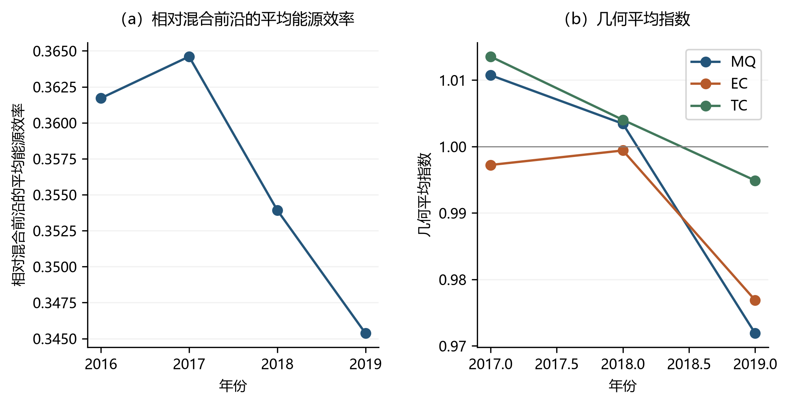

# 能源效率与能源生产率测度方法 {#sec-5}

在非参数（DEA）框架下，能源效率测算的经典起点是 Hu and Wang (2006) 提出的全要素能源效率（total-factor energy efficiency, TFEE），即目标能源投入与实际能源投入之比。能源效率的数值内涵取决于其口径设定：同一决策单元在不同技术集、调整方向及规模报酬假设下所得效率水平并不具备直接可比性。能源效率与能源生产率测度的核心难点在于：如何在多投入、多产出的生产结构中，分离能源投入节约、其他要素配置与技术前沿移动三者之间的关系。

本章沿一条递进的线索构造能源效率测度。**第一步**从最一般的谢泼德投入距离函数出发：所有投入（能源与非能源）按同一比例径向缩减。该口径简单、与经典 DEA 直接对接，但存在**短板效应**——径向缩减比例由节约潜力最小的投入决定，从而系统性低估能源专项节约潜力（Lin and Du, 2013）。**第二步**因此把能源从一般投入中剥离出来，固定其他投入与产出、只沿能源方向径向缩减，得到谢泼德能源距离函数（Zhou, Ang and Zhou, 2012）；Lin and Du (2013) 正是在这一口径下评估了中国各省份的能源效率。**第三步**再引入方向距离函数（DDF），把"调整什么、调整多少"完全交给研究者设定：既可以只沿能源一个方向调整，也可以让能源缩减与产出扩张同时发生，从而刻画"节能"与"增产"的联合改进空间。设非能源投入向量为 $\boldsymbol{x}=\left(x_1, x_2, \cdots, x_K\right)^{\mathrm{T}} \in \Re_{+}^K$，能源投入向量为 $\boldsymbol{e}=\left(e_1, e_2, \cdots, e_M\right)^{\mathrm{T}} \in \Re_{+}^M$，产出向量为 $\boldsymbol{y}=\left(y_1, y_2, \cdots, y_L\right)^{\mathrm{T}} \in \Re_{+}^L$。下文先按上述三步给出静态效率模型，再在同一技术设定下构造跨期能源生产率指数。静态能源效率刻画某一时期观测点相对于当期前沿的位置，但无法区分效率变化来自决策单元自身追赶还是技术前沿移动；能源生产率指数正是为分离这两种来源而构造，本章 [-@sec-5-4] 节将予以展开。


## 投入距离函数 {#sec-5-1}

### 谢泼德投入距离函数模型 {#sec-5-1-1}

投入距离函数是能源效率测算的自然起点。谢泼德投入距离函数（Shephard, 1970；Färe, Grosskopf and Lovell, 1985）采用径向收缩方式，将能源投入和非能源投入按同一比例压缩，适用于在产出水平保持不变的前提下考察全部投入共同节约空间的情形。

对被评价决策单元 $o$，在给定产出 $\boldsymbol{y}^o$ 不下降的条件下，模型通过最小化比例因子 $\theta$ 寻找可行的投入组合 $(\theta\boldsymbol{x}^o,\theta\boldsymbol{e}^o)$。若 $\theta=1$，说明该决策单元位于投入节约前沿；若 $\theta<1$，则存在按相同比例削减能源和非能源投入的空间。规模报酬不变（CRS）情形的线性规划为：
$$
\begin{aligned}
& \min_{\theta,\lambda^1,\ldots,\lambda^N}\theta \\
& \text{s.t. }\sum_{j=1}^N\lambda^j x_k^j\le \theta x_k^o,\quad k=1,\ldots,K \\
& \phantom{\text{s.t. }}\sum_{j=1}^N\lambda^j e_m^j\le \theta e_m^o,\quad m=1,\ldots,M \\
& \phantom{\text{s.t. }}\sum_{j=1}^N\lambda^j y_l^j\ge y_l^o,\quad l=1,\ldots,L \\
& \phantom{\text{s.t. }}\lambda^j\ge 0
\end{aligned}
$$ {#eq-5-1}

规模报酬可变（VRS）情形在式（[-@eq-5-1]）的基础上额外加入权重和为 1 的凸性约束 $\sum_{j=1}^N\lambda^j=1$，其规划为：
$$
\begin{aligned}
& \min_{\theta,\lambda^1,\ldots,\lambda^N}\theta \\
& \text{s.t. }\sum_{j=1}^N\lambda^j x_k^j\le \theta x_k^o,\quad k=1,\ldots,K \\
& \phantom{\text{s.t. }}\sum_{j=1}^N\lambda^j e_m^j\le \theta e_m^o,\quad m=1,\ldots,M \\
& \phantom{\text{s.t. }}\sum_{j=1}^N\lambda^j y_l^j\ge y_l^o,\quad l=1,\ldots,L \\
& \phantom{\text{s.t. }}\sum_{j=1}^N\lambda^j=1 \\
& \phantom{\text{s.t. }}\lambda^j\ge 0
\end{aligned}
$$ {#eq-5-2}

式（[-@eq-5-1]）与式（[-@eq-5-2]）给出谢泼德投入距离函数的径向规划，按规模报酬假设分为 CRS 与 VRS 两种情形。下文各 DEA 规划的规模报酬约束均按这两种方式处理，不再逐一说明。该设定下能源效率（$EE$）定义为：
$$
EE=\theta
$$
值得指出的是，方向距离函数取 $\boldsymbol{g}=(\boldsymbol{x},\boldsymbol{e},\boldsymbol{0})$（全部投入沿观测方向同步缩减、产出不变）时，投入约束化为 $(1-\beta)\boldsymbol{x}$ 与 $(1-\beta)\boldsymbol{e}$，与式（[-@eq-5-1]）仅差变量替换 $\theta=1-\beta$，两种表述数值等价，因而同样继承下述短板效应。

### 短板效应 {#sec-5-1-2}

径向口径要求所有投入**等比例**缩减，这一要求隐含着一个关键问题：可行的缩减比例由**节约潜力最小的投入**决定，正如木桶的容量由最短的木板决定。Lin and Du (2013) 将其称为"短板效应"（bucket effect），并给出了一个直观的数值例子。

设想一个经济体的能源、资本、劳动在保持产出不变时分别可以缩减 30%、20% 与 10%。径向口径要求三者按同一比例 $\theta$ 压缩，可行的 $\theta$ 由最不易缩减的投入——此处为劳动——决定，$\theta$ 至多降至 0.9。于是式（[-@eq-5-1]）测得的"能源效率"为 0.9，相应的结论是"该经济体可节约 10% 的能源投入"；而能源本身真实的节约潜力是 30%。换言之，径向口径**系统性低估**能源专项节约潜力，且低估幅度取决于其他投入的冗余程度，与能源利用状况本身无关。Hu and Wang (2006) 的 TFEE 指标虽以"目标能源投入/实际能源投入"定义，但其 DEA 实现要求能源与其他投入同比例缩减（能源的目标值随全投入径向投影一起得到），因而同样受短板效应影响。

短板效应的根源在于：能源节约与其他投入配置被捆绑在同一个比例因子上。要分离出能源本身的节约潜力，就必须允许能源**单独**缩减、其他投入保持不变——这正是下一节谢泼德能源距离函数的出发点。


## 谢泼德能源距离函数模型 {#sec-5-2}

为克服短板效应，应把能源投入从一般投入中单独剥离：固定非能源投入 $\boldsymbol{x}$ 和产出 $\boldsymbol{y}$，仅沿能源投入 $\boldsymbol{e}$ 的方向径向缩减。Zhou, Ang and Zhou (2012) 定义了这一能源专项的谢泼德能源距离函数；Lin and Du (2013) 认为由此定义的能源效率"更合适"，因为它直接度量能源本身的节约潜力，而不受其他投入冗余程度的干扰。该设定将能源利用效率与一般投入效率区分开来，适用于解释单位产出能源消耗、能源强度或能源约束政策下的技术改进空间。

式（[-@eq-5-4]）通过最小化能源缩放比例 $\theta$ 来构造能源专项效率。非能源投入约束保持在观测水平 $x_k^o$，产出约束要求不低于观测产出 $y_l^o$，只有能源投入允许按 $\theta$ 比例缩减：
$$
\begin{aligned}
& \min _{\theta, \lambda^1, \ldots, \lambda^N} \theta \\
& \text { s.t. } \sum_{j=1}^N \lambda^j x_k^j \leq x_k^o  , \quad k=1, \ldots, K \\
 &\sum_{j=1}^N \lambda^j e_m^j \leq \theta e_m^o  , \quad m=1, \ldots, M \\
& \sum_{j=1}^N \lambda^j y_l^j \geq  y_l^o , \quad l=1, \ldots, L \\
& \lambda^{j}  \geq 0 \\
\end{aligned}
$$ {#eq-5-4}
规模报酬约束：CRS 下不加入凸性约束，VRS 下加入 $\sum_{j=1}^N\lambda^j=1$（与式（[-@eq-5-1]）及式（[-@eq-5-2]）一致，下文各 DEA 规划均按此处理，不再逐一说明）。该设定下能源效率（EE）定义为：
$$
EE=\theta
$$

能源专项口径与全投入口径（[-@eq-5-1]）的区别在于约束条件的非对称性：非能源投入不参与径向收缩，而能源投入单独收缩。两者的效率值存在明确的大小关系：式（[-@eq-5-4]）的非能源约束 $\sum_j\lambda^j x_k^j\le x_k^o$ 比式（[-@eq-5-1]）的 $\sum_j\lambda^j x_k^j\le \theta x_k^o$（$\theta\le 1$）更松，可行域更大，最小值因而不会更大，即 $\theta_{\text{能源}}\le\theta_{\text{全投入}}$。回到 [-@sec-5-1-2] 节的数值例子：全投入口径测得 $\theta=0.9$（节能 10%），能源专项口径测得 $\theta=0.7$（节能 30%）——能源专项的效率得分**更低**，但揭示的节能空间**更大**，且后者才是能源本身的节约潜力。因此，$EE=\theta$ 反映的是在既定资本、劳动和产出条件下的能源节约潜力；若将其与全投入效率混合解释，会夸大能源专项技术进步的含义。从距离函数的一般形式看，式（[-@eq-5-4]）正是第 [-@sec-3] 章 [-@sec-3-2-2] 节（投入距离函数）所涵盖的单投入谢泼德距离函数（[-@eq-3-6]）——只是被单独径向缩减的投入由资本换成了能源。

## 方向距离函数模型 {#sec-5-3}

径向测度将调整比例限定于能源（或全部投入）单一维度。方向距离函数（Chambers, Chung and Färe, 1996）通过预设方向向量 $\boldsymbol{g}=(\boldsymbol{g_x},\boldsymbol{g_e},\boldsymbol{g_y})$ 描述效率改进路径，允许研究者明确指定哪些变量缩减、哪些变量扩张以及各变量的调整幅度。在能源问题中，方向距离函数提供两类常用选择：**只调整能源一个方向**，或**让能源缩减与产出扩张同时发生**。两类选择的非能源投入方向分量均取 $\boldsymbol{g_x}=\boldsymbol{0}$，即资本与劳动保持在观测水平，从而延续 [-@sec-5-2] 节克服短板效应的思路。

### 只调整能源一个方向 {#sec-5-3-1}

方向向量取 $\boldsymbol{g}=(\boldsymbol{0},\boldsymbol{e},\boldsymbol{0})$：非能源投入方向分量 $\boldsymbol{g_x}=\boldsymbol{0}$ 固定资本与劳动的调整空间，能源方向分量 $\boldsymbol{g_e}=\boldsymbol{e}$ 沿能源投入原始规模设定压缩路径，产出方向分量 $\boldsymbol{g_y}=\boldsymbol{0}$ 保持产出不变。这一非对称设计使方向距离函数在度量口径上与 [-@sec-5-2] 节的谢泼德能源距离函数一致——都衡量纯粹能源要素的节约潜力——但以加法形式刻画调整幅度，便于在不同投入维度上设定不同的方向权重。

固定非能源投入可隔离资本、劳动力等要素变动对能效评估的干扰，适用于评估既有生产设备条件下的能源节约空间；能源压缩方向 $\boldsymbol{g_e}=\boldsymbol{e}$ 与观测值同构，使模型度量的是"在当前能源投入规模下的最大可压缩比例"，与单位产出能耗、能源强度等指标的政策含义相对应。对应的 DEA 规划通过最大化能源可压缩比例 $\beta$ 构造生产前沿：
$$
\begin{array}{ll}
 &\vec{D}_{}  \left(\boldsymbol{x}^o, \boldsymbol{e}^o, \boldsymbol{y}^o ; \boldsymbol{g}_{x}^o,\boldsymbol{g}_{e}^o, \boldsymbol{g}_{y}^o\right)=\max \underset {\lambda^{j}, \beta}{ }\ \beta \\
\text { s.t. } 
& \sum_{j=1}^{N} \lambda^{j} y_l^{j} \geqslant y_l^o, l=1, \cdots, L \\
& \sum_{j=1}^{N} \lambda^{j} x_k^{j} \leqslant x_k^o , k=1, \cdots, K \\
& \sum_{j=1}^{N} \lambda^{j} e_m^{j} \leqslant e_m^o-\beta g_{m e}^o, m=1, \cdots, M \\
& \lambda^{j} \geqslant 0, j=1, \cdots, N
\end{array}
$$ {#eq-5-5}
规模报酬约束：CRS 下不加入凸性约束，VRS 下加入 $\sum_{j=1}^N\lambda^j=1$。此时，能源效率（EE）定义为：
$$
EE=1-\beta
$$
因此，$1-\beta$ 越接近 1，说明能源投入越接近前沿水平；$\beta$ 越大，则表示在保持非能源投入和产出不变时可节约的能源投入比例越高。该指标是本章后续案例所采用的主要静态能源效率口径。由于 $\boldsymbol{g_e}=\boldsymbol{e}$ 时能源约束化为 $(1-\beta)\boldsymbol{e}$，式（[-@eq-5-5]）与式（[-@eq-5-4]）仅差变量替换 $\theta=1-\beta$，两种表述数值等价。

### 能源缩减与产出扩张同时进行 {#sec-5-3-2}

若研究问题不只关心"给定产出能节约多少能源"，还关心能源节约与产出提升能否兼得，可将产出方向分量打开：方向向量取 $\boldsymbol{g}=(\boldsymbol{0},\boldsymbol{e},\boldsymbol{y})$，能源沿 $\boldsymbol{g_e}=\boldsymbol{e}$ 缩减、产出沿 $\boldsymbol{g_y}=\boldsymbol{y}$ 扩张，资本与劳动仍固定在观测水平。该设定刻画的是"节能"与"增产"的联合改进空间：$\beta$ 越大，说明在不增加其他投入的前提下，能源压缩与产出扩张的同时改进幅度越大，与能源强度类指标（单位产出的能源消耗）的政策含义直接对应。

对应 DEA 规划通过最大化联合改进幅度 $\beta$ 构造生产前沿：
$$
\begin{array}{ll}
 &\vec{D}_{}  \left(\boldsymbol{x}^o,\boldsymbol{e}^o,  \boldsymbol{y}^o ; \boldsymbol{g}_{x}^o,\boldsymbol{g}_{e}^o, \boldsymbol{g}_{y}^o\right)=\max \underset {\lambda^{j}, \beta}{ }\ \beta \\
\text { s.t. } 
& \sum_{j=1}^{N} \lambda^{j} y_l^{j} \geqslant y_l^o+\beta g_{l y}^o, l=1, \cdots, L \\
& \sum_{j=1}^{N} \lambda^{j} x_k^{j} \leqslant x_k^o , k=1, \cdots, K \\
& \sum_{j=1}^{N} \lambda^{j} e_m^{j} \leqslant e_m^o-\beta g_{m e}^o, m=1, \cdots, M \\
& \lambda^{j} \geqslant 0, j=1, \cdots, N
\end{array}
$$ {#eq-5-6}
规模报酬约束：CRS 下不加入凸性约束，VRS 下加入 $\sum_{j=1}^N\lambda^j=1$。此时 $\beta^*$ 同时包含能源端的压缩与产出端的扩张，若要把它折算成落在 $[0,1]$ 的绩效指数，应与第 [-@sec-3] 章的口径一致，采用
$$
EEI=\frac{1-\beta^*}{1+\beta^*}
$$
或分别报告能源端的 $1-\beta^*$ 与产出端的 $1/(1+\beta^*)$。$EEI$ 越接近 1，说明联合改进空间越小、决策单元越接近方向前沿。需要提醒的是：$1-\beta^*$ 只刻画能源端的收缩比例，既不能单独当作联合改进口径下的能源效率，也不能与式（[-@eq-5-4]）的 $EE=\theta$ 或式（[-@eq-5-5]）的 $EE=1-\beta$ 直接比较；本节的 $\boldsymbol{g}=(\boldsymbol{0},\boldsymbol{e},\boldsymbol{y})$ 与 [-@sec-5-3-1] 节纯能源方向 $\boldsymbol{g}=(\boldsymbol{0},\boldsymbol{e},\boldsymbol{0})$ 也不是同一指标。由于 $\beta$ 同时反映投入和产出调整，结果解释时应说明方向向量的选择，否则不同研究之间的效率水平不具备直接可比性。


## 能源生产率 {#sec-5-4}

为分离决策单元自身追赶与技术前沿移动这两种来源，本节构造跨期能源生产率指数。Malmquist 指数（Caves, Christensen and Diewert, 1982；Färe, Grosskopf, Norris and Zhang, 1994）利用跨期距离函数比较不同时期的生产计划和技术前沿，并将生产率变化分解为效率变化（MEFFCH）和技术变化（MTECHCH），其分解形式采用 Färe, Grosskopf, Norris and Zhang (1994) 的 DEA 实现。其中，$MQ>1$ 表示相邻期能源生产率提高，$MQ<1$ 表示能源生产率下降；MEFFCH 反映决策单元相对于前沿的追赶或退步，MTECHCH 反映样本技术前沿的移动。

沿用前文符号，非能源投入、能源投入和产出分别记为 $\boldsymbol{x}=\left(x_1, x_2, \cdots, x_K\right)^{\mathrm{T}} \in \Re_{+}^K$、$\boldsymbol{e}=\left(e_1, e_2, \cdots, e_M\right)^{\mathrm{T}} \in \Re_{+}^M$ 和 $\boldsymbol{y}=\left(y_1, y_2, \cdots, y_L\right)^{\mathrm{T}} \in \Re_{+}^L$。令 $s$ 表示后一期、$t$ 表示前一期，$\theta_o^\tau(q)$ 表示决策单元 $o$ 在 $q$ 期的生产计划相对于 $\tau$ 期技术前沿计算得到的效率型距离指标：谢泼德口径下为 Farrell 型效率分数，方向距离口径下为 $1-\vec{D}$ 型方向效率；数值越接近 1，表示越接近参考前沿。由于本章程序的返回值均为效率分数而非距离函数本身，后文动态公式统一使用 $\theta$ 表示效率型距离指标。

Malmquist 指数的定义与口径无关。指数定义为两个相邻时期指数的几何平均：
$$
M(s, t)=\sqrt{M^s M^t}=\sqrt{\frac{\theta_o^t(s)}{\theta_o^t(t)} \frac{\theta_o^s(s)}{\theta_o^s(t)}}
$$ {#eq-5-8}
其中，$M(s,t)>1$ 表示从前一期 $t$ 到后一期 $s$ 的能源生产率提高。该指数可分解为技术变化和效率变化（Färe, Grosskopf, Norris and Zhang, 1994）：
$$
\begin{split}
M(s, t) &= \sqrt{ \frac{\theta_o^t(s)}{\theta_o^s(s)} \cdot \frac{\theta_o^t(t)}{\theta_o^s(t)} } \cdot \frac{\theta_o^s(s)}{\theta_o^t(t)} \\
&= MTECHCH(s, t) \cdot MEFFCH(s, t)
\end{split}
$$ {#eq-5-9}

动态指标的口径必须与静态效率指标一致：全投入口径（[-@sec-5-1] 节）下的指数衡量全投入径向意义上的生产率变化，并继承短板效应；能源专项口径（[-@sec-5-2]、[-@sec-5-3] 节）下的指数衡量能源专项（或能源—产出联合）的生产率变化。只有在同一技术集、同一方向向量和同一规模报酬假设下，跨期指数及其分解才具有明确经济含义。

已有研究将该思路用于城市、国家和资源型经济体的能源绩效评价。例如，Zheng (2021) 基于 2012—2018 年 23 个城市面板数据测算全要素能源效率，并分解效率变化和技术变化；Shah, Hao, Yan, Yasmeen and Lu (2023) 考察 2001—2019 年南亚国家能源效率变化；Tachega, Yao, Liu, Ahmed, Li and Mintah (2021) 评估 2010—2017 年非洲产油国能源效率及其决定因素。


### 基于能源专项谢泼德距离函数的能源生产率 {#sec-5-4-1}

能源专项口径与 [-@sec-5-2] 节的谢泼德能源距离函数对应：固定非能源投入和产出条件，仅允许能源投入缩减，考察能源投入相对于不同时期技术前沿的可压缩程度，因而更适合解释能源专项生产率变化。

Malmquist 指数的定义与分解同式（[-@eq-5-8]）、（[-@eq-5-9]）结构相同，区别仅在于跨期效率分数由能源专项距离函数给出：
$$
M(s, t)=\sqrt{M^s M^t}=\sqrt{\frac{\theta_o^t(s)}{\theta_o^t(t)} \frac{\theta_o^s(s)}{\theta_o^s(t)}}= MTECHCH(s, t) \cdot MEFFCH(s, t)
$$ {#eq-5-16}
**同期效率计算模型**：$s$ 期技术下的同期效率分数由下式求解：
$$
\begin{aligned}
& \theta_o^s(s)=\min _{\theta, \lambda^1, \ldots, \lambda^N} \theta \\
& \text { s.t. } \sum_{j=1}^N \lambda^j x_k^{js} \leq   x_k^{os}  , \quad k=1, \ldots, K \\
 & \sum_{j=1}^N \lambda^j e_m^{js}  \leq \theta e_m^{os} , \quad m=1, \ldots, M \\
&  \sum_{j=1}^N \lambda^j y_l^{js} \geq y_l^{os} , \quad l=1, \ldots, L \\
& \lambda^{j} \geq 0 \\
\end{aligned}
$$ {#eq-5-17}
**跨期效率计算模型**：$t$ 期技术下评价 $s$ 期观测值时，跨期效率分数由下式求解：
$$
\begin{aligned}
& \theta_o^t(s)=\min _{\theta, \lambda^1, \ldots, \lambda^N} \theta \\
& \text { s.t. } \sum_{j=1}^N \lambda^j x_k^{jt} \leq   x_k^{os}  , \quad k=1, \ldots, K \\
 & \sum_{j=1}^N \lambda^j e_m^{jt} \leq \theta e_m^{os}  , \quad m=1, \ldots, M \\
&  \sum_{j=1}^N \lambda^j y_l^{jt} \geq y_l^{os} , \quad l=1, \ldots, L \\
& \lambda^{j} \geq 0 \\
\end{aligned}
$$ {#eq-5-18}
规模报酬约束：CRS 下不加入凸性约束，VRS 下加入 $\sum_{j=1}^N\lambda^j=1$。

### 基于能源专项方向距离函数的能源生产率 {#sec-5-4-2}

方向距离口径与 [-@sec-5-3] 节对应。取方向向量 $\boldsymbol{g}=(\boldsymbol{0},\boldsymbol{e},\boldsymbol{0})$（只调整能源方向）时，将式（[-@eq-5-8]）、（[-@eq-5-9]）中的效率分数 $\theta_o^\tau(q)$ 替换为方向效率 $1-\vec{D}_o^\tau(q)$，即得能源专项方向距离口径的 Malmquist 指数及其分解：
$$
M(s, t)=\sqrt{\frac{1-\vec{D}_o^t(s)}{1-\vec{D}_o^t(t)} \frac{1-\vec{D}_o^s(s)}{1-\vec{D}_o^s(t)}}= MTECHCH(s, t) \cdot MEFFCH(s, t)
$$ {#eq-5-19}
式（[-@eq-5-19]）与式（[-@eq-5-8]）具有相同的效率型比值方向，程序先将方向距离函数值转换为投入效率，再用跨期效率比率构造 `MQ`、`MEFFCH` 和 `MTECHCH`；后文案例中 `MQ>1` 仍解释为相邻期能源生产率提高。

在对应的方向距离模型中，$s$ 期技术评价 $s$ 期观测值的同期距离为：
$$
\begin{array}{ll}
 &\vec{D}_o^s(s)=\max \underset {\lambda^{j}, \beta}{ }\ \beta \\
\text { s.t. } 
& \sum_{j=1}^{N} \lambda^{j} y_l^{js} \geqslant y_l^{os}, l=1, \cdots, L \\
& \sum_{j=1}^{N} \lambda^{j} x_k^{js} \leqslant x_k^{os} , k=1, \cdots, K \\
& \sum_{j=1}^{N} \lambda^{j} e_m^{js} \leqslant e_m^{os}-\beta g_{m e}^{os}, m=1, \cdots, M \\
& \lambda^{j} \geqslant 0, j=1, \cdots, N
\end{array}
$$ {#eq-5-20}
$t$ 期技术评价 $s$ 期观测值的跨期距离为：
$$
\begin{array}{ll}
 &\vec{D}_o^t(s)=\max \underset {\lambda^{j}, \beta}{ }\ \beta \\
\text { s.t. } 
& \sum_{j=1}^{N} \lambda^{j} y_l^{jt} \geqslant y_l^{os}, l=1, \cdots, L \\
& \sum_{j=1}^{N} \lambda^{j} x_k^{jt} \leqslant x_k^{os} , k=1, \cdots, K \\
& \sum_{j=1}^{N} \lambda^{j} e_m^{jt} \leqslant e_m^{os}-\beta g_{m e}^{os}, m=1, \cdots, M \\
& \lambda^{j} \geqslant 0, j=1, \cdots, N
\end{array}
$$ {#eq-5-21}
规模报酬约束：CRS 下不加入凸性约束，VRS 下加入 $\sum_{j=1}^N\lambda^j=1$。若研究问题关注能源与产出的联合动态改进，方向向量亦可取 $\boldsymbol{g}=(\boldsymbol{0},\boldsymbol{e},\boldsymbol{y})$（见 [-@sec-5-3-2] 节），指数的构造方式完全相同，只需将方向效率相应替换；解释时应说明该口径同时包含能源端与产出端的调整。

跨期效率/方向距离函数（式（[-@eq-5-18]）、（[-@eq-5-21]））将一期观测值置于另一期技术前沿下评价，线性规划在某些决策单元—年份组合上可能无可行解，此时跨期距离值为缺失。这是 DEA 跨期分析的固有现象，并不影响同期效率的可行性；后续案例中相应年份的 `MQ`、`MEFFCH` 和 `MTECHCH` 将按可得样本计算并予以说明。

式（[-@eq-5-8]）—（[-@eq-5-21]）给出了从静态能源效率到跨期能源生产率的完整动态框架。无论采用谢泼德距离函数还是方向距离函数，也无论采用全投入缩减还是能源专项口径，Malmquist 指数及其分解项的定义形式不变，差异仅体现在底层距离函数的取法上。这一统一结构是下一节 `deabook` 程序接口设计的依据。


## 能源效率与能源生产率模型的Python实现 {#sec-5-5}

前几节将能源效率与能源生产率的测算问题依次表述为若干线性规划：[-@sec-5-1] 至 [-@sec-5-3] 节给出静态效率的谢泼德与方向距离规划（式（[-@eq-5-1]）、式（[-@eq-5-4]）、式（[-@eq-5-5]）与式（[-@eq-5-6]）），[-@sec-5-4] 节则在此基础上以跨期距离函数之比构造 Malmquist 指数（式（[-@eq-5-8]）、式（[-@eq-5-9]）、式（[-@eq-5-16]）与式（[-@eq-5-19]））。`deabook` 将这些规划封装为统一的求解接口，使同一套模型设定既能驱动静态效率求解，也能驱动跨期生产率分解。具体而言，两类静态能源效率分别由 `DEA.ite` 与 `DEA.ddf` 实现：谢泼德能源距离函数（[-@sec-5-2] 节，只缩减能源、其余投入与产出固定）对应 `DEA.ite`；方向距离函数（[-@sec-5-3] 节，沿指定方向向量调整）对应 `DEA.ddf`。跨期能源生产率（[-@sec-5-4] 节）由专门的 `DEA.ep`（谢泼德口径，基于 `DEA.ite`）与 `DEA.ep.ddf`（方向距离口径，基于 `DEA.ddf`）实现，二者分别按 [-@sec-5-4] 节的两个 Malmquist 公式组装相邻期效率分数，无需独立的动态模型类。下文先说明各接口如何把模型口径映射为代码设定，再给出与本章理论公式一一对应的调用示例。

### 数据接口约定 {#sec-5-5-1}

本章不涉及非期望产出进入 DEA 约束，二氧化碳变量仅在案例描述性统计中展示，故两类接口对生产结构的声明均沿用标准投入—产出写法。两类接口的分野源于它们对"被缩减对象"的不同处理方式：`DEA.ite` 把 `sent` 等号左侧的**第一个投入**固定为唯一被径向缩减的投入，因此能源专项口径要求将能源变量置于最前，例如 `sent="E K L=Y"`（E 为能源，K、L 为资本与劳动，Y 为期望产出）；`DEA.ddf` 则在 `sent` 中等号左侧列出全部投入、右侧列出全部产出，改由方向向量 `gx`/`gy` 指定调整对象，例如 `sent="K L E=Y"` 配合 `gx=[0,0,1]`、`gy=[0]` 即表示只缩减能源。这种设定上的差异，恰好对应 [-@sec-5-2] 节"固定其余、只缩能源"与 [-@sec-5-3] 节"按方向向量调整"两种理论口径。

调用前需导入分析环境与求解常量：

```python
from deabook import data_path, PANEL
from deabook.constant import CONTEMPORARY, GLOBAL
from deabook import DEA, PANEL
from deabook.constant import CONTEMPORARY, GLOBAL, SEQUENTIAL, WINDOW
from deabook.constant import RTS_CRS, RTS_VRS, OPT_LOCAL
import pandas as pd
```

上述两类接口共享的核心参数及其在本章案例中的常见取值汇总于 @tbl-5-1；该表既用于核对变量名映射，也标明了规模报酬、参考集与求解器等关键开关的所在位置。

| 参数 | 适用接口 | 本章常用设置 | 说明 |
|------|----------|--------------|------|
| `data` | `ite` / `ddf` | `DataFrame` | 包含 K、L、E、Y 及识别变量的数据 |
| `sent` | `ite` / `ddf` | `ite`: `"E K L=Y"`；`ddf`: `"K L E=Y"` | `ite` 首投入为被缩减的能源；`ddf` 全投入列于 `=` 左侧 |
| `gx` | `ddf` | `[0, 0, 1]` | 投入方向向量；第三个元素对应能源 E，1 表示沿能源方向缩减 |
| `gy` | `ddf` | `[0]` | 产出方向向量；本章能源专项案例产出保持不变 |
| `rts` | `ite` / `ddf` | `RTS_CRS`、`RTS_VRS` | 规模报酬不变 / 可变 |
| `evalindex` | `ite` / `ddf` | `None` 或年份筛选 | 被评价 DMU 筛选条件，`None` 评价全部 |
| `refindex` | `ite` / `ddf` | `None` 或年份筛选 | 参考技术集筛选条件，`None` 使用全部观测构造前沿 |
| `solver` | `ite` / `ddf` | 由 `optimize()` 指定 | 求解器，例如 `"mosek"` |
| `email` | `ite` / `ddf` | `OPT_LOCAL` | 本地求解 |
: 能源效率模型的主要参数 {#tbl-5-1}


### 测度口径与方向向量设定 {#sec-5-5-2}

`DEA.ite` 与 `DEA.ddf` 以两种互补的方式确定测度口径，其差别本质上反映了 [-@sec-5-2] 节与 [-@sec-5-3] 节两种理论表述的分野。`DEA.ite` 不需要显式方向向量，它始终只缩减 `sent` 中的第一个投入，其余投入与全部产出自动固定；只要将能源放在 `sent` 首位，便实现了能源专项谢泼德口径——例如 `sent="E K L=Y"` 令程序对 E 做径向缩减、K 与 L 保持观测水平、Y 不低于观测水平，对应 [-@sec-5-2] 节的式（[-@eq-5-4]）。`DEA.ddf` 则把调整对象完全交给研究者：以 `sent="K L E=Y"` 为例，`gx=[0,0,1]`、`gy=[0]` 表示仅缩减能源 E，资本、劳动与产出保持不变，对应理论模型 $\boldsymbol{g}=(\boldsymbol{0},\boldsymbol{e},\boldsymbol{0})$（[-@sec-5-3-1] 节）；若取 `gx=[0,0,1]`、`gy=[1]`，则能源缩减与产出扩张同时进行，对应 $\boldsymbol{g}=(\boldsymbol{0},\boldsymbol{e},\boldsymbol{y})$（[-@sec-5-3-2] 节）。@tbl-5-2 汇总了 `sent`、方向向量与理论模型之间的对应关系及其经济含义。

| `sent`（首投入） | `gx` | `gy` | 模型方向 | 经济含义 | 对应章节 |
|------|------|------|----------|----------|----------|
| `ite`: `"E K L=Y"` | — | — | 能源专项谢泼德 | 只缩减能源 E，K、L、Y 固定 | [-@sec-5-2] |
| `ddf`: `"K L E=Y"` | `[0,0,1]` | `[0]` | 只调整能源方向 | 仅能源 E 缩减，其余固定 | [-@sec-5-3-1] |
| `ddf`: `"K L E=Y"` | `[0,0,1]` | `[1]` | 能源—产出混合方向 | 能源缩减同时产出扩张 | [-@sec-5-3-2] |
| `ddf`: `"K L E=Y"` | `[1,1,1]` | `[0]` | 全投入导向 | 资本、劳动、能源同时缩减 | [-@sec-5-1] |
: 能源方向向量与经济含义 {#tbl-5-2}

`DEA.ddf` 的 `gx`/`gy` 仅是方向选择向量，用于标记哪些变量参与缩减或扩张；程序在约束中实际代入的是"对应投入/产出的观测值 × 该分量"作为方向，因此 `gx=[0,0,1]` 在数值上对应于理论中的 $\boldsymbol{g}=(\boldsymbol{0},\boldsymbol{e},\boldsymbol{0})$。这意味着方向向量决定的是调整维度而非调整幅度，调整幅度由规划自身求解得到。


### 返回结果与指标解读 {#sec-5-5-3}

明确 `sent` 与方向向量之后，还需理解两类接口返回的指标结构，方能将求解结果转换为本章的效率口径。`DEA.ite` 直接返回效率分数，而 `DEA.ddf` 返回的是方向距离值，需由研究者自行转换为效率——这一差异源于方向距离函数以加法形式刻画调整幅度、其取值本身不落在 $[0,1]$ 区间。 @tbl-5-3 汇总了两类接口的主要返回列及其指标解释。

| 接口 | 主要返回列 | 指标解释 |
|------|------------|----------|
| `DEA.ite` | `optimization_status`、`rho`、`objective_value` | 求解状态、原始目标值 |
| `DEA.ite` | `te` | 能源专项谢泼德效率 $\theta$，数值越接近 1 表示能源效率越高；本章将其直接记为 $EE$ |
| `DEA.ddf` | `optimization_status`、`rho`、`objective_value` | 求解状态、方向距离函数值 $\vec{D}$ |
| `DEA.ddf` | （由 `rho` 转换） | 投入方向效率 $EE=1-\rho$；产出方向效率 $EE=1/(1+\rho)$；混合方向两端分别按上述公式转换 |
: 静态能源模型的主要返回列 {#tbl-5-3}

返回列与 [-@sec-5-2]、[-@sec-5-3] 节公式符号的对应关系如下：`DEA.ite` 的 `te` 即式（[-@eq-5-4]）的 $\theta$，也是式（[-@eq-5-17]）、式（[-@eq-5-18]）中的同期/跨期效率分数；`DEA.ddf` 的 `rho` 即式（[-@eq-5-5]）、式（[-@eq-5-20]）、式（[-@eq-5-21]）的方向距离 $\beta=\vec{D}$，能源效率按 $EE=1-\vec{D}$ 转换。


### 调用示例与理论公式的对应 {#sec-5-5-4}

以下示例说明如何将本章的能源效率与能源生产率模型逐一映射为 `deabook` 调用；示例仅演示接口映射，不预先绑定后续案例的表格或图形。静态效率由 `DEA.ite`/`DEA.ddf` 单次求解得到，跨期能源生产率则依据 [-@sec-5-4] 节 Malmquist 公式，借助跨期 `evalindex`/`refindex` 调用组装。谢泼德能源距离函数口径（对应 [-@sec-5-2] 节与式（[-@eq-5-4]））将能源置于 `sent` 首位，其余投入与产出固定：

```python
model = DEA.ite(data, sent="E K L=Y", rts=RTS_CRS)
res = model.optimize(solver="mosek")
res["te"]   # 能源效率 EE = theta
```

若改用规模报酬可变，只需将 `rts` 替换为 `RTS_VRS`。方向距离函数口径（对应 [-@sec-5-3-1] 节与式（[-@eq-5-5]））则通过方向向量指定仅沿能源缩减：

```python
model = DEA.ddf(data, sent="K L E=Y", gx=[0, 0, 1], gy=[0], rts=RTS_CRS)
res = model.optimize(solver="mosek")
res["EE"] = 1 - res["rho"]   # 能源效率 EE = 1 - Dvec
```

若考察能源—产出联合方向（对应 [-@sec-5-3-2] 节），只需将 `gy` 改为 `[1]`，并分别转换能源端与产出端效率：

```python
model = DEA.ddf(data, sent="K L E=Y", gx=[0, 0, 1], gy=[1], rts=RTS_CRS)
res = model.optimize(solver="mosek")
res["EE_input"]  = 1 - res["rho"]         # 能源端效率
res["EE_output"] = 1 / (1 + res["rho"])   # 产出端效率
```

跨期能源生产率（对应 [-@sec-5-4] 节公式）由专门的 `DEA.ep` 与 `DEA.ep.ddf` 实现，二者分别封装了谢泼德口径（[-@sec-5-4-1] 节）与方向距离口径（[-@sec-5-4-2] 节）的 Malmquist 指数及其 `MEFFCH`/`MTECHCH` 分解。其调用方式与 `DEA.mq`/`DEA.mqddf` 类似，只需额外指定 `id` 与 `year`，并沿用能源专项的 `sent`（谢泼德口径能源置于首位，方向距离口径用 `gx`/`gy` 指定能源方向）。谢泼德口径（基于 `DEA.ite`，对应式（[-@eq-5-16]）—（[-@eq-5-18]））：

```python
model = DEA.ep(data, id=unit_col, year="year",
               sent="E K L=Y", rts=RTS_CRS)
res = model.optimize()
res[["MQ", "MEFFCH", "MTECHCH"]]   # 能源专项 Malmquist 指数及分解
```

方向距离口径（基于 `DEA.ddf`，对应式（[-@eq-5-19]）—（[-@eq-5-21]）），只需改为 `DEA.ep.ddf` 并给定能源方向向量：

```python
model = DEA.ep.ddf(data, id=unit_col, year="year",
                   sent="K L E=Y", gx=[0, 0, 1], gy=[0], rts=RTS_CRS)
res = model.optimize()
res[["MQ", "MEFFCH", "MTECHCH"]]
```

两个接口返回的 `D11`、`D12`、`D21` 即式（[-@eq-5-8]）、式（[-@eq-5-9]）中的同期与跨期效率分数（谢泼德口径为 $\theta$，方向距离口径为 $1-\vec{D}$），`MQ`、`MEFFCH`、`MTECHCH` 由同一组 Malmquist 公式组装；首期没有上一期可比较，对应年份的 `MQ`、`MEFFCH`、`MTECHCH` 通常为空值，个别决策单元—年份组合的跨期距离可能无可行解（见 [-@sec-5-4] 节末说明），此时相应年份的指数缺失。这与理论部分一致，整理结果时通常重点解释可得年份的 `MQ`、`MEFFCH` 和 `MTECHCH`。下一节用本章唯一主样本展示完整应用流程。

## 案例应用：中国省级能源效率与生产率 {#sec-5-6}

使用2016—2019年30个省级地区的120个观测。投入为能源E、资本K和劳动L，产出为Y。静态部分只压缩能源，固定其他投入与产出，参照集为四年混合CRS前沿；动态部分用各年当期前沿计算能源专项Malmquist指数。CO2不进入本章约束。各列沿用china data.xlsx的统计口径，并按全样本列均值缩放以改善求解条件；该缩放不包含减均值。

```python
from deabook.example.book_cases.run import FUN
FUN[5]()  # 重新计算本章，输出完整CSV、摘要表与PNG/PDF图
```


|   期末年份 | 指标    |   有效数 |   几何均值 |   中位数 |   P10 |   P90 |
|-------:|:------|------:|-------:|------:|------:|------:|
|   2017 | 生产率指数 |    28 |  1.011 | 1.009 | 0.971 | 1.052 |
|   2017 | 效率变化  |    28 |  0.997 | 0.996 | 0.958 | 1.038 |
|   2017 | 技术变化  |    28 |  1.014 | 1.014 | 1.014 | 1.014 |
|   2018 | 生产率指数 |    28 |  1.003 | 1.007 | 0.934 | 1.054 |
|   2018 | 效率变化  |    28 |  0.999 | 1.003 | 0.930 | 1.050 |
|   2018 | 技术变化  |    28 |  1.004 | 1.004 | 1.004 | 1.004 |
|   2019 | 生产率指数 |    28 |  0.972 | 0.971 | 0.940 | 1.015 |
|   2019 | 效率变化  |    28 |  0.977 | 0.976 | 0.944 | 1.020 |
|   2019 | 技术变化  |    28 |  0.995 | 0.995 | 0.995 | 0.995 |


: 中国省级能源效率与生产率：结果摘要 {#tbl-case-5}

{#fig-case-5 width=95%}

<!-- expanded-exhibit-note -->
表按期末年份分别报告能源生产率及两项分解的有效数、几何均值和分位数。首期没有跨期指数，故不单列指数行。图左补充四个年度相对混合前沿的平均能源效率，图右展示相邻期指数；两幅图的参照技术和指标含义不同。
<!-- /expanded-exhibit-note -->

2016—2019年相对混合前沿的平均能源效率分别约为0.362、0.365、0.354和0.345。2019年能源生产率几何均值降至0.972，效率变化与技术变化均低于1。静态年度均值反映相对固定混合前沿的位置，动态分解反映相邻当期前沿的变化，两者不能混为同一时间趋势。首年没有相邻期指数，表中以“—”表示。

配套程序 `deabook/example/book_cases/run.py` 保存全部观测到 `results/ch05_full.csv`。表中P10和P90为第10和第90百分位数（如适用），展示分布而不占用逐个决策单元的行数。

## 本章小结 {#sec-5-7}

2016—2019年相对混合前沿的平均能源效率分别约为0.362、0.365、0.354和0.345。2019年能源生产率几何均值降至0.972，效率变化与技术变化均低于1。静态年度均值反映相对固定混合前沿的位置，动态分解反映相邻当期前沿的变化，两者不能混为同一时间趋势。首年没有相邻期指数，表中以“—”表示。

## 参考文献 {.unnumbered}

APERGIS N, AYE G C, BARROS C P, GUPTA R, WANKE H. Energy efficiency of selected OECD countries: a slacks based model with undesirable outputs [J]. Energy Economics, 2015, 51: 45-53. DOI: 10.1016/j.eneco.2015.05.022.

CAVES D W, CHRISTENSEN L R, DIEWERT W E. The economic theory of index numbers and the measurement of input, output, and productivity [J]. Econometrica, 1982, 50(6): 1393-1414. DOI: 10.2307/1913388.

CHAMBERS R G, CHUNG Y, FÄRE R. Benefit and distance functions [J]. Journal of Economic Theory, 1996, 70(2): 407-419. DOI: 10.1006/jeth.1996.0096.

CHARNES A, COOPER W W, RHODES E. Measuring the efficiency of decision making units [J]. European Journal of Operational Research, 1978, 2(6): 429-444. DOI: 10.1016/0377-2217(78)90138-8.

FEENSTRA R C, INKLAAR R, TIMMER M P. The next generation of the Penn World Table [J]. American Economic Review, 2015, 105(10): 3150-3182. DOI: 10.1257/aer.20130954.

FÄRE R, GROSSKOPF S, LOVELL C A K. The measurement of efficiency of production [M]. Boston: Kluwer-Nijhoff Publishing, 1985. DOI: 10.1007/978-94-015-7681-6.

FÄRE R, GROSSKOPF S, NORRIS M, ZHANG Z. Productivity growth, technical progress, and efficiency change in industrialized countries [J]. American Economic Review, 1994, 84(1): 66-83.

HU J L, WANG S C. Total-factor energy efficiency of regions in China [J]. Energy Policy, 2006, 34(17): 3206-3217. DOI: 10.1016/j.enpol.2005.06.015.

KIANI MAVI N, MAVI R K. Energy and environmental efficiency of OECD countries in the context of the circular economy: common weight analysis for Malmquist productivity index [J]. Journal of Environmental Management, 2019, 247: 651-661. DOI: 10.1016/j.jenvman.2019.05.003.

LIN B, DU K. Technology gap and China's regional energy efficiency: a parametric metafrontier approach [J]. Energy Economics, 2013, 40: 529-536. DOI: 10.1016/j.eneco.2013.07.015.

SHAH W U H, HAO G, YAN H, YASMEEN R, LU L. Energy efficiency evaluation, changing trends and determinants of energy productivity growth across South Asian countries: SBM-DEA and Malmquist approach [J]. Environmental Science and Pollution Research, 2023, 30(8): 19890-19906. DOI: 10.1007/s11356-022-22642-2.

SHEPHARD R W. Theory of cost and production functions [M]. Princeton: Princeton University Press, 1970.

TACHEGA M A, YAO X, LIU Y, AHMED D, LI H, MINTAH C. Energy efficiency evaluation of oil producing economies in Africa: DEA, Malmquist and multiple regression approaches [J]. Cleaner Environmental Systems, 2021, 2: 100025. DOI: 10.1016/j.cesys.2021.100025.

ZHENG Z. Energy efficiency evaluation model based on DEA-SBM-Malmquist index [J]. Energy Reports, 2021, 7: 397-409. DOI: 10.1016/j.egyr.2021.10.020.

ZHOU P, ANG B W, ZHOU D Q. Measuring economy-wide energy efficiency performance: a parametric frontier approach [J]. Applied Energy, 2012, 90(1): 196-200. DOI: 10.1016/j.apenergy.2011.01.024.
