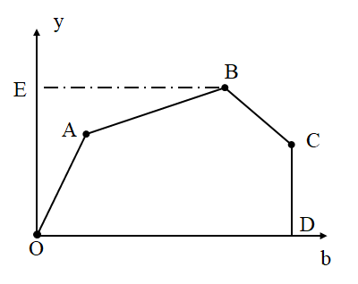
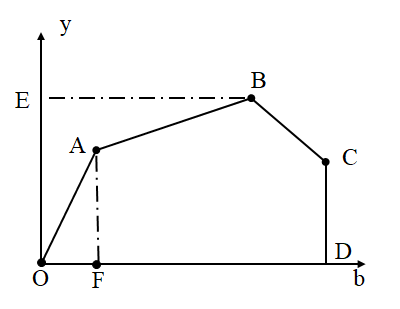
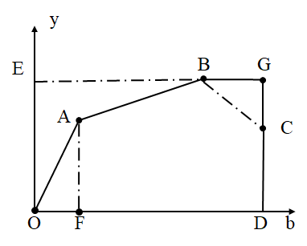
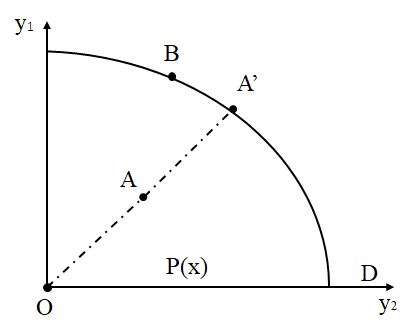
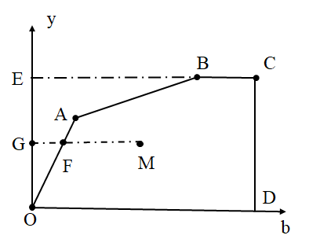
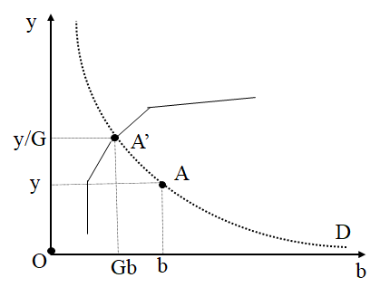
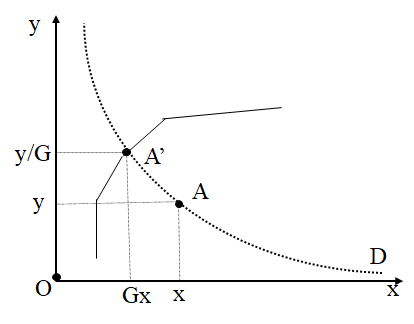
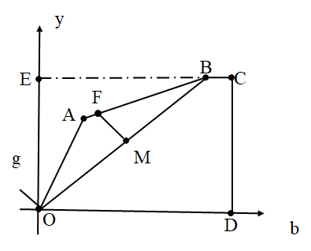
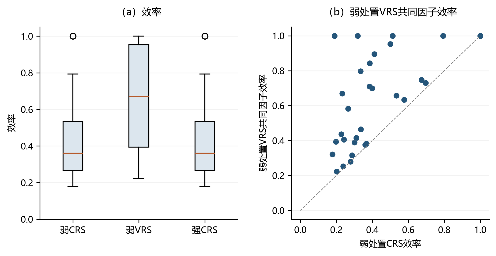

# 环境绩效测度方法 {#sec-6}

环境绩效测度的核心问题，是在经济产出与污染排放共同生成的条件下，如何刻画决策单元相对于环境生产前沿的距离。传统 DEA 模型通常只处理投入与期望产出，若将污染排放直接作为普通投入或可自由处置的产出，则会忽视污染与正常产出之间的联合生产关系，导致环境效率的解释出现偏误。

本章在概念、测算与指标解释三个层面扩展第 [-@sec-3] 章的经典 DEA 框架。关键扩展在于引入非期望产出、弱可处置性和零结合性，并在此基础上比较谢泼德距离函数、双曲距离函数、方向距离函数和非径向方向距离函数。上述模型为碳排放、污染物排放等环境绩效问题提供可复现的前沿测度框架。

全章按照“生产技术设定—距离函数构造—程序调用—案例解释”的逻辑展开。[-@sec-6-1] 节给出包含非期望产出的环境生产技术及其规模报酬设定；[-@sec-6-2] 节讨论不同距离函数对应的效率指标和经济含义；[-@sec-6-3] 节给出 `deabook` 中弱可处置性模型的调用方式；[-@sec-6-4] 节利用 OECD 国家和中国省份数据展示不同模型下环境效率结果的差异。不同距离函数、方向向量和规模报酬假设会生成不同量纲的指标，实证解释应始终回到模型设定本身。

## 生产技术 {#sec-6-1}

环境绩效测度首先需要回答“什么样的减排是技术上可行的”。在环境经济学语境下，污染排放和碳排放并不是可以任意丢弃的普通产出，也不宜简单地等同于投入。若假定非期望产出具有强可处置性，就意味着企业能够在投入和期望产出不变的情况下无成本降低排放，这与多数生产过程中的治理成本、技术约束和产出损失并不一致。更合适的设定是弱可处置性：在既定技术条件下，期望产出与非期望产出共同生成，降低污染排放通常需要压缩产出、增加治理投入或改变生产技术。因此，本节先给出包含非期望产出的环境生产技术，再说明规模报酬、减排因子和技术集修正对效率测算的影响。

考虑一个使用 $K$ 种投入要素 $\boldsymbol{x}=\left(x_{1}, x_{2}, \cdots, x_{K}\right)^{\mathrm{T}} \in \Re_{+}^{K}$，生产 $L$ 种期望产出 $\boldsymbol{y}=\left(y_{1}, y_{2}, \cdots, y_{L}\right)^{\mathrm{T}} \in \Re_{+}^{L}$ 和 $M$ 种非期望产出 $\boldsymbol{b}=\left(b_{1}, b_{2}, \cdots, b_{M}\right)^{\mathrm{T}} \in \Re_{+}^{M}$ 的生产过程。基于期望产出与非期望产出弱可处置性的生产技术集合 $T$ 可表示为：
$$
T=\{(\boldsymbol{x}, \boldsymbol{y}, \boldsymbol{b}): \boldsymbol{x} \text { 能生产 }(\boldsymbol{y}, \boldsymbol{b})\}
$$ {#eq-6-1}
其包含了技术上所有可行的投入产出组合，即如果 $\boldsymbol{x}$ 能生产 $(\boldsymbol{y}, \boldsymbol{b})$，那么 $(\boldsymbol{x}, \boldsymbol{y}, \boldsymbol{b}) \in T$ 。

该生产技术通常满足以下假设：

1. **无产出可行性**：对于任意投入 $\boldsymbol{x}$，均有 $(\boldsymbol{x},\boldsymbol{0},\boldsymbol{0})\in T$。这表示投入可以闲置，或在极端情形下未形成期望产出和非期望产出。
2. **无免费午餐**：对于 $\boldsymbol{y}>0$ 和 $\boldsymbol{b}>0$，$(\boldsymbol{0},\boldsymbol{y},\boldsymbol{b})\notin T$。即没有投入不能产生正的期望产出和污染排放。
3. **零投入约束**：若 $(\boldsymbol{x},\boldsymbol{y},\boldsymbol{b})\in T$ 且 $\boldsymbol{x}=\boldsymbol{0}$，则 $(\boldsymbol{y},\boldsymbol{b})=(\boldsymbol{0},\boldsymbol{0})$。
4. **期望产出强可处置性**：若 $(\boldsymbol{x},\boldsymbol{y},\boldsymbol{b})\in T$ 且 $\boldsymbol{0}\leq \boldsymbol{y}'\leq \boldsymbol{y}$，则 $(\boldsymbol{x},\boldsymbol{y}',\boldsymbol{b})\in T$。这意味着在投入和排放不变时，减少期望产出仍然可行。
5. **投入强可处置性**：若 $(\boldsymbol{x},\boldsymbol{y},\boldsymbol{b})\in T$ 且 $\boldsymbol{x}'\geq \boldsymbol{x}$，则 $(\boldsymbol{x}',\boldsymbol{y},\boldsymbol{b})\in T$。这意味着使用更多投入不会破坏原有生产计划的可行性。
6. **封闭性**：技术集 $T$ 是闭集，即包含自身边界；并且对任意给定投入 $\boldsymbol{x}$，可行产出集 $P(\boldsymbol{x})=\{(\boldsymbol{y},\boldsymbol{b}):(\boldsymbol{x},\boldsymbol{y},\boldsymbol{b})\in T\}$ 有界，即有限投入不能产生无限的期望产出与非期望产出。注意有界性针对的是给定投入下的产出集，而不是 $T$ 本身——CRS 下环境技术是一个锥，沿射线是无界的。
7. **期望产出与非期望产出弱可处置性**：若 $(\boldsymbol{x},\boldsymbol{y},\boldsymbol{b})\in T$ 且 $0\leq \theta\leq 1$，则 $(\boldsymbol{x},\theta\boldsymbol{y},\theta\boldsymbol{b})\in T$。该假设要求期望产出和污染排放按相同比例收缩。
8. **零结合性**：若 $(\boldsymbol{x},\boldsymbol{y},\boldsymbol{b})\in T$ 且 $\boldsymbol{b}=\boldsymbol{0}$，则 $\boldsymbol{y}=\boldsymbol{0}$。该假设刻画污染排放与正常产出之间不可完全分离的生产关系。
9. **凸性**：可行生产计划的凸组合仍然可行。
10. **规模报酬设定**：技术集可设为规模报酬不变（CRS）或规模报酬可变（VRS）。

若去除假设 $(7)$ 和 $(8)$，上述集合退化为经典 DEA 生产技术。假设 $(1)$—$(3)$ 保证生产活动必须以投入为基础；假设 $(4)$ 和 $(5)$ 分别对应期望产出和投入的强可处置性；假设 $(6)$ 保证技术集合封闭、且给定投入下的产出集有界；假设 $(9)$ 表示凸性，即可行生产计划的加权平均仍然可行；假设 $(10)$ 刻画规模报酬结构。加入假设 $(7)$ 后，期望产出和非期望产出必须按同一比例收缩，体现弱可处置性；加入假设 $(8)$ 后，若非期望产出为零，则期望产出也为零，体现零结合性。二者共同刻画了污染排放与正常产出之间的联合生产关系。

### 规模报酬性质 {#sec-6-1-1}

规模报酬（Return To Scale）刻画投入规模同比例变化时，期望产出和非期望产出组合如何变化。在包含非期望产出的生产技术中，规模报酬设定不仅改变效率前沿的位置，也决定效率差距是否包含规模因素。CRS 与 VRS 的选择直接关系到环境绩效指标的经济解释。下文分别讨论两类设定。

(1) 规模报酬不变(CRS)

在规模报酬不变（CRS）下，若某一投入—产出—排放组合可行，则其同比例扩张或收缩后的组合仍然可行。数学上，若 $(x, y, b) \in T$ 且 $\lambda>0$，则 $(\lambda x, \lambda y, \lambda b) \in T$。该设定适用于所有决策单元面临同一规模技术的情形。

(2) 规模报酬可变(VRS)

在规模报酬可变（VRS）下，投入按比例变化时，期望产出和非期望产出不必按相同比例变化。若产出和排放扩张比例高于投入扩张比例，则对应规模报酬递增；反之则对应规模报酬递减。VRS 设定允许不同规模的决策单元具有不同的局部前沿，因此在地区或国家样本规模差异较大时更常用于解释不含规模效应的技术效率。

### 生产技术的参数刻画 {#sec-6-1-2}

集合形式说明了环境生产技术的经济含义，但实证测度还需要将其转化为可求解的 DEA 生产前沿。根据规模报酬设定不同，包含非期望产出的 DEA 技术可分为 CRS 技术和 VRS 技术；根据弱可处置性的处理方式不同，又可进一步区分相同减排因子和不同减排因子两类模型。前者假定所有参考单元在同一减排比例下收缩期望产出和非期望产出，后者允许不同参考单元具有不同减排比例，从而更直接地刻画污染处置技术异质性。

(1) 规模报酬不变的生产技术

假设有 $N$ 个决策单元 (decision-making unit, DMU)， 每个 $\mathrm{DMU}_{i}(i=1,2$, $\cdots, N)$ 的投入产出组合为 $\left(x_{i}, y_{i}, b_{i}\right)$ 。根据 Färe, Grosskopf, Lovell and Pasurka (1989)，在规模报酬不变 (CRS) 假设下，基于期望产出和非期望产出之间弱可处置性的生产技术可表示为  

$$
T_{\mathrm{CRS}}=\left\{ (\boldsymbol{x}, \boldsymbol{y}, \boldsymbol{b}): 
\begin{aligned}
& \sum_{i=1}^{N} \boldsymbol{z_{i}} \boldsymbol{y}_{i} \geqslant \boldsymbol{y}, \\
& \sum_{i=1}^{N} \boldsymbol{z_{i}} \boldsymbol{b_{i}}=\boldsymbol{b}, \\
& \sum_{i=1}^{N} \boldsymbol{z_{i}} \boldsymbol{x_{i}} \leqslant \boldsymbol{x}, \\
& \boldsymbol{z_{i}} \geqslant 0, \quad i=1,2,\dots,N
\end{aligned}
\right\}
$$ {#eq-6-2}

式中，$\boldsymbol{z_{i}}(i=1,2, \cdots, N)$ 表示构建生产技术前沿时各决策单元的权重。期望产出的“$\geq$”约束表明任一决策单元可在参考单元期望产出的凸组合范围内生产，体现期望产出的强可处置性；投入的“$\leq$” 约束表明任一决策单元的投入可超出参考单元投入的凸组合，体现投入的强可处置性；非期望产出的“$=$”约束表明任一决策单元的非期望产出等于参考单元非期望产出的凸组合，体现非期望产出的弱可处置性。

图 $6.1$ 展示了规模报酬不变假设下的生产技术。由于生产技术满足规模报酬不变假设，各产出均可除以投入，相应的单位投入生产可能性区域为 $OABCDO$，生产技术前沿为 $OABC$。前沿段 $OAB$ 体现了期望产出 $y$ 和非期望产出 $b$ 之间的弱可处置性。相比之下，生产可能性区域 $OEBCDO$ 对应非期望产出强可处置性假设下的情形，前沿段 $EB$ 体现了在保持期望产出不变的情况下减少非期望产出的可能性。

{#fig-6-1}

(2) 规模报酬可变的生产技术

CRS 对所有决策单元施加同一规模技术约束，假设较强。VRS 技术通过加入 $\sum_{i=1}^{N} z_{i}=1$ 构造凸包前沿，并引入减排因子 $\theta$ 以保持期望产出和非期望产出的弱可处置性。若缺少减排因子，模型可能在 VRS 条件下破坏污染物与期望产出联合生产的结构。沿 Färe, Grosskopf, Lovell and Pasurka (1989) 弱可处置技术的 VRS 延伸、并按 Färe and Grosskopf (2003) 的表述，**相同**减排因子（即所有参考单元共用同一个 $\theta$）的 VRS 技术可表示为：

$$
T_{\mathrm{VRS}} = \left\{ (\boldsymbol{x}, \boldsymbol{y}, \boldsymbol{b}) : 
\begin{array}{l}
\theta \sum_{i=1}^{N} z_{i} y_{i} \geqslant \boldsymbol{y}, \\
\theta \sum_{i=1}^{N} z_{i} b_{i} = \boldsymbol{b}, \\
\sum_{i=1}^{N} z_{i} x_{i} \leqslant \boldsymbol{x}, \\
\sum_{i=1}^{N} z_{i} = 1, \\
0 \leqslant \theta \leqslant 1, \ z_{i} \geqslant 0, \ i = 1, 2, \dots, N
\end{array}
\right\}
$$ {#eq-6-3}

式中各项约束的经济含义同式 ([-@eq-6-2])；其中非期望产出的"$=$"约束与减排因子 $\theta$、权重之和约束 $\sum_{i=1}^{N} z_{i}=1$ 共同体现非期望产出的弱可处置性。

式 ([-@eq-6-3]) 中的减排因子 $\theta$ 对所有 DMU 均相同。Kuosmanen (2005) 指出，共用同一个 $\theta$ 隐含参照集中所有单元按相同比例削减期望产出与非期望产出，这一限制在 VRS 下并非弱可处置性所必需；他给出的凸表述允许各 DMU 拥有不同的减排因子 $\theta_i$。当 $\theta_1=\theta_2=\cdots=\theta_N$ 时，$T_{\mathrm{VRS}}^K$ 与 $T_{\mathrm{VRS}}$ 等价，即 $T_{\mathrm{VRS}}$ 是 $T_{\mathrm{VRS}}^K$ 的特例。

在规模报酬可变 (VRS) 假设下，具有不同减排因子 $\theta_i$ 的生产技术可表示为：
$$
\begin{aligned} T_{\mathrm{VRS}}^K=\{(\boldsymbol{x}, \boldsymbol{y}, \boldsymbol{b}):
& \sum_{i=1}^{N} \theta_{i} z_{i} y_{i} \geqslant y \\ 
& \sum_{i=1}^{N} \theta_{i} z_{i} b_{i}=\boldsymbol{b} \\ 
& \sum_{i=1}^{N} z_{i} x_{i} \leqslant \boldsymbol{x} \\ 
& \sum_{i=1}^{N} z_{i}=1, \\ &\left.0 \leqslant \theta_i \leqslant 1, z_{i} \geqslant 0, i=1,2, \cdots, N\right\} \end{aligned}
$$ {#eq-6-4}

图 $6.2$ 展示了规模报酬可变假设下的生产技术，相应的生产可能性区域为 $OABCD$，生产技术前沿为 $OABC$。前沿段 $OAB$ 体现了期望产出 $y$ 和非期望产出 $b$ 之间的弱可处置性。相比之下，若不加减排因子，则生产可能性区域为 $FABCD$，该情形违反产出的弱可处置性。

CRS 技术与 VRS 技术的关键区别在于是否施加权重约束 $\sum_{i=1}^{N} z_{i}=1$。在 VRS 情形下，该约束使生产前沿能够反映局部规模差异；减排因子则保证期望产出与非期望产出的弱可处置关系不被破坏。

{#fig-6-2}

对非期望产出施加等式约束可能导致生产技术边界出现后弯现象（Chen and Delmas, 2012），如 @fig-6-2 中 $BC$ 段所示。为避免后弯，Leleu (2013) 基于非期望产出影子价格非负的约束，利用对偶理论将非期望产出的等式约束修正为不等式约束。相同减排因子和不同减排因子下的修正环境生产技术分别为：
$$
T_{\mathrm{VRS}}^M = \left\{
\begin{array}{l}
(\boldsymbol{x}, \boldsymbol{y}, \boldsymbol{b}) : \\
\theta \sum_{i=1}^{N} z_{i} y_{i} \geqslant y, \\
\theta \sum_{i=1}^{N} z_{i} b_{i} \leqslant \boldsymbol{b}, \\
\sum_{i=1}^{N} z_{i} x_{i} \leqslant \boldsymbol{x}, \\
\sum_{i=1}^{N} z_{i} = 1, \\
0 \leqslant \theta \leqslant 1, \quad z_{i} \geqslant 0, \quad i=1,2,\dots, N
\end{array}
\right\}
$$ {#eq-6-5}

$$
T_{\mathrm{VRS}}^{MK} = \left\{
\begin{array}{l}
(\boldsymbol{x}, \boldsymbol{y}, \boldsymbol{b}) : \\
\sum_{i=1}^{N} \theta_{i} z_{i} y_{i} \geqslant y, \\
\sum_{i=1}^{N} \theta_{i} z_{i} b_{i} \leqslant \boldsymbol{b}, \\
\sum_{i=1}^{N} z_{i} x_{i} \leqslant \boldsymbol{x}, \\
\sum_{i=1}^{N} z_{i} = 1, \\
0 \leqslant \theta_i \leqslant 1, \quad z_{i} \geqslant 0, \quad i=1,2,\dots, N
\end{array}
\right\}
$$ {#eq-6-6}


修正后， @fig-6-2 中的 $BC$ 段将不存在，相应的产出可能性区域变为 $OABGD$，如 @fig-6-3 所示。

{#fig-6-3}

## 绩效测度 {#sec-6-2}

在给定环境生产技术后，绩效测度的任务是计算观测点相对于前沿的距离；距离函数的选择，决定了“改进空间”究竟指向增产、节能、减排，还是这些目标的联合变化。本节比较谢泼德距离函数、双曲距离函数、方向距离函数和非径向方向距离函数。谢泼德距离函数通常沿单一方向进行径向调整；双曲距离函数同时扩张期望产出并压缩非期望产出或投入；方向距离函数通过方向向量统一描述投入缩减、期望产出扩张和非期望产出压缩；非径向方向距离函数进一步允许不同变量具有不同调整幅度。实证研究必须在模型设定、指标转换和结果解释之间保持一致。下文每一类距离函数都将在 [-@sec-6-1] 节给出的 CRS、相同减排因子 VRS 与不同减排因子 VRS 三种基本技术集（式 6.2–6.4）上分别求解；不同技术集对应不同效率前沿，但同一距离函数的指标口径保持一致。修正集（式 6.5–6.6）主要用于避免技术后弯，本章 OECD/省份样本未应用该修正；若样本中出现后弯（影子价格非负约束被破坏），应改用式 ([-@eq-6-5])–([-@eq-6-6]) 重新估计。

### 谢泼德距离函数 {#sec-6-2-1}

谢泼德距离函数沿某一类投入或产出进行径向调整，因此适合度量单一方向上的效率。若沿期望产出方向扩张，则得到产出效率；若沿投入方向收缩，则得到投入效率；若沿非期望产出方向收缩，则得到环境效率。其优点是指标含义清晰、模型形式简洁；局限在于同一方向上的所有变量均按相同比例调整，难以反映变量层面的松弛差异。当投入或产出包含多个变量时，研究者还需要明确哪些变量被纳入调整方向。

**（一）期望产出方向的谢泼德距离函数**期望产出方向的谢泼德距离函数衡量在给定投入和非期望产出水平下，期望产出可按比例扩张的空间。其定义为：
$$
D_{o}(\boldsymbol{x}, \boldsymbol{y}, \boldsymbol{b})=\inf \left\{\theta:(\boldsymbol{x},\boldsymbol{y} / \theta, \boldsymbol{b}) \in T\right\}
$$ {#eq-6-7}
式中，$T$ 为包含非期望产出的生产可能性集合；$\theta$ 是**谢泼德产出距离函数值**，即实际期望产出与前沿期望产出之比（前沿产出为 $\boldsymbol{y}/\theta$），而不是"可扩张的比例"——最大扩张倍数是 $1/\theta$。$\theta=1$ 表明被评价决策单元位于产出前沿面上，$\theta<1$ 表明被评价决策单元的产出存在扩张空间，纯产出效率取 $PEO=\theta$。以图 $6.4$ 所示的生产可能性区域为例，$B$ 点位于生产前沿上，距离函数值为 1；而 $A$ 点位于边界下方，距离函数值 $\theta=O A / O A^{\prime}$ 小于 1，存在扩张空间（该点的产出最多可扩张 $OA^{\prime}/OA=1/\theta$ 倍）。

{#fig-6-4}


在 CRS 假设下，期望产出方向的谢泼德距离函数可由下列规划求解。规划的决策变量 $\lambda$ 是 Farrell 型扩张倍数，与谢泼德距离互为倒数，即 $\lambda=1/\theta$；因此下面求解的是 $1/D_o$，而不是 $D_o$ 本身：
$$
\begin{array}{ll}
& \lambda^{*}_{\mathrm{o,CRS}}=\max \lambda \\
\text { s.t. } 
& \sum_{i=1}^{N} z_{i} y_{l i} \geqslant \lambda y_{l 0}, l=1,2, \cdots, L, \\
& \sum_{i=1}^{N} z_{i} b_{m i}= b_{m 0}, m=1,2, \cdots, M, \\
& \sum_{i=1}^{N} z_{i} x_{k i} \leqslant x_{k 0}, k=1,2, \cdots, K, \\
&z_{i} \geqslant 0, i=1,2, \cdots, N
\end{array}
$$ {#eq-6-8}
式中，$\boldsymbol{z}=\left(z_{1}, z_{2}, \cdots, z_{N}\right)$ 为权重向量。式（[-@eq-6-8]）在保持投入和非期望产出不变的条件下，径向扩张所有期望产出。若目标函数值为 $\lambda^*$，则最佳期望产出量为 $\lambda^*y$，纯产出效率（PEO）为：
$$
PEO=\frac {y}{\lambda^*y} =\frac{1}{\lambda^*}
$$
式中，仅当 $\lambda^*=1$ 时，有 $PEO=1$，代表产出在生产前沿上；否则，当 $\lambda^*>1$ 时，$PEO<1$，表明产出效率存在提升空间。 

在 VRS 假设下，需要分别讨论相同减排因子和不同减排因子两种弱可处置技术。

相同减排因子下的模型为：
$$
\begin{array}{ll}
& \lambda^{*}_{\mathrm{o,VRS}}=\max \lambda \\
\text { s.t. } 
& \theta \sum_{i=1}^{N} z_{i} y_{l i} \geqslant \lambda y_{l 0}, l=1,2, \cdots, L, \\
&  \theta\sum_{i=1}^{N} z_{i} b_{m i}=b_{m 0}, m=1,2, \cdots, M, \\
& \sum_{i=1}^{N} z_{i} x_{k i} \leqslant   x_{k 0}, k=1,2, \cdots, K, \\
& \sum_{i=1}^{N} z_{i}=1, \\
&z_{i}\geqslant 0 ,0<\theta\leq1,i=1,2, \cdots, N
\end{array}
$$ {#eq-6-9}
在投入 $x$ 约束和权重之和约束的两边同乘 $\theta$，并令 $z_i\theta$=$z_i^\prime(i=1,...,N)$，可得与上述模型等价的新模型：
$$
\begin{array}{ll}
& \lambda^{*}_{\mathrm{o,VRS}}=\max \lambda \\
\text { s.t. } 
& \sum_{i=1}^{N} z_{i}^\prime y_{l i} \geqslant \lambda  y_{l 0}, l=1,2, \cdots, L, \\
&  \sum_{i=1}^{N} z_{i}^\prime b_{m i}=b_{m 0}, m=1,2, \cdots, M, \\
& \sum_{i=1}^{N} z_{i}^\prime x_{k i} \leqslant \theta x_{k 0}, k=1,2, \cdots, K, \\
& \sum_{i=1}^{N} z_{i}^\prime=\theta, \\
&z_{i}^\prime\geqslant 0 ,0<\theta\leq1,i=1,2, \cdots, N
\end{array}
$$
其等价形式为：
$$
\begin{array}{ll}
& \lambda^{*}_{\mathrm{o,VRS}}=\max \lambda \\
\text { s.t. } 
& \sum_{i=1}^{N} z_{i} y_{l i} \geqslant \lambda y_{l 0}, l=1,2, \cdots, L, \\
&  \sum_{i=1}^{N} z_{i} b_{m i}= b_{m 0}, m=1,2, \cdots, M, \\
& \sum_{i=1}^{N} z_{i} x_{k i} \leqslant \theta x_{k 0}, k=1,2, \cdots, K, \\
& \sum_{i=1}^{N} z_{i}=\theta, \\
&z_{i}\geqslant 0 ,0<\theta\leq1,i=1,2, \cdots, N
\end{array}
$$ {#eq-6-10}

若目标函数值为 $\lambda^*$，纯产出效率（PEO）为
$$
PEO=\frac {y}{\lambda^*y} =\frac{1}{\lambda^*}
$$
指标解释同式（[-@eq-6-8]）后所述：$\lambda^*=1$ 时产出位于生产前沿，$\lambda^*>1$ 时存在效率提升空间。

不同减排因子下的模型为：
$$
\begin{array}{ll}
& \lambda^{*,K}_{\mathrm{o,VRS}}=\max \lambda \\
\text { s.t. } 
& \sum_{i=1}^{N}  \theta_{i} z_{i} y_{l i} \geqslant \lambda  y_{l 0}, l=1,2, \cdots, L, \\
& \sum_{i=1}^{N}\theta_{i} z_{i} b_{m i}=b_{m 0}, m=1,2, \cdots, M, \\
& \sum_{i=1}^{N} z_{i} x_{k i} \leqslant   x_{k 0}, k=1,2, \cdots, K, \\
& \sum_{i=1}^{N} z_{i}=1, \\
&z_{i}\geqslant 0 ,0<\theta_i\leq1,i=1,2, \cdots, N
\end{array}
$$ {#eq-6-11}
令$\theta_i z_i = \rho_i$，并将$z_i$ 分解为 $\rho_i$和$\mu_i$两部分，即：$z_i= \rho_i+\mu_i$，则 $\theta_i= \frac{\rho_i}{\rho_i+\mu_i}$。可得上式的等价形式为：
$$
\begin{array}{ll}
& \lambda^{*,K}_{\mathrm{o,VRS}}=\max \lambda \\
\text { s.t. } 
& \sum_{i=1}^{N}  \rho_{i}y_{l i} \geqslant \lambda  y_{l 0}, l=1,2, \cdots, L, \\
& \sum_{i=1}^{N}\rho_{i} b_{m i}=b_{m 0}, m=1,2, \cdots, M, \\
& \sum_{i=1}^{N} (\rho_i+\mu_i) x_{k i} \leqslant  x_{k 0}, k=1,2, \cdots, K, \\
& \sum_{i=1}^{N}  (\rho_i+\mu_i) = 1, \\
&\rho_{i},\mu_{i}\geqslant 0 ,i=1,2, \cdots, N
\end{array}
$$ {#eq-6-12}
求解上述线性规划，若目标函数值为 $\lambda^*$，纯产出效率（PEO）为
$$
PEO=\frac {y}{\lambda^*y} =\frac{1}{\lambda^*}
$$
指标解释同式（[-@eq-6-8]）后所述，不再重复。

**（二）投入方向的谢泼德距离函数（纯投入效率）**与产出方向对应，投入方向把改进指向投入端，可识别资本、劳动和能源的可压缩比例。投入方向的谢泼德距离函数衡量在给定期望产出和非期望产出条件下，投入可按比例缩减的空间。其定义为：
$$
D_{i}(\boldsymbol{x}, \boldsymbol{y}, \boldsymbol{b})=\sup \left\{\theta:(\boldsymbol{x}/ \theta,\boldsymbol{y},\boldsymbol{b}  ) \in T\right\}
$$ {#eq-6-13}
式中， $T$ 为包含非期望产出的生产可能性集合；$\theta$ 是**谢泼德投入距离函数值**，即投入的最大可缩倍数（前沿投入为 $\boldsymbol{x}/\theta$），而不是"缩减的比例"——Farrell 型投入效率是它的倒数 $1/\theta$。$\theta=1$ 表明被评价决策单元位于生产前沿面上，$\theta>1$ 表明被评价决策单元的投入存在缩减空间。以图 $6.5$ 所示的生产可能性区域为例，$B$ 点位于生产前沿上，距离函数值为 1；而 $A$ 点位于边界上方，距离函数值 $\theta=O A / O A^{\prime}$ 大于 1，存在缩减空间（投入最多可压缩到原来的 $OA^{\prime}/OA=1/\theta$）。

{#fig-6-5}


在 CRS 假设下，投入方向的谢泼德距离函数可由下列规划求解。与产出方向同理，规划的决策变量 $\lambda$ 是 Farrell 型投入效率，与谢泼德投入距离互为倒数（$\lambda=1/\theta\le 1$）：
$$
\begin{array}{ll}
& \lambda^{*}_{\mathrm{i,CRS}}=\min \lambda \\
\text { s.t. } 
& \sum_{i=1}^{N} z_{i} y_{l i} \geqslant y_{l 0}, l=1,2, \cdots, L, \\
& \sum_{i=1}^{N} z_{i} b_{m i}= b_{m 0}, m=1,2, \cdots, M, \\
& \sum_{i=1}^{N} z_{i} x_{k i} \leqslant \lambda x_{k 0}, k=1,2, \cdots, K, \\
&z_{i} \geqslant 0, i=1,2, \cdots, N
\end{array}
$$ {#eq-6-14}
式中，$\boldsymbol{z}=\left(z_{1}, z_{2}, \cdots, z_{N}\right)$ 为权重向量。式（[-@eq-6-14]）在保持期望产出和非期望产出不变的条件下，径向缩减所有投入。若目标函数值为 $\lambda^*$，则最佳投入量为 $\lambda^*x$，纯投入效率（$PEI$）为
$$
PEI=\frac {\lambda^*x} {x}=\lambda^*
$$
式中，仅当$\lambda^*=1$时，有$PEI=1$，代表投入利用是有效的；否则，当$\lambda^*<1$时，$PEI<1$，表明投入效率存在提升空间。

VRS 下区分相同/不同减排因子两种情形：

相同减排因子下的模型为：
$$
\begin{array}{ll}
& \lambda^{*}_{\mathrm{i,VRS}}=\min \lambda \\
\text { s.t. } 
& \theta \sum_{i=1}^{N} z_{i} y_{l i} \geqslant y_{l 0}, l=1,2, \cdots, L, \\
&  \theta\sum_{i=1}^{N} z_{i} b_{m i}=b_{m 0}, m=1,2, \cdots, M, \\
& \sum_{i=1}^{N} z_{i} x_{k i} \leqslant \lambda  x_{k 0}, k=1,2, \cdots, K, \\
& \sum_{i=1}^{N} z_{i}=1, \\
&z_{i}\geqslant 0 ,0<\theta\leq1,i=1,2, \cdots, N
\end{array}
$$ {#eq-6-15}
该模型不能直接线性化，后续计算不采用这一设定。理由是：投入约束中含有同因子减排变量 $\theta$ 与效率变量 $\lambda$ 的乘积项，重标定 $z_i\to z_i/\theta$ 后会留下 $\theta\lambda$ 双线性残差。本章对此类“投入方向 + 同因子”设定一律仅列形式、不求解，下文 [-@sec-6-2-2] 节–[-@sec-6-2-4] 节遇到同类情形不再重复说明。

不同减排因子下的模型为：
$$
\begin{array}{ll}
& \lambda^{*,K}_{\mathrm{i,VRS}}=\min \lambda \\
\text { s.t. }
& \sum_{i=1}^{N}  \theta_{i} z_{i} y_{l i} \geqslant y_{l 0}, l=1,2, \cdots, L, \\
& \sum_{i=1}^{N}\theta_{i} z_{i} b_{m i}=b_{m 0}, m=1,2, \cdots, M, \\
& \sum_{i=1}^{N} z_{i} x_{k i} \leqslant \lambda  x_{k 0}, k=1,2, \cdots, K, \\
& \sum_{i=1}^{N} z_{i}=1, \\
&z_{i}\geqslant 0 ,0<\theta_i\leq1,i=1,2, \cdots, N
\end{array}
$$ {#eq-6-16}
做与式 ([-@eq-6-12]) 相同的替换 $\theta_i z_i=\rho_i,\ z_i=\rho_i+\mu_i$，得等价线性规划：
$$
\begin{array}{ll}
& \lambda^{*,K}_{\mathrm{i,VRS}}=\min \lambda \\
\text { s.t. } 
& \sum_{i=1}^{N}  \rho_{i}y_{l i} \geqslant y_{l 0}, l=1,2, \cdots, L, \\
& \sum_{i=1}^{N}\rho_{i} b_{m i}=b_{m 0}, m=1,2, \cdots, M, \\
& \sum_{i=1}^{N} (\rho_i+\mu_i) x_{k i} \leqslant \lambda  x_{k 0}, k=1,2, \cdots, K, \\
& \sum_{i=1}^{N}  (\rho_i+\mu_i) = 1, \\
&\rho_{i},\mu_{i}\geqslant 0 ,i=1,2, \cdots, N
\end{array}
$$ {#eq-6-17}
求解上述线性规划，若目标函数值为 $\lambda^*$，纯投入效率（$PEI$）为
$$
PEI=\frac {\lambda^*x} {x}=\lambda^*
$$
指标解释同式（[-@eq-6-14]）后所述，不再重复。

**（三）非期望产出方向的谢泼德距离函数**沿非期望产出方向则把改进指向污染端，这是环境绩效测度区别于经典 DEA 的关键环节；上述三个方向共同构成后续双曲距离函数与 DDF 联合改进测度的基础构件。非期望产出方向的谢泼德距离函数衡量在给定投入和期望产出水平下，非期望产出可按比例压缩的空间。依据 Zhou, Ang and Han (2010)，非期望产出导向距离函数为：
$$
D_{b}(\boldsymbol{x}, \boldsymbol{y}, \boldsymbol{b})=\sup \left\{\theta:(\boldsymbol{x}, \boldsymbol{y}, \boldsymbol{b} / \theta) \in T \right\}
$$ {#eq-6-18}
式中，$T$ 为包含非期望产出的生产可能性集合；$\theta$ 是**谢泼德非期望产出距离函数值**，即排放的最大可缩倍数（前沿排放为 $\boldsymbol{b}/\theta$），而不是"缩减的比例"。$\theta=1$ 表明被评价单元位于生产前沿面上，$\theta>1$ 表明存在缩减空间。在下文线性规划中，令 $\lambda=1/\theta\le1$（即 Farrell 型环境效率），则 $\sup\theta$ 等价于 $\min\lambda$，纯环境效率 $PEE=\lambda^*=1/\theta^*$。以图 $6.6$ 所示的生产可能性区域为例，$A$ 点位于生产前沿上，距离函数值为 1；而 $M$ 点位于边界下方，过 $M$ 点的水平线与纵轴交于 $G$ 点、与生产前沿交于 $F$ 点，距离函数值 $\theta=GM / GF$ 大于 1，存在缩减空间（排放最多可压缩到原来的 $GF/GM=1/\theta$）。


{#fig-6-6}


规模报酬不变（CRS）假设下的非期望产出方向上的谢泼德距离函数可由下列规划求解：
$$
\begin{array}{ll}
& \lambda^{*}_{\mathrm{b,CRS}}=\min \lambda \\
\text { s.t. } 
& \sum_{i=1}^{N} z_{i} y_{l i} \geqslant y_{l 0}, l=1,2, \cdots, L, \\
& \sum_{i=1}^{N} z_{i} b_{m i}=\lambda b_{m 0}, m=1,2, \cdots, M, \\
& \sum_{i=1}^{N} z_{i} x_{k i} \leqslant x_{k 0}, k=1,2, \cdots, K, \\
&z_{i} \geqslant 0, i=1,2, \cdots, N
\end{array}
$$ {#eq-6-19}
式中，$\boldsymbol{z}=\left(z_{1}, z_{2}, \cdots, z_{N}\right)$ 为权重向量。

VRS 下区分相同/不同减排因子两种情形。相同减排因子下的模型为：
$$
\begin{array}{ll}
& \lambda^{*}_{\mathrm{b,VRS}}=\min \lambda \\
\text { s.t. } 
& \theta \sum_{i=1}^{N} z_{i} y_{l i} \geqslant y_{l 0}, l=1,2, \cdots, L, \\
&  \theta\sum_{i=1}^{N} z_{i} b_{m i}=\lambda b_{m 0}, m=1,2, \cdots, M, \\
& \sum_{i=1}^{N} z_{i} x_{k i} \leqslant x_{k 0}, k=1,2, \cdots, K, \\
& \sum_{i=1}^{N} z_{i}=1, \\
&z_{i}\geqslant 0 ,0<\theta\leq1,i=1,2, \cdots, N
\end{array}
$$ {#eq-6-20}
在投入 $x$ 约束和权重之和约束的两边同乘 $\theta$，并令 $z_i\theta=z_i^\prime(i=1,...,N)$，可得与上述模型等价的新模型：
$$
\begin{array}{ll}
& \lambda^{*}_{\mathrm{b,VRS}}=\min \lambda \\
\text { s.t. } 
& \sum_{i=1}^{N} z_{i}^\prime y_{l i} \geqslant y_{l 0}, l=1,2, \cdots, L, \\
&  \sum_{i=1}^{N} z_{i}^\prime b_{m i}=\lambda b_{m 0}, m=1,2, \cdots, M, \\
& \sum_{i=1}^{N} z_{i}^\prime x_{k i} \leqslant \theta x_{k 0}, k=1,2, \cdots, K, \\
& \sum_{i=1}^{N} z_{i}^\prime=\theta, \\
&z_{i}^\prime\geqslant 0 ,0<\theta\leq1,i=1,2, \cdots, N
\end{array}
$$ {#eq-6-21}
其等价形式为：
$$
\begin{array}{ll}
& \lambda^{*}_{\mathrm{b,VRS}}=\min \lambda \\
\text { s.t. } 
& \sum_{i=1}^{N} z_{i} y_{l i} \geqslant y_{l 0}, l=1,2, \cdots, L, \\
&  \sum_{i=1}^{N} z_{i} b_{m i}=\lambda b_{m 0}, m=1,2, \cdots, M, \\
& \sum_{i=1}^{N} z_{i} x_{k i} \leqslant \theta x_{k 0}, k=1,2, \cdots, K, \\
& \sum_{i=1}^{N} z_{i}=\theta, \\
&z_{i}\geqslant 0 ,0<\theta\leq1,i=1,2, \cdots, N
\end{array}
$$ {#eq-6-22}

不同减排因子下的模型为：
$$
\begin{array}{ll}
& \lambda^{*,K}_{\mathrm{b,VRS}}=\min \lambda \\
\text { s.t. } 
& \sum_{i=1}^{N}  \theta_{i} z_{i} y_{l i} \geqslant y_{l 0}, l=1,2, \cdots, L, \\
& \sum_{i=1}^{N}\theta_{i} z_{i} b_{m i}= \lambda  b_{m 0}, m=1,2, \cdots, M, \\
& \sum_{i=1}^{N} z_{i} x_{k i} \leqslant x_{k 0}, k=1,2, \cdots, K, \\
& \sum_{i=1}^{N} z_{i}=1, \\
&z_{i}\geqslant 0 ,0<\theta_i\leq1,i=1,2, \cdots, N
\end{array}
$$ {#eq-6-23}
做与式 ([-@eq-6-12]) 相同的替换 $\theta_i z_i=\rho_i,\ z_i=\rho_i+\mu_i$，得等价线性规划：
$$
\begin{array}{ll}
& \lambda^{*,K}_{\mathrm{b,VRS}}=\min \lambda \\
\text { s.t. } 
& \sum_{i=1}^{N}  \rho_{i}y_{l i} \geqslant y_{l 0}, l=1,2, \cdots, L, \\
& \sum_{i=1}^{N}\rho_{i} b_{m i}= \lambda  b_{m 0}, m=1,2, \cdots, M, \\
& \sum_{i=1}^{N} (\rho_i+\mu_i) x_{k i} \leqslant  x_{k 0}, k=1,2, \cdots, K, \\
& \sum_{i=1}^{N}  (\rho_i+\mu_i) = 1, \\
&\rho_{i},\mu_{i}\geqslant 0 ,i=1,2, \cdots, N
\end{array}
$$ {#eq-6-24}
求解上述线性规划，若目标函数值为 $\lambda^*$，则纯环境效率（$PEE$）为：
$$
PEE=\frac {\lambda^*b} {b}=\lambda^*
$$
式中，仅当 $\lambda^*=1$ 时，有 $PEE=1$，表示非期望产出已经位于环境生产前沿；当 $\lambda^*<1$ 时，$PEE<1$，表明在保持投入和期望产出不变的条件下，非期望产出仍存在压缩空间。

### 双曲距离函数 {#sec-6-2-2}

双曲距离函数（Hyperbolic Distance Function，代码中标记为 HYPER）是谢泼德距离函数的扩展，能够在同一模型中同时扩张期望产出并压缩非期望产出，或同时扩张期望产出并压缩投入。因此，它衡量的是联合改进意义上的混合效率。与单一方向的谢泼德距离函数相比，双曲距离函数更适合分析“增产—减排”或“增产—节约投入”的协同改进空间。但也正因其同时调整多个端口，结果解释不能简单等同于纯产出效率、纯投入效率或纯环境效率。

**（一）同时调整期望产出和非期望产出**当研究重点是同时增加期望产出并减少非期望产出时，双曲距离函数可写为：
$$
G(\boldsymbol{x},\boldsymbol{y},\boldsymbol{b})=\inf\{\lambda>0:(\boldsymbol{x},\boldsymbol{y}/\lambda,\lambda\boldsymbol{b})\in T\}
$$ {#eq-6-25}
$G$（即最优 $\lambda$）是双曲距离函数的值。当 $G=1$ 时，被评价决策单元位于生产前沿上；当 $G<1$ 时，$y/G> y$（期望产出扩张）、$Gb< b$（非期望产出缩减），决策单元位于生产前沿内部，存在联合改进空间。 @fig-6-7 中的产出曲线表示给定非期望产出 $b$ 对应的产出 $y$；经过 A 点的反比例函数刻画该决策单元同时扩张期望产出、缩减非期望产出的调整路径。双曲距离函数的值 $G=OA/OA'$ 小于 1，表明存在改进空间，可改进至 $A'$ 点。

{#fig-6-7}

在 CRS 假设下，同时调整期望产出和非期望产出的双曲距离函数可由下列规划求解：
$$
\begin{array}{ll}
& \text { D }_{\mathrm{yb,CRS}}=\min \lambda \\
\text { s.t. } 
& \sum_{i=1}^{N} z_{i} y_{l i} \geqslant \frac{y_{l 0}}{\lambda}, l=1,2, \cdots, L, \\
& \sum_{i=1}^{N} z_{i} b_{m i}=\lambda b_{m 0}, m=1,2, \cdots, M, \\
& \sum_{i=1}^{N} z_{i} x_{k i} \leqslant x_{k 0}, k=1,2, \cdots, K, \\
&z_{i} \geqslant 0, i=1,2, \cdots, N
\end{array}
$$ {#eq-6-26}
式中，$\boldsymbol{z}=\left(z_{1}, z_{2}, \cdots, z_{N}\right)$ 为权重向量。为便于求解，需将该非线性问题转化为线性规划：在每个约束两边同乘 $\lambda$，并令 $\lambda^2=\delta$、$\lambda z_i=z_i^{\prime}$，可得如下线性规划模型：
$$
\begin{array}{ll}
& \text { D }_{\mathrm{yb,CRS}}=\min \delta \\
\text { s.t. } 
& \sum_{i=1}^{N} z_{i}^{\prime} y_{l i} \geqslant y_{l 0}, l=1,2, \cdots, L, \\
& \sum_{i=1}^{N} z_{i}^{\prime} b_{m i}=\delta b_{m 0}, m=1,2, \cdots, M, \\
& \sum_{i=1}^{N} z_{i}^{\prime} x_{k i}  \leqslant \lambda x_{k 0}, k=1,2, \cdots, K, \\
&z_{i}^{\prime} \geqslant 0,0<\lambda,\delta\leq1, i=1,2, \cdots, N 
\end{array}
$$ {#eq-6-27}

> **关于式 ([-@eq-6-27])/([-@eq-6-34]) 的退化说明**：上述线性化定义 $\delta=\lambda^2$ 后，**并未在 LP 中显式施加 $\delta=\lambda^2$ 的链接约束**，$\delta$ 与 $\lambda$ 在优化中事实上解耦。求解器会把 $\lambda$ 推向 1（放松投入约束），$\delta$ 退化为非期望产出方向的 Shephard 距离，期望产出扩张项 $y/\lambda$ 因此从最优解中消失。结果是 $\delta^*$（及相应的 $MEE_{CRS}$）只是非期望产出 Shephard 距离（即 $PEE_{CRS}$）的单调变换——可验证 $MEE_{CRS}\approx\sqrt{PEE_{CRS}}$，不携带"同时扩张 $y$、压缩 $b$"的联合改进信息。精确的 CRS 双曲距离需借助 Charnes–Cooper 变换或二阶锥规划（SOCP）求解，本章沿用文献中的常见写法仅作示意；**[-@sec-6-4] 节 案例中 CRS 双曲列应理解为坏产出端 Shephard 距离的单调变换，不可与 VRS 双曲或 DDF 作水平等同比较**。VRS 双曲（式 6.30/6.31）通过 Taylor 展开转化为 DDF 形式，不存在此退化问题。

在 VRS 且减排因子相同的情形下，模型为：
$$
\begin{array}{ll}
& \text { D }_{\mathrm{yb,VRS}}=\min \lambda \\
\text { s.t. } 
& \theta \sum_{i=1}^{N} z_{i} y_{l i} \geqslant \frac{y_{l 0}}{\lambda}, l=1,2, \cdots, L, \\
&  \theta\sum_{i=1}^{N} z_{i} b_{m i}=\lambda b_{m 0}, m=1,2, \cdots, M, \\
& \sum_{i=1}^{N} z_{i} x_{k i} \leqslant x_{k 0}, k=1,2, \cdots, K, \\
& \sum_{i=1}^{N} z_{i}=1, \\
&z_{i}\geqslant 0 ,0<\theta\leq1,i=1,2, \cdots, N
\end{array}
$$ {#eq-6-28}
将 $\lambda$ 替换为 $e^{-\beta}$，则 $1/\lambda$ 可替换为 $e^{\beta}$。根据泰勒公式，$e^{-\beta}\approx1-\beta$ 且 $e^{\beta}\approx1+\beta$，此时可将非线性模型转化为线性模型：
$$
\begin{array}{ll}
& \text { D }_{\mathrm{yb,VRS}}=\max \beta \\
\text { s.t. } 
& \theta \sum_{i=1}^{N} z_{i} y_{l i} \geqslant {y_{l 0}} +\beta{y_{l 0}} , l=1,2, \cdots, L, \\
&  \theta\sum_{i=1}^{N} z_{i} b_{m i}= b_{m 0}- \beta b_{m 0}, m=1,2, \cdots, M, \\
& \sum_{i=1}^{N} z_{i} x_{k i} \leqslant x_{k 0}, k=1,2, \cdots, K, \\
& \sum_{i=1}^{N} z_{i}=1, \\
&z_{i}\geqslant 0 ,0<\theta\leq1,i=1,2, \cdots, N
\end{array}
$$ {#eq-6-29}
该线性规划与方向向量 $g=(g_y,g_b)=(y,b)$ 的方向距离函数相对应。因此，可按照第 [-@sec-3] 章的处理方式，将双曲距离函数转换为方向距离函数形式。

其等价形式为：
$$
\begin{array}{ll}
&{D}_{yb,VRS} =\max\limits_{{z_{i}, \beta}} \beta \\
\text { s.t. } 
& \sum_{i=1}^{N} z_{i} y_{l i} \geqslant y_{l 0}+\beta y_{l 0}, l=1, \cdots, L \\
& \sum_{i=1}^{N} z_{i} b_{m i}=b_{m 0}-\beta b_{m 0}, m=1, \cdots, M \\
& \sum_{i=1}^{N} z_{i} x_{k i} \leqslant \theta x_{k 0}, k=1, \cdots, K, \\
& \sum_{i=1}^{N} z_{i}=\theta \\
& 0 \leqslant \theta\leqslant1, z_{i} \geqslant 0, i=1, \cdots, N
\end{array}
$$ {#eq-6-30}
求解上述线性规划，若目标函数值为 $\beta^*$，则期望产出端的混合效率 $MEE_O$ 与非期望产出端的混合效率 $MEE_{BO}$ 分别为：
$$
MEE_O=\frac {1} {1+\beta^*},\qquad MEE_{BO}=1-\beta^*
$$
两个公式对应同一 $\beta^*$ 的两端：$MEE_O$ 对应原始双曲比例 $1/e^{\beta}$ 在 $\beta=0$ 处的一阶展开 $1/(1+\beta^*)$，$MEE_{BO}$ 为其对 $\beta$ 的线性展开 $1-\beta^*$，二者在 $\beta$ 较小时数值接近但量纲不同——前者刻画 $y$ 扩张幅度，后者刻画 $b$ 压缩幅度。
式中，仅当 $\beta^*=0$ 时，$MEE_O=MEE_{BO}=1$，代表产出是有效的；否则，当 $\beta^*>0$ 时，二者均小于 1，表明存在联合改进空间。本章 [-@sec-6-4] 节案例在 VRS 设定下同时报告两者（代码列 `teo`、`teuo` 分别整理为 `MEE_O`、`MEE_BO`）；CRS 设定下因双曲线性化的退化（见式 6.27 处说明），仅报告由坏产出 Shephard 距离单调变换得到的单一 $MEE_{CRS}$，不再区分两端。

> **双曲与 DDF 的等价性说明**：式 ([-@eq-6-30]) 经 Taylor 近似得到的线性规划，在结构上与 [-@sec-6-2-3] 节方向向量取 $g=(g_y,g_b)=(y,b)$ 的 VRS 同因子方向距离函数（式 6.47）**完全相同**——二者约束完全一致，$\beta^*$ 相同，因而 $MEE_O=EO$、$MEE_{BO}=EB$。需要说明的是，这种一致性来自**线性化（一阶泰勒近似）之后**的规划形式，而不是说双曲距离函数本身是 DDF 的特例：原始双曲的投影路径是双曲线 $(\boldsymbol{y}/\lambda,\lambda\boldsymbol{b})$，DDF 的投影路径是直线 $(\boldsymbol{y}+\beta\boldsymbol{g}_y,\boldsymbol{b}-\beta\boldsymbol{g}_b)$，二者只在 $\beta$ 很小时近似重合。本章仍将双曲单独列为一类，是因为其原始非线性形式（式 6.25）导出了不同的线性化路径与近似处理；但读者在比较 [-@sec-6-4] 节 的 VRS 双曲结果（ @tbl-case-6 与 @tbl-case-6）与 VRS DDF 结果（ @tbl-case-6 与 @tbl-case-6）时应知：两者在相同方向、相同规模报酬下数值一致，**不是相互独立的稳健性对照**。真正独立的模型比较应基于 CRS 双曲 vs DDF、VRS 双曲 vs NDDF、或 DDF vs NDDF。

类似地，减排因子不同时的模型为：
$$
\begin{array}{ll}
&{D}_{yb,VRS}  =\max\limits_{{z_{i}, \beta}} \beta \\
\text { s.t. } 
& \sum_{i=1}^{N}\rho_{i} y_{l i} \geqslant y_{l 0}+\beta y_{l 0}, l=1, \cdots, L \\
& \sum_{i=1}^{N} \rho_{i} b_{m i}=b_{m 0}-\beta b_{m 0}, m=1, \cdots, M \\
& \sum_{i=1}^{N} (\rho_i+\mu_i) x_{k i} \leqslant x_{k 0}, k=1, \cdots, K, \\
& \sum_{i=1}^{N} (\rho_i+\mu_i) = 1 \\
& \rho_i, \mu_i \geqslant 0, i=1, \cdots, N
\end{array}
$$ {#eq-6-31}
混合环境效率（MEE）的估计方式与相同减排因子的双曲距离函数相同。

**（二）同时调整期望产出和投入**当研究重点是同时扩张期望产出并缩减投入时，双曲距离函数为：
$$
G(\boldsymbol{x},\boldsymbol{y},\boldsymbol{b})=\inf\{G:(G\boldsymbol{x},\boldsymbol{y}/G,\boldsymbol{b})\in T\}
$$ {#eq-6-32}
$G$ 是双曲距离函数的值。当 $G=1$ 时，被评价决策单元位于生产前沿上；当 $G<1$ 时，决策单元位于生产前沿内部，存在扩张期望产出和缩减投入的空间。 @fig-6-8 中的产出曲线表示给定投入 $x$ 对应的产出 $y$；经过 A 点的反比例函数刻画该决策单元同时扩张期望产出、缩减投入的调整路径。双曲距离函数的值 $G=OA/OA'$ 小于 1，表明存在改进空间，可改进至 $A'$ 点。

{#fig-6-8}

该模型与“期望产出—非期望产出”双曲模型的结构相似，区别在于被压缩的对象由非期望产出变为投入。以 CRS 假设为例，相应规划为：
$$
\begin{array}{ll}
& \text { D }_{\mathrm{yx,CRS}}=\min \lambda \\
\text { s.t. } 
& \sum_{i=1}^{N} z_{i} y_{l i} \geqslant \frac{y_{l 0}}{\lambda}, l=1,2, \cdots, L, \\
& \sum_{i=1}^{N} z_{i} b_{m i}= b_{m 0}, m=1,2, \cdots, M, \\
& \sum_{i=1}^{N} z_{i} x_{k i} \leqslant \lambda x_{k 0}, k=1,2, \cdots, K, \\
&z_{i} \geqslant 0, i=1,2, \cdots, N
\end{array}
$$ {#eq-6-33}
式中，$\boldsymbol{z}=\left(z_{1}, z_{2}, \cdots, z_{N}\right)$ 为权重向量。

为便于求解，需将该非线性问题转化为线性规划：在每个约束两边同乘 $\lambda$，并令 $\lambda^2=\delta$、$\lambda z_i=z_i^{\prime}$，可得如下线性规划模型（同式 6.27，此处亦存在 $\delta$ 与 $\lambda$ 解耦的退化问题，详见式 6.27 后的说明）：
$$
\begin{array}{ll}
& \text { D }_{\mathrm{yx,CRS}}=\min \delta \\
\text { s.t. } 
& \sum_{i=1}^{N} z_{i}^{\prime} y_{l i} \geqslant y_{l 0}, l=1,2, \cdots, L, \\
& \sum_{i=1}^{N} z_{i}^{\prime} b_{m i}= \lambda b_{m 0}, m=1,2, \cdots, M, \\
& \sum_{i=1}^{N} z_{i}^{\prime} x_{k i}  \leqslant \delta x_{k 0}, k=1,2, \cdots, K, \\
&z_{i}^{\prime} \geqslant 0,0<\lambda,\delta\leq1, i=1,2, \cdots, N
\end{array}
$$ {#eq-6-34}
规模报酬可变（VRS）且减排因子相同时，同时调整期望产出和投入的双曲距离函数可由下列规划求解：
$$
\begin{array}{ll}
& \text { D }_{\mathrm{yx,VRS}}=\min \lambda \\
\text { s.t. } 
& \theta \sum_{i=1}^{N} z_{i} y_{l i} \geqslant \frac{y_{l 0}}{\lambda}, l=1,2, \cdots, L, \\
&  \theta\sum_{i=1}^{N} z_{i} b_{m i}=b_{m 0}, m=1,2, \cdots, M, \\
& \sum_{i=1}^{N} z_{i} x_{k i} \leqslant \lambda  x_{k 0}, k=1,2, \cdots, K, \\
& \sum_{i=1}^{N} z_{i}=1, \\
&z_{i}\geqslant 0 ,0<\theta\leq1,i=1,2, \cdots, N
\end{array}
$$ {#eq-6-35}
同样将 $\lambda$ 替换为 $e^{-\beta}$ 并按泰勒公式作一阶近似（处理方式同式（[-@eq-6-29]）），可将非线性模型转化为线性模型：
$$
\begin{array}{ll}
& \text { D }_{\mathrm{yx,VRS}}=\max \beta \\
\text { s.t. } 
& \theta \sum_{i=1}^{N} z_{i} y_{l i} \geqslant {y_{l 0}} +\beta{y_{l 0}} , l=1,2, \cdots, L, \\
&  \theta\sum_{i=1}^{N} z_{i} b_{m i}= b_{m 0}, m=1,2, \cdots, M, \\
& \sum_{i=1}^{N} z_{i} x_{k i} \leqslant x_{k 0} - \beta x_{k0}, k=1,2, \cdots, K, \\
& \sum_{i=1}^{N} z_{i}=1, \\
&z_{i}\geqslant 0 ,0<\theta\leq1,i=1,2, \cdots, N
\end{array}
$$ {#eq-6-36}
该模型不能直接转化为本章采用的线性规划形式，后续计算不采用这一设定。

减排因子不同时的模型为：
$$
\begin{array}{ll}
&{D}_{yx,VRS}  =\max\limits_{{z_{i}, \beta}} \beta \\
\text { s.t. } 
& \sum_{i=1}^{N}\rho_{i} y_{l i} \geqslant y_{l 0}+\beta y_{l 0}, l=1, \cdots, L \\
& \sum_{i=1}^{N} \rho_{i} b_{m i}=b_{m 0}, m=1, \cdots, M \\
& \sum_{i=1}^{N} (\rho_i+\mu_i) x_{k i} \leqslant x_{k 0}-\beta x_{k 0}, k=1, \cdots, K, \\
& \sum_{i=1}^{N} (\rho_i+\mu_i) = 1 \\
& \rho_i, \mu_i \geqslant 0, i=1, \cdots, N
\end{array}
$$ {#eq-6-37}
使用上述线性规划模型可求解联合改进幅度。若最优值为 $\beta^*$，则混合投入效率（$MEI$）为：
$$
MEI=1-\beta^*
$$
式中，仅当 $\beta^*=0$ 时，有 $MEI=1$，表示观测点位于相应方向前沿；当 $\beta^*>0$ 时，$MEI<1$，表明仍存在联合增产和节约投入的空间。


### 方向距离函数 {#sec-6-2-3}

双曲距离函数虽然能同时扩张期望产出并压缩非期望产出，但其扩张与压缩被绑定在互为倒数的同一比例（$1/G$ 与 $G$）上，无法独立权衡增产与减排的相对强度。方向距离函数（Directional Distance Function, DDF）以方向向量 $(g_x, g_y, g_b)$ 替代固定的倒数比例，使增产、减排与节约投入的相对强度可以独立设定，从而更直接地刻画环境治理中的联合改进目标。需要强调的是，**原始的双曲距离函数并不是 DDF 的特例**：双曲沿双曲线 $(\boldsymbol{y}/G,G\boldsymbol{b})$ 投影，DDF 沿直线 $(\boldsymbol{y}+\beta\boldsymbol{g}_y,\boldsymbol{b}-\beta\boldsymbol{g}_b)$ 投影，一条是曲线、一条是直线，二者只在改进幅度很小时近似重合。真正成立的是：VRS 下常用的双曲**线性化**形式（式 6.29/6.30，由 $e^{\pm\beta}$ 的一阶泰勒展开得到）与方向向量 $g=(\boldsymbol{y},\boldsymbol{b})$ 的 DDF 是同一个线性规划，因此二者结果一致，不能互为稳健性对照（见式 6.30 处说明）；CRS 双曲的线性化则发生退化，只能读作坏产出端 Shephard 距离的单调变换（见式 6.27 处说明）。本章将双曲单独列为一类，是因为其原始非线性形式导出了不同的线性化路径与近似处理。方向向量的设定具有实质性含义：若只令非期望产出方向为正，指标反映减排空间；若同时令期望产出和非期望产出方向为正，指标反映增产减排的联合空间；若进一步纳入投入方向，则指标包含投入节约含义。根据 Chung, Färe and Grosskopf (1997)，其一般形式定义为：
$$
\vec{D}\left(\boldsymbol{x}, \boldsymbol{y},\boldsymbol{b} ; -\boldsymbol{g}_{\boldsymbol{x}}, \boldsymbol{g}_{\boldsymbol{y}, } -\boldsymbol{g}_{\boldsymbol{b}}\right)=\sup \left\{\beta:\left(\boldsymbol{x}-\beta \boldsymbol{g}_{\boldsymbol{x}}, \boldsymbol{y}+\beta \boldsymbol{g}_{\boldsymbol{y}},\boldsymbol{b}-\beta \boldsymbol{g}_{\boldsymbol{b}}\right) \in T\right\}
$$ {#eq-6-38}
式中， $T$为包含非期望产出的生产技术； $\boldsymbol{g_{x}}=$ $\left(g_{x_{1}}, g_{x_{2}}, \cdots, g_{x_{K}}\right)^{\mathrm{\prime}} \in R_{+}^{K}$,  $\boldsymbol{g_{y}}=$ $\left(g_{y_{1}}, g_{y_{2}}, \cdots, g_{y_{L}}\right)^{\mathrm{\prime}} \in R_{+}^{L}$,  $-\boldsymbol{g_{b}}=\left(-g_{b_{1}}, -g_{b_{2}}, \cdots, -g_{b_{M}}\right)^{\prime} \in \Re_{+}^{M}$，反映了方向距离函数的投射法则。$\beta$ 是方向距离函数的取值，表示扩张期望产出同时缩减投入和非期望产出的最大比例。

根据Chung, Färe and Grosskopf (1997) ，方向距离函数满足以下性质：

(i) 若 $(\boldsymbol{x}, \boldsymbol{y}, \boldsymbol{b}) \in T$，则 $\vec{D}\left(\boldsymbol{x}, \boldsymbol{y} , \boldsymbol{b};- \boldsymbol{g}_{\boldsymbol{x}}, \boldsymbol{g}_{\boldsymbol{y}}, -\boldsymbol{g}_{\boldsymbol{b}}\right) \geqslant 0$；

(ii) $\vec{D}\left(\boldsymbol{x}-\alpha \boldsymbol{g}_{\boldsymbol{x}} , \boldsymbol{y}+\alpha \boldsymbol{g}_{y},\boldsymbol{b}-\alpha \boldsymbol{g}_{\boldsymbol{b}} ; -\boldsymbol{g}_{\boldsymbol{x}}, \boldsymbol{g}_{y},-\boldsymbol{g}_{b}\right)=\vec{D}\left(\boldsymbol{x}, \boldsymbol{y}, \boldsymbol{b} ; -\boldsymbol{g}_{\boldsymbol{x}}, \boldsymbol{g}_{\boldsymbol{y}}, -\boldsymbol{g}_{\boldsymbol{b}}\right)-\alpha$；

(iii) $\vec{D}\left(\boldsymbol{x}, \boldsymbol{y}, \boldsymbol{b}  ;  -\lambda \boldsymbol{g}_{\boldsymbol{x}}, \lambda \boldsymbol{g}_{y}, -\lambda \boldsymbol{g}_{b}\right)=(1 / \lambda) \vec{D}\left(\boldsymbol{x}, \boldsymbol{y} , \boldsymbol{b}; -\boldsymbol{g}_{\boldsymbol{x}}, \boldsymbol{g}_{\boldsymbol{y}}, -\boldsymbol{g}_{\boldsymbol{b}}\right), \lambda>0$；   

(iv)规模报酬不变时，投入产出的一次齐次性：$\vec{D}\left( \lambda \boldsymbol{x}, \lambda\boldsymbol{y}, \lambda\boldsymbol{b}  ; -\boldsymbol{g}_{\boldsymbol{x}},  \boldsymbol{g}_{y}, - \boldsymbol{g}_{b}\right)=\lambda \vec{D}\left(\boldsymbol{x}, \boldsymbol{y} , \boldsymbol{b}; -\boldsymbol{g}_{\boldsymbol{x}}, \boldsymbol{g}_{\boldsymbol{y}}, -\boldsymbol{g}_{\boldsymbol{b}}\right), \lambda>0$；

(v) 如果 $\boldsymbol{x}^{\prime} \geqslant \boldsymbol{x}$，则 $0\leqslant \vec{D}\left(\boldsymbol{x}, \boldsymbol{y}, \boldsymbol{b} ; -\boldsymbol{g_{x}}, \boldsymbol{g_{y}}, -\boldsymbol{g_{b}}\right) \leqslant \vec{D}\left(\boldsymbol{x}^{\prime}, \boldsymbol{y}, \boldsymbol{b}  ;- \boldsymbol{g_{x}}, \boldsymbol{g_{y}}, -\boldsymbol{g_{b}}\right)$；

(vi) 如果 $\boldsymbol{y}^{\prime} \geqslant \boldsymbol{y }$，则 $\vec{D}\left(\boldsymbol{x}, \boldsymbol{y}, \boldsymbol{b} ; -\boldsymbol{g_{x}}, \boldsymbol{g_{y}}, -\boldsymbol{g_{b}}\right) \geqslant \vec{D}\left(\boldsymbol{x}, \boldsymbol{y^{\prime}}, \boldsymbol{b}  ;- \boldsymbol{g_{x}}, \boldsymbol{g_{y}}, -\boldsymbol{g_{b}}\right) \geqslant 0$；

(vii) 如果 $\boldsymbol{b^{\prime} }\geqslant \boldsymbol{b}$，则 $0\leqslant  \vec{D}\left(\boldsymbol{x}, \boldsymbol{y},\boldsymbol{b }; -\boldsymbol{g_{x}}, \boldsymbol{g_{y}},-\boldsymbol{g_{b}}\right) \leqslant \vec{D}\left(\boldsymbol{x}, \boldsymbol{y },\boldsymbol{b^{\prime}}; -\boldsymbol{g_{x}}, \boldsymbol{g_{y}}, -\boldsymbol{g_{b}}\right)$；

(viii) 如果 $T$是凸的，那么 $\vec{D}\left(\boldsymbol{x}, \boldsymbol{y },\boldsymbol{b }; -\boldsymbol{g_{x}}, \boldsymbol{g_{y}}, -\boldsymbol{g_{b}}\right)$ 对于 $(\boldsymbol{x}, \boldsymbol{y},\boldsymbol{b })$ 是凹的。

其中，性质 (i) 表明方向距离函数取非负值。性质 (ii) 说明，若决策单元沿原调整方向移动方向向量的 $\alpha$ 倍，方向距离函数值减少 $\alpha$。性质 (iii) 表明，若方向向量变为原来的 $\lambda$ 倍，方向距离函数变为原来的 $1 / \lambda$ 倍。性质 (iv) 表明，若投入、期望产出和非期望产出同比例变为原来的 $\lambda$ 倍，方向距离函数亦变为原来的 $\lambda$ 倍。性质 (v)、性质 (vi) 和性质 (vii) 表明投入增大时，方向距离函数增加；期望产出增大时，方向距离函数值减小；非期望产出增大时，方向距离函数值增加。这三个性质均反映了方向距离函数值随无效程度提高而变大。性质 (viii) 表明生产技术为凸集时，方向距离函数是凹函数。


规模报酬不变（CRS）假设下的方向距离函数可通过下式求解：
$$
\begin{array}{ll}
 &\vec{D}_{}^{r}   \left(\boldsymbol{x}, \boldsymbol{y}, \boldsymbol{b} ; -\boldsymbol{{g}_{x}}, \boldsymbol{{g}_{y}},-\boldsymbol{{g}_{b}}\right)=\max\limits_{{z_{i}, \beta}} \beta \\
\text { s.t. } 
& \sum_{i=1}^{N} z_{i} y_{l i} \geqslant y_{l 0}+\beta g_{l y}, l=1, \cdots, L \\
& \sum_{i=1}^{N} z_{i} b_{m i}=b_{m 0}-\beta g_{m b}, m=1, \cdots, M \\
& \sum_{i=1}^{N} z_{i} x_{k i} \leqslant x_{k 0}-\beta g_{k x}, k=1, \cdots, K \\
& z_{i} \geqslant 0, i=1, \cdots, N
\end{array}
$$ {#eq-6-39}
VRS 下区分减排因子相同和不同两种情形：

（1）减排因子相同时的方向距离函数模型可表示为：
$$
\begin{array}{ll}
&\vec{D}_{}^{r}  \left(\boldsymbol{x}, \boldsymbol{y}, \boldsymbol{b} ; \boldsymbol{{g}_{y}},-\boldsymbol{g_{b}}\right)=\max\limits_{{z_{i}, \beta}} \beta \\
\text { s.t. } 
& \theta \sum_{i=1}^{N} z_{i} y_{l i} \geqslant y_{l 0}+\beta g_{l y}, l=1, \cdots, L \\
& \theta \sum_{i=1}^{N} z_{i} b_{m i}=b_{m 0}-\beta g_{m b}, m=1, \cdots, M \\
& \sum_{i=1}^{N} z_{i} x_{k i} \leqslant x_{k 0}-\beta g_{k x}, k=1, \cdots, K, \\
& \sum_{i=1}^{N} z_{i}=1 \\
& 0 \leqslant \theta\leqslant1, z_{i} \geqslant 0, i=1, \cdots, N
\end{array}
$$ {#eq-6-40}
其等价形式为（令 $\beta^\prime=\theta\beta$，即投入方向的调整幅度经减排因子 $\theta$ 折算后与产出方向的 $\beta$ 对应）：
$$
\begin{array}{ll}
&\vec{D}_{}^{r}  \left(\boldsymbol{x}, \boldsymbol{y}, \boldsymbol{b} ; -\boldsymbol{{g}_{x}}, \boldsymbol{{g}_{y}},-\boldsymbol{g_{b}}\right)=\max\limits_{{z_{i}, \beta, \theta}} \beta^\prime \\
\text { s.t. } 
& \sum_{i=1}^{N} z_{i} y_{l i} \geqslant y_{l 0}+\beta g_{l y}, l=1, \cdots, L \\
&  \sum_{i=1}^{N} z_{i} b_{m i}=b_{m 0}-\beta g_{m b}, m=1, \cdots, M \\
& \sum_{i=1}^{N} z_{i} x_{k i} \leqslant \theta x_{k 0}-\beta^\prime g_{k x}, k=1, \cdots, K, \\
& \sum_{i=1}^{N} z_{i}= \theta\\
& 0 \leqslant \theta\leqslant1, z_{i} \geqslant 0, i=1, \cdots, N
\end{array}
$$ {#eq-6-41}

> **关于式 ([-@eq-6-41]) 的弃用说明**：式 ([-@eq-6-41]) 通过 $\beta'=\theta\beta$ 的代入，把含投入方向的全方向 DDF 写成线性形式，但这一替换**丢弃了双线性链接 $\beta'=\theta\beta$**，且目标从原模型的 $\max\beta$ 改为 $\max\beta'=\theta\beta$；由于 $\theta\in(0,1]$，$\max\beta'\ne\max\beta$，因此式 ([-@eq-6-41]) 与原始 DDF 定义并不等价。这与 [-@sec-6-2-3] 节（二）式 ([-@eq-6-52]) "投入方向同因子 DDF 不能直接线性化"是同一类问题——只要投入约束中含效率变量（$\beta g_{kx}$），同因子下的 $z_i\to z_i/\theta$ 重标定就会留下 $\theta\beta$ 双线性残差。因此式 ([-@eq-6-41]) **仅作形式对照列出，本章后续不再采用**；同因子 DDF 的求解仅用于投入方向不参与调整的 $y$–$b$ 方向（式 6.47）和 $b$ 方向（式 6.58），这两种情形下投入约束不含 $\beta$，线性化严格成立。`DEAweak` 在代码层面也对同因子+投入方向的组合显式拒绝。

（2）减排因子不同时的方向距离函数模型可表示为：
$$
\begin{array}{ll}
&\vec{D}_{o}^{r}  \left(\boldsymbol{x}, \boldsymbol{y}, \boldsymbol{b} ; \boldsymbol{{g}_{y}},-\boldsymbol{g_{b}}\right)=\max\limits_{{z_{i}, \beta}} \beta \\
\text { s.t. } 
& \sum_{i=1}^{N}\theta_i  z_{i} y_{l i} \geqslant y_{l 0}+\beta g_{l y}, l=1, \cdots, L \\
&  \sum_{i=1}^{N} \theta_i  z_{i} b_{m i}=b_{m 0}-\beta g_{m b}, m=1, \cdots, M \\
& \sum_{i=1}^{N} z_{i} x_{k i} \leqslant x_{k 0}-\beta g_{k x}, k=1, \cdots, K, \\
& \sum_{i=1}^{N} z_{i}=1 \\
& 0 \leqslant \theta_i\leqslant1, z_{i} \geqslant 0, i=1, \cdots, N
\end{array}
$$ {#eq-6-42}
做与式 ([-@eq-6-12]) 相同的替换 $\theta_i z_i=\rho_i,\ z_i=\rho_i+\mu_i$，得等价线性规划：
$$
\begin{array}{ll}
&\vec{D}_{o}^{r}  \left(\boldsymbol{x}, \boldsymbol{y}, \boldsymbol{b} ; \boldsymbol{{g}_{y}},-\boldsymbol{g_{b}}\right)=\max\limits_{{\rho_{i}, \mu_i,\beta}} \beta \\
\text { s.t. } 
& \sum_{i=1}^{N}\rho_i y_{l i} \geqslant y_{l 0}+\beta g_{l y}, l=1, \cdots, L \\
&  \sum_{i=1}^{N} \rho_i b_{m i}=b_{m 0}-\beta g_{m b}, m=1, \cdots, M \\
& \sum_{i=1}^{N}(\rho_i+\mu_i) x_{k i} \leqslant x_{k 0}-\beta g_{k x}, k=1, \cdots, K, \\
& \sum_{i=1}^{N}(\rho_i+\mu_i)=1 \\
& \rho_i, \mu_i \geqslant 0, i=1, \cdots, N
\end{array}
$$ {#eq-6-43}
设模型最优解为 $\beta^*$。根据评价目标不同，可以分别构造投入、期望产出和非期望产出端的绩效指数，也可以进一步构造综合绩效指数。

投入的绩效指数可表示为：
$$
EI = \frac {x-\beta^*x}{x}=1-\beta^*
$$
期望产出的绩效指数可表示为：
$$
EO = \frac {y}{y+\beta^*y} = \frac {1}{1+\beta^*}
$$
非期望产出的绩效指数可表示为：
$$
EB =\frac {b-\beta^*b}{b}=1-\beta^*
$$

还可将最优非期望产出强度与实际非期望产出强度之比定义为环境绩效指数：
$$
EEI = \frac {1-\beta^*}{1+\beta^*}
$$


**（一）期望产出和非期望产出方向的方向距离函数**方向向量的取值可以任意选择。当将方向向量调整为 $(-\boldsymbol{g}_{\boldsymbol{x}}, \boldsymbol{g}_{\boldsymbol{y} }, -\boldsymbol{g}_{\boldsymbol{b}})=  (\boldsymbol{0},\boldsymbol{y},-\boldsymbol{b})$ 时，得到期望产出和非期望产出同时调整的方向距离函数，定义如下（Chung, Färe and Grosskopf, 1997）：
$$
\vec{D}\left(\boldsymbol{x}, \boldsymbol{y},\boldsymbol{b} ; \boldsymbol{0}, \boldsymbol{g}_{\boldsymbol{y}},-\boldsymbol{g}_{\boldsymbol{b}},\right)=\sup \left\{\beta:\left(\boldsymbol{x}, \boldsymbol{y}+\beta \boldsymbol{g}_{\boldsymbol{y}},\boldsymbol{b}-\beta \boldsymbol{g}_{\boldsymbol{b}}\right) \in T\right\}
$$ {#eq-6-44}
式中， $T$为包含非期望产出的生产技术；$\boldsymbol{g_{y}}=$ $\left(g_{y_{1}}, g_{y_{2}}, \cdots, g_{y_{L}}\right)^{\mathrm{\prime}} \in R_{+}^{L}$,  $-\boldsymbol{g_{b}}=\left(-g_{b_{1}}, -g_{b_{2}}, \cdots, -g_{b_{M}}\right)^{\prime} \in R_{+}^{M}$，反映了方向距离函数的投射法则。$\beta$ 是方向距离函数的取值，表示同时扩张期望产出和缩减非期望产出的最大比例。

以图 $6.9$ 所示的单期望产出和单非期望产出技术为例，当取方向向量 $(-\boldsymbol{g}_{\boldsymbol{x}}, \boldsymbol{g}_{\boldsymbol{y} }, -\boldsymbol{g}_{\boldsymbol{b}})=  (0,1,-1)$ 时，$M$ 点将沿 $(0,1,-1)$ 的方向投影至 $F$ 点。

{#fig-6-9}

规模报酬不变（CRS）假设下的期望产出和非期望产出方向上的方向距离函数可通过下式求解：
$$
\begin{array}{ll}
 &\vec{D}_{o}^{r}   \left(\boldsymbol{x}, \boldsymbol{y}, \boldsymbol{b} ; \boldsymbol{0}, \boldsymbol{{g}_{y}},-\boldsymbol{{g}_{b}}\right)=\max\limits_{{z_{i}, \beta}} \beta \\
\text { s.t. } 
& \sum_{i=1}^{N} z_{i} y_{l i} \geqslant y_{l 0}+\beta g_{l y}, l=1, \cdots, L \\
& \sum_{i=1}^{N} z_{i} b_{m i}=b_{m 0}-\beta g_{m b}, m=1, \cdots, M \\
& \sum_{i=1}^{N} z_{i} x_{k i} \leqslant x_{k 0}, k=1, \cdots, K \\
& z_{i} \geqslant 0, i=1, \cdots, N
\end{array}
$$ {#eq-6-45}
VRS 下区分减排因子相同和不同两种情形：

（1）减排因子相同时的方向距离函数模型可表示为：
$$
\begin{array}{ll}
&\vec{D}_{o}^{r}  \left(\boldsymbol{x}, \boldsymbol{y}, \boldsymbol{b} ;  \boldsymbol{0}, \boldsymbol{{g}_{y}},-\boldsymbol{g_{b}}\right)=\max\limits_{{z_{i}, \beta}} \beta \\
\text { s.t. } 
& \theta \sum_{i=1}^{N} z_{i} y_{l i} \geqslant y_{l 0}+\beta g_{l y}, l=1, \cdots, L \\
& \theta \sum_{i=1}^{N} z_{i} b_{m i}=b_{m 0}-\beta g_{m b}, m=1, \cdots, M \\
& \sum_{i=1}^{N} z_{i} x_{k i} \leqslant x_{k 0}, k=1, \cdots, K, \\
& \sum_{i=1}^{N} z_{i}=1 \\
& 0 \leqslant \theta\leqslant1, z_{i} \geqslant 0, i=1, \cdots, N
\end{array}
$$ {#eq-6-46}
其等价形式为：
$$
\begin{array}{ll}
&\vec{D}_{o}^{r}  \left(\boldsymbol{x}, \boldsymbol{y}, \boldsymbol{b} ;  \boldsymbol{0}, \boldsymbol{{g}_{y}},-\boldsymbol{g_{b}}\right)=\max\limits_{{z_{i}, \beta}} \beta \\
\text { s.t. } 
& \sum_{i=1}^{N} z_{i} y_{l i} \geqslant y_{l 0}+\beta g_{l y}, l=1, \cdots, L \\
& \sum_{i=1}^{N} z_{i} b_{m i}=b_{m 0}-\beta g_{m b}, m=1, \cdots, M \\
& \sum_{i=1}^{N} z_{i} x_{k i} \leqslant \theta x_{k 0}, k=1, \cdots, K, \\
& \sum_{i=1}^{N} z_{i}=\theta \\
& 0 \leqslant \theta\leqslant1, z_{i} \geqslant 0, i=1, \cdots, N
\end{array}
$$ {#eq-6-47}

（2）减排因子不同时的方向距离函数模型可表示为：
$$
\begin{array}{ll}
&\vec{D}_{o}^{r}  \left(\boldsymbol{x}, \boldsymbol{y}, \boldsymbol{b} ;  \boldsymbol{0}, \boldsymbol{{g}_{y}},-\boldsymbol{g_{b}}\right)=\max\limits_{{z_{i}, \beta}} \beta \\
\text { s.t. } 
& \sum_{i=1}^{N}\theta_i  z_{i} y_{l i} \geqslant y_{l 0}+\beta g_{l y}, l=1, \cdots, L \\
& \sum_{i=1}^{N} \theta_i z_{i} b_{m i}=b_{m 0}-\beta g_{m b}, m=1, \cdots, M \\
& \sum_{i=1}^{N} z_{i} x_{k i} \leqslant x_{k 0}, k=1, \cdots, K, \\
& \sum_{i=1}^{N} z_{i}=1 \\
& 0 \leqslant \theta_i\leqslant1, z_{i} \geqslant 0, i=1, \cdots, N
\end{array}
$$ {#eq-6-48}
做与式 ([-@eq-6-12]) 相同的替换 $\theta_i z_i=\rho_i,\ z_i=\rho_i+\mu_i$，得等价线性规划：
$$
\begin{array}{ll}
&\vec{D}_{o}^{r}  \left(\boldsymbol{x}, \boldsymbol{y}, \boldsymbol{b} ;  \boldsymbol{0}, \boldsymbol{{g}_{y}},-\boldsymbol{g_{b}}\right)=\max\limits_{{z_{i}, \beta}} \beta \\
\text { s.t. } 
& \sum_{i=1}^{N}\rho_{i} y_{l i} \geqslant y_{l 0}+\beta g_{l y}, l=1, \cdots, L \\
& \sum_{i=1}^{N} \rho_{i} b_{m i}=b_{m 0}-\beta g_{m b}, m=1, \cdots, M \\
& \sum_{i=1}^{N} (\rho_i+\mu_i) x_{k i} \leqslant x_{k 0}, k=1, \cdots, K, \\
& \sum_{i=1}^{N} (\rho_i+\mu_i) = 1 \\
& \rho_i, \mu_i \geqslant 0, i=1, \cdots, N
\end{array}
$$ {#eq-6-49}
期望产出的绩效指数可表示为：
$$
EO = \frac {y}{y+\beta^*y} = \frac {1}{1+\beta^*}
$$
非期望产出的绩效指数可表示为：
$$
EB =\frac {b-\beta^*b}{b}=1-\beta^*
$$
还可将最优非期望产出强度与实际非期望产出强度之比定义为环境绩效指数：
$$
EEI = \frac {1-\beta^*}{1+\beta^*}
$$

**（二）投入方向的方向距离函数**前一情形同时调整期望产出和非期望产出；若只想识别投入端的压缩空间而不改变产出和排放，则需把方向向量限定在投入侧。当将方向向量调整为 $(-\boldsymbol{g}_{\boldsymbol{x}}, \boldsymbol{g}_{\boldsymbol{y} }, -\boldsymbol{g}_{\boldsymbol{b}})=  (\boldsymbol{x},\boldsymbol{0},\boldsymbol{0})$ 时，得到投入方向的方向距离函数，定义如下（Chung, Färe and Grosskopf, 1997）：
$$
\vec{D}_i\left(\boldsymbol{x}, \boldsymbol{y},\boldsymbol{b} ;  -\boldsymbol{{g}_{x}}, \boldsymbol{0},\boldsymbol{0}\right)=\sup \left\{\beta:\left(\boldsymbol{x}-\beta \boldsymbol{g}_{\boldsymbol{x}}, \boldsymbol{y},\boldsymbol{b}\right) \in T\right\}
$$ {#eq-6-50}
式中， $T$为包含非期望产出的生产技术； $\boldsymbol{g_{x}}=$ $\left(g_{x_{1}}, g_{x_{2}}, \cdots, g_{x_{K}}\right)^{\mathrm{\prime}} \in R_{+}^{K}$，反映了方向距离函数的投射法则。$\beta$ 是方向距离函数的取值，表示缩减投入的最大比例。

规模报酬不变（CRS）假设下的投入方向上的方向距离函数可通过下式求解：
$$
\begin{array}{ll}
 &\vec{D}_{i}^{r}   \left(\boldsymbol{x}, \boldsymbol{y}, \boldsymbol{b} ; -\boldsymbol{{g}_{x}}, \boldsymbol{0},\boldsymbol{0}\right)=\max\limits_{{z_{i}, \beta}} \beta \\
\text { s.t. } 
& \sum_{i=1}^{N} z_{i} y_{l i} \geqslant y_{l 0}, l=1, \cdots, L \\
& \sum_{i=1}^{N} z_{i} b_{m i}=b_{m 0}, m=1, \cdots, M \\
& \sum_{i=1}^{N} z_{i} x_{k i} \leqslant x_{k 0}-\beta g_{k x}, k=1, \cdots, K \\
& z_{i} \geqslant 0, i=1, \cdots, N 
\end{array}
$$ {#eq-6-51}
VRS 下区分减排因子相同和不同两种情形：

（1）减排因子相同时的方向距离函数模型可表示为：
$$
\begin{array}{ll}
&\vec{D}_{i}^{r}  \left(\boldsymbol{x}, \boldsymbol{y}, \boldsymbol{b} ;  -\boldsymbol{{g}_{x}}, \boldsymbol{0},\boldsymbol{0}\right)=\max\limits_{{z_{i}, \beta}} \beta \\
\text { s.t. } 
& \theta \sum_{i=1}^{N} z_{i} y_{l i} \geqslant y_{l 0}, l=1, \cdots, L \\
& \theta \sum_{i=1}^{N} z_{i} b_{m i}=b_{m 0}, m=1, \cdots, M \\
& \sum_{i=1}^{N} z_{i} x_{k i} \leqslant x_{k 0}-\beta g_{k x}, k=1, \cdots, K, \\
& \sum_{i=1}^{N} z_{i}=1 \\
& 0 \leqslant \theta\leqslant1, z_{i} \geqslant 0, i=1, \cdots, N
\end{array}
$$ {#eq-6-52}
同理（见式 6.15 处说明），该模型不能直接线性化，后续计算不采用。

（2）减排因子不同时的方向距离函数模型可表示为：
$$
\begin{array}{ll}
&\vec{D}_{i}^{r}  \left(\boldsymbol{x}, \boldsymbol{y}, \boldsymbol{b} ; -\boldsymbol{{g}_{x}}, \boldsymbol{0},\boldsymbol{0}\right)=\max\limits_{{z_{i}, \beta}} \beta \\
\text { s.t. } 
&  \sum_{i=1}^{N} \theta_i z_{i} y_{l i} \geqslant y_{l 0}, l=1, \cdots, L \\
&  \sum_{i=1}^{N}\theta_i z_{i} b_{m i}=b_{m 0}, m=1, \cdots, M \\
& \sum_{i=1}^{N} z_{i} x_{k i} \leqslant x_{k 0}-\beta g_{k x}, k=1, \cdots, K, \\
& \sum_{i=1}^{N} z_{i}=1 \\
& 0 \leqslant \theta_i\leqslant1, z_{i} \geqslant 0, i=1, \cdots, N
\end{array}
$$ {#eq-6-53}
做与式 ([-@eq-6-12]) 相同的替换 $\theta_i z_i=\rho_i,\ z_i=\rho_i+\mu_i$，得等价线性规划：
$$
\begin{array}{ll}
&\vec{D}_{i}^{r}  \left(\boldsymbol{x}, \boldsymbol{y}, \boldsymbol{b} ; -\boldsymbol{{g}_{x}}, \boldsymbol{0},\boldsymbol{0}\right)=\max\limits_{{z_{i}, \beta}} \beta \\
\text { s.t. } 
&  \sum_{i=1}^{N} \rho_{i} y_{l i} \geqslant y_{l 0}, l=1, \cdots, L \\
&  \sum_{i=1}^{N}\rho_{i} b_{m i}=b_{m 0}, m=1, \cdots, M \\
& \sum_{i=1}^{N} (\rho_i+\mu_i) x_{k i} \leqslant x_{k 0}-\beta g_{k x}, k=1, \cdots, K, \\
& \sum_{i=1}^{N} (\rho_i+\mu_i) = 1 \\
& \rho_i, \mu_i \geqslant 0, i=1, \cdots, N
\end{array}
$$ {#eq-6-54}
投入的绩效指数可表示为：
$$
EI = \frac {x-\beta^*x}{x}=1-\beta^*
$$

**（三）非期望产出方向的方向距离函数**除期望产出与非期望产出同时调整的方向距离函数外，也可仅沿非期望产出方向定义方向距离函数：
$$
\vec{D_b}\left(\boldsymbol{x}, \boldsymbol{y},\boldsymbol{b} ;\boldsymbol{0}, \boldsymbol{0, } -\boldsymbol{g}_{\boldsymbol{b}}\right)=\sup \left\{\beta:\left(\boldsymbol{x}, \boldsymbol{y} ,\boldsymbol{b}-\beta \boldsymbol{g}_{\boldsymbol{b}}\right) \in T\right\}
$$ {#eq-6-55}
式中， $T$为包含非期望产出的生产技术； $-\boldsymbol{g_{b}}=\left(-g_{b_{1}}, -g_{b_{2}}, \cdots, -g_{b_{M}}\right)^{\prime} \in \Re_{+}^{M}$，反映了方向距离函数的投射法则。$\beta$ 是方向距离函数的取值，表示缩减非期望产出的最大比例。

规模报酬不变（CRS）假设下的非期望产出方向上的方向距离函数可通过下式求解：
$$
\begin{array}{ll}
 &\vec{D}_{b}^{r}   \left(\boldsymbol{x}, \boldsymbol{y}, \boldsymbol{b} ; \boldsymbol{0}, \boldsymbol{0, } -\boldsymbol{g}_{\boldsymbol{b}}\right)=\max\limits_{{z_{i}, \beta}} \beta \\
\text { s.t. } 
& \sum_{i=1}^{N} z_{i} y_{l i} \geqslant y_{l 0}, l=1, \cdots, L \\
& \sum_{i=1}^{N} z_{i} b_{m i}=b_{m 0}-\beta g_{m b}, m=1, \cdots, M \\
& \sum_{i=1}^{N} z_{i} x_{k i} \leqslant x_{k 0}, k=1, \cdots, K \\
& z_{i} \geqslant 0, i=1, \cdots, N
\end{array}
$$ {#eq-6-56}
VRS 下区分减排因子相同和不同两种情形：

（1）减排因子相同时的方向距离函数模型可表示为：
$$
\begin{array}{ll}
&\vec{D}_{b}^{r}  \left(\boldsymbol{x}, \boldsymbol{y}, \boldsymbol{b} ; \boldsymbol{0}, \boldsymbol{0, } -\boldsymbol{g}_{\boldsymbol{b}}\right)=\max\limits_{{z_{i}, \beta}} \beta \\
\text { s.t. } 
& \theta \sum_{i=1}^{N} z_{i} y_{l i} \geqslant y_{l 0}, l=1, \cdots, L \\
& \theta \sum_{i=1}^{N} z_{i} b_{m i}=b_{m 0}-\beta g_{m b}, m=1, \cdots, M \\
& \sum_{i=1}^{N} z_{i} x_{k i} \leqslant x_{k 0}, k=1, \cdots, K, \\
& \sum_{i=1}^{N} z_{i}=1 \\
& 0 \leqslant \theta\leqslant1, z_{i} \geqslant 0, i=1, \cdots, N
\end{array}
$$ {#eq-6-57}
其等价形式为：
$$
\begin{array}{ll}
&\vec{D}_{b}^{r}  \left(\boldsymbol{x}, \boldsymbol{y}, \boldsymbol{b} ; \boldsymbol{0}, \boldsymbol{0, } -\boldsymbol{g}_{\boldsymbol{b}}\right)=\max\limits_{{z_{i}, \beta}} \beta \\
\text { s.t. } 
& \sum_{i=1}^{N} z_{i} y_{l i} \geqslant y_{l 0}, l=1, \cdots, L \\
& \sum_{i=1}^{N} z_{i} b_{m i}=b_{m 0}-\beta g_{m b}, m=1, \cdots, M \\
& \sum_{i=1}^{N} z_{i} x_{k i} \leqslant \theta x_{k 0}, k=1, \cdots, K, \\
& \sum_{i=1}^{N} z_{i}=\theta  \\
& 0 \leqslant \theta\leqslant1, z_{i} \geqslant 0, i=1, \cdots, N
\end{array}
$$ {#eq-6-58}

（2）经同样的转换，减排因子不同时的方向距离函数模型可表示为：
$$
\begin{array}{ll}
&\vec{D}_{b}^{r}  \left(\boldsymbol{x}, \boldsymbol{y}, \boldsymbol{b} ; \boldsymbol{0}, \boldsymbol{0, } -\boldsymbol{g}_{\boldsymbol{b}}\right)=\max\limits_{{z_{i}, \beta}} \beta \\
\text { s.t. } 
&  \sum_{i=1}^{N} \rho_i y_{l i} \geqslant y_{l 0}, l=1, \cdots, L \\
&  \sum_{i=1}^{N} \rho_i b_{m i}=b_{m 0}-\beta g_{m b}, m=1, \cdots, M \\
& \sum_{i=1}^{N} (\rho_i+\mu_i) x_{k i} \leqslant x_{k 0}, k=1, \cdots, K, \\
& \sum_{i=1}^{N}  (\rho_i+\mu_i)=1 \\
& \rho_i, \mu_i \geqslant 0, i=1, \cdots, N
\end{array}
$$ {#eq-6-59}
非期望产出的绩效指数可表示为：
$$
EB =\frac {b-\beta^*b}{b}=1-\beta^*
$$

### 非径向方向距离函数 {#sec-6-2-4}

标准方向距离函数对同一方向上的变量施加统一调整比例，因此仍带有径向测度特征。非径向方向距离函数（Non-radial Directional Distance Function, NDDF）允许不同变量具有不同调整幅度，能够把径向调整之外的松弛信息纳入环境绩效测度。当投入、期望产出或非期望产出存在非零松弛时，径向效率可能高估决策单元的真实绩效（Fukuyama and Weber, 2009）。其代价是输出指标维度增多，结果解释必须逐一说明投入端、期望产出端和非期望产出端的含义。一般形式可定义为：
$$
\vec{D}_{}^{n r}\left(\boldsymbol{x}, \boldsymbol{y}, \boldsymbol{b} ; -\boldsymbol{g_{x}},\boldsymbol{g_{y}},-\boldsymbol{g_{b}}\right)=\max \left\{\boldsymbol{\omega^{\prime}} \boldsymbol{\beta}:(\boldsymbol{x},\boldsymbol{y}, \boldsymbol{b})+\left(-\boldsymbol{g_{x}},\boldsymbol{g_{y}},-\boldsymbol{g_{b}}\right) \cdot \operatorname{diag}(\boldsymbol{\beta}) \in T\right\}
$$ {#eq-6-60}
式中，$\boldsymbol{\omega}=\left(\boldsymbol{\omega}_{x},\boldsymbol{\omega}_{y}, \boldsymbol{\omega}_{b}\right)^{\prime}=\left(   \omega_{1 x}, \omega_{2 x}, \cdots, \omega_{K{x}},  \omega_{1 y}, \omega_{2 y}, \cdots, \omega_{L{y}}, \omega_{1 b}, \omega_{2 b}, \cdots, \omega_{M{b}}\right)^{\prime}$ 为权重向量，且满足 $\sum_{k=1}^{K} \omega_{kx}+\sum_{l=1}^{L} \omega_{l y}+\sum_{m=1}^{M} \omega_{m b}=1$；$\left(-\boldsymbol{g_{x}},\boldsymbol{g_{y}},-\boldsymbol{g_{b}}\right)=\left(\left(-g_{1 x}, -g_{2 x}, \cdots, -g_{K{x}}\right)^{\prime},\left(g_{1 y}, g_{2 y}, \cdots, g_{L{y}}\right)^{\prime},\left(-g_{1 b},-g_{2 b}, \cdots,-g_{M b}\right)^{\prime}\right)$为方向向量；$\boldsymbol{\beta}=\left(\boldsymbol{\beta_{x}}, \boldsymbol{\beta_{y}}, \boldsymbol{\beta_{b}}\right)^{\prime}=\left(\beta_{1 x}, \beta_{2 x}, \cdots, \beta_{K x},\beta_{1 y}, \beta_{2 y}, \cdots, \beta_{Ly}, \beta_{1 b}, \beta_{2 b}, \cdots, \beta_{M b}\right)^{\prime} \geqslant 0$ 为各投入、期望产出和非期望产出在给定方向向量下的调整幅度。

非径向方向距离函数满足以下性质（Zhou, Ang and Wang, 2012）：

(i) 若 $(\boldsymbol{x}, \boldsymbol{y}, \boldsymbol{b}) \in T$，则 $\vec{D}_{}^{n r}\left(\boldsymbol{x}, \boldsymbol{y} , \boldsymbol{b}; -\boldsymbol{g}_{\boldsymbol{x}}, \boldsymbol{g}_{\boldsymbol{y}}, -\boldsymbol{g}_{\boldsymbol{b}}\right) \geqslant 0$；

(ii) 平移性质：$\vec{D}_{}^{n r}\left(\boldsymbol{x}-\alpha \boldsymbol{g}_{\boldsymbol{x}}, \boldsymbol{y}+\alpha \boldsymbol{g}_{y},\boldsymbol{b}-\alpha \boldsymbol{g}_{\boldsymbol{b}} ; -\boldsymbol{g}_{\boldsymbol{x}}, \boldsymbol{g}_{y},-\boldsymbol{g}_{b}\right)=\vec{D}_{}^{n r}\left(\boldsymbol{x}, \boldsymbol{y}, \boldsymbol{b} ; -\boldsymbol{g}_{\boldsymbol{x}}, \boldsymbol{g}_{\boldsymbol{y}}, -\boldsymbol{g}_{\boldsymbol{b}}\right)-\alpha$；(iii) 方向向量的负一次齐次性：$\vec{D}_{}^{n r}\left(\boldsymbol{x}, \boldsymbol{y}, \boldsymbol{b}  ; -\boldsymbol{g}_{\boldsymbol{x}}, \lambda \boldsymbol{g}_{y}, -\lambda \boldsymbol{g}_{b}\right)=(1 / \lambda) \vec{D}_{}^{n r}\left(\boldsymbol{x}, \boldsymbol{y} , \boldsymbol{b}; -\boldsymbol{g}_{\boldsymbol{x}}, \boldsymbol{g}_{\boldsymbol{y}}, -\boldsymbol{g}_{\boldsymbol{b}}\right), \lambda>0$；

(iv)规模报酬不变时，投入产出的一次齐次性：$\vec{D}_{}^{n r}\left(\lambda\boldsymbol{x}, \lambda\boldsymbol{y}, \lambda\boldsymbol{b}  ; -\boldsymbol{g}_{\boldsymbol{x}},  \boldsymbol{g}_{y}, - \boldsymbol{g}_{b}\right)=\lambda \vec{D}_{}^{n r}\left(\boldsymbol{x}, \boldsymbol{y} , \boldsymbol{b}; -\boldsymbol{g}_{\boldsymbol{x}}, \boldsymbol{g}_{\boldsymbol{y}}, -\boldsymbol{g}_{\boldsymbol{b}}\right), \lambda>0$；(v) 如果 $\boldsymbol{y}^{\prime} \geqslant \boldsymbol{y }$，则 $\vec{D}_{}^{n r}\left(\boldsymbol{x}, \boldsymbol{y}, \boldsymbol{b} ; -\boldsymbol{g_{x}}, \boldsymbol{g_{y}}, -\boldsymbol{g_{b}}\right) \geqslant \vec{D}_{}^{n r}\left(\boldsymbol{x}, \boldsymbol{y^{\prime}}, \boldsymbol{b}  ; -\boldsymbol{g_{x}}, \boldsymbol{g_{y}}, -\boldsymbol{g_{b}}\right) \geqslant 0$；

(vi) 如果 $\boldsymbol{b^{\prime} }\geqslant \boldsymbol{b}$，则 $0\leqslant  \vec{D}_{}^{n r}\left(\boldsymbol{x}, \boldsymbol{y},\boldsymbol{b }; -\boldsymbol{g_{x}}, \boldsymbol{g_{y}},-\boldsymbol{g_{b}}\right) \leqslant \vec{D}_{}^{n r}\left(\boldsymbol{x}, \boldsymbol{y },\boldsymbol{b^{\prime}}; -\boldsymbol{g_{x}}, \boldsymbol{g_{y}}, -\boldsymbol{g_{b}}\right)$；

(vii) 如果 $\boldsymbol{x^{\prime} }\geqslant \boldsymbol{x}$，则 $0\leqslant  \vec{D}_{}^{n r}\left(\boldsymbol{x}, \boldsymbol{y},\boldsymbol{b }; -\boldsymbol{g_{x}}, \boldsymbol{g_{y}},-\boldsymbol{g_{b}}\right) \leqslant \vec{D}_{}^{n r}\left(\boldsymbol{x}^{\prime}, \boldsymbol{y },\boldsymbol{b}; -\boldsymbol{g_{x}}, \boldsymbol{g_{y}}, -\boldsymbol{g_{b}}\right)$；

(viii) 如果 $T$是凸的，那么 $\vec{D}_{}^{n r}\left(\boldsymbol{x}, \boldsymbol{y },\boldsymbol{b }; -\boldsymbol{g_{x}}, \boldsymbol{g_{y}}, -\boldsymbol{g_{b}}\right)$ 对于 $(\boldsymbol{x}, \boldsymbol{y},\boldsymbol{b })$ 是凹的。

在 CRS 假设下，非径向方向距离函数可通过下式求解：$$
\begin{array}{ll}
& \vec{D}_{}^{n r}\left(\boldsymbol{x}, \boldsymbol{y}, \boldsymbol{b} ; -\boldsymbol{g}_{x},\boldsymbol{g}_{\boldsymbol{y}},-\boldsymbol{g}_{b}\right)=\max \sum_{k=1}^{K} \omega_{k x} \beta_{k x}+\sum_{l=1}^{L} \omega_{l y} \beta_{l y}+\sum_{m=1}^{M} \omega_{m b} \beta_{m b} \\
\text { s.t. } 
& \sum_{i=1}^{N} z_{i} y_{l i} \geqslant y_{l 0}+\beta_{l y} g_{l y}, l=1, \cdots, L  \\
& \sum_{i=1}^{N} z_{i} b_{m i}=b_{m 0}-\beta_{m b} g_{m b}, m=1, \cdots, M , \\
& \sum_{i=1}^{N} z_{i} x_{k i} \leqslant x_{k 0}-\beta_{k x} g_{k x}, k=1, \cdots, K , \\
& z_{i} \geqslant 0, i=1, \cdots, N ,\beta_{k x},  \beta_{l y}, \beta_{m b} \geqslant 0
\end{array}
$$ {#eq-6-61}
VRS 下区分减排因子相同和不同两种情形：

（1）减排因子相同时的非径向方向距离函数模型可表示为：
$$
\begin{array}{ll}
 &\vec{D}_{}^{n r} \left(\boldsymbol{x}, \boldsymbol{y}, \boldsymbol{b} ;  -\boldsymbol{g}_{x},\boldsymbol{g}_{\boldsymbol{y}},-\boldsymbol{g}_{b}\right)=\max  \sum_{k=1}^{K} \omega_{k x} \beta_{k x}+\sum_{l=1}^{L} \omega_{l y} \beta_{l y}+\sum_{m=1}^{M} \omega_{m b} \beta_{m b} \\
\text { s.t. }
& \theta \sum_{i=1}^{N} z_{i} y_{l i} \geqslant y_{l 0}+\beta_{l y} g_{l y}, l=1, \cdots, L, \\
& \theta \sum_{i=1}^{N} z_{i} b_{m i}=b_{m 0}-\beta_{m b} g_{m b}, m=1, \cdots, M, \\
& \sum_{i=1}^{N}z_{i} x_{k i} \leqslant x_{k 0}-\beta_{k x} g_{k x}, k=1, \cdots, K, \\
& \sum_{i=1}^{N} z_{i}=1, \\
& 0 \leqslant\theta \leqslant 1, z_{i} \geqslant 0, i=1, \cdots, N,  \beta_{k x},\beta_{l y}, \beta_{m b} \geqslant 0
\end{array}
$$ {#eq-6-62}
线性化后的模型为（令 $\beta_{kx}^\prime=\theta\beta_{kx}$，即投入方向调整幅度经减排因子折算）：
$$
\begin{array}{ll}
 &\vec{D}_{}^{n r} \left(\boldsymbol{x}, \boldsymbol{y}, \boldsymbol{b} ;  -\boldsymbol{g}_{x},\boldsymbol{g}_{\boldsymbol{y}},-\boldsymbol{g}_{b}\right)=\max  \sum_{k=1}^{K} \omega_{k x} \beta_{k x}^\prime+\sum_{l=1}^{L} \omega_{l y} \beta_{l y}+\sum_{m=1}^{M} \omega_{m b} \beta_{m b} \\
\text { s.t. }
& \sum_{i=1}^{N} z_{i} y_{l i} \geqslant y_{l 0}+\beta_{l y} g_{l y}, l=1, \cdots, L, \\
& \sum_{i=1}^{N} z_{i} b_{m i}=b_{m 0}-\beta_{m b} g_{m b}, m=1, \cdots, M, \\
& \sum_{i=1}^{N}z_{i} x_{k i} \leqslant  \theta x_{k 0}-\beta_{k x}^\prime g_{k x}, k=1, \cdots, K, \\
& \sum_{i=1}^{N} z_{i}= \theta , \\
& 0 \leqslant\theta \leqslant 1, z_{i} \geqslant 0, i=1, \cdots, N,  \beta_{l y}, \beta_{m b} \geqslant 0,\ \beta_{kx}^\prime\geqslant 0
\end{array}
$$ {#eq-6-63}
> **关于式 ([-@eq-6-63]) 的弃用说明**：与式 ([-@eq-6-41]) 同理，式 ([-@eq-6-63]) 通过 $\beta'_{kx}=\theta\beta_{kx}$ 把含投入方向的同因子 NDDF 写成线性形式，但同样丢失了双线性链接，目标函数最大化的是 $\theta$ 加权后的 $\beta'_{kx}$ 而非原始的 $\beta_{kx}$，因此与原 NDDF 定义不等价。本章后续不再采用式 ([-@eq-6-63])；同因子 NDDF 的求解仅用于投入方向不参与调整的 $y$–$b$ 方向（式 6.69）和 $b$ 方向（式 6.79），这两种情形下线性化严格成立。原式中残留的 $\beta_{kx}\geqslant 0$ 声明（实际不起作用）已替换为 $\beta_{kx}^\prime\geqslant 0$。


（2）减排因子不同时的非径向方向距离函数模型可表示为：
$$
\begin{array}{ll}
 &\vec{D}_{}^{n r}  \left(\boldsymbol{x}, \boldsymbol{y}, \boldsymbol{b} ;  -\boldsymbol{g}_{x},\boldsymbol{g}_{\boldsymbol{y}},-\boldsymbol{g}_{b}\right)=\max  \sum_{k=1}^{K} \omega_{k x} \beta_{k x}+\sum_{l=1}^{L} \omega_{l y} \beta_{l y}+\sum_{m=1}^{M} \omega_{m b} \beta_{m b} \\
\text { s.t. }
&  \sum_{i=1}^{N}\theta_i z_{i} y_{l i} \geqslant y_{l 0}+\beta_{l y} g_{l y}, l=1, \cdots, L, \\
&  \sum_{i=1}^{N}\theta_i z_{i} b_{m i}=b_{m 0}-\beta_{m b} g_{m b}, m=1, \cdots, M, \\
& \sum_{i=1}^{N} z_{i} x_{k i} \leqslant x_{k 0}-\beta_{k x} g_{k x}, k=1, \cdots, K, \\
& \sum_{i=1}^{N} z_{i}=1, \\
& 0 \leqslant\theta_i \leqslant 1, z_{i} \geqslant 0, i=1, \cdots, N,  \beta_{k x},\beta_{l y}, \beta_{m b} \geqslant 0
\end{array}
$$ {#eq-6-64}
做与式 ([-@eq-6-12]) 相同的替换 $\theta_i z_i=\rho_i,\ z_i=\rho_i+\mu_i$，得等价线性规划：
$$
\begin{array}{ll}
 &\vec{D}_{}^{n r}  \left(\boldsymbol{x}, \boldsymbol{y}, \boldsymbol{b} ;  -\boldsymbol{g}_{x},\boldsymbol{g}_{\boldsymbol{y}},-\boldsymbol{g}_{b}\right)=\max  \sum_{k=1}^{K} \omega_{k x} \beta_{k x}+\sum_{l=1}^{L} \omega_{l y} \beta_{l y}+\sum_{m=1}^{M} \omega_{m b} \beta_{m b} \\
\text { s.t. }
&  \sum_{i=1}^{N}\rho_{i} y_{l i} \geqslant y_{l 0}+\beta_{l y} g_{l y}, l=1, \cdots, L, \\
&  \sum_{i=1}^{N}\rho_{i} b_{m i}=b_{m 0}-\beta_{m b} g_{m b}, m=1, \cdots, M, \\
& \sum_{i=1}^{N}(\rho_i+\mu_i) x_{k i} \leqslant x_{k 0}-\beta_{k x} g_{k x}, k=1, \cdots, K, \\
& \sum_{i=1}^{N} (\rho_i+\mu_i)=1, \\
& \rho_i, \mu_i\geqslant 0, i=1, \cdots, N,  \beta_{k x},\beta_{l y}, \beta_{m b} \geqslant 0
\end{array}
$$ {#eq-6-65}
设模型最优解为 $\beta_{kx}^*$、$\beta_{ly}^*$ 和 $\beta_{mb}^*$。各端口绩效指数可由前沿值与观测值的比值计算，也可进一步汇总为综合绩效指数。

> **关于 NDDF 效率指数的量纲与上界**：NDDF 的效率指数取决于权重向量 $\boldsymbol{\omega}$ 的归一化方式。本章案例在 $y$–$b$ 方向下取 $\omega_y=\omega_b=1/2$（对应代码默认权重），目标函数为 $\frac{1}{2}\beta_{ly}+\frac{1}{2}\beta_{mb}$。需特别说明的是：前沿（有效）单元的 $\beta_{ly}^*=\beta_{mb}^*=0$（无法继续扩张 $y$ 或压缩 $b$），其单变量效率 $teY_l=1/(1+0)=1$、$teB_m=1-0=1$。但由代码返回的变量级缩放因子 `beta` 在调用处加权汇总得到的 `EO`、`EB` 是**加权聚合**后的值，即 $EO=\sum_l\omega_{ly}\cdot teY_l$、$EB=\sum_m\omega_{mb}\cdot teB_m$；因此即便前沿单元，加权后 $EO=\omega_y\times 1=0.5$、$EB=\omega_b\times 1=0.5$。即 0.5 上界**来自权重 $\omega=1/2$，而非调整幅度 $\beta^*$**。这正是 [-@sec-6-4] 节  @tbl-case-6–6.16 中前沿单元（如 Australia、Canada 全部年份，Switzerland 2018–2019 年的 `EO`）取 0.5 的原因，与 DDF 前沿单元 $EO\to 1$ 的归一化不同。因此 NDDF 的 $EO$、$EB$ 与 DDF 的同名指标**量纲不可直接横向等同**，应仅在排序和前沿识别层面比较。
>
> 此外，本章将调用处据 `beta` 计算的 $\text{EBO}=\text{EB}/\text{EO}$ 定义为**两端加权效率的比值**（相对排放强度）而非 Farrell 效率，因而其上界不限于 1：当某单元坏产出端的加权效率高于期望产出端时，$\text{EBO}>1$（如 [-@sec-6-4] 节  @tbl-case-6 中 Greece、Portugal、Slovenia 部分年份）。读者应将 $\text{EBO}>1$ 解读为"该单元在 $b$ 端的相对效率高于 $y$ 端"，而非"超效率"。注意 $\text{EBO}$ 与下文式 ([-@eq-6-71]) 后定义的 $\text{EEI}=(1-\beta_{mb}^*)/(1+\beta_{ly}^*)$ 数学形式不同：前者是两个加权效率之比，后者是关于 $\beta^*$ 的非线性分式；两者均反映相对排放强度，但量纲不同，不应混淆。

投入的单变量绩效指数可表示为：
$$
teX_k = \frac {x_k-\beta_{kx}^*x_k}{x_k}=1-\beta_{kx}^*
$$
期望产出的单变量绩效指数可表示为：
$$
teY_l = \frac {y_l}{y_l+\beta_{ly}^*y_l} = \frac {1}{1+\beta_{ly}^*}
$$
非期望产出的单变量绩效指数可表示为：
$$
teB_m =\frac {b_m-\beta_{mb}^*b_m}{b_m}=1-\beta_{mb}^*
$$
上述 $teX_k$、$teY_l$、$teB_m$ 为**单变量效率**，由代码返回的变量级缩放因子 `beta` 在调用处换算得到（$teY_l=1/(1+\beta_{ly}^*)$、$teB_m=1-\beta_{mb}^*$，对应代码列 `beta_Y`、`beta_CO2`），即未经加权的端口效率。本章案例报告的聚合指标 $EI$、$EO$、$EB$ 是在此基础上按权重 $\boldsymbol{\omega}$ 加权汇总：
$$
EI = \sum_{k=1}^{K}\omega_{kx}\cdot teX_k,\qquad EO = \sum_{l=1}^{L}\omega_{ly}\cdot teY_l,\qquad EB = \sum_{m=1}^{M}\omega_{mb}\cdot teB_m
$$
由调用处据 `beta` 与权重 $\boldsymbol{\omega}$ 汇总得到（对应 `EB`、`EO`）。当 $L=M=1$ 且 $\omega_{ly}=\omega_{mb}=1/2$ 时（本章案例设定），$EO=\frac{1}{2}\cdot\frac{1}{1+\beta_{ly}^*}$、$EB=\frac{1}{2}(1-\beta_{mb}^*)$，故前沿单元（$\beta^*=0$）的 $EO=EB=0.5$，详见前文量纲说明。
根据 Zhang and Choi (2013)，综合绩效指数可定义为最优投入产出比相对于实际投入产出比、以及最优排放强度相对于实际排放强度的平均值，即：
$$
UEI=\frac{1}{(K+M)}\left[ \sum^K_{k=1}\frac {x_k-\beta_{kx}^*x_k}{y_l+\beta_{ly}^*y_l}  / \frac {x_k }{y_l} +  \sum^M_{m=1}\frac {b_m-\beta_{mb}^*b_m}{y_l+\beta_{ly}^*y_l}  / \frac {b_m }{y_l}     \right ] \\ 
=\frac{1}{(K+M)}\left[ \sum^K_{k=1}\frac{1-\beta_{kx}^*}{1+\beta_{ly}^*}+\sum^M_{m=1}\frac{1-\beta_{mb}^*}{1+\beta_{ly}^*} \right ]
$$
**（一）期望产出和非期望产出方向的非径向方向距离函数**方向向量的取值可以任意选择。当将方向向量调整为 $(-\boldsymbol{g}_{\boldsymbol{x}}, \boldsymbol{g}_{\boldsymbol{y} }, -\boldsymbol{g}_{\boldsymbol{b}})=  (\boldsymbol{0},\boldsymbol{y},-\boldsymbol{b})$ 时，即得到期望产出和非期望产出方向的非径向方向距离函数：
$$
\vec{D}_{o}^{n r}\left(\boldsymbol{x}, \boldsymbol{y}, \boldsymbol{b} ;\boldsymbol{0}, \boldsymbol{g_{y}},-\boldsymbol{g_{b}}\right)=\max \left\{\boldsymbol{\omega^{\prime}} \boldsymbol{\beta}:(\boldsymbol{x},\boldsymbol{y}, \boldsymbol{b})+\left(\boldsymbol{0},\boldsymbol{g_{y}},-\boldsymbol{g_{b}}\right) \cdot \operatorname{diag}(\boldsymbol{\beta}) \in T\right\}
$$ {#eq-6-66}
式中，$\boldsymbol{\omega}=\left(\boldsymbol{\omega}_{y}, \boldsymbol{\omega}_{b}\right)^{\prime}=\left(\omega_{1 y}, \omega_{2 y}, \cdots, \omega_{L_{y}}, \omega_{1 b}, \omega_{2 b}, \cdots, \omega_{M_{b}}\right)^{\prime}$ 为权重向量，且满足 $\sum_{l=1}^{L} \omega_{l y}+\sum_{m=1}^{M} \omega_{m b}=1$；$\left(\boldsymbol{g_{y}},-\boldsymbol{g_{b}}\right)=\left(\left(g_{1 y}, g_{2 y}, \cdots, g_{L{y}}\right)^{\prime},\left(-g_{1 b},-g_{2 b}, \cdots,-g_{M b}\right)^{\prime}\right)$
为方向向量；$\boldsymbol{\beta}=\left(\boldsymbol{\beta_{y}}, \boldsymbol{\beta_{b}}\right)^{\prime}=\left(\beta_{1 y}, \beta_{2 y}, \cdots, \beta_{Ly}, \beta_{1 b}, \beta_{2 b}, \cdots, \beta_{M b}\right)^{\prime} \geqslant 0$ 为各期望产出和非期望产出在给定方向向量下的调整幅度。


在 CRS 假设下，期望产出和非期望产出方向的非径向方向距离函数可通过下式求解：
$$
\begin{array}{ll}
& \vec{D}_{o}^{n r}\left(\boldsymbol{x}, \boldsymbol{y}, \boldsymbol{b} ; \boldsymbol{0},\boldsymbol{g}_{\boldsymbol{y}},-\boldsymbol{g}_{b}\right)=\max \sum_{l=1}^{L} \omega_{l y} \beta_{l y}+\sum_{m=1}^{M} \omega_{m b} \beta_{m b} \\
\text { s.t. } 
& \sum_{i=1}^{N} z_{i} y_{l i} \geqslant y_{l 0}+\beta_{l y} g_{l y}, l=1, \cdots, L  \\
& \sum_{i=1}^{N} z_{i} b_{m i}=b_{m 0}-\beta_{m b} g_{m b}, m=1, \cdots, M , \\
& \sum_{i=1}^{N} z_{i} x_{k i} \leqslant x_{k 0}, k=1, \cdots, K , \\
& z_{i} \geqslant 0, i=1, \cdots, N , \beta_{l y}, \beta_{m b} \geqslant 0
\end{array}
$$ {#eq-6-67}
VRS 下区分减排因子相同和不同两种情形：

（1）减排因子相同时的非径向方向距离函数模型可表示为：
$$
\begin{array}{ll}
 &\vec{D}_{o}^{n r} \left(\boldsymbol{x}, \boldsymbol{y}, \boldsymbol{b} ; \boldsymbol{0},\boldsymbol{{g}_{y}},-\boldsymbol{g_{b}}\right)=\max \sum_{l=1}^{L} \omega_{l y} \beta_{l y}+\sum_{m=1}^{M} \omega_{m b} \beta_{m b} \\
\text { s.t. }
& \theta \sum_{i=1}^{N} z_{i} y_{l i} \geqslant y_{l 0}+\beta_{l y} g_{l y}, l=1, \cdots, L, \\
& \theta \sum_{i=1}^{N} z_{i} b_{m i}=b_{m 0}-\beta_{m b} g_{m b}, m=1, \cdots, M, \\
& \sum_{i=1}^{N} z_{i} x_{k i} \leqslant   x_{k 0}, k=1, \cdots, K, \\
& \sum_{i=1}^{N} z_{i}=1, \\
& 0 \leqslant \theta \leqslant 1, z_{i} \geqslant 0, i=1, \cdots, N,  \beta_{l y}, \beta_{m b} \geqslant 0
\end{array}
$$ {#eq-6-68}
线性化后的模型为：
$$
\begin{array}{ll}
 &\vec{D}_{o}^{n r} \left(\boldsymbol{x}, \boldsymbol{y}, \boldsymbol{b} ; \boldsymbol{0},\boldsymbol{{g}_{y}},-\boldsymbol{g_{b}}\right)=\max \sum_{l=1}^{L} \omega_{l y} \beta_{l y}+\sum_{m=1}^{M} \omega_{m b} \beta_{m b} \\
\text { s.t. } & \sum_{i=1}^{N} z_{i} y_{l i} \geqslant y_{l 0}+\beta_{l y} g_{l y}, l=1, \cdots, L, \\
& \sum_{i=1}^{N} z_{i} b_{m i}=b_{m 0}-\beta_{m b} g_{m b}, m=1, \cdots, M, \\
& \sum_{i=1}^{N} z_{i} x_{k i} \leqslant \theta x_{k 0}, k=1, \cdots, K, \\
& \sum_{i=1}^{N} z_{i}=\theta, \\
& 0 \leqslant \theta \leqslant 1, z_{i} \geqslant 0, i=1, \cdots, N,  \beta_{l y}, \beta_{m b} \geqslant 0
\end{array}
$$ {#eq-6-69}
（2）减排因子不同时的非径向方向距离函数模型可表示为：
$$
\begin{array}{ll}
 &\vec{D}_{o}^{n r} \left(\boldsymbol{x}, \boldsymbol{y}, \boldsymbol{b} ; \boldsymbol{0},\boldsymbol{{g}_{y}},-\boldsymbol{g_{b}}\right)=\max \sum_{l=1}^{L} \omega_{l y} \beta_{l y}+\sum_{m=1}^{M} \omega_{m b} \beta_{m b} \\
\text { s.t. }
& \sum_{i=1}^{N} \theta_i z_{i} y_{l i} \geqslant y_{l 0}+\beta_{l y} g_{l y}, l=1, \cdots, L, \\
& \sum_{i=1}^{N} \theta_i z_{i} b_{m i}=b_{m 0}-\beta_{m b} g_{m b}, m=1, \cdots, M, \\
& \sum_{i=1}^{N} z_{i} x_{k i} \leqslant x_{k 0}, k=1, \cdots, K, \\
& \sum_{i=1}^{N} z_{i} = 1, \\
& 0 \leqslant \theta_i \leqslant 1, z_{i} \geqslant 0, i=1, \cdots, N,  \beta_{l y}, \beta_{m b} \geqslant 0
\end{array}
$$ {#eq-6-70}
线性化后的模型为：
$$
\begin{array}{ll}
 &\vec{D}_{o}^{n r} \left(\boldsymbol{x}, \boldsymbol{y}, \boldsymbol{b} ; \boldsymbol{0},\boldsymbol{{g}_{y}},-\boldsymbol{g_{b}}\right)=\max \sum_{l=1}^{L} \omega_{l y} \beta_{l y}+\sum_{m=1}^{M} \omega_{m b} \beta_{m b} \\
\text { s.t. }
& \sum_{i=1}^{N} \rho_{i} y_{l i} \geqslant y_{l 0}+\beta_{l y} g_{l y}, l=1, \cdots, L, \\
& \sum_{i=1}^{N} \rho_{i} b_{m i}=b_{m 0}-\beta_{m b} g_{m b}, m=1, \cdots, M, \\
& \sum_{i=1}^{N} (\rho_i+\mu_i) x_{k i} \leqslant x_{k 0}, k=1, \cdots, K, \\
& \sum_{i=1}^{N} (\rho_i+\mu_i) = 1, \\
& \rho_i, \mu_i \geqslant 0, i=1, \cdots, N,  \beta_{l y}, \beta_{m b} \geqslant 0
\end{array}
$$ {#eq-6-71}
期望产出的绩效指数可表示为：
$$
teY_l = \frac {y_l}{y_l+\beta_{ly}^*y_l} = \frac {1}{1+\beta_{ly}^*}
$$
非期望产出的绩效指数可表示为：
$$
teB_m =\frac {b_m-\beta_{mb}^*b_m}{b_m}=1-\beta_{mb}^*
$$
上述 $teY_l$、$teB_m$ 由代码返回的变量级缩放因子 `beta` 在调用处换算得到：$teY_l = 1/(1+\beta_{ly}^*)$、$teB_m = 1-\beta_{mb}^*$（对应代码列 `beta_Y`、`beta_CO2`）。案例报告的加权聚合指标 $EO=\sum_l\omega_{ly}\cdot teY_l$、$EB=\sum_m\omega_{mb}\cdot teB_m$ 同样由调用处据 `beta` 与权重 $\omega$ 汇总得到（标准等权设定下 $EO=0.5/(1+\beta_Y)$、$EB=0.5(1-\beta_{CO2})$），详见式 ([-@eq-6-65]) 后的量纲说明。
还可将最优非期望产出强度与实际非期望产出强度之比定义为环境绩效指数：
$$
EEI = \frac {1-\beta_{mb}^*}{1+\beta_{ly}^*}
$$
注意 $\text{EEI}$ 与调用处据 `beta` 计算的 $\text{EBO}=\text{EB}/\text{EO}$ 数学形式不同：前者是单变量 $\beta^*$ 的分式，后者是加权效率之比；本章案例报告 `EBO` 而非 `EEI`。


**（二）投入方向的非径向方向距离函数**当将方向向量调整为 $(-\boldsymbol{g}_{\boldsymbol{x}}, \boldsymbol{g}_{\boldsymbol{y} }, -\boldsymbol{g}_{\boldsymbol{b}})=  (\boldsymbol{x},\boldsymbol{0},\boldsymbol{0})$ 时，投入方向的非径向方向距离函数可定义为：
$$
\vec{D}_{i}^{n r}\left(\boldsymbol{x}, \boldsymbol{y}, \boldsymbol{b} ; -\boldsymbol{g_{x}},\boldsymbol{0},\boldsymbol{0}\right)=\max \left\{\boldsymbol{\omega^{\prime}} \boldsymbol{\beta}:(\boldsymbol{x},\boldsymbol{y}, \boldsymbol{b})+\left(-\boldsymbol{g_{x}},\boldsymbol{0},\boldsymbol{0}\right) \cdot \operatorname{diag}(\boldsymbol{\beta}) \in T\right\}
$$ {#eq-6-72}
式中，$\boldsymbol{\omega}=\left(\boldsymbol{\omega}_{x}\right)^{\prime}=\left(   \omega_{1 x}, \omega_{2 x}, \cdots, \omega_{K x}\right)^{\prime}$ 为权重向量，且满足 $\sum_{k=1}^{K} \omega_{kx}=1$；$\left(-\boldsymbol{g_{x}}\right)=\left(-g_{1 x}, -g_{2 x}, \cdots, -g_{K x}\right)^{\prime}$
为方向向量；$\boldsymbol{\beta}=\left(\boldsymbol{\beta_{x}}\right)^{\prime}=\left(\beta_{1 x}, \beta_{2 x}, \cdots, \beta_{K x}\right)^{\prime} \geqslant 0$ 为各投入变量在给定方向向量下的调整幅度。

在 CRS 假设下，投入方向的非径向方向距离函数可通过下式求解：
$$
\begin{array}{ll}
& \vec{D}_{i}^{n r}\left(\boldsymbol{x}, \boldsymbol{y}, \boldsymbol{b} ; -\boldsymbol{g}_{x},\boldsymbol{0},\boldsymbol{0}\right)=\max \sum_{k=1}^{K} \omega_{k x} \beta_{k x} \\
\text { s.t. } 
& \sum_{i=1}^{N} z_{i} y_{l i} \geqslant y_{l 0}, l=1, \cdots, L  \\
& \sum_{i=1}^{N} z_{i} b_{m i}=b_{m 0}, m=1, \cdots, M , \\
& \sum_{i=1}^{N} z_{i} x_{k i} \leqslant x_{k 0}-\beta_{k x} g_{k x}, k=1, \cdots, K , \\
& z_{i} \geqslant 0, i=1, \cdots, N ,\beta_{k x} \geqslant 0
\end{array}
$$ {#eq-6-73}
VRS 下区分减排因子相同和不同两种情形：

（1）减排因子相同时的非径向方向距离函数模型可表示为：
$$
\begin{array}{ll}
& \vec{D}_{i}^{n r}\left(\boldsymbol{x}, \boldsymbol{y}, \boldsymbol{b} ; -\boldsymbol{g}_{x},\boldsymbol{0},\boldsymbol{0}\right)=\max \sum_{k=1}^{K} \omega_{k x} \beta_{k x} \\
\text { s.t. }
&  \theta\sum_{i=1}^{N} z_{i} y_{l i} \geqslant y_{l 0}, l=1, \cdots, L, \\
&  \theta\sum_{i=1}^{N} z_{i} b_{m i}=b_{m 0}, m=1, \cdots, M, \\
& \sum_{i=1}^{N} z_{i} x_{k i} \leqslant x_{k 0}-\beta_{k x} g_{k x}, k=1, \cdots, K, \\
& \sum_{i=1}^{N} z_{i}=1, \\
& 0 \leqslant\theta \leqslant 1, z_{i} \geqslant 0, i=1, \cdots, N,  \beta_{k x} \geqslant 0
\end{array}
$$ {#eq-6-74}
该模型不能直接线性化，后续计算不采用这一设定（理由同式 6.15 处说明）。

（2）减排因子不同时的非径向方向距离函数模型可表示为：
$$
\begin{array}{ll}
& \vec{D}_{i}^{n r}\left(\boldsymbol{x}, \boldsymbol{y}, \boldsymbol{b} ; -\boldsymbol{g}_{x},\boldsymbol{0},\boldsymbol{0}\right)=\max \sum_{k=1}^{K} \omega_{k x} \beta_{k x} \\
\text { s.t. }
&  \sum_{i=1}^{N} \theta_i z_{i} y_{l i} \geqslant y_{l 0}, l=1, \cdots, L, \\
&  \sum_{i=1}^{N} \theta_i z_{i} b_{m i}=b_{m 0}, m=1, \cdots, M, \\
& \sum_{i=1}^{N} z_{i} x_{k i} \leqslant x_{k 0}-\beta_{k x} g_{k x}, k=1, \cdots, K, \\
& \sum_{i=1}^{N} z_{i}=1, \\
& 0 \leqslant\theta_i \leqslant 1, z_{i} \geqslant 0, i=1, \cdots, N,  \beta_{k x}\geqslant 0
\end{array}
$$ {#eq-6-75}
线性化后的模型为：
$$
\begin{array}{ll}
& \vec{D}_{i}^{n r}\left(\boldsymbol{x}, \boldsymbol{y}, \boldsymbol{b} ; -\boldsymbol{g}_{x},\boldsymbol{0},\boldsymbol{0}\right)=\max \sum_{k=1}^{K} \omega_{k x} \beta_{k x} \\
\text { s.t. }
&  \sum_{i=1}^{N} \rho_{i} y_{l i} \geqslant y_{l 0}, l=1, \cdots, L, \\
&  \sum_{i=1}^{N} \rho_{i} b_{m i}=b_{m 0}, m=1, \cdots, M, \\
& \sum_{i=1}^{N} (\rho_i+\mu_i) x_{k i} \leqslant x_{k 0}-\beta_{k x} g_{k x}, k=1, \cdots, K, \\
& \sum_{i=1}^{N} (\rho_i+\mu_i)=1, \\
&\rho_i,\mu_i \geqslant 0, i=1, \cdots, N,  \beta_{k x} \geqslant 0
\end{array}
$$ {#eq-6-76}
投入的绩效指数可表示为：
$$
EI = \frac {x_k-\beta_{kx}^*x_k}{x_k}=1-\beta_{kx}^*
$$
**（三）非期望产出方向的非径向方向距离函数**除期望产出—非期望产出方向的非径向方向距离函数外，也可以只沿非期望产出方向定义非径向方向距离函数：
$$
\vec{D}_{o}^{n r}\left(\boldsymbol{x}, \boldsymbol{y}, \boldsymbol{b} ;\boldsymbol{0}, \boldsymbol{0},-\boldsymbol{g_{b}}\right)=\max \left\{\boldsymbol{\omega^{\prime}} \boldsymbol{\beta}:(\boldsymbol{x},\boldsymbol{y}, \boldsymbol{b})+\left(\boldsymbol{0},\boldsymbol{0},-\boldsymbol{g_{b}}\right) \cdot \operatorname{diag}(\boldsymbol{\beta}) \in T\right\}
$$ {#eq-6-77}
式中，$\boldsymbol{\omega}=\left(\boldsymbol{\omega}_{b}\right)^{\prime}=\left( \omega_{1 b}, \omega_{2 b}, \cdots, \omega_{M_{b}}\right)^{\prime}$ 为权重向量，且满足 $\sum_{m=1}^{M} \omega_{m b}=1$；$\left(-\boldsymbol{g_{b}}\right)=\left(-g_{1 b},-g_{2 b}, \cdots,-g_{M b}\right)^{\prime}$
为方向向量；$\boldsymbol{\beta}=\left(\boldsymbol{\beta_{b}}\right)^{\prime}=\left(\beta_{1 b}, \beta_{2 b}, \cdots, \beta_{M b}\right)^{\prime} \geqslant 0$ 为各非期望产出在给定方向向量下的调整幅度。

在 CRS 假设下，非期望产出方向的非径向方向距离函数可通过下式求解：
$$
\begin{array}{ll}
& \vec{D}_{o}^{n r}\left(\boldsymbol{x}, \boldsymbol{y}, \boldsymbol{b} ; \boldsymbol{0},\boldsymbol{0},-\boldsymbol{g}_{b}\right)=\max \sum_{m=1}^{M} \omega_{m b} \beta_{m b} \\
\text { s.t. } 
& \sum_{i=1}^{N} z_{i} y_{l i} \geqslant y_{l 0}, l=1, \cdots, L  \\
& \sum_{i=1}^{N} z_{i} b_{m i}=b_{m 0}-\beta_{m b} g_{m b}, m=1, \cdots, M , \\
& \sum_{i=1}^{N} z_{i} x_{k i} \leqslant x_{k 0}, k=1, \cdots, K , \\
& z_{i} \geqslant 0, i=1, \cdots, N , \beta_{m b} \geqslant 0
\end{array}
$$ {#eq-6-78}
VRS 下区分减排因子相同和不同两种情形：

（1）减排因子相同时的非径向方向距离函数模型可表示为：
$$
\begin{array}{ll}
\vec{D}_{o}^{n r} & \left(\boldsymbol{x}, \boldsymbol{y}, \boldsymbol{b} ; \boldsymbol{0},\boldsymbol{0},-\boldsymbol{g_b}\right)=\max \sum_{m=1}^{M} \omega_{m b} \beta_{m b} \\
\text { s.t. }
& \sum_{i=1}^{N} z_{i} y_{l i} \geqslant y_{l 0}, l=1, \cdots, L, \\
& \sum_{i=1}^{N} z_{i} b_{m i}=b_{m 0}-\beta_{m b} g_{m b}, m=1, \cdots, M, \\
& \sum_{i=1}^{N} z_{i} x_{k i} \leqslant \theta x_{k 0}, k=1, \cdots, K, \\
& \sum_{i=1}^{N} z_{i}=\theta, \\
& 0 \leqslant \theta \leqslant 1, z_{i} \geqslant 0, i=1, \cdots, N,    \beta_{m b} \geqslant 0
\end{array}
$$ {#eq-6-79}
（2）减排因子不同时的非径向方向距离函数模型可表示为：
$$
\begin{array}{ll}
 &\vec{D}_{o}^{n r} \left(\boldsymbol{x}, \boldsymbol{y}, \boldsymbol{b} ; \boldsymbol{0},\boldsymbol{0},-\boldsymbol{g_{b}}\right)=\max \sum_{m=1}^{M} \omega_{m b} \beta_{m b} \\
\text { s.t. }
& \sum_{i=1}^{N} \rho_{i} y_{l i} \geqslant y_{l 0}, l=1, \cdots, L, \\
& \sum_{i=1}^{N} \rho_{i} b_{m i}=b_{m 0}-\beta_{m b} g_{m b}, m=1, \cdots, M, \\
& \sum_{i=1}^{N} (\rho_i+\mu_i) x_{k i} \leqslant x_{k 0}, k=1, \cdots, K, \\
& \sum_{i=1}^{N} (\rho_i+\mu_i) = 1, \\
& \rho_i, \mu_i \geqslant 0, i=1, \cdots, N,   \beta_{m b} \geqslant 0
\end{array}
$$ {#eq-6-80}
非期望产出的绩效指数可表示为：
$$
EB =\frac {b_m-\beta_{mb}^*b_m}{b_m}=1-\beta_{mb}^*
$$


## 环境绩效测度模型的Python实现 {#sec-6-3}

[-@sec-6-1] 节与 [-@sec-6-2] 节已将非期望产出与弱可处置性约束纳入生产技术，并给出谢泼德距离函数、双曲距离函数、方向距离函数和非径向方向距离函数的线性规划形式。这些规划在代数上彼此平行，但其共同特征在于：除投入与期望产出外，约束中必须显式容纳非期望产出，并通过方向向量界定期望产出扩张、投入收缩与污染排放压缩的相对权重。本章的程序实现正是对上述线性规划的可计算转写——其关键差异并非算法本身，而在于须在 `sent` 中声明非期望产出，并借由方向向量 `gx/gy/gb` 说明调整方向。

`deabook` 提供的 `DEAweak` 模块即为这类弱可处置性模型而设计。为兼顾可读性与可复现性，该模块在底层承载类（`DEAweak`、`DDFweak`、`NDDFweak`）之上封装了四个面向距离函数的接口：`ushephard`、`hyper`、`ddf`、`nddf`。后续 OECD 国家与中国省份两类案例均只调用这四个接口，而不直接使用底层承载类。因此，本节先阐明接口与变量的声明方式，再依次讨论方向向量与规模报酬的经济含义、各接口的返回指标及其效率换算，最后以四个可运行示例分别对应本章四类距离函数模型。

具体而言，四个接口与 [-@sec-6-2] 节四类距离函数的对应关系为：`ushephard` 对应非期望产出方向的谢泼德距离函数（式 6.19/6.22/6.24）；`hyper` 对应包含非期望产出的双曲距离函数（式 6.27/6.30/6.31）；`ddf` 将方向距离函数扩展到非期望产出（式 6.45/6.47/6.49）；`nddf` 对应非径向方向距离函数（式 6.66 起）。四者共享同一套 `sent`、`gx/gy/gb` 与规模报酬设定，差异仅在于底层距离值的计算方式。其中 `ushephard` 与 `hyper` 为径向测度，默认方向由函数名隐式确定，使用者通常无需手写方向向量；`ddf` 与 `nddf` 则在方向距离框架下刻画期望产出扩张与非期望产出压缩，方向向量须与所研究的环境经济问题保持一致。

### 非期望产出的声明与参数框架 {#sec-6-3-1}

弱可处置性 DEA 模型与标准 DEA 调用的根本区别，集中体现在 `sent` 参数对产出结构的重新刻画上：冒号之前为期望产出，冒号之后为非期望产出。其余接口参数则沿用了既有 DEA 模块的约定，只是在方向向量上增加了非期望产出的维度。

```python
from deabook import data_path, PANEL
from deabook.constant import SEQUENTIAL
from deabook import DEAweak, PANEL
from deabook.constant import CONTEMPORARY, GLOBAL, SEQUENTIAL, WINDOW
from deabook.constant import RTS_CRS, RTS_VRS1, RTS_VRS2, OPT_LOCAL
```

以 `sent="K L E=Y:CO2"` 为例，等号左侧的 `K L E` 为投入变量，等号右侧冒号前的 `Y` 为期望产出，冒号后的 `CO2` 为非期望产出。方向向量 `gx`、`gy` 与 `gb` 分别作用于投入、期望产出与非期望产出，其元素顺序必须与 `sent` 中各变量的排列保持一致。完整的参数约定汇总于 @tbl-6-1；其中 `data` 为包含投入、两类产出与识别变量的 `DataFrame`，`evalindex` 与 `refindex` 分别用于筛选被评价样本与参考技术集（默认均为全部观测），`solver` 与 `email` 在 `optimize()` 中指定求解方式与求解位置。

| 参数 | 作用 | 本章常用设置 | 说明 |
|------|------|--------------|------|
| `data` | 指定待评价数据 | `DataFrame` | 包含投入、期望产出、非期望产出和识别变量 |
| `sent` | 声明投入产出结构 | `"K L E=Y:CO2"` | `=` 左侧为投入，`=` 右侧且 `:` 前为期望产出，`:` 后为非期望产出 |
| `gx` | 指定投入方向 | `[0,0,0]`、`[1,1,1]` | 元素顺序与投入变量 K、L、E 一致 |
| `gy` | 指定期望产出方向 | `[0]`、`[1]` | `[1]` 表示沿期望产出方向扩张 |
| `gb` | 指定非期望产出方向 | `[0]`、`[1]` | `[1]` 表示沿非期望产出方向缩减 |
| `rts` | 指定规模报酬和弱可处置性形式 | `RTS_CRS`、`RTS_VRS1`、`RTS_VRS2` | 分别表示规模报酬不变、相同减排因子和不同减排因子 |
| `evalindex` | 选择被评价样本 | `None` | `None` 表示评价全部观测，也可用条件语句筛选特定年份或 DMU |
| `refindex` | 选择参考技术集 | `None` | `None` 表示使用全部观测构造前沿 |
| `solver` | 指定求解器 | `"mosek"` | 在 `optimize()` 中设置 |
| `email` | 指定求解方式 | `OPT_LOCAL` | 表示本地求解 |
: 弱可处置性 DEA 模型的主要参数 {#tbl-6-1}

方向向量 `gx/gy/gb` 与规模报酬 `rts` 共同决定环境绩效指标的经济含义，二者的取值逻辑在下文分别展开。

### 方向设定与规模报酬 {#sec-6-3-2}

方向向量决定了距离函数究竟在测度何种"改进"。在弱可处置性框架下，若只令 `gb=[1]` 而保持 `gx`、`gy` 为零，模型评价的是在投入与期望产出不变时非期望产出可压缩的最大比例，即纯环境效率；若同时令 `gy=[1]`，则评价的是期望产出扩张与污染排放压缩的联合改进空间；若进一步加入投入方向，便得到涵盖投入缩减的全方向综合绩效。@tbl-6-2 依此列出本章涉及的几类方向与规模报酬设定，并给出其对应的经济含义。

| 设定 | 本章常用值 | 经济含义 | 对应模型或用途 |
|------|------------|----------|----------------|
| 非期望产出导向 | `gx=[0,0,0]`, `gy=[0]`, `gb=[1]` | 投入和期望产出不变，只压缩 CO2 | 纯环境效率 |
| 期望产出—非期望产出方向 | `gx=[0,0,0]`, `gy=[1]`, `gb=[1]` | 扩张 Y，同时压缩 CO2 | 混合环境效率、DDF 和 NDDF 案例 |
| 投入方向 | `gx=[1,1,1]`, `gy=[0]`, `gb=[0]` | 同时缩减资本、劳动和能源 | 投入效率扩展分析（仅 CRS/VRS2 可解，VRS1 同因子不可线性化，见式 6.15 处说明） |
| 全方向 | `gx=[1,1,1]`, `gy=[1]`, `gb=[1]` | 同时缩减投入、扩张期望产出并压缩非期望产出 | 综合绩效分析（仅 CRS/VRS2 可解） |
| `RTS_CRS` | 规模报酬不变 | 所有 DMU 面临同一规模技术 | 基准模型 |
| `RTS_VRS1` | 规模报酬可变、相同减排因子 | 允许规模差异，但污染减排因子相同 | 同质弱可处置性模型 |
| `RTS_VRS2` | 规模报酬可变、不同减排因子 | 允许不同 DMU 面临不同污染处置难度 | 异质弱可处置性模型 |
: 方向向量、规模报酬与经济含义 {#tbl-6-2}

本章实证部分集中采用两类标准方向：其一为 `ushephard` 的非期望产出导向，即投入与期望产出不变、仅压缩非期望产出（`gy=[0]`、`gx=[0,0,0]`、`gb=[1]`），对应纯环境效率；其二为 `hyper`、`ddf` 与 `nddf` 中的期望产出—非期望产出方向，即同时扩张期望产出并压缩非期望产出（`gy=[1]`、`gx=[0,0,0]`、`gb=[1]`）。当采用这两类标准方向时，四个接口的默认方向向量已与之吻合，调用时无需显式写出；若要偏离标准方向（如引入投入方向），再传入 `gx/gy/gb` 即可。方向设定确定之后，各接口究竟返回哪些列、列与效率指标的对应关系如何，便成为解读结果的关键。

### 返回指标及其效率换算 {#sec-6-3-3}

四个接口在类型上分别对应前述四类距离函数：`ushephard` 与 `hyper` 承载径向的弱可处置性 DEA 模型（分别为非期望产出方向的谢泼德距离函数与包含非期望产出的双曲距离函数），`ddf` 对应方向距离函数模型，`nddf` 对应非径向方向距离函数模型。值得强调的是，这些接口并不直接输出"环境效率"之类的成品指标，而是返回线性规划的目标值 `rho`（及 `objective_value`），由调用方依据方向向量换算为具有经济含义的效率分数。各接口的返回列与换算口径汇总于 @tbl-6-3。

| 接口 | 主要返回列 | 指标解释 |
|------|------------|----------|
| `ushephard` | `optimization_status`、`rho`、`objective_value` | 方向固定为非期望产出导向（不支持设定方向），仅返回径向效率比 `rho`，即纯环境效率 `PEE = rho`（不生成 `te` 列） |
| `hyper` | `optimization_status`、`rho`、`objective_value` | 双曲设定下仅返回线性规划目标值 `rho`；混合环境效率由调用方据方向换算：CRS 下 `MEE = sqrt(rho)`，VRS1/VRS2 下 `MEE_BO = 1 - rho`、`MEE_O = 1/(1 + rho)`（不生成 `te`/`teuo`/`teo` 列） |
| `ddf` | `optimization_status`、`rho`、`objective_value` | 方向距离函数模型；与 `DEA.ddf` 一致，本接口**仅返回方向距离函数值 `rho`**（外加 `objective_value`），并不生成 `teuo`/`teo` 等效率分解列。环境效率 `EB` 与产出效率 `EO` 由调用方按方向在调用处换算：`EB = 1 - rho`、`EO = 1/(1 + rho)` |
| `nddf` | `optimization_status`、`objective_value`、`beta_<变量名>` | 非径向模型为每个变量生成独立的缩放因子 `beta`（命名规则 `beta_<变量名>`，默认方向下为 `beta_Y`、`beta_CO2`），外加线性规划目标值 `objective_value`（各 `beta` 的加权和）。与 `DEA.ddf` 一致，本接口**不**生成 `teY`/`teCO2`/`teuo`/`teo`/`teuo2o` 等效率分解列；`EB`、`EO`、`EBO` 由调用方据 `beta` 与权重在调用处换算（标准等权下 `EB = 0.5(1-beta_CO2)`、`EO = 0.5/(1+beta_Y)`、`EBO = EB/EO`） |
: `DEAweak` 四类接口的主要返回列及解释 {#tbl-6-3}

> **`rho` 与 `te` 分别对应哪个符号**：`rho` 是线性规划的目标值，即 [-@sec-6-2] 节各规划中的 Farrell 型比例因子 $\lambda^*$；四个接口均只返回 `rho`（`nddf` 另返回各变量缩放因子 `beta`），效率分数由调用方据方向在调用处换算，换算口径按方向而定。非期望产出导向与投入导向下 $\lambda^*\le 1$ 本身就是效率，故 `te = rho`（对应 $PEE=\lambda^*$、$PEI=\lambda^*$，即谢泼德距离的倒数 $1/\theta^*$）；期望产出导向下 $\lambda^*\ge 1$ 是扩张倍数，故 `te = 1/rho`（对应 $PEO=1/\lambda^*=\theta^*$，即谢泼德产出距离本身）。双曲设定下 CRS 的 `rho` 仍是径向比例因子，效率 $= \sqrt{\rho}$；VRS 的 `rho` 则是线性化后 DDF 形式的 $\beta^*$（目标为最大化），因而分解为坏产出端效率 $1-\rho$、期望产出端效率 $1/(1+\rho)$。简言之，除双曲 VRS 的 `rho` 是 $\beta$ 外，`rho` 都是比例因子 $\lambda$，而效率分数才是与 $\theta$ 同口径（$\le 1$）的指标。

整理结果时，应先剔除 `optimization_status`、`rho`/`objective_value` 等辅助列，再据研究目标重命名效率列。具体而言，本章将 `ushephard` 返回的 `rho` 直接视为纯环境效率 `PEE`（非期望产出导向下 $PEE=\rho$）；将 `hyper` 返回的 `rho` 据方向换算为混合环境效率（CRS 下 `MEE = sqrt(rho)`，VRS1/VRS2 下 `MEE_BO = 1 - rho`、`MEE_O = 1/(1+rho)`）；将 `ddf` 返回的 `rho` 按方向换算为环境效率 `EB`、`EO`（其中 `EB = 1 - rho`、`EO = 1/(1 + rho)`，与 `DEA.ddf` 的换算口径一致）；将 `nddf` 返回的变量级缩放因子 `beta`（列 `beta_Y`、`beta_CO2`）按权重汇总为环境效率 `EB`、产出效率 `EO` 与相对排放强度 `EBO`（标准等权下 `EB = 0.5(1 - beta_CO2)`、`EO = 0.5/(1 + beta_Y)`、`EBO = EB/EO`）。其中 `EBO` 是单位期望产出的相对排放强度指标，本质是两端效率的比值而非 Farrell 效率，因而其上界不限于 1（详见 [-@sec-6-2-4] 节 式 6.65 后的量纲说明）。底层变量级效率 `teY`、`teCO2`（由 `beta_Y`、`beta_CO2` 在调用处换算为 $teY=1/(1+\beta_Y^*)$、$teB=1-\beta_{CO2}^*$）是 `EO`、`EB` 的加权原料，本章不再单独整理。这一换算逻辑在下一小节的可运行示例中逐一体现。

### 四类距离函数的可运行示例 {#sec-6-3-4}

以下四个示例依次实现 [-@sec-6-2] 节的四类距离函数：示例 1 对应谢泼德纯环境效率（式 6.19/6.22/6.24），示例 2 对应双曲混合效率（式 6.27/6.30/6.31），示例 3 对应方向距离函数（式 6.45/6.47/6.49），示例 4 对应非径向方向距离函数（式 6.66 起）。四者在 CRS、VRS1（相同减排因子）与 VRS2（不同减排因子）三种规模报酬下的调用方式完全一致，仅 `rts` 参数取值相异，故下文仅以 `rts` 区分三种技术设定。

**示例 1：ushephard 非期望产出导向**（对应 [-@sec-6-2-1] 节模型 6.19/6.22/6.24，即非期望产出方向的谢泼德距离函数。`ushephard` 的方向**固定**为非期望产出导向（`gx=[0,0,0]`、`gy=[0]`、`gb=[1]`：投入和期望产出不变、只压缩非期望产出），**不支持**设定方向向量，调用时无需（也不能）传入 `gx/gy/gb`；与 `DEA.ddf` 一致，本接口仅返回线性规划目标值 `rho`，在 `rho≤1` 下其本身就是效率，故纯环境效率 `PEE = rho`）：

```python
# CRS
model = DEAweak.ushephard(data, sent="K L E=Y:CO2", rts=RTS_CRS)
res = model.optimize(solver="mosek")

# VRS1
model = DEAweak.ushephard(data, sent="K L E=Y:CO2", rts=RTS_VRS1)
res = model.optimize(solver="mosek")

# VRS2
model = DEAweak.ushephard(data, sent="K L E=Y:CO2", rts=RTS_VRS2)
res = model.optimize(solver="mosek")
```

**示例 2：hyper 双曲距离函数（HYPER）**（对应 [-@sec-6-2-2] 节双曲距离函数模型 6.27/6.30/6.31。`hyper` 的默认方向向量为 `gx=[0,0,0]`、`gy=[1]`、`gb=[1]`，即同时扩张期望产出并压缩非期望产出；与 `DEA.ddf` 一致，本接口仅返回线性规划目标值 `rho`，混合环境效率由调用方据方向在调用处换算（CRS 下 `MEE = sqrt(rho)`，VRS1/VRS2 下 `MEE_BO = 1 - rho`、`MEE_O = 1/(1+rho)`），适用于"增产与减排能否协同推进"的联合改进分析。注意"Hyper"是"Hyperbolic"（双曲）的缩写，与超效率 super-efficiency 是不同概念。VRS1/VRS2 下的双曲线性化等价于方向向量 $g=(y,-b)$ 的 DDF，详见 [-@sec-6-2-2] 节 式 6.30 处的等价性说明）：

```python
# CRS
model = DEAweak.hyper(data, sent="K L E=Y:CO2", rts=RTS_CRS)
res = model.optimize(solver="mosek")

# VRS1
model = DEAweak.hyper(data, sent="K L E=Y:CO2", rts=RTS_VRS1)
res = model.optimize(solver="mosek")

# VRS2
model = DEAweak.hyper(data, sent="K L E=Y:CO2", rts=RTS_VRS2)
res = model.optimize(solver="mosek")
```

**示例 3：ddf 期望产出—非期望产出方向 — CRS/VRS1/VRS2**（对应 [-@sec-6-2-3] 节方向距离函数模型 6.45/6.47/6.49。`ddf` 的默认方向向量为 `gx=[0,0,0]`、`gy=[1]`、`gb=[1]`，同时调整期望产出与非期望产出；与 `DEA.ddf` 一致，本接口仅返回方向距离函数值 `rho`，需由调用方按方向换算为环境效率 `EB = 1 - rho` 与产出效率 `EO = 1/(1 + rho)`）：

```python
# CRS
model = DEAweak.ddf(data, sent="K L E=Y:CO2", rts=RTS_CRS)
res = model.optimize(solver="mosek")

# VRS1
model = DEAweak.ddf(data, sent="K L E=Y:CO2", rts=RTS_VRS1)
res = model.optimize(solver="mosek")

# VRS2
model = DEAweak.ddf(data, sent="K L E=Y:CO2", rts=RTS_VRS2)
res = model.optimize(solver="mosek")

# 显式给出方向向量（与默认一致：投入不变、扩张期望产出、压缩非期望产出）
model = DEAweak.ddf(data, sent="K L E=Y:CO2",
                    gx=[0,0,0], gy=[1], gb=[1], rts=RTS_CRS)
res = model.optimize(solver="mosek")

# 也可设定其他非负方向，例如同时收缩第一个投入 K（gx 取非零）：
#   model = DEAweak.ddf(data, sent="K L E=Y:CO2",
#                       gx=[1,0,0], gy=[1], gb=[1], rts=RTS_CRS)
# 方向改变后，EB/EO 的换算口径需按对应方向重新确定（本书案例沿用上述默认方向）
```

> `ddf` 使用方向距离函数，若不显式传入 `gx/gy/gb` 则取默认 `gx=[0,0,0]`、`gy=[1]`、`gb=[1]`：`gy=[1]` 扩张期望产出，`gb=[1]` 缩减非期望产出。

**示例 4：nddf 期望产出—非期望产出方向 — CRS/VRS1/VRS2**（对应 [-@sec-6-2-4] 节非径向方向距离函数，式 6.66 起；与示例 3 方向设定相同，但每个变量独立调整，返回各变量的缩放因子 `beta`（列 `beta_Y`、`beta_CO2`）及线性规划目标值 `objective_value`，适用于径向松弛明显、需要识别变量层面改进空间的研究）：

```python
# CRS
model = DEAweak.nddf(data, sent="K L E=Y:CO2", rts=RTS_CRS)
res = model.optimize(solver="mosek")

# VRS1
model = DEAweak.nddf(data, sent="K L E=Y:CO2", rts=RTS_VRS1)
res = model.optimize(solver="mosek")

# VRS2
model = DEAweak.nddf(data, sent="K L E=Y:CO2", rts=RTS_VRS2)
res = model.optimize(solver="mosek")

# 显式给出方向向量（与默认一致：投入不变、扩张期望产出、压缩非期望产出）
model = DEAweak.nddf(data, sent="K L E=Y:CO2",
                     gx=[0,0,0], gy=[1], gb=[1], rts=RTS_CRS)
res = model.optimize(solver="mosek")

# 也可设定其他非负方向，例如同时收缩第一个投入 K（gx 取非零）：
#   model = DEAweak.nddf(data, sent="K L E=Y:CO2",
#                        gx=[1,0,0], gy=[1], gb=[1], rts=RTS_CRS)
# 方向改变后，EB/EO/EBO 的换算口径需按对应方向重新确定（本书案例沿用上述默认方向）
```

> `nddf` 为非径向模型，每个变量独立计算缩放因子 `beta`（列 `beta_Y`、`beta_CO2`）；环境效率 `EB`、产出效率 `EO` 与相对排放强度 `EBO` 由调用方据 `beta` 与权重在调用处换算（标准等权下 `EB = 0.5(1 - beta_CO2)`、`EO = 0.5/(1 + beta_Y)`、`EBO = EB/EO`）。

上述调用规则只涉及语法层面。环境 DEA 模型的真正价值，在于不同距离函数、规模报酬与减排因子设定下结果如何分化。下面以 本章主样本展示这种分化，并据此给出实证选择建议。

## 案例应用：OECD国家的碳排放效率 {#sec-6-4}

本节固定2019年33个OECD国家为一个截面，以K、L、E为投入，Y为期望产出，CO2为非期望产出。数据源沿用Penn World Table、EIA和Global Carbon Atlas所整理的oecd data.xlsx。方向只减少CO2，效率记为1−D；资本、劳动、能源与产出保持不变。主表只比较弱可处置CRS、共同减排因子VRS和强可处置CRS三种技术，不另设中国样本。

```python
from deabook.example.book_cases.run import FUN
FUN[6]()  # 重新计算本章，输出完整CSV、摘要表与PNG/PDF图
```


| 统计量   |   弱处置CRS |   弱处置VRS共同因子 |   强处置CRS |
|:------|---------:|-------------:|---------:|
| 有效样本数 |   33 |       33 |   33 |
| 均值    |    0.447 |        0.654 |    0.447 |
| 标准差   |    0.257 |        0.273 |    0.257 |
| 最小值   |    0.178 |        0.223 |    0.178 |
| P10   |    0.207 |        0.317 |    0.207 |
| 中位数   |    0.361 |        0.670 |    0.361 |
| P90   |    0.959 |        1.000 |    0.959 |
| 最大值   |    1.000 |        1.000 |    1.000 |


: OECD国家的碳排放效率：结果摘要 {#tbl-case-6}

{#fig-case-6 width=95%}

<!-- expanded-exhibit-note -->
表将三种技术设定并列，分别列出样本数、中心位置、离散程度及两端分位数。图中的散点用于逐个国家比较CRS与VRS结果，箱线图保留离群点。不能仅凭均值判断不同处置假设对所有国家的影响相同。
<!-- /expanded-exhibit-note -->

弱可处置CRS效率均值为0.447，共同减排因子VRS为0.654。本样本只沿单一坏产出调整时，强、弱可处置CRS给出相同最优值；这是本例结果，不证明两种技术集合等价。共同减排因子VRS同时满足强度之和等于减排因子、投入约束右端乘该因子，不能误写成异质减排因子的技术。

配套程序 `deabook/example/book_cases/run.py` 保存全部观测到 `results/ch06_full.csv`。表中P10和P90为第10和第90百分位数（如适用），展示分布而不占用逐个决策单元的行数。

## 本章小结 {#sec-6-5}

弱可处置CRS效率均值为0.447，共同减排因子VRS为0.654。本样本只沿单一坏产出调整时，强、弱可处置CRS给出相同最优值；这是本例结果，不证明两种技术集合等价。共同减排因子VRS同时满足强度之和等于减排因子、投入约束右端乘该因子，不能误写成异质减排因子的技术。

## 参考文献 {.unnumbered}

CHEN C-M, DELMAS M A. Measuring eco-inefficiency: A new frontier approach [J]. Operations Research, 2012, 60(5): 1064-1079. DOI: 10.1287/opre.1120.1094.

CHUNG Y H, FÄRE R, GROSSKOPF S. Productivity and undesirable outputs: A directional distance function approach [J]. Journal of Environmental Management, 1997, 51(3): 229-240. DOI: 10.1006/jema.1997.0146.

FEENSTRA R C, INKLAAR R, TIMMER M P. Penn World Table version 10.01 [DS/OL]. Groningen Growth and Development Centre, University of Groningen, 2021. DOI: 10.34894/QT5BCC.

FEENSTRA R C, INKLAAR R, TIMMER M P. The next generation of the Penn World Table [J]. American Economic Review, 2015, 105(10): 3150-3182. DOI: 10.1257/aer.20130954.

FUKUYAMA H, WEBER W L. A directional slacks-based measure of technical inefficiency [J]. Socio-Economic Planning Sciences, 2009, 43(4): 274-287. DOI: 10.1016/j.seps.2008.12.001.

FÄRE R, GROSSKOPF S. Nonparametric productivity analysis with undesirable outputs: Comment [J]. American Journal of Agricultural Economics, 2003, 85(4): 1070-1074. DOI: 10.1111/1467-8276.00510.

FÄRE R, GROSSKOPF S, LOVELL C A K, PASURKA C A. Multilateral productivity comparisons when some outputs are undesirable: A nonparametric approach [J]. The Review of Economics and Statistics, 1989, 71(1): 90-98. DOI: 10.2307/1928055.

KUOSMANEN T. Weak disposability in nonparametric production analysis with undesirable outputs [J]. American Journal of Agricultural Economics, 2005, 87(4): 1077-1082. DOI: 10.1111/j.1467-8276.2005.00788.x.

LELEU H. Shadow pricing of undesirable outputs in nonparametric analysis [J]. European Journal of Operational Research, 2013, 231(2): 474-480. DOI: 10.1016/j.ejor.2013.05.028.

ZHANG N, CHOI Y. Total-factor carbon emission performance of fossil fuel power plants in China: A metafrontier non-radial Malmquist index analysis [J]. Energy Economics, 2013, 40: 549-559. DOI: 10.1016/j.eneco.2013.08.012.

ZHOU P, ANG B W, HAN J Y. Total factor carbon emission performance: A Malmquist index analysis [J]. Energy Economics, 2010, 32(1): 194-201. DOI: 10.1016/j.eneco.2009.10.003.

ZHOU P, ANG B W, WANG H. Energy and CO2 emission performance in electricity generation: A non-radial directional distance function approach [J]. European Journal of Operational Research, 2012, 221(3): 625-635. DOI: 10.1016/j.ejor.2012.04.022.
