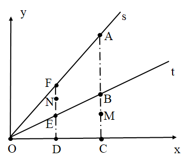
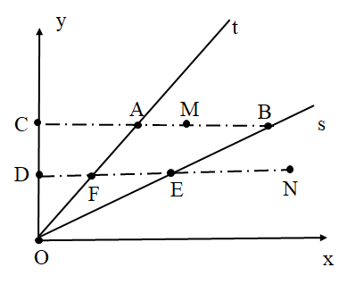
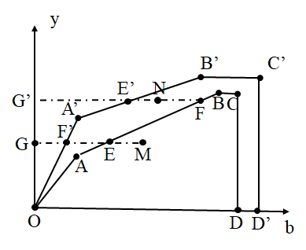
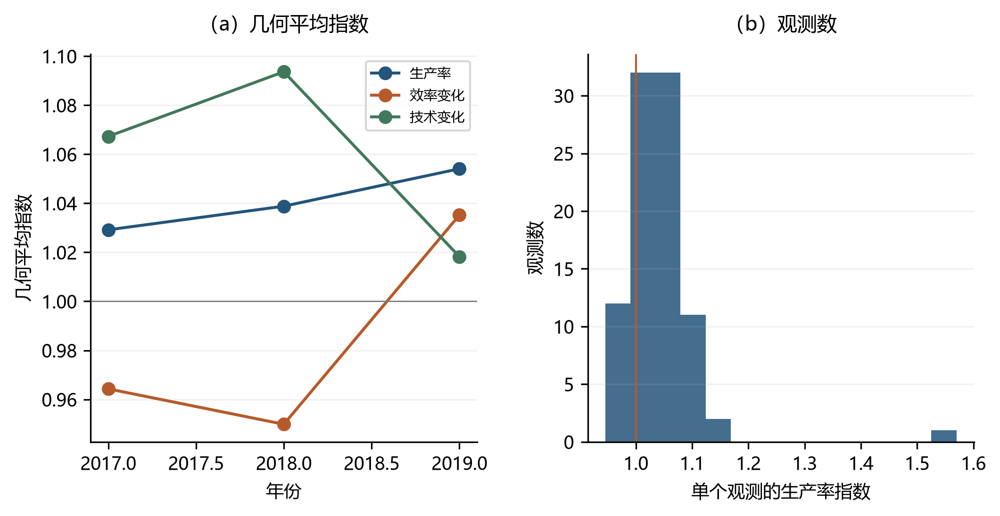

# 包含非期望产出的生产率 {#sec-7}
第 [-@sec-6] 章讨论了非期望产出约束下的静态环境效率，本章将分析对象从单期效率水平扩展到跨期生产率变化。传统全要素生产率指标主要刻画投入节约与期望产出扩张。然而，在污染排放具有弱可处置性时，若不同时考虑非期望产出，容易高估经济增长的真实质量。基于这一问题意识，本章在环境生产技术集合的基础上，依次引入 Malmquist 生产率指数、Malmquist-Luenberger 指数、Luenberger 指标以及非径向方向距离函数，并将非期望产出方向单独抽出，构造动态环境绩效指标，考察决策单元的环境绩效如何随效率追赶和技术前沿移动而变化。

本章按距离函数类型与调整方向依次展开，并以效率变化与技术变化的分解作为统一解释框架。首先，要明确投入、期望产出与非期望产出的可行组合；继而，以谢泼德距离函数、方向距离函数和非径向方向距离函数刻画观测点相对环境生产前沿的位置；再由相邻时期比较构造动态生产率指标与动态环境绩效指标；最后，将其分解为效率变化与技术变化。这样处理的优点在于，生产率增长被置于由污染约束与环境治理能力共同决定的技术边界之内进行评价，从而综合反映投入、产出与排放三方面的变化。

## Malmquist 生产率指数 {#sec-7-1}

生产率的动态变化以单期距离函数为基础，并通过跨期比较加以刻画。Malmquist 生产率指数（Caves, Christensen and Diewert, 1982）以不同时期的生产技术为参照，通过比较同一决策单元在相邻时期相对于生产前沿的位置变化，将生产率变动分解为效率变化和技术变化；本章采用的 DEA 实现及分解形式来自 Färe, Grosskopf, Norris and Zhang (1994)。本节先讨论期望产出方向的 Malmquist 指数，再给出投入方向的对称形式。Malmquist 指数在本章中首先作为基准框架出现：它可以将非期望产出纳入环境生产技术集合，但其调整方向仍主要围绕投入或期望产出展开，因此尚不能完全刻画"扩张期望产出、压缩污染排放"的绿色生产率含义。

### 期望产出方向 {#sec-7-1-1}

在包含非期望产出的环境生产技术中，期望产出方向的谢泼德距离函数（Shephard, 1970；环境方向扩展见 Färe, Grosskopf and Lovell, 1985）可定义为：
$$
D_{o}(\boldsymbol{x}, \boldsymbol{y},\boldsymbol{b})=\inf \left\{\theta:(\boldsymbol{x},\boldsymbol{y} / \theta,\boldsymbol{b}) \in T\right\}
$$ {#eq-7-1}
式中，$T$ 表示本章导语中定义的环境生产技术集合。设 $t$ 期和 $s(s>t)$ 期决策单元观测值分别为 $\left(x^{t},y^{t},b^{t}\right)$ 和 $\left(x^{s},y^{s},b^{s}\right)$，则以 $t$ 期技术为参照的 Malmquist 生产率指数，可写为 $s$ 期距离函数与 $t$ 期距离函数之比：
$$
M_{o}^{t}=\frac{D_{o}^{t}\left(\boldsymbol{{x}^{s}}, \boldsymbol{{y}^{s}},\boldsymbol{{b}^{s}}\right)}{D_{o}^{t}\left(\boldsymbol{{x}^{t}}, \boldsymbol{{y}^{t}},\boldsymbol{{b}^{t}}\right)}
$$ {#eq-7-2}
相应地，以 $s$ 期技术为参照的指数为：
$$
M_{o}^{s}=\frac{D_{o}^{s}\left(\boldsymbol{x^{s}}, \boldsymbol{y^{s}}, \boldsymbol{b^{s}}\right)}{D_{o}^{s}\left(\boldsymbol{x^{t}},\boldsymbol{y^{t}},\boldsymbol{b^{t}}\right)}
$$ {#eq-7-3}
为降低单一参照技术选择对指数的影响，产出导向 Malmquist 生产率指数通常取两个时期指数的几何平均：
$$
M_{o}=\left[\frac{D_{o}^{t}\left(\boldsymbol{{x}^{s}},\boldsymbol{y^{s}},\boldsymbol{b^{s}}\right)}{D_{o}^{t}\left(\boldsymbol{{x}^{t}}, \boldsymbol{{y}^{t}}, \boldsymbol{{b}^{t}}\right)} \times \frac{D_{o}^{s}\left(\boldsymbol{{x}^{s}}, \boldsymbol{{y}^{s}}, \boldsymbol{{b}^{s}}\right)}{D_{o}^{s}\left(\boldsymbol{{x}^{t}}, \boldsymbol{{y}^{t}}, \boldsymbol{{b}^{t}}\right)}\right]^{1 / 2}
$$ {#eq-7-4}
式（[-@eq-7-4]）包含四个产出方向谢泼德距离函数，其中同一期观测与同一期技术的组合反映效率位置，跨期观测与异期技术的组合反映前沿移动。将二者重新整理，可得到如下分解：
$$
\begin{aligned}
M_{o} &=\frac{D_{o}^{s}\left(\boldsymbol{{x}^{s}}, \boldsymbol{{y}^{s}}, \boldsymbol{{b}^{s}}\right)}{D_{o}^{t}\left(\boldsymbol{{x}^{t}}, \boldsymbol{{y}^{t}}, \boldsymbol{{b}^{t}}\right)} \times\left[\frac{D_{o}^{t}\left(\boldsymbol{{x}^{s}}, \boldsymbol{{y}^{s}}, \boldsymbol{{b}^{s}}\right)}{D_{o}^{s}\left(\boldsymbol{{x}^{s}},\boldsymbol{{y}^{s}}, \boldsymbol{{b}^{s}}\right)} \times \frac{D_{o}^{t}\left(\boldsymbol{{x}^{t}},\boldsymbol{{y}^{t}}, \boldsymbol{{b}^{t}}\right)}{D_{o}^{s}\left(\boldsymbol{{x}^{t}}, \boldsymbol{{y}^{t}},\boldsymbol{{b}^{t}}\right)}\right]^{1 / 2} \\
&=\text { MEFFCH } \times \text { MTECHCH }
\end{aligned}
$$ {#eq-7-5}
其中，$MEFFCH$ 表示效率变化，用于刻画决策单元相对于产出技术前沿的追赶或偏离；$MTECHCH$ 表示技术变化，用于刻画生产技术前沿本身的移动。在这一设定中，非期望产出通过技术集合进入模型，发挥的是可行性约束作用；指数本身仍沿期望产出方向评价生产率变化。因此，该指标适合作为传统生产率分析的环境约束扩展，对其解释应限于期望产出方向的生产率变化，污染减排绩效的测度留待后续指标处理。

{#fig-7-1}

 @fig-7-1 给出了单投入、单期望产出情形下产出导向 Malmquist 指数 $M_o$ 的几何含义。区域 $OABCD$ 和 $OA^{\prime}B^{\prime}C^{\prime}D^{\prime}$ 分别表示 $t$ 期和 $s$ 期环境 DEA 技术；点 $M$ 和 $N$ 表示同一决策单元在两个时期的投入—产出组合。图中，效率变化为 $\frac{DN/DF}{CM/CB}$，技术变化为 $[\frac {DN/DE}{DN/DF}\cdot\frac {CM/CB}{CM/CA}]^{1/2}=[\frac {GE}{GF'}\cdot\frac {G'F}{G'E'}]^{1/2}$，对应于给定投入水平下生产前沿的外移。

产出导向指数以期望产出的扩张刻画生产率变化，但当研究关注资源消耗约束更强、产出规模短期难以调整的情形时，更自然的参照是投入方向的节约能力，下一节给出投入导向的 Malmquist 指数。

### 投入方向 {#sec-7-1-2}

在投入方向上，谢泼德距离函数（Shephard, 1970）可定义为：
$$
D_{i}(\boldsymbol{x}, \boldsymbol{y}, \boldsymbol{b})=\sup \left\{\theta:(\boldsymbol{x}/ \theta,\boldsymbol{y},\boldsymbol{b}  ) \in T\right\}
$$ {#eq-7-6}
式中，$T$ 表示环境生产技术集合。设 $t$ 期和 $s(s>t)$ 期决策单元观测值分别为 $\left(x^{t},y^{t},b^{t}\right)$ 和 $\left(x^{s},y^{s},b^{s}\right)$。投入方向谢泼德距离函数取值范围为 $[1,+\infty)$，其倒数可解释为投入效率，因此以 $t$ 期技术为参照的投入导向指数写为：
$$
M_{i}^{t}=\frac{D_{i}^{t}\left(\boldsymbol{{x}^{t}}, \boldsymbol{{y}^{t}},\boldsymbol{{b}^{t}}\right)}{D_{i}^{t}\left(\boldsymbol{{x}^{s}}, \boldsymbol{{y}^{s}}, \boldsymbol{{b}^{s}}\right)}
$$ {#eq-7-7}
相应地，以 $s$ 期技术为参照的指数为：
$$
M_{i}^{s}=\frac{D_{i}^{s}\left(\boldsymbol{x^{t}}, \boldsymbol{y^{t}}, \boldsymbol{b^{t}}\right)}{D_{i}^{s}\left(\boldsymbol{x^{s}},\boldsymbol{y^{s}},\boldsymbol{b^{s}}\right)}
$$ {#eq-7-8}
为降低单一参照技术选择对指数的影响，投入导向 Malmquist 生产率指数通常取两个时期指数的几何平均：
$$
M_{i}=\left[\frac{D_{i}^{t}\left(\boldsymbol{{x}^{t}},\boldsymbol{y^{t} },\boldsymbol{b^{t} }\right)}{D_{i}^{t}\left(\boldsymbol{{x}^{s}}, \boldsymbol{{y}^{s}}, \boldsymbol{{b}^{s}}\right)} \times \frac{D_{i}^{s}\left(\boldsymbol{{x}^{t}}, \boldsymbol{{y}^{t}}, \boldsymbol{{b}^{t}}\right)}{D_{i}^{s}\left(\boldsymbol{{x}^{s}}, \boldsymbol{{y}^{s}}, \boldsymbol{{b}^{s}}\right)}\right]^{1 / 2}
$$ {#eq-7-9}
式（[-@eq-7-9]）包含四个投入方向谢泼德距离函数。按照同一期技术参照和跨期技术参照重新分组，可分解为效率变化和技术变化两部分：
$$
\begin{aligned}
M_{i} &=\frac{D_{i}^{t}\left(\boldsymbol{{x}^{t}}, \boldsymbol{{y}^{t}}, \boldsymbol{{b}^{t}}\right)}{D_{i}^{s}\left(\boldsymbol{{x}^{s}}, \boldsymbol{{y}^{s}}, \boldsymbol{{b}^{s}}\right)} \times\left[\frac{D_{i}^{s}\left(\boldsymbol{{x}^{s}}, \boldsymbol{{y}^{s}}, \boldsymbol{{b}^{s}}\right)}{D_{i}^{t}\left(\boldsymbol{{x}^{s}},\boldsymbol{{y}^{s}}, \boldsymbol{{b}^{s}}\right)} \times \frac{D_{i}^{s}\left(\boldsymbol{{x}^{t}},\boldsymbol{{y}^{t}}, \boldsymbol{{b}^{t}}\right)}{D_{i}^{t}\left(\boldsymbol{{x}^{t}}, \boldsymbol{{y}^{t}},\boldsymbol{{b}^{t}}\right)}\right]^{1 / 2} \\
&=\text { MEFFCH } \times \text { MTECHCH }
\end{aligned}
$$ {#eq-7-10}
其中，$MEFFCH$ 表示效率变化，用于刻画决策单元相对于投入方向技术前沿的追赶或偏离；$MTECHCH$ 表示技术变化，用于刻画生产技术前沿本身的移动。与产出导向相比，投入导向更强调在既定期望产出和非期望产出水平下的投入节约能力，因此适用于研究资源消耗约束更强、产出规模短期较难调整的情形。

{#fig-7-2}

 @fig-7-2 给出了投入导向 Malmquist 指数 $M_i$ 的几何含义。射线 $t$ 和 $s$ 分别表示两个时期的环境 DEA 技术，点 $M$ 和 $N$ 表示同一决策单元在 $t$ 期与 $s$ 期、相同产出水平下的投入组合。$A$、$E$ 分别是 $M$、$N$ 在**本期**前沿上的对应点，$B$、$F$ 分别是它们在**另一期**前沿上的对应点。于是 Farrell 型投入效率为 $\mathrm{TE}_t=CA/CM$、$\mathrm{TE}_s=DE/DN$，谢泼德距离为其倒数，即 $D_i^t(\boldsymbol{x}^t)=CM/CA$、$D_i^s(\boldsymbol{x}^s)=DN/DE$、$D_i^s(\boldsymbol{x}^t)=CM/CB$、$D_i^t(\boldsymbol{x}^s)=DN/DF$。据此，效率变化为 $\frac{DE/DN}{CA/CM}$（等价地写成谢泼德形式 $\frac{CM/CA}{DN/DE}$），与式 ([-@eq-7-10]) 中的 $MEFFCH=D_i^t(\boldsymbol{x}^t)/D_i^s(\boldsymbol{x}^s)=\mathrm{TE}_s/\mathrm{TE}_t$ 一致；技术变化为 $\left[\frac {DN/DE}{DN/DF}\cdot\frac {CM/CB}{CM/CA}\right]^{1/2}=\left[\frac {DF}{DE}\cdot\frac {CA}{CB}\right]^{1/2}$，对应于给定产出水平下投入需求前沿的内移（前沿内移时该值大于 1）。

上述 Malmquist 指数以谢泼德距离函数为基础，调整方向固定为投入或产出某一维度，难以同时刻画"扩张期望产出、压缩污染排放"的绿色生产率含义。下一节引入方向距离函数，使调整方向可灵活设定，并据此构造 Malmquist-Luenberger 指数与 Luenberger 指标。


## 基于方向距离函数的全要素生产率指数 {#sec-7-2}

方向距离函数的优势在于能够直接规定"改善"的经济方向。对于包含非期望产出的生产率测算，研究者通常关心给定污染约束下的最大产出，也关心在维持或节约投入的同时能否增加期望产出、减少污染排放（Nin, Arndt, Hertel and Preckel, 2003）。第 [-@sec-6] 章已给出方向距离函数的四类设定：期望产出扩张与非期望产出压缩同时调整、投入缩减、仅非期望产出压缩，以及投入缩减—期望产出扩张—非期望产出压缩同时调整。其中，前两类方向可构造比值型 Malmquist-Luenberger 指数或加法型 Luenberger 指标；综合方向由于同时涉及投入与产出调整，难以构造对应的谢泼德距离函数，通常采用加法型 Luenberger 指标。仅沿非期望产出方向调整的情形更适合解释为动态环境绩效，将在 [-@sec-7-4] 节单独讨论。

为便于后文叙述，此处统一交代两类指数的判读规则。比值型 Malmquist-Luenberger 指数及其分解项以 1 为判读基准：大于 1 表示改善或正向贡献，小于 1 表示退步或负向贡献。加法型 Luenberger 指标及其分解项以 0 为判读基准：大于 0 表示改善或正向贡献，小于 0 表示退步或负向贡献，等于 0 表示无变化。下文涉及的方向向量不同，但同一类指数的判读基准不变；除各节首次出现比值型或加法型指数时略作提示外，不再逐一重述。

### 期望产出和非期望产出方向同时调整 {#sec-7-2-1}

**（一）Malmquist-Luenberger 指数**期望产出和非期望产出同时调整时，方向向量设为 $(-\boldsymbol{g_x},\boldsymbol{g_y},-\boldsymbol{g_b})=(\boldsymbol{0},\boldsymbol{y},-\boldsymbol{b})$，即在保持投入不变的同时扩张期望产出并压缩非期望产出。方向距离函数由 Chambers, Chung and Färe (1996) 提出，并在环境生产率框架中由 Chung, Färe and Grosskopf (1997) 加以应用。这一方向最直接对应绿色生产率改善的含义：同样的要素投入需同时创造更多期望产出并减少污染排放。
$$
\vec{D}_{o}\left(\boldsymbol{x}, \boldsymbol{y},\boldsymbol{b}; \boldsymbol{0}, \boldsymbol{y}, -\boldsymbol{b}\right)=\sup \left\{\beta:\left(\boldsymbol{x}, \boldsymbol{y}+\beta\boldsymbol{y}, \boldsymbol{b}-\beta\boldsymbol{b}\right) \in T\right\}
$$ {#eq-7-11}

方向距离函数与谢泼德产出距离函数之间存在一个常被引用的恒等关系。Chung, Färe and Grosskopf (1997) 给出的是：当谢泼德距离沿**好坏产出同向扩张**定义，即 $D_o^{yb}(\boldsymbol{x},\boldsymbol{y},\boldsymbol{b})=\inf\{\theta:(\boldsymbol{y},\boldsymbol{b})/\theta\in P(\boldsymbol{x})\}$，且方向向量取 $\boldsymbol{g}=(\boldsymbol{0},\boldsymbol{y},\boldsymbol{b})$（好坏产出同向）时，有

$$
D_{o}^{yb}(\boldsymbol{x}, \boldsymbol{y},\boldsymbol{b})=\frac{1}{1+\overrightarrow{D}_{o}(\boldsymbol{x}, \boldsymbol{y},\boldsymbol{b} ;\boldsymbol{0},\boldsymbol{y},\boldsymbol{b})}
$$ {#eq-7-12}

需要特别说明的是，式 ([-@eq-7-12]) **不适用于**式 ([-@eq-7-1]) 的 $D_o$ 与式 ([-@eq-7-11]) 的增产减排方向距离函数：式 ([-@eq-7-1]) 只扩张期望产出而保持 $\boldsymbol{b}$ 不变，式 ([-@eq-7-11]) 的方向 $(\boldsymbol{0},\boldsymbol{y},-\boldsymbol{b})$ 是"增产同时减污"，两者的投影点落在前沿的不同位置，因此二者之间不存在 $D_o=1/(1+\beta)$ 这样的恒等式，不能把 ([-@eq-7-1]) 代入 ([-@eq-7-12]) 相互替换。第 [-@sec-6] 章的纯产出效率 $PEO$ 与环境 DDF 的 $1/(1+\beta^*)$ 也因此不是同一个数。

Malmquist-Luenberger 指数的构造方式是：**类比**标准 Malmquist 指数把距离函数之比换成 $1+\overrightarrow{D}_o(\cdot;\boldsymbol{0},\boldsymbol{y},-\boldsymbol{b})$ 之比，直接定义为下式，而不是由 ([-@eq-7-1]) 与 ([-@eq-7-12]) 代入导出。令 $t$ 和 $s(t<s)$ 表示相邻两个时期，其计算式为：

$$
\mathrm{ML}_{t}^{s}=\left[\frac{1+\overrightarrow{D_{o}^{t}}\left(\boldsymbol{x_{i}^{t}}, \boldsymbol{y_{i}^{t}}, \boldsymbol{b_{i}^{t}};\boldsymbol{0},\boldsymbol{y_{i}^{t}}, -\boldsymbol{b_{i}^{t}}\right)}{1+\overrightarrow{D_{o}^{t}}\left(\boldsymbol{x_{i}^{s}}, \boldsymbol{y_{i}^{s}}, \boldsymbol{b_{i}^{s}};\boldsymbol{0},\boldsymbol{y_{i}^{s}}, -\boldsymbol{b_{i}^{s}}\right)} \times \frac{1+ \overrightarrow{D_{o}^{s}} \left(\boldsymbol{x_{i}^{t}}, \boldsymbol{y_{i}^{t}}, \boldsymbol{b_{i}^{t}}; \boldsymbol{0},\boldsymbol{y_{i}^{t}}, -\boldsymbol{b_{i}^{t}}\right)}{1+\overrightarrow{D_{o}^{s}}\left(\boldsymbol{x_{i}^{s}}, \boldsymbol{y_{i}^{s}}, \boldsymbol{b_{i}^{s}};\boldsymbol{0},\boldsymbol{y_{i}^{s}}, -\boldsymbol{b_{i}^{s}}\right)}\right]^{1 / 2}
$$ {#eq-7-13}
其中，$\left(\boldsymbol{x_i^s},\boldsymbol{y_i^s},\boldsymbol{b_i^s}\right)$ 和 $\left(\boldsymbol{x_i^t},\boldsymbol{y_i^t},\boldsymbol{b_i^t}\right)$ 分别表示 $s$ 期和 $t$ 期观测值；方向向量分别取 $\boldsymbol{g}=(\boldsymbol{0},\boldsymbol{y_i^s},-\boldsymbol{b_i^s})$ 和 $\boldsymbol{g}=(\boldsymbol{0},\boldsymbol{y_i^t},-\boldsymbol{b_i^t})$；$\vec{D}_{o}^{s}$ 和 $\vec{D}_{o}^{t}$ 分别表示以 $s$ 期和 $t$ 期技术集合计算的方向距离函数。

$ML$ 可分解为效率变化 $MLEFFCH$ 和技术变化 $MLTECHCH$：
$$
MLEFFCH =\frac{1+\overrightarrow{D_{o}^{t}}\left(\boldsymbol{x_{i}^{t}}, \boldsymbol{{y}_{i}^{t}}, \boldsymbol{{b}_{i}^{t}};\boldsymbol{0},\boldsymbol{{y}_{i}^{t}}, -\boldsymbol{{b}_{i}^{t}}\right)}{1+\overrightarrow{D_{o}^{s}}\left(\boldsymbol{{x}_{i}^{s}}, \boldsymbol{{y}_{i}^{s}}, \boldsymbol{{b}_{i}^{s}};\boldsymbol{0},\boldsymbol{{y}_{i}^{s}}, -\boldsymbol{{b}_{i}^{s}}\right)}
$$ {#eq-7-14}


$$
\mathrm{MLTECHCH}=\left[\frac{1+\overrightarrow{D_{o}^{s}}\left(\boldsymbol{{x}_{i}^{s}}, \boldsymbol{{y}_{i}^{s}}, \boldsymbol{{b}_{i}^{s}};\boldsymbol{0},\boldsymbol{{y}_{i}^{s}}, -\boldsymbol{{b}_{i}^{s}}\right)}{1+\overrightarrow{D_{o}^{t}}\left(\boldsymbol{{x}_{i}^{s}}, \boldsymbol{{y}_{i}^{s}}, \boldsymbol{{b}_{i}^{s}};\boldsymbol{0},\boldsymbol{{y}_{i}^{s}}, -\boldsymbol{{b}_{i}^{s}}\right)} \times \frac{1+\overrightarrow{D_{o}^{s}}\left(\boldsymbol{{x}_{i}^{t}}, \boldsymbol{{y}_{i}^{t}}, \boldsymbol{{b}_{i}^{t}};\boldsymbol{0},\boldsymbol{{y}_{i}^{t}}, -\boldsymbol{{b}_{i} ^{t}}\right)}{1+\overrightarrow{D_{o}^{t}}\left(\boldsymbol{{x}_{i}^{t}}, \boldsymbol{{y}_{i}^{t}}, \boldsymbol{{b}_{i} ^{t}};\boldsymbol{0},\boldsymbol{{y}_{i}^{t}}, -\boldsymbol{{b}_{i} ^{t}}\right)}\right]^{1 / 2}
$$ {#eq-7-15}

其中，$MLEFFCH$ 衡量追赶效应，反映 $DMU_i$ 从 $t$ 期到 $s$ 期相对于环境生产前沿的位置变化；$MLTECHCH$ 衡量前沿移动效应，反映环境生产技术边界的变化。就比值型指数而言，指标大于 1 表示改善或进步，小于 1 表示退步。

**（二）Luenberger 指标**第二种做法是采用 Chambers, Färe and Grosskopf (1996) 以及 Briec and Kerstens (2009) 提出的加法型 Luenberger 生产率指标。其计算式为：
$$
\begin{aligned}
\mathrm{L}_{t}^{s}={0.5} \left[{\overrightarrow{D_{o}^{t}}\left(\boldsymbol{x_{i}^{t}},\boldsymbol{ y_{i}^{t}}, \boldsymbol{b_{i}^{t}};\boldsymbol{0},\boldsymbol{y_{i}^{t}}, -\boldsymbol{b_{i}^{t}}\right)}-{\overrightarrow{D_{o}^{t}}\left(\boldsymbol{x_{i}^{s}}, \boldsymbol{y_{i}^{s}}, \boldsymbol{b_{i}^{s}};\boldsymbol{0},\boldsymbol{y_{i}^{s}}, -\boldsymbol{b_{i}^{s}}\right)}\right] \\
+{0.5}  \left[{\overrightarrow{D_{o}^{s}}\left(\boldsymbol{x_{i}^{t}}, \boldsymbol{y_{i}^{t}}, \boldsymbol{b_{i}^{t}}; \boldsymbol{0},\boldsymbol{y_{i}^{t}}, -\boldsymbol{b_{i}^{t}}\right)}-{\overrightarrow{D_{o}^{s}}\left(\boldsymbol{x_{i}^{s}}, \boldsymbol{y_{i}^{s}}, \boldsymbol{b_{i}^{s}};\boldsymbol{0},\boldsymbol{y_{i}^{s}}, -\boldsymbol{b_{i}^{s}}\right)}\right ]
\end{aligned}
$$ {#eq-7-16}
其中，$\left(\boldsymbol{x_i^s},\boldsymbol{y_i^s},\boldsymbol{b_i^s}\right)$ 和 $\left(\boldsymbol{x_i^t},\boldsymbol{y_i^t},\boldsymbol{b_i^t}\right)$ 分别为 $s$ 期和 $t$ 期观测值；方向向量分别为 $g=(\boldsymbol{0},\boldsymbol{y_i^s},-\boldsymbol{b_i^s})$ 和 $g=(\boldsymbol{0},\boldsymbol{y_i^t},-\boldsymbol{b_i^t})$；$\vec{D}_{o}^{s}$ 和 $\vec{D}_{o}^{t}$ 分别表示以 $s$ 期和 $t$ 期生产技术计算的方向距离函数。

按照 Luenberger 生产率指标的加法分解，$L$ 可分解为效率变化 $LEFFCH$ 和技术变化 $LTECHCH$：
$$
LEFFCH ={\overrightarrow{D_{o}^{t}}\left(\boldsymbol{x_{i}^{t}}, \boldsymbol{{y}_{i}^{t}}, \boldsymbol{{b}_{i}^{t}};\boldsymbol{0},\boldsymbol{{y}_{i}^{t}}, -\boldsymbol{{b}_{i}^{t}}\right)}-{\overrightarrow{D_{o}^{s}}\left(\boldsymbol{{x}_{i}^{s}}, \boldsymbol{{y}_{i}^{s}}, \boldsymbol{{b}_{i}^{s}};\boldsymbol{0},\boldsymbol{{y}_{i}^{s}}, -\boldsymbol{{b}_{i}^{s}}\right)}
$$ {#eq-7-17}


$$
\mathrm{LTECHCH}=\left[({\overrightarrow{D_{o}^{s}}\left(\boldsymbol{{x}_{i}^{s}}, \boldsymbol{{y}_{i}^{s}}, \boldsymbol{{b}_{i}^ {s}};\boldsymbol{0},\boldsymbol{{y}_{i}^{s}}, -\boldsymbol{{b}_{i}^{s}}\right)}-{\overrightarrow{D_{o}^{t}}\left(\boldsymbol{{x}_{i}^{s}}, \boldsymbol{{y}_{i}^{s}}, \boldsymbol{{b}_{i}^{s}};\boldsymbol{0},\boldsymbol{{y}_{i}^{s}}, -\boldsymbol{{b}_{i}^{s}}\right)})\right] \times \frac {1} {2}\\
+\left[{\overrightarrow{D_{o}^{s}}\left(\boldsymbol{{x}_{i}^{t}}, \boldsymbol{{y}_{i}^{t}}, \boldsymbol{{b}_{i} ^{t}};\boldsymbol{0},\boldsymbol{{y}_{i}^{t}}, -\boldsymbol{{b}_{i} ^{t}}\right)}-{\overrightarrow{D_{o}^{t}}\left(\boldsymbol{x}_{i}^{t}, \boldsymbol{{y}_{i}^{t}}, \boldsymbol{{b}_{i} ^{t}};\boldsymbol{0},\boldsymbol{{y}_{i}^{t}}, -\boldsymbol{{b}_{i} ^{t}}\right)}\right]\times \frac {1} {2}
$$ {#eq-7-18}

其中，$LEFFCH$ 和 $LTECHCH$ 分别衡量期望产出—非期望产出方向上的效率追赶与技术前沿移动，判读基准同本节开篇说明。

上述期望产出—非期望产出方向同时调整的设定，对应"扩张产出、压缩排放"的绿色生产率含义；若研究问题转向投入节约，则需将方向向量改为投入方向，下一节给出相应的 Malmquist-Luenberger 指数与 Luenberger 指标。

### 投入方向 {#sec-7-2-2}

**（一）Malmquist-Luenberger 指数**当研究问题集中于投入节约能力时，可将方向向量设为 $(-\boldsymbol{g_x},\boldsymbol{g_y},-\boldsymbol{g_b})=(-\boldsymbol{x},\boldsymbol{0},\boldsymbol{0})$，表示在期望产出和非期望产出不变时缩减投入。该设定适合分析能源、资本或劳动力约束下的资源配置效率变化：
$$
\overrightarrow{D_{i}}\left(\boldsymbol{x}, \boldsymbol{y},\boldsymbol{b} ; {-\boldsymbol{x}}, {\boldsymbol{0}, } {\boldsymbol{0}}\right)=\sup \left\{\beta:\left(\boldsymbol{x}-\beta {\boldsymbol{x}}, \boldsymbol{y},\boldsymbol{b}\right) \in T\right\}
$$ {#eq-7-19}
与前述思路一致，可先利用投入方向距离函数与投入方向谢泼德距离函数之间的关系构造比值型指数。令 $\theta=\frac{1}{1-\beta}$，则 $(1-\beta)\boldsymbol{x}=\boldsymbol{x}/\theta$，且 $\beta$ 关于 $\theta$ 单调递增，故 $\beta$ 与 $\theta$ 的上确界在同一可行点达到：
$$
\begin{aligned}
\overrightarrow{D_{i}}(\boldsymbol{x}, \boldsymbol{y},\boldsymbol{b}; -\boldsymbol{x},\boldsymbol{0},\boldsymbol{0}) &=\sup \{\beta:(\boldsymbol{x}-\beta \boldsymbol{x},\boldsymbol{y},\boldsymbol{b}) \in T\} \\
&=\sup \{\beta:((1-\beta)\boldsymbol{x},\boldsymbol{y}, \boldsymbol{b}) \in T\}
\end{aligned}
$$ {#eq-7-20}
对应地，$\theta$ 的上确界为 $D_{i}(\boldsymbol{x},\boldsymbol{y},\boldsymbol{b})=\sup \{\theta:(\boldsymbol{x}/\theta,\boldsymbol{y}, \boldsymbol{b})\in T\}$。若记 $\overrightarrow{D}_{i}(\boldsymbol{x},\boldsymbol{y},\boldsymbol{b};-\boldsymbol{x},\boldsymbol{0},\boldsymbol{0})=\beta^{*}$，则 $\theta^{*}=\frac{1}{1-\beta^{*}}$ 达到 $D_{i}$ 的上确界，因而二者满足：
$$
D_{i}(\boldsymbol{x}, \boldsymbol{y},\boldsymbol{b})=\frac{1}{1-\overrightarrow{D}_{i}(\boldsymbol{x}, \boldsymbol{y}, \boldsymbol{b} ; -\boldsymbol{x},\boldsymbol{0},\boldsymbol{0})}
$$ {#eq-7-21}
据此可将投入方向距离函数纳入 Malmquist 指数框架，得到投入方向的 Malmquist-Luenberger 生产率指数。令 $t$ 和 $s(t<s)$ 表示相邻时期，其计算式为：
$$
\mathrm{ML}_{t}^{s}=\left[\frac{1-\overrightarrow{D_{i}^{t}}\left(\boldsymbol{x_{i}^{s}}, \boldsymbol{y_{i}^{s}}, \boldsymbol{b_{i}^{s}}; -\boldsymbol{x_{i}^{s}},\boldsymbol{0},\boldsymbol{0}\right)}{1-\overrightarrow{D_{i}^{t}}\left(\boldsymbol{x_{i}^{t}}, \boldsymbol{y_{i}^{t}}, \boldsymbol{b_{i}^{t}};-\boldsymbol{x_{i}^{t}},\boldsymbol{0},\boldsymbol{0}\right)} \times \frac{1- \overrightarrow{D_{i}^{s}} \left(\boldsymbol{x_{i}^{s}}, \boldsymbol{y_{i}^{s}}, \boldsymbol{b_{i}^{s}};-\boldsymbol{x_{i}^{s}},\boldsymbol{0},\boldsymbol{0}\right)}{1-\overrightarrow{D_{i}^{s}}\left(\boldsymbol{x_{i}^{t}}, \boldsymbol{y_{i}^{t}}, \boldsymbol{b_{i}^{t}};-\boldsymbol{x_{i}^{t}},\boldsymbol{0},\boldsymbol{0}\right)}\right]^{1 / 2}
$$ {#eq-7-22}
$ML$ 可分解为效率变化 $MLEFFCH$ 和技术变化 $MLTECHCH$。由 ([-@eq-7-21]) 可知，投入方向上与谢泼德距离函数同口径的效率分数为 $1/D_{i}=1-\overrightarrow{D_{i}}$，因此分解式中的每一项都必须写成 $1-\beta$ 的形式（而不是产出方向的 $1+\beta$）：
$$
MLEFFCH=\frac{1-\overrightarrow{D_{i}^{s}}\left(\boldsymbol{x_{i}^{s}}, \boldsymbol{y_{i}^{s}}, \boldsymbol{b_{i}^{s}};-\boldsymbol{x_{i}^{s}},\boldsymbol{0},\boldsymbol{0}\right)}{1-\overrightarrow{D_{i}^{t}}\left(\boldsymbol{x_{i}^{t}}, \boldsymbol{y_{i}^{t}}, \boldsymbol{b_{i}^{t}};-\boldsymbol{x_{i}^{t}},\boldsymbol{0},\boldsymbol{0}\right)}
$$ {#eq-7-23}

$$
\mathrm{MLTECHCH}=\left[\frac{1-\overrightarrow{D_{i}^{t}}\left(\boldsymbol{x_{i}^{s}}, \boldsymbol{y_{i}^{s}}, \boldsymbol{b_{i}^{s}};-\boldsymbol{x_{i}^{s}},\boldsymbol{0},\boldsymbol{0}\right)}{1-\overrightarrow{D_{i}^{s}}\left(\boldsymbol{x_{i}^{s}}, \boldsymbol{y_{i}^{s}}, \boldsymbol{b_{i}^{s}};-\boldsymbol{x_{i}^{s}},\boldsymbol{0},\boldsymbol{0}\right)} \times \frac{1-\overrightarrow{D_{i}^{t}}\left(\boldsymbol{x_{i}^{t}}, \boldsymbol{y_{i}^{t}}, \boldsymbol{b_{i}^{t}};-\boldsymbol{x_{i}^{t}},\boldsymbol{0},\boldsymbol{0}\right)}{1-\overrightarrow{D_{i}^{s}}\left(\boldsymbol{x_{i}^{t}}, \boldsymbol{y_{i}^{t}}, \boldsymbol{b_{i}^{t}};-\boldsymbol{x_{i}^{t}},\boldsymbol{0},\boldsymbol{0}\right)}\right]^{1 / 2}
$$ {#eq-7-24}

其中，([-@eq-7-23]) 的分子与分母分别是 $s$ 期和 $t$ 期各自参照本期技术的投入效率分数，$MLEFFCH>1$ 表示效率追赶；([-@eq-7-24]) 对 $s$ 期和 $t$ 期两个观测点分别比较两期技术下的效率分数，等价于 $\left[\frac{D_{i}^{s}\left(\boldsymbol{x_{i}^{s}},\cdot\right)}{D_{i}^{t}\left(\boldsymbol{x_{i}^{s}},\cdot\right)} \times \frac{D_{i}^{s}\left(\boldsymbol{x_{i}^{t}},\cdot\right)}{D_{i}^{t}\left(\boldsymbol{x_{i}^{t}},\cdot\right)}\right]^{1/2}$，投入方向的前沿内移（即生产同样产出所需投入下降）时该值大于 1。两式相乘即回到 ([-@eq-7-22])。投入方向的 ML 指数以比值型刻画投入节约的跨期变化；若研究者更关注改善的绝对幅度，可采用下文的加法型 Luenberger 指标。

**（二）Luenberger 指标**投入方向也可采用加法型 Luenberger 指标进行测度，其计算式为：
$$
\begin{aligned}
\mathrm{L}_{t}^{s}={0.5} \left[{\overrightarrow{D_{i}^{t}}\left(\boldsymbol{x_{i}^{t}},\boldsymbol{y_{i}^{t}}, \boldsymbol{b_{i}^{t}};-\boldsymbol{x_{i}^{t}},\boldsymbol{0}, \boldsymbol{0}\right)}-{\overrightarrow{D_{i}^{t}}\left(\boldsymbol{x_{i}^{s}}, \boldsymbol{y_{i}^{s}}, \boldsymbol{b_{i}^{s}};-\boldsymbol{x_{i}^{s}},\boldsymbol{0}, \boldsymbol{0}\right)}\right] \\
+{0.5}  \left[{\overrightarrow{D_{i}^{s}}\left(\boldsymbol{x_{i}^{t}}, \boldsymbol{y_{i}^{t}}, \boldsymbol{b_{i}^{t}}; -\boldsymbol{x_{i}^{t}},\boldsymbol{0}, \boldsymbol{0}\right)}-{\overrightarrow{D_{i}^{s}}\left(\boldsymbol{x_{i}^{s}}, \boldsymbol{y_{i}^{s}}, \boldsymbol{b_{i}^{s}};-\boldsymbol{x_{i}^{s}},\boldsymbol{0}, \boldsymbol{0}\right)}\right ]
\end{aligned}
$$ {#eq-7-25}
其中，$\left(\boldsymbol{x_i^s},\boldsymbol{y_i^s},\boldsymbol{b_i^s}\right)$ 和 $\left(\boldsymbol{x_i^t},\boldsymbol{y_i^t},\boldsymbol{b_i^t}\right)$ 分别为 $s$ 期和 $t$ 期观测值；方向向量分别为 $g=(-\boldsymbol{x_i^s},\boldsymbol{0},\boldsymbol{0})$ 和 $g=(-\boldsymbol{x_i^t},\boldsymbol{0},\boldsymbol{0})$；$\vec{D}_{i}^{s}$ 和 $\vec{D}_{i}^{t}$ 分别表示以 $s$ 期和 $t$ 期生产技术计算的投入方向距离函数。

$L$ 可分解为效率变化 $LEFFCH$ 和技术变化 $LTECHCH$：
$$
LEFFCH ={\overrightarrow{D_{i}^{t}}\left(\boldsymbol{x_{i}^{t}}, \boldsymbol{y_{i}^{t}}, \boldsymbol{b_{i}^{t}};-\boldsymbol{x_i^t},\boldsymbol{0},\boldsymbol{0}\right)}-{\overrightarrow{D_{i}^{s}}\left(\boldsymbol{x_i^s}, \boldsymbol{y_i^s}, \boldsymbol{b_i^s};-\boldsymbol{x_i^s},\boldsymbol{0},\boldsymbol{0}\right)}
$$ {#eq-7-26}

$$
\mathrm{LTECHCH}=\frac{1}{2}\left[{\overrightarrow{D_{i}^{s}}\left(\boldsymbol{x_i^s}, \boldsymbol{y_i^s}, \boldsymbol{b_i^s};-\boldsymbol{x_i^s},\boldsymbol{0},\boldsymbol{0}\right)}-{\overrightarrow{D_{i}^{t}}\left(\boldsymbol{x_i^s}, \boldsymbol{y_i^s}, \boldsymbol{b_i^s};-\boldsymbol{x_i^s},\boldsymbol{0},\boldsymbol{0}\right)}\right]
+\frac{1}{2}\left[{\overrightarrow{D_{i}^{s}}\left(\boldsymbol{x_i^t}, \boldsymbol{y_i^t}, \boldsymbol{b_i^t};-\boldsymbol{x_i^t},\boldsymbol{0},\boldsymbol{0}\right)}-{\overrightarrow{D_{i}^{t}}\left(\boldsymbol{x_i^t}, \boldsymbol{y_i^t}, \boldsymbol{b_i^t};-\boldsymbol{x_i^t},\boldsymbol{0},\boldsymbol{0}\right)}\right]
$$ {#eq-7-27}

其中，$LEFFCH$ 和 $LTECHCH$ 分别衡量投入方向上的效率追赶与投入节约技术前沿的移动，判读基准同本节开篇说明。

上述两类设定各自沿单一方向调整。若研究问题要求投入节约、产出扩张与污染压缩同时成立，则需采用综合方向向量，下一节给出相应的 Luenberger 指标。

### 投入、期望产出、非期望产出同时调整 {#sec-7-2-3}

当研究需要同时缩减投入、扩张期望产出并压缩非期望产出时，可设方向向量为 $(-\boldsymbol{g}_{\boldsymbol{x}},\boldsymbol{g}_{\boldsymbol{y}},-\boldsymbol{g}_{\boldsymbol{b}})=(-\boldsymbol{x},\boldsymbol{y},-\boldsymbol{b})$。这一综合方向对应更严格的环境生产率改进标准：同一决策单元只有在投入节约、产出扩张和污染压缩三个维度上共同改善，才会被评价为具有更高的动态绩效。相应方向距离函数定义如下（Chung et al., 1997）：
$$
\vec{D}_{g}\left(\boldsymbol{x}, \boldsymbol{y},\boldsymbol{b} ; -\boldsymbol{g}_{\boldsymbol{x}}, \boldsymbol{g}_{\boldsymbol{y}}, -\boldsymbol{g}_{\boldsymbol{b}}\right)=\sup \left\{\beta:\left(\boldsymbol{x}-\beta \boldsymbol{g}_{\boldsymbol{x}}, \boldsymbol{y}+\beta \boldsymbol{g}_{\boldsymbol{y}},\boldsymbol{b}-\beta \boldsymbol{g}_{\boldsymbol{b}}\right) \in T\right\}
$$ {#eq-7-28}

在该综合方向下，投入与产出同时发生调整，难以直接构造与单一投入或产出方向相对应的谢泼德距离函数。因此，本节采用加法型 Luenberger 指标刻画全要素生产率变化：
$$
\begin{aligned}
\mathrm{L}_{t}^{s}={0.5}\left[{\overrightarrow{D_{g}^{t}}\left( \boldsymbol{x_{i}^{t}},  \boldsymbol{y_{i}^{t}},  \boldsymbol{b_{i}^{t}}; -\boldsymbol{x_i^t}, \boldsymbol{y_i^t}, - \boldsymbol{b_{i}^{t}}\right)}-{\overrightarrow{D_{g}^{t}}\left( \boldsymbol{x_{i}^{s}},  \boldsymbol{y_{i}^{s}},  \boldsymbol{b_{i}^{s}}; -\boldsymbol{x_i^s}, \boldsymbol{y_i^s}, - \boldsymbol{b_{i}^{s}}\right)}\right]\\
+{0.5}\left[{\overrightarrow{D_{g}^{s}}\left( \boldsymbol{x_{i}^{t}},  \boldsymbol{y_{i}^{t}},  \boldsymbol{b_{i}^{t}}; -\boldsymbol{x_i^t}, \boldsymbol{y_i^t}, - \boldsymbol{b_{i}^{t}}\right)}-{\overrightarrow{D_{g}^{s}}\left( \boldsymbol{x_{i}^{s}},  \boldsymbol{y_{i}^{s}},  \boldsymbol{b_{i}^{s}}; -\boldsymbol{x_i^s}, \boldsymbol{y_i^s}, - \boldsymbol{b_{i}^{s}}\right)}\right]
\end{aligned}
$$ {#eq-7-29}

其中，$\left(\boldsymbol{x_{i}^{s}}, \boldsymbol{y_{i}^{s}}, \boldsymbol{b_{i}^{s}}\right)$ 和 $\left(\boldsymbol{x_{i}^{t}}, \boldsymbol{y_{i}^{t}}, \boldsymbol{b_{i}^{t}}\right)$ 分别为 $s$ 期和 $t$ 期观测值；方向向量 $(-\boldsymbol{g_x},\boldsymbol{g_y},-\boldsymbol{g_b})$ 分别取 $\left(-\boldsymbol{x_i^s},\boldsymbol{y_i^s},-\boldsymbol{b_i^s}\right)$ 和 $\left(-\boldsymbol{x_i^t},\boldsymbol{y_i^t},-\boldsymbol{b_i^t}\right)$；$\vec{D}_{g}^{s}$ 和 $\vec{D}_{g}^{t}$ 分别表示以 $s$ 期和 $t$ 期生产技术计算的综合方向距离函数。

按照 Luenberger 生产率指标的加法分解，$L$ 可分解为效率变化 $LEFFCH$ 和技术变化 $LTECHCH$：
$$
LEFFCH ={\overrightarrow{D_{g}^{t}}\left(\boldsymbol{x_{i}^{t}}, \boldsymbol{y_{i}^{t}}, \boldsymbol{b_i^t};-\boldsymbol{x_i^t},\boldsymbol{y_i^t}, -\boldsymbol{b_i^t}\right)}-{\overrightarrow{D_{g}^{s}}\left(\boldsymbol{x_i^s}, \boldsymbol{y_i^s}, \boldsymbol{b_i^s};-\boldsymbol{x_i^s},\boldsymbol{y_i^s}, -\boldsymbol{b_i^s}\right)}
$$ {#eq-7-30}

$$
\mathrm{LTECHCH}=\frac{1}{2}\left[{\overrightarrow{D_{g}^{s}}\left(\boldsymbol{x_i^s}, \boldsymbol{y_i^s}, \boldsymbol{b_i^s};-\boldsymbol{x_i^s},\boldsymbol{y_i^s}, -\boldsymbol{b_i^s}\right)}-{\overrightarrow{D_{g}^{t}}\left(\boldsymbol{x_i^s}, \boldsymbol{y_i^s}, \boldsymbol{b_i^s};-\boldsymbol{x_i^s},\boldsymbol{y_i^s}, -\boldsymbol{b_i^s}\right)}\right]\\
+\frac{1}{2}\left[{\overrightarrow{D_{g}^{s}}\left(\boldsymbol{x_i^t}, \boldsymbol{y_i^t}, \boldsymbol{b_i^t};-\boldsymbol{x_i^t},\boldsymbol{y_i^t}, -\boldsymbol{b_i^t}\right)}-{\overrightarrow{D_{g}^{t}}\left(\boldsymbol{x_i^t}, \boldsymbol{y_i^t}, \boldsymbol{b_i^t};-\boldsymbol{x_i^t},\boldsymbol{y_i^t}, -\boldsymbol{b_i^t}\right)}\right]
$$ {#eq-7-31}

其中，$LEFFCH$ 和 $LTECHCH$ 分别衡量综合方向上的效率追赶与技术前沿移动，判读基准同 [-@sec-7-2] 节开篇说明。至此，[-@sec-7-2] 节的三类方向设定均沿用径向调整假设；当研究问题要求不同要素按差异化幅度调整时，需进一步放松该假设，下一节给出非径向扩展。

## 基于非径向方向距离函数的全要素生产率指标 {#sec-7-3}

传统 Malmquist 生产率指数和径向方向距离函数在方向选择与调整比例上均存在限制：一方面，投入缩减与产出扩张通常需要分别设定，难以同时刻画多方向调整；另一方面，径向模型要求同一方向上的各要素按相同比例变化。现实中，不同投入要素的节约空间、不同污染物的治理难度以及不同期望产出的扩张能力往往并不相同。若研究问题需要允许不同投入、期望产出或非期望产出以差异化幅度调整，则应采用非径向方向距离函数，并使用加法型 Luenberger 指标进行跨期比较。

与 [-@sec-7-2] 节相对应，本节依次给出期望产出—非期望产出方向（7.3.1）、投入方向（7.3.2）以及综合方向（7.3.3）下的非径向 Luenberger 指标；三者的构造逻辑一致，差异仅在于方向向量与非径向松弛的设定。

### 期望产出和非期望产出方向同时调整 {#sec-7-3-1}

期望产出和非期望产出同时调整的非径向方向距离函数以 $(-\boldsymbol{g_x},\boldsymbol{g_y},-\boldsymbol{g_b})=(\boldsymbol{0},\boldsymbol{y},-\boldsymbol{b})$ 为方向向量（Mahlberg and Sahoo, 2011）：
$$
\vec{D}_{o}^{nr}\left(\boldsymbol{x}, \boldsymbol{y}, \boldsymbol{b} ;  -\boldsymbol{g_{x}},\boldsymbol{g_{y}},-\boldsymbol{g_{b}}\right)=\max \left\{\boldsymbol{w^{\prime}} \beta:(\boldsymbol{x},\boldsymbol{y}, \boldsymbol{b})+\left(\boldsymbol{0},\boldsymbol{y},-\boldsymbol{b}\right) \cdot \operatorname{diag}(\beta) \in T\right\}
$$ {#eq-7-32}
其中，$\beta$ 为由各方向调整比例构成的向量，$\boldsymbol{w}$ 为相应权重向量，$\operatorname{diag}(\beta)$ 表示将各维度调整比例写入对角矩阵。非径向设定允许不同期望产出和非期望产出维度具有不同调整幅度。基于该非径向方向距离函数，可构造加法型 Luenberger 生产率指标：
$$
\begin{aligned}
\mathrm{L}_{t}^{s}={0.5}\left[{\overrightarrow{D_{o}^{nr,t}}\left(\boldsymbol{x_{i}^{t}}, \boldsymbol{y_{i}^{t}}, \boldsymbol{b_{i}^{t}};\boldsymbol{0},\boldsymbol{y_{i}^{t}}, -\boldsymbol{b_{i}^{t}}\right)}-{\overrightarrow{D_{o}^{nr,t}}\left(\boldsymbol{x_{i}^{s}}, \boldsymbol{y_{i}^{s}}, \boldsymbol{b_{i}^{s}};\boldsymbol{0},\boldsymbol{y_{i}^{s}}, -\boldsymbol{b_{i}^{s}}\right)}\right]\\
+{0.5}\left[{\overrightarrow{D_{o}^{nr,s}}\left(\boldsymbol{x_{i}^{t}}, \boldsymbol{y_{i}^{t}}, \boldsymbol{b_{i}^{t}}; \boldsymbol{0},\boldsymbol{y_{i}^{t}}, -\boldsymbol{b_{i}^{t}}\right)}-{\overrightarrow{D_{o}^{nr,s}}\left(\boldsymbol{x_{i}^{s}}, \boldsymbol{y_{i}^{s}}, \boldsymbol{b_{i}^{s}};\boldsymbol{0},\boldsymbol{y_{i}^{s}}, -\boldsymbol{b_{i}^{s}}\right)}\right]
\end{aligned}
$$ {#eq-7-33}

其中，$\left(\boldsymbol{x_{i}^{s}}, \boldsymbol{y_{i}^{s}}, \boldsymbol{b_{i}^{s}}\right)$ 和 $\left(\boldsymbol{x_{i}^{t}}, \boldsymbol{y_{i}^{t}}, \boldsymbol{b_{i}^{t}}\right)$ 分别为 $s$ 和 $t$ 时期的观测值； $(-\boldsymbol{g_x},\boldsymbol{g_y},-\boldsymbol{g_b})=\left(\boldsymbol{0},\boldsymbol{{y}_{i}^{s}},-\boldsymbol{b_{i}^{s}}\right)$ 和 $(-\boldsymbol{g_x},\boldsymbol{g_y},-\boldsymbol{g_b})=\left(\boldsymbol{0},\boldsymbol{y_{i}^{t}},-\boldsymbol{b_{i}^{t}}\right)$ 分别为 $s$ 和 $t$ 时期的方向向量；$\vec{D}_{o}^{nr,s}$ 和 $\vec{D}_{o}^{nr,t}$ 分别表示以 $s$ 期和 $t$ 期生产技术计算的期望产出—非期望产出方向非径向距离函数值。

按照 Luenberger 生产率指标的加法分解，$L$ 可分解为效率变化 $LEFFCH$ 和技术变化 $LTECHCH$：
$$
LEFFCH ={\overrightarrow{D_{o}^{nr,t}}\left(\boldsymbol{{x_{i}^{t}}}, \boldsymbol{{y}_{i}^{t}}, \boldsymbol{{b}_{i}^{t}};\boldsymbol{0},\boldsymbol{{y}_{i}^{t}}, -\boldsymbol{{b}_{i}^{t}}\right)}-{\overrightarrow{D_{o}^{nr,s}}\left(\boldsymbol{{x}_{i}^{s}}, \boldsymbol{{y}_{i}^{s}}, \boldsymbol{{b}_{i}^{s}};\boldsymbol{0},\boldsymbol{{y}_{i}^{s}}, -\boldsymbol{{b}_{i}^{s}}\right)}
$$ {#eq-7-34}


$$
\mathrm{LTECHCH}=\frac{1}{2}\left[{\overrightarrow{D_{o}^{nr,s}}\left(\boldsymbol{{x}_{i}^{s}}, \boldsymbol{{y}_{i}^{s}}, \boldsymbol{{b}_{i}^{s}};\boldsymbol{0},\boldsymbol{{y}_{i}^{s}}, -\boldsymbol{{b}_{i}^{s}}\right)}-{\overrightarrow{D_{o}^{nr,t}}\left(\boldsymbol{{x}_{i}^{s}}, \boldsymbol{{y}_{i}^{s}}, \boldsymbol{{b}_{i}^{s}};\boldsymbol{0},\boldsymbol{{y}_{i}^{s}}, -\boldsymbol{{b}_{i}^{s}}\right)}\right]\\
+\frac{1}{2}\left[{\overrightarrow{D_{o}^{nr,s}}\left(\boldsymbol{{x}_{i}^{t}}, \boldsymbol{{y}_{i}^{t}}, \boldsymbol{{b}_{i}^{t}};\boldsymbol{0},\boldsymbol{{y}_{i}^{t}}, -\boldsymbol{{b}_{i}^{t}}\right)}-{\overrightarrow{D_{o}^{nr,t}}\left(\boldsymbol{{x}_{i}^{t}}, \boldsymbol{{y}_{i}^{t}}, \boldsymbol{{b}_{i}^{t}};\boldsymbol{0},\boldsymbol{{y}_{i}^{t}}, -\boldsymbol{{b}_{i}^{t}}\right)}\right]
$$ {#eq-7-35}

其中，$LEFFCH$ 和 $LTECHCH$ 分别衡量相应方向上的效率追赶与技术前沿移动，判读基准同 [-@sec-7-2] 节开篇说明。

将非径向设定应用于投入方向，可刻画不同投入要素的差异化节约，下一节给出相应指标。

### 投入方向 {#sec-7-3-2}

投入方向的非径向方向距离函数以 $(-\boldsymbol{g_x},\boldsymbol{g_y},-\boldsymbol{g_b})=(-\boldsymbol{x},\boldsymbol{0},\boldsymbol{0})$ 为方向向量：
$$
\vec{D}_{i}^{nr}\left(\boldsymbol{x}, \boldsymbol{y}, \boldsymbol{b} ;  -\boldsymbol{g_{x}},\boldsymbol{g_{y}},-\boldsymbol{g_{b}}\right)=\max \left\{\boldsymbol{w^{\prime}} \beta:(\boldsymbol{x},\boldsymbol{y}, \boldsymbol{b})+\left(-\boldsymbol{x},\boldsymbol{0},\boldsymbol{0}\right) \cdot \operatorname{diag}(\beta) \in T\right\}
$$ {#eq-7-36}
基于该非径向方向距离函数，可构造加法型 Luenberger 生产率指标：
$$
\begin{aligned}
\mathrm{L}_{t}^{s}={0.5}\left[{\overrightarrow{D_{i}^{nr,t}}\left(\boldsymbol{x_{i}^{t}}, \boldsymbol{y_{i}^{t}}, \boldsymbol{b_{i}^{t}};-\boldsymbol{x_i^t},\boldsymbol{0}, \boldsymbol{0}\right)}-{\overrightarrow{D_{i}^{nr,t}}\left(\boldsymbol{x_{i}^{s}}, \boldsymbol{y_{i}^{s}}, \boldsymbol{b_{i}^{s}};-\boldsymbol{x_i^s},\boldsymbol{0}, \boldsymbol{0}\right)}\right]\\
+{0.5}\left[{\overrightarrow{D_{i}^{nr,s}}\left(\boldsymbol{x_{i}^{t}}, \boldsymbol{y_{i}^{t}}, \boldsymbol{b_{i}^{t}}; -\boldsymbol{x_i^t},\boldsymbol{0}, \boldsymbol{0}\right)}-{\overrightarrow{D_{i}^{nr,s}}\left(\boldsymbol{x_{i}^{s}}, \boldsymbol{y_{i}^{s}}, \boldsymbol{b_{i}^{s}};-\boldsymbol{x_i^s},\boldsymbol{0}, \boldsymbol{0}\right)}\right]
\end{aligned}
$$ {#eq-7-37}

其中，$\left(\boldsymbol{x_{i}^{s}}, \boldsymbol{y_{i}^{s}}, \boldsymbol{b_{i}^{s}}\right)$ 和 $\left(\boldsymbol{x_{i}^{t}}, \boldsymbol{y_{i}^{t}}, \boldsymbol{b_{i}^{t}}\right)$ 分别为 $s$ 和 $t$ 时期的观测值； $(-\boldsymbol{g_x},\boldsymbol{g_y},-\boldsymbol{g_b})=\left(-\boldsymbol{x_i^s},\boldsymbol{0},\boldsymbol{0}\right)$ 和 $(-\boldsymbol{g_x},\boldsymbol{g_y},-\boldsymbol{g_b})=\left(-\boldsymbol{x_i^t},\boldsymbol{0},\boldsymbol{0}\right)$ 分别为 $s$ 和 $t$ 时期的方向向量；$\vec{D}_{i}^{nr,s}$ 和 $\vec{D}_{i}^{nr,t}$ 分别表示以 $s$ 时期和 $t$ 时期生产技术计算的方向距离函数值。

按照 Luenberger 生产率指标的加法分解，$L$ 可分解为效率变化 $LEFFCH$ 和技术变化 $LTECHCH$：
$$
LEFFCH ={\overrightarrow{D_{i}^{nr,t}}\left(\boldsymbol{{x_{i}^{t}}}, \boldsymbol{{y}_{i}^{t}}, \boldsymbol{{b}_{i}^{t}};-\boldsymbol{x_i^t},\boldsymbol{0}, \boldsymbol{0}\right)}-{\overrightarrow{D_{i}^{nr,s}}\left(\boldsymbol{{x}_{i}^{s}}, \boldsymbol{{y}_{i}^{s}}, \boldsymbol{{b}_{i}^{s}};-\boldsymbol{x_i^s},\boldsymbol{0}, \boldsymbol{0}\right)}
$$ {#eq-7-38}


$$
\mathrm{LTECHCH}=\frac{1}{2}\left[{\overrightarrow{D_{i}^{nr,s}}\left(\boldsymbol{{x}_{i}^{s}}, \boldsymbol{{y}_{i}^{s}}, \boldsymbol{{b}_{i}^{s}};-\boldsymbol{x_i^s},\boldsymbol{0}, \boldsymbol{0}\right)}-{\overrightarrow{D_{i}^{nr,t}}\left(\boldsymbol{{x}_{i}^{s}}, \boldsymbol{{y}_{i}^{s}}, \boldsymbol{{b}_{i}^{s}};-\boldsymbol{x_i^s},\boldsymbol{0}, \boldsymbol{0}\right)}\right]\\
+\frac{1}{2}\left[{\overrightarrow{D_{i}^{nr,s}}\left(\boldsymbol{{x}_{i}^{t}}, \boldsymbol{{y}_{i}^{t}}, \boldsymbol{{b}_{i}^{t}};-\boldsymbol{x_i^t},\boldsymbol{0}, \boldsymbol{0}\right)}-{\overrightarrow{D_{i}^{nr,t}}\left(\boldsymbol{{x}_{i}^{t}}, \boldsymbol{{y}_{i}^{t}}, \boldsymbol{{b}_{i}^{t}};-\boldsymbol{x_i^t},\boldsymbol{0}, \boldsymbol{0}\right)}\right]
$$ {#eq-7-39}

其中，$LEFFCH$ 和 $LTECHCH$ 分别衡量相应方向上的效率追赶与技术前沿移动，判读基准同 [-@sec-7-2] 节开篇说明。

若研究问题要求投入节约、产出扩张与污染压缩同时以差异化幅度调整，则需采用综合方向下的非径向设定，下一节给出相应指标。

### 投入、期望产出、非期望产出同时调整 {#sec-7-3-3}

投入、期望产出和非期望产出同时调整时，非径向方向距离函数以 $(-\boldsymbol{g_x},\boldsymbol{g_y},-\boldsymbol{g_b})=(-\boldsymbol{x},\boldsymbol{y},-\boldsymbol{b})$ 为方向向量：
$$
\vec{D}_{g}^{nr}\left(\boldsymbol{x}, \boldsymbol{y}, \boldsymbol{b} ;  -\boldsymbol{g_{x}},\boldsymbol{g_{y}},-\boldsymbol{g_{b}}\right)=\max \left\{\boldsymbol{w^{\prime}} \beta:(\boldsymbol{x},\boldsymbol{y}, \boldsymbol{b})+\left(-\boldsymbol{x},\boldsymbol{y},-\boldsymbol{b}\right) \cdot \operatorname{diag}(\beta) \in T\right\}
$$ {#eq-7-40}
基于该非径向方向距离函数，可构造加法型 Luenberger 生产率指标：
$$
\begin{aligned}
\mathrm{L}_{t}^{s}={0.5}\left[{\overrightarrow{D_{g}^{nr,t}}\left(\boldsymbol{x_{i}^{t}}, \boldsymbol{y_{i}^{t}}, \boldsymbol{b_{i}^{t}};-\boldsymbol{x_i^t},\boldsymbol{y_{i}^{t}}, -\boldsymbol{b_{i}^{t}}\right)}-{\overrightarrow{D_{g}^{nr,t}}\left(\boldsymbol{x_{i}^{s}}, \boldsymbol{y_{i}^{s}}, \boldsymbol{b_{i}^{s}};-\boldsymbol{x_i^s},\boldsymbol{y_{i}^{s}}, -\boldsymbol{b_{i}^{s}}\right)}\right] \\
+{0.5}\left[{\overrightarrow{D_{g}^{nr,s}}\left(\boldsymbol{x_{i}^{t}}, \boldsymbol{y_{i}^{t}}, \boldsymbol{b_{i}^{t}}; -\boldsymbol{x_i^t},\boldsymbol{y_{i}^{t}}, -\boldsymbol{b_{i}^{t}}\right)}-{\overrightarrow{D_{g}^{nr,s}}\left(\boldsymbol{x_{i}^{s}}, \boldsymbol{y_{i}^{s}}, \boldsymbol{b_{i}^{s}};-\boldsymbol{x_i^s},\boldsymbol{y_{i}^{s}}, -\boldsymbol{b_{i}^{s}}\right)}\right]
\end{aligned}
$$ {#eq-7-41}
其中，$\left(\boldsymbol{x_{i}^{s}}, \boldsymbol{y_{i}^{s}}, \boldsymbol{b_{i}^{s}}\right)$ 和 $\left(\boldsymbol{x_{i}^{t}}, \boldsymbol{y_{i}^{t}}, \boldsymbol{b_{i}^{t}}\right)$ 分别为 $s$ 和 $t$ 时期的观测值； $(-\boldsymbol{g_x},\boldsymbol{g_y},-\boldsymbol{g_b})=\left(-\boldsymbol{x_i^s},\boldsymbol{{y}_{i}^{s}},-\boldsymbol{b_{i}^{s}}\right)$ 和 $(-\boldsymbol{g_x},\boldsymbol{g_y},-\boldsymbol{g_b})=\left(-\boldsymbol{x_i^t},\boldsymbol{y_{i}^{t}},-\boldsymbol{b_{i}^{t}}\right)$ 分别为 $s$ 和 $t$ 时期的方向向量；$\vec{D}_{g}^{nr,s}$ 和 $\vec{D}_{g}^{nr,t}$ 分别表示以 $s$ 期和 $t$ 期生产技术计算的综合方向非径向距离函数值。

按照 Luenberger 生产率指标的加法分解，$L$ 可分解为效率变化 $LEFFCH$ 和技术变化 $LTECHCH$：
$$
LEFFCH ={\overrightarrow{D_{g}^{nr,t}}\left(\boldsymbol{{x_{i}^{t}}}, \boldsymbol{{y}_{i}^{t}}, \boldsymbol{{b}_{i}^{t}};-\boldsymbol{x_i^t},\boldsymbol{{y}_{i}^{t}}, -\boldsymbol{{b}_{i}^{t}}\right)}-{\overrightarrow{D_{g}^{nr,s}}\left(\boldsymbol{{x}_{i}^{s}}, \boldsymbol{{y}_{i}^{s}}, \boldsymbol{{b}_{i}^{s}};-\boldsymbol{x_i^s},\boldsymbol{{y}_{i}^{s}}, -\boldsymbol{{b}_{i}^{s}}\right)}
$$ {#eq-7-42}


$$
\mathrm{LTECHCH}=\frac{1}{2}\left[{\overrightarrow{D_{g}^{nr,s}}\left(\boldsymbol{{x}_{i}^{s}}, \boldsymbol{{y}_{i}^{s}}, \boldsymbol{{b}_{i}^{s}};-\boldsymbol{x_i^s},\boldsymbol{{y}_{i}^{s}}, -\boldsymbol{{b}_{i}^{s}}\right)}-{\overrightarrow{D_{g}^{nr,t}}\left(\boldsymbol{{x}_{i}^{s}}, \boldsymbol{{y}_{i}^{s}}, \boldsymbol{{b}_{i}^{s}};-\boldsymbol{x_i^s},\boldsymbol{{y}_{i}^{s}}, -\boldsymbol{{b}_{i}^{s}}\right)}\right]\\
+\frac{1}{2}\left[{\overrightarrow{D_{g}^{nr,s}}\left(\boldsymbol{{x}_{i}^{t}}, \boldsymbol{{y}_{i}^{t}}, \boldsymbol{{b}_{i}^{t}};-\boldsymbol{x_i^t},\boldsymbol{{y}_{i}^{t}}, -\boldsymbol{{b}_{i}^{t}}\right)}-{\overrightarrow{D_{g}^{nr,t}}\left(\boldsymbol{{x}_{i}^{t}}, \boldsymbol{{y}_{i}^{t}}, \boldsymbol{{b}_{i}^{t}};-\boldsymbol{x_i^t},\boldsymbol{{y}_{i}^{t}}, -\boldsymbol{{b}_{i}^{t}}\right)}\right]
$$ {#eq-7-43}

其中，$LEFFCH$ 和 $LTECHCH$ 分别衡量相应方向上的效率追赶与技术前沿移动，判读基准同 [-@sec-7-2] 节开篇说明。

以上设定使用综合方向向量 $(-\boldsymbol{g_x},\boldsymbol{g_y},-\boldsymbol{g_b})=(-\boldsymbol{x},\boldsymbol{y},-\boldsymbol{b})$。综合方向下仅 Luenberger 指标适用，原因见 [-@sec-7-2-3] 节。在具体应用中，可根据研究问题将方向向量的某些维度设为 0；只要跨期比较中方向向量口径保持一致，Luenberger 指标的构造逻辑不变。

## 动态环境绩效 {#sec-7-4}

前述指标从全要素生产率角度比较投入、期望产出和非期望产出的共同变化。本节聚焦污染排放压缩能力本身，将非期望产出方向单独作为评价方向。此时，动态指标刻画的经济含义是：在给定投入和期望产出条件下，污染排放前沿是否向更清洁方向移动，以及各决策单元是否向该前沿追赶。本节先基于非期望产出方向谢泼德距离函数给出动态环境绩效指标，再用方向距离函数给出可相互验证的第二种实现。

### 基于非期望产出导向谢泼德距离函数的动态环境绩效 {#sec-7-4-1}

若研究重点是污染排放压缩能力的动态变化，可直接基于非期望产出方向构造动态环境绩效指标。非期望产出方向的谢泼德距离函数（Färe, Grosskopf, Lovell and Pasurka, 1989）定义为：
$$
D_{b}(\boldsymbol{x}, \boldsymbol{y},\boldsymbol{b})=\sup \left\{\theta:(\boldsymbol{x},\boldsymbol{y},\boldsymbol{b} / \theta) \in T \right\}
$$ {#eq-7-44}


令 $t$ 和 $s(t<s)$ 表示相邻时期。$D_b^t(\boldsymbol{x^t},\boldsymbol{y^t},\boldsymbol{b^t})$ 与 $D_b^s(\boldsymbol{x^t},\boldsymbol{y^t},\boldsymbol{b^t})$ 分别表示 $t$ 期观测值在 $t$ 期和 $s$ 期技术集合下的非期望产出方向谢泼德距离函数；$D_b^t(\boldsymbol{x^s},\boldsymbol{y^s},\boldsymbol{b^s})$ 与 $D_b^s(\boldsymbol{x^s},\boldsymbol{y^s},\boldsymbol{b^s})$ 分别表示 $s$ 期观测值在 $t$ 期和 $s$ 期技术集合下的距离函数。相应动态环境绩效定义为：
$$
\mathrm{MEPI}_{t}^{s}=\left[\frac{D_{b}^{t}\left(\boldsymbol{x_{i}^{t}}, \boldsymbol{y_{i}^{t}}, \boldsymbol{b_{i}^{t}}\right)}{D_{b}^{t}\left(\boldsymbol{x_{i}^{s}}, \boldsymbol{y_{i}^{s}}, \boldsymbol{b_{i}^{s}}\right)} \times \frac{D_{b}^{s}\left(\boldsymbol{x_{i}^{t}},\boldsymbol{ y_{i}^{t}}, \boldsymbol{b_{i}^{t}}\right)}{D_{b}^{s}\left(\boldsymbol{x_{i}^{s}}, \boldsymbol{y_{i}^{s}}, \boldsymbol{b_{i}^{s}}\right)}\right]^{1 / 2}
$$ {#eq-7-45}
式中，$\mathrm{MEPI}_{t}^{s}$ 衡量 $DMU_i$ 从 $t$ 期到 $s$ 期的环境绩效变化。$\mathrm{MEPI}_{t}^{s}>1$ 表示环境绩效改善，$\mathrm{MEPI}_{t}^{s}<1$ 表示环境绩效下降。$\mathrm{MEPI}$ 可分解为效率变化 $MEFFCH$ 和技术变化 $MTECHCH$：
$$
MEFFCH =\frac{D_{b}^{t}\left(\boldsymbol{x_{i}^{t}}, \boldsymbol{{y}_{i}^{t}}, \boldsymbol{{b}_{i}^{t}}\right)}{D_{b}^{s}\left(\boldsymbol{{x}_{i}^{s}}, \boldsymbol{{y}_{i}^{s}}, \boldsymbol{{b}_{i}^{s}}\right)}
$$ {#eq-7-46}


$$
\mathrm{MTECHCH}=\left[\frac{D_{b}^{s}\left(\boldsymbol{{x}_{i}^{s}}, \boldsymbol{{y}_{i}^{s}}, \boldsymbol{{b}_{i}^ {s}}\right)}{D_{b}^{t}\left(\boldsymbol{{x}_{i}^{s}}, \boldsymbol{{y}_{i}^{s}}, \boldsymbol{{b}_{i}^{s}}\right)} \times \frac{D_{b}^{s}\left(\boldsymbol{{x}_{i}^{t}}, \boldsymbol{{y}_{i}^{t}}, \boldsymbol{{b}_{i} ^{t}}\right)}{D_{b}^{t}\left(\boldsymbol{{x}_{i}^{t}}, \boldsymbol{{y}_{i}^{t}}, \boldsymbol{{b}_{i} ^{t}}\right)}\right]^{1 / 2}
$$ {#eq-7-47}

其中，$MEFFCH$ 衡量效率追赶效应，反映 $DMU_i$ 从 $t$ 期到 $s$ 期相对于环境生产前沿的位置变化；$MTECHCH$ 衡量环境技术前沿移动效应。作为比值型指数，二者大于 1 表示正向贡献，小于 1 表示负向贡献。

{#fig-7-3}

 @fig-7-3 给出了单期望产出、单非期望产出情形下 $MEPI$ 的几何含义。区域 $OABCD$ 和 $OA'B'C'D'$ 分别表示 $t$ 期和 $s$ 期环境 DEA 技术，点 $M$ 和 $N$ 表示同一决策单元在两个时期的产出组合。效率变化为 $\frac{GM/GE}{G'N/G'E'}$，技术变化为 $\left[\frac{GM/GF'}{GM/GE}\cdot\frac{G'N/G'E'}{G'N/G'F}\right]^{1/2}=\left[\frac{GE}{GF'}\cdot\frac{G'F}{G'E'}\right]^{1/2}$，反映给定期望产出水平下污染排放前沿的移动。

上述 MEPI 基于谢泼德距离函数。若改用方向距离函数表示非期望产出方向，可与 [-@sec-7-2] 节的 Malmquist-Luenberger 框架衔接，并在经验测算中提供可相互验证的第二种实现。

### 基于非期望产出导向方向距离函数的动态环境绩效 {#sec-7-4-2}

非期望产出方向也可用方向距离函数表示。此时方向向量为 $(-g_x,g_y,-g_b)=(0,0,-b)$，表示在投入和期望产出不变时压缩非期望产出：
$$
\vec{D_b}\left(\boldsymbol{x}, \boldsymbol{y},\boldsymbol{b} ; {\boldsymbol{0}}, {\boldsymbol{0}, } -{\boldsymbol{b}}\right)=\sup \left\{\beta:\left(\boldsymbol{x}, \boldsymbol{y},\boldsymbol{b}-\beta {\boldsymbol{b}}\right) \in T\right\}
$$ {#eq-7-48}

非期望产出方向距离函数与非期望产出方向谢泼德距离函数之间存在可转换关系。

当方向向量为 $(-\boldsymbol{g}_{\boldsymbol{x}},\boldsymbol{g}_{\boldsymbol{y}},-\boldsymbol{g}_{\boldsymbol{b}})=(\boldsymbol{0},\boldsymbol{0},-\boldsymbol{b})$ 时，上述关系可推导如下。令 $\theta=\frac{1}{1-\beta}$，则 $(1-\beta)\boldsymbol{b}=\boldsymbol{b}/\theta$，且 $\beta$ 关于 $\theta$ 单调递增，故 $\beta$ 取上确界与 $\theta$ 取上确界在同一可行点达到：
$$
\begin{aligned}
\overrightarrow{D_{b}}(\boldsymbol{x}, \boldsymbol{y},\boldsymbol{b} ; \boldsymbol{0},\boldsymbol{0},-\boldsymbol{b}) &=\sup \{\beta:(\boldsymbol{x}, \boldsymbol{y},\boldsymbol{b}-\beta \boldsymbol{b}) \in T\} \\
&=\sup \{\beta:(\boldsymbol{x},\boldsymbol{y},(1-\beta)\boldsymbol{b}) \in T\}
\end{aligned}
$$ {#eq-7-49}
对应地，$\theta$ 的上确界为 $D_{b}(\boldsymbol{x},\boldsymbol{y},\boldsymbol{b})=\sup \{\theta:(\boldsymbol{x},\boldsymbol{y},\boldsymbol{b}/\theta) \in T\}$。
由此可知，若记 $\overrightarrow{D}_{b}(\boldsymbol{x},\boldsymbol{y},\boldsymbol{b};\boldsymbol{0},\boldsymbol{0},-\boldsymbol{b})=\beta^{*}$，则对应的 $\theta^{*}=\frac{1}{1-\beta^{*}}$ 即达到 $D_{b}$ 的上确界，因此：
$$
D_{b}(\boldsymbol{x}, \boldsymbol{y},\boldsymbol{b})=\frac {1}{1- \overrightarrow{D}_{b}(\boldsymbol{x}, \boldsymbol{y}, \boldsymbol{b} ; \boldsymbol{0},\boldsymbol{0},-\boldsymbol{b})}
$$ {#eq-7-50}

据此可将非期望产出方向距离函数纳入 Malmquist-Luenberger 框架，构造方向距离函数形式的动态环境绩效指数。令 $t$ 和 $s(t<s)$ 表示相邻时期，计算式为：
$$
\mathrm{ML}_{t}^{s}=\left[\frac{1-\overrightarrow{D}_{b}^{t}\left( \boldsymbol{x_{i}^{s}},  \boldsymbol{y_{i}^{s}},  \boldsymbol{b_{i}^{s}}; \boldsymbol{0}, \boldsymbol{0}, - \boldsymbol{b_{i}^{s}}\right)}{1-\overrightarrow{D}_{b}^{t}\left( \boldsymbol{x_{i}^{t}},  \boldsymbol{y_{i}^{t}},  \boldsymbol{b_{i}^{t}}; \boldsymbol{0}, \boldsymbol{0}, - \boldsymbol{b_{i}^{t}}\right)} \times \frac{1-\overrightarrow{D}_{b}^{s}\left( \boldsymbol{x_{i}^{s}},  \boldsymbol{y_{i}^{s}},  \boldsymbol{b_{i}^{s}}; \boldsymbol{0}, \boldsymbol{0}, - \boldsymbol{b_{i}^{s}}\right)}{1-\overrightarrow{D}_{b}^{s}\left( \boldsymbol{x_{i}^{t}},  \boldsymbol{y_{i}^{t}},  \boldsymbol{b_{i}^{t}}; \boldsymbol{0}, \boldsymbol{0}, - \boldsymbol{b_{i}^{t}}\right)}\right]^{1 / 2}
$$ {#eq-7-51}
其中，$\left( \boldsymbol{x_{i}^{s}},  \boldsymbol{y_{i}^{s}}, \boldsymbol{b_{i}^{s}}\right)$ 和 $\left(\boldsymbol{x_{i}^{t}},  \boldsymbol{y_{i}^{t}}, \boldsymbol{b_{i}^{t}}\right)$ 分别为 $s$ 和 $t$ 时期的观测值； $\boldsymbol{g}=\left( \boldsymbol{0}, \boldsymbol{0},- \boldsymbol{b_{i}^{s}}\right)$ 和 $\boldsymbol{g}=\left( \boldsymbol{0}, \boldsymbol{0},- \boldsymbol{b_{i}^{t}}\right)$ 分别为 $s$ 和 $t$ 时期的方向向量；$\vec{D}_{b}^{s}$ 和 $\vec{D}_{b}^{t}$ 分别表示以 $s$ 时期和 $t$ 时期生产技术计算的方向距离函数值。

$ML$ 可分解为效率变化 $MLEFFCH$ 和技术变化 $MLTECHCH$：
$$
MLEFFCH =\frac{1-\overrightarrow{D}_{b}^{s}\left(\boldsymbol{x_{i}^{s}}, \boldsymbol{y}_{i}^{s}, \boldsymbol{b}_{i}^{s}; \boldsymbol{0}, \boldsymbol{0}, -\boldsymbol{b}_{i}^{s}\right)}{1-\overrightarrow{D}_{b}^{t}\left(\boldsymbol{{x}_{i}^{t}}, \boldsymbol{{y}_{i}^{t}}, \boldsymbol{{b}_{i}^{t}}; \boldsymbol{0}, \boldsymbol{0}, -\boldsymbol{{b}_{i}^{t}}\right)}
$$ {#eq-7-52}


$$
\mathrm{MLTECHCH}=\left[\frac{1-\overrightarrow{D}_{b}^{t}\left(\boldsymbol{{x}_{i}^{s}}, \boldsymbol{{y}_{i}^{s}}, \boldsymbol{{b}_{i}^ {s}}; \boldsymbol{0}, \boldsymbol{0}, -\boldsymbol{{b}_{i}^ {s}}\right)}{1-\overrightarrow{D}_{b}^{s}\left(\boldsymbol{{x}_{i}^{s}}, \boldsymbol{{y}_{i}^{s}}, \boldsymbol{{b}_{i}^{s}}; \boldsymbol{0}, \boldsymbol{0}, -\boldsymbol{{b}_{i}^ {s}}\right)} \times \frac{1-\overrightarrow{D}_{b} ^{t}\left(\boldsymbol{{x}_{i}^{t}}, \boldsymbol{{y}_{i}^{t}}, \boldsymbol{{b}_{i} ^{t}}; \boldsymbol{0}, \boldsymbol{0}, -\boldsymbol{{b}_{i} ^{t}}\right)}{1-\overrightarrow{D}_{b}^{s}\left(\boldsymbol{{x}_{i}^{t}}, \boldsymbol{{y}_{i}^{t}}, \boldsymbol{{b}_{i}^{t}};\boldsymbol{0},\boldsymbol{0}, -\boldsymbol{{b}_{i}^{t}}\right)}\right]^{1 / 2}
$$ {#eq-7-53}

其中，$MLEFFCH$ 衡量非期望产出方向上的效率追赶，$MLTECHCH$ 衡量环境技术前沿移动。作为比值型指数，分解项大于 1 表示动态环境绩效改善的正向来源，小于 1 表示负向来源。上述指标体系已从理论层面刻画了动态环境绩效的构造逻辑；要将其用于实证比较，还需明确样本、变量、方向向量与技术假设的可复现设定，下一节转入测算实现。

## 包含非期望产出生产率模型的Python实现 {#sec-7-5}

前文已分别借助谢泼德距离函数、方向距离函数与非径向方向距离函数，从理论层面给出包含非期望产出的各类动态生产率指标及其效率变化—技术变化分解。这些指标在计算方法上最终都转化为一组线性规划：以环境生产技术集合的弱可处置性约束为基底，构造相邻时期的跨期距离函数或方向距离函数并求其最大投影。本章的案例测算即围绕这组规划展开。进入经验研究后，理论口径必须落实为可复现的样本结构、变量集合、方向向量、技术参照集、规模报酬假设与指数分解口径；这些设定在跨模型、跨地区之间保持一致，结果才具有可比性。

`deabook` 以 `DEAweak` 模块承载本章所需的弱可处置性动态环境绩效测算。该模块下，`DEAweak.dep` 对应 §7.4.1 中基于非期望产出导向谢泼德距离函数的动态环境绩效指数（MEPI），其经济含义是给定投入与期望产出时污染排放前沿的跨期移动与单元追赶；`DEAweak.depddf` 对应 §7.4.2 中基于方向距离函数的同口径指数（ML），二者在方向固定为非期望产出压缩时给出一致的比值型结论，可互为验证；`DEAweak.lddf` 对应 §7.2 与 §7.3 中基于方向距离函数的加性 Luenberger 指标，侧重以绝对幅度刻画"增产同时减污"的绿色生产率变化。三者共享同一求解引擎（`deabook.mqcore`），均支持当期、序列、窗口与全局四类技术参照集（`tech=CONTEMPORARY`/`SEQUENTIAL`/`WINDOW`/`GLOBAL`），并通过统一的 `.optimize(email, solver)` 接口返回结果。下文依"样本结构—方向与技术口径—返回列对应—接口调用"的顺序展开，以保证理论口径与代码实现的一一对应。

### 面板数据的样本结构与变量设定 {#sec-7-5-1}

动态模型要求数据同时包含决策单元标识和年份变量，以便识别同一国家或省份在相邻年份之间的变化。在程序中，`id` 对应决策单元列名，`year` 对应时间变量。经验应用中还应先检查样本是否形成平衡面板、年份是否连续、投入和产出变量是否为非负值；否则，相邻期指数的经济含义和可计算性都会受到影响。

```python
from deabook import data_path, PANEL
from deabook.constant import CONTEMPORARY, GLOBAL, SEQUENTIAL, WINDOW
from deabook import DEAweak, PANEL
from deabook.constant import CONTEMPORARY, GLOBAL, SEQUENTIAL, WINDOW
from deabook.constant import RTS_CRS, RTS_VRS1, RTS_VRS2, OPT_LOCAL
import pandas as pd
```

本章案例设定投入向量为资本（K）、劳动（L）和能源消费（E），期望产出为 GDP 或地区生产总值（Y），非期望产出为二氧化碳排放（CO2）。在程序中写作 `sent="K L E=Y:CO2"`：等号左侧为投入变量，等号右侧冒号前为期望产出，冒号后为非期望产出。

| 设定 | 适用函数 | 本章常用设置 | 含义 |
|------|----------|--------------|------|
| `data` | `DEAweak.dep` / `depddf` / `lddf` | `DataFrame` | 面板数据，包含投入、期望产出、非期望产出、DMU 标识和年份 |
| `id` | 三者通用 | `dmuname` | DMU 标识列，用于匹配同一国家或省份的跨期观测 |
| `year` | 三者通用 | `'year'` | 时间变量，模型按年份顺序计算相邻期指数 |
| `sent` | 三者通用 | `"K L E=Y:CO2"` | K、L、E 为投入，Y 为期望产出，CO2 为非期望产出 |
| `rts` | 三者通用 | `RTS_CRS`、`RTS_VRS1`、`RTS_VRS2` | 分别表示规模报酬不变、规模报酬可变且相同减排因子、规模报酬可变且不同减排因子 |
| `tech` | 三者通用 | `CONTEMPORARY`、`SEQUENTIAL`、`WINDOW`、`GLOBAL` | 分别表示当期、序列、窗口、全局技术参照集 |
| `orient` | `lddf` | `"oo"`、`"io"`、`"both"` | Luenberger 指标的方向设定；`dep`/`depddf` 方向固定为非期望产出导向，不接受该参数 |
| `solver` | 三者通用 | `"highs"`（或 `"mosek"`） | 运行环境参数，用于指定求解器 |
| `email` | 三者通用 | `OPT_LOCAL` | 运行环境参数，表示本地求解 |
: 动态环境绩效测算的主要设定 {#tbl-7-1}

 @tbl-7-1 汇总了动态环境绩效测算的全部参数。其中规模报酬与减排因子设定共同决定环境生产前沿的形状与可计算范围，下一节说明这些设定的经济含义及本章口径。需要注意的是，`dep` 与 `depddf` 的方向向量在内部固定为非期望产出导向（投入与期望产出保持不变，仅压缩 CO2），因此不再通过 `gx`/`gy`/`gb` 暴露；`lddf` 则通过 `orient` 选择方向。

### 方向向量、技术参照集与环境绩效分解口径 {#sec-7-5-2}

方向向量刻画单期技术中的可调整方向，动态指数则比较相邻时期的距离函数或方向距离函数变化。本章 `dep` 与 `depddf` 在内部将方向向量仅指向非期望产出维度：理论上对应 $-g_b$，即在投入和期望产出不变时压缩排放。`lddf` 的方向由 `orient` 指定，可覆盖期望产出—非期望产出方向（`oo`）、投入方向（`io`）或综合方向（`both`）。规模报酬和减排因子设定共同决定环境生产前沿形状；技术参照集设定则决定采用分期前沿、累积前沿、滑动窗口前沿还是全局前沿。 @tbl-7-2 汇总了本章涉及的方向、技术集与指数分解口径。

| 设定 | 本章常用值 | 经济含义 | 本章口径 |
|------|------------|----------|----------|
| 非期望产出方向（内部固定） | `dep`/`depddf` 均为 `gx=0, gy=0, gb=1` | 投入和期望产出不变，考察 CO2 压缩能力的跨期变化；`gb=1` 在理论上对应 $-g_b$ | `dep`/`depddf` 默认口径 |
| `orient="oo"` | 期望产出—非期望产出方向 | 同时扩张期望产出并压缩污染排放 | 可用于 `lddf` 扩展测算 |
| `orient="io"` | 投入方向 | 沿投入方向调整并压缩污染排放 | 可用于 `lddf` 扩展测算 |
| `orient="both"` | 综合方向 | 投入、期望产出、非期望产出同时调整 | `lddf` 综合方向口径 |
| `RTS_CRS` | 规模报酬不变 | 所有 DMU 面临同一规模技术 | 基准模型 |
| `RTS_VRS1` | 规模报酬可变、相同减排因子 | 不同规模下允许纯技术效率差异，但污染减排因子相同 | 同质弱可处置性模型 |
| `RTS_VRS2` | 规模报酬可变、不同减排因子 | 允许不同 DMU 的污染处置难度不同 | 异质弱可处置性模型 |
| `tech=CONTEMPORARY` | 当期技术 | 分期构造前沿，并可分解效率变化和技术变化 | 本章主要案例 |
| `tech=SEQUENTIAL` | 序列技术 | 截至各期的累积前沿，反映技术沿时间单向累积 | 稳健性比较 |
| `tech=WINDOW` | 窗口技术 | 以各期为中心的滑动窗口前沿，缓解单期波动 | 稳健性比较 |
| `tech=GLOBAL` | 全局技术 | 所有年份共同构造一个参考前沿 | 全局指数与 Pastor-Lovell 分解 |
: 动态环境绩效模型的方向、技术集与指数设定 {#tbl-7-2}

本章案例主要使用非期望产出方向，并采用 `tech=CONTEMPORARY` 构造相邻时期的分期前沿，从而分解动态环境绩效变化。选择当期技术的原因在于，本章关注的是相邻年份环境生产前沿的移动和决策单元的效率追赶；若研究重点转向长期共同前沿下的相对位置变化，则可采用 `tech=GLOBAL`（全局 Malmquist，Pastor & Lovell, 2005），或采用 `tech=SEQUENTIAL`/`tech=WINDOW` 进行稳健性检验。在样本、方向向量与技术参照集均已明确后，测算结果将以一系列返回列呈现；正确解读这些列的理论口径，是后续均值统计与跨实现比较的前提。

### 理论指标与测算返回列的口径对应 {#sec-7-5-3}

测算结果包括距离函数值、动态环境绩效指数及其分解项，并与决策单元—年份观测一一对应。理论符号和软件返回列名并非完全相同：例如，理论中的 $MEPI$ 或 $ML$ 在比值型实现中均以 `MQ` 形式返回。整理结果时需要先确认返回列的理论口径，再进行跨年均值、国家或省份排序和图表展示，避免把距离函数值、总指数和分解项混作同一指标。 @tbl-7-3 汇总了本章使用到的主要结果列及其经济含义。

| 理论口径 | 软件函数 | 主要返回列 | 指标解释 |
|------|----------------|------------|----------|
| 基于 $D_b$ 的动态环境绩效（§7.4.1） | `DEAweak.dep`, `CONTEMPORARY` | `D11`、`D12`、`D21` | 分别表示当前观测—当前前沿、当前观测—相邻上期前沿、相邻下期观测—当前前沿等跨期距离项 |
| $MEPI$ | `DEAweak.dep`, `CONTEMPORARY` | `MQ` | 动态环境绩效指数，大于 1 表示环境绩效提高 |
| $MEFFCH$、$MTECHCH$ | `DEAweak.dep`, `CONTEMPORARY` | `MEFFCH`、`MTECHCH` | 分别表示效率变化和技术变化，满足 $MQ=MEFFCH\times MTECHCH$ |
| `DEAweak.dep`, `GLOBAL` | `GLOBAL` | `D11`、`mqpi`、`MEFFCH`、`MTECHCH` | 全局技术下的距离值、全局指数及 Pastor-Lovell 分解（§3.4） |
| 基于 $\vec D_b$ 的 ML（§7.4.2） | `DEAweak.depddf`, `CONTEMPORARY` | `D11`、`D12`、`D21`、`MQ`、`MEFFCH`、`MTECHCH` | 使用方向距离函数转换后的比值型 Malmquist-Luenberger 指数及其分解；返回列与 `dep` 完全一致，便于对照 |
| `DEAweak.depddf`, `GLOBAL` | `GLOBAL` | `D11`、`mqpi`、`MEFFCH`、`MTECHCH` | 全局技术下的方向距离函数动态指标及 Pastor-Lovell 分解 |
| $L$、$LEFFCH$、$LTECHCH$ | `DEAweak.lddf` | `D11`、`D12`、`D21`、`L`、`LEFFCH`、`LTECHCH` | 加性 Luenberger 指标及其分解，满足 $L=LEFFCH+LTECHCH$，以 0 为判读基准；`GLOBAL` 下 `LTECHCH=0`、`L=LEFFCH` |
: 理论指标与 `deabook` 返回列的对应关系 {#tbl-7-3}

由于跨期指数需要相邻期观测，首期通常没有上一期可供比较；涉及下一期技术参照的距离项在末期也可能为空。后续表格展示的 2017—2019 年 `MQ`、`MEFFCH` 和 `MTECHCH`，实质上对应 2016—2017、2017—2018 和 2018—2019 三个相邻期指数。 @tbl-7-4 汇总了返回列的方向后缀规则。

| 情形 | 列名规则 | 示例 | 说明 |
|------|----------|------|------|
| `dep` / `depddf`（非期望产出导向） | 无方向后缀 | `D11`、`MQ`、`MEFFCH`、`MTECHCH` | 方向在内部固定为非期望产出导向 |
| `lddf`, `orient="oo"` | 无方向后缀 | `D11`、`L`、`LEFFCH`、`LTECHCH` | 期望产出—非期望产出方向 |
| `lddf`, `orient="io"` | 无方向后缀 | `D11`、`L`、`LEFFCH`、`LTECHCH` | 投入方向 |
| `lddf`, `orient="both"` | 无方向后缀 | `D11`、`L`、`LEFFCH`、`LTECHCH` | 综合方向；加性指标使用目标函数差分，不按方向端拆列 |
| `tech=GLOBAL` | 仅保留全局距离和全局指数 | `D11`、`mqpi`（比值型）或 `L`/`LEFFCH`/`LTECHCH`（加性） | 比值型不返回 `D12`、`D21` 及当期技术分解项；加性下 `LTECHCH=0` |
: 动态模型返回列的方向后缀规则 {#tbl-7-4}

在整理实证结果时，本章主要保留 `year`、DMU 名称、`MQ`、`MEFFCH` 和 `MTECHCH`（或 `L`、`LEFFCH`、`LTECHCH`）。若采用全局技术，应改用 `mqpi` 列作为全局指数，并同时报告 `MEFFCH` 与 `MTECHCH` 的 Pastor-Lovell 分解。

### 测算接口的调用与结果获取 {#sec-7-5-4}

在样本、变量、方向向量、技术参照集与返回列口径均已明确后，即可调用模型并经由 `.optimize(email, solver)` 取得结果。下面依次给出三类接口的调用形式：`DEAweak.dep` 基于谢泼德距离函数（§7.4.1），`DEAweak.depddf` 基于方向距离函数（§7.4.2），`DEAweak.lddf` 则给出加性 Luenberger 分解。由于 `dep` 与 `depddf` 的方向已在内部固定为非期望产出导向，调用时无需再传入方向向量；`lddf` 通过 `orient` 选择方向。

**DEAweak.dep（谢泼德距离函数，§7.4.1）**：

```python
from deabook import PANEL
from deabook.constant import CONTEMPORARY, GLOBAL, SEQUENTIAL, WINDOW
# CRS + 当期技术
res = DEAweak.dep(
    data, id=dmuname, year='year',
    sent="K L E=Y:CO2", rts=RTS_CRS, tech=CONTEMPORARY,
).optimize(OPT_LOCAL, "highs")

# VRS1 + 当期技术
res = DEAweak.dep(
    data, id=dmuname, year='year',
    sent="K L E=Y:CO2", rts=RTS_VRS1, tech=CONTEMPORARY,
).optimize(OPT_LOCAL, "highs")

# VRS2 + 当期技术
res = DEAweak.dep(
    data, id=dmuname, year='year',
    sent="K L E=Y:CO2", rts=RTS_VRS2, tech=CONTEMPORARY,
).optimize(OPT_LOCAL, "highs")
```

**DEAweak.depddf（方向距离函数，§7.4.2）**：

`DEAweak.depddf` 与 `DEAweak.dep` 共用同一模块（`from deabook import DEAweak`），方向同样固定为非期望产出导向，仅底层距离函数由谢泼德距离改为方向距离函数。其余参数与 `dep` 一致：

```python
from deabook import PANEL
from deabook.constant import CONTEMPORARY, GLOBAL, SEQUENTIAL, WINDOW
# CRS + 当期技术
res = DEAweak.depddf(
    data, id=dmuname, year='year',
    sent="K L E=Y:CO2", rts=RTS_CRS, tech=CONTEMPORARY,
).optimize(OPT_LOCAL, "highs")

# VRS1 + 当期技术
res = DEAweak.depddf(
    data, id=dmuname, year='year',
    sent="K L E=Y:CO2", rts=RTS_VRS1, tech=CONTEMPORARY,
).optimize(OPT_LOCAL, "highs")

# VRS2 + 当期技术
res = DEAweak.depddf(
    data, id=dmuname, year='year',
    sent="K L E=Y:CO2", rts=RTS_VRS2, tech=CONTEMPORARY,
).optimize(OPT_LOCAL, "highs")
```

**DEAweak.lddf（加性 Luenberger 指标）**：

`DEAweak.lddf` 返回加性分解 `L`/`LEFFCH`/`LTECHCH`，通过 `orient` 选择方向；以下以期望产出—非期望产出方向（`orient="oo"`，§7.2.1）为例，该方向在三种规模报酬假设下均可求解。综合方向 `orient="both"` 与投入方向 `orient="io"` 仅支持 `RTS_CRS`/`RTS_VRS2`（VRS1 下不可线性化，见 §7.2.3）：

```python
from deabook import PANEL
from deabook.constant import CONTEMPORARY, GLOBAL, SEQUENTIAL, WINDOW
# CRS + 当期技术 + oo 方向
res = DEAweak.lddf(
    data, id=dmuname, year='year',
    sent="K L E=Y:CO2", orient="oo", rts=RTS_CRS, tech=CONTEMPORARY,
).optimize(OPT_LOCAL, "highs")

# VRS1 + 当期技术 + oo 方向
res = DEAweak.lddf(
    data, id=dmuname, year='year',
    sent="K L E=Y:CO2", orient="oo", rts=RTS_VRS1, tech=CONTEMPORARY,
).optimize(OPT_LOCAL, "highs")

# VRS2 + 当期技术 + oo 方向
res = DEAweak.lddf(
    data, id=dmuname, year='year',
    sent="K L E=Y:CO2", orient="oo", rts=RTS_VRS2, tech=CONTEMPORARY,
).optimize(OPT_LOCAL, "highs")
```

上述三个函数构成动态环境绩效测算的完整接口：`DEAweak.dep` 对应谢泼德距离函数实现，`DEAweak.depddf` 对应方向距离函数实现，二者在相同样本与口径下可相互验证；`DEAweak.lddf` 提供加性 Luenberger 分解作为补充。四种技术参照集（`CONTEMPORARY`/`SEQUENTIAL`/`WINDOW`/`GLOBAL`）均可通过 `tech` 参数切换，全局技术下比值型指数返回 `mqpi` 并附 Pastor-Lovell 分解（`MEFFCH`/`MTECHCH`）。下一节将该接口分别应用于 OECD 国家与中国省级面板，考察动态环境绩效在不同样本与技术假设下的表现与稳健性。

## 案例应用：OECD动态环境绩效 {#sec-7-6}

使用第6章同源OECD数据的2016—2019年面板，共33个国家、132个观测。投入产出定义沿用第6章；本章仅研究碳排放方向的跨期变化。采用CRS时序技术，某年的参考集包含2016年至当年的全部观测。按同一国家匹配相邻年份，分别求解四个同期和跨期距离，并计算动态绩效MQ、效率变化EC与技术变化TC。

```python
from deabook.example.book_cases.run import FUN
FUN[7]()  # 重新计算本章，输出完整CSV、摘要表与PNG/PDF图
```


|   期末年份 | 指标    |   有效数 |   几何均值 |   中位数 |   P10 |   P90 |
|-------:|:------|------:|-------:|------:|------:|------:|
|   2017 | 生产率指数 |    30 |  1.029 | 1.033 | 0.977 | 1.086 |
|   2017 | 效率变化  |    30 |  0.964 | 0.954 | 0.925 | 1.012 |
|   2017 | 技术变化  |    30 |  1.067 | 1.043 | 1.043 | 1.116 |
|   2018 | 生产率指数 |    30 |  1.039 | 1.038 | 0.996 | 1.076 |
|   2018 | 效率变化  |    30 |  0.950 | 0.961 | 0.886 | 1.001 |
|   2018 | 技术变化  |    30 |  1.094 | 1.067 | 1.067 | 1.122 |
|   2019 | 生产率指数 |    30 |  1.054 | 1.041 | 0.991 | 1.106 |
|   2019 | 效率变化  |    30 |  1.035 | 1.026 | 0.973 | 1.090 |
|   2019 | 技术变化  |    30 |  1.018 | 1.014 | 1.014 | 1.023 |


: OECD动态环境绩效：结果摘要 {#tbl-case-7}

{#fig-case-7 width=95%}

<!-- expanded-exhibit-note -->
表按期末年份展开环境生产率及其分解，并报告各项有效观测数。跨期不可行的观测不参加统计，不按零值填补；因此有效数须与完整结果一起读取。图左比较时期变化，图右显示有效观测的生产率分布。
<!-- /expanded-exhibit-note -->

99个候选相邻期组合中，90个具有完整正距离，每年有效样本均为30。不可行跨期距离保留为缺失，不填0或1。MQ的年度几何均值依次为1.029、1.039和1.054；前两期EC低于1，2019年回升至1.035。表内三项使用同一有效集合取几何平均，因此乘法分解仍成立；完整文件同时列出四个距离，便于定位缺失。

配套程序 `deabook/example/book_cases/run.py` 保存全部观测到 `results/ch07_full.csv`。表中P10和P90为第10和第90百分位数（如适用），展示分布而不占用逐个决策单元的行数。

## 本章小结 {#sec-7-7}

99个候选相邻期组合中，90个具有完整正距离，每年有效样本均为30。不可行跨期距离保留为缺失，不填0或1。MQ的年度几何均值依次为1.029、1.039和1.054；前两期EC低于1，2019年回升至1.035。表内三项使用同一有效集合取几何平均，因此乘法分解仍成立；完整文件同时列出四个距离，便于定位缺失。

## 参考文献 {.unnumbered}

BRIEC W, KERSTENS K. Infeasibility and directional distance functions with application to the determinateness of the Luenberger productivity indicator [J]. Journal of Optimization Theory and Applications, 2009, 141(1): 55-73. DOI: 10.1007/s10957-008-9503-2.

CAVES D W, CHRISTENSEN L R, DIEWERT W E. The economic theory of index numbers and the measurement of input, output, and productivity [J]. Econometrica, 1982, 50(6): 1393-1414. DOI: 10.2307/1913388.

CHAMBERS R G, CHUNG Y, FÄRE R. Benefit and distance functions [J]. Journal of Economic Theory, 1996, 70(2): 407-419. DOI: 10.1006/jeth.1996.0096.

CHAMBERS R G, FÄRE R, GROSSKOPF S. Productivity growth in APEC countries [J]. Pacific Economic Review, 1996, 1(3): 181-190. DOI: 10.1111/j.1468-0106.1996.tb00184.x.

CHARNES A, COOPER W W, RHODES E. Measuring the efficiency of decision making units [J]. European Journal of Operational Research, 1978, 2(6): 429-444. DOI: 10.1016/0377-2217(78)90138-8.

CHUNG Y H, FÄRE R, GROSSKOPF S. Productivity and undesirable outputs: a directional distance function approach [J]. Journal of Environmental Management, 1997, 51(3): 229-240. DOI: 10.1006/jema.1997.0146.

FEENSTRA R C, INKLAAR R, TIMMER M P. The next generation of the Penn world table [J]. American Economic Review, 2015, 105(10): 3150-3182. DOI: 10.1257/aer.20130954.

FÄRE R, GROSSKOPF S, LOVELL C A K, PASURKA C A. Multilateral productivity comparisons when some outputs are undesirable: a nonparametric approach [J]. The Review of Economics and Statistics, 1989, 71(1): 90-98. DOI: 10.2307/1928055.

FÄRE R, GROSSKOPF S, LOVELL C A K. The measurement of efficiency of production [M]. Boston: Kluwer-Nijhoff Publishing, 1985. DOI: 10.1007/978-94-015-7681-6.

FÄRE R, GROSSKOPF S, NORRIS M, ZHANG Z. Productivity growth, technical progress, and efficiency change in industrialized countries [J]. American Economic Review, 1994, 84(1): 66-83.

MAHLBERG B, SAHOO B K. Radial and non-radial decompositions of Luenberger productivity indicator with an illustrative application [J]. International Journal of Production Economics, 2011, 131(2): 721-726. DOI: 10.1016/j.ijpe.2011.02.021.

NIN A, ARNDT C, HERTEL T W, PRECKEL P V. Bridging the gap between partial and total factor productivity measures using directional distance functions [J]. American Journal of Agricultural Economics, 2003, 85(4): 928-945. DOI: 10.1111/0002-9092.00145.

SHEPHARD R W. Theory of cost and production functions [M]. Princeton: Princeton University Press, 1970.
