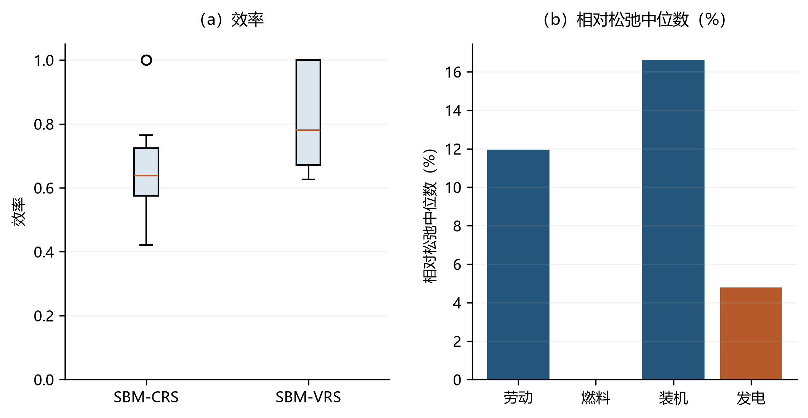

# 基于松弛测度的效率模型 {#sec-8}

前面章节介绍的投入距离函数、产出距离函数、双曲距离函数和方向距离函数，大多采用径向（radial）效率测度。径向模型的核心假设是：投入收缩、产出扩张或非期望产出削减可以用一个共同的比例因子概括。这一处理方式直观，便于比较不同决策单元相对于前沿面的距离，但也隐含了较强的“等比例改进”假设。在能源、环境与多投入生产问题中，不同投入要素、期望产出与污染排放往往分别存在冗余、不足或过剩。如果某个决策单元在完成径向调整后仍存在投入冗余、产出不足或非期望产出过剩，仅报告径向效率就可能高估其真实效率水平，并掩盖低效率的具体来源。

Tone（2001）提出的基于松弛测度的效率模型（Slacks-Based Measure, SBM）正是为处理这一问题而构建的。需要说明两点分工：Tone（2001）给出的是**只含投入与期望产出**的非径向 SBM，把投入冗余 $s^x$ 与期望产出不足 $s^y$ 直接纳入效率指标（本章 [-@sec-8-3] 节）；把**非期望产出松弛** $s^b$ 也纳入目标函数的环境 SBM 出自 Tone（2003）的 GRIPS 研究报告（本章 [-@sec-8-4] 节）。此外，"非径向"是 SBM 各变体的共同属性，而"非导向"（non-radial and non-oriented）只对应把两端（或三端）松弛同时纳入目标的式（[-@eq-8-1]）与式（[-@eq-8-3]）；8.3.1—8.3.2、8.4.3—8.4.5 的单一导向 SBM 仍是非径向的，但只把一端的松弛计入效率损失。SBM 的经济含义是：效率损失不仅来自整体比例上的落后，也来自具体变量层面的结构性冗余或短缺。能源、资本与劳动等投入要素的节约空间与污染排放的削减空间往往并不同步，单一比例因子难以同时刻画两端。除本章主线的相对松弛加权平均写法外，SBM 还可沿方向距离函数的思路推广为基于方向距离函数的松弛测度（SD，见 [-@sec-8-5] 节），在允许零值与负值数据的同时提供比径向模型更强的判别力。

本章先说明径向模型遗漏松弛变量时可能产生的效率判断偏误，再分别给出不含和含非期望产出的 SBM 模型，最后结合 `deabook` 包的调用方式说明方向向量、规模报酬假设和返回结果的解释口径。全章重点包括：

1. 不含非期望产出的 SBM：投入导向、产出导向和非导向 SBM；
2. 含非期望产出的 SBM：投入导向、期望产出导向、非期望产出导向和综合非导向 SBM；
3. CRS 与 VRS 两种规模报酬假设下技术集合的差异；
4. `deabook` 包中 `DEA.sbm` 与 `DEAweak.sbmu` 的参数设定、返回结果和案例解释，重点说明如何从研究问题出发选择效率改进口径；
5. 基于方向距离函数的松弛测度（SD）及其在非期望产出下的扩展（Färe & Grosskopf, 2010；Pham & Zelenyuk, 2018），作为把绝对松弛直接求和的 SBM 推广形式，可在含零值或负值数据时保持判别力。

## 径向效率测度中的松弛问题 {#sec-8-1}

本节从径向 DEA（Charnes, Cooper and Rhodes（1978）提出；系统介绍见 Cooper, Seiford and Tone（2007））中松弛变量的来源出发，说明 SBM 的必要性。设有 $N$ 个决策单元（decision making unit, DMU），每个 DMU 使用 $P$ 种投入 $x=(x_1,\ldots,x_P)$ 生产 $Q$ 种期望产出 $y=(y_1,\ldots,y_Q)$。以投入导向 DEA 为例，CRS 下的径向模型可写为：

$$
\begin{aligned}
\min_{\theta,\lambda} \quad & \theta \\
\text{s.t.}\quad
& \sum_{n=1}^{N}\lambda_n x_{np}\le \theta x_{0p},\quad p=1,\ldots,P,\\
& \sum_{n=1}^{N}\lambda_n y_{nq}\ge y_{0q},\quad q=1,\ldots,Q,\\
& \lambda_n\ge 0.
\end{aligned}
$$

令最优解为 $\theta^*,\lambda^*$。即使 $\theta^*=1$，仍可能存在

$$
s_p^- = x_{0p}-\sum_{n=1}^{N}\lambda_n^*x_{np}>0,
\qquad
s_q^+ = \sum_{n=1}^{N}\lambda_n^*y_{nq}-y_{0q}>0.
$$

其中，$s_p^-$ 表示第 $p$ 类投入的冗余，$s_q^+$ 表示第 $q$ 类期望产出的不足。若一个 DMU 在径向比例调整后仍有非零松弛，则所谓“径向有效”只说明不存在统一比例上的改进空间，并不意味着所有投入和产出变量都已达到前沿。松弛变量是反映资源配置结构的重要证据，而非求解过程中的附属信息。

若记同时考虑全部松弛的 SBM 效率为 $\rho$，则只要存在非零松弛就有 $\rho<\theta^*=1$；一般地，$\rho^*\le\theta^*$。该不等式即 Tone（2001）定理 4，比较的是输入导向 CCR 径向效率 $\theta^*\in(0,1]$ 与非导向 SBM $\rho^*$。因此，存在松弛时径向效率系统性高于 SBM 效率，这正是“径向高估”的形式化含义。SBM 的基本思想是：不再只用一个比例因子概括效率，而用所有相关松弛的平均相对大小构造效率指标，从而把非比例性改进空间纳入效率评价。

## 生产技术与符号设定 {#sec-8-2}

SBM 的松弛量需要在明确的生产技术集合上才能定义。本节统一给出该集合与变量记号，作为后续各类 SBM 模型的共同基础，同时避免不同方向下的符号重复。不含非期望产出时，DEA 生产技术可以写为：

$$
T=\{(x,y): x \text{ 能够生产 } y\}.
$$

在样本数据下，CRS 技术集合为：

$$
\begin{aligned}
T_{CRS}=\{(x,y):\;& x_p\ge \sum_{n=1}^{N}\lambda_n x_{np},\quad p=1,\ldots,P,\\
& y_q\le \sum_{n=1}^{N}\lambda_n y_{nq},\quad q=1,\ldots,Q,\\
& \lambda_n\ge 0,\quad n=1,\ldots,N\}.
\end{aligned}
$$

VRS 技术集合在 CRS 的基础上增加凸性约束：

$$
\sum_{n=1}^{N}\lambda_n=1.
$$

从经济含义看，CRS 假设各 DMU 可以按任意比例复制生产活动，适合规模差异可被视为技术复制的情形；VRS 则要求参考组合位于样本凸包内，更适合比较规模差异较大的地区、企业或国家。CRS 与 VRS 的差异会影响前沿面的形状，进而影响效率水平和有效单元识别。下文用 $0$ 表示被评价的决策单元，用 $\lambda_n$ 表示参考前沿上第 $n$ 个 DMU 的强度变量。除非特别说明，公式先给出 CRS 情形，VRS 只需增加凸性约束。

## 不含非期望产出的 SBM 模型 {#sec-8-3}

本节先讨论没有污染等非期望产出时的 SBM。借助 [-@sec-8-2] 节给出的生产技术 $T$ 与符号 $x,y,\lambda$，下面先在最简的双松弛情形下给出 SBM 的目标函数，再逐步引入非期望产出。此时低效率主要表现为两类：一是给定期望产出下的投入冗余，二是给定投入下的期望产出不足。不同导向的 SBM 对应不同的研究问题，效率值的数值大小本身无法说明哪个模型“更好”，关键在于明确效率值究竟衡量投入节约空间、产出扩张空间，还是二者的综合改进空间。

### 投入导向 SBM {#sec-8-3-1}

投入导向 SBM 适用于研究资源节约、成本压缩或要素投入冗余等问题。其核心问题是：在期望产出至少不减少的条件下，各类投入分别可以减少多少。模型为：

$$
\begin{aligned}
\min_{\rho^I,\lambda,s^-}\quad
& \rho^I = 1-\frac{1}{P}\sum_{p=1}^{P}\frac{s_p^-}{x_{0p}}\\
\text{s.t.}\quad
& x_{0p}=\sum_{n=1}^{N}\lambda_nx_{np}+s_p^-,\quad p=1,\ldots,P,\\
& y_{0q}\le \sum_{n=1}^{N}\lambda_ny_{nq},\quad q=1,\ldots,Q,\\
& \lambda_n\ge 0,\quad s_p^-\ge 0.
\end{aligned}
$$

投入导向 SBM 的效率值满足 $0<\rho^I\le 1$。如果 $s_p^-=0$ 对所有投入都成立，则 $\rho^I=1$，说明在保持期望产出不下降的前提下不存在投入冗余；若某些投入存在冗余，则 $\rho^I<1$。$\rho^I$ 是所有被纳入目标函数的投入相对松弛的平均结果，而非某一个投入的节约率。因此，在经验解释中应同时报告效率值和具体投入松弛，才能判断低效率主要来自资本、劳动、能源还是其他投入。该模型的目标函数本身是线性的，不需要 Charnes-Cooper 变换。

VRS 情形下增加：

$$
\sum_{n=1}^{N}\lambda_n=1.
$$

### 产出导向 SBM {#sec-8-3-2}

与投入导向对称地考察产出端：产出导向 SBM 关注另一类低效率来源——给定投入下的期望产出不足，适用于研究产出扩张、服务供给提升或创新产出不足等问题。其核心问题是：在投入不增加的条件下，各类期望产出分别可以增加多少。模型可写为：

$$
\begin{aligned}
\max_{\phi^O,\lambda,s^+}\quad
& \phi^O = 1+\frac{1}{Q}\sum_{q=1}^{Q}\frac{s_q^+}{y_{0q}}\\
\text{s.t.}\quad
& x_{0p}\ge \sum_{n=1}^{N}\lambda_nx_{np},\quad p=1,\ldots,P,\\
& y_{0q}=\sum_{n=1}^{N}\lambda_ny_{nq}-s_q^+,\quad q=1,\ldots,Q,\\
& \lambda_n\ge 0,\quad s_q^+\ge 0.
\end{aligned}
$$

$\phi^O\ge 1$ 表示平均产出扩张因子，其值越大，说明给定投入下期望产出的潜在扩张空间越大。为使不同方向下效率值都落在 $(0,1]$ 内，通常报告：

$$
\rho^O=\frac{1}{\phi^O}.
$$

若所有产出松弛均为 0，则 $\phi^O=1$ 且 $\rho^O=1$；若存在产出不足，则 $\phi^O>1$ 且 $\rho^O<1$。VRS 情形同样增加 $\sum_n\lambda_n=1$。

### 非导向 SBM {#sec-8-3-3}

当研究对象同时存在投入冗余和产出不足时，可以使用非导向 SBM。该模型同时考察投入端和产出端两类松弛，是 Tone（2001）最常用的 SBM 形式：

$$
\begin{aligned}
\min_{\rho,\lambda,s^-,s^+}\quad
& \rho =
\frac{1-\frac{1}{P}\sum_{p=1}^{P}s_p^-/x_{0p}}
{1+\frac{1}{Q}\sum_{q=1}^{Q}s_q^+/y_{0q}}\\
\text{s.t.}\quad
& x_{0p}=\sum_{n=1}^{N}\lambda_nx_{np}+s_p^-,\quad p=1,\ldots,P,\\
& y_{0q}=\sum_{n=1}^{N}\lambda_ny_{nq}-s_q^+,\quad q=1,\ldots,Q,\\
& \lambda_n\ge0,\quad s_p^-\ge0,\quad s_q^+\ge0.
\end{aligned}
$$ {#eq-8-1}

分子刻画平均投入利用程度，分母刻画平均产出不足程度，只要任一投入或产出存在松弛，效率值都会下降。因此，非导向 SBM 通常比单纯径向模型更严格，也更能揭示低效率的变量来源：记径向效率为 $\theta^*$，则 $\rho_{SBM}\le\theta^*$（Tone（2001）定理 4），当且仅当不存在非径向松弛时取等。该模型尤其适合研究对象同时涉及资源节约和产出提升的情形。

### 非导向 SBM 的线性化 {#sec-8-3-4}

式（[-@eq-8-1]）的目标函数是分式规划，直接求解不如线性规划稳定，可采用 Charnes and Cooper（1962）提出的 Charnes-Cooper 变换。令

$$
t=\left(1+\frac{1}{Q}\sum_{q=1}^{Q}\frac{s_q^+}{y_{0q}}\right)^{-1},\quad
S_p^-=ts_p^-,\quad S_q^+=ts_q^+,
\quad \Lambda_n=t\lambda_n.
$$

则可转化为线性规划式（[-@eq-8-2]）：

$$
\begin{aligned}
\min_{t,\Lambda,S^-,S^+}\quad
& \tau=t-\frac{1}{P}\sum_{p=1}^{P}\frac{S_p^-}{x_{0p}}\\
\text{s.t.}\quad
& 1=t+\frac{1}{Q}\sum_{q=1}^{Q}\frac{S_q^+}{y_{0q}},\\
& tx_{0p}=\sum_{n=1}^{N}\Lambda_nx_{np}+S_p^-,\quad p=1,\ldots,P,\\
& ty_{0q}=\sum_{n=1}^{N}\Lambda_ny_{nq}-S_q^+,\quad q=1,\ldots,Q,\\
& \Lambda_n\ge0,\quad S_p^-\ge0,\quad S_q^+\ge0,\quad t>0.
\end{aligned}
$$ {#eq-8-2}

求解后有 $\rho=\tau^*$，原始松弛由

$$
s_p^- = S_p^{-*}/t^*,\qquad s_q^+=S_q^{+*}/t^*
$$

恢复。VRS 约束 $\sum_n\lambda_n=1$ 在线性化后变为：

$$
\sum_{n=1}^{N}\Lambda_n=t.
$$

## 含非期望产出的 SBM 模型 {#sec-8-4}

[-@sec-8-3] 节的模型尚未考虑污染等非期望产出。在能源—环境问题中，许多生产过程会同时产生期望产出和非期望产出，例如企业在创造增加值或发电量的同时，也会排放二氧化碳、二氧化硫等污染物，因此需要把 SBM 扩展到含非期望产出的情形。设非期望产出为 $b=(b_1,\ldots,b_R)$。为同时区分投入、期望产出与非期望产出三类松弛，本节起将松弛记号由 $s^-,s^+$ 改写为 $s^x,s^y,s^b$，对应关系为 $s_p^x\equiv s_p^-$、$s_q^y\equiv s_q^+$，并新增非期望松弛 $s_r^b$。在环境 SBM 框架下，期望产出和非期望产出的经济方向相反：期望产出越多越好，非期望产出越少越好，因此非期望产出的松弛表示污染物过剩或可削减空间。环境效率测算的关键在于污染松弛是否进入效率损失函数：仅把污染变量列入生产技术（$b$ 出现在约束中）并不改变效率口径，只有把 $s^b$ 纳入目标函数，污染削减空间才真正进入效率评价。

本节先给出 Tone（2003）的综合非导向 SBM 作为环境 SBM 的主线模型并完成线性化（8.4.1–8.4.2）；随后 8.4.3–8.4.5 的投入导向、期望产出导向、非期望产出导向是其退化情形，目标函数本身为线性，无需 Charnes-Cooper 变换。

> **技术假设的差别：本节的非期望产出约束不是第 6—7 章的弱可处置技术。**
> 下文式（[-@eq-8-3]）及 8.4.3—8.4.5 对非期望产出采用 $b_{0r}=\sum_n\lambda_n b_{nr}+s_r^b$（或 $b_{0r}\ge\sum_n\lambda_n b_{nr}$）的形式：参考组合的排放加上一个自由的非负松弛等于观测排放，因此污染可以在期望产出不变的条件下**单独削减**。这与把污染物写在约束不等式"较小方向"上的投入处理方式相同，属于强可处置的 bads-as-inputs 设定。第 6—7 章的环境技术采用弱可处置（$(\boldsymbol{y},\boldsymbol{b})\to(\theta\boldsymbol{y},\theta\boldsymbol{b})$，$0\le\theta\le1$）：减排必须与期望产出同比例收缩，减污是有机会成本的。
> 两者不是同一个生产可能集 $T$，因此本章的效率值与第 6—7 章的环境效率不可直接比较，数值差异也不能解释为"目标函数换了写法"。Tone（2003）在可分（separable）设定之外还给出好坏产出不可分（non-separable）的情形，以接近 Färe 等的联合生产刻画。若研究设计要求坚持联合生产，应改用不可分设定或直接在约束中写入弱可处置，而不是只改目标函数、不改技术。

### 含非期望产出的综合非导向 SBM {#sec-8-4-1}

综合非导向环境 SBM 把投入冗余、期望产出不足和非期望产出过剩三类松弛同时纳入效率目标。Tone（2003）的含非期望产出 SBM 为：

$$
\begin{aligned}
\min_{\rho,\lambda,s^x,s^y,s^b}\quad
& \rho =
\frac{1-\frac{1}{P}\sum_{p=1}^{P}s_p^x/x_{0p}}
{1+\frac{1}{Q+R}\left(\sum_{q=1}^{Q}s_q^y/y_{0q}+\sum_{r=1}^{R}s_r^b/b_{0r}\right)}\\
\text{s.t.}\quad
& x_{0p}=\sum_{n=1}^{N}\lambda_nx_{np}+s_p^x,\quad p=1,\ldots,P,\\
& y_{0q}=\sum_{n=1}^{N}\lambda_ny_{nq}-s_q^y,\quad q=1,\ldots,Q,\\
& b_{0r}=\sum_{n=1}^{N}\lambda_nb_{nr}+s_r^b,\quad r=1,\ldots,R,\\
& \lambda_n\ge0,\quad s_p^x\ge0,\quad s_q^y\ge0,\quad s_r^b\ge0.
\end{aligned}
$$ {#eq-8-3}

其中：

- $s_p^x$：投入冗余；
- $s_q^y$：期望产出不足；
- $s_r^b$：非期望产出过剩，即在保持生产可行的前提下可削减的污染物数量。

式（[-@eq-8-3]）的分母同时惩罚期望产出不足和非期望产出过剩，分子则惩罚投入冗余。若某个 DMU 的投入、期望产出和非期望产出都不存在松弛，则 $\rho=1$。由于该模型使用相对松弛量，进入分式的投入、期望产出和非期望产出必须严格大于零（$x_{0p}>0$、$y_{0q}>0$、$b_{0r}>0$），否则 $s/x_0$、$s/y_0$ 或 $s/b_0$ 会触发除零或失去经济可比性。

### 含非期望产出的线性化 {#sec-8-4-2}

与式（[-@eq-8-1]）类似，式（[-@eq-8-3]）的目标函数同样是分式规划，需经 Charnes-Cooper 变换线性化后求解。令

$$
t=\left[1+\frac{1}{Q+R}\left(\sum_{q=1}^{Q}\frac{s_q^y}{y_{0q}}+\sum_{r=1}^{R}\frac{s_r^b}{b_{0r}}\right)\right]^{-1},
$$

并令 $S_p^x=ts_p^x$、$S_q^y=ts_q^y$、$S_r^b=ts_r^b$、$\Lambda_n=t\lambda_n$，则得到线性规划式（[-@eq-8-4]）：

$$
\begin{aligned}
\min_{t,\Lambda,S^x,S^y,S^b}\quad
& \tau=t-\frac{1}{P}\sum_{p=1}^{P}\frac{S_p^x}{x_{0p}}\\
\text{s.t.}\quad
& 1=t+\frac{1}{Q+R}\left(\sum_{q=1}^{Q}\frac{S_q^y}{y_{0q}}+\sum_{r=1}^{R}\frac{S_r^b}{b_{0r}}\right),\\
& tx_{0p}=\sum_{n=1}^{N}\Lambda_nx_{np}+S_p^x,\quad p=1,\ldots,P,\\
& ty_{0q}=\sum_{n=1}^{N}\Lambda_ny_{nq}-S_q^y,\quad q=1,\ldots,Q,\\
& tb_{0r}=\sum_{n=1}^{N}\Lambda_nb_{nr}+S_r^b,\quad r=1,\ldots,R,\\
& \Lambda_n\ge0,\quad S_p^x\ge0,\quad S_q^y\ge0,\quad S_r^b\ge0,\quad t>0.
\end{aligned}
$$ {#eq-8-4}

VRS 情形增加 $\sum_n\Lambda_n=t$。

### 投入导向环境 SBM {#sec-8-4-3}

[-@sec-8-4-1] 节的综合非导向 SBM 把投入、期望产出和非期望产出三类松弛同时纳入目标函数，但许多研究只关心其中某一端的改进空间，因此下面分别给出投入导向、期望产出导向和非期望产出导向三种单一口径的环境 SBM。投入导向环境 SBM 在期望产出不下降、非期望产出不增加的条件下衡量投入冗余，适合回答“在不降低经济产出、且不增加污染排放的前提下，资源投入可以节约多少”的问题：

$$
\begin{aligned}
\min\quad
& \rho^{I,b}=1-\frac{1}{P}\sum_{p=1}^{P}\frac{s_p^x}{x_{0p}}\\
\text{s.t.}\quad
& x_{0p}=\sum_{n=1}^{N}\lambda_nx_{np}+s_p^x,\quad p=1,\ldots,P,\\
& y_{0q}\le\sum_{n=1}^{N}\lambda_ny_{nq},\quad q=1,\ldots,Q,\\
& b_{0r}\ge\sum_{n=1}^{N}\lambda_nb_{nr},\quad r=1,\ldots,R,\\
& \lambda_n\ge0,\quad s_p^x\ge0.
\end{aligned}
$$

在该模型中，期望产出和非期望产出作为技术可行性约束：参考组合的期望产出不得低于被评价 DMU，非期望产出不得高于被评价 DMU，只有投入松弛进入效率目标。该模型及以下 8.4.4、8.4.5 两个单一导向的目标函数均为线性，无需 Charnes-Cooper 变换；只有 8.4.1 的综合模型因含分式目标才需要线性化。

### 期望产出导向环境 SBM {#sec-8-4-4}

把效率损失来源从投入端换到期望产出端，便得到期望产出导向环境 SBM。它在投入不增加、非期望产出不增加的条件下衡量期望产出不足，适合回答“在资源投入和污染排放不增加的前提下，经济产出还有多大扩张空间”的问题：

$$
\begin{aligned}
\max\quad
& \phi^{Y,b}=1+\frac{1}{Q}\sum_{q=1}^{Q}\frac{s_q^y}{y_{0q}}\\
\text{s.t.}\quad
& x_{0p}\ge\sum_{n=1}^{N}\lambda_nx_{np},\quad p=1,\ldots,P,\\
& y_{0q}=\sum_{n=1}^{N}\lambda_ny_{nq}-s_q^y,\quad q=1,\ldots,Q,\\
& b_{0r}\ge\sum_{n=1}^{N}\lambda_nb_{nr},\quad r=1,\ldots,R,\\
& \lambda_n\ge0,\quad s_q^y\ge0.
\end{aligned}
$$

通常报告 $\rho^{Y,b}=1/\phi^{Y,b}$，因此效率值仍位于 $(0,1]$。这里的效率损失来自期望产出不足，而投入和非期望产出主要发挥约束作用。VRS 情形增加 $\sum_n\lambda_n=1$（与 8.3.1、8.3.2 一致；该模型目标函数为线性，无需 Charnes-Cooper 变换）。

### 非期望产出导向 SBM {#sec-8-4-5}

若关心的是污染削减空间而非经济产出扩张，则采用非期望产出导向 SBM。它在投入不增加、期望产出不下降的条件下，衡量污染物的可削减空间。与式（[-@eq-8-3]）保持一致，先求 Tone 分式在非期望产出端的分母 $\phi^{B}$：

$$
\begin{aligned}
\max\quad
& \phi^{B}=1+\frac{1}{R}\sum_{r=1}^{R}\frac{s_r^b}{b_{0r}}\\
\text{s.t.}\quad
& x_{0p}\ge\sum_{n=1}^{N}\lambda_nx_{np},\quad p=1,\ldots,P,\\
& y_{0q}\le\sum_{n=1}^{N}\lambda_ny_{nq},\quad q=1,\ldots,Q,\\
& b_{0r}=\sum_{n=1}^{N}\lambda_nb_{nr}+s_r^b,\quad r=1,\ldots,R,\\
& \lambda_n\ge0,\quad s_r^b\ge0.
\end{aligned}
$$

其中，$\phi^{B}=1+\delta_b\ge1$（记 $\delta_b=\frac{1}{R}\sum_r s_r^b/b_{0r}$ 为平均相对污染松弛）。报告的效率值为其倒数，从而仍位于 $(0,1]$：

$$
\rho^B=\frac{1}{\phi^B}=\frac{1}{1+\delta_b}.
$$

$\phi^{B}$ 只是 Tone 分式在非期望产出端的分母，**不是径向意义上的污染物缩减因子**，$\rho^B$ 也不是径向减排效率。这一点与期望产出导向不同：产出导向时投影产出为 $\boldsymbol{y}+s^y=\phi^Y\boldsymbol{y}$，故 $\rho^Y=1/\phi^Y$ 恰好是 Farrell 意义上的"实际／前沿"比值；而污染端的投影是 $\boldsymbol{b}-s^b$，剩余污染比例是 $1-\delta_b$，与 $1/(1+\delta_b)$ 并不相等——对任意 $\delta_b>0$ 恒有 $\frac{1}{1+\delta_b}>1-\delta_b$。因此本节及案例中报告的非期望产出导向效率应按 $\rho^B=1/(1+\delta_b)$ 解释；若要读出"污染还剩多少比例"，须直接报告 $1-\delta_b$ 或各维 $s_r^b/b_{0r}$（相关的跨方向可比性问题见 [-@sec-8-7] 节）。

若 $\rho^B=1$，表示在给定投入和期望产出约束下不存在污染物过剩；若 $\rho^B<1$，说明非期望产出相对于前沿存在可削减空间。VRS 情形同样增加 $\sum_n\lambda_n=1$。

综合 8.4.1–8.4.5 可见，含非期望产出的 SBM 各变体的差别仅在于“哪些松弛进入效率目标”：综合非导向（8.4.1）把三类松弛全部纳入，三个单一导向（8.4.3–8.4.5）各只纳入其中一类。此外，[-@sec-8-6-2] 节 @tbl-8-2 还将给出由方向向量组合得到的混合方向（如投入—污染联合改进型）。这一选择由方向向量 `gx`、`gy`、`gb` 编码，下一节说明 `deabook` 如何在代码中落实。

## 基于方向距离函数的松弛测度（SD） {#sec-8-5}

[-@sec-8-3] 节与 [-@sec-8-4] 节给出的 SBM 以各变量相对松弛的加权平均构造效率，已能同时刻画投入、期望产出与非期望产出三端的非比例改进空间。不过，Tone（2001）的 SBM 也是更一般框架的一个特例：Färe 与 Grosskopf（2010）指出，方向距离函数（directional distance function, DDF，见第 [-@sec-6]、[-@sec-7] 章）本身具有可加结构，据此可以构造一种“基于方向距离函数的松弛测度”（slack-based directional distance function，下文记为 SD）。SD 把方向向量取为单位向量 $\mathbf{1}$，但允许各投入、各产出拥有相互独立的标量松弛，从而把 DDF 的方向性位移与 SBM 的松弛识别结合起来。Pham 与 Zelenyuk（2018）进一步把 SD 扩展到含非期望产出的情形。本节先给出不含非期望产出的 SD（[-@sec-8-5-1] 节），再给出含非期望产出的扩展（[-@sec-8-5-2] 节），并说明它与 [-@sec-8-3]、[-@sec-8-4] 节模型的关系。

### 不含非期望产出的 SD：Färe 与 Grosskopf（2010） {#sec-8-5-1}

回顾第 [-@sec-6] 章的方向距离函数：给定方向向量 $\boldsymbol{g}=(\boldsymbol{g}_x,\boldsymbol{g}_y)$，DDF 沿统一比例 $\tau$ 做位移

$$
\vec{D}_T(x,y;\boldsymbol{g})=\max\{\tau:(x-\tau\boldsymbol{g}_x,\;y+\tau\boldsymbol{g}_y)\in T\}.
$$

Färe 与 Grosskopf（2010）把方向向量取为全 $1$ 向量 $\boldsymbol{g}_x=\mathbf{1}_P$、$\boldsymbol{g}_y=\mathbf{1}_Q$，但不再要求所有维度共享同一个位移系数，而是让每个投入、每个产出各自拥有一个独立的标量松弛 $\alpha_i\ge0$、$\beta_r\ge0$。于是投入可分别减少 $\alpha_i$、期望产出可分别增加 $\beta_r$，效率损失由这些标量松弛的总和度量：

$$
\begin{aligned}
\max_{\alpha_i,\beta_r,\lambda_n}\quad
& SD(x_0,y_0)=\sum_{i=1}^{P}\alpha_i+\sum_{r=1}^{Q}\beta_r\\
\text{s.t.}\quad
& x_{0i}=\sum_{n=1}^{N}\lambda_n x_{ni}+\alpha_i,\quad i=1,\dots,P,\\
& y_{0r}=\sum_{n=1}^{N}\lambda_n y_{nr}-\beta_r,\quad r=1,\dots,Q,\\
& \lambda_n\ge0,\quad \alpha_i\ge0,\quad \beta_r\ge0.
\end{aligned}
$$ {#eq-8-5}

VRS 情形下补充 $\sum_{n=1}^{N}\lambda_n=1$。式（[-@eq-8-5]）的目标函数是各维绝对松弛之和：投入松弛 $\alpha_i$ 以 $x_i$ 的单位度量、产出松弛 $\beta_r$ 以 $y_r$ 的单位度量，方向向量取 $\mathbf{1}$ 使得各松弛都是标量，不依赖于相应变量的度量单位。这带来三点与 [-@sec-8-3] 节 Tone SBM 不同的性质。

第一，SD 是 Tone（2001）SBM 的推广，Tone SBM 是 SD 的特例。二者都把松弛纳入效率定义；但 Tone SBM 采用相对松弛 $s/x_0$（或 $s/y_0$）的加权平均，并要求进入分式的变量严格为正，否则会触发除零；而 SD 直接对各维绝对松弛求和，无需除以观测值，因此能够处理零值乃至负值数据，也不必为变量符号而做数据变换。

第二，SD 具有平移不变性（translation invariance）。由于目标与约束都是投入、产出的可加形式，对数据做常数平移不会改变效率排序，这使其在处理含负值的金融数据（如以负值记账的贷款损失准备）时优于径向与相对松弛类模型。

第三，SD 比 DDF、增强双曲效率与 Farrell 型技术效率具有更强的判别力（discriminative power）。若某 DMU 被 SD 判定为完全有效（所有松弛均为零），则它同时也被 DDF、增强双曲效率与 Farrell 技术效率判定为有效；反之不成立。原因在于 DDF 沿固定方向 $\boldsymbol{g}$ 只度量一个径向的位移比例，位于技术前沿“平面”（flat facet）上的 DMU 会被 DDF 判为有效，但 SD 仍能识别该平面内部的非径向松弛。因此，SD 在揭示低效率来源上比单一方向的 DDF 更细致。

### 含非期望产出的 SD：Pham 与 Zelenyuk（2018） {#sec-8-5-2}

把 SD 用于环境绩效时，非期望产出（如污染物排放、银行不良贷款）必须被区别对待。Pham 与 Zelenyuk（2018）沿用第 [-@sec-6]、[-@sec-7] 章的联合弱可处置技术：期望产出强可处置，而期望产出与非期望产出联合弱可处置，即若 $(y,b)\in P(x)$，则对任意 $\tilde y\le y$ 与 $0\le\theta\le1$ 均有 $(\tilde y,\theta b)\in P(x)$。在该技术下，非期望产出可以在期望产出不变的条件下被削减，但减排并非无成本（减污与期望产出的扩张受联合生产约束）。

在 SD 框架中加入非期望产出松弛 $\gamma_r\ge0$（$r=1,\dots,R$），即把污染削减空间也作为可独立取值的标量松弛纳入目标函数：

$$
\begin{aligned}
\max_{\alpha_i,\beta_r,\gamma_r,\lambda_n}\quad
& SdD(x_0,y_0,b_0)=\sum_{i=1}^{P}\alpha_i+\sum_{r=1}^{Q}\beta_r+\sum_{r=1}^{R}\gamma_r\\
\text{s.t.}\quad
& x_{0i}=\sum_{n=1}^{N}\lambda_n x_{ni}+\alpha_i,\quad i=1,\dots,P,\\
& y_{0r}=\sum_{n=1}^{N}\lambda_n y_{nr}-\beta_r,\quad r=1,\dots,Q,\\
& b_{0r}=\sum_{n=1}^{N}\lambda_n b_{nr}+\gamma_r,\quad r=1,\dots,R,\\
& \lambda_n\ge0,\quad \alpha_i\ge0,\quad \beta_r\ge0,\quad \gamma_r\ge0.
\end{aligned}
$$ {#eq-8-6}

VRS 同理补充 $\sum_n\lambda_n=1$。式（[-@eq-8-6]）中，非期望产出以正值存储，松弛 $\gamma_r$ 表示在保持期望产出与其他投入可行的条件下可削减的污染量；其约束写法 $b_{0r}=\sum_n\lambda_n b_{nr}+\gamma_r$ 与 [-@sec-8-4] 节环境 SBM 的 $b_{0r}=\sum_n\lambda_n b_{nr}+s_r^b$ 一致，都属于强可处置 bads-as-inputs 的设定（参见 [-@sec-8-4] 节的技术假设说明）。与 [-@sec-8-4] 节 Tone（2003）环境 SBM 相比，SD 同样把污染松弛纳入目标，但用绝对松弛之和代替相对松弛的加权平均，因而同样不要求数据严格为正，并保持平移不变性与更强的判别力。

综合 [-@sec-8-5-1] 与 [-@sec-8-5-2] 节可见，SD 家族与 [-@sec-8-3]、[-@sec-8-4] 节 SBM 家族是同一“把松弛纳入效率”思想的两种写法：SBM 用相对松弛的平均，SD 用绝对松弛的和。二者对“哪些松弛进入目标函数”的判断完全一致——都可由投入、期望产出、非期望产出三端的松弛组合决定；差别仅在于松弛进入目标的函数形式（加权平均 vs 直接求和）以及对数据正值的依赖程度。因此，SD 特别适合数据类型复杂（含零值或负值）或需要更强判别力的环境效率研究。`deabook` 的 `DEAweak` 模块（如 `DEAweak.sbmu`、`DEAweak.ddf`）已提供含非期望产出的弱可处置技术与相应松弛求解，读者可在其生产可能集之上自行组装式（[-@eq-8-6]）的 SD 目标。

## SBM 模型的Python实现 {#sec-8-6}

前几节已经从生产技术与线性规划两个层面给出了 SBM 的理论形式：不含非期望产出的 [-@sec-8-3] 节（含式（[-@eq-8-1]）及其 Charnes–Cooper 线性化式（[-@eq-8-2]））、含非期望产出的 [-@sec-8-4] 节（含式（[-@eq-8-3]）及式（[-@eq-8-4]）），以及基于方向距离函数的松弛测度 [-@sec-8-5] 节（含式（[-@eq-8-5]）与式（[-@eq-8-6]））。这些形式在数学上回答了“哪些松弛进入效率目标、约束如何书写、分式目标如何线性化”，而程序实现要回答的是同一组经济学选择在代码中如何落实。SBM 之所以需要专门的接口，正因为它把效率定义为各变量相对松弛的平均，而非一个统一的比例因子；因此编码时，研究者填写参数的过程本身就是在落实前文的理论选择——生产可能集由哪些投入、期望产出与非期望产出构成，哪些变量的松弛被视为效率损失来源，以及被评价对象相对于怎样的参考前沿进行比较。`deabook` 提供两个相互对照的 SBM 接口——`DEA.sbm`（不含非期望产出，对应 [-@sec-8-3] 节，位于 `DEA` 模块）与 `DEAweak.sbmu`（含非期望产出，对应 [-@sec-8-4] 节，位于 `DEAweak` 模块）——并把上述三类选择集中在 `sent`、`gx`、`gy`、`gb`、`rts`、`evalindex` 与 `refindex` 等参数中。下文先说明变量结构与方向向量的编码逻辑，再将求解结果与前文模型逐项对应。

### 接口模块与变量结构 {#sec-8-6-1}

SBM 的调用始于两个模块与一组常量的导入：`DEA` 与 `DEAweak` 分别承载不含与含非期望产出的 SBM（`DEA.sbm` 与 `DEAweak.sbmu`），规模报酬常量则用于显式指定前沿的凸性假设。整理表格、计算分组均值或输出结果通常借助 `pandas`，后文示例另以 `pathlib.Path` 统一管理数据路径。

```python
from deabook import data_path, PANEL
from deabook.constant import WINDOW
from deabook import DEA, DEAweak, PANEL
from deabook.constant import CONTEMPORARY, GLOBAL, SEQUENTIAL, WINDOW
from deabook.constant import RTS_CRS, RTS_VRS1, OPT_LOCAL
from pathlib import Path
import pandas as pd
```

`sent` 参数用于声明投入产出结构。不含非期望产出时，例如 `sent="K L=Y"`，等号左侧的 `K L` 表示投入，右侧的 `Y` 表示期望产出。含非期望产出时，例如 `sent="K L E=Y:CO2"`，冒号前的 `Y` 仍为期望产出，冒号后的 `CO2` 为非期望产出。变量在 `sent` 中的顺序会决定 `gx`、`gy` 和 `gb` 中各元素所对应的变量。


| 参数 | 作用 | 本章常用设置 | 经济含义与解释重点 |
|------|------|--------------|--------------------|
| `data` | 指定待评价数据 | `DataFrame` | 包含投入、期望产出、非期望产出和 DMU 标识变量，是构造生产可能集的样本基础 |
| `sent` | 声明投入产出结构 | `"K L=Y"`、`"K L E=Y:CO2"` | `=` 左侧为投入，`=` 右侧且 `:` 前为期望产出，`:` 后为非期望产出 |
| `gx` | 指定投入松弛方向 | `[0,0,0]`、`[1,1,1]`、`[0,0,1]` | 元素顺序与投入变量一致；1 表示该投入冗余计入效率损失，0 表示该投入仍约束可行生产组合但不进入效率损失 |
| `gy` | 指定期望产出松弛方向 | `[0]`、`[1]` | 1 表示该期望产出不足计入效率损失，0 表示该期望产出仅作为“不低于当前水平”的可行性约束 |
| `gb` | 指定非期望产出松弛方向 | `[0]`、`[1]` | 1 表示该非期望产出过剩计入效率损失，0 表示该非期望产出仅作为“不高于当前水平”的可行性约束 |
| `rts` | 指定规模报酬假设 | `RTS_CRS`、`RTS_VRS1` | 分别表示规模报酬不变和规模报酬可变，决定参考前沿是否允许局部规模比较 |
| `evalindex` | 选择被评价样本 | `None` 或筛选条件 | 决定哪些 DMU 被评价，即“评价谁” |
| `refindex` | 选择参考技术集 | `None` 或筛选条件 | 决定哪些 DMU 构造前沿，即“与谁比较” |
| `solver` | 指定求解器 | `"mosek"`、`"glpk"` | 在 `optimize()` 中设置，属于数值求解选项，不改变经济模型含义 |
: `SBM` 模型的主要参数 {#tbl-8-1}

使用 @tbl-8-1 时尤其要核对方向向量的长度和变量顺序。例如，`sent="K L E=Y:CO2"` 有三个投入变量，因此 `gx` 必须包含三个元素；若只希望将能源投入 E 的冗余纳入目标函数，而资本 K 和劳动 L 仅作为“不增加”的约束，应写作 `gx=[0,0,1]`，不能写作 `gx=[1]`。`gx=0`、`gy=0` 或 `gb=0` 表示该变量的松弛不被计入本次效率损失，相应变量仍保留在生产技术中。进入相对松弛比的变量必须严格正值的要求已在 [-@sec-8-4-1] 节说明，此处不再重复。

### 方向向量对效率口径的编码 {#sec-8-6-2}

`deabook` 中的 SBM 借用方向距离函数（DDF）的记号习惯，用 `gx`、`gy` 和 `gb` 三个向量表示"哪些维度的松弛进入效率目标"。这里必须强调：这三个向量只是**开关**，测度本身仍是 SBM，不是相应方向上的 DDF——DDF 沿方向 $\boldsymbol{g}$ 做统一的径向位移 $\beta$，SBM 则让各维松弛独立取值后再代入分式（对照 @tbl-8-4）。即使把 `gb=[1]` 与第 [-@sec-6] 章 $\boldsymbol{g}=(\boldsymbol{0},\boldsymbol{0},-\boldsymbol{b})$ 的 DDF 写成"同一个方向"，两者的效率函数形式也不同：单一非期望产出时 SBM 给出 $\rho^B=1/(1+\delta_b)$，第 [-@sec-6] 章 DDF 常用的效率口径是 $1-\beta$。因此把本章结果与第 [-@sec-6] 章 DDF 结果并列时，必须同时报告 $\beta$ 与 $\delta_b$（或同时给出 $1-\beta$ 与 $1/(1+\delta_b)$），不能因方向向量同名就当作同一口径的两次测算。三个向量的含义分别是：

- `gx`：投入方向向量。某个投入对应位置为 1，表示该投入允许向下调整并进入 SBM 松弛目标。
- `gy`：期望产出方向向量。某个期望产出对应位置为 1，表示该产出允许向上调整并进入 SBM 松弛目标。
- `gb`：非期望产出方向向量。某个非期望产出对应位置为 1，表示该污染物允许向下调整并进入 SBM 松弛目标。

`SBM` 会根据 `gx`、`gy` 和 `gb` 的组合自动识别模型类型。可以概括为：某个方向向量中至少有一个元素为 1，该方向的松弛量就会进入 SBM 效率目标；若该方向全部为 0，则相应变量只作为技术可行性约束存在，不参与效率值的松弛惩罚。因此，方向向量本质上是研究问题的编码，须依研究目标设定。


| 经济口径 | 方向向量条件 | 程序返回的方向名称 | 被直接纳入目标函数的松弛 |
| :--- | :--- | :--- | :--- |
| 投入冗余型 | `sum(gx)>0, sum(gy)=0, sum(gb)=0` | `input_oriented` | 投入冗余 $s^x$ |
| 期望产出不足型 | `sum(gy)>0, sum(gx)=0, sum(gb)=0` | `output_oriented` | 期望产出不足 $s^y$ |
| 污染过剩型 | `sum(gb)>0, sum(gx)=0, sum(gy)=0` | `unoutput_oriented` | 非期望产出过剩 $s^b$ |
| 投入—期望产出综合型 | `sum(gx)>0, sum(gy)>0, sum(gb)=0` | `hyper_orientedyx` | $s^x,s^y$ |
| 期望产出—污染综合型 | `sum(gy)>0, sum(gb)>0, sum(gx)=0` | `hyper_orientedyb` | $s^y,s^b$ |
| 投入—污染联合改进型 | `sum(gx)>0, sum(gb)>0, sum(gy)=0` | `hyper_orientedxb` | $s^x,s^b$ |
| 投入—期望产出—污染综合型 | `sum(gx)>0, sum(gy)>0, sum(gb)>0` | `hyper_orientedyxb` | $s^x,s^y,s^b$ |
: SBM 方向向量与方向模式的对应关系 {#tbl-8-2}

方向向量还决定归一化基数，这一点与 Tone 标准形有实质差异。式（[-@eq-8-1]）、式（[-@eq-8-3]）等 Tone 标准形使用总维度（$P$、$Q+R$）作为相对松弛的平均基数；`deabook` 则在 `gx`、`gy`、`gb` 出现 0 元素（部分变量不进入目标函数）时，自动把归一化基数替换为活跃维度数（$|\{p:gx_p>0\}|$、$|\{q:gy_q>0\}|+|\{r:gb_r>0\}|$）。例如，`gx=[0,0,1]`、`gy=[0]`、`gb=[1]` 实际求解的是 $\rho=\frac{1-s_E/x_E}{1+s^b/b_0}$（投入活跃数=1、产出活跃数=1）；而式（[-@eq-8-3]）在该最优解（仅 $s_E^x, s^b$ 非零）处的归一化基数仍为 $P=3$、$Q+R=2$，取值为 $\frac{1-s_E/(3x_E)}{1+s^b/(2b_0)}$。两种归一化在全变量活跃时完全等价，差异只出现在部分活跃设定下；本章 8.5.4 的混合方向示例与 8.6.5 的能源—碳联合案例均采用活跃计数口径。

方向向量表示“是否允许该维度改进并进入目标函数”的开关，与变量的实际大小或权重无关。投入导向模型使用 `gx=[1,1,1]`、`gy=[0]`、`gb=[0]`，表示只度量投入冗余；非期望产出导向模型使用 `gx=[0,0,0]`、`gy=[0]`、`gb=[1]`，表示只度量污染物过剩；能源投入与非期望产出联合方向使用 `gx=[0,0,1]`、`gy=[0]`、`gb=[1]`，表示能源投入和 `CO2` 两个维度进入效率目标，资本和劳动仅作为不增加的约束条件。

综合方向也应由研究问题决定，而不宜机械地把所有维度都设为 1。例如，不含非期望产出且同时关注资源节约和产出扩张时，可设 `gx=[1,1]`、`gy=[1]`，对应 `hyper_orientedyx`；若研究绿色全要素效率，同时关注投入节约、期望产出扩张和污染削减，可设 `gx=[1,1,1]`、`gy=[1]`、`gb=[1]`，对应 `hyper_orientedyxb`。

这种设定方式的优点是理论模型与经验代码可以逐项对应。第 [-@sec-8-4] 节的投入导向环境 SBM、期望产出导向环境 SBM、非期望产出导向 SBM，以及综合方向 SBM，都可以通过改变这三个方向向量在 `DEA.sbm` / `DEAweak.sbmu` 同一接口下实现。方向向量设定后，下一步是调用求解并解读返回结果。

### 求解结果的解释口径 {#sec-8-6-3}

调用 `optimize()` 后，`DEA.sbm` / `DEAweak.sbmu` 返回一个 `DataFrame`，其主要列见 @tbl-8-3。解释顺序应当是：先检查求解状态是否为 `"optimal"`，再用 `rho` 判断总体效率水平，最后结合 `slack_x_*`、`slack_y_*` 和 `slack_b_*` 识别效率损失来源。`objective_value`、`phi` 和 `t` 更多用于理解求解过程或特定方向下的变换关系，一般不直接作为经济结论。


| 返回内容 | 适用方向 | 含义 | 解释注意 |
|----------|----------|------|----------|
| `optimization_status` | 全部方向 | 求解状态 | `"ok"` 或 `"optimal"` 表示求解成功，具体取值取决于求解器接口 |
| `direction` | 全部方向 | 程序识别出的方向模式 | 名称与 @tbl-8-2 中的方向模式一致 |
| `objective_value` | 全部方向 | 原始优化目标值 | 通常作为求解过程信息，不直接作为效率指标解释 |
| `rho` | 全部方向 | SBM 效率值 | 取值越接近 1，表示相应方向上的松弛改进空间越小 |
| `phi` | `output_oriented`、`unoutput_oriented`、`hyper_orientedyb` | 产出扩张或非期望产出缩减因子 | 这些方向中通常有 $\rho=1/\phi$，可辅助理解改进空间 |
| `t` | `hyper_orientedyx`、`hyper_orientedxb`、`hyper_orientedyxb` | Charnes-Cooper 变换变量 | 属于线性化变量，不宜直接赋予经济含义 |
| `slack_x_*` | 投入方向活跃时 | 各投入变量的松弛量 | `gx` 中对应元素为 1 时具有实质含义 |
| `slack_y_*` | 期望产出方向活跃时 | 各期望产出的松弛量 | `gy` 中对应元素为 1 时具有实质含义 |
| `slack_b_*` | 非期望产出方向活跃时 | 各非期望产出的松弛量 | `gb` 中对应元素为 1 时具有实质含义 |
: `SBM.optimize()` 的主要返回列及解释 {#tbl-8-3}

此处要区分两类方向：投入导向、期望产出导向、非期望产出导向以及“期望产出 + 非期望产出”方向的目标函数本身为线性，没有分式目标的线性化问题；只有 `hyper_orientedyx`、`hyper_orientedxb` 和 `hyper_orientedyxb` 这类同时包含投入方向和至少一个产出方向的模型采用 Charnes-Cooper 变换。`deabook` 在返回这些方向的 `slack_*` 列时已将变换后的松弛量除以 `t`，恢复为原始量纲。但由于不同方向纳入目标函数的变量集合不同，不同模型下的松弛量和效率值仍不宜脱离方向设定直接比较。比较前应说明比较的是“投入节约效率”“污染削减效率”还是“综合环境效率”，否则排序差异可能来自评价口径差异，而不一定代表真实绩效差异。


| 比较维度 | 径向 DEA / DDF | SBM |
|----------|----------------|-----|
| 调整方式 | 按统一比例因子收缩投入或扩张产出 | 允许不同变量具有不同松弛量 |
| 松弛变量的角色 | 多数情况下不直接进入效率值 | 直接进入效率值，是效率损失的重要来源 |
| 效率值含义 | 主要反映比例性改进空间 | 同时反映比例性和非比例性改进空间 |
| 结果解释重点 | 关注径向效率、方向距离或相应转换效率 | 同时关注 `rho` 和各变量的 `slack_*` |
| 适用场景 | 改进可以近似看作等比例调整 | 存在非比例性投入冗余、产出不足或污染过剩 |
: SBM 与径向 DEA / DDF 的结果解释差异 {#tbl-8-4}

 @tbl-8-4 说明，SBM 的关键改进是把松弛量纳入效率定义本身。因此，在解释 SBM 结果时，仅看 `rho` 的高低并不充分，还应结合具体变量的 `slack_x_*`、`slack_y_*` 或 `slack_b_*` 判断改进空间来自哪里。

### 与理论模型的调用对应 {#sec-8-6-4}

下面把 [-@sec-8-3] 节、[-@sec-8-4] 节的公式与 `deabook` 调用逐一对应，每段代码注释标注其对应的公式或小节编号。为便于对照，前两组示例统一采用 VRS，第三组演示 CRS 与 VRS 的切换。

**不含非期望产出的 SBM**（对应 [-@sec-8-3] 节）：

```python
# 投入与期望产出综合 SBM（hyper_orientedyx）—— 对应 8.3.3 节非导向 SBM，即式（8.1）
model_yx = DEA.sbm(
    data=ex4, sent="K L=Y", gy=[1], gx=[1, 1], rts=RTS_VRS1,
    evalindex="t=[1,2,3]", refindex="t=[1,2,3]",
)
result_yx = model_yx.optimize(OPT_LOCAL, "highs")

# 投入导向 SBM（input_oriented）—— 对应 8.3.1 节
model_i = DEA.sbm(
    data=ex4, sent="K L=Y", gy=[0], gx=[1, 1], rts=RTS_VRS1,
    evalindex="t=[1,2,3]", refindex="t=[1,2,3]",
)
result_i = model_i.optimize(OPT_LOCAL, "highs")

# 期望产出导向 SBM（output_oriented）—— 对应 8.3.2 节
model_o = DEA.sbm(
    data=ex4, sent="K L=Y", gy=[1], gx=[0, 0], rts=RTS_VRS1,
    evalindex="t=[1,2,3]", refindex="t=[1,2,3]",
)
result_o = model_o.optimize(OPT_LOCAL, "highs")
```

**含非期望产出的 SBM**（对应 [-@sec-8-4] 节，把非期望产出加入 `sent` 结构）：

```python
# 综合环境 SBM（hyper_orientedyxb）—— 对应 8.4.1 节，即式（8.3）
model_env_yxb = DEAweak.sbmu(
    data=ex4, sent="K L E=Y:CO2", gy=[1], gx=[1, 1, 1], gb=[1], rts=RTS_VRS1,
    evalindex="t=[1,2,3]", refindex="t=[1,2,3]",
)
result_env_yxb = model_env_yxb.optimize(OPT_LOCAL, "highs")

# 非期望产出导向 SBM（unoutput_oriented）—— 对应 8.4.5 节
result_env_b = DEAweak.sbmu(
    data=ex4, sent="K L E=Y:CO2", gy=[0], gx=[0, 0, 0], gb=[1], rts=RTS_VRS1,
    evalindex="t=[1,2,3]", refindex="t=[1,2,3]",
).optimize(OPT_LOCAL, "highs")

# 投入导向环境 SBM（input_oriented）—— 对应 8.4.3 节
result_env_i = DEAweak.sbmu(
    data=ex4, sent="K L E=Y:CO2", gy=[0], gx=[1, 1, 1], gb=[0], rts=RTS_VRS1,
    evalindex="t=[1,2,3]", refindex="t=[1,2,3]",
).optimize(OPT_LOCAL, "highs")

# 期望产出与非期望产出综合方向（hyper_orientedyb）—— 导向SBM的混合方向变体（活跃计数口径，见8.5.2节说明）
result_env_yb = DEAweak.sbmu(
    data=ex4, sent="K L E=Y:CO2", gy=[1], gx=[0, 0, 0], gb=[1], rts=RTS_VRS1,
    evalindex="t=[1,2,3]", refindex="t=[1,2,3]",
).optimize(OPT_LOCAL, "highs")

# 投入与非期望产出综合方向（hyper_orientedxb）—— 导向SBM的混合方向变体（活跃计数口径，即 8.6.5 案例所用口径）
result_env_xb = DEAweak.sbmu(
    data=ex4, sent="K L E=Y:CO2", gy=[0], gx=[1, 1, 1], gb=[1], rts=RTS_VRS1,
    evalindex="t=[1,2,3]", refindex="t=[1,2,3]",
).optimize(OPT_LOCAL, "highs")
```

**CRS 与 VRS 的设定**（前两组示例统一采用 VRS；只需把 `rts` 参数由 `RTS_VRS1` 改为 `RTS_CRS`，即可在两种规模报酬假设间切换）：

```python
# CRS
res_crs = DEA.sbm(
    ex4, sent="K L=Y", gy=[1], gx=[1, 1], rts=RTS_CRS
).optimize(OPT_LOCAL, "highs")

# VRS
res_vrs = DEA.sbm(
    ex4, sent="K L=Y", gy=[1], gx=[1, 1], rts=RTS_VRS1
).optimize(OPT_LOCAL, "highs")
```

### SD 模型的Python实现 {#sec-8-6-5}

[-@sec-8-5] 节的两类基于方向距离函数的松弛测度——Färe 与 Grosskopf（2010）不含非期望产出的式（[-@eq-8-5]），以及 Pham 与 Zelenyuk（2018）含非期望产出的式（[-@eq-8-6]）——在 `deabook` 中由 `DEA.sddf` 与 `DEAweak.sddf` 两个工厂函数实现，二者底层共享同一个 `_SDDF` 求解引擎。与 SBM 把效率定义为相对松弛的加权平均不同，SD 直接最大化各变量绝对松弛之和，且每个变量拥有独立的松弛变量（见 [-@sec-8-5] 节讨论），因此它对零值与负值不敏感（可平移），并且比 DDF、双曲线与 Farrell 测度具有更强的判别力：一个 SD 无效的 DMU 必定在这三种测度下也无效，反之不成立。

两个接口的参数结构与 SBM 一致：`sent` 声明投入产出结构（不含非期望产出用 `DEA.sddf`，含非期望产出用 `DEAweak.sddf`），`rts` 指定规模报酬，`evalindex`/`refindex` 选择评价与参考样本。SD 模型的方向固定为“单位方向”——所有变量的松弛都进入目标函数——因此一般无需（也不接受）`gx`/`gy`/`gb` 的精细设定；若需限定仅部分变量参与，可显式传入对应的方向向量。`DEA.sddf` 会拒绝带有 `:` 非期望产出成分的 `sent`，`DEAweak.sddf` 则要求必须包含非期望产出成分。

```python
# 不含非期望产出的 SD：Färe & Grosskopf (2010)，对应 8.5.1 节式（8.5）
model_sd = DEA.sddf(
    data=ex4, sent="K L=Y", rts=RTS_VRS1,
    evalindex="t=[1,2,3]", refindex="t=[1,2,3]",
)
result_sd = model_sd.optimize(OPT_LOCAL, "highs")

# 含非期望产出的 SD：Pham & Zelenyuk (2018)，对应 8.5.2 节式（8.6）
model_sd_bad = DEAweak.sddf(
    data=ex4, sent="K L E=Y:CO2", rts=RTS_VRS1,
    evalindex="t=[1,2,3]", refindex="t=[1,2,3]",
)
result_sd_bad = model_sd_bad.optimize(OPT_LOCAL, "highs")
```

`optimize()` 返回的 `DataFrame` 与 SBM 类似，但 SD 以绝对松弛之和作为非效率度量（而非 SBM 的 `rho`）。主要列包括：`optimization_status`（求解状态）、`objective_value`（SD 非效率值，即各绝对松弛之和，取值为 0 表示 SD 有效）、`te`（由 `objective_value` 经 $1/(1+\text{SD})$ 归一化得到的效率值，SD 有效时为 1），以及逐变量的 `slack_x_*`、`slack_y_*`、`slack_b_*`（仅含非期望产出时出现）。由于 SD 同时累计投入冗余、期望产出不足与非期望产出过剩，其 `objective_value` 可以跨变量直接相加，不像 SBM 的 `rho` 那样受归一化基数影响，因而更便于在变量之间比较松弛的绝对大小。但正因如此，SD 的 `te` 只是一种基于 $1/(1+\text{SD})$ 的归一化展示，并非 SD 文献中唯一的效率定义；若需与径向 DEA、DDF 的 `te` 并列比较，应同时报告 `objective_value` 与各 `slack_*` 的绝对值。

以上示例覆盖了 8.3、[-@sec-8-4] 与 [-@sec-8-5] 节的主要模型。下一节把这些调用应用到 OECD 国家的真实面板数据。


## 案例应用：美国电厂的投入冗余与发电不足 {#sec-8-7}

本章只使用美国1978年19家电厂样本。数据来自Färe、Grosskopf和Kokkelenberg（1989）在International Economic Review发表的“Measuring Plant Capacity, Utilization and Technical Change: A Nonparametric Approach”；公开数据文件见deaR的Electric_plants。投入为劳动Labor、燃料Fuel与装机容量Capital，产出为发电量Output。这份数据也在其他章节使用，但本章的模型比较、结果表和松弛图均使用同一19家电厂，不加入第二份样本。

本例计算非导向普通SBM的CRS和VRS版本。该样本没有污染排放变量，不补造SO2或CO2；含非期望产出的扩展在本章理论和接口部分说明。

```python
from deabook.example.book_cases.run import FUN
FUN[8]()
```


| 统计量   |   SBM-CRS |   SBM-VRS |   劳动松弛比例 |   燃料松弛比例 |   装机松弛比例 |   发电松弛比例 |
|:------|----------:|----------:|---------:|---------:|---------:|---------:|
| 有效样本数 |    19 |    19 |   19 |   19 |   19 |   19 |
| 均值    |     0.677 |     0.826 |    0.208 |    0.000 |    0.176 |    0.067 |
| 标准差   |     0.165 |     0.161 |    0.247 |    0.000 |    0.178 |    0.072 |
| 最小值   |     0.421 |     0.626 |   -0.000 |    0.000 |    0.000 |   -0.000 |
| P10   |     0.536 |     0.640 |   -0.000 |    0.000 |    0.000 |   -0.000 |
| 中位数   |     0.638 |     0.781 |    0.120 |    0.000 |    0.166 |    0.048 |
| P90   |     1.000 |     1.000 |    0.572 |    0.000 |    0.367 |    0.155 |
| 最大值   |     1.000 |     1.000 |    0.737 |    0.000 |    0.564 |    0.212 |


: 美国电厂SBM效率摘要 {#tbl-case-8}

{#fig-case-8 width=95%}

<!-- expanded-exhibit-note -->
表将SBM效率与四项VRS相对松弛并列，提供均值、标准差、分位数和极值。松弛比例在表中用小数表示，图右换算为百分数。即使某项松弛中位数为零，也应检查均值、P90和最大值，不能据此认为所有电厂都没有改进空间。
<!-- /expanded-exhibit-note -->

图左比较两种规模报酬假设下的效率分布，图右报告VRS下各投入与产出的相对松弛中位数。中位数接近零不意味着所有电厂没有该项松弛，应结合完整观测判断。燃料冗余表示在样本技术和发电约束下的相对节约空间，不是工程测算的实际节煤量。完整计算结果保存在配套results/ch08_full.csv，正文同时报告效率与分项松弛的分布。

## 本章小结 {#sec-8-8}

SBM把投入冗余和产出不足纳入效率度量。本章在同一电厂样本内比较CRS与VRS，并用分项松弛图解释改进方向；污染排放扩展需要另有相应观测，不能从燃料变量直接推定。

## 参考文献 {.unnumbered}

CHARNES A, COOPER W W, RHODES E. Measuring the efficiency of decision making units [J]. European Journal of Operational Research, 1978, 2(6): 429-444. DOI: 10.1016/0377-2217(78)90138-8.

CHARNES A, COOPER W W. Programming with linear fractional functionals [J]. Naval Research Logistics Quarterly, 1962, 9(3-4): 181-186. DOI: 10.1002/nav.3800090303.

COOPER W W, SEIFORD L M, TONE K. Data envelopment analysis: A comprehensive text with models, applications, references and DEA-solver software [M]. 2nd ed. New York: Springer, 2007. DOI: 10.1007/978-0-387-45283-8.

FEENSTRA R C, INKLAAR R, TIMMER M P. The next generation of the Penn World Table [J]. American Economic Review, 2015, 105(10): 3150-3182. DOI: 10.1257/aer.20130954.

TONE K. A slacks-based measure of efficiency in data envelopment analysis [J]. European Journal of Operational Research, 2001, 130(3): 498-509. DOI: 10.1016/S0377-2217(99)00407-5.

TONE K. Dealing with undesirable outputs in DEA: a slacks-based measure (SBM) approach [R]. Tokyo: National Graduate Institute for Policy Studies (GRIPS), GRIPS Research Report Series I-2003-0005, 2003. DOI: 10.24545/00000955. 可获取于: https://grips.repo.nii.ac.jp/record/955/files/I-2003-0005.pdf.

FÄRE R, GROSSKOPF S. Directional distance functions and slacks-based measures of efficiency [J]. European Journal of Operational Research, 2010, 200(1): 320-322. DOI: 10.1016/j.ejor.2009.01.031.

PHAM M D, ZELENYUK V. Slack-based directional distance function in the presence of bad outputs: theory and application to Vietnamese banking [J]. Empirical Economics, 2018, 54(1): 153-187. DOI: 10.1007/s00181-017-1232-7.
