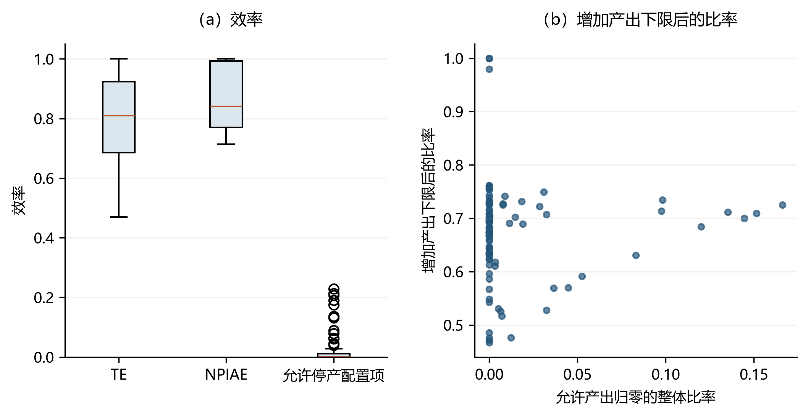

# 基于物质平衡的环境绩效测度方法 {#sec-9}
前几章已经讨论了含非期望产出的 DEA、方向距离函数和动态生产率测度。这些方法能够将污染排放纳入效率评价，但在多数设定中，投入、期望产出和非期望产出之间的物质守恒关系并未被显式写入生产技术。对于能源、农业和工业排放等场景，如果忽略污染物质在投入端、产出端和排放端之间的流动关系，环境绩效测度可能将物理上不可行的投影点误判为可行技术，进而影响对效率得分、减排潜力和低效率来源的判断。

基于此，本章介绍物质平衡原则（Material Balance Principle, MBP）下的环境绩效测度方法。全章围绕“为什么需要物质守恒约束—物质平衡如何改变可行技术—如何形成非参数线性规划模型—如何在 `deabook` 中计算和解释分解指标”这一主线展开。本章模型提供的是相对于样本前沿的测算结果，不对某项政策或外生冲击作因果识别；其核心贡献在于将环境绩效差异进一步分解为技术效率、污染投入配置、非污染投入配置和产出配置等可解释来源。

> **本章符号约定（与第 3–8、10 章不同）**：本章案例以火电行业为对象，`E` 表示**电力（期望产出）**、`F` 表示**燃料（污染投入）**；而本书其他章节（第 3、5、6、7、8、10 章）的 `E` 一律表示**能源投入**。阅读本章案例（[-@sec-9-6] 节、[-@sec-9-7] 节）时，请注意 `sent="K L+F=E:CO2"` 中 `=` 右侧的 `E` 是期望产出，而非投入。

## 物质平衡原则 {#sec-9-1}

在 DEA 文献中，非期望产出的处理大体有四类思路：第一，将非期望产出作为具有强可处置性的投入（Hailu and Veeman, 2001）；第二，将非期望产出作为具有弱可处置性的产出（Färe and Grosskopf, 2004; Färe et al., 1989）；第三，将期望产出和非期望产出分别置于不同子技术中刻画，例如副生产法以及自然处置/管理处置框架（Murty et al., 2012; Sueyoshi and Goto, 2012）；第四，在生产技术中引入物质平衡原则，约束污染物质从投入到产出和排放的流动。第四类思路中，物质平衡条件下的环境效率测度由 Coelli, Lauwers and Van Huylenbroeck（2007）提出（以最小污染投入与观测污染投入之比定义环境效率），Welch and Barnum（2009）在此思路下考察发电的成本—环境联合效率；把**弱 G 可处置性**（weak G-disposability，即只允许在满足物质平衡的方向上处置）确立为生产技术公理的是 Rødseth（2016, 2017），其非参数 DEA 实现见 Hampf and Rødseth（2015）。

上述方法的核心差异在于是否承认污染物质具有明确的物理来源。将非期望产出直接当作投入，虽然形式上便于建模，却难以反映“投入经过生产过程形成期望产出和排放”的经济含义。单纯的弱可处置设定也可能在缺乏末端治理活动时允许不符合物质守恒的排放缩减，从而影响影子价格和效率测度（Hampf and Rødseth, 2015; Dakpo et al., 2016; Førsund, 2009）。因此，物质平衡模型的目的在于将污染物质从投入到产出和排放的转换关系纳入技术集本身，而非简单增加约束。下一节将通过证明传统径向效率度量在物质平衡条件下退化为 1，说明为何必须重新定义生产技术与投影方向。


## 物质平衡条件 {#sec-9-2}
Ayres 和 Kneese（1969）提出的物质平衡原则指出，在不考虑存量变化和外部减排活动时，投入中携带的特定物质或能量，应当等于期望产出中保留下来的相应物质或能量与非期望产出中排放出去的相应物质或能量之和（Coelli et al., 2007）。不考虑末端减排时，物质平衡条件可写为：
$$
\boldsymbol{S_x x}-\boldsymbol{S_y y}=\boldsymbol{b}
$$ {#eq-9-1}
其中，$\boldsymbol{x}$、$\boldsymbol{y}$和$\boldsymbol{b}$分别表示投入、期望产出和非期望产出向量；$\boldsymbol{S_x}$和$\boldsymbol{S_y}$分别表示投入端和期望产出端的单位物质含量系数。以养殖业为例，饲料和仔猪中的氮元素会在成品猪和粪便之间分配；以火力发电为例，燃料中的碳、硫、氮等元素会相应形成电力生产过程中的排放。为便于表述，下文将这类需要满足守恒关系的元素或污染载体统称为“污染物质”，并将携带污染物质的投入/产出简称**污染投入/污染产出**，不携带的简称**非污染投入/非污染产出**（详见 [-@sec-9-2-2] 节）。

在式（[-@eq-9-1]）中，不携带污染物质的投入对应的 $\boldsymbol{S_x}$ 分量为零，携带污染物质的投入对应分量大于零；同理，不携带污染物质的期望产出对应的 $\boldsymbol{S_y}$ 分量为零，携带污染物质的期望产出对应分量大于零。因此，降低非期望产出有多条途径：可以来自污染投入的减少、污染投入结构的变化，也可以来自污染物质更多地保留在期望产出中，而非仅靠“直接压减排放”一条路径。物质平衡模型正是通过这些约束区分不同来源的效率改进空间。

### 距离函数与物质平衡条件 {#sec-9-2-1}

前几章已经介绍了谢泼德产出距离函数、谢泼德投入距离函数、双曲线距离函数和方向距离函数等效率测度方式。在定义符合物质平衡原则的生产技术之前，有必要先考察这些距离函数在何种条件下与式（[-@eq-9-1]）相容。基本结论是：当携带污染物质的期望产出分量为正（即 $\boldsymbol{S_y y}\ne \boldsymbol{0}$）时，传统谢泼德距离函数和双曲线距离函数通常难以同时满足物质平衡条件；方向距离函数只有在投影方向满足特定物质守恒关系时，才与物质平衡条件相容。

为说明这一点，考虑一个生产单元使用 $K$ 个投入 $\boldsymbol{x}\in {R}_{+}^{K}$ 生产 $L$ 个期望产出 $\boldsymbol{y}\in {R}_{+}^{L}$，并产生非期望产出 $\boldsymbol{b}$。排放量由物质平衡方程 $\boldsymbol{S_x x}-\boldsymbol{S_y y}=\boldsymbol{b}$ 决定，其中 $\boldsymbol{S_x}$ 和 $\boldsymbol{S_y}$ 是已知的非负物质含量系数。

首先，考虑 Färe 等（1989）的双曲线效率度量。该方法寻找最大的标量 $\lambda$，使得放缩后的组合 $(\lambda y,x/\lambda,b/\lambda)$ 仍位于可行生产集中。若将该放缩方式代入物质平衡方程，可得：
$$
b/ \lambda=\boldsymbol{S_x x} / \lambda   -   \boldsymbol{S_y y} \lambda
$$ {#eq-9-2}
这表示，当携带污染物质的期望产出分量为正（即 $\boldsymbol{S_y y}\ne \boldsymbol{0}$）时，
$$
b- \boldsymbol{S_x x}   =     -     \boldsymbol{S_y y}\lambda^{2}
$$ {#eq-9-3}
此时，$\lambda=1$ 是唯一能够同时满足双曲线效率测度和物质平衡方程的正值。由于观测点本身满足物质平衡条件 $\boldsymbol{S_x x}-\boldsymbol{S_y y}=\boldsymbol{b}$，即 $\boldsymbol{S_y y}=\boldsymbol{S_x x}-\boldsymbol{b}$，代入上式并由 $\boldsymbol{S_y y}\ne \boldsymbol{0}$ 得 $\lambda^{2}=1$，故 $\lambda=1$。模型不再允许低效率生产单元沿该比例方向投影到可行技术内部，效率测度由此失去区分低效率程度的作用。

Färe 等（1996）的投入导向效率度量也会出现类似问题。该方法寻找最大的标量 $\lambda$，使得 $(y,x/\lambda,b)$ 保持可行。将其代入物质平衡方程，可得：
$$
b= \boldsymbol{S_x x} / \lambda     -  \boldsymbol{S_y y}
$$ {#eq-9-4}
这表示，对任意 $\boldsymbol{S_y}$（含 $\boldsymbol{S_y}=\boldsymbol{0}$），
$$
\left(  b   + \boldsymbol{S_y y}\right) \lambda   =    \boldsymbol{S_x x}
$$ {#eq-9-5}
因此，$\lambda=1$ 仍是唯一在数学上可行的值。由于观测点满足 $\boldsymbol{S_x x}-\boldsymbol{S_y y}=\boldsymbol{b}$，即 $(\boldsymbol{b}+\boldsymbol{S_y y})=\boldsymbol{S_x x}$，代入上式得 $\boldsymbol{S_x x}\cdot \lambda=\boldsymbol{S_x x}$，故 $\lambda=1$。

对 Reinhard 等（2000）使用的其他效率度量，即 $(\boldsymbol{y}, \boldsymbol{x}, \boldsymbol{b}/\lambda)$、$(\lambda\boldsymbol{y}, \boldsymbol{x}, \boldsymbol{b})$ 和 $(\boldsymbol{y}, \boldsymbol{x}/\lambda, \boldsymbol{b}/\lambda)$ 进行同样检查，也会得到相近结论：在 $\boldsymbol{S_y y}\ne \boldsymbol{0}$ 的条件下，若投影路径没有同步满足物质守恒关系，与物质平衡条件一致的效率分数只能退化为 1。这说明必须重新定义环境生产技术和允许的投影方向。

方向距离函数的优势在于可以显式指定投入、期望产出和非期望产出的联合调整方向。当方向向量设定为 $(-\boldsymbol{g}_{\boldsymbol{x}}, \boldsymbol{g}_{\boldsymbol{y}}, -\boldsymbol{g}_{\boldsymbol{b}})$ 时，方向距离函数定义为（Chung et al., 1997）：
$$
\vec{D}_i\left(\boldsymbol{x}, \boldsymbol{y},\boldsymbol{b} ; -\boldsymbol{g}_{\boldsymbol{x}}, \boldsymbol{g}_{\boldsymbol{y}},-\boldsymbol{g}_{\boldsymbol{b}}\right)=\sup \left\{\beta:\left(\boldsymbol{x}-\beta \boldsymbol{g}_{\boldsymbol{x}}, \boldsymbol{y}+\beta \boldsymbol{g}_{\boldsymbol{y}},\boldsymbol{b}-\beta \boldsymbol{g}_{\boldsymbol{b}}\right) \in T\right\}
$$ {#eq-9-6}
式中，$T$ 为包含非期望产出的生产技术；$\boldsymbol{g_x}$、$\boldsymbol{g_y}$ 和 $\boldsymbol{g_b}$ 分别表示投入缩减、期望产出扩张和非期望产出缩减的方向；$\beta$ 表示沿给定方向可改进的最大幅度。

投入和产出的变动需符合物质平衡条件，即：
$$
\begin{array}{l}
(\boldsymbol{b}-\beta \boldsymbol{g_b})=\boldsymbol{S_x }(\boldsymbol{x}-\beta \boldsymbol{g_x})- \boldsymbol{S_y }(\boldsymbol{y}+\beta \boldsymbol{g_y})
 \end{array}
$$ {#eq-9-7}
可得：
$$
\boldsymbol{b}-\boldsymbol{S_x x}+ \boldsymbol{S_y }\boldsymbol{y}= \beta ( \boldsymbol{g_b}- \boldsymbol{S_x}\boldsymbol{g_x}- \boldsymbol{S_y }\boldsymbol{g_y})
$$ {#eq-9-8}
由于观测点本身满足物质平衡条件 $\boldsymbol{S_x x}-\boldsymbol{S_y y}=\boldsymbol{b}$，上式左端恒为零。为使**投影后的点** $(\boldsymbol{x}-\beta\boldsymbol{g_x},\boldsymbol{y}+\beta\boldsymbol{g_y},\boldsymbol{b}-\beta\boldsymbol{g_b})$ 也满足物质平衡条件，必须有 $\beta(\boldsymbol{g_b}-\boldsymbol{S_x}\boldsymbol{g_x}-\boldsymbol{S_y}\boldsymbol{g_y})=0$。该条件有两种满足方式：一是 $\beta=0$，即生产单元无可改进空间（投影退化为不动点）；二是投影方向本身满足 $\boldsymbol{g_b}- \boldsymbol{S_x}\boldsymbol{g_x}- \boldsymbol{S_y}\boldsymbol{g_y}=0$。后一种情形允许 $\beta$ 取非负值，是构造物质平衡方向距离函数的关键。当 $\boldsymbol{S_y}= \boldsymbol{0}$ 时，上述条件退化为 $\boldsymbol{g_b}- \boldsymbol{S_x}\boldsymbol{g_x}=0$，表明期望产出的调整不改变污染物质守恒关系。

### 符合物质平衡的生产技术的公理 {#sec-9-2-2}

在得到方向距离函数与物质平衡条件相容的方向约束后，需要进一步定义符合该约束的生产技术。考虑一个生产过程，其中 $K$ 个投入 $\boldsymbol{x}\in {R}_{+}^{K}$ 被用于生产 $L$ 个期望产出 $\boldsymbol{y}\in {R}_{+}^{L}$。为便于下文表述，将“包含污染物质的投入”简称**污染投入**（$x^{P}$，共 $K_1$ 个），“不包含污染物质的投入”简称**非污染投入**（$x^{NP}$，共 $K_2=K-K_1$ 个），即 $\boldsymbol{x}=\left[\begin{array}{ll}\boldsymbol{x}^{P}\\ \boldsymbol{x}^{NP}\end{array}\right]$；类似地，将期望产出划分为**污染产出**（$y^{P}$，共 $L_1$ 个）和**非污染产出**（$y^{NP}$，共 $L_2=L-L_1$ 个）。污染投入经生产过程转化后，会形成 $M$ 个非期望产出 $\boldsymbol{b}\in {R}_{+}^{M}$。生产技术集 $T$ 定义为所有技术上可行的投入—产出组合：
$$
T=\{(\boldsymbol{x}, \boldsymbol{y}, \boldsymbol{b}): \boldsymbol{x} \text { 能生产 }(\boldsymbol{y}, \boldsymbol{b})\}
$$ {#eq-9-9}
根据上一小节，方向距离函数满足物质平衡条件的关键在于方向向量满足 $\boldsymbol{g_b}-\boldsymbol{S_x}\boldsymbol{g_x}-\boldsymbol{S_y}\boldsymbol{g_y}=0$。Rødseth（2016）将这一关系纳入物质平衡生产技术的公理体系。其含义是，污染投入、污染产出和非期望产出的调整必须共同满足物质守恒约束，三者彼此相关。基于此，可将符合物质平衡条件的技术集设定为满足以下假设：

$(1)$ $T$ 是闭集；并且对任意给定的投入 $\boldsymbol{x}$，可行产出集 $P(\boldsymbol{x})=\{(\boldsymbol{y},\boldsymbol{b}):(\boldsymbol{x},\boldsymbol{y},\boldsymbol{b})\in T\}$ 有界（有界性针对给定投入下的产出集，而不是 $T$ 本身——CRS 下技术集是锥，沿射线无界）；

$(2)$ 没有免费的午餐：若$(\boldsymbol{y},\boldsymbol{b})\geq(\boldsymbol{0},\boldsymbol{0})$，则$(\boldsymbol{0},\boldsymbol{y},\boldsymbol{b}) \notin T$；

$(3)$ 非污染投入具有强可处置性；

$(4)$ 非污染产出具有强可处置性；

$(5)$ 污染投入对非期望产出的要素必要性：若$(\boldsymbol{x},\boldsymbol{y},\boldsymbol{b}) \in T$，且$\boldsymbol{x^P}=\boldsymbol{0}$，则$\boldsymbol{b}=\boldsymbol{0}$；

$(6)$ 非期望产出对污染投入的存在性对应：若$(\boldsymbol{x},\boldsymbol{y},\boldsymbol{b}) \in T$，且$\boldsymbol{b}=\boldsymbol{0}$，则$\boldsymbol{x^P}=\boldsymbol{0}$；

$(7)$ 投入和产出满足弱 G 可处置性：若$(\boldsymbol{x},\boldsymbol{y},\boldsymbol{b}) \in T$，且方向向量满足 $\boldsymbol{g_b}-\boldsymbol{S_x}\boldsymbol{g_x}-\boldsymbol{S_y}\boldsymbol{g_y}=0$，则$(\boldsymbol{x}-\boldsymbol{g_x},\boldsymbol{y}+\boldsymbol{g_y},\boldsymbol{b}-\boldsymbol{g_b}) \in T$。

$(8)$ $T$ 是凸的；

$(9)$ 规模报酬可设定为可变（VRS）或不变（CRS）规模报酬。

公理$(5)$和$(6)$刻画了污染投入与非期望产出之间的**要素必要性（存在性对应）**：没有污染投入就不会产生相应非期望产出，反之，观测不到非期望产出也意味着没有污染投入。需要与第 [-@sec-6] 章的**零结合性（null-jointness）**相区别：后者说的是好产出与坏产出之间的联合性，即若 $(\boldsymbol{x},\boldsymbol{y},\boldsymbol{b})\in T$ 且 $\boldsymbol{b}=\boldsymbol{0}$，则 $\boldsymbol{y}=\boldsymbol{0}$（无污染即无产出）；本章 $(5)(6)$ 是物质守恒下 $\boldsymbol{x}^P$ 与 $\boldsymbol{b}$ 的对应，两者不是同一条公理，不应混用同一名称。公理$(7)$进一步刻画了二者之间的调整对应关系，是落实物质平衡的实质约束：投入和产出的调整必须满足物质守恒关系，即污染投入减少所降低的物质流入，以及污染产出扩张所吸收的物质量，必须与非期望产出的减少相匹配。该条件排除了污染投入和污染产出的任意强可处置性，但其他投入和产出仍可调整；非污染投入和非污染产出仍按照强可处置性处理。

## 物质平衡生产技术的非参数刻画 {#sec-9-3}

将公理 $(7)$ 中的方向向量 $(\boldsymbol{g_x},\boldsymbol{g_y},\boldsymbol{g_b})$ 替换为松弛向量 $(\epsilon_{\boldsymbol{x}},\epsilon_{\boldsymbol{y}},\epsilon_{\boldsymbol{b}})$，方向守恒条件 $\boldsymbol{g_b}-\boldsymbol{S_x}\boldsymbol{g_x}-\boldsymbol{S_y}\boldsymbol{g_y}=0$ 即对应为 $\boldsymbol{S_x}\epsilon_{\boldsymbol{x}}+\boldsymbol{S_y}\epsilon_{\boldsymbol{y}}=\epsilon_{\boldsymbol{b}}$。在非参数 DEA 框架中，可用这些松弛变量表示各维度相对于参考技术的调整幅度，并据此落实弱 G 可处置性中的物质守恒要求。规模报酬不变下，物质平衡技术可估计为：

$$
\begin{array}{ll}
\hat{T}_{CRS}^{M B}=  \{ & (\boldsymbol{x}, \boldsymbol{y}, \boldsymbol{b}):  \\  
 & \boldsymbol{x}=\boldsymbol{X} \boldsymbol{\lambda}+\epsilon_{\boldsymbol{x}}, \\
 & \boldsymbol{y}=\boldsymbol{Y} \boldsymbol{\lambda}-\epsilon_{\boldsymbol{y}}, \\ 
 & \boldsymbol{b}=\boldsymbol{B} \boldsymbol{\lambda}+\epsilon_{\boldsymbol{b}}, \\
 & \boldsymbol{S}_{\boldsymbol{x}} \epsilon_{\boldsymbol{x}}+\boldsymbol{S}_{\boldsymbol{y}}  \epsilon_{\boldsymbol{y}}=\epsilon_{\boldsymbol{b}}, \\ 
 & \epsilon_{\boldsymbol{x}},\epsilon_{\boldsymbol{y}} ,\epsilon_{\boldsymbol{b}},\boldsymbol{\lambda} \geqq \mathbf{0}                \}
 \end{array}
$$ {#eq-9-10}
在规模报酬可变下，只需进一步加入强度变量之和等于 1 的约束：
$$
\begin{array}{ll}
\hat{T}_{VRS}^{M B}=  \{ & (\boldsymbol{x}, \boldsymbol{y}, \boldsymbol{b}):  \\  
 & \boldsymbol{x}=\boldsymbol{X} \boldsymbol{\lambda}+\epsilon_{\boldsymbol{x}}, \\
 & \boldsymbol{y}=\boldsymbol{Y} \boldsymbol{\lambda}-\epsilon_{\boldsymbol{y}}, \\ 
 & \boldsymbol{b}=\boldsymbol{B} \boldsymbol{\lambda}+\epsilon_{\boldsymbol{b}}, \\
 & \boldsymbol{S}_{\boldsymbol{x}} \epsilon_{\boldsymbol{x}}+\boldsymbol{S}_{\boldsymbol{y}}  \epsilon_{\boldsymbol{y}}=\epsilon_{\boldsymbol{b}}, \\ 
 &  \mathbf{1}^{T} \boldsymbol{\lambda}=1, \\
 & \epsilon_{\boldsymbol{x}},\epsilon_{\boldsymbol{y}} ,\epsilon_{\boldsymbol{b}},\boldsymbol{\lambda} \geqq \mathbf{0}                \}
 \end{array}
$$ {#eq-9-11}
因此，物质平衡非参数技术的核心约束是 $\boldsymbol{S}_{\boldsymbol{x}} \epsilon_{\boldsymbol{x}}+\boldsymbol{S}_{\boldsymbol{y}}\epsilon_{\boldsymbol{y}}=\epsilon_{\boldsymbol{b}}$。该式要求投入和期望产出松弛引起的污染物质变动必须与非期望产出松弛相一致。若进一步假定 $\epsilon_{\boldsymbol{b}}=0$，模型实际上考察的是在非期望产出不发生净变化时，投入和期望产出结构如何调整才能满足物质平衡。与一般联合生产技术相比，MB 技术的关键差异就在于增加了这一物质守恒约束，并据此形成弱 G 可处置性。

应用该模型时，$\boldsymbol{S}_{\boldsymbol{x}}$ 和 $\boldsymbol{S}_{\boldsymbol{y}}$ 需要在估计前给定。Wang 等（2018）在研究火电行业时，由于期望产出电力不携带碳元素，将 $\boldsymbol{S}_{\boldsymbol{y}}$ 设为零，并用二氧化碳排放量与燃料投入之比构造投入端污染系数 $\boldsymbol{S}_{\boldsymbol{x}}$。这一处理是基于样本观测值的排放系数近似，而非独立于生产技术的结构参数。

## 绩效测度 {#sec-9-4}

### 非期望产出方向上的技术效率 {#sec-9-4-1}

基于上一节的非参数技术，本节构造可操作的环境绩效指标，首先考察非期望产出方向上的技术效率。对每个 DMU，可以将目标设定为在给定物质平衡约束下最小化非期望产出。由于物质平衡约束把非期望产出与投入、期望产出绑定，“最小化非期望产出”本质上是寻找使排放最低的投入—产出再配置，而非对排放端的任意压缩。随着可调整变量范围逐步扩大，模型可将总体环境效率分解为技术效率、污染投入配置效率、非污染投入配置效率、污染产出配置效率和非污染产出配置效率。下面按调整成本递增的顺序逐层放松约束——先允许污染投入结构调整（如同质燃料替代），再允许非污染投入再配置（资本、劳动的重新组合），最后允许产出结构调整（产出组合改变涉及需求侧，通常调整成本较高）。这样，每一层级的效率损失对应着越来越难以调整的来源。

**第一层级：污染投入保持不变。** 此时，最小可达非期望产出与实际非期望产出之比，用于衡量非期望产出方向上的技术效率。

在 CRS 假设下，该层级的最小可达排放可通过下式求解：
$$
\begin{array}{ll}
 B_{1}= & \underset {\lambda, \epsilon,  b_{m}} {\min} \frac{1}{M} \sum_{m=1}^{M} b_{m} \\
&\sum_{i=1}^{N} \lambda_{i} x_{k i}^{P}+\epsilon_{k x^{P}}=x_{k0}^{P}, \quad k=1, \ldots, K_1\\
&\sum_{i=1}^{N} \lambda_{i} x_{k i}^{NP}+\epsilon_{k x^{NP}}=x_{k0}^{NP}, \quad k=K_{1}+1, \ldots, K\\
&\sum_{i=1}^{N} \lambda_{i} y_{l i}^{P}-\epsilon_{l y^{P}} = y_{l0}^{P}, \quad l=1, \ldots, L_{1} \\
&\sum_{i=1}^{N}\lambda_{i}y_{l i}^{NP}-\epsilon_{l y^{NP}}=y_{l0}^{NP}, \quad l=L_{1}+1, \ldots, L \\
&\sum_{i=1}^{N} \lambda_{i} b_{m i}+\epsilon_{m b}=b_{m}, \quad m=1, \ldots, M \\
& \sum_{k=1}^{K_{1}} S_{x_{km}} \epsilon_{k x^{P}} +\sum_{l=1}^{L_{1}} S_{y_{lm}} \epsilon_{l y^{P}} = (\epsilon_{m b} + b_{m0} - b_{m}), \quad m= 1, \ldots, M\\
& \lambda_{i} \geq 0, \quad i=1, \ldots, N 
\end{array}
$$ {#eq-9-12}
由于目标函数最小化非期望产出之和，最优解中恒有 $\epsilon_{mb}=0$。其机理是：将非期望产出约束 $\sum_i\lambda_i b_{mi}+\epsilon_{mb}=b_m$ 代入物质平衡约束 $\sum_k S_{x_{km}}\epsilon_{kx^P}+\sum_l S_{y_{lm}}\epsilon_{ly^P}=\epsilon_{mb}+b_{m0}-b_m$ 消元，$\epsilon_{mb}$ 恒等消去，不再独立约束 $\lambda$ 与其他松弛；而 $\epsilon_{mb}\ge 0$ 仅以 $+\epsilon_{mb}$ 形式进入目标项 $b_m$，故极小化目标必然将其压至下界 0。据此在式（[-@eq-9-12]）中令 $\epsilon_{mb}=0$ 并消去该项，即得等价的简约形式（式 9.13）。该消去论证仅依赖非期望产出约束与目标函数的形式（二者在各层级不变），故对各层级均成立。下文统一采用简约形式（`deabook` 的 `DEAmb` 模块实现的也是简约形式）。
$$
\begin{array}{ll}
 B_{1}= & \underset {\lambda, \epsilon,  b_{m}} {\min} \frac{1}{M} \sum_{m=1}^{M} b_{m} \\
&\sum_{i=1}^{N} \lambda_{i} x_{k i}^{ P}+\epsilon_{k x^{ P}}=x_{k0}^{P}, \quad k=1, \ldots, K_1\\
&\sum_{i=1}^{N} \lambda_{i} x_{k i}^{N P}+\epsilon_{k x^{N P}}=x_{k0}^{N P}, \quad k=K_{1}+1, \ldots, K\\
& \sum_{i=1}^{N} \lambda_{i} y_{l i}^{P}-\epsilon_{l y^{P} } =y_{l0}^{P}, \quad l=1, \ldots, L_{1} \\
&\sum_{i=1}^{N}\lambda_{i}y_{l i}^{N P}-\epsilon_{l y^{N P}}=y_{l0}^{N P}, \quad l=L_{1}+1, \ldots,L \\
 &\sum_{i=1}^{N} \lambda_{i} b_{m i}+\epsilon_{m b}=b_{m}, \quad m=1, \ldots M \\
& \sum_{k=1}^{K_{1}} S_{x_{km}} \epsilon_{k x^{ P}} +\sum_{l=1}^{L_{1}} S_{y_{lm}} \epsilon_{l y^{P} }=(b_{m0}-b_{m}),  \quad m= 1, \ldots, M\\
& \lambda_{i}  \geq 0 \quad i= 1, \ldots, N\\ 
\end{array}
$$ {#eq-9-13}
**第二层级：在第一层级基础上，允许污染投入调整。** 此时，新的最小可达非期望产出与第一层级下的最小可达非期望产出之比，用于衡量污染投入配置效率。

在 CRS 假设下，第二层级的最小可达排放可通过下式求解：
$$
\begin{array}{ll}
 B_{2}= & \underset {\lambda, \epsilon,  b_{m}, x^{ P}} {\min} \frac{1}{M} \sum_{m=1}^{M} b_{m} \\
&\sum_{i=1}^{N} \lambda_{i} x_{k i}^{ P}+\epsilon_{k x^{ P}}=x_{k}^{P}, \quad k=1, \ldots, K_1\\
&\sum_{i=1}^{N} \lambda_{i} x_{k i}^{N P}+\epsilon_{k x^{N P}}=x_{k0}^{N P}, \quad k=K_{1}+1, \ldots, K\\
& \sum_{i=1}^{N} \lambda_{i} y_{l i}^{P}-\epsilon_{l y^{P} } =y_{l0}^{P}, \quad l=1, \ldots, L_{1} \\
&\sum_{i=1}^{N}\lambda_{i}y_{l i}^{N P}-\epsilon_{l y^{N P}}=y_{l0}^{N P}, \quad l=L_{1}+1, \ldots,L \\
 &\sum_{i=1}^{N} \lambda_{i} b_{m i}+\epsilon_{m b}=b_{m}, \quad m=1, \ldots M \\
&\sum_{k=1}^{K_{1}} S_{x_{km}}  \left(x_{k0}^{P}-x_{k}^{P}\right)  +\sum_{l=1}^{L_{1}} S_{y_{lm}} \epsilon_{l y^{P} }=(b_{m0}-b_{m}), \quad m = 1, \ldots, M \\
& \lambda_{i}  \geq 0 \quad i= 1, \ldots, N\\ 
\end{array}
$$ {#eq-9-14}
由于污染投入被允许调整，污染物质流入的减少由实际污染投入从 $x_{k0}^{P}$ 调整到 $x_k^{P}$ 所带来的变化刻画，即 $S_{x_{km}}\left(x_{k0}^{P}-x_k^{P}\right)$，而不再仅由松弛项 $\epsilon_{k x^{P}}$ 表示。若把松弛项也显式写入物质平衡约束，可得到等价表达 $S_{x_{km}}\left(\epsilon_{k x^{P}}+x_{k0}^{P}-x_k^{P}\right)$；两种写法的最优值相同，因为目标函数极小化 $b_m$ 且 $S_{x_{km}}\ge 0$，最优解中 $\epsilon_{k x^{P}}$ 被压至下界 0（污染投入被压至前沿组合 $\sum_i\lambda_i x_{ki}^{P}$）。两种形式可统一记为：
$$
\sum_{k=1}^{K_{1}} S_{x_{km}}  \left(\epsilon_{k x^{ P}}+x_{k0}^{P}-x_{k}^{P}\right)  +\sum_{l=1}^{L_{1}} S_{y_{lm}} \epsilon_{l y^{P} }=(b_{m0}-b_{m}), \quad m = 1, \ldots, M
$$ {#eq-9-15}
其余约束与式（[-@eq-9-14]）相同。

在第二层级的基础上，进一步允许非污染投入调整，可得到第三层级。

**第三层级：非污染投入可以调整。** 此时，最小可达非期望产出与第二层级下最小可达非期望产出之比，用于衡量非污染投入配置效率。

在 CRS 假设下，第三层级的最小可达排放可通过下式求解：
$$
\begin{array}{ll}
 B_{3}= & \underset {\lambda, \epsilon,  b_{m}, x  } {\min} \frac{1}{M} \sum_{m=1}^{M} b_{m} \\
&\sum_{i=1}^{N} \lambda_{i} x_{k i}^{ P}+\epsilon_{k x^{ P}}=x_{k}^{P}, \quad k=1, \ldots, K_1\\
&\sum_{i=1}^{N} \lambda_{i} x_{k i}^{N P}+\epsilon_{k x^{N P}}=x_{k}^{N P}, \quad k=K_{1}+1, \ldots, K\\
& \sum_{i=1}^{N} \lambda_{i} y_{l i}^{P}-\epsilon_{l y^{P} } =y_{l0}^{P}, \quad l=1, \ldots, L_{1} \\
&\sum_{i=1}^{N}\lambda_{i}y_{l i}^{N P}-\epsilon_{l y^{N P}}=y_{l0}^{N P}, \quad l=L_{1}+1, \ldots,L \\
&\sum_{i=1}^{N} \lambda_{i} b_{m i}+\epsilon_{m b}=b_{m}, \quad m=1, \ldots M \\
&\sum_{k=1}^{K_{1}} S_{x_{km}} \left(x_{k0}^{P}-x_{k}^{P}\right)+\sum_{l=1}^{L_{1}} S_{y_{lm}} \epsilon_{l y^{P} }=(b_{m0}-b_{m}), \quad m = 1, \ldots, M \\
& \lambda_{i}  \geq 0 \quad i= 1, \ldots, N\\ 
\end{array}
$$ {#eq-9-16}

在第三层级的基础上，若进一步允许污染产出调整，可得到第四层级。

**第四层级：污染产出可以调整。** 此时，最小可达非期望产出与第三层级下最小可达非期望产出之比，用于衡量污染产出配置效率。

在 CRS 假设下，第四层级的最小可达排放可通过下式求解：
$$
\begin{array}{ll}
 B_{4}= & \underset {\lambda, \epsilon,  b_{m}, x ,y^{P}} {\min} \frac{1}{M} \sum_{m=1}^{M} b_{m} \\
&\sum_{i=1}^{N} \lambda_{i} x_{k i}^{ P}+\epsilon_{k x^{ P}}=x_{k}^{P}, \quad k=1, \ldots, K_1\\
&\sum_{i=1}^{N} \lambda_{i} x_{k i}^{N P}+\epsilon_{k x^{N P}}=x_{k}^{N P}, \quad k=K_{1}+1, \ldots, K\\
& \sum_{i=1}^{N} \lambda_{i} y_{l i}^{P}-\epsilon_{l y^{P} } =y_{l }^{P}, \quad l=1, \ldots, L_{1} \\
&\sum_{i=1}^{N}\lambda_{i}y_{l i}^{N P}-\epsilon_{l y^{N P}}=y_{l0}^{N P}, \quad l=L_{1}+1, \ldots,L \\
&\sum_{i=1}^{N} \lambda_{i} b_{m i}+\epsilon_{m b}=b_{m}, \quad m=1, \ldots M \\
&\sum_{k=1}^{K_{1}} S_{x_{km}}  \left(x_{k0}^{P}-x_{k}^{P}\right)+\sum_{l=1}^{L_{1}} S_{y_{lm}} \left(y_{l}^{P}-y_{l0}^{P}\right)=(b_{m0}-b_{m}), \quad m = 1, \ldots, M \\
& \lambda_{i}  \geq 0 \quad i= 1, \ldots, N\\ 
\end{array}
$$ {#eq-9-17}
同理，当污染产出可调整时，期望产出端所吸收的污染物质量需要由 $S_{y_{lm}}\left(y_l^P-y_{l0}^P\right)$ 表示，而不仅由 $\epsilon_{l y^P}$ 表示。在最小化非期望产出的目标下，若期望产出能够承载更多污染物质，扩大 $y_l^P$ 会相应降低排放端的物质压力。

在第四层级的基础上，若继续允许非污染产出调整，可得到第五层级。

**第五层级：非污染产出可以调整。** 此时，最小可达非期望产出与第四层级下最小可达非期望产出之比，用于衡量非污染产出配置效率；第五层级下的最小可达非期望产出与实际非期望产出之比，则用于衡量整体环境效率。需注意，第五层级允许产出调整可能引入**停产退化**：当产出可调时，模型可能选择产出与污染投入同步归零的平凡解，使 $B_5$ 触零。此时 NPOAE=0 反映的是模型允许停产而非有经济意义的产出再配置空间；若研究目的在于排除停产情形，可在第五层级加入产出下限约束（如 $y_l^{NP}\ge y_{l0}^{NP}$）或改用 Hampf 和 Rødseth（2015）的最大化 $E/b$ 目标。

在 CRS 假设下，第五层级的最小可达排放可通过下式求解：
$$
\begin{array}{ll}
 B_{5}= & \underset {\lambda, \epsilon,  b_{m}, x ,y} {\min} \frac{1}{M} \sum_{m=1}^{M} b_{m} \\
&\sum_{i=1}^{N} \lambda_{i} x_{k i}^{ P}+\epsilon_{k x^{ P}}=x_{k}^{P}, \quad k=1, \ldots, K_1\\
&\sum_{i=1}^{N} \lambda_{i} x_{k i}^{N P}+\epsilon_{k x^{N P}}=x_{k}^{N P}, \quad k=K_{1}+1, \ldots, K\\
& \sum_{i=1}^{N} \lambda_{i} y_{l i}^{P}-\epsilon_{l y^{P} } =y_{l }^{P}, \quad l=1, \ldots, L_{1} \\
&\sum_{i=1}^{N}\lambda_{i}y_{l i}^{N P}-\epsilon_{l y^{N P}}=y_{l }^{N P}, \quad l=L_{1}+1, \ldots,L \\
&\sum_{i=1}^{N} \lambda_{i} b_{m i}+\epsilon_{m b}=b_{m}, \quad m=1, \ldots M \\
&\sum_{k=1}^{K_{1}} S_{x_{km}}  \left(x_{k0}^{P}-x_{k}^{P}\right)+\sum_{l=1}^{L_{1}} S_{y_{lm}} \left(y_{l}^{P}-y_{l0}^{P}\right)=(b_{m0}-b_{m}), \quad m = 1, \ldots, M \\
& \lambda_{i}  \geq 0 \quad i= 1, \ldots, N\\ 
\end{array}
$$ {#eq-9-18}
与式（[-@eq-9-15]）同理，若把松弛项显式写入物质平衡约束，第五层级的物质平衡约束可等价写为：
$$
\sum_{k=1}^{K_{1}} S_{x_{km}}  \left(\epsilon_{k x^{ P}}+x_{k0}^{P}-x_{k}^{P}\right)+\sum_{l=1}^{L_{1}} S_{y_{lm}} \left(\epsilon_{l y^{P} }+y_{l}^{P}-y_{l0}^{P}\right)=(b_{m0}-b_{m}), \quad m = 1, \ldots, M
$$ {#eq-9-19}
其余约束与式（[-@eq-9-18]）相同；两种写法最优值一致（最优解处 $\epsilon_{k x^{P}}=0$、$\epsilon_{ly^{P}}=0$）。
将上述五个层级得到的最优非期望产出分别记为 $B_1,\ldots,B_5$，可得到如下分解指标：
$$
整体效率(OE)= \frac {B_5}{\frac{1}{M} \sum_{m=1}^{M} b_{m0}}
$$ {#eq-9-20}

$$
非期望产出方向的技术效率(TE)= \frac {B_1}{\frac{1}{M} \sum_{m=1}^{M} b_{m0}}
$$ {#eq-9-21}

$$
包含污染物质的投入配置效率(PIAE)=\frac {B_2}{B_1}
$$ {#eq-9-22}

$$
不包含污染物质的投入配置效率(NPIAE)=\frac {B_3}{B_2}
$$ {#eq-9-23}

$$
包含污染物质的产出配置效率(POAE)=\frac {B_4}{B_3}
$$ {#eq-9-24}

$$
不包含污染物质的产出配置效率(NPOAE)=\frac {B_5}{B_4}
$$ {#eq-9-25}

整体效率可以分解为非期望产出方向的技术效率、污染投入配置效率、非污染投入配置效率、污染产出配置效率和非污染产出配置效率：
$$
OE=TE \cdot PIAE \cdot NPIAE \cdot POAE \cdot NPOAE
$$ {#eq-9-26}
其中各缩写的英文全称为：$OE$=Overall Efficiency（整体效率），$TE$=Technical Efficiency（技术效率），$PIAE$=Polluting Input Allocative Efficiency（污染投入配置效率），$NPIAE$=Non-Polluting Input Allocative Efficiency（非污染投入配置效率），$POAE$=Polluting Output Allocative Efficiency（污染产出配置效率），$NPOAE$=Non-Polluting Output Allocative Efficiency（非污染产出配置效率）。在同一规模报酬假设下，每一层级相对上一层放松了约束，可行域单调扩大，故 $B_1\ge B_2\ge B_3\ge B_4\ge B_5$，各效率比值均落在 $[0,1]$（下界 0 表示该层级最小可达非期望产出已降至零，如产出调整导致停产退化时 $B_5=0$，此时该比值失去常规经济解释力）。**必须强调：这一单调性以及各比值的配置效率解释，都要求各层级使用同一规模报酬假设。**若第一层级用 VRS、第二层级用 CRS，则 $B_2^{CRS}/B_1^{VRS}$ 同时混入了规模报酬变化，不再是纯粹的“放松污染投入约束”所带来的配置效率，不应称为 PIAE（[-@sec-9-7] 节给出该口径下的具体数值证据）。

还需注意上述简约形式的一个结构性含义：**在同一规模报酬假设下，$B_2=B_1$ 恒成立，因而 $PIAE\equiv 1$。**理由有两点。第一，把污染投入约束 $\sum_i\lambda_i x_{ki}^{P}+\epsilon_{kx^{P}}=x_{k}^{P}$ 代入第二层级的物质平衡约束（[-@eq-9-15]），污染物质流入的减少量为 $\epsilon_{kx^{P}}+x_{k0}^{P}-x_{k}^{P}=x_{k0}^{P}-\sum_i\lambda_i x_{ki}^{P}$，与第一层级（[-@eq-9-13]）中的 $\epsilon_{kx^{P}}=x_{k0}^{P}-\sum_i\lambda_i x_{ki}^{P}$ 完全相同——第一层级的投入松弛已经把“污染投入相对前沿组合的节约”计入了物质平衡，第二层级把 $x^{P}$ 设为决策变量并未打开新的减排通道。第二，第二层级唯一多出的自由度是允许 $\sum_i\lambda_i x_{ki}^{P}>x_{k0}^{P}$（此时 $x_{k}^{P}>x_{k0}^{P}$），但这会使 $b_m>b_{m0}$；而取 $\lambda_0=1$、其余为零总是第一层级的可行解并给出 $b_m=b_{m0}$，故 $B_1\le b_{m0}$，这一多出的自由度永不最优。这意味着污染投入配置效率在式（[-@eq-9-12]）—（[-@eq-9-18]）的**非径向**简约设定下不被单独识别：它已被吸收进第一层级的技术效率。若研究者需要一个非退化的 PIAE，必须改变第一层级的设定本身（例如在第一层级要求 $\epsilon_{kx^{P}}=0$、即技术效率不把投入松弛记作物质节约），而不是靠改变层级之间的规模报酬假设来制造差异。[-@sec-9-7] 节案例将验证这一点。
当采用规模报酬可变技术时，只需在相应线性规划中加入 $\sum_{i=1}^{N}\lambda_i=1$。除最小化非期望产出外，文献中也可将目标函数设定为最大化期望产出与非期望产出的比值，相关处理可参见 Hampf 和 Rødseth（2015）。

当 $\boldsymbol{S}_{\boldsymbol{y}}=\boldsymbol{0}$ 时，表示期望产出不携带所考察的污染物质。例如，在火力发电中，若考察燃料燃烧形成的 $CO_2$，期望产出电力本身不携带碳元素，则可令 $\boldsymbol{S}_{\boldsymbol{y}}=\boldsymbol{0}$。此时，污染物质守恒主要通过投入端排放系数与非期望产出之间的关系体现。

当 $\boldsymbol{S_y}=\boldsymbol{0}$ 时，第四层级可简化为：
$$
\begin{array}{ll}
 B_{4}^\prime= & \underset {\lambda, \epsilon,  b_{m}, x ,y^{P}} {\min} \frac{1}{M} \sum_{m=1}^{M} b_{m} \\
&\sum_{i=1}^{N} \lambda_{i} x_{k i}^{ P}+\epsilon_{k x^{ P}}=x_{k}^{P}, \quad k=1, \ldots, K_1\\
&\sum_{i=1}^{N} \lambda_{i} x_{k i}^{N P}+\epsilon_{k x^{N P}}=x_{k}^{N P}, \quad k=K_{1}+1, \ldots, K\\
& \sum_{i=1}^{N} \lambda_{i} y_{l i}^{P}-\epsilon_{l y^{P} } =y_{l }^{P}, \quad l=1, \ldots, L_{1} \\
&\sum_{i=1}^{N}\lambda_{i}y_{l i}^{N P}-\epsilon_{l y^{N P}}=y_{l0}^{N P}, \quad l=L_{1}+1, \ldots,L \\
&\sum_{i=1}^{N} \lambda_{i} b_{m i}+\epsilon_{m b}=b_{m}, \quad m=1, \ldots M \\
&\sum_{k=1}^{K_{1}} S_{x_{km}}  \left(x_{k0}^{P}-x_{k}^{P}\right)=(b_{m0}-b_{m}), \quad m = 1, \ldots, M \\
& \lambda_{i}  \geq 0 \quad i= 1, \ldots, N\\ 
\end{array}
$$ {#eq-9-27}
同理，第五层级可简化为：
$$
\begin{array}{ll}
 B_{5}^\prime= & \underset {\lambda, \epsilon,  b_{m}, x ,y} {\min} \frac{1}{M} \sum_{m=1}^{M} b_{m} \\
&\sum_{i=1}^{N} \lambda_{i} x_{k i}^{ P}+\epsilon_{k x^{ P}}=x_{k}^{P}, \quad k=1, \ldots, K_1\\
&\sum_{i=1}^{N} \lambda_{i} x_{k i}^{N P}+\epsilon_{k x^{N P}}=x_{k}^{N P}, \quad k=K_{1}+1, \ldots, K\\
& \sum_{i=1}^{N} \lambda_{i} y_{l i}^{P}-\epsilon_{l y^{P} } =y_{l }^{P}, \quad l=1, \ldots, L_{1} \\
&\sum_{i=1}^{N}\lambda_{i}y_{l i}^{N P}-\epsilon_{l y^{N P}}=y_{l }^{N P}, \quad l=L_{1}+1, \ldots,L \\
&\sum_{i=1}^{N} \lambda_{i} b_{m i}+\epsilon_{m b}=b_{m}, \quad m=1, \ldots M \\
&\sum_{k=1}^{K_{1}} S_{x_{km}}  \left(x_{k0}^{P}-x_{k}^{P}\right)=(b_{m0}-b_{m}), \quad m = 1, \ldots, M \\
& \lambda_{i}  \geq 0 \quad i= 1, \ldots, N\\ 
\end{array}
$$ {#eq-9-28}

$B_{4}^{\prime}$ 和 $B_{5}^{\prime}$ 即 $\boldsymbol{S}_{\boldsymbol{y}}=\boldsymbol{0}$ 情形下的简化写法。两式关系需区分两种情形讨论：

第一，若数据中存在污染产出（$L_1>0$），式（[-@eq-9-27]）放松 $y^P$、式（[-@eq-9-28]）进一步放松 $y^{NP}$。由于 $y^{NP}$ 不进入物质平衡约束，从第四层级到第五层级放松 $y^{NP}$ 仅放松构造约束 $\sum_i\lambda_i y_{li}^{NP}\ge y_{l0}^{NP}$（由 $\epsilon_{ly^{NP}}\ge 0$ 得出），从而扩大 $\lambda$ 的可行集，故 $B_{5}^{\prime}\le B_{4}^{\prime}$（恒成立）。

第二，若数据中不存在污染产出（$L_1=0$，即本案例情形：电力 $E$ 归入非污染产出，$y^P$ 为空），第四层级（污染产出调整）为空操作，$B_{4}^{\prime}=B_{3}$，POAE（$B_{4}^{\prime}/B_{3}$）退化为 1；此时 `deabook` 的 `level=4` 直接计算第五层级（非污染产出可调），为简化记法其输出仍记为 $B_4$。故本案例中 OE 由 $B_4/\text{CO2}$ 计算、NPOAE 由 $B_4/B_3$ 计算；因 $B_4'=B_3$，该 NPOAE 对应完整模型的 NPOAE（$B_5'/B_4'=B_5'/B_3$）。需注意，POAE 退化为 1 的真正条件是 $L_1=0$（无污染产出），而非 $\boldsymbol{S_y}=\boldsymbol{0}$；当 $L_1>0$ 但 $\boldsymbol{S_y}=\boldsymbol{0}$ 时，POAE 仍可严格小于 1。第五层级允许产出调整可能引入停产退化（见式 9.18 处说明），[-@sec-9-7] 节案例中将进一步讨论。

### 投入方向上的技术效率 {#sec-9-4-2}

除非期望产出方向外，也可以从投入方向刻画效率。投入方向模型的基本思想是：在给定期望产出和非期望产出约束下，考察投入尤其是污染投入的最小可达水平，并用最小投入与实际投入之比衡量投入节约空间。需注意，由于投入方向模型最小化投入而非非期望产出，$\epsilon_{mb}$ 不被目标压至 0，故物质平衡约束保留完整形式（含 $\epsilon_{mb}$）。在规模报酬不变下，可通过下式求解：
$$
\begin{array}{ll}
 X_{1}= & \underset {\lambda, \epsilon,  b_{m}} {\min} \frac{1}{K} \sum_{k=1}^{K} x_{k} \\
&\sum_{i=1}^{N} \lambda_{i} x_{k i}^{ P}+\epsilon_{k x^{ P}}=x_{k}^{P}, \quad k=1, \ldots, K_1\\
&\sum_{i=1}^{N} \lambda_{i} x_{k i}^{N P}+\epsilon_{k x^{N P}}=x_{k}^{N P}, \quad k=K_{1}+1, \ldots, K\\
& \sum_{i=1}^{N} \lambda_{i} y_{l i}^{P}-\epsilon_{l y^{P} } =y_{l0}^{P}, \quad l=1, \ldots, L_{1} \\
&\sum_{i=1}^{N}\lambda_{i}y_{l i}^{N P}-\epsilon_{l y^{N P}}=y_{l0}^{N P}, \quad l=L_{1}+1, \ldots,L \\
&\sum_{i=1}^{N} \lambda_{i} b_{m i}+\epsilon_{m b}=b_{m0}, \quad m=1, \ldots M \\
&\sum_{k=1}^{K_{1}} S_{x_{km}}  \left(x_{k0}^{P}-x_{k}^{P}\right)+\sum_{l=1}^{L_{1}} S_{y_{lm}} \epsilon_{l y^{P} }=\epsilon_{m b}, \quad m =1, \ldots, M \\
& \lambda_{i}  \geq 0 \quad i= 1, \ldots, N\\ 
\end{array}
$$ {#eq-9-29}
相应的投入方向效率可按以下方式衡量：
$$
投入方向的技术效率(TE)= \frac {X_{1}}{\frac{1}{K} \sum_{k=1}^{K} x_{k0}}
$$ {#eq-9-30}
在此基础上，也可以逐步放松非污染投入、期望产出和非期望产出约束，构造与 [-@sec-9-4-1] 节类似的分解指标。由于本章案例聚焦非期望产出方向，投入方向模型主要用于说明物质平衡框架的可扩展性。

### 期望产出方向上的技术效率 {#sec-9-4-3}

期望产出方向模型则将目标设定为最大化期望产出。在给定投入和非期望产出约束下，最大可达期望产出与实际期望产出之比反映产出扩张空间。在规模报酬不变下，可通过下式求解：
$$
\begin{array}{ll}
 Y_{1}= & \underset {\lambda, \epsilon,  b_{m}} {\max} \frac{1}{L} \sum_{l=1}^{L} y_{l} \\
&\sum_{i=1}^{N} \lambda_{i} x_{k i}^{ P}+\epsilon_{k x^{ P}}=x_{k0}^{P}, \quad k=1, \ldots, K_1\\
&\sum_{i=1}^{N} \lambda_{i} x_{k i}^{N P}+\epsilon_{k x^{N P}}=x_{k0}^{N P}, \quad k=K_{1}+1, \ldots, K\\
& \sum_{i=1}^{N} \lambda_{i} y_{l i}^{P}-\epsilon_{l y^{P} } =y_{l {}}^{P}, \quad l=1, \ldots, L_{1} \\
&\sum_{i=1}^{N}\lambda_{i}y_{l i}^{N P}-\epsilon_{l y^{N P}}=y_{l {}}^{N P}, \quad l=L_{1}+1, \ldots,L \\
&\sum_{i=1}^{N} \lambda_{i} b_{m i}+\epsilon_{m b}=b_{m0}, \quad m=1, \ldots M \\
&\sum_{k=1}^{K_{1}} S_{x_{km}} \epsilon_{k x^{ P}}+\sum_{l=1}^{L_{1}} S_{y_{lm}} \left(y_{l}^{P}-y_{l0}^{P}\right)=\epsilon_{m b}, \quad m = 1, \ldots, M \\
& \lambda_{i}  \geq 0 \quad i= 1, \ldots, N\\ 
\end{array}
$$ {#eq-9-31}
相应的期望产出扩张指标可写为：
$$
期望产出方向的技术效率(TE)= \frac {Y_{1}}{\frac{1}{L} \sum_{l=1}^{L} y_{l0}}
$$ {#eq-9-32}
该指标通常大于或等于 1，表示沿期望产出方向的可扩张倍数；若需要构造取值不超过 1 的效率得分，可在具体应用中取其倒数。与投入方向类似，本章案例不使用该扩展指标。

### 混合方向上的技术效率 {#sec-9-4-4}

除上述三个单一方向外，还可以借鉴 SBM 模型，将投入压缩、期望产出扩张和非期望产出压缩放入同一目标函数，形成混合方向的物质平衡效率指标。本节模型仅作方法展示，本章案例仍采用 [-@sec-9-4-1] 节的非期望产出方向分解。例如，可设定：
$$
\min \quad \rho = \frac{
  \frac{1}{K+M} \left( \sum_{k=1}^{K} \frac{x_k}{x_{k0}} + \sum_{m=1}^{M} \frac{b_m}{b_{m0}} \right)
}{
  \frac{1}{L} \sum_{l=1}^{L} \frac{y_l}{y_{l0}}
}
$$ {#eq-9-33}
约束条件为：
$$
\begin{array}{ll}
&\sum_{i=1}^{N} \lambda_{i} x_{k i}^{ P}+\epsilon_{k x^{ P}}=x_{k}^{P}, \quad k=1, \ldots, K_1\\
&\sum_{i=1}^{N} \lambda_{i} x_{k i}^{N P}+\epsilon_{k x^{N P}}=x_{k}^{N P}, \quad k=K_{1}+1, \ldots, K\\
& \sum_{i=1}^{N} \lambda_{i} y_{l i}^{P}-\epsilon_{l y^{P} } =y_{l {}}^{P}, \quad l=1, \ldots, L_{1} \\
&\sum_{i=1}^{N}\lambda_{i}y_{l i}^{N P}-\epsilon_{l y^{N P}}=y_{l {}}^{N P}, \quad l=L_{1}+1, \ldots,L \\
&\sum_{i=1}^{N} \lambda_{i} b_{m i}+\epsilon_{m b}=b_{m}, \quad m=1, \ldots M \\
&\sum_{k=1}^{K_{1}} S_{x_{km}} \left(x_{k0}^{P}-x_{k}^{P}\right)+\sum_{l=1}^{L_{1}} S_{y_{lm}} \left(y_{l}^{P}-y_{l0}^{P}\right)=(b_{m0}-b_{m}), \quad m = 1, \ldots, M \\
& \lambda_{i}  \geq 0 \quad i= 1, \ldots, N\\ 
\end{array}
$$ {#eq-9-34}


物质平衡模型的有效性依赖于 $\boldsymbol{S}_{\boldsymbol{x}}$ 和 $\boldsymbol{S}_{\boldsymbol{y}}$ 的设定（关于其作为测算假设而非外生常数的性质，参见 [-@sec-9-3] 节）。在实际研究中，这些系数往往由观测数据或工程排放系数推得，例如 Wang 等（2018）以火电行业 $CO_2$ 排放量与燃料消耗量之比构造投入端排放系数。

上述基础模型假定不存在单独的末端减排活动。下一节放宽这一假定，介绍含末端减排活动的扩展模型。

## 物质平衡条件的发展：含末端减排活动的扩展 {#sec-9-5}

本节介绍物质平衡模型的一种扩展，用于刻画专门的末端减排活动。该扩展模型目前尚未在 `deabook` 的 `DEAmb` 模块中实现，[-@sec-9-6] 节和 [-@sec-9-7] 节的代码与案例对应的是不含减排活动 $\boldsymbol{a}$ 的基础模型；本节内容可作为进一步研究的理论参考。

在上述基础模型中，投入端进入生产过程的污染物质最终在期望产出和非期望产出之间分配。Hampf 和 Rødseth（2015）进一步指出，现实生产中还可能存在专门的减排或处理活动：对某些 DMU 而言，使用额外资源处理排放，可能比完全依靠低污染投入替代高污染投入的成本更低。例如，电厂可以安装脱硫、除尘或碳捕集设备，养殖场也可以通过粪便收集和外运利用减少本场剩余污染物。考虑这类减排活动时，物质平衡条件可扩展为：
$$
\boldsymbol{S_x x}-\boldsymbol{S_y y}=\boldsymbol{b}+\boldsymbol{a}
$$ {#eq-9-35}
其中，$\boldsymbol{a}$ 表示通过治理、回收或外运等活动减少的非期望产出向量；若不存在减排活动，则 $\boldsymbol{a}=0$；若存在减排活动，则 $\boldsymbol{a}>0$。

相应地，生产技术需要同时包括投入、期望产出、减排量和非期望产出。仍将投入划分为污染投入 $x^{P}$ 与非污染投入 $x^{NP}$，将期望产出划分为污染产出 $y^{P}$ 与非污染产出 $y^{NP}$。进一步假定前 $M_1$ 个非期望产出是可控的，可通过治理活动形成减排量 $a_m$，$m=1,\ldots,M_1$。此时技术集可写为：
$$
T=\{(\boldsymbol{x}, \boldsymbol{y}, \boldsymbol{a},\boldsymbol{b}): \boldsymbol{x} \text { 能生产 }(\boldsymbol{y}, \boldsymbol{a},\boldsymbol{b})\}
$$ {#eq-9-36}
规模报酬不变下，物质平衡模型（MB）的相应非参数估计为：
$$
\begin{array}{ll}
\hat{T}_{CRS}^{M B}=  \{ & (\boldsymbol{x}, \boldsymbol{y}, \boldsymbol{a}, \boldsymbol{b}):  \\  
 & \boldsymbol{x}=\boldsymbol{X} \boldsymbol{\lambda}+\epsilon_{\boldsymbol{x}}, \\
 & \boldsymbol{y}=\boldsymbol{Y} \boldsymbol{\lambda}-\epsilon_{\boldsymbol{y}}, \\ 
 & \boldsymbol{b}=\boldsymbol{B} \boldsymbol{\lambda}+\epsilon_{\boldsymbol{b}}, \\
 & \boldsymbol{a}=\boldsymbol{A} \boldsymbol{\lambda}-\epsilon_{\boldsymbol{a}}, \\
 & \boldsymbol{S}_{\boldsymbol{x}} \epsilon_{\boldsymbol{x}}+\boldsymbol{S}_{\boldsymbol{y}}  \epsilon_{\boldsymbol{y}}=\epsilon_{\boldsymbol{b}}-\epsilon_{\boldsymbol{a}}, \\ 
 & \epsilon_{\boldsymbol{x}},\epsilon_{\boldsymbol{y}} ,\epsilon_{\boldsymbol{b}},\epsilon_{\boldsymbol{a}},\boldsymbol{\lambda} \geqq \mathbf{0}                \}
 \end{array}
$$ {#eq-9-37}
规模报酬可变下，相应非参数技术为：
$$
\begin{array}{ll}
\hat{T}_{VRS}^{M B}=  \{ & (\boldsymbol{x}, \boldsymbol{y}, \boldsymbol{a}, \boldsymbol{b}):  \\  
 & \boldsymbol{x}=\boldsymbol{X} \boldsymbol{\lambda}+\epsilon_{\boldsymbol{x}}, \\
 & \boldsymbol{y}=\boldsymbol{Y} \boldsymbol{\lambda}-\epsilon_{\boldsymbol{y}}, \\ 
 & \boldsymbol{b}=\boldsymbol{B} \boldsymbol{\lambda}+\epsilon_{\boldsymbol{b}}, \\
  & \boldsymbol{a}=\boldsymbol{A} \boldsymbol{\lambda}-\epsilon_{\boldsymbol{a}}, \\
 & \boldsymbol{S}_{\boldsymbol{x}} \epsilon_{\boldsymbol{x}}+\boldsymbol{S}_{\boldsymbol{y}}  \epsilon_{\boldsymbol{y}}=\epsilon_{\boldsymbol{b}}-\epsilon_{\boldsymbol{a}}, \\ 
 &  \mathbf{1}^{T} \boldsymbol{\lambda}=1, \\
 & \epsilon_{\boldsymbol{x}},\epsilon_{\boldsymbol{y}} ,\epsilon_{\boldsymbol{b}},\epsilon_{\boldsymbol{a}},\boldsymbol{\lambda} \geqq \mathbf{0}                \}
 \end{array}
$$ {#eq-9-38}
与无减排活动的模型相比，扩展模型的关键变化在于物质平衡约束变为 $\boldsymbol{S}_{\boldsymbol{x}}\epsilon_{\boldsymbol{x}}+\boldsymbol{S}_{\boldsymbol{y}}\epsilon_{\boldsymbol{y}}=\epsilon_{\boldsymbol{b}}-\epsilon_{\boldsymbol{a}}$。减排活动 $\epsilon_{\boldsymbol{a}}$ 会吸收一部分原本进入非期望产出的物质流，全部污染物质变化不能再仅归因于投入和产出结构调整。当 $\epsilon_{\boldsymbol{a}}=0$ 时，该模型退化为前述无减排活动情形。

在规模报酬不变下，包含减排活动的非期望产出方向技术效率可通过下式求解：
$$
\begin{array}{ll}
 B_{1}= & \underset {\lambda, \epsilon, b_{m}, a_m} {\min} \frac{1}{M} \sum_{m=1}^{M} b_{m} \\
&\sum_{i=1}^{N} \lambda_{i} x_{k i}^{ P}+\epsilon_{k x^{ P}}=x_{k0}^{P}, \quad k=1, \ldots, K_1\\
&\sum_{i=1}^{N} \lambda_{i} x_{k i}^{N P}+\epsilon_{k x^{N P}}=x_{k0}^{N P}, \quad k=K_{1}+1, \ldots, K\\
& \sum_{i=1}^{N} \lambda_{i} y_{l i}^{P}-\epsilon_{l y^{P} } =y_{l0}^{P}, \quad l=1, \ldots, L_{1} \\
&\sum_{i=1}^{N}\lambda_{i}y_{l i}^{N P}-\epsilon_{l y^{N P}}=y_{l0}^{N P}, \quad l=L_{1}+1, \ldots,L \\
 &\sum_{i=1}^{N} \lambda_{i} b_{m i}+\epsilon_{m b}=b_{m}, \quad m=1, \ldots M \\
&\sum_{i=1}^{N} \lambda_{i} a_{m i}-\epsilon_{m a }=a_{m0}, \quad m=1, \ldots, M_{1} \\
& \sum_{k=1}^{K_{1}} S_{x_{km}} \epsilon_{k x^{ P}} +\sum_{l=1}^{L_{1}} S_{y_{lm}} \epsilon_{l y^{P} }=(b_{m0}-b_{m})-\epsilon_{m a },  \quad m= 1, \ldots, M_1 \\
&\sum_{k=1}^{K_{1}} S_{x_{km}} \epsilon_{k x^{ P}}+\sum_{l=1}^{L_{1}} S_{y_{lm}} \epsilon_{l y^{P} }=(b_{m0}-b_{m}), \quad m = M_{1}+1, \ldots, M \\
& \lambda_{i}  \geq 0 \quad i= 1, \ldots, N\\ 
\end{array}
$$ {#eq-9-39}
式（[-@eq-9-39]）仅展示第一层级作为示例；含减排活动的第二至五层级分解可类比 [-@sec-9-4-1] 节构造。与 [-@sec-9-4-1] 节同理，由于 $\epsilon_{mb}$ 在非期望产出约束与物质平衡约束相加后消去，且仅以 $+\epsilon_{mb}$ 进入目标，极小化目标将其压至 0，简约形式与完整形式等价。本节模型为理论参考，下一节回到不含减排活动的基础模型，介绍其在 `deabook` 中的实现。

## 物质平衡模型的Python实现 {#sec-9-6}

前文已将物质平衡下的环境绩效测度严格写成一组逐层放松约束的线性规划（式 [-@eq-9-12]）—（[-@eq-9-18]），并论证了在非径向简约形式下各层级 $B$ 值如何经由比例指标分解为 `OE`、`TE`、`PIAE`、`NPIAE`、`POAE` 与 `NPOAE`。这些模型的经济含义能否在程序中正确落地，取决于一个前置的识别问题：必须把公理体系中的污染投入、污染产出与非期望产出明确地映射到求解接口，并保证五个层级在同一规模报酬假设下依次求解，方能维持 $B_1\ge B_2\ge B_3\ge B_4\ge B_5$ 的单调性与各配置效率的纯约束解释。

`deabook` 通过 `DEAmb` 模块实现本章 [-@sec-9-4-1] 节所对应的基础物质平衡分解模型，即不显式引入减排活动 $\boldsymbol{a}$ 的情形（含减排活动的扩展见 [-@sec-9-5] 节，目前尚未纳入该模块）。`DEAmb.MB.optimize()` 返回 `(result, info)`：其中 `result` 保存每个 DMU 的求解状态、目标函数值和当前层级的最优非期望产出；在当前基础 DEAmb 入口中，`info` 主要作为兼容性返回项，通常为 `None`，实际分析以 `result` 为准。下文先说明物质流声明与模型接口的经济含义，再依次说明分解层级、返回结果的整理与后处理指标的构造。

### 物质流声明与模型接口 {#sec-9-6-1}

模型接口的第一步是导入 `DEAmb` 模块及规模报酬常量。物质平衡模型区别于一般非期望产出 DEA 的关键，在于它要求调用者显式声明污染物质在投入端、产出端与排放端之间的守恒结构，而非仅提供一组变量列表。

```python
from deabook import data_path, PANEL
from deabook.constant import GLOBAL
from deabook import DEAmb, PANEL
from deabook.constant import CONTEMPORARY, GLOBAL, SEQUENTIAL, WINDOW
from deabook.constant import RTS_CRS, RTS_VRS1
from pathlib import Path
import pandas as pd
```

`sent` 参数承担的正是这一物质流结构声明功能，而非普通变量清单。以 `sent="K L+F=E:CO2"` 为例，等号左侧加号前的 `K` 和 `L` 是非污染投入，加号后的 `F` 是污染投入；等号右侧冒号前的 `E` 是期望产出，冒号后的 `CO2` 是非期望产出。**再次提醒（见本章导语）：本章 `E` 表示电力（期望产出），`F` 表示燃料（污染投入），与本书其他章节将 `E` 用作能源投入的记法不同。** 若期望产出亦需区分是否携带污染物质，则等号右侧加号前为非污染产出、加号后为污染产出。`sx` 与 `sy` 分别给出投入端与产出端的污染物质含量系数，二者共同决定投入、期望产出与非期望产出如何经由物质平衡约束相连。在式（[-@eq-9-1]）的记号下，`sx` 对应 $\boldsymbol{S_x}$、`sy` 对应 $\boldsymbol{S_y}$，因此它们是连接前述公理体系与数值求解的接口参数。各参数的作用与经济含义汇总于 @tbl-9-1。


| 参数 | 作用 | 本章常用设置 | 经济含义与解释重点 |
|------|------|--------------|--------------------|
| `data` | 待评价样本 | `DataFrame` | 包含投入、期望产出、非期望产出以及年份、省份等 DMU 标识变量；样本范围即全样本（全局）参考前沿 |
| `sent` | 物质流声明 | `"K L+F=E:CO2"` | 区分非污染投入、污染投入、期望产出和非期望产出 |
| `sx` | 投入端污染系数 | `[[0,0,sx]]` | 将燃料投入与 $CO_2$ 排放连接起来；K、L 不携带碳元素，系数为 0 |
| `sy` | 产出端污染系数 | `[[0]]` | 本案例中电力 E 不携带碳元素，因此系数为 0；若期望产出保留污染物质，则需相应设定 |
| `rts` | 规模报酬假设 | `RTS_CRS`、`RTS_VRS1` | 决定生产单元在共同规模前沿还是局部规模前沿上比较 |
| `level` | 分解层级 | `1`—`5` | 决定依次放松哪些调整约束，并形成 $B_1$—$B_5$ 的分解链条 |
| `evalindex` | 被评价样本 | `None` 或条件表达式 | 可限定评价年份或 DMU，例如 `"year=[2017]"` |
| `refindex` | 参考技术集 | `None` 或条件表达式 | 可限定参考集年份或 DMU；默认用全部样本（即全局）构造参考前沿，并非跨群组"共同前沿" |
| `solver` | 求解器 | `"mosek"`、`"glpk"` | 数值求解选项，不改变模型的经济含义 |
: 物质平衡模型的主要参数 {#tbl-9-1}

### 分解层级及其效率含义 {#sec-9-6-2}

`level` 是物质平衡模型中最关键的接口参数，它对应 [-@sec-9-4-1] 节中逐层放松约束的五个层级，而非简单的模型开关。每一层级在上一个层级可行域的基础上进一步放开某一类调整约束，从而生成从 $B_1$ 到 $B_5$ 的分解链条；后文所有效率指标均由这些 $B$ 值之间的比例给出。某一环节的比例明显低于 1，即意味着整体效率损失主要源于该环节所对应的可调整来源——且调整成本通常随层级后移而递增。各层级、`level` 取值与 $B$ 值的对应关系见 @tbl-9-2。


| `level` | 优化变量 | 返回的 $B$ 值 | 对应效率含义 | 本章案例用途 |
|---------|----------|---------------|--------------|--------------|
| `1` | $b$ | $B_1$ | 技术效率 TE，表示给定投入和产出约束下非期望产出的最小可达水平 | 计算 `TE` |
| `2` | $b$, $x^P$ | $B_2$ | 在技术效率基础上允许污染投入调整，名义上刻画污染投入配置效率 PIAE；但在简约形式下 $B_2=B_1$ 恒成立（见 [-@sec-9-4-1] 节式 9.26 后的说明），故同一 RTS 下 $PIAE\equiv 1$ | 计算 `PIAE`（本案例恒为 1） |
| `3` | $b$, $x^P$, $x^{NP}$ | $B_3$ | 进一步允许非污染投入调整，刻画非污染投入配置效率 NPIAE | 计算 `NPIAE` |
| `4` | $b$, $x^P$, $x^{NP}$, $y^P$ | $B_4$ | 允许污染产出调整，刻画污染产出配置效率 POAE（$B_4/B_3$）；当 $L_1=0$（无污染产出，本案例）时第四层级为空操作、$B_4'=B_3$，POAE 退化为 1，`level=4` 直接计算第五层级（输出记为 $B_4$） | 一般情形计算 `POAE`；$L_1=0$ 案例中兼作 `OE`、`NPOAE` 计算 |
| `5` | 全部变量 | $B_5$ | 进一步允许非污染产出调整，刻画非污染产出配置效率 NPOAE（$B_5/B_4$） | 计算 `OE`、`NPOAE`（$L_1=0$ 时改用 $B_4/B_3$） |
: 物质平衡分解层级与 $B$ 值含义 {#tbl-9-2}

本章案例中，数据不存在污染产出（$L_1=0$，电力 $E$ 归入非污染产出；此即 POAE 退化的起作用条件）且 $\boldsymbol{S_y}=\boldsymbol{0}$（`sy=0`，本案例附加特征），第四层级为空操作，POAE 退化为 1。`deabook` 的 `level=4` 在此情形下直接计算第五层级（非污染产出可调），其输出记为 $B_4$ 仅为简便。因此程序运行到 `level=4`，将 $B_4/CO2$ 记为整体效率 `OE`，并将 $B_4/B_3$ 记为非污染产出配置效率 `NPOAE`（对应完整模型的 $B_5/B_4$）。若研究对象同时存在污染产出和非污染产出（$L_1>0$），则应继续运行 `level=5`，并按完整模型使用 $B_5$ 计算 `OE`、用 $B_4/B_3$ 计算 `POAE`、用 $B_5/B_4$ 计算 `NPOAE`。

### 返回结果与后处理指标 {#sec-9-6-3}

`DEAmb.MB.optimize()` 在不同 `level` 下返回的结果列名保持一致，差异只体现在 `best of Undesirable` 所代表的 $B$ 值层级上。因此，计算分解指标时需要分别运行各个层级，并将 `best of Undesirable` 按层级重命名为 `B1`、`B2`、`B3`、`B4` 或 `B5`；`obj` 为数值目标函数值，主要用于核对求解的一致性，经济解释应建立在各层级 $B$ 值构造的比例指标之上。返回结果的主要字段见 @tbl-9-3。


| 返回对象或列 | 类型 | 含义 | 使用方式 |
|--------------|------|------|----------|
| `result` | `DataFrame` | 每个 DMU 的求解结果 | 与原始年份、省份和 $CO_2$ 数据合并后计算分解指标 |
| `optimization_status` | float | 求解状态码 | 成功时为 `1.0`；整理结果前应检查是否存在非 1 的状态值 |
| `obj` | float | 目标函数值 | 对应当前层级的最小化目标，主要用于数值核验 |
| `best of Undesirable` | float | 当前 `level` 下的最优非期望产出值 | 按层级重命名为 `B1`—`B5` 后再计算效率比例 |
| `info` | `None` 或模型信息 | 兼容性返回项 | 当前基础 MB 模型通常返回 `None`，实际分析主要使用 `result` |
: `DEAmb.MB.optimize()` 的返回结果 {#tbl-9-3}

```python
model_l1 = DEAmb.MB(
    data, sent="K L+F=E:CO2", sx=[[0, 0, sx]], sy=[[sy]],
    rts=RTS_CRS, evalindex=None, refindex=None, level=1,
)
result_l1, info_l1 = model_l1.optimize("mosek", "1")
result_l1[["optimization_status", "obj", "best of Undesirable"]].head()
```

将各层级的 $B$ 值合并后，可以计算整体效率和分解效率。物质平衡环境绩效分解指标见 @tbl-9-4。本案例的电力产出不携带污染物质，因此将 `level=4` 的 $B_4$ 作为最后一层可计算结果；若数据中同时存在污染产出和非污染产出，则应继续运行 `level=5` 并使用 $B_5$ 完成完整分解。


| 指标 | 本案例公式 | 完整模型公式 | 含义与解释重点 |
|------|------------|--------------|----------------|
| `OE` | `B4 / CO2` | `B5 / CO2` | 整体环境效率；越接近 1 表示整体越接近物质平衡前沿 |
| `TE` | `B1 / CO2` | `B1 / CO2` | 非期望产出方向的技术效率，反映给定投入产出约束下的排放压缩空间 |
| `PIAE` | `B2 / B1` | `B2 / B1` | 污染投入配置效率；在简约形式下 $B_2=B_1$，故同一 RTS 下恒为 1，不提供额外信息（见 [-@sec-9-4-1] 节说明与 [-@sec-9-7] 节案例） |
| `NPIAE` | `B3 / B2` | `B3 / B2` | 非污染投入配置效率，反映资本、劳动等非污染投入调整空间 |
| `POAE` | 不适用（$L_1=0$ 时 POAE 退化） | `B4 / B3` | 污染产出配置效率 |
| `NPOAE` | `B4 / B3` | `B5 / B4` | 非污染产出配置效率；低值表示产出配置环节在乘法分解中距 1 最远，可视为整体效率偏低的主要贡献项（详见 [-@sec-9-7] 节案例讨论） |
: 物质平衡环境绩效分解指标 {#tbl-9-4}

注：本案例不存在污染产出（$L_1=0$，POAE 退化的起作用条件）且 $\boldsymbol{S_y}=\boldsymbol{0}$（本案例附加特征），第四层级为空操作，POAE 退化为 1，故不单独计算；`level=4` 实算第五层级，输出记为 $B_4$ 仅为简便，`OE` 与 `NPOAE` 直接用 $B_4$ 计算。完整模型见式（[-@eq-9-20]）—（[-@eq-9-26]）。$B_1\ge B_2\ge B_3\ge B_4$ 单调成立（要求各层级使用同一规模报酬假设；本章案例统一取 CRS），各效率指标均落在 $[0,1]$，故无需取绝对值；实际计算中若求解器返回负零（如 $-0.000000$）等数值噪声，可对 $B$ 值取绝对值以消除显示问题。

```python
MB_results["OE"] = MB_results["B4"] / MB_results["CO2"]
MB_results["TE"] = MB_results["B1"] / MB_results["CO2"]
MB_results["PIAE"] = MB_results["B2"] / MB_results["B1"]
MB_results["NPIAE"] = MB_results["B3"] / MB_results["B2"]
MB_results["NPOAE"] = MB_results["B4"] / MB_results["B3"]
```

### 多层级求解的依次调用 {#sec-9-6-4}

由于各层级须在同一规模报酬假设下分别求解（本章统一取 `RTS_CRS`，否则层间比值会混入规模报酬变化），实际计算时必须依次调用 `level=1` 至 `level=4`，再将各层级结果合并后方可构造分解指标。以基础模型在 CRS 下的四个层级为例，调用方式如下：

```python
# Level 1
model = DEAmb.MB(data, sent="K L+F=E:CO2", sx=[[0,0,sx]], sy=[[sy]],
              rts=RTS_CRS, level=1)
res, info = model.optimize("mosek", "1")

# Level 2
model = DEAmb.MB(data, sent="K L+F=E:CO2", sx=[[0,0,sx]], sy=[[sy]],
              rts=RTS_CRS, level=2)
res, info = model.optimize("mosek", "1")

# Level 3
model = DEAmb.MB(data, sent="K L+F=E:CO2", sx=[[0,0,sx]], sy=[[sy]],
              rts=RTS_CRS, level=3)
res, info = model.optimize("mosek", "1")

# Level 4
model = DEAmb.MB(data, sent="K L+F=E:CO2", sx=[[0,0,sx]], sy=[[sy]],
              rts=RTS_CRS, level=4)
res, info = model.optimize("mosek", "1")
```
## 案例应用：中国火电行业的物质平衡分解 {#sec-9-7}

使用2015—2017年30个省级地区火电行业的90个观测。资本K为装机容量，L为相关行业就业人数，污染投入F为标准煤口径燃料，Y为发电量，CO2为依据燃料与排放因子计算的排放。三年观测共同构造CRS前沿。燃料系数取全样本CO2总量与F总量之比，电力不携带碳，产出物质系数为零。该平均系数是本例假设，不是逐省实测碳含量。

```python
from deabook.example.book_cases.run import FUN
FUN[9]()  # 重新计算本章，输出完整CSV、摘要表与PNG/PDF图
```


| 统计量   |     TE |   PIAE |   NPIAE |   NPOAE |   保产出效率 |
|:------|-------:|-------:|--------:|--------:|--------:|
| 有效样本数 | 90 | 90 |  90 |  90 |  90 |
| 均值    |  0.793 |  1.000 |   0.861 |   0.023 |   0.671 |
| 标准差   |  0.149 |  0.000 |   0.102 |   0.053 |   0.096 |
| 最小值   |  0.469 |  1.000 |   0.714 |   0.000 |   0.467 |
| P10   |  0.591 |  1.000 |   0.753 |   0.000 |   0.541 |
| 中位数   |  0.810 |  1.000 |   0.840 |   0.000 |   0.684 |
| P90   |  1.000 |  1.000 |   1.000 |   0.080 |   0.744 |
| 最大值   |  1.000 |  1.000 |   1.000 |   0.229 |   1.000 |


: 中国火电行业的物质平衡分解：结果摘要 {#tbl-case-9}

{#fig-case-9 width=95%}

<!-- expanded-exhibit-note -->
表列出各项效率分解与保产出约束下比率的分布，便于识别恒定项及对产出下限敏感的结果。图右对照允许产出归零与加入产出下限两种设定；不能把允许停产时的数学最优值直接理解为可实施的减排方案。
<!-- /expanded-exhibit-note -->

TE均值为0.793，PIAE恒为1，NPIAE均值为0.861。允许电力产出自由下降时，NPOAE中位数为0，不能把这种停产退化写成真实减排潜力。作为约束敏感性比较，最后一层增加Y*≥Y，重新求得的整体排放比率均值为0.671。图中分别报告原目标与保产出结果，后者属于增加约束后的重估，不与原分解指标混用。

配套程序 `deabook/example/book_cases/run.py` 保存全部观测到 `results/ch09_full.csv`。表中P10和P90为第10和第90百分位数（如适用），展示分布而不占用逐个决策单元的行数。

## 本章小结 {#sec-9-8}

TE均值为0.793，PIAE恒为1，NPIAE均值为0.861。允许电力产出自由下降时，NPOAE中位数为0，不能把这种停产退化写成真实减排潜力。作为约束敏感性比较，最后一层增加Y*≥Y，重新求得的整体排放比率均值为0.671。图中分别报告原目标与保产出结果，后者属于增加约束后的重估，不与原分解指标混用。

## 参考文献 {.unnumbered}

AYRES R U, KNEESE A V. Production, consumption, and externalities [J]. American Economic Review, 1969, 59(3): 282-297.

CHUNG Y H, FÄRE R, GROSSKOPF S. Productivity and undesirable outputs: a directional distance function approach [J]. Journal of Environmental Management, 1997, 51(3): 229-240. DOI: 10.1006/jema.1997.0146.

COELLI T, LAUWERS L, VAN HUYLENBROECK G. Environmental efficiency measurement and the materials balance condition [J]. Journal of Productivity Analysis, 2007, 28(1-2): 3-12. DOI: 10.1007/s11123-007-0061-4.

DAKPO K H, JEANNEAUX P, LATRUFFE L. Modelling pollution-generating technologies in performance benchmarking: recent developments, limits and future prospects in the nonparametric framework [J]. European Journal of Operational Research, 2016, 250(2): 347-359. DOI: 10.1016/j.ejor.2015.09.031.

FÄRE R, GROSSKOPF S, LOVELL C A K, PASURKA C Jr. Multilateral productivity comparisons when some outputs are undesirable: a nonparametric approach [J]. The Review of Economics and Statistics, 1989, 71(1): 90-98. DOI: 10.2307/1928055.

FÄRE R, GROSSKOPF S, TYTECA D. An activity analysis model of the environmental performance of firms: application to fossil-fuel-fired electric utilities [J]. Ecological Economics, 1996, 18(2): 161-175. DOI: 10.1016/0921-8009(96)00019-5.

FÄRE R, GROSSKOPF S. Modeling undesirable factors in efficiency evaluation: comment [J]. European Journal of Operational Research, 2004, 157(1): 242-245. DOI: 10.1016/S0377-2217(03)00205-4.

FØRSUND F R. Good modelling of bad outputs: pollution and multiple-output production [J]. International Review of Environmental and Resource Economics, 2009, 3(1): 1-38. DOI: 10.1561/101.00000019.

HAILU A, VEEMAN T S. Non-parametric productivity analysis with undesirable outputs: an application to the Canadian pulp and paper industry [J]. American Journal of Agricultural Economics, 2001, 83(3): 605-616. DOI: 10.1111/0002-9092.00181.

HAMPF B, RØDSETH K L. Carbon dioxide emission standards for U.S. power plants: an efficiency analysis perspective [J]. Energy Economics, 2015, 50: 140-153. DOI: 10.1016/j.eneco.2015.04.001.

MURTY S, RUSSELL R R, LEVKOFF S B. On modeling pollution-generating technologies [J]. Journal of Environmental Economics and Management, 2012, 64(1): 117-135. DOI: 10.1016/j.jeem.2012.01.001.

REINHARD S, LOVELL C A K, THIJSSEN G J. Environmental efficiency with multiple environmentally detrimental variables; estimated with SFA and DEA [J]. European Journal of Operational Research, 2000, 121(2): 287-303. DOI: 10.1016/S0377-2217(99)00115-2.

RØDSETH K L. Environmental efficiency measurement and the materials balance condition reconsidered [J]. European Journal of Operational Research, 2016, 250(1): 342-346. DOI: 10.1016/j.ejor.2015.10.061.

RØDSETH K L. Axioms of a polluting technology: a materials balance approach [J]. Environmental and Resource Economics, 2017, 67(1): 1-22. DOI: 10.1007/s10640-015-9974-1.

SUEYOSHI T, GOTO M. Data envelopment analysis for environmental assessment: comparison between public and private ownership in petroleum industry [J]. European Journal of Operational Research, 2012, 216(3): 668-678. DOI: 10.1016/j.ejor.2011.07.046.

WANG K, WEI Y-M, HUANG Z. Environmental efficiency and abatement efficiency measurements of China's thermal power industry: a data envelopment analysis based materials balance approach [J]. European Journal of Operational Research, 2018, 269(1): 35-50. DOI: 10.1016/j.ejor.2017.04.053.

WELCH E, BARNUM D. Joint environmental and cost efficiency analysis of electricity generation [J]. Ecological Economics, 2009, 68(8-9): 2336-2343. DOI: 10.1016/j.ecolecon.2009.02.011.
