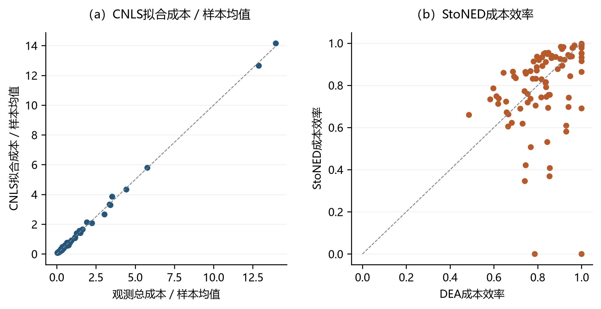

# 随机非参数数据包络分析 {#sec-10}

在效率分析领域，尽管尚未形成统一的理论框架，数据包络分析（DEA）和随机前沿分析（SFA）已发展为两种具有互补特征的主流方法，二者在处理效率评估问题时呈现出不同的技术路径，方法的选择通常取决于研究数据的特征与具体问题的需求。

数据包络分析（DEA, Farrell 1957; Charnes et al. 1978）是一种基于公理、采用数学规划的效率分析方法。与计量经济学中基于回归的工具相比，DEA的主要优势在于对前沿的非参数化处理：它建立在生产理论的公理之上，主要包括自由可处置性（单调性）与凸性，而不假定边界或无效率分布的任何特定函数形式。规模报酬不变（CRS）并非必有公理，实践中可在不变、可变（VRS）等设定之间选择。这种直接的、以数据为导向的方法也有助于将效率分析的结果传达给决策者。然而，DEA的主要缺点在于它把所有偏离前沿的情况都归结为无效率，这往往是一个非常强的假设。

SFA（Aigner, Lovell and Schmidt, 1977）的主要优势在于其对偏离前沿部分的概率建模：这些偏离被分解为一个非负的无效率项和一个随机扰动项 $v_i$，后者用以吸收企业及经营环境的不可观测异质性、测量误差、设定误差等噪声来源。与DEA相比，SFA采用参数化的回归技术，需要事先对前沿的函数形式和无效率分布进行规范。由于经济理论很少证明一个特定的函数形式是合理的，实践中常使用灵活的函数形式，如translog（超对数函数）。然而，灵活的函数形式往往违反生产理论的公理，而施加这些公理则会降低灵活性。

鉴于两类方法论之间的界限与区别，Kuosmanen（2008）提出的凸非参数最小二乘法（Convex Nonparametric Least Squares, CNLS）开创了新的研究路径。CNLS通过二次规划估计满足单调性与凹性约束的非参数生产前沿（对应生产可能性集的凸性），误差项为均值为零的噪声 $v_i$，从而在不预设函数形式的前提下继承了DEA的公理化建模。Kuosmanen and Johnson（2010）进一步表明，对残差施加符号约束后，CNLS与DEA等价（corrected convex nonparametric least squares, C²NLS）。在此基础上，Kuosmanen and Kortelainen（2012）将偏离前沿的部分分解为非负无效率 $u_i$ 与噪声 $v_i$，形成随机非参数数据包络（Stochastic Nonparametric Envelopment of Data, StoNED）。该框架把生产技术的非参数估计与复合误差的统计分解结合起来，为效率分析提供了更为严谨的计量经济学基础。

## 单产出模型设定 {#sec-10-1}

本节首先考察多投入、单产出的情形，并与SFA模型进行比较，以便理解二者的差异。多投入、多产出以及多投入、多产出且有非期望产出的情形均为单产出模型的扩展，将在本节之后讨论。

假设生产技术由前沿生产函数$f(\boldsymbol{x})$表示，其中$\boldsymbol{x}$是一个m维的投入向量。前沿$f(\boldsymbol{x})$表示用投入$\boldsymbol{x}$可以生产的最大产出，因此，函数$f(\boldsymbol{x})$表征了生产可能性集的边界。假设函数$f(\boldsymbol{x})$属于连续的、单调递增的、全局凹的函数类，且可以是不可微的（将此类记为$F_2$），这等价于生产可能性集满足自由可处置性和凸性的经典DEA假设。与SFA不同的是，这里没有假定$f(\boldsymbol{x})$的具体函数形式。

由于无效率和噪声的影响，决策单元（decision making unit, DMU）$_i$ 的观测产出 $y_i$ 可能与 $f(\boldsymbol{x_i})$ 不同。遵循SFA文献，引入一个综合误差项 $\varepsilon_{i}=v_i-u_i$，它由非效率项$u_i$ 和随机噪声项$v_i$组成，形式为
$$
y_{i}=f(\boldsymbol{x_i}) +{\varepsilon_{i}}\\
 =f(\boldsymbol{x_i}) +v_i-u_i, \quad i=1, \ldots, n
$$ {#eq-10-1}

式中，变量 $u_i$ 和 $v_i$ 是随机变量，假定二者相互独立，且都与投入 $\boldsymbol{x}$ 无关。另外，假定 $E\left(u_{i}\right)=\mu>0$，$Var\left(u_{i}\right)=\sigma^2_u<\infty$，且$E\left(v_{i}\right)=0$，$Var\left(v_{i}\right)=\sigma^2_v<\infty$。假设$\sigma^2_u$和$\sigma^2_v$在不同DMU间是恒定的，这被称为同方差性；具有异方差性的非效率和噪声模型需要对$u_i$和$v_i$的分布进一步施加假设，这里不做讨论，可见 Kuosmanen(2008) 的进一步讨论。在这个模型中，没有对 $f(\boldsymbol{x_i})$ 的具体函数形式施加限制，这与DEA文献的方法相同；同时，假设综合误差项 $\varepsilon_{i}$ 由非效率项 $u_i$ 和随机噪声项$v_i$组成，这与SFA文献的方法相同。因此，这个模型结合了DEA和SFA方法的优点。然而，与DEA模型相比，这个模型对非效率项 $u_i$ 的分布施加了假设；与SFA模型相比，对 $u_i$ 和 $v_i$ 的分布的假设可能无法进一步精细化。

除了假设综合误差项 $\varepsilon_{i}=v_i-u_i$ 外，可以施加一个替代性的假设：$\varepsilon_{i}=-u_i$，从而与DEA模型的假设保持相似。需要注意的是，这里的非效率项$u_i$不是最终需要的非效率，非效率的计算方法为$u_i$除以前沿（$y_i+u_i$）。此外，还可以施加另一种替代性假设：$\varepsilon_{i}=v_i$，从而与凸非参数最小二乘法的假设相同。下面逐一介绍这些模型。


### 凸非参数最小二乘法 {#sec-10-1-1}

当把模型（[-@eq-10-1]）中综合误差项 $\varepsilon_{i}=v_i-u_i$ 的假设替换为综合误差项 $\varepsilon_{i}=v_i$ 时，便可得到凸非参数最小二乘的模型，即：
$$
y_{i}=f(\boldsymbol{x_i}) +{\varepsilon_{i}}
 =f(\boldsymbol{x_i}) +v_i, \quad i=1, \ldots, n
$$
其中，变量$v_i$是随机变量，假定$v_i$与投入$\boldsymbol{x}$无关， $E\left(v_{i}\right)=0$，$Var\left(v_{i}\right)=\sigma^2_v<\infty$，且$\sigma^2_v$在不同DMU间是恒定的。此时，$E(y_{i}|X)=f(\boldsymbol{x_i}) +E(v_i|X)=f(\boldsymbol{x_i}) +0$。在满足这种假设的条件下，凸非参数最小二乘法估计量是以下广义回归问题的解：
$$
\min _{f \in F_2}  \sum_{i=1}^{n}\left(y_{i}-f\left(\mathbf{x}_{i}\right)\right)^{2},
$$ {#eq-10-2}
其中，$F_2$ 代表满足单调性与凹性的函数类。模型（[-@eq-10-2]）是一个关于函数的优化问题，可以等效地写成一个有限维的凹二次优化问题，其中变量是函数值和每个点$\boldsymbol{x_1},...,\boldsymbol{x_n}$的子梯度(Boyd and Vandenberghe, 2004; Kuosmanen, 2008)。作为约束条件的一部分，需施加凹性条件；也就是说，凹函数的图像位于其任一切平面之下。更确切地说，给定任何一点$\boldsymbol{x_i}$，$f$在$\boldsymbol{x_i}$处的值小于或等于在任何一点处估计的切平面在$\boldsymbol{x_i}$上的取值（在$\boldsymbol{x_i}$自身的切平面处二者相等）。显然，任何凹函数在每一点都有一个非空的子梯度，因而这种切平面的存在是有保证的。对于这个问题，在有限样本下，对所有 $n(n-1)$ 对观测点 $\boldsymbol{x}_i, \boldsymbol{x}_j \, (1 \leq i,j \leq n, \, i \neq j)$ 施加凹性约束条件：$f(\boldsymbol{x}_j) \leq f(\boldsymbol{x}_i) + \nabla f(\boldsymbol{x}_i)^\top (\boldsymbol{x}_j - \boldsymbol{x}_i)$，即可保证函数$f$在整个定义域上的全局凹性。这是因为凹函数在任意两点间的线性插值均不高于其实际值，而样本外点的性质可通过插值/外推自动满足（无需显式约束）。由此形成带有变量${\alpha}, \boldsymbol{\beta}, {\varepsilon}$的二次优化问题如下：

$$
\begin{array}{ll}
\min _{{\alpha}, \boldsymbol{\beta}, {\varepsilon}} \sum_{i=1}^{n}\left({\varepsilon_i^{CNLS}}\right)^{2} \\
\text {s.t. } \\
{y}_{i}=\alpha_{i}+\mathbf{x}_{\boldsymbol{i}}' \boldsymbol{\beta}_{i}+{\varepsilon_i^{CNLS}} &\forall i=1, \ldots, n \\
\alpha_{i}+\mathbf{x}_{\boldsymbol{i}}' \boldsymbol{\beta}_{i} \leq \alpha_{h}+\mathbf{x}_{\boldsymbol{i}}' \boldsymbol{\beta}_{h} &\forall h, i=1, \ldots, n \\
\boldsymbol{\beta}_{i} \geq \mathbf{0} & \forall i=1, \ldots, n
\end{array}
$$ {#eq-10-3}

其中，变量$\alpha_{i}+\mathbf{x}_{\boldsymbol{i}}' \boldsymbol{\beta}_{i}$代表$f(\boldsymbol{x_i})$的切平面，$\boldsymbol{\beta}_{i}$属于凹函数$f$在每个$\boldsymbol{x_i}$处的超梯度，也就是边际产量。这个问题的解$\hat\alpha+\mathbf{x}' \hat {\boldsymbol{\beta}}$被称为凸非参数最小二乘法估计量(CNLS)。注意，通过设置$\alpha_i=\alpha,\boldsymbol{\beta}_{i}=\boldsymbol{\beta} \forall i$和$f(\boldsymbol{x_i})=\alpha+\mathbf{x}_{\boldsymbol{i}}' \boldsymbol{\beta}$可恢复普通最小二乘线性回归问题。也就是说，CNLS估计量估计了n条不同的回归线，其截距和斜率系数因DMU而异，而不是像OLS那样只拟合一条回归线。模型的第一个约束施加了产出观测值与超平面之间的关系；第二个约束通过应用 Afriat 不等式系统（Afriat, 1972）施加凹性约束；第三个约束施加单调性约束。

可以证明，在满足上述假设时，$\hat f^{CNLS}(\boldsymbol{x_i})$是$f(\boldsymbol{x_i})$的一致估计。特别是，$E\left(v_{i}\right)=0$的假设对一致性至关重要，当违反这个假设时，CNLS估计量将不是一致的估计。需注意，带 Afriat 不等式的凹非参数最小二乘是**受约束**的估计量：凹性和单调性约束在有限样本中一般会使拟合值产生偏差，因此 CNLS 只有一致性，没有 OLS 那样的有限样本无偏性。

另外，$\hat f^{CNLS}(\boldsymbol{x_i})$在样本内观察值$(\boldsymbol{x_i},y_i)$上是$f(\boldsymbol{x_i})$的唯一估计。虽然CNLS估计量对于样本内观察值是唯一的，但没有唯一的方法将其外推到样本外观察值。CNLS外推的不唯一性导致样本外预测结果波动（类似过拟合中高方差模型对噪声敏感），因模型对样本内结构过度适配而缺乏稳健性。为了使CNLS估计量适用于样本外观察值，Bertsimas and Mundru(2021)建议使用正则化，即加入$\boldsymbol{\beta}_{i}$的二范数，得到的需要求解的问题如下（其中 $\rho>0$ 为正则化参数）：
$$
\begin{array}{ll}
\min _{{\alpha}, \boldsymbol{\beta}, {\varepsilon}} \sum_{i=1}^{n}\left({\varepsilon_i^{CNLS}}\right)^{2} +{\rho} \sum_{i=1}^{n}\left\|\boldsymbol{\beta}_{i}\right\|^{2} \\
\text {s.t. } \\
{y}_{i}=\alpha_{i}+\mathbf{x}_{\boldsymbol{i}}' \boldsymbol{\beta}_{i}+{\varepsilon_i^{CNLS}} &\forall i=1, \ldots, n \\
\alpha_{i}+\mathbf{x}_{\boldsymbol{i}}' \boldsymbol{\beta}_{i} \leq \alpha_{h}+\mathbf{x}_{\boldsymbol{i}}' \boldsymbol{\beta}_{h} &\forall h, i=1, \ldots, n \\
\boldsymbol{\beta}_{i} \geq \mathbf{0} & \forall i=1, \ldots, n
\end{array}
$$ {#eq-10-4}

另一方面，Kuosmanen and Kortelainen(2012)呼吁使用最小外推原则，并建议使用下限值：
$$
\hat f_{min}^{CNLS}(\boldsymbol{x})=\min_{\alpha,\boldsymbol{\beta}} \{\alpha+\boldsymbol{\beta}'\mathbf{x}\;|\;\alpha+\boldsymbol{\beta}'\mathbf{x_i}\geq\hat f^{CNLS}(\mathbf{x_i}), \forall i=1,...,n\}
$$ {#eq-10-5}

### 确定性前沿 {#sec-10-1-2}

在这一节中，考虑模型（[-@eq-10-1]）的另一种特殊情况，即综合误差项$\varepsilon_{i}=v_i-u_i$的假设替换为综合误差项$\varepsilon_{i}=-u_i$时，便可得到确定性模型。确定性模型假设投入产出数据无测量误差（即 $v_i=0$），唯一的随机性在于观测样本是从生产可能性集中抽样得到的。因此，DEA 的 bootstrap 置信区间不能直接与其他真正具有随机性的模型的置信区间（如 SFA 置信区间）进行比较。如果确定性模型的无噪声假设$(v_i=0)$不成立，DEA 的统计推断基础将不再成立；即便是面向小样本修正的 bootstrap 方法，也无法解决噪声带来的问题。

在单一产出的情况下，第$o$个DMU的生产函数$f_i$的规模报酬可变（VRS）DEA估计值可以被表述为：
$$
\max _{\theta_{o}, \lambda}\left\{\theta_{o} \mid \begin{array}{ll}
\sum_{i=1}^{n} \lambda_{i} y_{i} \geq \theta_{o}y_{o} & \\
\sum_{i=1}^{n}\lambda_{i} x_{i m} \leq x_{o m} & \forall m=1, \ldots, M \\
\sum_{i=1}^{n}\lambda_{i}=1 & \\
\lambda_{i}\geq 0 & \forall i=1, \ldots, n
\end{array}\right\}
$$ {#eq-10-6}
乘法模式可以转换为加法模式：


$$
\max _{\phi_{o}, \lambda, \mu}\left\{\phi_{o} \mid \begin{array}{ll}
\sum_{i=1}^{n} \lambda_{i} y_{i} \geq y_{o}+\phi_{o} & \\
\sum_{i=1}^{n}\lambda_{i}x_{i m} \leq x_{o m} & \forall m=1, \ldots, M \\
\sum_{i=1}^{n}\lambda_{i}=1 & \\
\lambda_{i} \geq 0 & \forall i=1, \ldots, n
\end{array}\right\}
$$

其中 $\theta_{o}=1+\frac{\phi_{o}}{y_{o}}$。

上述线性规划问题的对偶为：
$$
\min _{\alpha, \bold{\beta}}\left\{\alpha+\boldsymbol{x'_o\beta}-y_o \mid \begin{array}{ll}
\alpha+\boldsymbol{x'_i\beta} \geq y_i  &  \forall i=1,\ldots,n \\
\bold{\beta} \geq0
\end{array}\right\}
$$

引入一个新变量${\varepsilon_o}=y_o-(\alpha+\boldsymbol{x'_o\beta})$，并添加这个新约束，上述线性规划问题可以被写为：

$$
\min _{\alpha, \bold{\beta} ,\varepsilon}\left\{-\varepsilon_o \mid \begin{array}{ll}
{\varepsilon_o}=y_o-(\alpha+\boldsymbol{x'_o\beta}) \\
\alpha+\boldsymbol{x'_i\beta} \geq y_i  &  \forall i=1,\ldots,n \\
\bold{\beta} \geq0
\end{array}\right\}
$$
DEA问题是对每一个DMU分别求解上述线性规划问题，使用新的线性规划问题可同时求解所有DMU的线性规划问题：
$$
\min _{\alpha_i, \bold{\beta_i} ,\varepsilon_i}\left\{-\sum_{i=1}^{n} \varepsilon_i \mid \begin{array}{ll}
{\varepsilon_i}=y_i-(\alpha_i+\boldsymbol{x'_i\beta_i}) &  \forall i=1,\ldots,n  \\
\alpha_h+\boldsymbol{x'_i\beta_h} \geq y_i  &  \forall i,h=1,\ldots,n \\
\bold{\beta_i} \geq0 &  \forall i=1,\ldots,n
\end{array}\right\}
$$

通过构造，可知$\varepsilon_i \leq 0$。另外，由于单调性，上述线性规划问题为：

$$
\min _{\alpha_i, \bold{\beta_i} ,\varepsilon_i}\left\{-\sum_{i=1}^{n} \varepsilon_i \mid 
\begin{array}{ll}
{\varepsilon_i}=y_i-(\alpha_i+\boldsymbol{x'_i\beta_i}) &  \forall i=1,\ldots,n  \\
\alpha_h+\boldsymbol{x'_i\beta_h} \geq \alpha_i+\boldsymbol{x'_i\beta_i}   &  \forall i,h=1,\ldots,n \\
\bold{\beta_i} \geq0,  \varepsilon_i\leq0 &  \forall i=1,\ldots,n
\end{array}\right\}
$$ {#eq-10-7}
这是模型（[-@eq-10-3]）的限制符号的版本。因此，得到的结论是：限制符号版本的CNLS估计量等同于DEA VRS估计量。另外，可以将其他规模报酬假定的DEA估计量与限制符号版本的CNLS估计量等价：若假定DEA的规模报酬不变（CRS），则可以设定${\alpha_i} =0$；若假定DEA的规模报酬非递增（NIRS），则可以设定${\alpha_i} \geq0$；若假定DEA的规模报酬非递减（NDRS），则可以设定${\alpha_i} \leq 0$。在这一单产出、不含非期望产出的设定中，截距 $\alpha_i$ 的符号约束是规模报酬的**唯一**载体，与减排因子无关；`deabook` 中 `RTS_VRS1` 与 `RTS_VRS2` 的区别只出现在含非期望产出的弱可处置技术里（见 [-@sec-10-3] 节式 ([-@eq-10-44]) 处的说明）。另外，这种方法与Aigner and Chu(1968)的参数化规划 (PP) 模型的非参数化扩展类似。

在参数模型中，除了限制综合误差项的符号，还可以通过修正的OLS（COLS）来估计非效率。COLS 是一个两阶段的过程：在第一阶段，前沿通过普通最小二乘法 (OLS) 回归估计；在第二阶段，前沿向上移动，使得产生的 COLS 前沿包含所有数据。普通最小二乘 (OLS) 对误差项没有限制，OLS 残差既有正值也有负值。OLS 残差记为$\varepsilon_i^{OLS}$。 在 COLS 模型中，这些误差被归因于效率低下；因此误差估计量被调整为
$$
\begin{array}{ll}
{\hat\varepsilon_i^{COLS}}={\varepsilon_i^{OLS}}- \underset{i}{max}{\varepsilon_i^{OLS}} &  \forall i=1,\ldots,n 
\end{array}
$$ {#eq-10-8}
其中，${\hat\varepsilon_i^{COLS}}$的值范围为$[-\infty,0]$，0 表示位于最优前沿，即完全有效。 类似地，将截距项调整为
$$
\begin{array}{l}
{\hat\alpha^{COLS}}={\alpha^{OLS}} + \underset{i}{max}{\varepsilon_i^{OLS}}
\end{array}
$$ {#eq-10-9}
斜率系数${\hat\beta_i^{COLS}}$直接从OLS估计中获得，因为${\hat\beta_i^{COLS}}={\hat\beta_i^{OLS}}$。

因CNLS是OLS的非参数扩展，可以将COLS中的第一步OLS估计替换为CNLS估计，并同样将COLS的第二步用于估计非效率。Kuosmanen and Johnson(2010) 将这种方法称为$C^2 NLS$，完整的估计步骤如下：

**第一步**：通过求解式 ([-@eq-10-3]) 的 CNLS 估计量来估计$E(y_i|\boldsymbol{x_i)}$，将得到的残差记为${\hat\varepsilon_i^{CNLS}}$。 注意，这里的$E(\varepsilon_{i}|\boldsymbol{x})=-\mu \neq 0$，所以，这里估计的是$h=f-\mu$。

**第二步**：类似于 COLS 过程移动残差，$C^2NLS$效率估计量是
$$
\begin{array}{ll}
{\hat\varepsilon_i^{C^2NLS}}={\varepsilon_i^{CNLS}}- \underset{i}{max}{\varepsilon_i^{CNLS}} &  \forall i=1,\ldots,n 
\end{array}
$$ {#eq-10-10}
其中，${\hat\varepsilon_i^{C^2NLS}}$的值范围为$[-\infty,0]$， 0 表示位于最优前沿，即完全有效。 虽然已经说明CNLS 估计量在观察点$\boldsymbol{x_i},\forall i=1,\ldots,n$上是唯一的，但在未观察的$\boldsymbol{x}$ 上不是。因此，可以使用公式（[-@eq-10-5]）中的方法来得到$h=f-\mu$的下限$\hat h_{min}^{CNLS}(\boldsymbol{x})$：
$$
\hat h_{min}^{CNLS}(\boldsymbol{x})=\min_{\alpha,\boldsymbol{\beta}} \{\alpha+\boldsymbol{\beta}'\mathbf{x}\;|\;\alpha+\boldsymbol{\beta}'\mathbf{x_i}\geq\hat h^{CNLS}(\mathbf{x_i}), \forall i=1,...,n\}
$$
类似地，将$C^2NLS$的截距项调整为
$$
\begin{array}{ll}
{\hat\alpha_i^{C^2NLS}}={\alpha_i^{CNLS}} + \underset{i}{max}{\varepsilon_i^{CNLS}} &  \forall i=1,\ldots,n
\end{array}
$$ {#eq-10-11}
$C^2NLS$的斜率系数${\hat\beta_i^{C^2NLS}}$直接从CNLS估计中获得，因为${\hat\beta_i^{C^2NLS}}={\hat\beta_i^{CNLS}}$。 $C^2NLS$估计的前沿为：
$$
\begin{array}{ll}
{\hat f^{C^2NLS}(\boldsymbol{x}_i)}={\hat\alpha_i^{C^2NLS}}+\boldsymbol{x_i'}{\hat{\boldsymbol{\beta}}_i^{C^2NLS}} &  \forall i=1,\ldots,n
\end{array}
$$ {#eq-10-12}
Kuosmanen and Johnson(2010)证明了 $C^2NLS$估计量的一致性，即前沿估计量 $\hat h^{C^2NLS}(\cdot)$ 在样本点上一致收敛到 $h(\cdot)=f(\cdot)-\mu$。值得说明的是，$C^2NLS$的一致性要求所有 DMU 的非效率项都来自相同的分布（同方差）。如果违反 i.i.d.假设（例如，不同DMU的非效率具有不同分布），则无法保证$C^2NLS$的一致性。

### 随机非参数(StoNED)模型 {#sec-10-1-3}

现在，可以使用模型（[-@eq-10-1]）中综合误差项$\varepsilon_{i}=v_i-u_i$来进行分析，这样的模型是随机非参数模型，Kuosmanen and Kortelainen(2012)提出一种StoNED方法来估计这个问题。可以发现，$E(y_i|\boldsymbol{x})=f(\boldsymbol{x})+E(\varepsilon_{i}|\boldsymbol{x})=f(\boldsymbol{x})+(E(v_{i}|\boldsymbol{x})-E(u_i|\boldsymbol{x}))=f(\boldsymbol{x})+(-\mu)$，其中$E(\varepsilon_{i}|\boldsymbol{x})=-\mu$，所以，对前沿$f$的估计将不是一致的。为此，可以将综合误差项的条件期望中的非0项与前沿$f$合并估计，这样得到的新的误差项的条件期望就为0，即估计：
$$
\begin{array}{l}
y_{i}=f(\boldsymbol{x_i}) +v_i-u_i,  \\
=(f(\boldsymbol{x_i}) -\mu)+ (\mu+v_i-u_i)  \\
=g(\boldsymbol{x_i})+ (\mu+v_i-u_i)
\quad i=1, \ldots, n
\end{array}
$$ {#eq-10-13}
此时，$E(y_i|\boldsymbol{x})=g(\boldsymbol{x})+E(\mu+v_i-u_i|\boldsymbol{x})=g(\boldsymbol{x})+0$，其中$E(\mu+v_i-u_i|\boldsymbol{x})=\mu-E(u_i)=0$（因为 $E(v_i)=0$，且此处 $\mu\equiv E(u_i)$ 即非效率的无条件均值）。注意，这里分析的是同方差的情况；如果是异方差的情况，还需要对综合误差项各成分的分布施加进一步假设。

在同方差的条件下，可以将StoNED方法的第一步设定为：使用CNLS估计量对模型（[-@eq-10-13]）进行估计，得到$g(\boldsymbol{x})=f(\boldsymbol{x})-\mu$的一致估计。估计的方程和公式（[-@eq-10-3]）一致，但需要注意的是，这里使用CNLS估计量估计的残差为对$\mu+v_i-u_i$的估计。

进一步，只需得到$\mu$，就可以得到前沿$f$的一致估计。因此，第二步使用不同方法来估计非效率。下面介绍两类路径：（一）参数化路径——使用 Fan et al.(1996)提出、后经 Johnson and Kuosmanen(2015)系统整理的准似然估计（QLE），在 Stevenson 截断正态设定下估计 $(\mu_0,\sigma_u,\sigma_v)$ 进而得到 $\hat m_u$ 和企业特定条件非效率；（二）非参数路径——使用核密度估计（KDE）直接恢复 $\hat f_u$ 和 $\hat f_v$，通过数值积分计算条件非效率 $\hat u_i^{KDE}=E(u_i\mid e_i)$，绕过参数化的 $\mu$ 直接进入 JLMS 型条件期望。两种路径最终都产出企业特定条件非效率 $\hat u_i$，用于第三步的效率恢复。

**（一）准似然估计**准似然估计法需要额外的参数化分布假设。本章采用 Stevenson (1980)的截断正态—正态设定：噪声项服从正态分布，非效率项来自潜在正态分布并在 0 处左截断。形式上，

$$
\begin{aligned}
u_i &\sim N(\mu_0,\sigma_u^2)\ \text{truncated at }0,\\
v_i &\sim N(0,\sigma_v^2),
\end{aligned}
$$ {#eq-10-14}

其中 $\mu_0$ 是截断前潜在正态分布的均值，可以不等于 0；$u_i$ 的无条件均值不是 $\mu_0$，而是

$$
m_u=E(u_i)=\mu_0+\sigma_u\frac{\phi(\mu_0/\sigma_u)}{\Phi(\mu_0/\sigma_u)},
$$ {#eq-10-15}

这里 $\phi(\cdot)$ 和 $\Phi(\cdot)$ 分别为标准正态密度函数和分布函数。半正态设定只是 $\mu_0=0$ 的特例。需要特别指出，前文 [-@sec-10-1] 节中用于 $g=f-\mu$ 分解的非效率均值 $\mu$，在 Stevenson 截断正态设定下即为截断后均值 $m_u=E(u_i)$，它由潜在均值 $\mu_0$ 经 ([-@eq-10-15]) 决定，而非 $\mu_0$ 本身。

在生产型模型中，复合误差可写为 $\varepsilon_i=v_i-u_i$。CNLS 残差 $\hat\varepsilon_i^{CNLS}$ 是对 $m_u+v_i-u_i$（零均值）的估计；为进入截断正态—正态复合误差似然，需先将其转回原始复合误差尺度：

$$
e_i=\hat\varepsilon_i-m_u
$$ {#eq-10-16}

给定 $\sigma=(\sigma_u^2+\sigma_v^2)^{1/2}$，单个观测的对数似然可写为

$$
\ell_i=
-\ln\sigma
+\ln\phi\left(\frac{e_i+\mu_0}{\sigma}\right)
+\ln\Phi\left(\frac{\mu_0\sigma_v^2-e_i\sigma_u^2}{\sigma\sigma_u\sigma_v}\right)
-\ln\Phi\left(\frac{\mu_0}{\sigma_u}\right).
$$ {#eq-10-17}

通过最大化 $\sum_i\ell_i$ 可得到 $\hat\mu_0$、$\hat\sigma_u$ 和 $\hat\sigma_v$，并进一步计算 $\hat m_u=E(u_i)$。代码中保留 `mu_latent` 表示 $\hat\mu_0$，保留 `mu` 表示截断后均值 $\hat m_u$，以避免将潜在均值和非效率均值混用。

**（二）非参数核密度估计法**与准似然估计不同，非参数核密度估计法不施加 Stevenson 截断正态参数化假设。需要注意的是，仅凭复合误差 $e_i=v_i-u_i$ 本身并不能在没有额外识别约束时唯一分解出 $f_u$ 与 $f_v$。因此，`deabook` 的 `RED_KDE` 被定位为非参数稳健性路径：先按残差偏态构造非负单边非效率初始样本，在 $u\ge0$ 上用边界反射 KDE 估计 $\hat f_u(u)$，并由中心化噪声样本估计 $\hat f_v(v)$，再通过 Bayes 公式的数值积分计算企业特定条件非效率 $E(u_i\mid e_i)$。

具体地，先由 CNLS 残差构造非效率种子样本（取残差位于零均值右侧的部分并截断为非负）和噪声种子样本，再用高斯核分别估计 $\hat f_u(u)$ 和 $\hat f_v(v)$。在 $u_i\ge0$ 的约束下，条件非效率的核密度数值估计为

$$
\hat u_i^{KDE}=E(u_i\mid e_i)=\frac{\int_0^\infty u\,\hat f_v(e_i+u)\,\hat f_u(u)\,du}{\int_0^\infty \hat f_v(e_i+u)\,\hat f_u(u)\,du},
$$ {#eq-10-18}

其中 $e_i=r_i-\hat m_u$ 为中心化后的复合误差（与 ([-@eq-10-16]) 同形），$\hat f_v(e_i+u)$ 反映噪声把真实非效率 $u$ 平滑到观测误差 $e_i+u$ 处的概率权重。分子是带 $u$ 加权的积分（一阶矩），分母是归一化积分（零阶矩），二者之比即截断非效率的条件期望。

需要强调的是，KDE 路径**不再估计** Stevenson 截断正态的 $(\mu_0,\sigma_u,\sigma_v)$，而是基于单边残差初始化与 KDE 数值积分得到企业特定条件非效率 $\hat u_i^{KDE}$；它不返回 Stevenson 意义下的无条件均值 $\hat\mu$，也不应被解释为形式化盲反卷积估计。因此 KDE 结果应理解为非参数条件均值估计，而不是 Stevenson 参数估计的近似。这一路径与 Hall and Simar(2002) 提出的残差密度不连续点检测法在目标上相通（均不依赖参数分布假设），但实现上用数值条件期望替代了导数最大变化点定位。

接下来，便可以使用第一步得到的$g$的CNLS估计量和第二步得到的非效率的期望来计算前沿$f$。但是，如前所述，CNLS 估计量在观察点$\boldsymbol{x_i},\forall i=1,\ldots,n$上是唯一的，但在未观察的$\boldsymbol{x}$ 上不是。因此，Kuosmanen and Kortelainen(2012)建议应用$g$的下限（类似于公式（[-@eq-10-5]）），定义为
$$
\hat g_{min}^{CNLS}(\boldsymbol{x})=\min_{\alpha,\boldsymbol{\beta}} \{\alpha+\boldsymbol{\beta}'\mathbf{x}\;|\;\alpha+\boldsymbol{\beta}'\mathbf{x_i}\geq\hat g^{CNLS}(\mathbf{x_i}), \forall i=1,...,n\}
$$

随后，可以提出StoNED方法的第三步：在$g$的CNLS估计量中加入非效率的期望$\mu$来估计前沿$f$，使用：
$$
\hat f^{StoNED}(\boldsymbol{x})=\hat g_{min}^{CNLS}(\boldsymbol{x})+\hat\mu
$$
必须强调，即使第三步在统计上使用一致的方法来估计前沿的 $f$，企业特定非效率 $u_i$ 本身仍需要基于条件分布进一步估计。在 Stevenson 截断正态—正态设定下，`deabook` 先将 CNLS 残差写成零均值残差

$$
r_i=\hat\varepsilon_i^{CNLS}\approx v_i-u_i+m_u,
$$

再转回原始复合误差尺度

$$
e_i=r_i-\hat m_u\approx v_i-u_i.
$$

令

$$
\sigma_*^2=\frac{\sigma_u^2\sigma_v^2}{\sigma_u^2+\sigma_v^2},\qquad
\mu_{*i}=\frac{\mu_0\sigma_v^2-e_i\sigma_u^2}{\sigma_u^2+\sigma_v^2},
$$

其中 $e_i=\hat\varepsilon_i-\hat m_u$。则 $u_i\mid e_i$ 服从在 0 处截断的正态分布，其条件期望（JLMS 型非效率估计，即 Jondrow、Lovell、Materov 和 Schmidt (1982) 提出的条件期望法在截断正态下的推广，参见 Kumbhakar 和 Lovell (2000)）为

$$
\hat u_i=E(u_i\mid e_i)
=\mu_{*i}+\sigma_*\frac{\phi(\mu_{*i}/\sigma_*)}{\Phi(\mu_{*i}/\sigma_*)}.
$$

得到企业特定非效率 $\hat u_i=E\left(u_i \mid e_i\right)$ 后，便可以恢复效率值。对于普通产出型加性模型，效率可理解为实际产出与条件前沿产出的比值：
$$
TE_i=\frac{y_i}{y_i+\hat u_i}.
$$

对于乘法误差或 Shephard 型距离函数，条件无效率进入对数尺度，`deabook` 使用指数转换恢复径向效率：

$$
TE_i=\exp(-\hat u_i).
$$

对于 DDF 模型，$\hat u_i$ 在归一化方向距离尺度（如 CO2 量级）上取值，直接取指数会导致数值趋近于 0。因此 DDF 模型先用真实变量归一化：对非期望产出方向 $g^b$，$TE_i=(b_i-\hat u_i)/b_i$；对期望产出方向 $g^y$，$TE_i=y_i/(y_i+\hat u_i\cdot g^y)$；对投入方向 $g^x$，$TE_i=(x_i-\hat u_i\cdot g^x)/x_i$。多方向同时存在时取绑定（最小）分量比率。所有 TE 经 clip 后满足 $0\le TE_i\le 1$。

因此，StoNED 的“恢复效率”分成两步：第一步由 JLMS 条件期望（式 ([-@eq-10-35])/([-@eq-10-46])）从复合误差中分离出条件非效率 $\hat u_i=E(u_i\mid e_i)$；第二步按距离函数类型把 $\hat u_i$ 转换成效率——Shephard 乘法模型取 $TE_i=\exp(-\hat u_i)$（式 ([-@eq-10-36])），DDF 加性模型取式 ([-@eq-10-36]) 后续的方向归一化比率。两步的输出即为技术非效率 $\hat u_i$ 与技术效率 $TE_i$。


Kuosmanen and Kortelainen(2012)提出，StoNED模型也可以通过对不限制符号的CNLS中改变${\alpha_i}$的限制条件来获得（CRS、NIRS、NDRS设定方式与第[-@sec-10-1-2]节相同，详见 [-@sec-10-1-2] 节末说明）。

### 乘法模型 {#sec-10-1-4}

虽然 CNLS 回归很容易适应替代 RTS 假设，但对效率估计的影响有些棘手。具体而言，如果估计受 CRS 约束的平均实践技术 g，再将前沿向上平移预期无效率的估计值 $\hat\mu$，则所得最佳实践前沿通常不满足 CRS。这是由于 ([-@eq-10-1]) 中假设的非效率与噪声项的加性结构与规模属性的乘法性质不匹配。如果施加 CRS、NIRS 或 NDRS 假设，则采用非效率与噪声的乘法设定在逻辑上是一致的，接下来将讨论。

可以将模型 ([-@eq-10-1]) 改写为：
$$
y_{i}=f\left(\mathbf{x}_{i}\right) \cdot \exp \left(\varepsilon_{i}\right)=f\left(\mathbf{x}_{i}\right) \cdot \exp \left(v_{i}-u_{i}\right)
$$ {#eq-10-19}
如上所述，CRS 假设需要乘法误差结构。 此外，乘法误差规范可能有助于缓解不同尺度大小的异方差性（参见 Caudill and Ford (1993)）。

对生产函数 f 和复合误差项保持与模型 ([-@eq-10-1]) 中相同的假设。 对等式 （[-@eq-10-19]）应用对数变换，得到
$$
\ln y_{i}=\ln f\left(\mathbf{x}_{i}\right)+\varepsilon_{i} .
$$ {#eq-10-20}
仍然要求CNLS估计量估计的误差项的期望为0。因此，将公式（[-@eq-10-20]）改写为
$$
\ln y_{i}=(\ln f\left(\mathbf{x}_{i}\right)-\mu)+(\varepsilon_{i}+\mu) 
=\ln g(\mathbf{x}_{i})+(\varepsilon_{i}+\mu)
$$ {#eq-10-21}
其中$\mu$是预期的低效率，为了通过 CNLS 估计$\ln g$，可以将（[-@eq-10-3]）改写为如下非线性规划（NLP）问题（因 $\ln(\phi_i+1)$ 关于变量 $\phi_i$ 非线性，需采用非线性求解器，如 Knitro）：
$$
\begin{array}{l}
\min _{\boldsymbol{\alpha}, \boldsymbol{\beta}, \phi, \varepsilon} \sum_{i=1}^{n}\left(\varepsilon_{i}^{C N L S}\right)^{2} \\
\text {s.t. } \\
\ln y_{i}=\ln \left(\phi_{i}+1\right)+\varepsilon_{i}^{C N L S} \forall i \\
\phi_{i}+1=\alpha_{i}+\boldsymbol{\beta}_{i}^{\prime} \mathbf{x}_{i} \forall i \\
\alpha_{i}+\boldsymbol{\beta}_{i}^{\prime} \mathbf{x}_{i} \leq \alpha_{h}+\boldsymbol{\beta}_{h}^{\prime} \mathbf{x}_{i} \forall h, i \\
\boldsymbol{\beta}_{i} \geq \mathbf{0} \forall i
\end{array}
$$ {#eq-10-22}
其中$\phi_{i}+1$是$\ln g(\mathbf{x}_{i})$ 取指数后的 CNLS 估计量（近似 $g(\mathbf{x}_{i})$；对 $\exp(\cdot)$ 变换应用 Jensen 不等式可知严格地 $E(y_i|\mathbf{x}_i)=E(f\cdot e^{\varepsilon_i})\ne g(\mathbf{x}_i)\cdot e^{E(\varepsilon_i)}$）。这里加上1的值是为了确保计算算法不会试图取零的对数。第一个等式可以解释为对数转换的回归方程（使用自然对数函数$ln(.)$）。第二至第五个约束条件与([-@eq-10-3])相似，但([-@eq-10-3])中观察到的产出被替换为$\phi_{i}+1$。使用$\phi_{i}$可以估计产出和投入之间的乘法关系，同时保证原始投入产出空间中生产可能性集的凸性。

在乘法模型下，可以应用CNLS估计量作为第[-@sec-10-1-3]节描述的StoNED估计程序的第一步。接着使用第[-@sec-10-1-3]节描述的StoNED估计程序的第二步估计非效率的均值$\mu$。在进行第三步之前，仍然使用最小外推方法，估计$g$的下限：
$$
\hat g_{min}^{CNLS}(\boldsymbol{x})=\min_{\alpha,\boldsymbol{\beta}} \{\alpha+\boldsymbol{\beta}'\mathbf{x}\;|\;\alpha+\boldsymbol{\beta}'\mathbf{x_i}\geq\hat g^{CNLS}(\mathbf{x_i}), \forall i=1,...,n\}
$$
第三步，鉴于 $(\ln f\left(\mathbf{x}_{i}\right)-\mu) =\ln g(\mathbf{x}_{i})$ ，等价于$f\left(\mathbf{x}_{i}\right) / exp(\mu) = g(\mathbf{x}_{i})$，使用$\hat{f}^{S t o N E D}\left(\mathbf{x}_{i}\right) =\hat{g}_{\min }^{C N L S}(\mathbf{x}) \cdot \exp (\hat{\mu})$作为前沿$f$的估计量。

### 背景变量 {#sec-10-1-5}

以乘法模型为起点，引入背景变量（contextual variable）。用r维向量$\mathbf{z}_{i}$表示背景变量的观测值，假设综合误差项为$\varepsilon_{i}=v_{i}-u_{i}+ \mathbf{z}_i^{\prime}\boldsymbol{\eta}$，从而得到以下半非参数化的偏对数线性方程（此处用 $\boldsymbol{\eta}$ 表示背景变量系数，以避免与 [-@sec-10-3] 节中用作非期望产出系数的 $\boldsymbol{\delta}$ 混淆）：
$$
\ln y_{i}=\ln f\left(\mathbf{x}_{i}\right)+\boldsymbol{\eta}^{\prime} \mathbf{z}_{i}+v_{i}-u_{i}
$$ {#eq-10-23}
其中，$\boldsymbol{\eta}=(\eta_1,\ldots,\eta_r)'$是一个待估计的参数向量，表示背景变量$\mathbf{z}_{i}$对绩效的平均影响。还有其他的设置背景变量的方法，如将$\mathbf{z}$变量影响随机非效率项$u_{i}$的概率分布。需要指出的是，这两种设置具有非常大的差异。这里主要涉及公式（[-@eq-10-23]）中的设置方法。Johnson and Kuosmanen(2011)认为公式（[-@eq-10-23]）中的设置方法需要更少的假设条件。

背景变量$\mathbf{z}_{i}$可以直接纳入StoNED问题中的目标函数，公式（[-@eq-10-23]）可以使用与公式（[-@eq-10-3]）相似的方程求解：
$$
\begin{array}{l}
\min _{\boldsymbol{\alpha}, \boldsymbol{\beta}, \boldsymbol{\eta}, \phi, \boldsymbol{\varepsilon}} \sum_{i=1}^{n}\left(\varepsilon_{i}^{C N L S}\right)^{2} \\
\text {s.t. } \\
\ln y_{i}=\ln \left(\phi_{i}+1\right)+\boldsymbol{\eta}^{\prime} \mathbf{z}_{i}+\varepsilon_{i}^{C N L S} \forall i \\
\phi_{i}+1=\alpha_{i}+\boldsymbol{\beta}_{i}^{\prime} \mathbf{x}_{i} \forall i \\
\alpha_{i}+\boldsymbol{\beta}_{i}^{\prime} \mathbf{x}_{i} \leq \alpha_{h}+\boldsymbol{\beta}_{h}^{\prime} \mathbf{x}_{i} \forall h, i \\
\boldsymbol{\beta}_{i} \geq \mathbf{0} \forall i
\end{array}
$$ {#eq-10-24}
其中，$\hat{\boldsymbol{\eta}}^{\text {StoNEZD }}$表示作为模型（[-@eq-10-23]）的最优解得到的背景变量的系数。Johnson and Kuosmanen(2011)详细研究了这个估计量的统计特性，显示了其 $\sqrt{n}$ 一致性、渐近正态性和渐近有效性（该文并未主张有限样本无偏性）。

### 凸非参数分位数回归 {#sec-10-1-6}

进一步定义凸非参数分位数回归模型，从而在数据内部分析投入的边际产出。

令$Y \mid \mathbf{x}$ 是给定投入水平 $\mathbf{x}$ 的随机产出$Y$，其条件分布为$F_{Y \mid \mathbf{x}}$，即：$F_{Y \mid \mathbf{x}}(y) \triangleq \operatorname{Prob}\{Y \leqslant y \mid \mathbf{x}\}$。那么，在投入水平$\mathbf{x}$的$\tau$-分位前沿被定义为：
$$
\varphi_{\tau}(\mathbf{x}) \triangleq \sup \left\{y \in \mathbb{R}_{+} \mid F_{Y \mid \mathbf{x}}(y) \leqslant  1-\tau\right\}
$$
如果$F_{Y \mid \mathbf{x}}$是连续且严格增加的，有$\varphi_{\tau}(\mathbf{x})=F_{Y \mid \mathbf{x}}^{-1}(1-\tau)$。$\tau$-分位前沿的经济含义很直观：对于任意给定的投入水平 $\mathbf{x}$，有效与非有效观测的占比分别为$1-\tau$和$\tau$。

Wang et al.(2014)通过类比线性分位数回归中关于目标函数的设定和凸非参数最小二乘中关于凸性和单调性假设的设定，定义了如下凸非参数分位数回归模型(CNQR)的求解方法：
$$
\begin{array}{l}
\min _{\alpha, \boldsymbol{\beta}, \varepsilon^{+}, \varepsilon^{-}} \tau \sum_{i=1}^{n} \varepsilon_{i}^{+}+(1-\tau) \sum_{i=1}^{n} \varepsilon_{i}^{-} \\
\text {s.t. } \\
y_{i}=\alpha_{i}+\boldsymbol{\beta}_{i}^{\prime} \mathbf{x}_{i}+\varepsilon_{i}^{+}-\varepsilon_{i}^{-} \forall i \\
\alpha_{i}+\boldsymbol{\beta}_{i}^{\prime} \mathbf{x}_{i} \leq \alpha_{h}+\boldsymbol{\beta}_{h}^{\prime} \mathbf{x}_{i} \forall h, i \\
\boldsymbol{\beta}_{i} \geq \mathbf{0} \forall i \\
\varepsilon_{i}^{+} \geq 0 \forall i \\
\varepsilon_{i}^{-} \geq 0 \forall i
\end{array}
$$ {#eq-10-25}
与CNLS相比，CNQR的一个主要的缺点是该问题的最优解不一定是唯一的，甚至对于观察到的数据点$\left(\mathbf{x}_{i}, y_{i}\right), i=1, \ldots, n$也是如此。Kuosmanen and Johnson(2017)建议使用以下的目标函数的二次方表述来求得唯一解：
$$
\begin{array}{l}
\min _{\alpha, \boldsymbol{\beta}, \varepsilon^{+}, \varepsilon^{-}} \tau \sum_{i=1}^{n} (\varepsilon_{i}^{+})^2+(1-\tau) \sum_{i=1}^{n} (\varepsilon_{i}^{-})^2 \\
\text {s.t. } \\
y_{i}=\alpha_{i}+\boldsymbol{\beta}_{i}^{\prime} \mathbf{x}_{i}+\varepsilon_{i}^{+}-\varepsilon_{i}^{-} \forall i \\
\alpha_{i}+\boldsymbol{\beta}_{i}^{\prime} \mathbf{x}_{i} \leq \alpha_{h}+\boldsymbol{\beta}_{h}^{\prime} \mathbf{x}_{i} \forall h, i \\
\boldsymbol{\beta}_{i} \geq \mathbf{0} \forall i \\
\varepsilon_{i}^{+} \geq 0 \forall i \\
\varepsilon_{i}^{-} \geq 0 \forall i
\end{array}
$$ {#eq-10-26}
对异方差的稳健性被普遍认为是分位数回归的主要优势之一（例如Koenker, 2005）。如果$\varepsilon_i$是同方差的，那么根据经验估计的分位数前沿的形状在不同的$\tau$下将是相似的。在这种情况下，估计一个单一的分位数指标或条件平均值就足以得到任何感兴趣的分位数指标。通过实证估计与不同绩效水平相关的多个分位数指标，可以有效地放松同方差假设，因为分位数前沿的形状可以在不同的$\tau$之间自由地变化。

## 多产出StoNED模型的设定 {#sec-10-2}

到目前为止，CNLS和StoNED框架一直是在单产出、多投入情形下展开的。在本节中，将在Chambers et al.(1996, 1998) 的方向距离函数（DDF）框架内描述CNLS估计量。CNLS 的表述从结构上满足了 DDF 的公理特性，对多投入和多产出进行建模，并明确说明了随机噪声，解决了 DEA 和参数化方法的关键限制。下面将简要介绍CNLS对DDF的估计。

考虑一种联合生产技术，将投入向量$\mathbf{x}=\left(x_{1} \ldots x_{m}\right)^{\prime} \in \Re_{+}^{m}$转换为期望产出$\mathbf{y}=\left(y_{1} \ldots y_{s}\right)^{\prime} \in \Re_{+}^{s}$ 。基准技术的特点是生产可能性集，定义为：
$$
T=\left\{(\mathbf{x}, \mathbf{y}) \in \mathfrak{R}_{+}^{m+s} \mid \mathbf{X} \text { 可以生产 }(\mathbf{y})\right\} .
$$ {#eq-10-27}
本章考虑的基准技术的经典公理包括自由可处置性（即 $T=T+\Re_{+}^{m} \times \Re_{-}^{s}$）和凸性（即 $T=\operatorname{Conv}(T)$）（见，例如，Färe and Primont, 1995）。

方向距离函数被用来表示多产出的生产函数。Chambers et al.(1996, 1998) 介绍的方向距离函数（DDF）定义为：
$$
\vec{D}\left(\mathbf{x}, \mathbf{y},  \mathbf{g}^{x}, \mathbf{g}^{y}\right)=\sup \left\{\theta \mid\left(\mathbf{x}-\theta \mathbf{g}^{x}, \mathbf{y}+\theta \mathbf{g}^{y}\right) \in T\right\}
$$ {#eq-10-28}
其中$\left(\mathbf{g}^{x}, \mathbf{g}^{y}\right) \in \Re_{+}^{m+s}$是一个方向向量。

DDF继承了生产可能性集的公理属性（见 Chambers, Chung and Färe, 1998, Lemma 2.2）。任何DDF必须满足的两个基本属性包括转换属性（即$\vec{D}\left(\mathbf{x}-\lambda \mathbf{g}^{x}, \mathbf{y}+\lambda \mathbf{g}^{y}, \mathbf{g}^{x}, \mathbf{g}^{y}\right)=\vec{D}\left(\mathbf{x}, \mathbf{y},  \mathbf{g}^{x}, \mathbf{g}^{y}\right)-\lambda$）和DDF对方向向量的-1度齐次性（即$\vec{D}\left(\mathbf{x}, \mathbf{y}, \lambda \mathbf{g}^{x}, \lambda \mathbf{g}^{y}\right)=   \left(1 / \lambda \right) \cdot \vec{D}\left(\mathbf{x}, \mathbf{y}, \mathbf{g}^{x}, \mathbf{g}^{y}\right), \lambda>0$）。这些属性对DDF的内部一致性至关重要，必须在DDF的经验估计中施加这些约束。

Kuosmanen and Johnson(2017)引入了一个DDF的概率模型，其中所有的投入和产出$(\mathbf{x}, \mathbf{y})$都受到综合误差项$\varepsilon_{i}$和位于生产前沿的投入产出$(\mathbf{x^*}, \mathbf{y^*})$的影响，其中综合误差项$\varepsilon_{i}=u_{i}+v_{i}$包含非负非效率项$u_{i}$和随机噪声项$v_{i}$，即（注意：此处 DDF 框架下 $\varepsilon_i=u_i+v_i$ 为非负值，与 [-@sec-10-1] 节单产出模型 $\varepsilon_i=v_i-u_i$ 的符号约定相反；后续 JLMS 公式与残差调整均按 $\varepsilon_i$ 取负、统一回到 $v_i-u_i$ 尺度处理）：
$$
\left(\mathbf{x}_{i}, \mathbf{y}_{i}\right)=\left(\mathbf{x}_{i}^{*}+\varepsilon_{i} {\mathbf{g}}_{i}^{x}, \mathbf{y}_{i}^{*}-\varepsilon_{i} {\mathbf{g}}_{i}^{y}\right) \forall i=1, \ldots, n,
$$
由于观察到的数据受到非效率和噪声的干扰，第i个DMU的DDF值是一个随机变量：
$$
\vec{D}_{T}\left(\mathbf{x}_{i}, \mathbf{y}_{i}, {\mathbf{g}}_{i}^{x}, {\mathbf{g}}_{i}^{y}\right)=\varepsilon_{i} \quad \forall i
$$ {#eq-10-29}
由于所有投入和产出都受到非效率和噪声的影响，因此，所有投入和产出都是内生变量，在进行估计时需要解决这一问题。可以利用DDF的转换属性，估计：
$$
\vec{D}_{T}\left(\overrightarrow{\mathbf{x}}_{i}, \overrightarrow{\mathbf{y}}_{i}, {\mathbf{g}}_{i}^{x}, {\mathbf{g}}_{i}^{y}\right)-\frac{y_{1i}}{g_1^y}=\varepsilon_{i}
$$ {#eq-10-30}
即：
$$
\frac{y_{1i}}{g_1^y} = \vec{D}_{T}\left(\overrightarrow{\mathbf{x}}_{i}, \overrightarrow{\mathbf{y}}_{i}, {\mathbf{g}}_{i}^{x}, {\mathbf{g}}_{i}^{y}\right)-\varepsilon_{i}  \\
 = \vec{D}_{T}\left(\overrightarrow{\mathbf{x}}_{i}, \overrightarrow{\mathbf{y}}_{i}, {\mathbf{g}}_{i}^{x}, {\mathbf{g}}_{i}^{y}\right)-(u_i+v_{i})
$$ {#eq-10-31}
其中，${\overrightarrow{\mathbf{x}}_i}=\mathbf{x_i}+\frac{y_{1i}}{g_1^y} \mathbf{g}^{x}$，${\overrightarrow{\mathbf{y}}_i}=\mathbf{y_i}-\frac{y_{1i}}{g_1^y} \mathbf{g}^{y}$。可以证明，此时，$\operatorname{Cov}\left({\overrightarrow{\mathbf{x}}_i}, \varepsilon_{i}\right)=0$，$\operatorname{Cov}\left({\overrightarrow{\mathbf{y}}_i}, \varepsilon_{i}\right)=0$。这里以 $y_{1i}/g_1^y$ 作平移基准，前提是 $g_1^y\neq0$；若方向向量在期望产出上全为零（例如只压缩投入），则须换用其他非零分量对应的变量作基准，一般形式见 [-@sec-10-3] 节 $t_i$ 的定义。

类比单产出的StoNED问题，可以在第一步中使用二次规划问题计算方向距离函数的超平面。需要注意的是$E(\varepsilon_{i})=E(u_i+v_i)=\mu \neq0$，所以，需要先估计：
$$
\frac{y_{1i}}{g_1^y}=(\vec{D}_{T}\left(\overrightarrow{\mathbf{x}}_{i}, \overrightarrow{\mathbf{y}}_{i}, {\mathbf{g}}_{i}^{x}, {\mathbf{g}}_{i}^{y}\right)-\mu)-(\varepsilon_{i}-\mu)  \\
=\vec{D}_{T2}\left(\overrightarrow{\mathbf{x}}_{i}, \overrightarrow{\mathbf{y}}_{i}, {\mathbf{g}}_{i}^{x}, {\mathbf{g}}_{i}^{y}\right) -(\varepsilon_{i}-\mu )\quad\forall i       \\
=\vec{D}_{T2}\left(\overrightarrow{\mathbf{x}}_{i}, \overrightarrow{\mathbf{y}}_{i}, {\mathbf{g}}_{i}^{x}, {\mathbf{g}}_{i}^{y}\right) + \varepsilon_i ^{CNLS} \quad\forall i
$$ {#eq-10-32}
可以发现上式与单产出的StoNED模型（[-@eq-10-13]）一致，因此，可以按照同样的方法计算超平面、无条件非效率$\mu$和条件非效率$E(u_i|\varepsilon_i)$。

$\vec{D}_{T2}$的估计值$\hat{\vec{D}}_{T2}$的计算方法如下：
$$
\begin{array}{ll}
\min _{\boldsymbol{\alpha}, \boldsymbol{\beta}, \boldsymbol{\gamma},  \boldsymbol{\varepsilon^{CNLS}}, } \sum_{i=1}^{n} {(\varepsilon_{i}^{CNLS})}^2 \\
\text {s.t. } \\
\frac{y_{1i}}{g_1^y}=\alpha_{i}+\boldsymbol{\beta}_{i}^{\prime} \overrightarrow{\mathbf{x}}_{i}-\boldsymbol{\gamma}_{i}^{\prime} \overrightarrow{\mathbf{y}}_{i}+\varepsilon_{i}^{CNLS}&\forall i \\
\alpha_{i}+\boldsymbol{\beta}_{i}^{\prime} \overrightarrow{\mathbf{x}}_{i}-\boldsymbol{\gamma}_{i}^{\prime} \overrightarrow{\mathbf{y}}_{i} \leq \alpha_{h}+\boldsymbol{\beta}_{h}^{\prime} \overrightarrow{\mathbf{x}}_{i}-\boldsymbol{\gamma}^{\prime}{ }_{h} \overrightarrow{\mathbf{y}}_{i}&\forall i, h \\
\boldsymbol{\beta}_{i}^{\prime}  \mathbf{g}^{x}+\boldsymbol{\gamma}_{i}^{\prime} \mathbf{g}^{y}=1 &\forall i \\
\boldsymbol{\beta}_{i} \geq \mathbf{0}, \boldsymbol{\gamma}_{i} \geq \mathbf{0}  &\forall i \\
\end{array}
$$ {#eq-10-33}


第二步是像单产出的模型中一样，使用准似然估计（Fan et al., 1996；Stevenson 截断正态设定）或非参数核密度估计（KDE 数值条件期望，参见 [-@sec-10-1-3] 节(二)）来估计企业特定条件非效率 $\hat u_i$。

第三步是从$\vec{D}_{T2}$的估计值$\hat{\vec{D}}_{T2}$中减去$\mu$的估计值$\hat\mu$。但首先，请注意，CNLS 估计量在观察点$\left(\overrightarrow{\mathbf{x}}_{i}, \overrightarrow{\mathbf{y}}_{i}\right),\forall i=1,\ldots,n$上是唯一的，但在未观察的$\left(\overrightarrow{\mathbf{x}}_{i}, \overrightarrow{\mathbf{y}}_{i}\right)$上不是。为了解决非唯一性问题，Kuosmanen and Kortelainen(2012) 求助于最小外推原则，并提出估计 CNLS 估计量拟合值的最小包络。同样，对 $\hat{\vec{D}}_{T2}^*$ 的最小外推估计$\hat{\vec{D}}_{T2,min}^*$由下式给出：
$$
\begin{array}{ll}
\min _{\boldsymbol{\alpha}, \boldsymbol{\beta}, \boldsymbol{\gamma}} \alpha+\boldsymbol{\beta}^{\prime} \mathbf{x}-\boldsymbol{\gamma}^{\prime} \mathbf{y} \\
\text {s.t. } \\
\alpha+\boldsymbol{\beta}^{\prime} \hat{\mathbf{x}}_i-\boldsymbol{\gamma}^{\prime} \hat{\mathbf{y}}_i \geq 0 & \forall i\\
\boldsymbol{\beta}^{\prime}  \mathbf{g}^{x}+\boldsymbol{\gamma}^{\prime} \mathbf{g}^{y}=1  \\
\boldsymbol{\beta} \geq \mathbf{0}, \boldsymbol{\gamma}\geq \mathbf{0}\\
\end{array}
$$ {#eq-10-34}
其中，$\hat{\mathbf{x}}_i=\mathbf{x_i}-(\hat{\mu}+\hat\varepsilon_{i}^{CNLS}) \mathbf{g}^{x}$，$\hat{\mathbf{y}}_i=\mathbf{y_i}+(\hat{\mu}+\hat\varepsilon_{i}^{CNLS}) \mathbf{g}^{y}$。

第四步是用 Stevenson 截断正态—正态残差分解结果恢复企业特定无效率和效率。`deabook` 先根据方向符号得到统一尺度下的 CNLS 残差 $r_i^{DDF}$，再转回原始复合误差尺度

$$
e_i=r_i^{DDF}-\hat m_u.
$$

令

$$
\hat\sigma_*^2=\frac{\hat\sigma_u^2\hat\sigma_v^2}{\hat\sigma_u^2+\hat\sigma_v^2},\qquad
\hat\mu_{*i}=\frac{\hat\mu_0\hat\sigma_v^2-e_i\hat\sigma_u^2}{\hat\sigma_u^2+\hat\sigma_v^2}.
$$

则 Stevenson-JLMS 条件非效率为

$$
\hat u_i=E(u_i\mid e_i)
=\hat\mu_{*i}+\hat\sigma_*
\frac{\phi(\hat\mu_{*i}/\hat\sigma_*)}{\Phi(\hat\mu_{*i}/\hat\sigma_*)}.
$$ {#eq-10-35}

其中$\phi$是标准正态分布$N(0,1)$ 的密度函数，$\Phi$是相应的累积分布函数。

得到条件非效率 $\hat u_i$ 后，对 Shephard 乘法模型（对数尺度），技术效率由指数转换恢复：

$$
TE_i=\exp(-\hat u_i).
$$ {#eq-10-36}

对 DDF 加性模型，$\hat u_i$ 带有方向变量单位，需按对应真实变量归一化后形成有界效率比率：期望产出方向用 $TE_i=y_i/(y_i+\hat u_i g^y)$，投入方向用 $TE_i=(x_i-\hat u_i g^x)/x_i$，非期望产出方向用 $TE_i=(b_i-\hat u_i g^b)/b_i$；多方向同时存在时取绑定的最小方向比率 $TE_i=\min\{TE_i^x,TE_i^y,TE_i^b\}$ 作为总效率。方向距离本身记为 $\hat u_i$，辅助距离分数 $1/(1+\hat u_i)$ 仅用于跨 DMU 排序。

> 记号说明：$\hat u_i$ 表示 JLMS 条件非效率，定义为 $\hat u_i=E(u_i\mid e_i)$，由式 ([-@eq-10-35]) 或 ([-@eq-10-46]) 给出。非 DDF 模型的技术效率为式 ([-@eq-10-36]) 的 $TE_i=\exp(-\hat u_i)$；DDF 模型则按上述方向归一化比率恢复效率。
注意，DDF 框架下，当方向作用于投入（$g^x$）或非期望产出（$g^b$）时，CNLS 残差会先取负（对应式 ([-@eq-10-29]) 处的符号约定：把 $\varepsilon_i=u_i+v_i$ 映射回 $v_i-u_i$ 尺度）；当方向作用于期望产出（$g^y$）时不取负。这一方向相关的符号处理的目的，是统一回到 $v_i-u_i$ 尺度后，再代入上述 ([-@eq-10-35]) 形式的 JLMS 公式。

需要强调的是，两种效率形式均满足 $0\le TE_i\le 1$。对 Shephard 乘法模型，$\hat u_i$ 在对数尺度上，$TE_i=\exp(-\hat u_i)$ 即为径向技术效率；对 DDF 加性模型，$\hat u_i$ 在归一化方向距离尺度上，需通过上述方向归一化比率得到有界的 $TE_i$。除 $TE_i$ 之外，方向距离 $\hat u_i$ 与辅助距离分数 $1/(1+\hat u_i)$ 也可作为排序指标。


## 有非期望产出的StoNED模型的设定 {#sec-10-3}

考虑一种联合生产技术，将投入向量$\mathbf{x}=\left(x_{1} \ldots x_{m}\right)^{\prime} \in \Re_{+}^{m}$转换为期望产出$\mathbf{y}=\left(y_{1} \ldots y_{s}\right)^{\prime} \in \Re_{+}^{s}$ 和非期望产出 $\mathbf{b}=\left(b_{1} \ldots b_{q}\right)^{\prime} \in \Re_{+}^{q}$。基准技术的特点是生产可能性集，定义为：
$$
T=\left\{(\mathbf{x}, \mathbf{y}, \mathbf{b}) \in \mathfrak{R}_{+}^{m+s+q} \mid \mathbf{X} \text { 可以生产 }(\mathbf{y}, \mathbf{b})\right\} .
$$ {#eq-10-37}
本章考虑的基准技术的经典公理包括自由可处置性（即 $T=T+\Re_{+}^{m} \times \Re_{-}^{s} \times \Re_{+}^{q}$）和凸性（即 $T=\operatorname{Conv}(T)$）（见，例如，Färe and Primont, 1995）。另外，假设非期望产出$\mathbf{b}$和投入$\mathbf{x}$是单调递增的，且期望产出是单调递减的。对非期望产出的单调性显然与物质平衡原则不一致：对于给定的物质投入，非期望产出不能无限增加（例如，Rødseth, 2016, 2017）。然而，这里假设单调性可以保证非期望产出的影子价格是非负的。另外，也可以不假设非期望产出的单调性，从而施加非期望产出的弱可处置性假设。

与 [-@sec-10-2] 节同理，方向距离函数被用来表示多产出的生产函数。Chambers, Chung and Färe(1996, 1998) 介绍的方向距离函数（DDF）在含非期望产出的情形下定义为：
$$
\vec{D}\left(\mathbf{x}, \mathbf{y}, \mathbf{b}, \mathbf{g}^{x}, \mathbf{g}^{y}, \mathbf{g}^{b}\right)=\sup \left\{\theta \mid\left(\mathbf{x}-\theta \mathbf{g}^{x}, \mathbf{y}+\theta \mathbf{g}^{y}, \mathbf{b}-\theta \mathbf{g}^{b},\right) \in T\right\},
$$ {#eq-10-38}
其中$\left(\mathbf{g}^{x}, \mathbf{g}^{y}, \mathbf{g}^{b}\right) \in \Re_{+}^{m+s+q}$是一个方向向量。

DDF继承了生产可能性集的公理属性（见 Chambers, Chung and Färe, 1998, Lemma 2.2）。任何DDF必须满足的两个基本属性包括转换属性（即$\vec{D}\left(\mathbf{x}-\lambda \mathbf{g}^{x}, \mathbf{y}+\lambda \mathbf{g}^{y}, \mathbf{b}-\lambda \mathbf{g}^{b}, \mathbf{g}^{x}, \mathbf{g}^{y}, \mathbf{g}^{b}\right)=\vec{D}\left(\mathbf{x}, \mathbf{y}, \mathbf{b}, \mathbf{g}^{x}, \mathbf{g}^{y}, \mathbf{g}^{b}\right)-\lambda$）和DDF对方向向量的-1度齐次性（即$\vec{D}\left(\mathbf{x}, \mathbf{y}, \mathbf{b}, \lambda \mathbf{g}^{x}, \lambda \mathbf{g}^{y}, \lambda \mathbf{g}^{b}\right)=   \left(1 / \lambda \right) \cdot \vec{D}\left(\mathbf{x}, \mathbf{y}, \mathbf{b}, \mathbf{g}^{x}, \mathbf{g}^{y}, \mathbf{g}^{b}\right), \lambda>0$）。这些属性对DDF的内部一致性至关重要，必须在DDF的经验估计中施加这些约束。

Kuosmanen and Johnson(2017)引入了一个DDF的概率模型，其中所有的投入和产出$(\mathbf{x}, \mathbf{y}, \mathbf{b})$都受到综合误差项$\varepsilon_{i}$和位于生产前沿的投入产出$(\mathbf{x^*}, \mathbf{y^*}, \mathbf{b^*})$的影响，其中综合误差项$\varepsilon_{i}=u_{i}+v_{i}$包含非负非效率项$u_{i}$和随机噪声项$v_{i}$，即：
$$
\left(\mathbf{x}_{i}, \mathbf{y}_{i},\mathbf{b}_{i}\right)=\left(\mathbf{x}_{i}^{*}+\varepsilon_{i} {\mathbf{g}}_{i}^{x}, \mathbf{y}_{i}^{*}-\varepsilon_{i} {\mathbf{g}}_{i}^{y}, \mathbf{b}_{i}^{*}+\varepsilon_{i} {\mathbf{g}}_{i}^{b}\right) \forall i=1, \ldots, n
$$ {#eq-10-39}
由于观察到的数据受到非效率和噪声的干扰，第i个DMU的DDF值是一个随机变量：
$$
\vec{D}_{T}\left(\mathbf{x}_{i}, \mathbf{y}_{i}, \mathbf{b}_{i}, {\mathbf{g}}_{i}^{x}, {\mathbf{g}}_{i}^{y},{\mathbf{g}}_{i}^{b}\right)=\varepsilon_{i} \quad \forall i
$$ {#eq-10-40}

如前所述，所有投入和产出均为内生变量，估计时需要解决这一问题。可以利用DDF的转换属性把其中一个变量移到方程左端作为因变量。**这里的关键是：作为平移基准的变量，其对应的方向向量分量必须非零**。记该基准为 $t_i$，它可以取自方向向量任一非零分量所对应的变量：

$$
t_{i}=\left\{\begin{array}{ll}
y_{ji}/g_{j}^{y}, & \text{若存在 } g_{j}^{y}\neq0 \\
-x_{ji}/g_{j}^{x}, & \text{若 } \mathbf{g}^{y}=\mathbf{0} \text{ 且存在 } g_{j}^{x}\neq0 \\
-b_{ji}/g_{j}^{b}, & \text{若 } \mathbf{g}^{y}=\mathbf{g}^{x}=\mathbf{0} \text{ 且存在 } g_{j}^{b}\neq0
\end{array}\right.
$$

（`deabook` 的 `assert_CNLSDDFweak1` 正是按 $\mathbf{g}^{y}\to\mathbf{g}^{x}\to\mathbf{g}^{b}$ 的顺序取第一个正分量构造 `basexyb`，见 `utils/tools.py`。）于是要估计的是：
$$
\vec{D}_{T}\left(\overrightarrow{\mathbf{x}}_{i}, \overrightarrow{\mathbf{y}}_{i},\overrightarrow{\mathbf{b}}_{i}, {\mathbf{g}}_{i}^{x}, {\mathbf{g}}_{i}^{y},{\mathbf{g}}_{i}^{b}\right)-t_{i}=\varepsilon_{i}
$$ {#eq-10-41}
即：
$$
t_{i} = \vec{D}_{T}\left(\overrightarrow{\mathbf{x}}_{i}, \overrightarrow{\mathbf{y}}_{i},\overrightarrow{\mathbf{b}}_{i}, {\mathbf{g}}_{i}^{x}, {\mathbf{g}}_{i}^{y},{\mathbf{g}}_{i}^{b}\right)-\varepsilon_{i}  \\
 = \vec{D}_{T}\left(\overrightarrow{\mathbf{x}}_{i}, \overrightarrow{\mathbf{y}}_{i},\overrightarrow{\mathbf{b}}_{i}, {\mathbf{g}}_{i}^{x}, {\mathbf{g}}_{i}^{y},{\mathbf{g}}_{i}^{b}\right)-(u_i+v_{i})
$$ {#eq-10-42}
其中，${\overrightarrow{\mathbf{x}}_i}=\mathbf{x_i}+t_{i} \mathbf{g}^{x}$，${\overrightarrow{\mathbf{y}}_i}=\mathbf{y_i}-t_{i} \mathbf{g}^{y}$，${\overrightarrow{\mathbf{b}}_i}=\mathbf{b_i}+t_{i} \mathbf{g}^{b}$；按 $t_i$ 的构造，作为基准的那一个变量在平移后恰好等于零。可以证明，此时，$\operatorname{Cov}\left({\overrightarrow{\mathbf{x}}_i}, \varepsilon_{i}\right)=0$，$\operatorname{Cov}\left({\overrightarrow{\mathbf{y}}_i}, \varepsilon_{i}\right)=0$，$\operatorname{Cov}\left({\overrightarrow{\mathbf{b}}_i}, \varepsilon_{i}\right)=0$。本节以下各式沿用 $t_i$ 这一记号：只压缩期望产出（$g_1^y=1$）时 $t_i=y_{1i}$，只压缩非期望产出（$g_1^b=1$、$\mathbf{g}^{y}=\mathbf{g}^{x}=\mathbf{0}$）时 $t_i=-b_{1i}$，此时因变量为**负的**非期望产出，[-@sec-10-6] 节的案例即属于后者。

与单产出 StoNED 问题类似，第一步可以使用二次规划问题计算方向距离函数的超平面。需要注意的是$E(\varepsilon_{i})=E(u_i+v_i)=\mu \neq0$，所以，需要先估计：
$$
t_{i}=(\vec{D}_{T}\left(\overrightarrow{\mathbf{x}}_{i}, \overrightarrow{\mathbf{y}}_{i}, \overrightarrow{\mathbf{b}}_{i}, {\mathbf{g}}_{i}^{x}, {\mathbf{g}}_{i}^{y},{\mathbf{g}}_{i}^{b}\right)-\mu)-(\varepsilon_{i}-\mu)  \\
=\vec{D}_{T2}\left(\overrightarrow{\mathbf{x}}_{i}, \overrightarrow{\mathbf{y}}_{i}, \overrightarrow{\mathbf{b}}_{i}, {\mathbf{g}}_{i}^{x}, {\mathbf{g}}_{i}^{y},{\mathbf{g}}_{i}^{b}\right) -(\varepsilon_{i}-\mu )\quad\forall i       \\
=\vec{D}_{T2}\left(\overrightarrow{\mathbf{x}}_{i}, \overrightarrow{\mathbf{y}}_{i}, \overrightarrow{\mathbf{b}}_{i}, {\mathbf{g}}_{i}^{x}, {\mathbf{g}}_{i}^{y},{\mathbf{g}}_{i}^{b}\right) + \varepsilon_i ^{CNLS} \quad\forall i
$$ {#eq-10-43}
上式同样与单产出的StoNED模型（[-@eq-10-13]）一致，因此，可以按照同样的方法计算超平面、无条件非效率$\mu$和条件非效率$E(u_i|\varepsilon_i)$。

$\vec{D}_{T2}$的估计值$\hat{\vec{D}}_{T2}$的计算方法如下：
$$
\begin{array}{ll}
\min _{\boldsymbol{\alpha}, \boldsymbol{\beta}, \boldsymbol{\gamma},  \boldsymbol{\varepsilon^{CNLS}}, } \sum_{i=1}^{n} {(\varepsilon_{i}^{CNLS})}^2 \\
\text {s.t. } \\
t_{i}=\alpha_{i}+\boldsymbol{\beta}_{i}^{\prime} \overrightarrow{\mathbf{x}}_{i}-\boldsymbol{\gamma}_{i}^{\prime} \overrightarrow{\mathbf{y}}_{i}+\boldsymbol{\delta}_{i}^{\prime} \overrightarrow{\mathbf{b}}_{i}+\varepsilon_{i}^{CNLS}&\forall i \\
\alpha_{i}+\boldsymbol{\beta}_{i}^{\prime} \overrightarrow{\mathbf{x}}_{i}-\boldsymbol{\gamma}_{i}^{\prime} \overrightarrow{\mathbf{y}}_{i} +\boldsymbol{\delta}_{i}^{\prime} \overrightarrow{\mathbf{b}}_{i}\leq \alpha_{h}+\boldsymbol{\beta}_{h}^{\prime} \overrightarrow{\mathbf{x}}_{i}-\boldsymbol{\gamma}^{\prime}{ }_{h} \overrightarrow{\mathbf{y}}_{i}+\boldsymbol{\delta}_{h}^{\prime} \overrightarrow{\mathbf{b}}_{i} &\forall i, h \\
\alpha_{h}+\boldsymbol{\beta}_{h}^{\prime} \overrightarrow{\mathbf{x}}_{i}\geq0   &\forall i, h\\
\boldsymbol{\beta}_{i}^{\prime}  \mathbf{g}^{x}+\boldsymbol{\gamma}_{i}^{\prime} \mathbf{g}^{y}+\boldsymbol{\delta}_{i}^{\prime} \mathbf{g}^{b}=1 &\forall i \\
\boldsymbol{\beta}_{i} \geq \mathbf{0}, \boldsymbol{\gamma}_{i} \geq \mathbf{0} ,\boldsymbol{\delta}_{i}\geq\mathbf{0} &\forall i \\
\end{array}
$$ {#eq-10-44}
相比于多产出StoNED模型对应公式([-@eq-10-33])，公式([-@eq-10-44])中多出了第三个约束条件，这个约束条件对应非期望产出和期望产出的弱可处置性。这里也是"减排因子"进入模型的地方：`deabook` 中 `RTS_VRS1` 表示规模报酬可变且**相同减排因子**（所有 DMU 共享同一 $\theta$），`RTS_VRS2` 表示规模报酬可变且**不同减排因子**（各 DMU 拥有独立的 $\theta_i$）。二者的差别仅存在于含非期望产出的弱可处置技术中，与 [-@sec-10-1-2] 节里 $\alpha_i$ 的符号约束（CRS/NIRS/NDRS）不是同一件事。具体地，公式 ([-@eq-10-44]) 与 ([-@eq-10-51]) 是 `deabook` 在 `RTS_VRS2` 设定下的完整约束结构（回归约束含 $\alpha_i$、凹性约束含 $+\alpha_i/+\alpha_h$、并施加弱可处置性约束）。在 `RTS_CRS` 下取 $\alpha_i=0$；在 `RTS_VRS1` 下，所有 DMU 共享相同减排因子，弱可处置性被方向归一化等式约束隐含满足，故回归方程不含 $\alpha_i$、凹性约束以 $-\alpha_i/-\alpha_h$ 形式出现且不施加额外的弱可处置性不等式约束（详见 `CNLSSDFDDFweak.py` 中 `__regression_rule`、`__afriat_rule`、`__reduction_factor_rule` 的实现）。此外，公式 ([-@eq-10-44]) 与 ([-@eq-10-51]) 第三约束（弱可处置性）理论上写作 $\alpha_h+\boldsymbol{\beta}_h'\overrightarrow{\mathbf{x}}_i\ge0\;\forall i,h$（约 $n^2$ 个约束，$i=h$ 时跳过，对应 `CNLSSDweak` 的实现）；而 `CNLSDDFweak` 源码出于计算效率做了对角简化 $\alpha_i+\boldsymbol{\beta}_i'\overrightarrow{\mathbf{x}}_i\ge0\;\forall i$（$n$ 个约束），两者在样本内等价。

第二步与单产出模型相同，使用准似然估计或非参数核密度估计（参见 [-@sec-10-1-3] 节）来估计企业特定条件非效率 $\hat u_i$。

第三步是从$\vec{D}_{T2}$的估计值$\hat{\vec{D}}_{T2}$中减去$\mu$的估计值$\hat\mu$。同样，CNLS 估计量在观察点$\left(\overrightarrow{\mathbf{x}}_{i}, \overrightarrow{\mathbf{y}}_{i},\overrightarrow{\mathbf{b}}_{i}\right), \forall i=1,\ldots,n$上是唯一的，但在未观察的$\left(\overrightarrow{\mathbf{x}}_{i}, \overrightarrow{\mathbf{y}}_{i},\overrightarrow{\mathbf{b}}_{i}\right)$上不是。为了解决非唯一性问题，Kuosmanen and Kortelainen(2012)求助于最小外推原则，并提出估计 CNLS 估计量拟合值的最小包络。同样，对 $\hat{\vec{D}}_{T2}^*$ 的最小外推估计$\hat{\vec{D}}_{T2,min}^*$由下式给出：
$$
\begin{array}{ll}
\min _{\boldsymbol{\alpha}, \boldsymbol{\beta}, \boldsymbol{\gamma}, \boldsymbol{\delta}} \alpha+\boldsymbol{\beta}^{\prime} \mathbf{x}+\boldsymbol{\delta}^{\prime} \mathbf{b}-\boldsymbol{\gamma}^{\prime} \mathbf{y} \\
\text {s.t. } \\
\alpha+\boldsymbol{\beta}^{\prime} \hat{\mathbf{x}}_i+\boldsymbol{\delta}^{\prime} \hat{\mathbf{b}}_i-\boldsymbol{\gamma}^{\prime} \hat{\mathbf{y}}_i \geq 0 & \forall i\\
\alpha+\boldsymbol{\beta}^{\prime} \hat{\mathbf{x}}_i\geq 0 & \forall i\\
\boldsymbol{\beta}^{\prime}  \mathbf{g}^{x}+\boldsymbol{\delta}^{\prime} \mathbf{g}^{b}+\boldsymbol{\gamma}^{\prime} \mathbf{g}^{y}=1  \\
\boldsymbol{\beta} \geq \mathbf{0}, \boldsymbol{\gamma}\geq \mathbf{0}, \boldsymbol{\delta} \geq \mathbf{0} \\
\end{array}
$$ {#eq-10-45}
其中，$\hat{\mathbf{x}}_i=\mathbf{x_i}-(\hat{\mu}+\hat\varepsilon_{i}^{CNLS}) \mathbf{g}^{x}$，$\hat{\mathbf{y}}_i=\mathbf{y_i}+(\hat{\mu}+\hat\varepsilon_{i}^{CNLS}) \mathbf{g}^{y}$，$\hat{\mathbf{b}}_i=\mathbf{b_i}-(\hat{\mu}+\hat\varepsilon_{i}^{CNLS}) \mathbf{g}^{b}$。

第四步是用 Stevenson 截断正态—正态残差分解结果恢复企业特定无效率和效率。令经方向符号处理后的 CNLS 残差为 $r_i^{DDF}$，并转回原始复合误差尺度

$$
e_i=r_i^{DDF}-\hat m_u.
$$

令

$$
\hat\sigma_*^2=\frac{\hat\sigma_u^2\hat\sigma_v^2}{\hat\sigma_u^2+\hat\sigma_v^2},\qquad
\hat\mu_{*i}=\frac{\hat\mu_0\hat\sigma_v^2-e_i\hat\sigma_u^2}{\hat\sigma_u^2+\hat\sigma_v^2}.
$$

则 Stevenson-JLMS 条件非效率为

$$
\hat u_i=E(u_i\mid e_i)
=\hat\mu_{*i}+\hat\sigma_*
\frac{\phi(\hat\mu_{*i}/\hat\sigma_*)}{\Phi(\hat\mu_{*i}/\hat\sigma_*)}.
$$ {#eq-10-46}

注意，DDF 框架下，当方向作用于投入（$g^x$）或非期望产出（$g^b$）时，源码会先将 $\hat\varepsilon_i^{CNLS}$ 取负（对应式 ([-@eq-10-29]) 处的符号约定）；当方向作用于期望产出（$g^y$）时不取负。再代入与 ([-@eq-10-35]) 同形的 Stevenson-JLMS 公式 ([-@eq-10-46])。得到非效率的条件期望值 $\hat u_i$ 后，可以使用方向基准变量与条件前沿值之间的比值得到条件效率。在 $\sum g^y\ge1$ 时，$\frac{y_{1i}}{g_1^y}$ 为产出基准，条件前沿值为 $\frac{y_{1i}}{g_1^y}+\hat u_i$。因此，效率可以被计算为：
$$
TE_i=\frac{\frac{y_{1i}}{g_1^y}}{\frac{y_{1i}}{g_1^y}+\hat u_i}.
$$ {#eq-10-47}

当方向作用于投入或非期望产出时，效率公式与 ([-@eq-10-47]) 同形，只是把产出基准 $\frac{y_{1i}}{g_1^y}$ 替换为对应方向的观测变量：投入方向用 $TE_i=(x_i-\hat u_i g^x)/x_i$，非期望产出方向用 $TE_i=(b_i-\hat u_i g^b)/b_i$。本章案例的 `gb=[1]` 属于非期望产出方向，效率由 $TE_i=(b_i-\hat u_i)/b_i$ 恢复，其中 $b_i$ 为原始非期望产出观测值。

如果方向距离函数同时调整多个方向，例如 `gx=[1]`、`gy=[1]` 且 `gb=[1]`，则同一个方向距离 $\hat u_i$ 同时对应“压缩投入”“增加期望产出”和“减少非期望产出”的联合移动。此时不应只报告一个 $y$ 或 $b$ 口径的效率，而应同时报告每个方向分量上的非效率、投影值和效率比值。

对每个正方向分量，`deabook` 先把共同的方向距离 $\hat u_i$ 转成该变量上的调整量：

$$
\Delta x_{ji}=\hat u_i g_j^x,\qquad
\Delta y_{ki}=\hat u_i g_k^y,\qquad
\Delta b_{li}=\hat u_i g_l^b.
$$

因此，联合方向下的条件前沿投影为

$$
x_{ji}^{*}=x_{ji}-\Delta x_{ji},\qquad
y_{ki}^{*}=y_{ki}+\Delta y_{ki},\qquad
b_{li}^{*}=b_{li}-\Delta b_{li}.
$$

对应的分项效率比值可写为

$$
TE^x_{ji}=\frac{x_{ji}^{*}}{x_{ji}}=\frac{x_{ji}-\hat u_i g_j^x}{x_{ji}},\qquad
TE^y_{ki}=\frac{y_{ki}}{y_{ki}^{*}}=\frac{y_{ki}}{y_{ki}+\hat u_i g_k^y},\qquad
TE^b_{li}=\frac{b_{li}^{*}}{b_{li}}=\frac{b_{li}-\hat u_i g_l^b}{b_{li}}.
$$

多方向同时存在时，总效率取上述各方向分量效率的绑定（最小）值：

$$
TE_i=\min\left\{TE^x_{ji}:g_j^x>0;\;TE^y_{ki}:g_k^y>0;\;TE^b_{li}:g_l^b>0\right\}.
$$

因此，DDF 模型在多方向同时存在时，总效率取各方向分量效率的最小值 $TE_i=\min\{TE_i^x,TE_i^y,TE_i^b\}$（即“绑定方向”的效率）；若需逐方向查看，可分别计算投入方向效率 $TE_i^x$、期望产出方向效率 $TE_i^y$ 和非期望产出方向效率 $TE_i^b$，以及对应的目标点 $(x_i-\hat u_i g^x,\,y_i+\hat u_i g^y,\,b_i-\hat u_i g^b)$。这样在 $g^x+g^y+g^b$ 同时非零时，即可分别查看投入压缩、期望产出扩张和非期望产出压缩三个口径下的效率与非效率。


### 有背景变量和非期望产出的StoNED模型 {#sec-10-3-1}

以第[-@sec-10-3]节描述的非期望产出模型为起点，引入背景变量。用r维向量$\mathbf{z}_{i}$表示背景变量的观测值，假设综合误差项为$\varepsilon_{i}=v_{i}+u_{i}+ \eta^{\prime}\mathbf{z}$（沿用 [-@sec-10-3] 节 DDF 框架 $\varepsilon_i=u_i+v_i$ 的符号约定），从而得到以下方程：
$$
\vec{D}_{T}\left(\mathbf{x}_{i}, \mathbf{y}_{i}, \mathbf{b}_{i}, {\mathbf{g}}_{i}^{x}, {\mathbf{g}}_{i}^{y},{\mathbf{g}}_{i}^{b}\right)=\varepsilon_{i}=v_{i}+u_{i}+ \eta^{\prime}\mathbf{z} \quad \forall i
$$ {#eq-10-48}
同样由于所有投入和产出都受到非效率和噪声的影响，它们都是内生变量，在进行估计时需要解决这一问题。可以利用DDF的转换属性，估计：
$$
\vec{D}_{T}\left(\overrightarrow{\mathbf{x}}_{i}, \overrightarrow{\mathbf{y}}_{i},\overrightarrow{\mathbf{b}}_{i}, {\mathbf{g}}_{i}^{x}, {\mathbf{g}}_{i}^{y},{\mathbf{g}}_{i}^{b}\right)-t_{i}=\varepsilon_{i}=v_{i}+u_{i}+ \eta^{\prime}\mathbf{z}
$$ {#eq-10-49}
其中，平移基准 $t_i$ 的定义与 [-@sec-10-3] 节相同（取方向向量任一非零分量对应的变量），${\overrightarrow{\mathbf{x}}_i}=\mathbf{x_i}+t_{i} \mathbf{g}^{x}$，${\overrightarrow{\mathbf{y}}_i}=\mathbf{y_i}-t_{i} \mathbf{g}^{y}$，${\overrightarrow{\mathbf{b}}_i}=\mathbf{b_i}+t_{i} \mathbf{g}^{b}$。可以证明，此时，$\operatorname{Cov}\left({\overrightarrow{\mathbf{x}}_i}, \varepsilon_{i}\right)=0$，$\operatorname{Cov}\left({\overrightarrow{\mathbf{y}}_i}, \varepsilon_{i}\right)=0$，$\operatorname{Cov}\left({\overrightarrow{\mathbf{b}}_i}, \varepsilon_{i}\right)=0$。

可以将$\eta^{\prime}\mathbf{z}$移到等式左边，并使用DDF的平移属性，可得：
$$
\vec{D}_{T}\left( \overrightarrow{\mathbf{x}}_{i}, \overrightarrow{\mathbf{y}}_{i}, \overrightarrow{\mathbf{b}}_{i}, {\mathbf{g}}_{i}^{x}, {\mathbf{g}}_{i}^{y},{\mathbf{g}}_{i}^{b}\right)-t_{i}- \eta^{\prime}\mathbf{z} \\=\vec{D}_{T}\left(\tilde{\overrightarrow{\mathbf{x}}}_{i}, \tilde{\overrightarrow{\mathbf{y}}}_{i}, \tilde{\overrightarrow{\mathbf{b}}}_{i}, {\mathbf{g}}_{i}^{x}, {\mathbf{g}}_{i}^{y},{\mathbf{g}}_{i}^{b}\right)-t_{i}=v_{i}+u_{i} \quad \forall i
$$ {#eq-10-50}
其中，$\tilde{\overrightarrow{\mathbf{x}}}_i=\overrightarrow{\mathbf{x}}_i-(\eta^{\prime}\mathbf{z}) \mathbf{g}^{x}$，$\tilde{\overrightarrow{\mathbf{y}}}_i=\overrightarrow{\mathbf{y}}_i+(\eta^{\prime}\mathbf{z}) \mathbf{g}^{y}$，$\tilde{\overrightarrow{\mathbf{b}}}_i=\overrightarrow{\mathbf{b}}_i-(\eta^{\prime}\mathbf{z}) \mathbf{g}^{b}$。

有背景变量和非期望产出的StoNED模型可以通过如下模型求解，
$$
\begin{array}{ll}
\min _{\boldsymbol{\alpha}, \boldsymbol{\beta}, \boldsymbol{\gamma},  \boldsymbol{\varepsilon^{CNLS}}, } \sum_{i=1}^{n} {(\varepsilon_{i}^{CNLS})}^2 \\
\text {s.t. } \\
t_{i}=\alpha_{i}+\boldsymbol{\beta}_{i}^{\prime} \overrightarrow{\mathbf{x}}_{i}-\boldsymbol{\gamma}_{i}^{\prime} \overrightarrow{\mathbf{y}}_{i}+\boldsymbol{\delta}_{i}^{\prime} \overrightarrow{\mathbf{b}}_{i}+\eta^{\prime}\mathbf{z}+\varepsilon_{i}^{CNLS}&\forall i \\
\alpha_{i}+\boldsymbol{\beta}_{i}^{\prime} \overrightarrow{\mathbf{x}}_{i}-\boldsymbol{\gamma}_{i}^{\prime} \overrightarrow{\mathbf{y}}_{i} +\boldsymbol{\delta}_{i}^{\prime} \overrightarrow{\mathbf{b}}_{i}\leq \alpha_{h}+\boldsymbol{\beta}_{h}^{\prime} \overrightarrow{\mathbf{x}}_{i}-\boldsymbol{\gamma}^{\prime}{ }_{h} \overrightarrow{\mathbf{y}}_{i}+\boldsymbol{\delta}_{h}^{\prime} \overrightarrow{\mathbf{b}}_{i} &\forall i, h \\
\alpha_{h}+\boldsymbol{\beta}_{h}^{\prime} \overrightarrow{\mathbf{x}}_{i}\geq0 \\
\boldsymbol{\beta}_{i}^{\prime}  \mathbf{g}^{x}+\boldsymbol{\gamma}_{i}^{\prime} \mathbf{g}^{y}+\boldsymbol{\delta}_{i}^{\prime} \mathbf{g}^{b}=1 &\forall i \\
\boldsymbol{\beta}_{i} \geq \mathbf{0}, \boldsymbol{\gamma}_{i} \geq \mathbf{0} ,\boldsymbol{\delta}_{i}\geq\mathbf{0} &\forall i \\
\end{array}
$$ {#eq-10-51}
在得到$\varepsilon_{i}^{CNLS}$的估计值后，无条件非效率、条件非效率以及效率的值的估计都与第[-@sec-10-2]节中的步骤一致。

有背景变量和非期望产出的 StoNED 模型可进一步扩展为 meta-前沿（meta-frontier）设定：先用不含背景变量的 DDF 得到第一阶段方向距离、效率比值和残差，再在第二阶段的 CNLS-DDF 回归中加入背景变量项 $\boldsymbol{\eta}^{\prime}\mathbf{z}_i$。在 StoNED 估计阶段，meta-DDF 分支返回包含技术差距比 $\mathrm{TGR}$、组别技术效率 $\mathrm{GTE}$ 和共同前沿技术效率 $\mathrm{MTE}=\mathrm{TGR}\times\mathrm{GTE}$ 的结果；其分项效率明细与普通 DDF 模型一致，并额外保留 meta 模型所需的共同前沿比值解释。

### 有非期望产出的凸非参数分位数回归 {#sec-10-3-2}

在第[-@sec-10-1-6]节的凸非参数分位数回归和第[-@sec-10-3]节的非期望产出框架基础上，进一步定义含非期望产出的凸非参数分位数回归模型，从而可以在数据内部分析投入的边际产出。通过求助于DDF的概率分位数特征，对含有低效率和噪音的随机数据进行建模：

$$
\begin{array}{l}
\vec{D}_{\tau}\left(\mathbf{x}_{i}, \mathbf{y}_{i}, \mathbf{b}_{i}, \mathbf{g}^{x}, \mathbf{g}^{y}, \mathbf{g}^{b}\right) \\
\quad=\sup \left\{\theta \mid \operatorname{Pr} \cdot\left[\left(\mathbf{x}_{i}-\theta \mathbf{g}^{x}, \mathbf{y}_{i}+\theta \mathbf{g}^{y}, \mathbf{b}_{i}-\theta \mathbf{g}^{b}\right) \in T\right] \geq 1-\tau\right\}
\end{array}
$$ {#eq-10-52}
其中参数$\tau \in[0,1]$。请注意，确定性DEA技术是通过设置$\tau \to 0$得到的极限特例（此时要求 $\Pr[\cdot]\ge 1$ 为确定性约束）。对分位数DDF的解释直接类似于标准线性分位数回归（Koenker and Bassett, 1978）。本公式可以看作是Wang et al.(2014)在形状约束下提出的分位数前沿公式在一般多投入多产出设置中的延伸。

类比第[-@sec-10-1-6]节的单产出的凸非参数分位数回归模型，可以定义如下有非期望产出的凸非参数分位数回归模型(CNQR)的求解方法：
$$
\begin{array}{ll}
\min _{\boldsymbol{\alpha}, \boldsymbol{\beta}, \boldsymbol{\gamma}, \delta, \boldsymbol{\varepsilon}^{-}, \boldsymbol{\varepsilon}^{+}}(1-\tau) \sum_{i=1}^{n} \varepsilon_{i}^{-}+\tau \sum_{i=1}^{n} \varepsilon_{i}^{+} \\
\text {s.t. } \\
\boldsymbol{\gamma}_{i}^{\prime} \mathbf{y}_{i}=\alpha_{i}+\boldsymbol{\beta}_{i}^{\prime} \mathbf{x}_{i}+\boldsymbol{\delta}_{i}^{\prime} \mathbf{b}_{i}-\varepsilon_{i}^{-}+\varepsilon_{i}^{+} &\forall i \\
\alpha_{i}+\boldsymbol{\beta}_{i}^{\prime} \mathbf{x}_{i}+\boldsymbol{\delta}_{i}^{\prime} \mathbf{b}_{i}-\boldsymbol{\gamma}_{i}^{\prime} \mathbf{y}_{i} \leq \alpha_{h}+\boldsymbol{\beta}_{h}^{\prime} \mathbf{x}_{i}+\boldsymbol{\delta}^{\prime}{ }_{h} \mathbf{b}_{i}-\boldsymbol{\gamma}^{\prime}{ }_{h} \mathbf{y}_{i} &\forall i, h \\
\boldsymbol{\beta}_{i}^{\prime} \mathbf{g}^{x}+\boldsymbol{\delta}_{i}^{\prime} \mathbf{g}^{b}+\boldsymbol{\gamma}_{i}^{\prime} \mathbf{g}^{y}=1 &\forall i \\
\boldsymbol{\beta}_{i} \geq \mathbf{0}, \boldsymbol{\gamma}_{i} \geq \mathbf{0}, \boldsymbol{\delta}_{i} \geq \mathbf{0} &\forall i \\
\varepsilon_{i}^{-} \geq 0, \varepsilon_{i}^{+} \geq 0 &\forall i
\end{array}
$$ {#eq-10-53}


与CNLS相比，CNQR的一个主要的缺点是该问题的最优解不一定是唯一的，甚至对于观察到的数据点$\left(\mathbf{x}_{i}, y_{i}\right), i=1, \ldots, n$也是如此。Kuosmanen and Johnson(2017)建议使用以下的目标函数的二次方表述来求得唯一解：
$$
\begin{array}{ll}
\min _{\boldsymbol{\alpha}, \boldsymbol{\beta}, \boldsymbol{\gamma}, \boldsymbol{\delta}, \boldsymbol{\varepsilon}^{-}, \boldsymbol{\varepsilon}^{+}}(1-\tilde{\tau}) \sum_{i=1}^{n}\left(\varepsilon_{i}^{-}\right)^{2}+\tilde{\tau} \sum_{i=1}^{n}\left(\varepsilon_{i}^{+}\right)^{2}, \\
\text {s.t. } \\
\boldsymbol{\gamma}_{i}^{\prime} \mathbf{y}_{i}=\alpha_{i}+\boldsymbol{\beta}_{i}^{\prime} \mathbf{x}_{i}+\boldsymbol{\delta}_{i}^{\prime} \mathbf{b}_{i}-\varepsilon_{i}^{-}+\varepsilon_{i}^{+} &\forall i \\
\alpha_{i}+\boldsymbol{\beta}_{i}^{\prime} \mathbf{x}_{i}+\boldsymbol{\delta}_{i}^{\prime} \mathbf{b}_{i}-\boldsymbol{\gamma}_{i}^{\prime} \mathbf{y}_{i} \leq \alpha_{h}+\boldsymbol{\beta}_{h}^{\prime} \mathbf{x}_{i}+\boldsymbol{\delta}^{\prime}{ }_{h} \mathbf{b}_{i}-\boldsymbol{\gamma}^{\prime}{ }_{h} \mathbf{y}_{i} &\forall i, h \\
\boldsymbol{\beta}_{i}^{\prime} \mathbf{g}^{x}+\boldsymbol{\delta}_{i}^{\prime} \mathbf{g}^{b}+\boldsymbol{\gamma}_{i}^{\prime} \mathbf{g}^{y}=1 &\forall i \\
\boldsymbol{\beta}_{i} \geq \mathbf{0}, \boldsymbol{\gamma}_{i} \geq \mathbf{0}, \boldsymbol{\delta}_{i} \geq \mathbf{0} &\forall i \\
\varepsilon_{i}^{-} \geq 0, \varepsilon_{i}^{+} \geq 0 &\forall i
\end{array}
$$ {#eq-10-54}
同理，有非期望产出的凸非参数分位数回归可以添加背景变量，以分析背景变量的影响。

### 基于 Shephard 距离函数的弱可处置 StoNED 模型 {#sec-10-3-3}

前文的弱可处置 StoNED 模型均在方向距离函数（DDF）框架下展开。`deabook` 还提供基于 Shephard 距离函数的弱可处置乘法实现（对应类 `CNLSSDweak`，应用见 [-@sec-10-6] 节）。与 DDF 沿给定方向进行非径向调整不同，Shephard 型距离函数强调对期望产出的比例缩放。一个常见的 Shephard 产出距离函数可表示为：

$$
D_o(\boldsymbol{x},\boldsymbol{y},\boldsymbol{b})=\sup\left\{\theta>0 \mid (\boldsymbol{x},\boldsymbol{y}/\theta,\boldsymbol{b})\in T\right\}.
$$

`CNLSSDweak` 在弱可处置生产技术下估计 Shephard 型距离函数，并在乘法复合误差结构下通过 `StoNED.get_technical_efficiency()` 将条件无效率转换为近似径向的技术效率（参见 [-@sec-10-2] 节式 ([-@eq-10-36]) 的指数转换 $TE_i=\exp(-\hat u_i)$）。最终效率值通常位于 $(0,1]$，越接近 1 表示越接近前沿。

在乘法误差结构下，其 CNLS 估计可概括为（此处公式不参与正文编号，仅说明 `CNLSSDweak` 的约束结构；与 [-@sec-10-1-4] 节乘法模型 ([-@eq-10-22]) 同属乘法族）：

$$
\begin{array}{l}
\min \sum_{i=1}^{n}\left(\varepsilon_{i}^{CNLS}\right)^{2} \\
\text { s.t. } \\
\varepsilon_{i}^{CNLS}-\ln\left(\text{base}_{i}\right)=\ln\left(\hat{D}_{i}+1\right) \quad \forall i \\
\hat{D}_{i}+1=\alpha_{i}+\boldsymbol{\beta}_{i}^{\prime}\boldsymbol{x}_{i}-\boldsymbol{\gamma}_{i}^{\prime}\boldsymbol{y}_{i}+\boldsymbol{\kappa}_{i}^{\prime}\boldsymbol{b}_{i} \quad \forall i \\
\alpha_{h}+\boldsymbol{\beta}_{h}^{\prime}\boldsymbol{x}_{i}-\boldsymbol{\gamma}_{h}^{\prime}\boldsymbol{y}_{i}+\boldsymbol{\kappa}_{h}^{\prime}\boldsymbol{b}_{i} \leq \hat{D}_{h}+1 \quad \forall i, h \\
\boldsymbol{\beta}_{i}^{\prime}\boldsymbol{g}^{x}+\boldsymbol{\gamma}_{i}^{\prime}\boldsymbol{g}^{y}+\boldsymbol{\kappa}_{i}^{\prime}\boldsymbol{g}^{b}=1 \quad \forall i \\
\boldsymbol{\beta}_{i} \geq \boldsymbol{0},\;\boldsymbol{\gamma}_{i} \geq \boldsymbol{0},\;\boldsymbol{\kappa}_{i} \geq \boldsymbol{0} \quad \forall i .
\end{array}
$$

其中，$\text{base}_i$ 为由方向向量决定的基准变量（与 DDF 框架 ([-@eq-10-41])–([-@eq-10-43]) 中的 $t_i$ 同源，用于把内生投入产出转换为外生回归变量）。例如，当仅设定 $g_b\ne0$ 时，基准变量来自非期望产出方向，即 $\text{base}_i=-b_{1i}/g_1^b$。使用 $\ln(\hat D_i+1)$ 是为了避免对零取对数，与 [-@sec-10-1-4] 节乘法模型中 $\ln(\phi_i+1)$ 的处理一致。该模型的 StoNED 三步估计（CNLS 前沿、残差分解、效率恢复）与 [-@sec-10-3] 节 DDF 框架完全平行，区别仅在于距离函数类型与误差结构。

## 计算问题 {#sec-10-4}

对于模型（[-@eq-10-3]），在样本中增加一个新的DMU会使未知参数的数量增加m+2（m为投入的维度），而Afriat不等式约束的数量增加2n（n为DMU的个数）。引入一个额外的投入变量会使未知参数的数量增加n，但对约束的数量没有影响。由于这些原因，标准的QP算法不足以处理有几百或几千个观测值的大样本。可以使用基于切割平面的算法来求解模型（[-@eq-10-3]）。下面解释该算法的各个步骤。

切割面算法是解决约束条件数量非常多的大规模优化问题的有效工具。在继续之前，定义一些在大规模优化文献中常用的术语。在这里，主问题指的是具有n(n-1)个约束条件的主问题（[-@eq-10-3]），而减少的主问题指的是具有相同目标和变量、但约束条件只是主问题约束条件子集的问题。这些方法的主要思想是：从最初只有几个约束条件的问题，开始求解；然后，找到被违反的约束条件，并以延迟的方式迭代添加它们：在每次迭代中，解决一个减少的主问题（但约束条件逐渐多于最初的减少的主问题）。因此，这种方法在大规模优化文献中也被称为延迟约束生成（Bertsimas and Tsitsiklis, 1997）。这种方法的成功在很大程度上取决于寻找被违反的约束条件的效率。

从n(n-1)个约束中的一小部分开始（一个初始的减少的主问题）。通常情况下，只有n(n-1)个约束中的一小部分在主问题的最优解下是有效的，而且只用这些有效的约束来解决这个问题显然等同于解决完整问题。然而，这些有效的约束条件是事先不知道的。从一个“接近”有效约束集的约束集开始，一个关键的好处是，它可以大大减少在以后的迭代中增加的切割数量，并减少净计算负担。

有两种常用的方法来形成初始的n-1个约束：基于观测值之间的欧氏距离的跨越路径（SP）和观测值之间的最小生成树（MST）。此外，还有Lee等(2013)提出的Sweet spot 方法。问题（[-@eq-10-3]）的初始减少的主问题是：
$$
\begin{array}{ll}
\min _{{\alpha}, \boldsymbol{\beta}, {\varepsilon}} \sum_{i=1}^{n}\left({\varepsilon_i^{CNLS}}\right)^{2} &\\
\text {s.t. } \\ 
{\alpha}_{i_{1}}+\boldsymbol{\beta}_{i_{1}}^{\prime}\boldsymbol{x}_{i_{2}} \geq {\alpha}_{i_{2}}+\boldsymbol{\beta}_{i_{2}}^{\prime}\boldsymbol{x}_{i_{2}}  & \\
{\alpha}_{i_{2}}+\boldsymbol{\beta}_{i_{2}}^{\prime}\boldsymbol{x}_{i_{3}} \geq {\alpha}_{i_{3}}+\boldsymbol{\beta}_{i_{3}}^{\prime}\boldsymbol{x}_{i_{3}}  & \\
{\alpha}_{i_{n-1}}+\boldsymbol{\beta}_{i_{n-1}}^{\prime}\boldsymbol{x}_{i_{n}} \geq {\alpha}_{i_{n}}+\boldsymbol{\beta}_{i_{n}}^{\prime}\boldsymbol{x}_{i_{n}}  & \\
 {y}_{i}=\alpha_{i}+\boldsymbol{\beta}_{i}^{\prime}\mathbf{x}_{\boldsymbol{i}} +{\varepsilon_i^{CNLS}} &\forall i\\
   \boldsymbol{\beta}_{i} \geq \mathbf{0} & \forall i
\end{array}
$$ {#eq-10-55}
对于由$\hat{\alpha}, \hat{\boldsymbol{\beta}}, \hat{\varepsilon}$给出的减少的主问题（[-@eq-10-55]）的解，需要检查这是否是主问题的可行解。如果它确实是可行的，那么显然它也是主问题的最优解。另一方面，如果它不可行，那么需要有效地找到一个被违反的约束条件。这个寻找违反约束的问题也被称为分离问题，因为这相当于找到一个超平面，将$\hat{\alpha}, \hat{\boldsymbol{\beta}}, \hat{\varepsilon}$从可行集合中分离出来（Bertsimas and Tsitsiklis, 1997）。因此，对于每一个i，第i个分离问题是找到最小的索引$m(i)$，满足
$$
m(i)=\arg \min _{1 \leq m \leq n}\left\{(\alpha_i+\boldsymbol{\beta}_{i}^{\prime}\boldsymbol{x}_{m})-(\alpha_m+\boldsymbol{\beta}_{m}^{\prime}\boldsymbol{x}_{m})<0\right\}
$$ {#eq-10-56}
此外，当且仅当最小值小于一个给定的阈值时，违反的约束才会被添加到减少的主问题中。

添加的分离问题对应的约束条件为：
$$
{\alpha}_{i}+\boldsymbol{\beta}_{i}^{\prime}\boldsymbol{x}_{m} \geq {\alpha}_{m}+\boldsymbol{\beta}_{m}^{\prime}\boldsymbol{x}_{m}  \quad \forall i
$$
用$T_{k}$表示在第$k$次迭代时加入的被违反的约束的索引对。因此，在第k次迭代后，所解决的问题为：
$$
\begin{array}{ll}
\min _{{\alpha}, \boldsymbol{\beta}, {\varepsilon}} \sum_{i=1}^{n}\left({\varepsilon_i^{CNLS}}\right)^{2} &\\
\text {s.t. } \\ 
{\alpha}_{i}+\boldsymbol{\beta}_{i}^{\prime}\boldsymbol{x}_{h} \geq {\alpha}_{h}+\boldsymbol{\beta}_{h}^{\prime}\boldsymbol{x}_{h}  & \forall(i, h) \in T_{0} \\
{\alpha}_{i}+\boldsymbol{\beta}_{i}^{\prime}\boldsymbol{x}_{h} \geq {\alpha}_{h}+\boldsymbol{\beta}_{h}^{\prime}\boldsymbol{x}_{h}  & \forall(i, h) \in T_{1} \\
{\alpha}_{i}+\boldsymbol{\beta}_{i}^{\prime}\boldsymbol{x}_{h} \geq {\alpha}_{h}+\boldsymbol{\beta}_{h}^{\prime}\boldsymbol{x}_{h}  & \forall(i, h) \in T_{k} \\
 {y}_{i}=\alpha_{i}+\boldsymbol{\beta}_{i}^{\prime}\mathbf{x}_{\boldsymbol{i}} +{\varepsilon_i^{CNLS}} &\forall i\\
   \boldsymbol{\beta}_{i} \geq \mathbf{0} & \forall i
\end{array}
$$ {#eq-10-57}
同样，在凸非参数分位数回归中，可以使用上述算法来求解大样本问题。需要做的是将目标函数对应，并改变相应的Afriat条件。问题（[-@eq-10-25]）对应的减少的主问题为：
$$
\begin{array}{ll}
\min _{\alpha, \boldsymbol{\beta}, \varepsilon^{+}, \varepsilon^{-}} \tau \sum_{i=1}^{n} \varepsilon_{i}^{+}+(1-\tau) \sum_{i=1}^{n} \varepsilon_{i}^{-} \\
\text {s.t. } \\ 
{\alpha}_{i_{1}}+\boldsymbol{\beta}_{i_{1}}^{\prime}\boldsymbol{x}_{i_{2}} \geq {\alpha}_{i_{2}}+\boldsymbol{\beta}_{i_{2}}^{\prime}\boldsymbol{x}_{i_{2}}  & \\
{\alpha}_{i_{2}}+\boldsymbol{\beta}_{i_{2}}^{\prime}\boldsymbol{x}_{i_{3}} \geq {\alpha}_{i_{3}}+\boldsymbol{\beta}_{i_{3}}^{\prime}\boldsymbol{x}_{i_{3}}  & \\
{\alpha}_{i_{n-1}}+\boldsymbol{\beta}_{i_{n-1}}^{\prime}\boldsymbol{x}_{i_{n}} \geq {\alpha}_{i_{n}}+\boldsymbol{\beta}_{i_{n}}^{\prime}\boldsymbol{x}_{i_{n}}  & \\
 {y}_{i}=\alpha_{i}+\boldsymbol{\beta}_{i}^{\prime}\mathbf{x}_{\boldsymbol{i}} +\varepsilon_{i}^{+}-\varepsilon_{i}^{-}  &\forall i\\
   \boldsymbol{\beta}_{i} \geq \mathbf{0} & \forall i \\
 \varepsilon_{i}^{+} ,\varepsilon_{i}^{-}\geq 0 & \forall i
\end{array}
$$ {#eq-10-58}
在第k次迭代后，所解决的问题为：
$$
\begin{array}{ll}
\min _{\alpha, \boldsymbol{\beta}, \varepsilon^{+}, \varepsilon^{-}} \tau \sum_{i=1}^{n} \varepsilon_{i}^{+}+(1-\tau) \sum_{i=1}^{n} \varepsilon_{i}^{-} \\
\text {s.t. } \\ 
{\alpha}_{i}+\boldsymbol{\beta}_{i}^{\prime}\boldsymbol{x}_{h} \geq {\alpha}_{h}+\boldsymbol{\beta}_{h}^{\prime}\boldsymbol{x}_{h}  & \forall(i, h) \in T_{0} \\
{\alpha}_{i}+\boldsymbol{\beta}_{i}^{\prime}\boldsymbol{x}_{h} \geq {\alpha}_{h}+\boldsymbol{\beta}_{h}^{\prime}\boldsymbol{x}_{h}  & \forall(i, h) \in T_{1} \\
{\alpha}_{i}+\boldsymbol{\beta}_{i}^{\prime}\boldsymbol{x}_{h} \geq {\alpha}_{h}+\boldsymbol{\beta}_{h}^{\prime}\boldsymbol{x}_{h}  & \forall(i, h) \in T_{k} \\
 {y}_{i}=\alpha_{i}+\boldsymbol{\beta}_{i}^{\prime}\mathbf{x}_{\boldsymbol{i}} +\varepsilon_{i}^{+}-\varepsilon_{i}^{-}  &\forall i\\
   \boldsymbol{\beta}_{i} \geq \mathbf{0} & \forall i \\
 \varepsilon_{i}^{+} ,\varepsilon_{i}^{-}\geq 0 & \forall i
\end{array}
$$ {#eq-10-59}


需要说明的是，切割面（延迟约束生成）算法主要面向数千观测以上的大样本场景，用于缓解 Afriat 不等式约束数随 $n^2$ 增长带来的求解压力。本章 10.5–[-@sec-10-6] 节的案例样本量 $n=120$，由求解器（mosek/knitro）内置的约束生成机制已可高效处理，因此代码层不显式调用切割面算法。`deabook` 在 `CQERDFDDFweak` 模块中实现了含非期望产出的凸非参数分位数回归接口（`CQRweak` 为 Shephard 型、`CQRDDFweak` 为方向距离函数型，对应 10.1.6 与 [-@sec-10-3-2] 节的理论公式）；本章 10.6.3 与 [-@sec-10-6] 节将给出其应用示例。若需大样本加速的约束生成版本，可参考 Lee, Johnson, Moreno-Centeno and Kuosmanen (2013) 的算法。

## 随机非参数前沿模型的Python实现 {#sec-10-5}

本章前述理论将 StoNED 问题表述为带 Afriat 凸性约束的约束优化形式：CNLS 对应式 ([-@eq-10-3]) 的二次规划，凸非参数分位数回归对应式 ([-@eq-10-25])、式 ([-@eq-10-53]) 等线性或凸规划。`deabook` 沿用了这一数学结构，将实现组织为“先构造前沿、后分解残差”的两阶段流程：第一阶段用 `CNLSSDFDDFweak` 构造并求解满足凸性、单调性和弱可处置性的 CNLS 前沿；第二阶段将 CNLS 残差传入 `StoNED`，在复合误差设定下完成随机噪声与技术无效率的分解。这一组织方式并非工程惯例，而是直接反映模型结构本身的两点经济—计算含义。其一，CNLS 前沿的求解器并非 Python 标准库组件：加性方向距离函数（DDF）对应凸二次规划，通常由 `mosek` 等求解；乘法 Shephard 距离函数对应非线性规划，通常需 `knitro`（或 `amplpy`）等外部/商业求解器，因此对象的构造（`CNLSSDFDDFweak.CNLSDDFweak`）与求解（`model.optimize(solver="...")`）被刻意分离，以便在不同求解环境下复用同一建模逻辑。其二，效率表需经“准备数据—设定方向—求解前沿—分解残差—解释效率”的串行处理才能获得，而非由单一函数直接返回，这正对应 StoNED 将偏离前沿的部分进一步识别为随机扰动与技术无效率的两步推断思想。

### 调用前的数据与模型设定 {#sec-10-5-1}

`deabook` 为两类距离函数分别提供了生产前沿类：`CNLSSDFDDFweak.CNLSDDFweak` 对应方向距离函数，其经济含义是沿研究者指定的方向（压缩非期望产出、调整投入或扩张期望产出）度量无效率；`CNLSSDFDDFweak.CNLSSDweak` 对应 Shephard 距离函数，采用乘法复合误差结构，通常与 `StoNED.get_technical_efficiency()` 配合以指数形式恢复径向技术效率。二者共享同一份数据与方向设定，差别只在于距离函数类型与误差结构所决定的效率解释（详见 [-@sec-10-5-3] 节对照）。此外，`CNLSSDFDDF.CNLSDDF` 是不含非期望产出（即无非期望产出方向 $g^b$、无非期望产出系数 $\boldsymbol{\delta}$）的多产出 DDF 类，对应 [-@sec-10-2] 节公式 ([-@eq-10-33])；本章重点是含非期望产出的 `CNLSDDFweak`，其弱可处置设定对应式 ([-@eq-10-44])。无论采用哪一类，调用前都需先将投入、期望产出与非期望产出汇入同一 `DataFrame`，并以 `sent` 字符串声明各变量的生产角色——这是后续所有方向向量与规模报酬设定得以对齐的前提。

```python
from deabook import data_path, PANEL
from deabook.constant import GLOBAL
from pathlib import Path

import numpy as np
import pandas as pd
from deabook import CNLSSDFDDFweak, StoNED, PANEL
from deabook.constant import CONTEMPORARY, GLOBAL, SEQUENTIAL, WINDOW
from deabook.constant import CET_MULT, FUN_PROD, OPT_LOCAL, RED_KDE, RED_MOM, RED_QLE, RTS_CRS, RTS_VRS1, RTS_VRS2
```

下表 @tbl-10-1 汇总了构造与求解这两类前沿时最具实质性的接口参数及其典型取值。其中 `data` 与 `sent` 规定了样本与变量角色，`cet` 与 `solver` 则共同决定模型的数学类型与所需求解器——`CNLSDDFweak` 默认加性误差（`CET_ADDI`）、由凸二次规划求解；`CNLSSDweak` 必须设为乘法误差（`CET_MULT`）、并由非线性求解器（通常为 `knitro`）求解。

| 参数 | 典型设定 | 含义 |
|------|----------|------|
| `data` | `DataFrame` | DMU 数据，需包含 `sent` 中出现的全部变量。 |
| `sent` | `"K L E=Y:CO2"` | `=` 左侧为投入，右侧冒号前为期望产出，冒号后为非期望产出。 |
| `gy` | `[0]` 或 `[1]` | 期望产出方向向量；`[0]` 表示不沿期望产出方向调整。 |
| `gx` | `[0,0,0]` 或 `[1,0,0]` | 投入方向向量；元素顺序与 `sent` 中投入变量顺序一致。 |
| `gb` | `[0]` 或 `[1]` | 非期望产出方向向量；本章碳排放案例设为 `[1]`。 |
| `fun` | `FUN_PROD` | 前沿类型；本章使用生产前沿。 |
| `rts` | `RTS_CRS`、`RTS_VRS1`、`RTS_VRS2` | 规模报酬设定，分别表示规模报酬不变、规模报酬可变且减排因子相同、规模报酬可变且减排因子不同。 |
| `email` | `OPT_LOCAL` 或邮箱地址 | 本地求解或远程求解通知设置。 |
| `solver` | `"mosek"`、`"knitro"` | 外部优化求解器名称；需在本地环境中安装并配置授权。 |
| `cet` | `CET_ADDI`、`CET_MULT` | 复合误差项类型。`CNLSDDFweak` 默认加性（`CET_ADDI`）；`CNLSSDweak` **必须**设为乘法 `CET_MULT`，且求解器通常用 `"knitro"`（非线性）。 |
: 本章 StoNED/CNLS 调用的核心参数 {#tbl-10-1}

方向向量是 StoNED 设定中真正承载经济含义的部分，它把“无效率”具体化为沿某一技术维度的改进空间，而非一个笼统的标量。以 `sent="K L E=Y:CO2"` 为例，`gx` 的三个元素分别对应资本、劳动与能源，`gy` 对应 GDP，`gb` 对应碳排放；若研究问题关注在既定投入与期望产出下压缩碳排放，便采用 `gy=[0]`、`gx=[0,0,0]`、`gb=[1]`。下文 @tbl-10-2 将方向、规模报酬与模型类型一并列出，以便理解每种组合所对应的经济识别对象。


| 设定对象 | 可选设定 | 解释 |
|----------|----------|------|
| 期望产出方向 | `gy=[0]`；`gy=[1]` | 不扩张期望产出；或沿期望产出方向扩张。 |
| 投入方向 | `gx=[0,0,0]`；`gx=[1,0,0]` | 不压缩投入；或沿指定投入方向压缩。 |
| 非期望产出方向 | `gb=[0]`；`gb=[1]` | 不调整非期望产出；或沿非期望产出方向压缩。 |
| 规模报酬 | `RTS_CRS`；`RTS_VRS1`；`RTS_VRS2` | 规模报酬不变；规模报酬可变且减排因子相同；规模报酬可变且减排因子不同。 |
| Shephard 距离函数 | `CNLSSDweak(..., cet=CET_MULT)` | 使用乘法复合误差项，求解器通常设为 `"knitro"`。 |
| 方向距离函数 | `CNLSDDFweak(...)` | 使用方向距离函数，求解器通常设为 `"mosek"`。 |
: 方向、规模报酬与模型类型设定 {#tbl-10-2}

`"mosek"` 和 `"knitro"` 均属外部优化求解器，不在 Python 标准库中。运行示例前，应先确认求解器已安装、授权有效，并能被 Pyomo 调用；否则，模型可能在优化阶段报错。对于乘法复合误差模型，`CNLSSDweak` 通常需要可用的非线性求解器。

### 从 CNLS 前沿到 StoNED 效率 {#sec-10-5-2}

前沿求解与残差分解在 `deabook` 中分属两个对象，这一分离正是 StoNED “先估计确定性前沿、再对残差做随机分解”两步法的代码对应。CNLS 模型的 `optimize()` 方法只负责求解式 ([-@eq-10-3]) 所示的前沿，结果保存在模型对象内部，并不直接给出可解释的效率表；只有将求解后的 `model` 传入 `StoNED`，才进入噪声与无效率的分解阶段。因此在实际分析中，应先核验 `optimization_status` 以及 Pyomo 返回的求解器状态，确认前沿已正常收敛，再开展残差分解。以下片段假定 `model` 已经按 [-@sec-10-5-1] 节的方式构造完毕：

```python
model.optimize(solver="mosek")
print(model.optimization_status)
print(model.problem_status.solver.status)
print(model.problem_status.solver.termination_condition)

rd = StoNED.StoNED(model)
res = rd.get_technical_efficiency(RED_QLE)
```

StoNED 残差分解与效率获取的完整方法链如 @tbl-10-3 所示。


| 步骤或方法 | `deabook` 调用 | 作用 |
|------------|----------------|------|
| 求解 CNLS 前沿 | `model.optimize(solver="...")` | 根据模型类型调用线性或非线性求解器，结果保存在模型对象内部。 |
| 查看求解状态 | `model.optimization_status`、`model.problem_status.solver.status`、`model.problem_status.solver.termination_condition` | 检查模型是否进入已优化状态、求解器是否正常终止。 |
| 创建 StoNED 对象 | `StoNED.StoNED(model)` | 读取 CNLS 残差并准备进行随机噪声与无效率分解。 |
| 准似然估计 | `RED_QLE` | 通过 Stevenson 截断正态准似然估计 $\mu_0$、$\sigma_u$ 和 $\sigma_v$；本章案例采用该方法。 |
| 矩估计 | `RED_MOM` | 采用 Stevenson 截断正态三矩匹配，估计潜在均值 $\mu_0$、$\sigma_u$ 和 $\sigma_v$；可进一步计算 JLMS 条件非效率。 |
| 核密度条件期望 | `RED_KDE` | 不再套用 Stevenson 截断正态解析 JLMS；先基于单边残差初始化估计 $f_u(u)$ 与 $f_v(v)$，再通过数值积分计算 $\hat u_i^{KDE}=E(u_i\mid e_i)$。 |
| Shephard 效率 | `get_technical_efficiency(method)` | 用于 `CNLSSDweak`，返回 $TE_i=\exp(-\hat u_i)\in(0,1]$。 |
| DDF 效率 | `get_technical_efficiency(method)` | 用于 `CNLSDDFweak`，返回方向归一化比率 $TE_i\in[0,1]$（如 gb 方向为 $(b_i-\hat u_i)/b_i$）。 |
| DDF 效率恢复明细 | `get_technical_efficiency_components(method)` | 用于 `CNLSDDFweak`，返回残差、JLMS 条件无效率 $\hat u_i$、方向距离和 TE 等精简列。 |
: StoNED 残差分解与效率获取方法 {#tbl-10-3}

对于 CQER/CER 类，`get_technical_efficiency()` 不带 `method` 参数，因为它不是 StoNED 残差分解接口；`get_technical_efficiency_components()` 返回确定性前沿值、方向距离或分项效率，便于和 StoNED-JLMS 效率区分。

**三种残差分解方法的对比**。`RED_QLE`（准似然）、`RED_MOM`（矩估计）、`RED_KDE`（核密度）是从 CNLS 残差中分解无效率和噪声的三条路径。`RED_QLE` 与 `RED_MOM` 均采用 Stevenson 截断正态—正态设定：前者最大化截断正态复合误差准似然（式 ([-@eq-10-17])），后者匹配残差的二阶、三阶和四阶累积量，二者估计 $\mu_0$、$\sigma_u$ 和 $\sigma_v$ 后使用 Stevenson-JLMS 条件期望公式恢复 $\hat u_i=E(u_i\mid e_i)$。`RED_KDE` 则作为非参数核密度路径：它不再用 Stevenson 截断正态解析 JLMS，而是基于单边残差初始化构造 $u$ 与 $v$ 的样本，再用 KDE 估计非效率密度 $f_u(u)$ 与噪声密度 $f_v(v)$，最后通过数值积分计算 $E(u_i\mid e_i)$。因此，`RED_KDE` 的结果应理解为 KDE 条件均值恢复，而不是 Stevenson 参数估计结果。以下代码片段展示如何在同一 CNLS 前沿上切换三种路径（以 `CNLSDDFweak` 为例）：

```python
rd = StoNED.StoNED(model)  # 复用同一个已求解的 CNLS 前沿
te_qle = rd.get_technical_efficiency(RED_QLE)  # 准似然（本章主用）
te_mom = rd.get_technical_efficiency(RED_MOM)  # Stevenson 截断正态三矩匹配
te_kde = rd.get_technical_efficiency(RED_KDE)  # KDE 数值条件期望

# 简要对比三种方法的全样本均值
import numpy as np
print("MOM:", np.mean(te_mom), " QLE:", np.mean(te_qle), " KDE:", np.mean(
    te_kde))
```

若三种方法得到的效率排序高度一致（例如秩相关系数接近 1），说明残差分解方法的选择对排序影响有限；若差异明显，则需结合样本规模、残差偏态、异方差和研究目的判断哪种路径更稳健。由于 `RED_KDE` 不施加 Stevenson 截断正态分布，它尤其适合作为非参数稳健性对照，但不应把它解释为 $\mu_0$、$\sigma_u$、$\sigma_v$ 的 Stevenson 参数估计。

`RED_KDE` 的企业特定无效率恢复公式为：令 $e_i$ 表示中心化后的复合残差，满足 $e_i\approx v_i-u_i$，且 $u_i\ge 0$。用核密度估计得到 $\hat f_u(u)$ 与 $\hat f_v(v)$ 后，`deabook` 通过数值积分计算

$$
\hat u_i^{KDE}
=E(u_i\mid e_i)
=\frac{
\int_0^\infty u\,\hat f_v(e_i+u)\hat f_u(u)\,du
}{
\int_0^\infty \hat f_v(e_i+u)\hat f_u(u)\,du
}.
$$

这里的 $\hat f_u(u)$ 在 $u\ge 0$ 上由非负单边非效率初始样本和边界反射 KDE 估计，$\hat f_v(v)$ 用中心化噪声样本的 KDE 估计。得到 $\hat u_i^{KDE}$ 后，效率转换步骤与 `RED_QLE`、`RED_MOM` 完全一致：普通 Shephard/乘法模型使用 $TE_i=\exp(-\hat u_i)$；DDF 模型则按激活方向用真实变量归一化，例如非期望产出方向为 $TE_i=(b_i-\hat u_i g^b)/b_i$。


**本章案例的实际表现**。在本章 n=120、`gb=[1]` 的设定下，由于三种残差分解方法的识别信息不同，效率水平的绝对值不宜跨方法直接比较，真正应考察的是**排序（rank）一致性**而非水平一致；本章后续 @tbl-case-10 至 @tbl-case-10 的结果均基于 `RED_QLE`。

此外，`get_mean_of_inefficiency(RED_MOM)` 和 `get_mean_of_inefficiency(RED_QLE)` 返回的是截断后无效率均值 $m_u=E(u_i)$，而潜在均值 $\mu_0$ 保存在 `mu_latent` 中。`RED_KDE` 的 `get_mean_of_inefficiency(RED_KDE)` 返回 KDE 初始非效率样本的均值，用于把 CNLS 残差从 $r_i\approx v_i-u_i+E(u_i)$ 中心化到 $e_i\approx v_i-u_i$，但它不对应 Stevenson 潜在均值 $\mu_0$。这些无效率量都处于 DDF 回归因变量 `basexyb` 的量纲（`gb=[1]` 时 `basexyb=-b_i`，即 CO2 量级），不宜与 @tbl-case-10–10.8 中的效率比值直接比较量级。

### 两类前沿的调用结构 {#sec-10-5-3}

前述参数与分解方法最终汇成两类可运行的建模结构。为突出核心调用逻辑，下面仅在规模报酬不变（CRS）下展示每类模型的最小骨架；三种规模报酬设定（CRS、VRS1、VRS2）在碳排放案例中的完整对照见 [-@sec-10-6] 节（DDF）与 [-@sec-10-6] 节（Shephard）。两种结构在经济含义上的本质差异，在于距离函数类型与误差结构所决定的效率解释，详见下文的对照说明。

**CNLSSDweak（Shephard 距离函数，乘法误差，knitro）**：

```python
# 以 CRS 为例；改 rts=RTS_VRS1 / RTS_VRS2 即可切换规模报酬
model = CNLSSDFDDFweak.CNLSSDweak(
    data, sent="K L E=Y:CO2", gy=[0], gx=[0,0,0], gb=[1],
    cet=CET_MULT, rts=RTS_CRS, fun=FUN_PROD
)
model.optimize(solver="knitro")
rd = StoNED.StoNED(model)
res = rd.get_technical_efficiency(RED_QLE)
```

**CNLSDDFweak（方向距离函数，加性误差，mosek）**：

```python
# 以 CRS 为例；改 rts=RTS_VRS1 / RTS_VRS2 即可切换规模报酬
model = CNLSSDFDDFweak.CNLSDDFweak(
    data, sent="K L E=Y:CO2", gy=[0], gx=[0,0,0], gb=[1],
    fun=FUN_PROD, rts=RTS_CRS
)
model.optimize(solver="mosek")
rd = StoNED.StoNED(model)
res = rd.get_technical_efficiency(RED_QLE)
```

两类前沿在距离函数类型、误差结构、方向向量用法、效率计算方法与结果解释上的系统差异，可归结为效率指标经济含义的不同，汇总于 @tbl-10-4。`CNLSSDweak` 经由指数转换得到的是更接近径向技术效率的测度，适用于需要与传统径向模型比较的场合；`CNLSDDFweak` 则把无效率显式解释为沿某一方向的减排、增产或投入压缩空间，更适合在环境效率研究中区分投入、期望产出与非期望产出的方向性调整。[-@sec-10-6] 节（DDF）与 [-@sec-10-6] 节（Shephard）将基于同一份碳排放数据对两类方法进行数值对照，以检验结论对距离函数设定的稳健性。


| 特征 | CNLSSDweak（Shephard 距离函数） | CNLSDDFweak（方向距离函数） |
|------|------|------|
| 距离函数类型 | 径向、比例缩放 | 非径向、沿指定方向调整 |
| 误差结构 | 乘法模型，必须使用 `CET_MULT` | 加性方向距离函数模型 |
| 方向向量 | 使用 `gy`、`gx`、`gb` 确定基准方向 | 使用 `gy`、`gx`、`gb` 确定调整方向 |
| 效率计算方法 | `StoNED.get_technical_efficiency(RED_QLE)` | `StoNED.get_technical_efficiency(RED_QLE)` |
| 结果解释 | 指数转换后的技术效率，通常在 $(0,1]$ | 方向归一化后的技术效率 $(b-\hat u)/b$，在 $[0,1]$ 区间 |
| 适用场景 | 需要径向效率测度或与传统径向模型比较 | 需要明确区分投入、期望产出和非期望产出的方向性调整 |
: CNLSSDweak 与 CNLSDDFweak 的方法差异 {#tbl-10-4}

## 案例应用：芬兰配电企业的随机成本前沿 {#sec-10-6}

Kuosmanen（2012）将StoNED用于芬兰配电监管，公开数据包含89家企业。现有electricityFirms.csv与pyStoNED公开文件逐项一致。本节以TOTEX为成本，以加权输配电量Energy、网络长度Length和客户数Customers为服务规模。Energy是服务产出，不是能源消耗投入。TOTEX不等于文件中OPEX与CAPEX的简单相加，保留原始口径。CSV没有企业年份和名称，本节仅按原始行号标识观测，不构造年度趋势。

```python
from deabook.example.book_cases.run import FUN
FUN[10]()  # 重新计算本章，输出完整CSV、摘要表与PNG/PDF图
```


| 统计量   |   DEA成本效率 |   StoNED成本效率 |
|:------|----------:|-------------:|
| 有效样本数 |    89 |       89 |
| 均值    |     0.828 |        0.795 |
| 标准差   |     0.119 |        0.194 |
| 最小值   |     0.485 |        0.000 |
| P10   |     0.662 |        0.601 |
| 中位数   |     0.836 |        0.843 |
| P90   |     1.000 |        0.975 |
| 最大值   |     1.000 |        0.998 |


: 芬兰配电企业的随机成本前沿：结果摘要 {#tbl-case-10}

{#fig-case-10 width=95%}

<!-- expanded-exhibit-note -->
表并列报告DEA与StoNED成本效率的中心位置和分布范围。图左检查CNLS拟合成本与观测成本的关系，图右逐企业比较两种效率估计。两种方法处理随机噪声的方式不同，均值差异不等于某一种方法必然更准确。
<!-- /expanded-exhibit-note -->

本例估计加法误差的凸、单调成本CNLS，再以正态噪声与半正态非效率的中心化似然分解残差。CNLS残差三阶偏度约0.194；估得σu=0.0684、σv=0.0738，单位均为样本平均TOTEX。用JLMS条件均值û计算加法成本效率(C−û)/C，有2个低成本观测得到负值，主图将其截到0，同时在完整结果保留û和残差。这说明共同绝对噪声尺度对小企业的适配有限；0值是模型诊断，不能解释为企业没有生产能力。DEA与StoNED成本效率均值分别为0.828和0.795，两者不是必然谁高谁低。本例是透明的半正态教学重估，不是芬兰监管公式或原文结果的完整复现，也不同于本章其他部分的Stevenson截断正态扩展。

配套程序 `deabook/example/book_cases/run.py` 保存全部观测到 `results/ch10_full.csv`。表中P10和P90为第10和第90百分位数（如适用），展示分布而不占用逐个决策单元的行数。

## 本章小结 {#sec-10-7}

本例估计加法误差的凸、单调成本CNLS，再以正态噪声与半正态非效率的中心化似然分解残差。CNLS残差三阶偏度约0.194；估得σu=0.0684、σv=0.0738，单位均为样本平均TOTEX。用JLMS条件均值û计算加法成本效率(C−û)/C，有2个低成本观测得到负值，主图将其截到0，同时在完整结果保留û和残差。这说明共同绝对噪声尺度对小企业的适配有限；0值是模型诊断，不能解释为企业没有生产能力。DEA与StoNED成本效率均值分别为0.828和0.795，两者不是必然谁高谁低。本例是透明的半正态教学重估，不是芬兰监管公式或原文结果的完整复现，也不同于本章其他部分的Stevenson截断正态扩展。

## 参考文献 {.unnumbered}

AFRIAT S N. Efficiency estimation of production functions [J]. International Economic Review, 1972, 13(3): 568-598. DOI: 10.2307/2525845.

AIGNER D J, CHU S F. On estimating the industry production function [J]. The American Economic Review, 1968, 58(4): 826-839.

AIGNER D, LOVELL C A K, SCHMIDT P. Formulation and estimation of stochastic frontier production function models [J]. Journal of Econometrics, 1977, 6(1): 21-37. DOI: 10.1016/0304-4076(77)90052-5.

BERTSIMAS D, MUNDRU N. Sparse convex regression [J]. INFORMS Journal on Computing, 2021, 33(1): 262-279. DOI: 10.1287/ijoc.2020.0954.

BERTSIMAS D, TSITSIKLIS J N. Introduction to linear optimization [M]. Belmont: Athena Scientific, 1997.

BOYD S P, VANDENBERGHE L. Convex optimization [M]. Cambridge: Cambridge University Press, 2004.

CAUDILL S B, FORD J M. Biases in frontier estimation due to heteroscedasticity [J]. Economics Letters, 1993, 41(1): 17-20. DOI: 10.1016/0165-1765(93)90104-K.

CHAMBERS R G, CHUNG Y, FÄRE R. Benefit and distance functions [J]. Journal of Economic Theory, 1996, 70(2): 407-419. DOI: 10.1006/jeth.1996.0096.

CHAMBERS R G, CHUNG Y, FÄRE R. Profit, directional distance functions, and Nerlovian efficiency [J]. Journal of Optimization Theory and Applications, 1998, 98(2): 351-364. DOI: 10.1023/A:1022637501082.

CHARNES A, COOPER W W, RHODES E. Measuring the efficiency of decision making units [J]. European Journal of Operational Research, 1978, 2(6): 429-444. DOI: 10.1016/0377-2217(78)90138-8.

FAN Y, LI Q, WEERSINK A. Semiparametric estimation of stochastic production frontier models [J]. Journal of Business & Economic Statistics, 1996, 14(4): 460-468. DOI: 10.1080/07350015.1996.10524675.

FARRELL M J. The measurement of productive efficiency [J]. Journal of the Royal Statistical Society: Series A (General), 1957, 120(3): 253-290. DOI: 10.2307/2343100.

FÄRE R, PRIMONT D. Multi-output production and duality: Theory and applications [M]. Dordrecht: Springer, 1995. DOI: 10.1007/978-94-011-0651-1.

HALL P, SIMAR L. Estimating a changepoint, boundary, or frontier in the presence of observation error [J]. Journal of the American Statistical Association, 2002, 97(458): 523-534. DOI: 10.1198/016214502760047050.

JOHNSON A L, KUOSMANEN T. An introduction to CNLS and StoNED methods for efficiency analysis: Economic insights and computational aspects [M]//RAY S C, KUMBHAKAR S C, DUA P. Benchmarking for performance evaluation: A production frontier approach. New Delhi: Springer, 2015: 117-186. DOI: 10.1007/978-81-322-2253-8_3.

JOHNSON A L, KUOSMANEN T. One-stage estimation of the effects of operational conditions and practices on productive performance: Asymptotically normal and efficient, root-n consistent StoNEZD method [J]. Journal of Productivity Analysis, 2011, 36(2): 219-230. DOI: 10.1007/s11123-011-0231-5.

JONDROW J, LOVELL C A K, MATEROV I S, SCHMIDT P. On the estimation of technical inefficiency in the stochastic frontier production function model [J]. Journal of Econometrics, 1982, 19(2-3): 233-238. DOI: 10.1016/0304-4076(82)90004-5.

KOENKER R, BASSETT G. Regression quantiles [J]. Econometrica, 1978, 46(1): 33-50. DOI: 10.2307/1913643.

KOENKER R. Quantile regression [M]. Cambridge: Cambridge University Press, 2005. DOI: 10.1017/CBO9780511754098.

KUMBHAKAR S C, LOVELL C A K. Stochastic frontier analysis [M]. Cambridge: Cambridge University Press, 2000. DOI: 10.1017/CBO9781139174411.

KUOSMANEN T, JOHNSON A L. Data envelopment analysis as nonparametric least-squares regression [J]. Operations Research, 2010, 58(1): 149-160. DOI: 10.1287/opre.1090.0722.

KUOSMANEN T, JOHNSON A L. Modeling joint production of multiple outputs in StoNED: Directional distance function approach [J]. European Journal of Operational Research, 2017, 262(2): 792-801. DOI: 10.1016/j.ejor.2017.04.014.

KUOSMANEN T, KORTELAINEN M. Stochastic non-smooth envelopment of data: Semi-parametric frontier estimation subject to shape constraints [J]. Journal of Productivity Analysis, 2012, 38(1): 11-28. DOI: 10.1007/s11123-010-0201-3.

KUOSMANEN T. Representation theorem for convex nonparametric least squares [J]. Econometrics Journal, 2008, 11(2): 308-325. DOI: 10.1111/j.1368-423X.2008.00239.x.

LEE C Y, JOHNSON A L, MORENO-CENTENO E, KUOSMANEN T. A more efficient algorithm for convex nonparametric least squares [J]. European Journal of Operational Research, 2013, 227(2): 391-400. DOI: 10.1016/j.ejor.2012.11.054.

RØDSETH K L. Axioms of a polluting technology: A materials balance approach [J]. Environmental and Resource Economics, 2017, 67(1): 1-22. DOI: 10.1007/s10640-015-9974-1.

RØDSETH K L. Environmental efficiency measurement and the materials balance condition reconsidered [J]. European Journal of Operational Research, 2016, 250(1): 342-346. DOI: 10.1016/j.ejor.2015.10.061.

STEVENSON R E. Likelihood functions for generalized stochastic frontier estimation [J]. Journal of Econometrics, 1980, 13(1): 57-66. DOI: 10.1016/0304-4076(80)90042-1.

WANG Y, WANG S, DANG C, GE W. Nonparametric quantile frontier estimation under shape restriction [J]. European Journal of Operational Research, 2014, 232(3): 671-678. DOI: 10.1016/j.ejor.2013.06.049.
