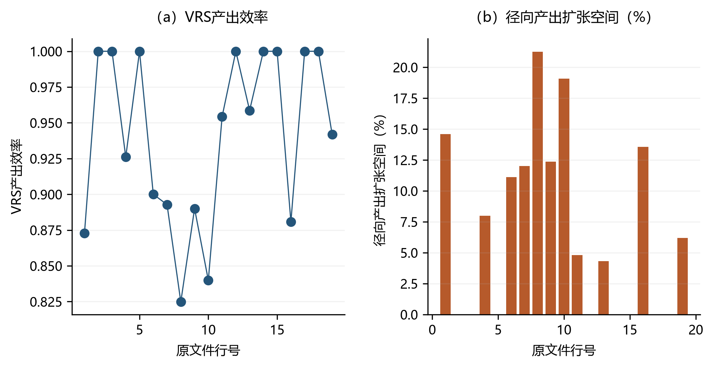

# DEA模型编程的基本思路 {#sec-11}

> **代码运行约定**：在项目根目录运行，先安装 `python -m pip install numpy pandas scipy matplotlib pyomo highspy openpyxl`。各段 Python 代码按本章顺序在同一会话执行，后文复用前文定义；默认采用 HiGHS。公式讲解片段另标为 `text`，不作为独立程序执行。

在前面的章节中，我们介绍了多个用于效率评价的DEA模型。这些模型虽然形式各异，但基本结构相同，均由两部分组成：技术集和效率评价准则。在数学形式上，二者共同构成一个线性规划问题：效率评价准则体现为线性规划的目标函数，技术集体现为线性规划的约束条件。

第3章至第10章已系统建立了导向、规模报酬假设与技术集构造各异的一系列DEA模型，并论证了它们在生产理论上的含义。本章承接上述建模工作，进一步回答一个方法论问题：如何将形式化的DEA规划翻译为优化求解器可识别、并能在整个数据集中自动执行的计算机程序。具体而言，本章将阐明单个决策单元模型向Pyomo建模语言的映射逻辑、以决策单元为单位的循环求解结构，以及如何将这一流程封装为具有明确接口的Python函数。所建立的编程思路，将直接支撑第12章的实战演练。

## DEA模型求解的程序化思路 {#sec-11-1}

根据DEA模型的结构特征与Python语言的表达能力，将一个数学形式的DEA模型转化为可运行的求解程序，在逻辑上可分解为三个相互衔接的环节。第一，将针对单个决策单元的模型翻译为Pyomo等建模语言能够识别的对象，即明确决策变量、目标函数与约束条件，并声明其索引集合。第二，将这一单单元求解过程在全部待评价单元的数据集上循环推进，从而完成整体效率评价。第三，将循环过程进一步封装为具有明确输入与输出的Python函数，以提升代码的复用性与可维护性。

本章的代码演进遵循"迭代式教学"策略：从基础版本开始，逐步增加功能，使读者在实践中理解函数封装、数据框操作、公式解析等核心编程技能。各版本的演进路线如下：

```
步骤1: 单个DMU的CRS产出导向DEA（核心求解代码，11.2节）
  ↓ + 循环迭代
步骤2: 所有DMU的CRS产出导向DEA（增加for循环，11.3节）
  ↓ + 函数封装
dea1: 封装为函数（numpy数组输入，11.4.1节）
  ↓ + 数据框支持
dea2: 支持pandas DataFrame（增加数据框操作，11.4.2节）
  ↓ + 查询条件
dea3: 支持查询条件指定评价单元（11.4.3节）
  ↓ + 参照集选择
dea4: 支持分别指定评价单元和参照单元（11.4.4节）
  ↓ + 索引保留
dea5: 保留原始索引（解决索引错位问题，11.4.5节）
  ↓ + 公式解析
dea6: 支持公式字符串"Output=Labor Fuel Capital"（增加字符串解析，11.4.6节）
  ↓ + 规模报酬选择
dea7: 支持CRS/VRS切换（增加条件约束，11.4.7节）
  ↓ + 方向选择
dea8: 支持投入导向/产出导向（增加方向参数，11.4.8节）
```

**图11.1：代码演进路线图**

图11.1展示了本章代码的演进路径。每个新版本均在前一版本的基础上增加一项具体功能，这种渐进式的安排有助于读者理解每一行代码的作用与必要性。

## 单个决策单元规划问题的建模映射 {#sec-11-2}

在DEA模型中，效率评价的测度通常可转化为一个线性规划问题。Python的pyomo包可用于构建并求解线性规划问题，读者可访问[pyomo的文档](https://pyomo.readthedocs.io/en/stable/installation.html)查看说明文档和技术细节。下面以求解基于谢泼德产出导向距离函数的技术效率为例，进行详细说明。假定给定的数据集如 @tbl-11-1 所示。


| 电厂 | Labor | Fuel | Capital | Output |
|---|---:|---:|---:|---:|
| Coffeen | 179.0 | 3969.1 | 1005.5 | 3531.4 |
| Grant Tower | 96.0 | 896.32 | 194.6 | 841.3 |
| Gudsonville | 94.0 | 803.17 | 200.0 | 690.5 |
| Meredosia | 141.0 | 1629.9 | 564.1 | 1498.1 |
| Newton | 147.0 | 3264.4 | 617.4 | 3347.7 |
: 原文件前五家电厂（程序检查子样本） {#tbl-11-1}

将规模报酬不变技术下的谢泼德产出导向距离函数表示为如下线性规划问题：

$$
\begin{aligned} D(\mathbf{X}^*,\mathbf{Y}^*)^{-1}&=\max_{\theta,\lambda_1,\lambda_2,...,\lambda_5}  \quad  \theta  \\s.t.& \sum_{i=1}^{5} \lambda_{i}X_{ki} \leq  X_k^*,  k=1,2,3 \\  & \sum_{i=1}^{5} \lambda_{i}Y_{li}  \geq  \theta Y_l^* ,l=1  \\& \lambda_{i} \geq 0, i=1, 2,\ldots, 5 ;-\infty \leq \theta\leq +\infty \end{aligned}
$$

其中，$X^* \in R^3_+$和$Y^* \in R^1_+$分别为被评价决策单元的投入和产出向量。

具体而言，以被评价决策单元为Coffeen、技术参照集为表中五家电厂为例，该规划向求解器输入的转化可按三个要素展开。首先是决策变量：需明确其维度与上下界。其次是目标函数：需明确优化的方向（极大或极小）以及各变量对应的系数。最后是约束条件：需明确其维度、各变量对应的系数以及约束符号（$\geq$、$\leq$与$=$）。

就上述谢泼德产出导向距离函数而言，决策变量由$\theta$与$\lambda_i$构成：$\theta$为一维且取值无约束，$\lambda_i$为$1 \times 5$的多维强度向量，满足$\lambda_i \geq 0$。目标函数中$\theta$的系数为$1$，$\lambda_i$的系数为$\mathbf{0}_{1 \times 5}$，故整体取极大值。约束条件包含两个维度不同的部分：其一对应$3$个投入变量$X$（$x_1、x_2、x_3$的第1—5行），符号为$\leq$，其中$\theta$不出现；其二对应$1$个产出变量$Y$（$y_1$的第1—5行），符号为$\geq$，$\theta$的系数为被评价单元A的产出（$y_1$的第1行）。

在确定上述决策变量、约束和目标函数后，还需将它们转换为pyomo定义的建模语言，才能用代码实现优化模型。在转换之前，需要先介绍pyomo模块中另一个不可或缺的要素——**索引集合**。索引集合用于在定义变量和约束时声明其索引，从而可以通过索引调用变量和约束的具体内容。索引集合可采用如下方法定义：

```python
import numpy as np
from pyomo.environ import *
model = ConcreteModel()
model.I = Set(initialize = range(5)) # 采用range初始化技术参照决策单元个数的集合
model.K = Set(initialize = range(3)) # 采用range初始化投入变量个数的集合
model.L = Set(initialize = range(1)) # 采用range初始化产出变量个数的集合
```

常用参数`initialize`表示初始化参数，可以采用列表、range对象、元组和集合等可迭代对象来给一个`Set`初始化。上面的代码使用`range`对象进行初始化。可以通过`data`属性查看索引集合的内容。

```python
print(model.I.data())
print(model.K.data())
print(model.L.data())
```

### 决策变量的定义 {#sec-11-2-1}

在定义完索引后，使用`Var`方法定义决策变量。常用的参数有四个：`index_set`表示决策变量的索引，这个索引可以是上面定义的索引集合；`bounds`表示决策变量的上下界；`within`表示决策变量的类型；`doc`为该决策变量取名。`bounds`传入一个元组，元组的第一个值表示变量的下界，第二个值表示变量的上界，且都包含等号，$\infty$对应传入`None`；`within`默认为实数，可以选择的类型有：

| 传入值 | 含义 |
| :--: | :--: |
| `Reals` | 实数 |
| `PositiveReals` | 正实数 |
| `NonPositiveReals` | 非正实数 |
| `NegativeReals` | 负实数 |
| `NonNegativeReals` | 非负实数 |
| `PercentFraction` | 0到1之间实数 |
| `UnitInterval` | 0到1之间实数 |
| `Integers` | 整数 |
| `PositiveIntegers` | 正整数 |
| `NonPositiveIntegers` | 非正整数 |
| `NegativeIntegers` | 负整数 |
| `NonNegativeIntegers` | 非负整数 |
| `Boolean` | 布尔变量 |
| `Binary` | 0,1变量 |

由于DEA对应的规划问题为线性规划问题，且变量的范围为正实数或非负实数，所以`within`一般不需要传入参数，只需要在`bounds`中传入变量的上下界即可。决策变量是一维还是多维，对应`Var`函数的两种调用方法：当决策变量是一维变量时，只需要传入一个索引变量；当决策变量是多维变量时，则需要根据决策变量的维度传入多个索引变量。比如，下面两行代码分别定义了一维变量和二维变量：

```python
model.theta = Var(within=Reals, bounds=(None, None), doc='efficiency')
model.intensity = Var(
    model.I, bounds=(0.0, None), doc='intensity variables'
)  # 强度变量（原lambda）
```

> **命名说明**：`model.intensity`是DEA模型中的**强度变量**（intensity variable），对应数学公式中的$\lambda_i$。在Python中，`lambda`是关键字（用于定义匿名函数），因此不能作为变量名。这里使用`intensity`而非`lamda`，因为`intensity`是DEA文献中的标准术语，含义明确。

### 目标函数的构造 {#sec-11-2-2}

使用`Objective`方法定义目标函数。常用参数有三个：`rule`表示目标函数的定义规则；`sense`表示最大化问题还是最小化问题，`maximize`代表极大化问题，`minimize`代表极小化问题；`doc`为该目标函数取名。下面的代码定义了上述DEA模型的目标函数。由于$\lambda_i$的系数为0，故可将其省略。

```python
def obj_rule(model):
    return model.theta
    # return model.theta*1 + sum(model.intensity[i] * 0 for i in model.I)
model.obj = Objective(rule=obj_rule, sense=maximize, doc='objective function')
```

### 约束条件的定义 {#sec-11-2-3}

使用`Constraint`方法定义约束条件。参数有三个：`index_set`表示约束的索引集合，可以是上面定义的索引集合；`rule`表示约束的定义规则，可以传入一个函数表达式，一般用来定义多维约束；`expr`表示约束表达式，一般用来定义一维约束。下面使用`rule`定义上述DEA模型的约束，这是一个多维约束。此时需要以技术参照决策单元和被评价决策单元的投入产出变量作为决策变量的系数。

```python
from deabook.example.book_cases.loaders import plants
data = plants().head(5)[["Labor", "Fuel", "Capital", "Output"]].to_numpy()
x = data[0, 0:3]      # 被评价电厂Coffeen的投入
y = data[0, 3:4]      # 被评价电厂Coffeen的产出
xref = data[:, 0:3]   # 所有参照决策单元的投入
yref = data[:, 3:4]   # 所有参照决策单元的产出

def input_rule(model, k):
    """投入约束：参照单元的加权投入不超过被评价单元的投入"""
    return (
        sum(model.intensity[i] * xref[i, k] for i in model.I)
        <= x[k]
    )

def output_rule(model, l):
    """产出约束：参照单元的加权产出不低于theta倍的被评价单元产出"""
    return (
        sum(model.intensity[i] * yref[i, l] for i in model.I)
        >= model.theta * y[l]
    )

model.input = Constraint(model.K, rule=input_rule, doc='input constraint')
model.output = Constraint(model.L, rule=output_rule, doc='output constraint')
```

下面的例子定义模型`model2`中的一维约束。模型`model2`中变量的维度为$4 \times 5$，第一个一维约束为$x_{11}+4x_{13} \geq 2$，第二个一维约束为$3x_{34}+5x_{45} = 10$。需要注意，Python中的下标从0开始。

```python
model2 = ConcreteModel()
model2.I = Set(initialize = range(4))
model2.J = Set(initialize = range(5))
model2.x = Var(model2.I, model2.J, within = Reals)
model2.c1 = Constraint(
    expr=2.0 <= model2.x[0, 0] + 4 * model2.x[0, 2]
)      # 不等式约束 2 <= x[0,0] + 4*x[0,2]
model2.c2 = Constraint(
    expr=3 * model2.x[2, 3] + 5 * model2.x[3, 4] == 10.0
)    # 等式约束 3*x[2,3] + 5*x[3,4] = 10
```

可以使用`Constraint.Skip`方法跳过使用某一个索引值对应的变量来组成约束。如下面定义的多维约束为$\sum_{j, j \neq 1} x_{ij} \leq 2, \, i=1,2,3,4$：

```python
def c3_rule(model2, i):
    if i == 1:
        return Constraint.Skip
    return (
        sum([model2.x[i, j] for j in model2.J])
        <= 2
    )
model2.c3 = Constraint(model2.I, rule=c3_rule)
```

### 模型求解 {#sec-11-2-4}

Pyomo只能完成建模的任务，求解还需将Pyomo模型导入专业的优化求解器来实现，例如`glpk`、`ipopt`、`Cplex`、`SCIP`、`mosek`等。如下代码就是调用`highs`求解器来实现求解：

```python
opt = SolverFactory('highs')       # 指定 HiGHS 作为求解器
solution = opt.solve(model)       # 调用求解器求解
```

另外，可以在`solve`方法中传入`report_timing=True`来查看模型运行的时间：

```python
opt = SolverFactory('highs')
solution = opt.solve(model, report_timing=True)
```

本章采用开源线性规划求解器 HiGHS，可用 `python -m pip install highspy` 安装。运行时间取决于机器、模型规模与求解器版本，读者可用上面的计时代码在自己的环境测量。其他求解器须单独安装，并满足其许可证要求。

```python
opt = SolverFactory('highs')
assert opt.available(exception_flag=False), "请安装 highspy"
solution = opt.solve(model)
```

> **求解器安装提示**：关于各求解器的详细安装步骤，请参阅本书附录A.[-@sec-1-3]节（求解器安装详细指南）。下面给出一段代码，用于**验证求解器是否已正确安装**：
>
> ```python
> # 验证求解器是否可用
> from pyomo.environ import SolverFactory
> for solver in ['highs', 'glpk', 'mosek']:
>     opt = SolverFactory(solver)
>     print(f"{solver}: {'可用' if opt.available(exception_flag=False) else '不可用'}")
> ```

### 优化结果的提取 {#sec-11-2-5}

```python
theta = np.asarray(list(model.theta[:].value))          # 提取决策变量 theta（效率倒数）
intensity_vals = np.asarray(list(model.intensity[:].value))  # 提取强度变量 lambda
obj = value(model.obj)                                   # 提取目标函数值
print("optimum theta: \n {} ".format(theta))
print("optimum intensity: \n {} ".format(intensity_vals))
print("optimal objective: {}".format(obj))
```

**图11.2：代码运行结果**

求解一个决策单元的DEA线性规划问题的完整代码如下：

```python
from pyomo.environ import *
import numpy as np

from deabook.example.book_cases.loaders import plants
data = plants().head(5)[["Labor", "Fuel", "Capital", "Output"]].to_numpy()

x = data[0, 0:3]       # 被评价单元A的投入
y = data[0, 3:4]       # 被评价单元A的产出
xref = data[:, 0:3]    # 参照单元投入
yref = data[:, 3:4]    # 参照单元产出

model = ConcreteModel()
model.I = Set(initialize=range(5))    # 技术参照决策单元集合
model.K = Set(initialize=range(3))    # 投入变量集合
model.L = Set(initialize=range(1))    # 产出变量集合

model.theta = Var(within=Reals, bounds=(None, None), doc='efficiency')
model.intensity = Var(model.I, bounds=(0.0, None), doc='intensity variables')

def obj_rule(model):
    return model.theta
model.obj = Objective(rule=obj_rule, sense=maximize, doc='objective function')

def input_rule(model, k):
    return (
        sum(model.intensity[i] * xref[i, k] for i in model.I)
        <= x[k]
    )
def output_rule(model, l):
    return (
        sum(model.intensity[i] * yref[i, l] for i in model.I)
        >= model.theta * y[l]
    )

model.input = Constraint(model.K, rule=input_rule, doc='input constraint')
model.output = Constraint(model.L, rule=output_rule, doc='output constraint')

opt = SolverFactory('highs')
solution = opt.solve(model)

theta = np.asarray(list(model.theta[:].value))
intensity_vals = np.asarray(list(model.intensity[:].value))
obj = value(model.obj)
print("optimum theta: \n {} ".format(theta))
print("optimum intensity: \n {} ".format(intensity_vals))
print("optimal objective: {}".format(obj))
```

## 效率评价的循环迭代 {#sec-11-3}

在前面的步骤中，已经完成了决策单元A的技术效率求解，接下来将求解决策单元B的技术效率。决策单元B的投入和产出数据在数组的第二行，因此只要改变被评价决策单元的投入和产出数据（X和Y所在的行），即将步骤1代码中的第8-9行修改为 `x=data[1,0:3]`、`y=data[1,3:4]`，求解得到的就是第2个决策单元的技术效率。求解所有决策单元技术效率的基本思路，就是让步骤1的线性规划求解在所有决策单元上进行迭代，这可以用`for`循环来实现。具体代码如下：

```python
from pyomo.environ import *
import numpy as np

from deabook.example.book_cases.loaders import plants
data = plants().head(5)[["Labor", "Fuel", "Capital", "Output"]].to_numpy()

theta_results = np.empty(5)    # 定义 theta_results 用于存储计算结果（原thetalt）

for j in range(5):             # 在 data 的行上循环
    x = data[j, 0:3]
    y = data[j, 3:4]
    xref = data[:, 0:3]
    yref = data[:, 3:4]
    
    model = ConcreteModel()
    model.I = Set(initialize=range(5))
    model.K = Set(initialize=range(3))
    model.L = Set(initialize=range(1))
    
    model.theta = Var(within=Reals, bounds=(None, None), doc='efficiency')
    model.intensity = Var(model.I, bounds=(0.0, None),
        doc='intensity variables')
    
    def obj_rule(model):
        return model.theta
    model.obj = Objective(rule=obj_rule, sense=maximize,
        doc='objective function')
    
    def input_rule(model, k):
        return (
            sum(model.intensity[i] * xref[i, k] for i in model.I)
            <= x[k]
        )
    def output_rule(model, l):
        return (
            sum(model.intensity[i] * yref[i, l] for i in model.I)
            >= model.theta * y[l]
        )
    
    model.input = Constraint(model.K, rule=input_rule, doc='input constraint')
    model.output = Constraint(model.L, rule=output_rule,
        doc='output constraint')
    
    opt = SolverFactory('highs')
    solution = opt.solve(model)
    
    theta = np.asarray(list(model.theta[:].value))
    intensity_vals = np.asarray(list(model.intensity[:].value))
    obj = value(model.obj)
    
    theta_results[j] = theta[0]

te = 1 / theta_results
print(te)
```

**图11.3：代码运行结果**

> **命名说明**：`theta_results`存储每个决策单元的$\theta$值（效率的倒数），`te`（technical efficiency）为最终的技术效率值，两者关系为 $\text{te} = 1 / \theta$。

在上述代码中，第8行提前定义了一个变量`theta_results`（其元素值未初始化，为内存中的残留值，仅用于预先分配存储空间），用以存储循环计算得到的结果。这部分代码与步骤1中的核心计算代码完全相同，只是增加了`for`循环语句。运行之后，`te`变量就存储了5个决策单元的技术效率值。从计算逻辑上看，DEA的效率评价本质上是对每个决策单元求解一个以其余单元为参照集的规划问题，因而以决策单元为单位的循环迭代并非权宜之计，而是DEA方法论的内在要求：每个单元既是被评价对象，又作为参照集的组成部分参与其余单元前沿的构造。

## 封装为可复用函数 {#sec-11-4}

将以上代码写成函数，可以提高代码应用的灵活性，实现代码的重复使用。

### dea1：基础函数 {#sec-11-4-1}

```python
from pyomo.environ import *
import numpy as np

def dea1(data, dataref, numk):
    """
    计算DEA技术效率（基础版本）
    
    Parameters
    ----------
    data : np.ndarray
        待评价决策单元的投入产出数据
    dataref : np.ndarray
        参照决策单元的投入产出数据
    numk : int
        投入变量的个数
    
    Returns
    -------
    np.ndarray
        各决策单元的技术效率值（te）
    """
    n = data.shape[0]                    # 待评价决策单元个数
    theta_results = np.empty(n)          # 存储theta值的数组
    
    for j in range(n):                   # 在每个决策单元上循环
        x = data[j, 0:numk]
        y = data[j, numk:]
        xref = dataref[:, 0:numk]
        yref = dataref[:, numk:]
        
        model = ConcreteModel()
        model.I = Set(initialize=range(dataref.shape[0]))
        model.K = Set(initialize=range(numk))
        model.L = Set(initialize=range(data.shape[1] - numk))
        
        model.theta = Var(within=Reals, bounds=(None, None), doc='efficiency')
        model.intensity = Var(model.I, bounds=(0.0, None),
            doc='intensity variables')
        
        def obj_rule(model):
            return model.theta
        model.obj = Objective(rule=obj_rule, sense=maximize,
            doc='objective function')
        
        def input_rule(model, k):
            return (
                sum(model.intensity[i] * xref[i, k] for i in model.I)
                <= x[k]
            )
        def output_rule(model, l):
            return (
                sum(model.intensity[i] * yref[i, l] for i in model.I)
                >= model.theta * y[l]
            )
        
        model.input = Constraint(model.K, rule=input_rule,
            doc='input constraint')
        model.output = Constraint(model.L, rule=output_rule,
            doc='output constraint')
        
        opt = SolverFactory('highs')
        solution = opt.solve(model)
        
        theta = np.asarray(list(model.theta[:].value))
        theta_results[j] = theta[0]
    
    te = 1.0 / theta_results
    return te
```

对以上代码简要解释如下：

- `def dea1(data, dataref, numk)` 定义了函数，三个参数分别是被评价单元的投入产出数据、参照单元的投入产出数据、投入变量的个数。
- `np.empty(n)` 定义一个空数组，`n` 使用 `data.shape[0]` 确定（`shape`属性可获得数据的行数和列数，`[0]`表示行数）。
- 循环中对每个被评价决策单元求解线性规划，最后返回技术效率值数组 `te`。

将这一过程封装为函数，使效率评价从一次性的脚本操作转变为可重复调用的计算接口：使用者只需提供数据与变量结构，便可获得标准化的效率结果，而无须重复书写建模与求解的细节。

仍以 @tbl-11-1 所示数据为例，`dea1` 的调用与效率提取过程如下：

```python
from deabook.example.book_cases.loaders import plants
data = plants().head(5)[["Labor", "Fuel", "Capital", "Output"]].to_numpy()
dataref = data
numk = 3
te = dea1(data, dataref, numk)
print(te)
```

**图11.4：代码运行结果**

### dea2：支持pandas DataFrame {#sec-11-4-2}

`dea1`函数使用numpy数组传入数据，无法保留变量名称。接下来使用pandas的**DataFrame**（数据框）传入投入产出数据，并用数据框的变量名确定投入产出变量。下面以美国电厂数据（见图11.5）为例进行说明。该数据集包含19家电厂，三个投入为Labor、Fuel、Capital，产出为Output。

**图11.5：美国电厂数据**

```python
from pyomo.environ import *
import pandas as pd
from deabook.example.book_cases.loaders import plants
import numpy as np

def dea2(dataframe, varname, numk):
    """
    计算DEA技术效率（支持DataFrame版本）
    
    Parameters
    ----------
    dataframe : pd.DataFrame
        待评价决策单元的投入产出数据框
    varname : list[str]
        投入和产出变量的列表，如["K","L","Y"]
    numk : int
        前numk个变量为投入数据
    
    Returns
    -------
    pd.DataFrame
        包含theta值和技术效率值的数据框
    """
    theta_results = {}           # 使用字典存储结果（保留原始索引）
    data = dataframe.loc[:, varname]
    dataref = dataframe.loc[:, varname]
    
    for j in range(data.shape[0]):
        x = data.iloc[j, 0:numk]
        y = data.iloc[j, numk:]
        xref = dataref.iloc[:, 0:numk]
        yref = dataref.iloc[:, numk:]
        xcol = xref.columns
        ycol = yref.columns
        
        model = ConcreteModel()
        model.I = Set(initialize=range(dataref.shape[0]))
        model.K = Set(initialize=range(numk))
        model.L = Set(initialize=range(len(ycol)))
        
        model.theta = Var(within=Reals, bounds=(None, None), doc='efficiency')
        model.intensity = Var(model.I, bounds=(0.0, None),
            doc='intensity variables')
        
        def obj_rule(model):
            return model.theta
        model.obj = Objective(rule=obj_rule, sense=maximize,
            doc='objective function')
        
        def input_rule(model, k):
            return (
                sum(model.intensity[i] * xref.iloc[i, k] for i in model.I)
                <= x.iloc[k]
            )
        def output_rule(model, l):
            return (
                sum(model.intensity[i] * yref.iloc[i, l] for i in model.I)
                >= model.theta * y.iloc[l]
            )
        
        model.input = Constraint(model.K, rule=input_rule,
            doc='input constraint')
        model.output = Constraint(model.L, rule=output_rule,
            doc='output constraint')
        
        opt = SolverFactory('highs')
        solution = opt.solve(model)
        
        theta = np.asarray(list(model.theta[:].value))
        theta_results[j] = theta[0]
    
    thetadf = pd.DataFrame(theta_results, index=["theta"]).T
    thetadf["te"] = 1 / thetadf["theta"]
    return thetadf
```

`dea2()`函数与`dea1()`函数的主要区别：

1. 使用数据框的`loc`方法取出投入产出数据，使用`iloc`方法索引行和列。
2. 约束条件中对`xref`和`yref`的调用使用**位置下标**（`xref.iloc[i, k]`）。这里 `model.I` 初始化为 `range(dataref.shape[0])`，是行的位置而不是行标签，因此第二维也必须用整数位置 `k`。若写成 `xref.iloc[i, xcol[k]]`，由于 `xcol[k]` 是列名字符串（如 `'K'`），`iloc` 的第二维不接受字符串，运行时会抛出 `TypeError`；需要用列名时应改用标签索引 `xref.loc[i, xcol[k]]`（见 `dea4` 起的写法，此时 `model.I` 也须改为行标签）。
3. 使用字典存储结果，再转换为DataFrame，保留了数据框的操作特性。

以 美国电厂数据 为例，`dea2` 的调用方式如下：

```python
import pandas as pd
from deabook.example.book_cases.loaders import plants
ex3 = plants()
te = dea2(ex3, ["Labor", "Fuel", "Capital", "Output"], 3)
print(te)
```

**图11.6：代码运行结果**

### dea3：支持查询条件指定评价单元 {#sec-11-4-3}

通过数据框的`.query()`方法来指定待评价的决策单元：

```python
def dea3(dataframe, varname, numk, eval_query):
    """
    计算DEA技术效率（支持查询条件指定评价单元）
    
    Parameters
    ----------
    eval_query : str or None
        传入数据框.query()方法的参数，如"dmu==1","dmu in [1,2,3]"
        若为None，则评价所有决策单元
    """
    theta_results = {}
    
    if eval_query is None:
        index_list = dataframe.index
    else:
        index_list = dataframe.query(eval_query).index
    
    data = dataframe.loc[index_list, varname]
    dataref = dataframe.loc[index_list, varname]
    
    for j in range(data.shape[0]):
        x = data.iloc[j, 0:numk]
        y = data.iloc[j, numk:]
        xref = dataref.iloc[:, 0:numk]
        yref = dataref.iloc[:, numk:]
        xcol = xref.columns
        ycol = yref.columns
        
        model = ConcreteModel()
        model.I = Set(initialize=range(dataref.shape[0]))
        model.K = Set(initialize=range(numk))
        model.L = Set(initialize=range(data.shape[1] - numk))
        
        model.theta = Var(within=Reals, bounds=(None, None), doc='efficiency')
        model.intensity = Var(model.I, bounds=(0.0, None),
            doc='intensity variables')
        
        def obj_rule(model):
            return model.theta
        model.obj = Objective(rule=obj_rule, sense=maximize,
            doc='objective function')
        
        def input_rule(model, k):
            return (
                sum(model.intensity[i] * xref.iloc[i, k] for i in model.I)
                <= x.iloc[k]
            )
        def output_rule(model, l):
            return (
                sum(model.intensity[i] * yref.iloc[i, l] for i in model.I)
                >= model.theta * y.iloc[l]
            )
        
        model.input = Constraint(model.K, rule=input_rule,
            doc='input constraint')
        model.output = Constraint(model.L, rule=output_rule,
            doc='output constraint')
        
        opt = SolverFactory('highs')
        solution = opt.solve(model)
        
        theta = np.asarray(list(model.theta[:].value))
        theta_results[j] = theta[0]
    
    thetadf = pd.DataFrame(theta_results, index=["theta"]).T
    thetadf["te"] = 1 / thetadf["theta"]
    return thetadf
```

> **命名说明**：`eval_query`（evaluation query）表示用于筛选待评价决策单元的查询条件字符串。使用下划线分隔的命名方式（snake_case）是Python的PEP 8标准命名规范。

该函数的典型调用方式如下：

```python
import pandas as pd
from deabook.example.book_cases.loaders import plants
ex3 = plants()
te = dea3(ex3, ["Labor", "Fuel", "Capital", "Output"], 3, "dmu in [1,2,3,4,5,6,7,8,9,10]")
print(te)
```

其他`eval_query`的用法：

```python
te = dea3(ex3, ["Labor", "Fuel", "Capital", "Output"], 3, "dmu<=10")     # 评价前10个DMU
te = dea3(ex3, ["Labor", "Fuel", "Capital", "Output"], 3, None)           # 评价所有DMU
```

> **名单筛选用 `in`，不要用 `<=` 接列表。** `DataFrame.query` 里的 `<=`、`<`、`>=`、`>` 只做逐元素比较：右侧写成列表时，pandas 会把它当成一列长度为列表长度的数据去和整列对齐，长度不等就抛 `ValueError: ('Lengths must match to compare', (20,), (10,))`；长度恰好相等时不报错，但比较的是"第1行的 dmu ≤ 1、第2行的 dmu ≤ 2……"，与"取出这10个 DMU"的本意毫无关系。按名单筛选必须用集合运算 `dmu in [1,2,3,4,5,6,7,8,9,10]`（`==` 右侧接列表时 pandas 会自动等价成 `in`/`isin`，也可用，但 `in` 的语义更直白）。上例这10个 DMU 的编号连续，因此也可以直接写标量比较 `dmu<=10`。

### dea4：支持分别指定评价单元和参照单元 {#sec-11-4-4}

```python
def dea4(dataframe, varname, numk, eval_query, ref_query):
    """
    计算DEA技术效率（支持分别指定评价单元和参照单元）
    
    Parameters
    ----------
    eval_query : str or None
        筛选待评价决策单元的查询条件
    ref_query : str or None
        筛选参照决策单元的查询条件
    """
    theta_results = {}
    
    if eval_query is None:
        index_list = dataframe.index
    else:
        index_list = dataframe.query(eval_query).index
    
    if ref_query is None:
        index_list_ref = dataframe.index
    else:
        index_list_ref = dataframe.query(ref_query).index
    
    data = dataframe.loc[index_list, varname]
    dataref = dataframe.loc[index_list_ref, varname]
    
    for j in range(data.shape[0]):
        x = data.iloc[j, 0:numk]
        y = data.iloc[j, numk:]
        xref = dataref.iloc[:, 0:numk]
        yref = dataref.iloc[:, numk:]
        xcol = xref.columns
        ycol = yref.columns
        
        model = ConcreteModel()
        model.I = Set(initialize=dataref.index)    # 使用参照单元的原始索引
        model.K = Set(initialize=range(numk))
        model.L = Set(initialize=range(data.shape[1] - numk))
        
        model.theta = Var(within=Reals, bounds=(None, None), doc='efficiency')
        model.intensity = Var(model.I, bounds=(0.0, None),
            doc='intensity variables')
        
        def obj_rule(model):
            return model.theta
        model.obj = Objective(rule=obj_rule, sense=maximize,
            doc='objective function')
        
        def input_rule(model, k):
            return (
                sum(model.intensity[i] * xref.loc[i, xcol[k]] for i in model.I)
                <= x.iloc[k]
            )
        def output_rule(model, l):
            return (
                sum(model.intensity[i] * yref.loc[i, ycol[l]] for i in model.I)
                >= model.theta * y.iloc[l]
            )
        
        model.input = Constraint(model.K, rule=input_rule,
            doc='input constraint')
        model.output = Constraint(model.L, rule=output_rule,
            doc='output constraint')
        
        opt = SolverFactory('highs')
        solution = opt.solve(model)
        
        theta = np.asarray(list(model.theta[:].value))
        theta_results[j] = theta[0]
    
    thetadf = pd.DataFrame(theta_results, index=["theta"]).T
    thetadf["te"] = 1 / thetadf["theta"]
    return thetadf
```

该函数的典型调用方式如下：

```python
import pandas as pd
from deabook.example.book_cases.loaders import plants
ex3 = plants()
te = dea4(ex3, ["Labor", "Fuel", "Capital", "Output"], 3, "dmu<=10", "dmu<=20")
print(te)
```

**图11.7：代码运行结果**

其他调用方式：

```python
te = dea4(ex3, ["Labor", "Fuel", "Capital", "Output"], 3, "dmu==[10,11,2,3,4,5,6,18]", "dmu<=20")
```

### dea5：保留原始索引 {#sec-11-4-5}

从`dea4`的结果中可以发现，即使选择了非连续的DMU（如第10、11、2、3、4、5、6、18个），得到的`te`的索引却是0-7。我们期望得到和原始数据框中相同的索引，以便将优化结果与原始数据合并。这需要对`dea4`进行修改：

```python
def dea5(dataframe, varname, numk, eval_query, ref_query):
    """
    计算DEA技术效率（保留原始索引版本）
    """
    theta_results = {}
    
    if eval_query is None:
        index_list = dataframe.index
    else:
        index_list = dataframe.query(eval_query).index
    
    if ref_query is None:
        index_list_ref = dataframe.index
    else:
        index_list_ref = dataframe.query(ref_query).index
    
    xcol = varname[0:numk]
    ycol = varname[numk:]
    
    data = dataframe.loc[index_list, varname]
    dataref = dataframe.loc[index_list_ref, varname]
    xref = dataref.loc[:, xcol]
    yref = dataref.loc[:, ycol]
    
    for j in data.index:                    # 在data的原始索引上循环（关键改动）
        x = data.loc[j, xcol]               # 使用loc而非iloc
        y = data.loc[j, ycol]
        
        model = ConcreteModel()
        model.I = Set(initialize=dataref.index)
        model.K = Set(initialize=range(numk))
        model.L = Set(initialize=range(len(ycol)))
        
        model.theta = Var(within=Reals, bounds=(None, None), doc='efficiency')
        model.intensity = Var(model.I, bounds=(0.0, None),
            doc='intensity variables')
        
        def obj_rule(model):
            return model.theta
        model.obj = Objective(rule=obj_rule, sense=maximize,
            doc='objective function')
        
        def input_rule(model, k):
            return (
                sum(model.intensity[i] * xref.loc[i, xcol[k]] for i in model.I)
                <= x.loc[xcol[k]]
            )
        def output_rule(model, l):
            return (
                sum(model.intensity[i] * yref.loc[i, ycol[l]] for i in model.I)
                >= model.theta * y.loc[ycol[l]]
            )
        
        model.input = Constraint(model.K, rule=input_rule,
            doc='input constraint')
        model.output = Constraint(model.L, rule=output_rule,
            doc='output constraint')
        
        opt = SolverFactory('highs')
        solution = opt.solve(model)
        
        theta = np.asarray(list(model.theta[:].value))
        theta_results[j] = theta[0]             # j为原始索引值
    
    thetadf = pd.DataFrame(theta_results, index=["theta"]).T
    thetadf["te"] = 1 / thetadf["theta"]
    return thetadf
```

**关键改动说明**：

1. 循环变量从`range(data.shape[0])`改为`data.index`，使`j`取原始索引值
2. 数据切片从`iloc`（位置索引）改为`loc`（标签索引）
3. `xcol`和`ycol`提前在循环外通过`varname`切片获得

该函数的典型调用方式如下：

```python
import pandas as pd
from deabook.example.book_cases.loaders import plants
ex3 = plants()
te = dea5(ex3, ["Labor", "Fuel", "Capital", "Output"], 3, "dmu==[10,11,2,3,4,5,6,18]", "dmu<=20")
print(te)
```

**图11.8：代码运行结果**

此时，`te`的索引与电厂数据中的原始索引一致，可以通过索引将二者直接合并。

### dea6：支持公式字符串 {#sec-11-4-6}

`dea5`通过`varname`和`numk`传递投入产出变量。接下来优化输入方式，使用类似R语言的**formula表达式格式**来传递变量，例如 `"Output=Labor Fuel Capital"`。在这个表达式中，以`=`作为分隔符，等式左边是产出变量，等式右边是投入变量。

```python
import re

s = "Y = K     L  "
input_vars = s.split('=')[1].strip(' ')
input_vars = re.compile(' +').sub(' ', input_vars).split(' ')
output_vars = s.split('=')[0].strip(' ')
output_vars = re.compile(' +').sub(' ', output_vars).split(' ')
```

第3行代码中的`split("=")`将`s`切分成列表`["Y ", " K     L  "]`（注意首元素带有尾随空格），`[1]`选择第二个元素；`strip(' ')`去掉两端空格，`re.sub`将多个空格替换为一个空格，最后用`split(' ')`得到列表`['K', 'L']`。

```python
from pyomo.environ import *
import pandas as pd
from deabook.example.book_cases.loaders import plants
import numpy as np
import re

def dea6(formula, dataframe, eval_query, ref_query):
    """
    计算DEA技术效率（支持公式字符串版本）
    
    Parameters
    ----------
    formula : str
        公式字符串，格式为 "产出 = 投入1 投入2 ..."
        例如："Output=Labor Fuel Capital"、"Y = K     L"
    """
    theta_results = {}
    
    if eval_query is None:
        index_list = dataframe.index
    else:
        index_list = dataframe.query(eval_query).index
    
    if ref_query is None:
        index_list_ref = dataframe.index
    else:
        index_list_ref = dataframe.query(ref_query).index
    
    # 解析公式字符串
    input_vars = formula.split('=')[1].strip(' ')
    xcol = re.compile(' +').sub(' ', input_vars).split(' ')
    output_vars = formula.split('=')[0].strip(' ')
    ycol = re.compile(' +').sub(' ', output_vars).split(' ')
    
    data = dataframe.loc[index_list, xcol + ycol]
    dataref = dataframe.loc[index_list_ref, xcol + ycol]
    xref = dataref.loc[:, xcol]
    yref = dataref.loc[:, ycol]
    
    for j in data.index:
        x = data.loc[j, xcol]
        y = data.loc[j, ycol]
        
        model = ConcreteModel()
        model.I = Set(initialize=dataref.index)
        model.K = Set(initialize=range(len(xcol)))
        model.L = Set(initialize=range(len(ycol)))
        
        model.theta = Var(within=Reals, bounds=(None, None), doc='efficiency')
        model.intensity = Var(model.I, bounds=(0.0, None),
            doc='intensity variables')
        
        def obj_rule(model):
            return model.theta
        model.obj = Objective(rule=obj_rule, sense=maximize,
            doc='objective function')
        
        def input_rule(model, k):
            return (
                sum(model.intensity[i] * xref.loc[i, xcol[k]] for i in model.I)
                <= x.loc[xcol[k]]
            )
        def output_rule(model, l):
            return (
                sum(model.intensity[i] * yref.loc[i, ycol[l]] for i in model.I)
                >= model.theta * y.loc[ycol[l]]
            )
        
        model.input = Constraint(model.K, rule=input_rule,
            doc='input constraint')
        model.output = Constraint(model.L, rule=output_rule,
            doc='output constraint')
        
        opt = SolverFactory('highs')
        solution = opt.solve(model)
        
        theta = np.asarray(list(model.theta[:].value))
        theta_results[j] = theta[0]
    
    thetadf = pd.DataFrame(theta_results, index=["theta"]).T
    thetadf["te"] = 1 / thetadf["theta"]
    return thetadf
```

该函数的典型调用方式如下：

```python
import pandas as pd
from deabook.example.book_cases.loaders import plants
ex3 = plants()
te = dea6("Output=Labor Fuel Capital", ex3, "dmu==[10,11,2,3,4,5,6,18]", "dmu<=20")
print(te)
```

**图11.9：代码运行结果**

### dea7：支持CRS/VRS切换 {#sec-11-4-7}

`dea6`可以完成产出方向且规模报酬不变条件下基于谢泼德距离函数的技术效率计算。若要支持规模报酬可变（VRS），需要添加约束条件：$\sum_{i=1}^{n} \lambda_i = 1$。

规模报酬可变的产出导向模型：

$$
\begin{aligned} D(\mathbf{X}^*,\mathbf{Y}^*)^{-1}&=\max_{\theta,\lambda} \quad \theta \\ s.t. & \sum_{i=1}^{n} \lambda_{i}X_{ki} \leq X_k^*, \quad k=1,2,3 \\ & \sum_{i=1}^{n} \lambda_{i}Y_{li} \geq \theta Y_l^*, \quad l=1 \\ & \sum_{i=1}^{n} \lambda_i = 1 \\ & \lambda_{i} \geq 0 \end{aligned}
$$

```python
from pyomo.environ import *
import pandas as pd
from deabook.example.book_cases.loaders import plants
import numpy as np
import re

def dea7(formula, dataframe, rts, eval_query, ref_query):
    """
    计算DEA技术效率（支持CRS/VRS切换版本）
    
    Parameters
    ----------
    rts : str
        规模报酬假设："crs"（规模报酬不变）或"vrs"（规模报酬可变）
    """
    theta_results = {}
    
    if eval_query is None:
        index_list = dataframe.index
    else:
        index_list = dataframe.query(eval_query).index
    
    if ref_query is None:
        index_list_ref = dataframe.index
    else:
        index_list_ref = dataframe.query(ref_query).index
    
    # 解析公式
    input_vars = formula.split('=')[1].strip(' ')
    xcol = re.compile(' +').sub(' ', input_vars).split(' ')
    output_vars = formula.split('=')[0].strip(' ')
    ycol = re.compile(' +').sub(' ', output_vars).split(' ')
    
    data = dataframe.loc[index_list, xcol + ycol]
    dataref = dataframe.loc[index_list_ref, xcol + ycol]
    xref = dataref.loc[:, xcol]
    yref = dataref.loc[:, ycol]
    
    for j in data.index:
        x = data.loc[j, xcol]
        y = data.loc[j, ycol]
        
        model = ConcreteModel()
        model.I = Set(initialize=dataref.index)
        model.K = Set(initialize=range(len(xcol)))
        model.L = Set(initialize=range(len(ycol)))
        
        model.theta = Var(within=Reals, bounds=(None, None), doc='efficiency')
        model.intensity = Var(model.I, bounds=(0.0, None),
            doc='intensity variables')
        
        def obj_rule(model):
            return model.theta
        model.obj = Objective(rule=obj_rule, sense=maximize,
            doc='objective function')
        
        def input_rule(model, k):
            return (
                sum(model.intensity[i] * xref.loc[i, xcol[k]] for i in model.I)
                <= x.loc[xcol[k]]
            )
        def output_rule(model, l):
            return (
                sum(model.intensity[i] * yref.loc[i, ycol[l]] for i in model.I)
                >= model.theta * y.loc[ycol[l]]
            )
        def vrs_rule(model):
            """规模报酬可变约束：强度变量之和为1"""
            return sum(model.intensity[i] for i in model.I) == 1
        
        model.input = Constraint(model.K, rule=input_rule,
            doc='input constraint')
        model.output = Constraint(model.L, rule=output_rule,
            doc='output constraint')
        
        # 根据rts参数条件添加VRS约束
        if rts == "vrs":
            model.vrs = Constraint(rule=vrs_rule, doc='VRS constraint')
        
        opt = SolverFactory('highs')
        solution = opt.solve(model)
        
        theta = np.asarray(list(model.theta[:].value))
        theta_results[j] = theta[0]
    
    thetadf = pd.DataFrame(theta_results, index=["theta"]).T
    thetadf["te"] = 1 / thetadf["theta"]
    return thetadf
```

该函数的典型调用方式如下：

```python
import pandas as pd
from deabook.example.book_cases.loaders import plants
ex3 = plants()
te = dea7("Output=Labor Fuel Capital", ex3, "vrs", "dmu==[10,11,2,3,4,5,6,18]", "dmu<=20")
print(te)
```

**图11.10：代码运行结果**

### dea8：支持投入导向/产出导向 {#sec-11-4-8}

接下来以投入导向进行研究。投入方向的 Farrell 投入效率（即谢泼德投入距离函数的倒数 $D_I^{-1}$，见第 [-@sec-3] 章式 ([-@eq-3-13])）公式为：

**CRS投入导向**：

$$
\begin{aligned} D_I(\mathbf{X}^*,\mathbf{Y}^*)^{-1}&=\min_{\theta,\lambda} \quad \theta \\ s.t. & \sum_{i=1}^{n} \lambda_{i}X_{ki} \leq \theta X_k^*, \quad k=1,2,3 \\ & \sum_{i=1}^{n} \lambda_{i}Y_{li} \geq Y_l^*, \quad l=1 \\ & \lambda_{i} \geq 0 \end{aligned}
$$

这里的 $\theta$ 是投入收缩比，取值范围为 $(0,1]$，技术效率 $\mathrm{TE}=\theta=1/D_I$；而谢泼德投入距离函数本身满足 $D_I\ge1$。这与产出侧的写法（式中 $D^{-1}=\max\theta$、$\theta\ge1$ 为扩张倍数）是同一套对应关系的两侧，不要把投入侧的 $\min\theta$ 直接称作谢泼德距离 $D$。

**VRS投入导向**：增加约束 $\sum_{i=1}^{n} \lambda_i = 1$
```python
from pyomo.environ import *
import pandas as pd
from deabook.example.book_cases.loaders import plants
import numpy as np
import re

def dea8(formula: str,
         dataframe: pd.DataFrame,
         rts: str = "crs",
         orient: str = "oo",
         eval_query: str | None = None,
         ref_query: str | None = None) -> pd.DataFrame:
    """
    计算DEA技术效率（完整版本：支持CRS/VRS、投入/产出导向）
    
    Parameters
    ----------
    formula : str
        公式字符串，格式为 "产出 = 投入1 投入2 ..."
    dataframe : pd.DataFrame
        包含投入产出数据的DataFrame
    rts : str, default "crs"
        规模报酬假设："crs"（规模报酬不变）或"vrs"（规模报酬可变）
    orient : str, default "oo"
        导向类型："oo"（产出导向，output-oriented）或"io"（投入导向，input-oriented）
    eval_query : str or None, default None
        筛选待评价决策单元的查询条件
    ref_query : str or None, default None
        筛选参照决策单元的查询条件
    
    Returns
    -------
    pd.DataFrame
        包含theta值和技术效率值的数据框
    """
    theta_results = {}
    
    # 处理查询条件（None表示使用全部数据）
    if eval_query is None:
        index_list = dataframe.index
    else:
        index_list = dataframe.query(eval_query).index
    
    if ref_query is None:
        index_list_ref = dataframe.index
    else:
        index_list_ref = dataframe.query(ref_query).index
    
    # 解析公式字符串
    input_vars = formula.split('=')[1].strip(' ')
    xcol = re.compile(' +').sub(' ', input_vars).split(' ')
    output_vars = formula.split('=')[0].strip(' ')
    ycol = re.compile(' +').sub(' ', output_vars).split(' ')
    
    data = dataframe.loc[index_list, xcol + ycol]
    dataref = dataframe.loc[index_list_ref, xcol + ycol]
    xref = dataref.loc[:, xcol]
    yref = dataref.loc[:, ycol]
    
    for j in data.index:
        x = data.loc[j, xcol]
        y = data.loc[j, ycol]
        
        model = ConcreteModel()
        model.I = Set(initialize=dataref.index)
        model.K = Set(initialize=range(len(xcol)))
        model.L = Set(initialize=range(len(ycol)))
        
        model.theta = Var(within=Reals, bounds=(None, None), doc='efficiency')
        model.intensity = Var(model.I, bounds=(0.0, None),
            doc='intensity variables')
        
        # 目标函数：根据导向确定最大/最小化
        def obj_rule(model):
            return model.theta
        model.obj = Objective(
            rule=obj_rule,
            sense=(maximize if orient == "oo" else minimize),
            doc='objective function'
        )
        
        # 投入约束：根据导向变化
        def input_rule(model, k):
            if orient == "oo":           # 产出导向：投入不超过被评价单元
                return (
                    sum(model.intensity[i] * xref.loc[i, xcol[
                        k]] for i in model.I)
                    <= x.loc[xcol[k]]
                )
            elif orient == "io":         # 投入导向：投入不超过theta倍被评价单元
                return (
                    sum(model.intensity[i] * xref.loc[i, xcol[
                        k]] for i in model.I)
                    <= model.theta * x.loc[xcol[k]]
                )
        

        # 产出约束：根据导向变化
        def output_rule(model, l):
            if orient == "oo":           # 产出导向：产出不低于theta倍被评价单元
                return (
                    sum(model.intensity[i] * yref.loc[i, ycol[
                        l]] for i in model.I)
                    >= model.theta * y.loc[ycol[l]]
                )
            elif orient == "io":         # 投入导向：产出不低于被评价单元
                return (
                    sum(model.intensity[i] * yref.loc[i, ycol[
                        l]] for i in model.I)
                    >= y.loc[ycol[l]]
                )
        
        # VRS约束
        def vrs_rule(model):
            return sum(model.intensity[i] for i in model.I) == 1
        
        model.input = Constraint(model.K, rule=input_rule,
            doc='input constraint')
        model.output = Constraint(model.L, rule=output_rule,
            doc='output constraint')
        
        if rts == "vrs":
            model.vrs = Constraint(rule=vrs_rule, doc='VRS constraint')
        
        opt = SolverFactory('highs')
        solution = opt.solve(model)
        
        theta = np.asarray(list(model.theta[:].value))
        theta_results[j] = theta[0]
    
    thetadf = pd.DataFrame(theta_results, index=["theta"]).T
    # 技术效率计算：产出导向取倒数，投入导向直接取theta
    thetadf["te"] = (1 / thetadf["theta"] if orient == "oo" else thetadf[
        "theta"])
    return thetadf
```

**dea8相比dea7的改动**：

1. **参数`orient`**：控制产出导向（`"oo"`）或投入导向（`"io"`）
2. **目标函数方向**：产出导向为`maximize`，投入导向为`minimize`
3. **约束条件**：根据导向自动调整不等式形式
4. **技术效率计算**：产出导向 `te = 1/theta`，投入导向 `te = theta`
5. **查询条件默认值**：`eval_query`和`ref_query`默认为`None`，表示使用全部数据

至此，`dea1`至`dea8`逐步形成了一套在导向、规模报酬与样本选择上均可灵活配置的求解接口。其演进的意义在于：将DEA建模中原本分散、易错的重复代码收敛为少数可控的参数，使研究者得以把注意力从编程细节转移到模型设定本身。该函数的典型调用方式如下：

```python
import pandas as pd
from deabook.example.book_cases.loaders import plants
ex3 = plants()

# VRS投入导向
te = dea8("Output=Labor Fuel Capital", ex3, "vrs", "io", "dmu==[10,11,2,3,4,5,6,18]", "dmu<=20")
print(te)
```

**图11.11：代码运行结果**

## 代码重构：用类封装DEA模型 {#sec-11-5}

从`dea1`到`dea8`，代码逐步增加了功能，但也带来了一个问题：**大量代码重复**。每个版本的函数中，模型定义、求解器调用、结果提取等核心逻辑几乎完全相同。这违背了软件工程中的**DRY原则**（Don't Repeat Yourself，不要重复自己）。

本节展示如何用**Python类**来重构代码，将通用逻辑封装起来，使代码更简洁、更易维护。这是从"脚本编程"到"模块化设计"的进阶，也是从入门练习走向专业编程的关键一步。

### 异常处理：让代码更健壮 {#sec-11-5-1}

在重构之前，先介绍一项重要的工程化技能——**异常处理**。在`dea1`到`dea8`中，如果求解器未安装、数据格式错误或线性规划无可行解，程序会直接崩溃并抛出晦涩的错误信息。通过`try-except`块来捕获这些异常，可以给用户提供有意义的错误提示：

```python
from pyomo.opt import SolverStatus, TerminationCondition

def solve_with_check(model, solver="highs"):
    """
    带状态检查的求解器调用
    
    检查求解器是否可用、求解是否成功，提供清晰的错误信息。
    """
    opt = SolverFactory(solver)
    
    # 检查求解器是否已安装
    if not opt.available(exception_flag=False):
        raise RuntimeError(
            f"求解器 '{solver}' 未安装或不可用。"
            f"请运行以下命令安装：\n"
            f"  conda install {solver}\n"
            f"或使用其他求解器：'highs'、'ipopt'"
        )
    
    # 调用求解器
    solution = opt.solve(model, load_solutions=False)
    
    # 检查求解状态
    if solution.solver.status != SolverStatus.ok:
        raise RuntimeError(f"求解器状态异常: {solution.solver.status}")
    
    # 检查求解终止条件
    if solution.solver.termination_condition != TerminationCondition.optimal:
        if (solution.solver.termination_condition ==
            TerminationCondition.infeasible):
            raise RuntimeError(
                "线性规划无可行解——请检查数据是否存在异常值（如0或负数），"
                "或投入产出变量是否设置正确。"
            )
        else:
            raise RuntimeError(
                f"求解未达到最优。终止条件: {solution.solver.termination_condition}"
            )
    
    model.solutions.load_from(solution)
    return solution
```

> **教学价值**：异常处理是工程化编程的核心能力。这段代码向读者展示了"如何给用户提供有意义的错误信息"，而非让Python抛出晦涩的堆栈跟踪。

### DEAModel类 {#sec-11-5-2}

下面用类来封装DEA模型：

```python
from pyomo.environ import *
from pyomo.opt import SolverStatus, TerminationCondition
import pandas as pd
from deabook.example.book_cases.loaders import plants
import numpy as np
import re


class DEAModel:
    """
    DEA效率评价模型（类封装版本）
    
    将DEA模型的构建、求解、结果提取封装为类，减少代码重复，
    提高代码的可维护性和可扩展性。
    
    Parameters
    ----------
    formula : str
        公式字符串，格式为 "产出 = 投入1 投入2 ..."
    dataframe : pd.DataFrame
        包含投入产出数据的DataFrame
    orient : str, default "oo"
        导向类型："oo"（产出导向）或"io"（投入导向）
    rts : str, default "crs"
        规模报酬假设："crs"或"vrs"
    """
    
    def __init__(self, formula, dataframe, orient="oo", rts="crs"):
        self.formula = formula
        self.dataframe = dataframe
        self.orient = orient
        self.rts = rts
        self._parse_formula()
    
    def _parse_formula(self):
        """解析公式字符串，提取投入变量名和产出变量名"""
        input_vars = self.formula.split('=')[1].strip(' ')
        self.xcol = re.compile(' +').sub(' ', input_vars).split(' ')
        output_vars = self.formula.split('=')[0].strip(' ')
        self.ycol = re.compile(' +').sub(' ', output_vars).split(' ')
    
    def _prepare_data(self, eval_query=None, ref_query=None):
        """
        根据查询条件准备评价数据和参考数据
        
        Returns
        -------
        data, dataref : pd.DataFrame
            评价数据和参照数据
        """
        if eval_query is None:
            index_list = self.dataframe.index
        else:
            index_list = self.dataframe.query(eval_query).index
        
        if ref_query is None:
            index_list_ref = self.dataframe.index
        else:
            index_list_ref = self.dataframe.query(ref_query).index
        
        cols = self.xcol + self.ycol
        data = self.dataframe.loc[index_list, cols]
        dataref = self.dataframe.loc[index_list_ref, cols]
        return data, dataref
    
    def _build_model(self, x, y, xref, yref):
        """
        构建Pyomo模型（通用部分）
        
        Parameters
        ----------
        x, y : pd.Series
            被评价单元的投入和产出
        xref, yref : pd.DataFrame
            参照单元的投入和产出
        
        Returns
        -------
        model : ConcreteModel
            构建好的Pyomo模型
        """
        model = ConcreteModel()
        model.I = Set(initialize=xref.index)
        model.K = Set(initialize=range(len(self.xcol)))
        model.L = Set(initialize=range(len(self.ycol)))
        
        model.theta = Var(within=Reals, bounds=(None, None), doc='efficiency')
        model.intensity = Var(model.I, bounds=(0.0, None),
            doc='intensity variables')
        
        # 目标函数
        def obj_rule(model):
            return model.theta
        model.obj = Objective(
            rule=obj_rule,
            sense=(maximize if self.orient == "oo" else minimize)
        )
        
        # 投入约束
        def input_rule(model, k):
            if self.orient == "oo":
                return (
                    sum(model.intensity[i] * xref.loc[i, self.xcol[k]] 
                          for i in model.I)
                    <= x.loc[self.xcol[k]]
                )
            else:  # io
                return (
                    sum(model.intensity[i] * xref.loc[i, self.xcol[k]] 
                          for i in model.I)
                    <= model.theta * x.loc[self.xcol[k]]
                )
        
        # 产出约束
        def output_rule(model, l):

            if self.orient == "oo":
                return (
                    sum(model.intensity[i] * yref.loc[i, self.ycol[l]] 
                          for i in model.I)
                    >= model.theta * y.loc[self.ycol[l]]
                )
            else:  # io
                return (
                    sum(model.intensity[i] * yref.loc[i, self.ycol[l]] 
                          for i in model.I)
                    >= y.loc[self.ycol[l]]
                )
        
        model.input = Constraint(model.K, rule=input_rule)
        model.output = Constraint(model.L, rule=output_rule)
        
        # VRS约束
        if self.rts == "vrs":
            def vrs_rule(model):
                return sum(model.intensity[i] for i in model.I) == 1
            model.vrs = Constraint(rule=vrs_rule)
        
        return model
    
    def solve(self, eval_query=None, ref_query=None, solver="highs"):
        """
        求解DEA模型并返回效率结果
        
        Parameters
        ----------
        eval_query : str or None
            筛选待评价决策单元的查询条件
        ref_query : str or None
            筛选参照决策单元的查询条件
        solver : str, default "highs"
            求解器名称
        
        Returns
        -------
        pd.DataFrame
            包含theta值和技术效率值的数据框
        """
        data, dataref = self._prepare_data(eval_query, ref_query)
        xref = dataref.loc[:, self.xcol]
        yref = dataref.loc[:, self.ycol]
        
        theta_results = {}
        
        for j in data.index:
            x = data.loc[j, self.xcol]
            y = data.loc[j, self.ycol]
            
            model = self._build_model(x, y, xref, yref)
            
            # 调用带检查的求解
            opt = SolverFactory(solver)
            if not opt.available(exception_flag=False):
                raise RuntimeError(f"求解器 '{solver}' 未安装。请安装后重试。")
            
            solution = opt.solve(model)
            
            # 检查求解状态
            if (solution.solver.termination_condition 
                != TerminationCondition.optimal):
                print(f"警告: DMU {j} 的求解未达到最优，"
                      f"终止条件: {solution.solver.termination_condition}")
            
            theta = np.asarray(list(model.theta[:].value))
            theta_results[j] = theta[0]
        
        thetadf = pd.DataFrame(theta_results, index=["theta"]).T
        thetadf["te"] = (1 / thetadf["theta"] 
                         if self.orient == "oo" else thetadf["theta"])
        return thetadf
```

### 使用DEAModel类 {#sec-11-5-3}

```python
import pandas as pd
from deabook.example.book_cases.loaders import plants

# 读取数据
ex3 = plants()

# 创建模型实例（产出导向、VRS）
model = DEAModel("Output=Labor Fuel Capital", ex3, orient="oo", rts="vrs")

# 求解
te = model.solve(eval_query="dmu in [1,2,3,4,5]", ref_query="dmu<=20")
print(te)

# 切换到CRS投入导向，无需重新定义类
te_io = DEAModel("Output=Labor Fuel Capital", ex3, orient="io", rts="crs").solve()
print(te_io)
```

**类的优势**：

1. **消除重复**：模型构建逻辑只写一次，多个DMU共用
2. **易于扩展**：增加新功能（如SBM模型、Malmquist指数）只需继承或修改类
3. **状态封装**：公式解析、数据准备等中间状态存储在实例属性中
4. **接口清晰**：`solve()`方法的调用方式直观简洁

## 常见错误与调试技巧 {#sec-11-6}

在编写DEA代码的过程中，初学者常会遇到各种错误。本节汇总了最常见的错误现象、原因和解决方案，帮助读者快速定位和修复问题。


| 错误现象 | 可能原因 | 解决方案 |
| :-- | :-- | :-- |
| `SolverFactory('highs')` 报错 | 未安装 highspy | `python -m pip install highspy` |
| `RuntimeError: 求解器不可用` | 求解器未正确安装 | 运行验证代码检查可用求解器；参见附录A.[-@sec-1-3]节 |
| `ValueError: No objective` | 目标函数定义错误 | 检查`Objective`的`rule`参数是否返回有效表达式 |
| `Constraint.Skip` 无效 | 索引变量未传入 | 确保`rule`函数接受索引参数（如`def rule(model, k)`） |
| 效率值全为1.0 | 指标过多而DMU过少（维数灾难），或各单元均具独特投入产出组合，样本内无法区分 | 增加样本量、合并或删减指标；检查参照集是否过小（是否误把每个DMU当作自己的唯一参照） |
| 模型无可行解或求解失败 | 数据含0、负值，或产出全为0 | 检查并处理非正值；确认模型对零值的假设；检查投入产出变量方向 |
| VRS结果与CRS相同 | VRS约束未生效 | 检查`if rts == "vrs"`条件拼写；确认约束已添加到模型 |
| `KeyError` 在数据索引时 | 列名拼写错误 | 检查formula中的变量名是否与DataFrame列名一致 |
| `TypeError: 'NoneType'` | eval_query或ref_query为无效字符串 | 检查query字符串语法；确保列名存在 |
| 内存溢出（大样本） | 约束数量过大 | 使用切割平面算法或降采样；考虑使用专业包如`deabook` |
| 产出导向效率值大于1 | theta计算方向错误 | 产出导向效率 = 1/theta；投入导向效率 = theta |
| 索引错位（结果索引从0开始） | 未使用原始索引循环 | 将`range(n)`改为`data.index`；将`iloc`改为`loc` |
: 常见错误与调试方法 {#tbl-11-2}

**调试建议**：

1. **从简单开始**：先用`dea1`在5个DMU的小数据集上测试，确认代码正确后再扩展
2. **逐步验证**：每增加一个功能，检查结果是否合理（如VRS效率应不低于CRS效率，因为CRS技术集包含VRS技术集，CRS可行域更大）
3. **打印中间变量**：在循环中打印`x`、`y`的值，确认数据切片正确
4. **检查求解状态**：使用`solve_with_check`函数捕获求解异常

## 案例应用：把单个电厂求解扩展为循环 {#sec-11-case}

本章只使用美国19家电厂。先从原文件抽取前5行检查输入与索引，再以全部19行为参照集循环求解。投入为Labor、Fuel、Capital，产出为Output；结果图使用VRS产出导向效率1/φ。表只展示原文件前5行的结果，这不是前五名排名，完整结果仍包含19家电厂。

```python
from deabook.example.book_cases.run import FUN
FUN[11]()  # 重新计算本章，输出完整CSV、摘要表与PNG/PDF图
```


| 电厂          |      劳动 |       燃料 |       装机 |      发电量 |   VRS产出效率 |
|:------------|--------:|---------:|---------:|---------:|----------:|
| Coffeen     | 179.000 | 3969.100 | 1005.500 | 3531.400 |     0.873 |
| Grant Tower |  96.000 |  896.320 |  194.600 |  841.300 |     1.000 |
| Gudsonville |  94.000 |  803.170 |  200.000 |  690.500 |     1.000 |
| Meredosia   | 141.000 | 1629.900 |  564.100 | 1498.100 |     0.926 |
| Newton      | 147.000 | 3264.400 |  617.400 | 3347.700 |     1.000 |
| Fisk        | 261.000 | 1427.500 |  347.100 | 1263.200 |     0.900 |
| Joliet      | 448.000 | 6365.300 | 1680.400 | 5734.000 |     0.893 |
| Kinkaid     | 223.000 | 4911.000 | 1319.400 | 4107.700 |     0.825 |


: 把单个电厂求解扩展为循环：结果摘要 {#tbl-case-11}

{#fig-case-11 width=95%}

<!-- expanded-exhibit-note -->
表按原文件顺序展示前8家电厂的投入、产出及VRS产出效率，便于将循环计算的返回索引与原始记录逐一对应。图左展示全部19家电厂的效率，图右按100×(1/效率−1)计算径向产出扩张空间；该比例未包含非径向松弛。
<!-- /expanded-exhibit-note -->

循环中用原始行号追踪结果，参照集始终保持全部19行。仅改变显示行数不会改变参照技术；若为了缩短表格而只拿前5家构造前沿，效率会改变。教材前面的索引、函数封装和类封装都复用同一数据入口。

配套程序 `deabook/example/book_cases/run.py` 保存全部观测到 `results/ch11_full.csv`。表中P10和P90为第10和第90百分位数（如适用），展示分布而不占用逐个决策单元的行数。

## 本章小结 {#sec-11-7}

本章通过**迭代式教学**的方法，从单个决策单元的线性规划求解出发，逐步构建了一个功能完整的DEA效率评价函数。主要内容包括：

1. **Pyomo建模基础**：索引集合、决策变量、目标函数、约束条件的定义
2. **循环迭代**：用`for`循环对所有决策单元进行效率评价
3. **函数封装**：将代码组织为可复用的函数（`dea1`到`dea8`）
4. **功能扩展**：DataFrame支持、查询条件、公式解析、CRS/VRS切换、投入/产出导向
5. **代码重构**：用Python类封装DEA模型，实现模块化设计
6. **异常处理**：添加求解状态检查，提高代码健壮性

### 从自定义函数到deabook包

本章构建的自定义DEA函数虽然功能完整，但在实际研究中推荐使用成熟的软件包（如`deabook`），原因有三：

1. **可靠性**：软件包经过大量测试，边界情况处理更完善；
2. **效率**：软件包使用优化的求解策略（如切割平面算法），大样本下速度更快；
3. **功能**：软件包实现了更多模型（SBM、DDF、Malmquist指数等），自定义函数难以覆盖。

理解本章的编程原理，有助于读者在使用`deabook`时调试错误、扩展功能，甚至在软件包无法满足需求时自行开发。

### 变量命名对照表


| 变量名 | 含义 | 备注 |
| :-- | :-- | :-- |
| `theta` | 目标函数的直接优化结果：产出导向为产出扩张倍数（$\theta\ge1$，即效率的倒数）；投入导向为投入收缩比（$\theta\in(0,1]$，即技术效率本身） | 两种导向下 `theta` 的经济含义不同，不可混称"效率倒数" |
| `te` | 技术效率值（technical efficiency） | 产出导向：te = 1/theta；投入导向：te = theta |
| `intensity` | 强度变量（$\lambda_i$） | DEA文献标准术语，替代`lamda`/`lambda_var` |
| `theta_results` | 存储各DMU的theta值的字典/数组 | 替代原`thetalt` |
| `eval_query` | 评价单元查询条件字符串 | snake_case命名，替代原`evaquery` |
| `ref_query` | 参照单元查询条件字符串 | snake_case命名，替代原`refquery` |
| `xcol` | 投入变量名列表 | 从formula解析得到 |
| `ycol` | 产出变量名列表 | 从formula解析得到 |
| `orient` | 导向方向参数 | `"oo"`=产出导向，`"io"`=投入导向 |
| `rts` | 规模报酬假设参数 | `"crs"`=不变，`"vrs"`=可变 |
: 本章主要变量命名对照 {#tbl-11-3}

> **命名规范建议**：遵循Python的PEP 8标准，使用**snake_case**（小写下划线分隔）命名变量和函数，使用**CamelCase**命名类。选择具有描述性的名称，避免缩写（除非缩写是领域通用术语如`te`、`rts`）。

---

**附录**：关于各求解器（glpk、cbc、ipopt、mosek、gurobi、AMPL/Knitro、scip）的详细安装步骤，请参阅本书**附录A.[-@sec-1-3]节（求解器安装详细指南）**。
