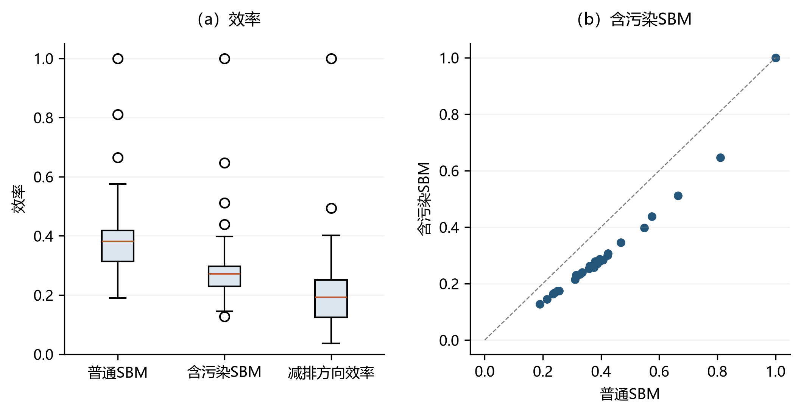

# DEA程序编写的实战演练 {#sec-12}

> **代码运行约定**：在项目根目录运行，先安装 `python -m pip install numpy pandas scipy matplotlib pyomo highspy openpyxl`。各段 Python 代码按本章顺序在同一会话执行，后文复用前文定义；默认采用 HiGHS。公式讲解片段另标为 `text`，不作为独立程序执行。

上一章详细介绍了如何在Python中逐步编写DEA程序。本章将通过6个代表性实例开展程序编写的实战演练，涵盖SBM模型、含非期望产出的SBM模型、DDF模型、NDDF模型、Malmquist生产率指数以及Malmquist-Luenberger生产率指数。

第三章至第十章已系统建立了各类DEA模型的理论基础，第十一章则阐述了运用Python与Pyomo将这些模型转化为线性规划求解程序的一般编程逻辑。本章在上述理论与编程逻辑之上开展实战演练，依次实现SBM、含非期望产出的SBM、方向距离函数（DDF）、非径向方向距离函数（NDDF）、Malmquist以及Malmquist-Luenberger六类具有代表性的模型。需要强调的是，尽管这些模型在经济学含义与数学形式上各有侧重，其在计算结构上却共享同一骨架——公式解析、数据准备、模型构建、求解与结果提取——差异仅局部地体现在目标函数与约束条件的设定之上。本章将先以两个完整示例呈现这一骨架的全貌，进而通过提取公共工具函数说明如何在保持模型特异性的同时消除重复代码，最后在后续模型中复用这些工具，将注意力集中于各模型特有的逻辑。


## SBM模型的程序编写 {#sec-12-1}

Tone(2001)提出了基于松弛测度的效率模型（Slacks-Based Measure, SBM）。假设决策单元以$P$种投入要素$\boldsymbol{X}$生产出$Q$种产出$\boldsymbol{Y}$，相应的技术效率测度模型定义如下：

$$
\begin{aligned}
\min \quad & \rho = \frac{1 - \frac{1}{P}\sum_{p=1}^{P} s_{p}^{\boldsymbol{X}}/\boldsymbol{X}_{0p}}{1 + \frac{1}{Q}\sum_{q=1}^{Q} s_{q}^{\boldsymbol{Y}}/Y_{0q}} \\
\text{s.t.} \quad
& \boldsymbol{X}_{0p} = \sum_{i=1}^{N} \lambda_{i}\boldsymbol{X}_{ip} + s_{p}^{\boldsymbol{X}}, & p = 1, \dots, P, \\
& Y_{0q} = \sum_{i=1}^{N} \lambda_{i}\boldsymbol{Y}_{iq} - s_{q}^{\boldsymbol{Y}}, & q = 1, \dots, Q, \\
& \lambda_{i}, s_{p}^{\boldsymbol{X}}, s_{q}^{\boldsymbol{Y}} \geq 0.
\end{aligned}
$$

上述目标函数为非线性形式，无法直接运用线性规划技术求解，因此在求解前需对其进行如下**Charnes-Cooper线性转换**：

$$
\begin{aligned}
\min \quad & \tau = t - \frac{1}{P}\sum_{p=1}^{P} S_{p}^{\boldsymbol{X}}/\boldsymbol{X}_{0p} \\
\text{s.t.} \quad
& 1 = t + \frac{1}{Q}\sum_{q=1}^{Q} S_{q}^{\boldsymbol{Y}}/\boldsymbol{Y}_{0q}, \\
& t\boldsymbol{X}_{0p} = \sum_{i=1}^{N} \Lambda_{i}\boldsymbol{X}_{ip} + S_{p}^{\boldsymbol{X}}, & p = 1, \dots, P, \\
& t\boldsymbol{Y}_{0q} = \sum_{i=1}^{N} \Lambda_{i}\boldsymbol{Y}_{iq} - S_{q}^{\boldsymbol{Y}}, & q = 1, \dots, Q, \\
& \Lambda_{i}, S_{p}^{\boldsymbol{X}}, S_{q}^{\boldsymbol{Y}} \geq 0,\ t > 0.
\end{aligned}
$$

在这个线性规划问题中：

(1) **变量**为{$t$, $S_{p}^{\boldsymbol{X}}$, $S_{q}^{\boldsymbol{Y}}$, $\Lambda_{i}$}，其中$t$是一维的，$S_{p}^{\boldsymbol{X}}$的维度是$P$，$S_{q}^{\boldsymbol{Y}}$的维度是$Q$，$\Lambda_{i}$的维度是$N$；$\Lambda_{i}, S_{p}^{\boldsymbol{X}}, S_{q}^{\boldsymbol{Y}} \geq 0, t>0$；

(2) **目标函数**中变量$t$和$S_{p}^{\boldsymbol{X}}$对应的系数分别为1和$\frac{1}{P \cdot \boldsymbol{X}_{0p}}$；求最小值；

(3) **约束条件**有三个：
- 第一个约束（Charnes-Cooper转换约束）对应的行数有$1$个，其中$t$和$S_{q}^{\boldsymbol{Y}}$的系数分别为1和$\frac{1}{Q \cdot \boldsymbol{Y}_{0q}}$；
- 第二个约束（投入约束）对应的行数有$P$个，其中$t$、$\Lambda_{i}$、$S_{p}^{\boldsymbol{X}}$的系数分别为$\boldsymbol{X}_{0p}$、$\boldsymbol{X}_{ip}$和1；
- 第三个约束（产出约束）对应的行数有$Q$个，其中$t$、$\Lambda_{i}$、$S_{q}^{\boldsymbol{Y}}$的系数分别为$\boldsymbol{Y}_{0q}$、$\boldsymbol{Y}_{iq}$和1；
- 三个约束的约束符号都为$=$。

以下给出求解SBM效率的完整实现。作为本章第一个完整示例，该函数意在呈现从公式解析、数据准备到模型求解与结果整理的完整流程，并为后续各模型提供一个可对照的计算骨架。

```python
from deabook import data_path
from pyomo.environ import *
from pyomo.opt import SolverStatus, TerminationCondition
import pandas as pd
from deabook.example.book_cases.loaders import china
import numpy as np
import re
import warnings

warnings.filterwarnings("ignore")


def sbm(formula, dataframe, eval_query=None, ref_query=None, solver="highs"):
    """
    计算SBM（Slacks-Based Measure）效率值。
    
    基于Tone(2001)的SBM模型，通过Charnes-Cooper线性转换将非线性
    规划问题转化为线性规划问题求解。
    
    Parameters
    ----------
    formula : str
        公式字符串，格式为 "产出 = 投入1 投入2 ..."
        例如："Y = K L"
    dataframe : pd.DataFrame
        待评价决策单元的投入产出数据框
    eval_query : str or None, default None
        筛选待评价决策单元的query字符串。None表示评价全部
    ref_query : str or None, default None
        筛选参照决策单元的query字符串。None表示使用全部
    solver : str, default "highs"
        线性规划求解器名称
    
    Returns
    -------
    pd.DataFrame
        包含效率值(obj)和各投入产出松弛变量的DataFrame
    
    Examples
    --------
    >>> import pandas as pd
from deabook.example.book_cases.loaders import china
    >>> ex4 = china(scaled=True)
    >>> result = sbm("Y = K L", ex4, "t==[1,2,3]", "t==[1,2,3]")
    """
    # === Step 1: 解析公式字符串 ===
    input_vars = formula.split("=")[1].strip(" ")
    xcol = re.compile(" +").sub(" ", input_vars).split(" ")
    output_vars = formula.split("=")[0].strip(" ")
    ycol = re.compile(" +").sub(" ", output_vars).split(" ")
    
    # === Step 2: 根据查询条件准备数据 ===
    if eval_query is None:
        index_eval = dataframe.index
    else:
        index_eval = dataframe.query(eval_query).index
    
    if ref_query is None:
        index_ref = dataframe.index
    else:
        index_ref = dataframe.query(ref_query).index
    
    data = dataframe.loc[index_eval, xcol + ycol]
    dataref = dataframe.loc[index_ref, xcol + ycol]
    
    xref = dataref.loc[:, xcol]   # 参照单元投入
    yref = dataref.loc[:, ycol]   # 参照单元产出
    
    # === Step 3: 数据验证 ===
    assert data[xcol + ycol].notna().all().all(), "数据包含缺失值"
    assert (data[xcol] > 0).all().all(), "投入数据必须严格为正"
    assert (data[ycol] > 0).all().all(), "产出数据必须严格为正"
    
    # 初始化结果存储字典
    slack_x_results = {}   # 投入松弛变量
    slack_y_results = {}   # 产出松弛变量
    obj_results = {}       # 目标函数值
    
    # === Step 4: 对每个决策单元构建并求解线性规划 ===
    for j in data.index:
        x = data.loc[j, xcol]   # 被评价单元投入
        y = data.loc[j, ycol]   # 被评价单元产出
        
        # 构建Pyomo模型
        model = ConcreteModel()
        model.I = Set(initialize=dataref.index)          # 参照决策单元集合
        model.K = Set(initialize=range(len(xcol)))       # 投入变量集合
        model.L = Set(initialize=range(len(ycol)))       # 产出变量集合
        
        # 定义决策变量
        model.t = Var(domain=PositiveReals, doc="CC transformation variable")
        model.slack_x = Var(model.K, bounds=(0.0, None), doc="input slack")
        model.slack_y = Var(model.L, bounds=(0.0, None), doc="output slack")
        model.intensity = Var(model.I, bounds=(0.0, None), doc="intensity variables")
        
        # 目标函数：min t - (1/P) * sum(slack_x[p] / x[p])
        def objective_rule(model):
            return model.t - sum(
                model.slack_x[k] / x.iloc[k] for k in model.K
            ) / len(xcol)
        model.obj = Objective(rule=objective_rule, sense=minimize)
        
        # Charnes-Cooper转换约束
        def cc_trans_rule(model):
            return 1 == model.t + sum(
                model.slack_y[l] / y.iloc[l] for l in model.L
            ) / len(ycol)
        model.cc_trans = Constraint(rule=cc_trans_rule)
        
        # 投入约束：t * x[k] = sum(intensity[i] * xref[i,k]) + slack_x[k]
        def input_rule(model, k):
            return sum(
                model.intensity[i] * xref.loc[i, xcol[k]] for i in model.I
            ) == x.iloc[k] * model.t - model.slack_x[k]
        model.input = Constraint(model.K, rule=input_rule)
        
        # 产出约束：t * y[l] = sum(intensity[i] * yref[i,l]) - slack_y[l]
        def output_rule(model, l):
            return sum(
                model.intensity[i] * yref.loc[i, ycol[l]] for i in model.I
            ) == y.iloc[l] * model.t + model.slack_y[l]
        model.output = Constraint(model.L, rule=output_rule)
        
        # === Step 5: 求解模型 ===
        opt = SolverFactory(solver)
        if not opt.available(exception_flag=False):
            raise RuntimeError(f"求解器 '{solver}' 未安装。请安装后重试。")
        
        solution = opt.solve(model)
        
        if solution.solver.termination_condition == "optimal":
            # 提取结果（线性变换后松弛变量 slack = Slack / t）
            t_val = value(model.t)
            slack_x_results[j] = np.asarray(
                list(model.slack_x[:].value)
            ) / t_val
            slack_y_results[j] = np.asarray(
                list(model.slack_y[:].value)
            ) / t_val
            obj_results[j] = value(model.obj)
    
    # === Step 6: 格式化输出结果 ===
    obj_df = pd.DataFrame(obj_results, index=["obj"]).T
    
    slack_x_df = pd.DataFrame(slack_x_results, index=xcol).T
    slack_x_df.columns = slack_x_df.columns.map(lambda x: "slack " + str(x))
    
    slack_y_df = pd.DataFrame(slack_y_results, index=ycol).T
    slack_y_df.columns = slack_y_df.columns.map(lambda y: "slack " + str(y))
    
    result = pd.concat([obj_df, slack_x_df, slack_y_df], axis=1)
    return result
```

上述SBM函数沿用了第十一章所阐述的一般编程逻辑。函数首先解析公式字符串以分离投入与产出变量，并依据`eval_query`与`ref_query`筛选评价单元与参照单元；随后对数据的完整性与正性进行校验，以保证线性规划的可行。核心部分是针对每个被评价单元构建并求解对应的Pyomo模型——声明强度变量、各项松弛变量与Charnes-Cooper变换变量，定义以$\tau$为目标、以转化后约束为条件的线性规划，并调用求解器提取效率值与各项松弛。最后，函数将结果整理为结构化的DataFrame予以返回。下文两个说明性注记分别解释了强度变量的命名缘由，以及标量变量与带索引变量在结果提取时的取值差异。

> **命名说明**：`model.intensity`是DEA模型中的**强度变量**（intensity variable），对应数学公式中的$\lambda_i$。在Python中，`lambda`是关键字（用于定义匿名函数），因此不能作为变量名。使用`intensity`而非`lamda`，因为`intensity`是DEA文献中的标准术语，含义明确。`slack_x`和`slack_y`分别表示投入和产出的松弛变量。

> **标量变量与索引变量的取值方式不同。** `model.t` 是Charnes-Cooper变换引入的**标量**`Var`（声明时没有索引集），求解后 `model.t.value` 已经是一个浮点数，因此直接写 `t_val = value(model.t)`（或 `float(model.t.value)`）即可；若照搬索引变量的写法 `list(model.t.value)`，会得到 `TypeError: 'float' object is not iterable`。相反，`model.slack_x`、`model.slack_y`、`model.intensity` 是带索引集的`Var`，`model.slack_x[:].value` 返回的是切片视图，需要 `list(...)` 或 `np.asarray(list(...))` 才能展开成数组。判断依据只有一条：`Var` 声明时是否传入了索引集。

下面以本章省级面板中第1至3期为例调用`sbm`函数，其运行结果如**图12.1**所示：

```python
import pandas as pd
from deabook.example.book_cases.loaders import china

# 读取数据
ex4 = china(scaled=True)

# 计算SBM效率（评价第1-3期数据，参照集为第1-3期）
sbm_result = sbm("Y = K L", ex4, "t==[1,2,3]", "t==[1,2,3]")
print(sbm_result)
```

**图12.1：SBM模型代码运行结果**

结果DataFrame包含：`obj`（SBM效率值）、`slack K`（资本投入松弛）、`slack L`（劳动投入松弛）、`slack Y`（产出松弛）。效率值越小表示技术效率越低，SBM效率的取值范围为$(0, 1]$。当某决策单元的`obj`等于1时，表明其已落在生产前沿上、技术有效；`obj`偏离1的程度与各项松弛变量的大小共同刻画了该单元的无效来源与改进方向。

上述基础SBM未考虑生产过程中的非期望产出。在环境与发展的议题下，污染等副产品往往与经济产出相伴而生，忽略它们会使效率评价失真。下一节将扩展该框架，把非期望产出纳入前沿构造。

## 包含非期望产出的SBM模型的程序编写 {#sec-12-2}

Tone(2003)对原始SBM模型进行了扩展，使其能够用于包含非期望产出情形下的技术效率测度。假设决策单元以$P$种投入要素$\boldsymbol X$生产出$Q$种产出$\boldsymbol Y$，同时伴随产生$R$种非期望产出$\boldsymbol B$，相应的技术效率测度模型定义如下：

$$
\begin{aligned}
\min \quad & \rho=\frac{1-\frac{1}{P}\sum_{p=1}^{P}s_{p}^{\boldsymbol{X}}/\boldsymbol{X}_{0p}}
{1+\frac{1}{Q+R}\left(\sum_{q=1}^{Q}s_{q}^{\boldsymbol{Y}}/Y_{0q}+\sum_{r=1}^{R}s_{r}^{\boldsymbol{B}}/B_{0r}\right)} \\
\text{s.t.} \quad
& \boldsymbol{X}_{0p}=\sum_{i=1}^{N}\lambda_{i}\boldsymbol{X}_{ip}+s_{p}^{\boldsymbol{X}}, \quad p=1,\dots,P, \\
& \boldsymbol{Y}_{0q}=\sum_{i=1}^{N}\lambda_{i}\boldsymbol{Y}_{iq}-s_{q}^{\boldsymbol{Y}}, \quad q=1,\dots,Q, \\
& \boldsymbol{B}_{0r}=\sum_{i=1}^{N}\lambda_{i}\boldsymbol{B}_{ir}+s_{r}^{\boldsymbol{B}}, \quad r=1,\dots,R, \\
& \lambda_{i},s_{p}^{\boldsymbol{X}},s_{q}^{\boldsymbol{Y}},s_{r}^{\boldsymbol{B}}\geq 0 .
\end{aligned}
$$

利用线性转换方法，上述优化问题可以转换为如下线性规划问题：

$$
\begin{aligned}
\min \quad & \tau = t - \frac{1}{P}\sum_{p=1}^{P} S_{p}^{\boldsymbol{X}} / \boldsymbol{X}_{0p} \\
\text{s.t.} \quad
& 1 = t + \frac{1}{Q+R} \left( \sum_{q=1}^{Q} S_{q}^{\boldsymbol{Y}} / \boldsymbol{Y}_{0q} + \sum_{r=1}^{R} S_{r}^{\boldsymbol{B}} / \boldsymbol{B}_{0r} \right), \\
& t\boldsymbol{X}_{0p} = \sum_{i=1}^{N} \Lambda_{i}\boldsymbol{X}_{ip} + S_{p}^{\boldsymbol{X}}, \quad p = 1,...,P, \\
& t\boldsymbol{Y}_{0q} = \sum_{i=1}^{N} \Lambda_{i}\boldsymbol{Y}_{iq} - S_{q}^{\boldsymbol{Y}}, \quad q = 1,...,Q, \\
& t\boldsymbol{B}_{0r} = \sum_{i=1}^{N} \Lambda_{i}\boldsymbol{B}_{ir} + S_{r}^{\boldsymbol{B}}, \quad r = 1,...,R, \\
& \Lambda_{i}, S_{p}^{\boldsymbol{X}}, S_{q}^{\boldsymbol{Y}}, S_{r}^{\boldsymbol{B}} \geq 0, \quad t > 0.
\end{aligned}
$$

与[-@sec-12-1]节的SBM模型相比，含非期望产出的SBM模型增加了：
1. **非期望产出松弛变量** $S_{r}^{\boldsymbol{B}}$ 及其对应约束
2. **非期望产出项** 加入到Charnes-Cooper转换约束的分母中（$Q+R$）

```python
def sbm_undesirable(formula, dataframe, eval_query=None, ref_query=None,
                    solver="highs"):
    """
    计算含非期望产出的SBM效率值（Tone, 2003）。
    
    Parameters
    ----------
    formula : str
        公式字符串，格式为 "产出:非期望产出 = 投入1 投入2 ..."
        例如："Y:CO2 = K L"
    dataframe : pd.DataFrame
        待评价决策单元的投入产出数据框
    eval_query : str or None, default None
        筛选待评价决策单元的query字符串
    ref_query : str or None, default None
        筛选参照决策单元的query字符串
    solver : str, default "highs"
        线性规划求解器名称
    
    Returns
    -------
    pd.DataFrame
        包含效率值(obj)、投入松弛、期望产出松弛、非期望产出松弛的DataFrame
    
    Examples
    --------
    >>> result = sbm_undesirable("Y:CO2 = K L", ex4, "t==[1,2,3]", "t==[1,2,3]")
    """
    # === Step 1: 解析公式字符串（投入:非期望产出 = 投入变量）===
    input_vars = formula.split("=")[1].strip(" ")
    xcol = re.compile(" +").sub(" ", input_vars).split(" ")
    
    output_vars = formula.split("=")[0].split(":")[0].strip(" ")
    ycol = re.compile(" +").sub(" ", output_vars).split(" ")
    
    undesirable_vars = formula.split("=")[0].split(":")[1].strip(" ")
    bcol = re.compile(" +").sub(" ", undesirable_vars).split(" ")
    
    # === Step 2: 根据查询条件准备数据 ===
    if eval_query is None:
        index_eval = dataframe.index
    else:
        index_eval = dataframe.query(eval_query).index
    
    if ref_query is None:
        index_ref = dataframe.index
    else:
        index_ref = dataframe.query(ref_query).index
    
    data = dataframe.loc[index_eval, xcol + ycol + bcol]
    dataref = dataframe.loc[index_ref, xcol + ycol + bcol]
    
    xref = dataref.loc[:, xcol]   # 参照单元投入
    yref = dataref.loc[:, ycol]   # 参照单元期望产出
    bref = dataref.loc[:, bcol]   # 参照单元非期望产出（新增）
    
    # === Step 3: 数据验证 ===
    assert data[xcol + ycol + bcol].notna().all().all(), "数据包含缺失值"
    assert (data[xcol] > 0).all().all(), "投入数据必须严格为正"
    assert (data[ycol] > 0).all().all(), "期望产出数据必须严格为正"
    assert (data[bcol] >= 0).all().all(), "非期望产出不能为负"
    
    # 初始化结果存储
    slack_x_results = {}
    slack_y_results = {}
    slack_b_results = {}   # 非期望产出松弛（新增）
    obj_results = {}
    
    # === Step 4: 对每个决策单元构建并求解线性规划 ===
    for j in data.index:
        x = data.loc[j, xcol]   # 被评价单元投入
        y = data.loc[j, ycol]   # 被评价单元期望产出
        b = data.loc[j, bcol]   # 被评价单元非期望产出（新增）
        
        model = ConcreteModel()
        model.I = Set(initialize=dataref.index)
        model.K = Set(initialize=range(len(xcol)))
        model.L = Set(initialize=range(len(ycol)))
        model.M = Set(initialize=range(len(bcol)))   # 非期望产出集合（新增）
        
        model.t = Var(domain=PositiveReals, doc="CC transformation variable")
        model.slack_x = Var(model.K, bounds=(0.0, None), doc="input slack")
        model.slack_y = Var(model.L, bounds=(0.0, None), doc="desirable output slack")
        model.slack_b = Var(model.M, bounds=(0.0, None), doc="undesirable output slack")
        model.intensity = Var(model.I, bounds=(0.0, None), doc="intensity variables")
        
        # 目标函数（与基础SBM相同）
        def objective_rule(model):
            return model.t - sum(
                model.slack_x[k] / x.iloc[k] for k in model.K
            ) / len(xcol)
        model.obj = Objective(rule=objective_rule, sense=minimize)
        
        # CC转换约束（分母变为 Q+R，增加非期望产出项）
        def cc_trans_rule(model):
            return 1 == model.t + (
                sum(model.slack_y[l] / y.iloc[l] for l in model.L)
                + sum(model.slack_b[m] / b.iloc[m] for m in model.M)
            ) / (len(ycol) + len(bcol))
        model.cc_trans = Constraint(rule=cc_trans_rule)
        
        # 投入约束（与基础SBM相同）
        def input_rule(model, k):
            return sum(
                model.intensity[i] * xref.loc[i, xcol[k]] for i in model.I
            ) == x.iloc[k] * model.t - model.slack_x[k]
        model.input = Constraint(model.K, rule=input_rule)
        
        # 期望产出约束（与基础SBM相同）
        def output_rule(model, l):
            return sum(
                model.intensity[i] * yref.loc[i, ycol[l]] for i in model.I
            ) == y.iloc[l] * model.t + model.slack_y[l]
        model.output = Constraint(model.L, rule=output_rule)
        
        # 非期望产出约束（新增）：t*b = sum(lambda*bref) + slack_b
        def undesirable_output_rule(model, m):
            return sum(
                model.intensity[i] * bref.loc[i, bcol[m]] for i in model.I
            ) == b.iloc[m] * model.t - model.slack_b[m]
        model.undesirable_output = Constraint(model.M, rule=undesirable_output_rule)
        
        # === Step 5: 求解模型 ===
        opt = SolverFactory(solver)
        if not opt.available(exception_flag=False):
            raise RuntimeError(f"求解器 '{solver}' 未安装。请安装后重试。")
        
        solution = opt.solve(model)
        
        if solution.solver.termination_condition == "optimal":
            t_val = value(model.t)
            slack_x_results[j] = np.asarray(list(model.slack_x[:].value)) / t_val
            slack_y_results[j] = np.asarray(list(model.slack_y[:].value)) / t_val
            slack_b_results[j] = np.asarray(list(model.slack_b[:].value)) / t_val
            obj_results[j] = value(model.obj)
    
    # === Step 6: 格式化输出结果 ===
    obj_df = pd.DataFrame(obj_results, index=["obj"]).T
    
    slack_x_df = pd.DataFrame(slack_x_results, index=xcol).T
    slack_x_df.columns = slack_x_df.columns.map(lambda x: "slack " + str(x))
    
    slack_y_df = pd.DataFrame(slack_y_results, index=ycol).T
    slack_y_df.columns = slack_y_df.columns.map(lambda y: "slack " + str(y))
    
    result = pd.concat([obj_df, slack_x_df, slack_y_df], axis=1)
    
    slack_b_df = pd.DataFrame(slack_b_results, index=bcol).T
    slack_b_df.columns = slack_b_df.columns.map(lambda b: "slack " + str(b))
    result = pd.concat([result, slack_b_df], axis=1)
    
    return result
```

`sbm_undesirable`函数通过冒号分隔期望产出与非期望产出（公式左侧写作"Y:CO2"），从而在解析阶段同时得到`xcol`、`ycol`与`bcol`三个变量列表，其余公式解析与数据准备的流程与基础SBM一致。相较于[-@sec-12-1]节的基础SBM，该扩展主要体现在五处模型特有逻辑之上：在Charnes-Cooper转换约束的分母中以$Q+R$取代$Q$，将非期望产出纳入归一化项；相应地引入非期望产出集合`M`与松弛变量`slack_b`，并增列一条形如$t\,\boldsymbol B_0=\sum\lambda_i\boldsymbol B_i+S^{\boldsymbol B}$的非期望产出约束；最后在结果中追加`slack_b`列。除这几处外，函数的其余部分（公式解析、数据准备、求解与格式化）与基础SBM保持同一结构。

以下仍以本章省级面板第1至3期数据演示该函数的调用：

```python
import pandas as pd
from deabook.example.book_cases.loaders import china

ex4 = china(scaled=True)
result = sbm_undesirable("Y:CO2 = K L", ex4, "t==[1,2,3]", "t==[1,2,3]")
print(result)
```

**图12.2：含非期望产出SBM模型代码运行结果**

与图12.1相比，此处效率值已将CO$_2$等非期望产出纳入前沿构造，因而一个在传统SBM下有效的决策单元，一旦计入污染排放后可能转为无效——`obj`与`slack CO2`共同揭示了环境维度的无效率来源。


## 公共工具模块的建立 {#sec-12-3}

### 从代码重复到模块化的动机 {#sec-12-3-1}

完成[-@sec-12-1]节（SBM模型）和[-@sec-12-2]节（含非期望产出的SBM模型）的编程练习后，细心的读者可能已经注意到一个不容忽视的事实：**两个函数的代码存在大量重复**。不妨先做一个简单的对比：


| 代码段 | SBM (12.1) | SBM+非期望产出 (12.2) | 是否重复 |
|:------|:----------|:---------------------|:-------:|
| 导入语句 (`import ...`) | 有 | 有 | 是 |
| 公式解析（字符串分割） | `split("=")` | `split("=")` + `split(":")` | 类似 |
| 数据准备（query筛选） | 相同逻辑 | 相同逻辑 | 是 |
| 数据验证（缺失值/正数检查） | `assert`语句 | `assert`语句 | 是 |
| 求解器调用 | `SolverFactory` + `solve` | `SolverFactory` + `solve` | 是 |
| 结果格式化（DataFrame构造） | 相同逻辑 | 相同逻辑 | 是 |
| 异常处理 | `opt.available(exception_flag=False)` 检查 | `opt.available(exception_flag=False)` 检查 | 是 |
: SBM与含非期望产出SBM的代码重复分析 {#tbl-12-1}

由 @tbl-12-1 可以清晰地看出，**约70%的代码是重复的**，真正体现模型差异的部分（非期望产出的约束定义和变量声明）只占约30%。这种重复带来了一系列问题：

1. **维护困难**：如果发现数据验证逻辑有bug，需要在两个函数中分别修改；
2. **一致性风险**：修改时可能遗漏某个函数，导致行为不一致；
3. **可读性下降**：读者需要在大量重复代码中寻找差异点；
4. **扩展成本高**：每增加一个新模型，都需要"复制-粘贴-修改"一整套流程。

软件工程中有一条著名的原则——**DRY原则**（Don't Repeat Yourself，不要重复自己）。遵循这一原则，本节将两个示例中重复的代码提取为**公共工具函数**，构建一套共享的工具模块。后续所有模型（DDF、NDDF、Malmquist）都将复用这些工具，仅需关注各自模型特有的逻辑。

### 公共导入约定 {#sec-12-3-2}

本章后续各示例均依赖如下公共导入。在实际研究中，可将其置于脚本或Notebook起始处统一执行：

```python
"""DEA实战演练——公共导入模块"""
from pyomo.environ import *
from pyomo.opt import SolverStatus, TerminationCondition
import pandas as pd
from deabook.example.book_cases.loaders import china
import numpy as np
import re
import warnings

warnings.filterwarnings("ignore")
```

### 公式字符串的解析 {#sec-12-3-3}

DEA模型通过公式字符串指定投入和产出变量。为了保证代码的健壮性，使用正则表达式解析公式，并添加输入规范化处理。

```python
def normalize_formula(formula_str):
    """
    规范化公式字符串：统一分隔符、去除多余空格。
    
    Parameters
    ----------
    formula_str : str
        原始公式字符串，如 " Y  = K     L " 或 "Y:CO2 = K L"
    
    Returns
    -------
    str
        规范化后的公式字符串
    """
    # 统一全角符号为半角符号
    formula_str = formula_str.replace("：", ":").replace("＝", "=")
    # 将多个连续空格替换为单个空格
    formula_str = re.sub(r'\s+', ' ', formula_str).strip()
    return formula_str


def parse_formula(formula_str):
    """
    解析DEA公式字符串，提取投入变量名和产出变量名。
    
    支持格式：
    - 基础格式："产出 = 投入1 投入2"（如 "Y = K L"）
    - 含非期望产出格式："产出:非期望产出 = 投入1 投入2"（如 "Y:CO2 = K L"）
    
    Parameters
    ----------
    formula_str : str
        公式字符串，等号左边为产出变量，右边为投入变量
    
    Returns
    -------
    tuple
        (xcol, ycol, bcol) —— 分别为投入变量列表、期望产出变量列表、
        非期望产出变量列表。若无非期望产出，bcol为空列表。
    """
    formula_str = normalize_formula(formula_str)
    
    parts = formula_str.split("=")
    if len(parts) != 2:
        raise ValueError(
            f"公式格式错误：'{formula_str}'。应包含一个 '=' 分隔符"
        )
    
    left_side = parts[0].strip()
    right_side = parts[1].strip()
    
    xcol = [v.strip() for v in right_side.split(" ") if v.strip()]
    
    if ":" in left_side:
        output_parts = left_side.split(":")
        ycol = [v.strip() for v in output_parts[0].split(" ") if v.strip()]
        bcol = [v.strip() for v in output_parts[1].split(" ") if v.strip()]
    else:
        ycol = [v.strip() for v in left_side.split(" ") if v.strip()]
        bcol = []
    
    return xcol, ycol, bcol
```

### 数据验证与准备 {#sec-12-3-4}

```python
def validate_data(df, xcol, ycol, bcol=None):
    """
    验证投入产出数据是否符合DEA模型要求。
    
    Parameters
    ----------
    df : pd.DataFrame
        包含投入产出数据的DataFrame
    xcol : list of str
        投入变量列名列表
    ycol : list of str
        期望产出变量列名列表
    bcol : list of str or None, default None
        非期望产出变量列名列表
    
    Raises
    ------
    AssertionError
        数据不符合DEA模型要求时抛出
    """
    cols = xcol + ycol
    if bcol:
        cols = cols + bcol
    
    assert df[cols].notna().all().all(), \
        f"数据包含缺失值(NA)，请检查以下变量: {cols}"
    assert (df[xcol] > 0).all().all(), \
        f"投入变量 {xcol} 中存在非正值。SBM和DDF模型要求投入数据严格为正。"
    assert (df[ycol] > 0).all().all(), \
        f"期望产出变量 {ycol} 中存在非正值。"
    if bcol:
        assert (df[bcol] >= 0).all().all(), \
            f"非期望产出变量 {bcol} 中存在负值。"


def prepare_data(formula, dataframe, eval_query=None, ref_query=None):
    """
    根据公式和查询条件准备评价数据和参照数据。
    
    Parameters
    ----------
    formula : str
        公式字符串
    dataframe : pd.DataFrame
        包含投入产出数据的DataFrame
    eval_query : str or None, default None
        筛选待评价决策单元的query字符串
    ref_query : str or None, default None
        筛选参照决策单元的query字符串
    
    Returns
    -------
    tuple
        (data, dataref, xcol, ycol, bcol)
    """
    xcol, ycol, bcol = parse_formula(formula)
    
    if eval_query is None:
        index_eval = dataframe.index
    else:
        index_eval = dataframe.query(eval_query).index
    
    if ref_query is None:
        index_ref = dataframe.index
    else:
        index_ref = dataframe.query(ref_query).index
    
    all_cols = xcol + ycol + (bcol if bcol else [])
    data = dataframe.loc[index_eval, all_cols]
    dataref = dataframe.loc[index_ref, all_cols]
    
    return data, dataref, xcol, ycol, bcol
```

### 求解与结果格式化 {#sec-12-3-5}

```python
def solve_dea_model(model, solver_name="highs", timeout=60):
    """
    求解DEA模型并返回求解结果，包含完整的异常处理和状态检查。
    
    Parameters
    ----------
    model : pyomo.environ.ConcreteModel
        已构建的Pyomo模型对象
    solver_name : str, default "highs"
        求解器名称。推荐 "highs"；备选 "glpk"、"ipopt"
    timeout : int, default 60
        求解超时时间（秒）
    
    Returns
    -------
    pyomo.opt.results.SolverResults
        求解器返回的结果对象
    
    Raises
    ------
    RuntimeError
        求解器未安装、求解失败或未达到最优时抛出
    """
    solver = SolverFactory(solver_name)
    
    if not solver.available(exception_flag=False):
        raise RuntimeError(
            f"求解器 '{solver_name}' 未安装或不可用。\n"
            f"安装建议：conda install {solver_name}"
        )
    
    results = solver.solve(model, timelimit=timeout, load_solutions=False)
    
    if results.solver.status != SolverStatus.ok:
        raise RuntimeError(f"求解器状态异常: {results.solver.status}")
    
    if results.solver.termination_condition != TerminationCondition.optimal:
        if (results.solver.termination_condition ==
            TerminationCondition.infeasible):
            raise RuntimeError("线性规划无可行解。请检查数据是否存在异常值。")
        else:
            raise RuntimeError(
                f"求解未达到最优: {results.solver.termination_condition}"
            )
    
    model.solutions.load_from(results)
    return results


def format_sbm_results(obj_dict, slack_x_dict, slack_y_dict,
                       xcol, ycol, bcol=None, slack_b_dict=None):
    """
    将SBM模型的求解结果格式化为标准DataFrame输出。
    
    Parameters
    ----------
    obj_dict : dict
        目标函数值字典
    slack_x_dict, slack_y_dict : dict
        松弛变量字典
    xcol, ycol : list of str
        变量名列表
    bcol : list of str or None, default None
        非期望产出变量名列表
    slack_b_dict : dict or None, default None
        非期望产出松弛变量字典
    
    Returns
    -------
    pd.DataFrame
        包含效率值和各松弛变量的结果DataFrame
    """
    obj_df = pd.DataFrame(obj_dict, index=["obj"]).T
    
    slack_x_df = pd.DataFrame(slack_x_dict, index=xcol).T
    slack_x_df.columns = slack_x_df.columns.map(lambda x: "slack " + str(x))
    
    slack_y_df = pd.DataFrame(slack_y_dict, index=ycol).T
    slack_y_df.columns = slack_y_df.columns.map(lambda y: "slack " + str(y))
    
    result = pd.concat([obj_df, slack_x_df, slack_y_df], axis=1)
    
    if bcol and slack_b_dict:
        slack_b_df = pd.DataFrame(slack_b_dict, index=bcol).T
        slack_b_df.columns = slack_b_df.columns.map(lambda b: "slack " + str(
            b))
        result = pd.concat([result, slack_b_df], axis=1)
    
    return result


def format_ddf_results(obj_dict, index_list):
    """
    将DDF/NDDF模型的求解结果格式化为标准DataFrame输出。
    
    Parameters
    ----------
    obj_dict : dict
        目标函数值字典
    index_list : list
        DMU索引列表
    
    Returns
    -------
    pd.DataFrame
        包含方向距离值的结果DataFrame
    """
    return pd.DataFrame(obj_dict, index=["te"]).T
```

### 求解器的选择 {#sec-12-3-6}

本章默认使用开源 HiGHS 求解线性规划，安装命令为 `python -m pip install highspy`。其他求解器须按其安装与许可要求配置；不预设不同机器上的速度排序。

> **求解器安装提示**：关于各求解器的详细安装步骤，请参阅本书**附录A.[-@sec-1-3]节（求解器安装详细指南）**。以下代码片段可用于核验所需求解器是否可用：
>
> ```python
> # 验证求解器是否可用
> from pyomo.environ import SolverFactory
> for solver in ["highs", "glpk", "ipopt"]:
>     opt = SolverFactory(solver)
>     print(f"{solver}: {'可用' if opt.available(exception_flag=False) else '不可用'}")
> ```

> **说明**：公共工具模块的建立体现了软件工程思维在DEA编程中的应用。前两个完整示例已揭示重复代码带来的维护负担，[-@sec-12-4]节起后续各模型将复用本节定义的工具函数，仅聚焦于各模型特有的逻辑。研究者可将本节代码保存为独立的`.py`文件（如`dea_utils.py`），以便在实际研究中重复调用。


## DDF模型的程序编写 {#sec-12-4}

> **本节复用[-@sec-12-3]节的公共工具函数，仅展示模型特有逻辑。**

方向距离函数（Directional Distance Function, DDF）由 Chambers, Chung and Färe (1996, 1998) 提出，是测度技术效率的另一个常用工具；Chung, Färe and Grosskopf (1997) 则把它用于含非期望产出的生产技术，并在此基础上构造了 Malmquist-Luenberger 生产率指数（见 [-@sec-12-6-5] 节）。假设决策单元以$P$种投入要素$\boldsymbol X$ 生产出$Q$种产出$\boldsymbol Y$，同时伴随产生$R$种非期望产出$\boldsymbol B$，方向距离函数的定义如下：

$$
\vec{D}(\boldsymbol{X}, \boldsymbol{Y}, \boldsymbol{B};\boldsymbol{g})=\max\{\beta:(\boldsymbol{X},\boldsymbol{Y},\boldsymbol{B})+ \beta \,\boldsymbol{g}\circ(\boldsymbol{X},\boldsymbol{Y},\boldsymbol{B}) \in T\}
$$

其中$T$是生产技术集，$\boldsymbol{g}=(g_X,g_Y,g_B)'$是投入变量、期望产出变量和非期望产出变量调整的方向向量。

本章（及配套代码）统一采用**无量纲方向系数**口径：$g$ 的每个分量取自 $\{-1,0,1\}$，实际的调整幅度由该系数与被评价单元自身的观测值相乘得到。因此投影点写作 $\boldsymbol{X}_0+\beta\,\boldsymbol{g_X}\circ\boldsymbol{X}_0$（"$\circ$"表示逐分量相乘），例如 $g_{X}=-1$ 对应投入缩减到 $(1-\beta)\boldsymbol X_0$。按这一口径，方向距离函数可以由下面的线性规划问题求解：

$$
\begin{aligned}
& \max_{\beta, \lambda} \quad \beta \\
\text{s.t.} \quad
& \sum_{i=1}^{N} \lambda_{i} \boldsymbol{X_{i}} \leq \boldsymbol{X}_0 + \beta \,\boldsymbol{g_X}\circ\boldsymbol{X}_0, \\
& \sum_{i=1}^{N} \lambda_{i} \boldsymbol{Y_{i}} \geq \boldsymbol{Y}_0 + \beta \,\boldsymbol{g_Y}\circ\boldsymbol{Y}_0, \\
& \sum_{i=1}^{N} \lambda_{i} \boldsymbol{B_{i}} = \boldsymbol{B}_0 + \beta \,\boldsymbol{g_B}\circ\boldsymbol{B}_0, \\
& \lambda_{i} \geq 0, \quad i=1, \ldots, N.
\end{aligned}
$$

若采用文献中常见的"方向向量与变量同量纲"口径（即 $\boldsymbol g$ 直接是一个投入产出向量），则上式右端为 $\boldsymbol X_0+\beta\boldsymbol g_X$，此时等比例调整对应 $\boldsymbol g_X=-\boldsymbol X_0$。两种写法在等比例设定下给出相同的 $\beta$，但 $\boldsymbol g$ 的取值含义不同，混用会把方向距离的单位读错。

在这个线性规划问题中：

(1) **变量**为{$\beta$, $\lambda_{i}$}，其中$\beta$是一维的，$\lambda_{i}$的维度是$N$；$\lambda_{i}\geq 0$，$\beta$无约束；

(2) **目标函数**中变量$\beta$对应的系数为1；求最大值；

(3) **约束条件**有三个，分别对应投入、期望产出和非期望产出；约束符号分别为$\leq$、$\geq$和$=$。


### 从SBM到DDF：模型逻辑的转变 {#sec-12-4-1}

在正式编写代码之前，有必要厘清DDF模型与[-@sec-12-1]节SBM模型的根本差异，因为这决定了代码结构的显著不同。

**第一，效率测度方式不同。** SBM模型通过**松弛变量**直接度量各投入产出的超额或不足，其效率值是一个介于0和1之间的比值。而DDF模型通过**方向距离**$\beta$来度量被评价DMU沿指定方向$\boldsymbol{g}$到生产前沿的"距离"。$\beta$越大，表示该DMU距离前沿越远，效率越低。从经济学直觉上看，SBM回答的是"各变量需要调整多少比例"，而DDF回答的是"沿某个特定方向还能走多远"。

**第二，目标函数的结构差异。** SBM模型由于涉及分式形式，需要通过Charnes-Cooper转换引入额外的变量$t$和相应的转换约束。DDF模型的目标函数直接就是最大化$\beta$，是一个标准的线性目标函数，无需任何转换。这大大简化了模型构建——不再需要处理CC转换变量$t$，也无需在结果提取时进行$\text{slack}/t$的逆变换。

**第三，约束条件的方向性。** SBM模型的所有约束都是等式（投入约束和产出约束均为$=$），松弛变量以显式形式出现在约束中。DDF模型的约束则使用不等号：投入约束是$\leq$（参照单元的投入组合不超过被评价单元的投入加上方向调整），期望产出约束是$\geq$（参照单元的产出组合不少于被评价单元的产出加上方向调整），非期望产出约束是$=$（通常假设非期望产出需要严格匹配）。这种不等式的使用意味着松弛变量被"隐含"在约束中，而非显式声明。

**第四，方向向量的引入。** DDF模型最大的特色是方向向量$\boldsymbol{g}$，它决定了效率改进的方向。在环境效率分析中，最典型的方向向量设定是**同时减少投入和非期望产出、增加期望产出**，按本节的无量纲系数口径即 $g_X = -1$，$g_Y = 1$，$g_B = -1$（等价于同量纲口径下的 $\boldsymbol g_X=-\boldsymbol X_0$、$\boldsymbol g_Y=\boldsymbol Y_0$、$\boldsymbol g_B=-\boldsymbol B_0$）。这一设定具有明确的经济学含义：$\beta$可以解释为"所有投入和非期望产出等比例减少 $\beta$、同时期望产出等比例增加 $\beta$"的潜在改进空间。


基于以上分析，可以预见`ddf`函数的代码结构将与`sbm`函数有显著差异：不再需要`t`变量和CC转换约束，不再提取松弛变量，而是直接提取$\beta$作为效率度量。同时，函数需要接受额外的方向向量参数`gx`、`gy`、`gb`，并提供合理的默认值。

```python
def ddf(formula, dataframe, gx=None, gy=None, gb=None,
        eval_query=None, ref_query=None, solver="highs"):
    """
    计算方向距离函数（Directional Distance Function, DDF）效率值。
    
    基于Chambers, Chung and Färe (1996, 1998)的DDF模型（含非期望产出的
    应用见Chung, Färe and Grosskopf, 1997），支持投入、期望产出和非期望产出
    的自定义方向向量。
    
    Parameters
    ----------
    formula : str
        公式字符串，格式为 "产出:非期望产出 = 投入1 投入2 ..."
        例如："Y:CO2 = K L"
    dataframe : pd.DataFrame
        待评价决策单元的投入产出数据框
    gx : list or None, default None
        投入方向向量。None表示默认 [-1, -1, ...]（投入缩减）
    gy : list or None, default None
        期望产出方向向量。None表示默认 [1, 1, ...]（产出扩张）
    gb : list or None, default None
        非期望产出方向向量。None表示默认 [-1, -1, ...]（非期望产出缩减）
    eval_query : str or None, default None
        筛选待评价决策单元的query字符串
    ref_query : str or None, default None
        筛选参照决策单元的query字符串
    solver : str, default "highs"
        线性规划求解器名称
    
    Returns
    -------
    pd.DataFrame
        包含方向距离值（te列）的结果DataFrame
    
    Notes
    -----
    方向向量默认取：
    - gx = [-1, -1, ...]：投入按比例缩减
    - gy = [1, 1, ...]：期望产出按比例扩张
    - gb = [-1, -1, ...]：非期望产出按比例缩减
    """
    # 复用公共工具：解析公式并准备数据
    data, dataref, xcol, ycol, bcol = prepare_data(
        formula, dataframe, eval_query, ref_query
    )
    validate_data(dataframe, xcol, ycol, bcol)
    
    xref = dataref.loc[:, xcol]
    yref = dataref.loc[:, ycol]
    bref = dataref.loc[:, bcol]
    
    # 设置默认方向向量（若未提供）
    if gx is None:
        gx = [-1] * len(xcol)
    if gy is None:
        gy = [1] * len(ycol)
    if gb is None:
        gb = [-1] * len(bcol)
    
    obj_results = {}
    
    for j in data.index:
        x = data.loc[j, xcol]
        y = data.loc[j, ycol]
        b = data.loc[j, bcol]
        
        model = ConcreteModel()
        model.I = Set(initialize=dataref.index)
        model.K = Set(initialize=range(len(xcol)))
        model.L = Set(initialize=range(len(ycol)))
        model.M = Set(initialize=range(len(bcol)))
        
        # DDF特有变量：方向距离 beta（无约束）
        model.beta = Var(bounds=(None, None), within=Reals,
                         doc='directional distance')
        model.intensity = Var(model.I, bounds=(0.0, None),
                              doc='intensity variables')
        
        # 目标函数：maximize beta
        def objective_rule(model):
            return model.beta
        model.obj = Objective(rule=objective_rule, sense=maximize)
        
        # 投入约束：sum(lambda * xref) <= x + beta * gx * x
        def input_rule(model, k):
            return (sum(model.intensity[i] * xref.loc[i, xcol[k]]
                        for i in model.I)
                    - model.beta * gx[k] * x.iloc[k] <= x.iloc[k])
        model.input = Constraint(model.K, rule=input_rule)
        
        # 期望产出约束：sum(lambda * yref) >= y + beta * gy * y
        def output_rule(model, l):
            return (-sum(model.intensity[i] * yref.loc[i, ycol[l]]
                         for i in model.I)
                    + model.beta * gy[l] * y.iloc[l] <= -y.iloc[l])
        model.output = Constraint(model.L, rule=output_rule)
        
        # 非期望产出约束：sum(lambda * bref) = b + beta * gb * b
        def undesirable_output_rule(model, m):
            return (sum(model.intensity[i] * bref.loc[i, bcol[m]]
                        for i in model.I)
                    - model.beta * gb[m] * b.iloc[m] == b.iloc[m])
        model.undesirable_output = Constraint(model.M,
            rule=undesirable_output_rule)
        
        # 求解并提取结果
        try:
            solution = solve_dea_model(model, solver)
            obj_results[j] = value(model.obj)
        except RuntimeError as e:
            print(f"DMU {j} 求解失败: {e}")
            obj_results[j] = np.nan
    
    # 复用公共工具：格式化输出
    return format_ddf_results(obj_results, data.index)
```


以下围绕若干关键设计选择，剖析`ddf`函数相对于SBM模型的取舍。

**关于方向向量的默认值设定（第42-48行）。** 当用户不提供方向向量时，函数自动采用"投入缩减、产出扩张、非期望产出缩减"的经典设定。具体来说，`gx = [-1] * len(xcol)`为每种投入分配-1的方向系数，这意味着在投入约束中，被评价DMU的右端项变为$x + \beta \cdot (-1) \cdot x = x(1-\beta)$，即投入允许减少到原来的$(1-\beta)$倍。同理，`gy = [1] * len(ycol)`使期望产出增加到原来的$(1+\beta)$倍，`gb = [-1] * len(bcol)`使非期望产出减少到原来的$(1-\beta)$倍。这种默认设定符合环境效率分析中"少投入、多产出、少污染"的直觉。

**关于变量的声明（第61-65行）。** DDF模型只声明了两个变量：`model.beta`和`model.intensity`。与SBM模型相比，这里缺少了`t`变量和各类松弛变量。`model.beta`被声明为`within=Reals`且`bounds=(None, None)`，即$\beta$是一个无约束的实数变量。理论上$\beta \geq 0$（距离不能为负），但即使不显式设置下界，最优解也会自动满足非负性，因为目标函数是最大化$\beta$且$\beta=0$总是可行解（取$\lambda_i$使得参照单元恰好复制被评价单元即可）。

**关于约束的数学转换（第71-91行）。** 代码中的约束形式与数学公式略有不同，这是为了适配Pyomo的标准形式$\text{expression} \leq \text{constant}$或$\text{expression} = \text{constant}$。以投入约束为例，数学形式是$\sum \lambda_i X_{ik} \leq X_{0k} + \beta g_{Xk} X_{0k}$，代码中将其整理为$\sum \lambda_i X_{ik} - \beta g_{Xk} X_{0k} \leq X_{0k}$。这种等价变形使得所有与变量相关的项都在不等式左侧，常数项在右侧，符合线性规划的标准矩阵形式。

**关于期望产出约束的符号处理（第81-85行）。** 细心的读者可能注意到，期望产出约束被改写成了"小于等于"形式，且$y$项带有负号。这是因为数学上的$\geq$约束在移项后变成了$-\sum \lambda_i Y_{ik} + \beta g_{Yk} Y_{0k} \leq -Y_{0k}$。Pyomo内部会将这种形式正确处理，但理解这种符号转换有助于调试约束错误。

**关于异常处理的设计（第94-99行）。** 与SBM模型直接使用`if`判断求解状态不同，`ddf`函数使用`try-except`块捕获`solve_dea_model`抛出的`RuntimeError`。这种设计更加Pythonic——将求解和状态检查封装在工具函数中，模型函数只需关注"求解成功时记录结果，失败时记录NaN并打印警告"。这也体现了分层错误处理的思想：底层工具函数负责诊断具体问题（求解器未安装、无可行解、未达最优），上层模型函数负责决定失败后的业务逻辑（跳过该DMU、使用默认值等）。

以下给出`ddf`函数的调用示例：

```python
import pandas as pd
from deabook.example.book_cases.loaders import china
ex4 = china(scaled=True)
ddf_result = ddf("Y:CO2 = K L", ex4)
print(ddf_result)
```

**图12.3：DDF模型代码运行结果**

返回的`te`列即为方向距离$\beta$；$\beta=0$表示决策单元已位于前沿、方向调整空间耗尽，而$\beta$越大意味着该单元沿既定方向距前沿越远、潜在改进幅度越大。


## NDDF模型的程序编写 {#sec-12-5}

> **本节复用[-@sec-12-3]节的公共工具函数，仅展示模型特有逻辑。**

Zhou et al. (2012)提出的非径向方向距离函数（Non-radial Directional Distance Function, NDDF）允许投入和产出变量进行不同比例的调整。假设决策单元以$P$种投入要素$\boldsymbol X$生产出$Q$种产出$\boldsymbol Y$，同时伴随产生$R$种非期望产出$\boldsymbol B$，NDDF的定义如下：

$$
\vec{D}(\boldsymbol X, \boldsymbol Y, \boldsymbol B;\boldsymbol g)=\max\{\boldsymbol{w'\beta}:(\boldsymbol X, \boldsymbol Y, \boldsymbol B)+\boldsymbol{\beta'}\text{diag}(\boldsymbol g\circ(\boldsymbol X,\boldsymbol Y,\boldsymbol B)) \in T\}
$$

其中$\boldsymbol g=(\boldsymbol{g_X,g_Y,g_B})'$是方向系数向量（口径与 [-@sec-12-4] 节一致：各分量取自 $\{-1,0,1\}$，实际调整幅度由该系数乘以被评价单元的观测值得到），$\boldsymbol{\beta}=(\beta_X,\beta_Y,\beta_B)'$是各变量对应的调整因子向量，$\boldsymbol w=(\omega_X,\omega_Y,\omega_B)'$是权重向量。利用数据包络分析的方法，NDDF可以由以下线性规划问题求解：

$$
\begin{aligned}
& \max \quad \boldsymbol{w'\beta} \\
\text{s.t.} \quad
& \sum_{i=1}^{N} \lambda_{i} \boldsymbol X_{i} \leq \boldsymbol x + \text{diag}(\boldsymbol g_{X}\circ\boldsymbol x)\boldsymbol{\beta_{X}}, \\
& \sum_{i=1}^{N} \lambda_{i} \boldsymbol Y_{i} \geq \boldsymbol y + \text{diag}(\boldsymbol g_{Y}\circ\boldsymbol y)\boldsymbol{\beta_{Y}}, \\
& \sum_{i=1}^{N} \lambda_{i} \boldsymbol B_{i} = \boldsymbol b + \text{diag}(\boldsymbol g_{B}\circ\boldsymbol b)\boldsymbol{\beta_{B}}, \\
& \lambda_{i} \geq 0, \quad \boldsymbol{\beta} \geq 0.
\end{aligned}
$$

即第 $k$ 个投入的约束为 $\sum_i\lambda_i X_{ik}\le x_k(1+g_{Xk}\beta_{Xk})$，与代码中的 `- gx[k] * x.iloc[k] * model.beta_x[k] <= x.iloc[k]` 一一对应。

NDDF与DDF的主要区别在于：
1. **每个变量有独立的调整因子** $\beta_X, \beta_Y, \beta_B$（而非单一的$\beta$）
2. **目标函数是加权求和** $\boldsymbol{w'\beta}$
3. **所有调整因子非负**

### 从DDF到NDDF：非径向化的设计哲学 {#sec-12-5-1}
如果说DDF模型是DEA效率测度的"径向版本"——所有投入按同一比例$\beta$调整、所有期望产出按同一比例$\beta$调整，那么NDDF模型则解除了这一"等比例"约束，允许每种投入、每种产出拥有**各自独立的调整因子**。这种非径向化的设计具有重要的经济学意义：在现实生产中，不同投入要素（如资本和劳动）的替代弹性各不相同，不同产出（如GDP和CO$_2$）的减排成本也存在差异，强制它们按相同比例调整显然过于粗糙。NDDF通过为每种变量分配独立的$\beta$和权重$w$，能够更精确地刻画技术效率的结构性特征。**权重向量$\boldsymbol{w}$的设计考量**是NDDF模型编程中的核心问题。从数学上看，$\boldsymbol{w}$的作用是聚合各变量的调整因子为一个标量目标值。权重设定的经济学含义是：研究者对不同变量改进的**相对重视程度**。例如，在环境效率评价中，如果研究者认为减少CO$_2$排放比减少资本投入更为重要，就可以给CO$_2$对应的$\beta_B$赋予更大的权重。当用户不提供权重时，函数采用**等权重**作为默认设定（代码第52-65行）。等权重的计算逻辑是：首先统计非零方向向量的变量类型数（投入、期望产出、非期望产出三类中哪些参与了方向调整），然后将总权重1均分给各类变量，再在各类型内部均分给每种具体变量。例如，当投入、期望产出、非期望产出三类均参与调整且各有1种变量时，每种变量获得的权重为$1/3$。这种设定保证了目标函数具有对称性和可比性，且当方向向量变化时权重自动适应。**目标函数中系数符号的处理**需要特别关注（代码第72-78行）。观察代码可以发现，目标函数表达式为：

```text
-sum(w_x[k] * gx[k] * model.beta_x[k]) 
+ sum(w_y[l] * gy[l] * model.beta_y[l]) 
- sum(w_b[m] * gb[m] * model.beta_b[m])
```

为什么投入项和非期望产出项带有负号，而期望产出项带有正号？这是因为$\beta$的非负约束与方向向量的符号共同决定了改进方向。当$g_X = -1$（投入缩减）时，$-w_X \cdot (-1) \cdot \beta_X = w_X \beta_X$，目标函数中该项为正值，最大化目标函数意味着鼓励投入调整因子$\beta_X$增大。同理，当$g_Y = 1$（产出扩张）时，$w_Y \cdot 1 \cdot \beta_Y = w_Y \beta_Y$也为正值。这种符号设计确保了最大化$\boldsymbol{w'\beta}$等价于最大化各变量的有效改进幅度。**从变量声明看模型结构差异。** NDDF模型声明了三种独立的调整因子变量（`beta_x`、`beta_y`、`beta_b`），分别对应投入、期望产出和非期望产出，每种都是向量形式（以各自变量集合为索引）。这与DDF模型中单一的`beta`标量形成鲜明对比。此外，NDDF要求所有$\beta \geq 0$，因此在变量声明时显式设置了`bounds=(0.0, None)`。

```python
def nddf(formula, dataframe, gx=None, gy=None, gb=None,
         weight=None, eval_query=None, ref_query=None, solver="highs"):
    """
    计算非径向方向距离函数（NDDF）效率值（Zhou et al., 2012）。
    
    NDDF允许投入和产出进行不同比例的调整，通过权重向量w对各调整因子
    进行加权求和作为目标函数。
    
    Parameters
    ----------
    formula : str
        公式字符串，格式为 "产出:非期望产出 = 投入1 投入2 ..."
    dataframe : pd.DataFrame
        待评价决策单元的投入产出数据框
    gx, gy, gb : list or None, default None
        投入、期望产出、非期望产出的方向向量。None时使用默认值
    weight : list or None, default None
        权重向量 [w_X, w_Y, w_B]。None时自动计算等权重
    eval_query : str or None, default None
        筛选待评价决策单元的query字符串
    ref_query : str or None, default None
        筛选参照决策单元的query字符串
    solver : str, default "highs"
        线性规划求解器名称
    
    Returns
    -------
    pd.DataFrame
        包含目标函数值(obj)和各变量调整因子(scale)的结果DataFrame
    """
    # 复用公共工具：解析公式并准备数据
    data, dataref, xcol, ycol, bcol = prepare_data(
        formula, dataframe, eval_query, ref_query
    )
    validate_data(dataframe, xcol, ycol, bcol)
    
    xref = dataref.loc[:, xcol]
    yref = dataref.loc[:, ycol]
    bref = dataref.loc[:, bcol]
    
    # 设置默认方向向量
    if gx is None:
        gx = [-1] * len(xcol)
    if gy is None:
        gy = [1] * len(ycol)
    if gb is None:
        gb = [-1] * len(bcol)
    
    # 设置默认权重（等权重）
    if weight is None:
        weight = []
        # 计算非零方向向量的种类数
        num_directions = (
            int(gx[0] != 0) + int(gy[0] != 0) + int(gb[0] != 0)
        )
        # 每种变量类型内部等权重
        for _ in range(len(xcol)):
            weight.append(1.0 / num_directions / len(xcol))
        for _ in range(len(ycol)):
            weight.append(1.0 / num_directions / len(ycol))
        for _ in range(len(bcol)):
            weight.append(1.0 / num_directions / len(bcol))
    
    # 分离各变量类型的权重
    w_x = weight[0:len(xcol)]
    w_y = weight[len(xcol):len(xcol) + len(ycol)]
    w_b = weight[len(xcol) + len(ycol):len(xcol) + len(ycol) + len(bcol)]
    
    # 初始化结果存储
    beta_x_results = {}
    beta_y_results = {}
    beta_b_results = {}
    obj_results = {}
    
    for j in data.index:
        x = data.loc[j, xcol]
        y = data.loc[j, ycol]
        b = data.loc[j, bcol]
        
        model = ConcreteModel()
        model.I = Set(initialize=dataref.index)
        model.K = Set(initialize=range(len(xcol)))
        model.L = Set(initialize=range(len(ycol)))
        model.M = Set(initialize=range(len(bcol)))
        
        # NDDF特有变量：各变量类型的独立调整因子
        model.beta_x = Var(model.K, bounds=(0.0, None), doc='scale factor x')
        model.beta_y = Var(model.L, bounds=(0.0, None), doc='scale factor y')
        model.beta_b = Var(model.M, bounds=(0.0, None), doc='scale factor b')
        model.intensity = Var(model.I, bounds=(0.0, None),
                              doc='intensity variables')
        
        # NDDF特有目标函数：加权求和 w' * beta
        def objective_rule(model):
            return (
                -sum(w_x[k] * gx[k] * model.beta_x[k] for k in model.K)
                + sum(w_y[l] * gy[l] * model.beta_y[l] for l in model.L)
                - sum(w_b[m] * gb[m] * model.beta_b[m] for m in model.M)
            )
        model.obj = Objective(rule=objective_rule, sense=maximize)
        
        # 投入约束
        def input_rule(model, k):
            return (sum(model.intensity[i] * xref.loc[i, xcol[k]]
                        for i in model.I)
                    - gx[k] * x.iloc[k] * model.beta_x[k] <= x.iloc[k])
        model.input = Constraint(model.K, rule=input_rule)
        
        # 期望产出约束
        def output_rule(model, l):
            return (-sum(model.intensity[i] * yref.loc[i, ycol[l]]
                         for i in model.I)
                    + gy[l] * y.iloc[l] * model.beta_y[l] <= -y.iloc[l])
        model.output = Constraint(model.L, rule=output_rule)
        
        # 非期望产出约束
        def undesirable_output_rule(model, m):
            return (sum(model.intensity[i] * bref.loc[i, bcol[m]]
                        for i in model.I)
                    - gb[m] * b.iloc[m] * model.beta_b[m] == b.iloc[m])
        model.undesirable_output = Constraint(model.M,
            rule=undesirable_output_rule)
        
        # 求解并提取结果
        try:
            solution = solve_dea_model(model, solver)
            
            beta_x_results[j] = np.asarray(list(model.beta_x[:].value))
            beta_y_results[j] = np.asarray(list(model.beta_y[:].value))
            beta_b_results[j] = np.asarray(list(model.beta_b[:].value))
            obj_results[j] = value(model.obj)
            
        except RuntimeError as e:
            print(f"DMU {j} 求解失败: {e}")
            beta_x_results[j] = np.full(len(xcol), np.nan)
            beta_y_results[j] = np.full(len(ycol), np.nan)
            beta_b_results[j] = np.full(len(bcol), np.nan)
            obj_results[j] = np.nan
    
    # 格式化输出
    obj_df = pd.DataFrame(obj_results, index=["obj"]).T
    
    beta_x_df = pd.DataFrame(beta_x_results, index=xcol).T
    beta_x_df.columns = beta_x_df.columns.map(lambda x: "scale " + str(x))
    
    beta_y_df = pd.DataFrame(beta_y_results, index=ycol).T
    beta_y_df.columns = beta_y_df.columns.map(lambda y: "scale " + str(y))
    
    beta_b_df = pd.DataFrame(beta_b_results, index=bcol).T
    beta_b_df.columns = beta_b_df.columns.map(lambda b: "scale " + str(b))
    
    result = pd.concat([obj_df, beta_x_df, beta_y_df, beta_b_df], axis=1)
    return result
```

### 结果解读与使用建议 {#sec-12-5-2}
NDDF函数返回的结果DataFrame包含`obj`（加权目标函数值）和各变量的`scale`值（调整因子）。与DDF模型返回的单一$\beta$不同，NDDF为每种投入和产出变量都提供了独立的调整因子，这意味着研究者可以进行**结构性效率分析**。例如，如果某DMU的`scale K`远大于`scale L`，说明该DMU的资本投入冗余比劳动投入更为严重，政策建议应优先针对资本配置进行优化。在结果格式化部分（代码第118-130行），使用`scale`作为列名前缀（而非DDF中的`te`或SBM中的`slack`），以强调这些值是"调整比例因子"而非直接的距离或松弛度量。这种命名约定有助于用户正确理解结果的经济学含义。以下给出`nddf`函数的调用示例：

```python
import pandas as pd
from deabook.example.book_cases.loaders import china

ex4 = china(scaled=True)
nddf_result = nddf("Y:CO2 = K L", ex4)
print(nddf_result)
```

**图12.4：NDDF模型代码运行结果**

## Malmquist生产率指数的程序编写 {#sec-12-6}
Malmquist生产率指数是衡量跨期生产率变化的重要工具。本节将产出导向与投入导向的Malmquist指数合并讲解，并给出Malmquist分解公式及其代码实现。

### Malmquist指数的基本原理 {#sec-12-6-1}
产出方向的Malmquist生产率指数定义如下：

$$
M(\boldsymbol X_{t}, \boldsymbol Y_{t}, \boldsymbol X_{t+1}, \boldsymbol Y_{t+1})=
\left[\frac{D^{t}(\boldsymbol X_{t+1}, \boldsymbol Y_{t+1})}{D^{t}(\boldsymbol X_{t}, \boldsymbol Y_{t})}
\cdot \frac{D^{t+1}(\boldsymbol X_{t+1}, \boldsymbol Y_{t+1})}{D^{t+1}(\boldsymbol X_{t}, \boldsymbol Y_{t})}\right]^{1 / 2}
$$

其中$D^{t}(\cdot)$和$D^{t+1}(\cdot)$分别表示以时期$t$和时期$t+1$的技术为参照的产出距离函数。计算Malmquist指数需要估计**四个**距离函数：

| 距离函数 | 被评价DMU | 参照前沿 | 含义 |
| :--: | :--: | :--: | :--: |
| $D^{t}(\boldsymbol X_{t}, \boldsymbol Y_{t})$ | 时期$t$ | 时期$t$前沿 | 时期$t$的同期效率 |
| $D^{t+1}(\boldsymbol X_{t+1}, \boldsymbol Y_{t+1})$ | 时期$t+1$ | 时期$t+1$前沿 | 时期$t+1$的同期效率 |
| $D^{t}(\boldsymbol X_{t+1}, \boldsymbol Y_{t+1})$ | 时期$t+1$ | 时期$t$前沿 | **混合效率**（跨期） |
| $D^{t+1}(\boldsymbol X_{t}, \boldsymbol Y_{t})$ | 时期$t$ | 时期$t+1$前沿 | **混合效率**（跨期） |

**图12.5：Malmquist指数的四类距离函数示意**

```
                    时期 t 的效率                    时期 t+1 的效率
                    被评价: 时期 t DMU               被评价: 时期 t+1 DMU
                    参照前沿: V(t)                   参照前沿: V(t+1)
                    ├─ D^t(X_t, Y_t)                 ├─ D^{t+1}(X_{t+1}, Y_{t+1})
                    │                                │
                    混合效率（跨期前沿）               混合效率（跨期前沿）
                    被评价: 时期 t+1 DMU              被评价: 时期 t DMU
                    参照前沿: V(t)                    参照前沿: V(t+1)
                    ├─ D^t(X_{t+1}, Y_{t+1})          ├─ D^{t+1}(X_t, Y_t)

```

**跨期前沿的构造方法**：混合效率计算中，被评价DMU和参照DMU来自不同时期。在代码实现中，这通过分别指定`eval_query`（被评价DMU）和`ref_query`（参照DMU）来实现。例如，$D^{t}(\boldsymbol X_{t+1}, \boldsymbol Y_{t+1})$的`eval_query`为`t==t+1`，`ref_query`为`t==t`。

### Malmquist分解 {#sec-12-6-2}

Malmquist指数可以分解为**效率变化**（efficiency change，追赶效应）和**技术变化**（technical change，前沿移动）两个部分：

$$
\begin{aligned}
M &= EC \times TC, \\
EC &= \frac{D^{t+1}(\boldsymbol X_{t+1}, \boldsymbol Y_{t+1})}
           {D^{t}(\boldsymbol X_{t}, \boldsymbol Y_{t})}, \\
TC &= \left[
\frac{D^{t}(\boldsymbol X_{t+1}, \boldsymbol Y_{t+1})}
     {D^{t+1}(\boldsymbol X_{t+1}, \boldsymbol Y_{t+1})}
\cdot
\frac{D^{t}(\boldsymbol X_{t}, \boldsymbol Y_{t})}
     {D^{t+1}(\boldsymbol X_{t}, \boldsymbol Y_{t})}
\right]^{1/2}.
\end{aligned}
$$

其中，$EC$为两个时期同期效率的比值，反映效率追赶；$TC$比较同一观测值在两个时期前沿下的距离，反映技术前沿的移动。

**经济学解释**：
- **效率变化 (EC) > 1**：DMU向生产前沿靠近（管理水平提升）
- **技术变化 (TC) > 1**：生产前沿向外扩张（技术进步）
- **Malmquist指数 (MPI) > 1**：总生产率提升


### 从距离函数到代码实现：Malmquist计算的整体架构 {#sec-12-6-3}

在深入代码之前，先从宏观层面理解Malmquist指数计算的**架构设计**。与SBM、DDF、NDDF等单期效率模型不同，Malmquist指数是一个"元模型"——它本身不直接定义新的线性规划形式，而是**复用现有的距离函数模型**（如谢泼德距离函数），通过组合多个不同时间设定下的效率值来构造跨期生产率指标。

这种"元模型"的设计带来了独特的编程挑战。首先，Malmquist指数的计算不是"一次线性规划求解"，而是**多次线性规划求解的编排**——对于$T$个时期的面板数据，需要求解约$3T$次（当期效率$T$次、两种混合效率各$T-1$次）。其次，每次求解的`eval_query`和`ref_query`组合不同，需要根据生产技术设定（当期、时序、全局、视窗）动态生成查询字符串。最后，求解结果需要按照时间顺序对齐，通过Pandas的`shift`操作进行时序匹配。

基于以上分析，Malmquist指数的代码实现自然地划分为三个层次：**基础距离函数层**（`dea8`函数，负责单次DEA求解）、**距离函数计算层**（`mpi`函数中的三个循环，负责生成所有需要的距离函数值）、**指数计算层**（`mpi`函数末尾的公式计算，负责组合距离函数并分解为EC和TC）。这种分层设计使代码逻辑清晰，也便于后续扩展（如增加新的生产技术设定或导向类型）。

### 基础DEA函数 {#sec-12-6-4}

Malmquist指数的计算依赖于基础的距离函数估计函数。本节复用并改进第[-@sec-11]章的`dea8`函数：

```python
def dea8(formula, dataframe, rts, orient,
         eval_query=None, ref_query=None, solver="highs"):
    """
    计算谢泼德距离函数效率值（Malmquist计算的基础函数）。
    
    支持CRS/VRS规模假设和产出导向(oo)/投入导向(io)两种方向。
    
    Parameters
    ----------
    formula : str
        公式字符串，如 "Y = K L"
    dataframe : pd.DataFrame
        投入产出数据框
    rts : str
        规模报酬假设："crs"（不变）或 "vrs"（可变）
    orient : str
        导向类型："oo"（产出导向）或 "io"（投入导向）
    eval_query : str or None, default None
        筛选待评价决策单元的query字符串
    ref_query : str or None, default None
        筛选参照决策单元的query字符串
    solver : str, default "highs"
        求解器名称
    
    Returns
    -------
    pd.DataFrame
        包含theta值和技术效率值(te)的DataFrame
    """
    # 复用公共工具：解析公式并准备数据
    data, dataref, xcol, ycol, _ = prepare_data(
        formula, dataframe, eval_query, ref_query
    )
    
    xref = dataref.loc[:, xcol]
    yref = dataref.loc[:, ycol]
    
    theta_results = {}   # 存储各DMU的theta值（原thetalt）
    
    for j in data.index:
        x = data.loc[j, xcol]
        y = data.loc[j, ycol]
        
        model = ConcreteModel()
        model.I = Set(initialize=dataref.index)
        model.K = Set(initialize=range(len(xcol)))
        model.L = Set(initialize=range(len(ycol)))
        
        model.theta = Var(within=Reals, bounds=(None, None), doc='efficiency')
        model.intensity = Var(model.I, bounds=(0.0, None),
            doc='intensity variables')
        
        # 目标函数：根据导向确定最大/最小化
        def obj_rule(model):
            return model.theta
        model.obj = Objective(
            rule=obj_rule,
            sense=(maximize if orient == "oo" else minimize)
        )
        
        # 投入约束：根据导向变化
        def input_rule(model, k):
            if orient == "oo":       # 产出导向：投入不超过被评价单元
                return sum(
                    model.intensity[i] * xref.loc[i, xcol[k]] for i in model.I
                ) <= x.iloc[k]
            elif orient == "io":     # 投入导向：投入不超过theta倍被评价单元
                return sum(
                    model.intensity[i] * xref.loc[i, xcol[k]] for i in model.I
                ) <= model.theta * x.iloc[k]
        
        # 产出约束：根据导向变化
        def output_rule(model, l):
            if orient == "oo":       # 产出导向：产出不低于theta倍被评价单元
                return sum(
                    model.intensity[i] * yref.loc[i, ycol[l]] for i in model.I
                ) >= model.theta * y.iloc[l]
            elif orient == "io":     # 投入导向：产出不低于被评价单元
                return sum(
                    model.intensity[i] * yref.loc[i, ycol[l]] for i in model.I
                ) >= y.iloc[l]
        
        # VRS约束
        def vrs_rule(model):
            return sum(model.intensity[i] for i in model.I) == 1
        
        model.input = Constraint(model.K, rule=input_rule)
        model.output = Constraint(model.L, rule=output_rule)
        
        if rts == "vrs":
            model.vrs = Constraint(rule=vrs_rule)
        
        # 求解
        try:
            solution = solve_dea_model(model, solver)
            theta = np.asarray(list(model.theta[:].value))
            theta_results[j] = theta[0]
        except RuntimeError as e:
            print(f"DMU {j} 求解失败: {e}")
            theta_results[j] = np.nan
    
    # 格式化输出
    thetadf = pd.DataFrame(theta_results, index=["theta"]).T
    # 技术效率：产出导向取倒数，投入导向直接取theta
    thetadf["te"] = (
        1.0 / thetadf["theta"] if orient == "oo" else thetadf["theta"]
    )
    return thetadf
```


### dea8函数的设计解析 {#sec-12-6-5}

`dea8`函数是Malmquist指数计算的"基石"，它封装了经典的**谢泼德距离函数**模型（Shephard distance function），支持两种规模报酬假设（CRS/VRS）和两种导向（产出导向/投入导向）。理解该函数的设计，是理解整个Malmquist计算框架的关键。

**导向类型对约束条件的影响**是dea8函数设计的核心。产出导向（output-oriented）和投入导向（input-oriented）在约束条件上呈现"对偶"关系：

在**产出导向**下，投入约束保持固定（参照单元的投入组合不超过被评价单元的实际投入），而产出约束要求参照单元的产出达到被评价单元产出的$\theta$倍（$\theta \geq 1$）。此时$\theta$衡量的是"产出可以扩大多少倍"，技术效率取其倒数$1/\theta$（使得效率值落在$(0,1]$区间）。

在**投入导向**下，产出约束保持固定（参照单元的产出组合不少于被评价单元的实际产出），而投入约束要求参照单元的投入不超过被评价单元投入的$\theta$倍（$\theta \leq 1$）。此时$\theta$直接就是技术效率值，无需取倒数。

这种约束条件的"交叉"设计体现在代码第51-71行：投入约束在产出导向时使用$\leq x_{0k}$，在投入导向时使用$\leq \theta \cdot x_{0k}$；产出约束在产出导向时使用$\geq \theta \cdot y_{0l}$，在投入导向时使用$\geq y_{0l}$。通过`if orient == "oo"`的条件判断，同一套代码框架可以同时支持两种导向。

**VRS约束的条件化添加**（代码第77-78行）体现了DEA模型中规模报酬假设的灵活性。当`rts="vrs"`时，添加$\sum \lambda_i = 1$约束；当`rts="crs"`时，不添加此约束。值得注意的是，Malmquist指数的标准定义基于CRS假设，因此`mpi`函数在调用`dea8`时固定传入`"crs"`（参见[-@sec-12-6-6]节代码第37、56、74行）。VRS支持的存在使得`dea8`函数可以作为通用工具，在Malmquist之外的其他分析场景中复用。

**技术效率的换算逻辑**（代码第88-90行）需要特别注意。产出导向时返回的`theta`是产出扩张倍数（$\geq 1$），而研究者通常期望的效率值是$\in (0,1]$的形式，因此需要取倒数。投入导向时`theta`直接就是效率值（$\leq 1$），无需转换。这种换算保证了无论使用哪种导向，最终`te`列的数值都在同一尺度上可比。

### 产出导向的Malmquist指数 {#sec-12-6-6}

```python
def mpi(formula, data, id_var, t_var, orient="oo", tech=None):
    """
    计算Malmquist生产率指数（支持多种生产技术设定）。
    
    基于Fare et al. (1994)的Malmquist指数，支持当期(com)、时序(seq)、
    视窗(window)和全局(global)四种生产技术设定。
    
    Parameters
    ----------
    formula : str
        公式字符串，如 "Y = K L"
    data : pd.DataFrame
        面板数据（包含id_var和t_var）
    id_var : str
        个体标识变量名
    t_var : str
        时间标识变量名
    orient : str, default "oo"
        导向类型："oo"（产出导向）或 "io"（投入导向）
    tech : str or None, default None
        生产技术设定：
        - None / "com"：当期生产技术（默认）
        - "seq"：时序生产技术
        - "window h"：视窗生产技术（h为窗宽）
        - "global"：全局生产技术
    
    Returns
    -------
    pd.DataFrame
        原始数据附加Malmquist指数及其分解（effch, techch, mpi）
    
    Examples
    --------
    >>> ex4 = china(scaled=True)
    >>> result = mpi("Y = K L", ex4, "id", "t", "oo", "com")
    >>> result_seq = mpi("Y = K L", ex4, "id", "t", "oo", "seq")
    >>> result_win = mpi("Y = K L", ex4, "id", "t", "oo", "window 2")
    """
    # 获取时间序列（去重并排序）
    t_series = pd.Series(data[t_var]).drop_duplicates().sort_values()
    t_values = t_series.tolist()
    
    # ---------- 计算 D^t(X_t, Y_t)：同期效率 ----------
    D11_list = []
    for t_val in t_values:
        eval_q = "{}=={}".format(t_var, t_val)
        
        # 根据生产技术设定确定参照集
        if tech is None or tech == "com":
            ref_q = "{}=={}".format(t_var, t_val)
        elif tech == "seq":
            ref_q = "{}<={}".format(t_var, t_val)
        elif tech == "global":
            ref_q = None
        elif "window " in str(tech):
            h = int(tech.split(" ")[1])
            t_idx = t_values.index(t_val)
            t_min = t_values[max(0, t_idx - h)]
            t_max = t_values[min(len(t_values) - 1, t_idx + h)]
            ref_q = "{}<={}<={}".format(t_min, t_var, t_max)
        
        D11 = dea8(formula, data, "crs", orient, eval_q, ref_q)[["te"]]
        D11_list.append(D11)
    
    D11_df = pd.concat(D11_list)
    D11_df.rename(columns={"te": "D11"}, inplace=True)
    
    # 全局技术只需D11即可计算
    if tech == "global":

        result = pd.merge(data, D11_df, left_index=True, right_index=True,
                          how="left")
        result["mpi"] = (
            result["D11"] / result.groupby(id_var)["D11"].shift(1)
        )
        result.drop(columns=["D11"], inplace=True)
        return result
    
    # ---------- 计算 D^t(X_{t+1}, Y_{t+1})：混合效率 ----------
    D12_list = []
    for t_val in t_values[1:]:   # 从第2个时期开始
        eval_q = "{}=={}".format(t_var, t_val)
        
        if tech is None or tech == "com":
            ref_q = "{}=={}".format(t_var, t_values[t_values.index(t_val) - 1])
        elif tech == "seq":
            ref_q = "{}<={}".format(t_var, t_values[t_values.index(t_val) - 1])
        elif "window " in str(tech):
            h = int(tech.split(" ")[1])
            t_idx = t_values.index(t_val)
            t_min = t_values[max(0, t_idx - 1 - h)]
            t_max = t_values[min(len(t_values) - 1, t_idx - 1 + h)]
            ref_q = "{}<={}<={}".format(t_min, t_var, t_max)
        
        D12 = dea8(formula, data, "crs", orient, eval_q, ref_q)[["te"]]
        D12_list.append(D12)
    
    D12_df = pd.concat(D12_list)
    D12_df.rename(columns={"te": "D12"}, inplace=True)
    
    # ---------- 计算 D^{t+1}(X_t, Y_t)：混合效率 ----------
    D21_list = []
    for t_val in t_values[1:]:
        eval_q = "{}=={}".format(t_var, t_values[t_values.index(t_val) - 1])
        
        if tech is None or tech == "com":
            ref_q = "{}=={}".format(t_var, t_val)
        elif tech == "seq":
            ref_q = "{}<={}".format(t_var, t_val)
        elif "window " in str(tech):
            h = int(tech.split(" ")[1])
            t_idx = t_values.index(t_val)
            t_min = t_values[max(0, t_idx - h)]
            t_max = t_values[min(len(t_values) - 1, t_idx + h)]
            ref_q = "{}<={}<={}".format(t_min, t_var, t_max)
        
        D21 = dea8(formula, data, "crs", orient, eval_q, ref_q)[["te"]]
        D21_list.append(D21)
    
    D21_df = pd.concat(D21_list)
    D21_df.rename(columns={"te": "D21"}, inplace=True)
    
    # ---------- 合并并计算Malmquist指数及其分解 ----------
    result_df = pd.concat([D11_df, D12_df, D21_df], axis=1)
    result = pd.merge(data, result_df, left_index=True, right_index=True,
                      how="left")
    
    # Malmquist指数
    # dea8 在两种导向下返回的 te 都是取值于 (0,1] 的效率：
    #   产出导向 te = 1/theta = 谢泼德产出距离 D_O；
    #   投入导向 te = theta = Farrell 投入效率 = 1/D_I。
    # 因此两种导向共用同一套比率公式，效率改善时 mpi>1，与 effch 方向一致。
    # MPI = [D^t(X_{t+1},Y_{t+1}) / D^t(X_t,Y_t)
    #        * D^{t+1}(X_{t+1},Y_{t+1}) / D^{t+1}(X_t,Y_t)]^{1/2}
    # 即 sqrt(D12/D11.shift(1) * D11/D21.shift(1))
    result["mpi"] = np.sqrt(result["D12"] / result.groupby(id_var)["D11"].shift(1)
                            * result["D11"] / result.groupby(id_var)["D21"].shift(1))
    
    # Malmquist分解
    # 效率变化 EC = D_{t+1}(X_{t+1},Y_{t+1}) / D_t(X_t,Y_t)
    # 即 同一DMU相邻期 D11 之比（按个体分组 shift，首期为 NaN）
    result["effch"] = result["D11"] / result.groupby(id_var)["D11"].shift(1)
    
    # 技术变化 TC = MPI / EC
    result["techch"] = result["mpi"] / result["effch"]
    
    # 清理中间结果列
    result.drop(columns=["D11", "D12", "D21"], inplace=True)
    
    return result
```


### mpi函数的深度解析：从理论公式到代码实现 {#sec-12-6-7}

`mpi`函数是整个Malmquist计算框架的"指挥中心"，其代码虽较长，但逻辑层次分明。下面逐层剖析。

**第一层：时间序列的提取与对齐（代码第37-39行）。** 函数首先对`t_var`列进行去重和排序，得到完整的时间序列`t_values`。这一操作至关重要，因为后续所有循环都依赖`t_values`的顺序来正确匹配"时期$t$"和"时期$t+1$"。如果数据中存在时间跳跃（如2010、2012、2015），`t_values`会忠实反映这种非均匀间隔，代码会自动处理，无需假设时间等距。

**第二层：同期效率$D^{t}(\boldsymbol{X}_t, \boldsymbol{Y}_t)$的计算（代码第42-66行，标记为D11）。** 这是Malmquist计算中最直观的环节——对每个时期$t$，被评价DMU和参照DMU都来自同一时期。代码通过循环遍历`t_values`，为每个时期构造`eval_q`和`ref_q`。关键技术设定差异体现在`ref_q`的构造上：

- **当期技术（com）**：`ref_q`与`eval_q`相同，只使用时期$t$的DMU构建前沿。这是最严格的设定，假设技术在不同期间完全独立。
- **时序技术（seq）**：`ref_q`使用`"{}<={}"`，包含从第一期到时期$t$的所有DMU。这种设定假设技术具有累积性，过去的技术在当期仍然可用。
- **全局技术（global）**：`ref_q=None`，使用全部时期的全部DMU构建一个统一的前沿。这是最不严格的设定，假设所有技术在所有时期都可用。
- **视窗技术（window）**：`ref_q`使用以当前时期为中心、窗宽为$h$的时间窗口。这种设定在当期和全局之间取得平衡，假设技术在相邻时期之间可以共享。

**第三层：混合效率的计算（代码第69-102行，标记为D12和D21）。** 混合效率是Malmquist指数的精髓所在，它衡量的是"跨期技术适应性"。$D^{t}(\boldsymbol{X}_{t+1}, \boldsymbol{Y}_{t+1})$（D12）回答的问题是：如果用时期$t$的技术来评价时期$t+1$的DMU，效率会如何？$D^{t+1}(\boldsymbol{X}_t, \boldsymbol{Y}_t)$（D21）则反之。这两种混合效率共同构成了技术变化（TC）的度量基础。

在代码实现上，D12和D21的循环从`t_values[1:]`开始（即跳过第一个时期），因为混合效率需要"时期$t$和时期$t+1$"两个时间点的数据。每种生产技术设定下，`eval_q`和`ref_q`的组合逻辑需要仔细对照——例如，在当期技术设定下，D12的`eval_q`是`t==t_{k}`而`ref_q`是`t==t_{k-1}`；D21则正好相反。

**第四层：全局技术的特殊处理（代码第54-58行）。** 全局技术（global）是四种设定中最简单的一种——由于所有时期的DMU共享同一个全局前沿，混合效率的计算变得多余。在全局技术下，Malmquist指数简化为相邻时期同期效率的比值：$M = D^{t+1}(\boldsymbol{X}_{t+1}, \boldsymbol{Y}_{t+1}) / D^{t}(\boldsymbol{X}_t, \boldsymbol{Y}_t)$。因此，代码在第54行检测`tech == "global"`后，直接计算`mpi`并返回，跳过D12和D21的计算。

**第五层：Malmquist指数的计算与分解（代码第105-121行）。** 这是理论公式与代码实现衔接最紧密的部分。下面验证公式与代码的对应关系——由于`dea8`在两种导向下返回的`te`都是取值于$(0,1]$的效率（产出导向为$D_O$，投入导向为Farrell投入效率$1/D_I$），**同一套比率公式同时适用于产出导向与投入导向**，代码中不再按导向分支：

Malmquist指数的数学定义是（式中$D$统一表示上述$(0,1]$区间的效率度量）：
$$M = \left[\frac{D^{t}(\boldsymbol{X}_{t+1}, \boldsymbol{Y}_{t+1})}{D^{t}(\boldsymbol{X}_t, \boldsymbol{Y}_t)} \cdot \frac{D^{t+1}(\boldsymbol{X}_{t+1}, \boldsymbol{Y}_{t+1})}{D^{t+1}(\boldsymbol{X}_t, \boldsymbol{Y}_t)}\right]^{1/2}$$

代码中的实现是（第111-112行）：
```text
result["mpi"] = np.sqrt(result["D12"] / result.groupby(id_var)["D11"].shift(1)
                        * result["D11"] / result.groupby(id_var)["D21"].shift(
                            1))
```

下面逐项对应：
- $D^{t}(\boldsymbol{X}_{t+1}, \boldsymbol{Y}_{t+1})$ → `D12`（时期$t+1$的DMU到时期$t$前沿的距离）
- $D^{t}(\boldsymbol{X}_t, \boldsymbol{Y}_t)$ → `D11.shift(1)`（时期$t$的DMU到时期$t$前沿的距离，按个体分组的shift(1)将其与同一DMU的D12对齐到同一行）
- $D^{t+1}(\boldsymbol{X}_{t+1}, \boldsymbol{Y}_{t+1})$ → `D11`（时期$t+1$的DMU到时期$t+1$前沿的距离）
- $D^{t+1}(\boldsymbol{X}_t, \boldsymbol{Y}_t)$ → `D21.shift(1)`（时期$t$的DMU到时期$t+1$前沿的距离）

代码中通过`np.sqrt`显式取平方根（$[\cdot]^{1/2}$），与上面的数学定义严格一致。开方是定义的一部分：$M$ 是分别以时期 $t$ 与时期 $t+1$ 生产技术为参照的两期指数的几何平均。若省略开方，得到的是 $M^2$——虽然 $M^2>1$ 与 $M>1$ 的方向判断一致，但增长幅度会失真（如 $M=1.05$ 对应 5% 的生产率增长，$M^2=1.1025$ 则会误读为 10.25%），且技术变化分解 $TC=M/EC$ 不再成立。取平方根后，`effch`、`techch`、`mpi` 三列严格满足 $M=EC\times TC$。

**关于`shift(1)`的时序对齐原理**需要特别说明。公式中所有`shift(1)`都不是对整列直接平移，而是先按个体分组：`result.groupby(id_var)["D11"].shift(1)` 取**同一DMU**上一时期的取值。这样无论数据按个体排序还是按时期排序，时期$t+1$的D12都能与同一DMU时期$t$的D11落到同一行；同时，每个DMU的首期没有上一时期，分组shift返回NaN，`effch`、`mpi`相应为NaN——若不分组而直接对整列`shift(1)`，个体主序数据中每个DMU的首期会错误地除以**前一个体**末期的取值（如Beijing t1的效率变化被算成 D11(Beijing, t1)/D11(Anhui, t3)），产生无意义的跨个体数值。这种按个体分组的对齐方式保证了分子和分母的时间对应关系正确。

效率变化（EC）的计算（第117行）使用`D11 / groupby(id_var)["D11"].shift(1)`，即同一DMU相邻时期同期效率的比值。技术变化（TC）则通过`mpi / effch`间接计算（第120行），这种分解方式保证了$M = EC \times TC$的恒等关系成立。

**为什么投入导向不需要另写一套倒比公式。** 上式中的 $D$ 是取值于 $(0,1]$ 的效率度量。`dea8` 在产出导向下返回 $\mathrm{te}=1/\theta=D_O\in(0,1]$，在投入导向下返回 $\mathrm{te}=\theta=1/D_I\in(0,1]$（Farrell 投入效率，见 [-@sec-12-6-3] 节），两者都已经是"实际／前沿"意义上的效率，而不是谢泼德投入距离 $D_I\ge1$。教科书中投入导向 MPI 之所以把比率倒过来写，是因为那里代入的是 $D_I\ge1$。若对已经是 Farrell 效率的 `te` 再取一次倒比，效率改善时会得到 $M<1$，与 $EC=D_{11}/D_{11,-1}$（改善时 $>1$）方向相反，$TC=M/EC$ 也随之被带偏。因此 `mpi` 对两种导向使用同一套公式；只有当 `dea8` 投入侧改为返回 $\theta^{-1}=D_I$ 时，才需要同时把 `mpi` 换成倒比公式，两处必须成对修改。

以下给出不同生产技术设定下的调用示例：

```python
import pandas as pd
from deabook.example.book_cases.loaders import china

ex4 = china(scaled=True)

# 产出导向，当期生产技术
result_com = mpi("Y = K L", ex4, "id", "t", orient="oo", tech="com")

# 产出导向，时序生产技术
result_seq = mpi("Y = K L", ex4, "id", "t", orient="oo", tech="seq")

# 产出导向，视窗生产技术（窗宽=2）
result_win = mpi("Y = K L", ex4, "id", "t", orient="oo", tech="window 2")

# 产出导向，全局生产技术
result_glb = mpi("Y = K L", ex4, "id", "t", orient="oo", tech="global")

# 投入导向
result_io = mpi("Y = K L", ex4, "id", "t", orient="io", tech="com")
```

**图12.6：Malmquist指数代码运行结果**

结果中的`effch`、`techch`与`mpi`三列分别刻画效率追赶、技术前沿移动与总的全要素生产率变化，三者满足恒等式$mpi=effch\times techch$；任一分指数大于1即表示对应维度有所改善，小于1则表示恶化。

### Malmquist-Luenberger生产率指数 {#sec-12-6-8}

Malmquist-Luenberger (ML) 指数将Malmquist框架扩展到包含非期望产出的情形，使用方向距离函数替代谢泼德距离函数：

$$
ML_{t}^{t+1}=\left[\frac{1+D^{t}(\boldsymbol{x}_{t}, \boldsymbol{y}_{t}, \boldsymbol{b}_{t} ; \boldsymbol{g})}{1+D^{t}(\boldsymbol{x}_{t+1}, \boldsymbol{y}_{t+1}, \boldsymbol{b}_{t+1} ; \boldsymbol{g})} \times \frac{1+D^{t+1}(\boldsymbol{x}_{t}, \boldsymbol{y}_{t}, \boldsymbol{b}_{t} ; \boldsymbol{g})}{1+D^{t+1}(\boldsymbol{x}_{t+1}, \boldsymbol{y}_{t+1}, \boldsymbol{b}_{t+1} ; \boldsymbol{g})}\right]^{1/ 2}
$$


### 从Malmquist到ML：DDF替换的设计考量 {#sec-12-6-9}

ML指数与标准Malmquist指数的关系，恰如含非期望产出的SBM与基础SBM的关系——前者是后者在"非期望产出"情境下的自然扩展。从编程角度看，这种扩展的实现异常简洁：**只需将距离函数从`dea8`替换为`ddf`**。

这种替换之所以可行，根源在于两个函数具有**一致的接口契约**。观察`ddf`函数的返回格式：它返回一个包含`te`列的DataFrame，与`dea8`函数的返回格式完全一致。这意味着`mpi`函数中对距离函数结果的所有后续操作（提取`te`列、重命名为`D11`/`D12`/`D21`、时序对齐、公式计算）都可以不经修改地应用于`ddf`的结果。

**$(1+D)$形式的公式由来**是ML指数与MPI在计算层面的唯一差异。在DDF模型中，$\beta$（即`te`列）表示方向距离，$\beta = 0$意味着DMU已经位于前沿上。ML指数的公式使用$(1+\beta)$而非直接使用$\beta$，是为了确保当DMU位于前沿时（$\beta=0$），比值项为1，不影响指数的乘积结构。代码中这种转换体现在第143行的公式：`(1 + result.groupby(id_var)["D11"].shift(1)) / (1 + result["D12"])`。

**ML指数的函数结构选择**体现了"代码复用最大化"的设计哲学。`mlpi`函数没有调用`mpi`函数本身（虽然理论上可以封装一个接受"距离函数工厂"作为参数的通用函数），而是直接复用了`mpi`函数的框架结构。这种选择权衡了代码复用性和可读性——直接复用框架使得读者可以清晰地看到ML与MPI的对应关系，每个`ddf`调用对应一个`dea8`调用的位置，便于逐行对比理解。

```python
def mlpi(formula, data, id_var, t_var, tech=None):
    """
    计算Malmquist-Luenberger生产率指数（含非期望产出）。
    
    复用 mpi() 函数的框架，将距离函数从谢泼德距离函数替换为
    方向距离函数（DDF）。
    
    Parameters
    ----------
    formula : str
        公式字符串，如 "Y:CO2 = K L"
    data : pd.DataFrame
        面板数据
    id_var : str
        个体标识变量名
    t_var : str
        时间标识变量名
    tech : str or None, default None
        生产技术设定（同mpi函数）
    
    Returns
    -------
    pd.DataFrame
        原始数据附加ML指数的结果
    """
    t_series = pd.Series(data[t_var]).drop_duplicates().sort_values()
    t_values = t_series.tolist()
    
    # D^t(x_t, y_t, b_t)
    D11_list = []
    for t_val in t_values:
        eval_q = "{}=={}".format(t_var, t_val)
        
        if tech is None or tech == "com":
            ref_q = "{}=={}".format(t_var, t_val)
        elif tech == "seq":
            ref_q = "{}<={}".format(t_var, t_val)
        elif tech == "global":
            ref_q = None
        elif "window " in str(tech):
            h = int(tech.split(" ")[1])
            t_idx = t_values.index(t_val)
            t_min = t_values[max(0, t_idx - h)]
            t_max = t_values[min(len(t_values) - 1, t_idx + h)]
            ref_q = "{}<={}<={}".format(t_min, t_var, t_max)
        
        D11 = ddf(formula, data, eval_query=eval_q, ref_query=ref_q)[["te"]]
        D11_list.append(D11)
    
    D11_df = pd.concat(D11_list)
    D11_df.rename(columns={"te": "D11"}, inplace=True)
    
    if tech == "global":
        result = pd.merge(data, D11_df, left_index=True, right_index=True,
                          how="left")
        result["mlpi"] = ((1 + result.groupby(id_var)["D11"].shift(1)) / (1 +
            result["D11"]))
        result.drop(columns=["D11"], inplace=True)
        return result
    
    # D^t(x_{t+1}, y_{t+1}, b_{t+1})
    D12_list = []
    for t_val in t_values[1:]:
        eval_q = "{}=={}".format(t_var, t_val)
        
        if tech is None or tech == "com":
            ref_q = "{}=={}".format(t_var, t_values[t_values.index(t_val) - 1])
        elif tech == "seq":
            ref_q = "{}<={}".format(t_var, t_values[t_values.index(t_val) - 1])
        elif "window " in str(tech):
            h = int(tech.split(" ")[1])
            t_idx = t_values.index(t_val)
            t_min = t_values[max(0, t_idx - 1 - h)]
            t_max = t_values[min(len(t_values) - 1, t_idx - 1 + h)]
            ref_q = "{}<={}<={}".format(t_min, t_var, t_max)
        
        D12 = ddf(formula, data, eval_query=eval_q, ref_query=ref_q)[["te"]]
        D12_list.append(D12)
    
    D12_df = pd.concat(D12_list)
    D12_df.rename(columns={"te": "D12"}, inplace=True)
    
    # D^{t+1}(x_t, y_t, b_t)
    D21_list = []
    for t_val in t_values[1:]:
        eval_q = "{}=={}".format(t_var, t_values[t_values.index(t_val) - 1])
        
        if tech is None or tech == "com":
            ref_q = "{}=={}".format(t_var, t_val)
        elif tech == "seq":
            ref_q = "{}<={}".format(t_var, t_val)
        elif "window " in str(tech):
            h = int(tech.split(" ")[1])
            t_idx = t_values.index(t_val)
            t_min = t_values[max(0, t_idx - h)]
            t_max = t_values[min(len(t_values) - 1, t_idx + h)]
            ref_q = "{}<={}<={}".format(t_min, t_var, t_max)
        
        D21 = ddf(formula, data, eval_query=eval_q, ref_query=ref_q)[["te"]]
        D21_list.append(D21)
    
    D21_df = pd.concat(D21_list)
    D21_df.rename(columns={"te": "D21"}, inplace=True)
    
    # 合并并计算ML指数
    result_df = pd.concat([D11_df, D12_df, D21_df], axis=1)
    result = pd.merge(data, result_df, left_index=True, right_index=True,
                      how="left")
    
    # ML指数公式：sqrt[(1+D11.shift)/(1+D12) * (1+D21.shift)/(1+D11)]（shift 按个体分组）
    result["mlpi"] = np.sqrt((1 + result.groupby(id_var)["D11"].shift(1)) / (
        1 + result["D12"])
                             * (1 + result.groupby(id_var)["D21"].shift(1)) / (
                                 1 + result["D11"]))
    
    # Malmquist-Luenberger分解
    result["effch"] = (1 + result.groupby(id_var)["D11"].shift(1)) / (1 +
        result["D11"])
    result["techch"] = result["mlpi"] / result["effch"]
    
    result.drop(columns=["D11", "D12", "D21"], inplace=True)
    return result
```


### ML与MPI的代码对比总结 {#sec-12-6-10}

为了清晰展示ML指数与标准Malmquist指数的关系，下表对比了两者的核心差异：

| 对比维度 | Malmquist (`mpi`) | Malmquist-Luenberger (`mlpi`) |
|:------|:-----------------|:------------------------------|
| 距离函数 | `dea8`（谢泼德距离函数） | `ddf`（方向距离函数） |
| 支持非期望产出 | 否 | 是 |
| 公式格式 | `"Y = K L"` | `"Y:CO2 = K L"` |
| 同期效率计算 | `dea8(...)["te"]` | `ddf(...)["te"]` |
| MPI计算公式 | `sqrt(D12/D11.shift * D11/D21.shift)` | `sqrt((1+D11.shift)/(1+D12) * (1+D21.shift)/(1+D11))` |
| EC计算公式 | `D11/D11.shift` | `(1+D11.shift)/(1+D11)` |
| 结果列名 | `mpi` | `mlpi` |

表中 `.shift` 均指按个体分组的 `groupby(id_var)[·].shift(1)`——同一 DMU 相邻时期配对，每个 DMU 首期为 NaN。

跨期参照技术可能无法覆盖被评价观测。程序对未求得最优解的距离保留 NaN，相关指数也保留 NaN，不能把它们替换成零或有效值。

以下给出`mlpi`函数的调用示例：

```python
import pandas as pd
from deabook.example.book_cases.loaders import china

ex4 = china(scaled=True)

# 计算ML指数
ml_result = mlpi("Y:CO2 = K L", ex4, "id", "t", tech="com")
print(ml_result)
```

**图12.7：Malmquist-Luenberger指数代码运行结果**

与Malmquist的情形类似，`mlpi`、`effch`、`techch`三者同样满足恒等式`mlpi = effch × techch`；区别仅在于方向距离$\beta$经$(1+\beta)$变换后替代了谢泼德距离函数，从而将污染约束一并纳入生产率变化率的测度。


## 结果验证与敏感性分析 {#sec-12-7}

> **本节为新增内容，介绍如何验证DEA计算结果的正确性。**

计算效率值只是第一步，更重要的是确保结果是正确的。本节提供一套结果验证和敏感性分析的方法。


### 为什么需要专门的结果验证？ {#sec-12-7-1}

在DEA编程实践中，"代码运行通过"绝不等于"结果正确"。线性规划求解器总会返回一个数值结果，但该结果可能是错误的——原因包括：约束条件设置错误（如将$\geq$写成$\leq$）、变量声明遗漏（如忘记声明松弛变量）、方向向量符号错误、数据预处理失误等。更糟糕的是，某些错误不会引发运行时异常，而是静默地产生看似合理但实则错误的效率值。例如，如果投入约束的不等号方向写反，所有DMU的效率值都可能被计算为1.0（有效），这显然是不合理的，但代码会正常运行完毕。

结果验证的核心目标是建立**多层次的防御体系**：在代码层面通过断言检查不变量，在模型层面通过与基准实现交叉验证，在数据层面通过敏感性分析评估结果的稳健性。这三层验证分别对应"快速发现明显错误"、"确认计算逻辑正确"和"评估结果的可靠性"三个递进目标。

### 效率值合理性检查 {#sec-12-7-2}

```python
def validate_efficiency_results(result_df, model_type="sbm", same_frontier=True):
    """
    验证DEA效率结果的合理性。
    
    Parameters
    ----------
    result_df : pd.DataFrame
        包含效率值的结果DataFrame
    model_type : str, default "sbm"
        模型类型："sbm"、"ddf"、"nddf"、"dea"
    
    Returns
    -------
    dict
        验证结果报告
    
    Raises
    ------
    AssertionError
        验证不通过时抛出警告
    """
    report = {"model_type": model_type, "checks_passed": True, "warnings": []}
    
    if model_type == "sbm":
        eff = result_df["obj"]
        # SBM效率应在 (0, 1] 区间
        assert (eff.dropna() > 0).all(), "SBM效率值应为正"
        assert (eff.dropna() <= 1.001).all(), "SBM效率值不应超过1（允许数值误差）"
        
        # 松弛变量应非负
        slack_cols = [c for c in result_df.columns if c.startswith("slack ")]
        for col in slack_cols:
            assert (result_df[col].dropna() >= -1e-6).all(), \
                f"松弛变量 {col} 出现负值"
    
    elif model_type in ["ddf", "nddf", "dea"]:
        eff = result_df["te"] if "te" in result_df.columns else result_df[
            "obj"]
        # DDF方向距离应 >= 0
        if same_frontier:
            assert (eff.dropna() >= -1e-6).all(), "同期方向距离不应为负"
    
    else:
        raise ValueError("未知模型类型")

    # 检查NaN比例
    nan_ratio = eff.isna().mean()
    if nan_ratio > 0.1:
        report["warnings"].append(
            f"警告: {nan_ratio*100:.1f}% 的DMU求解失败，请检查数据质量"
        )
        report["checks_passed"] = False
    
    return report
```


### 合理性检查的设计依据 {#sec-12-7-3}

`validate_efficiency_results`函数的设计基于DEA模型的**理论不变量**——即无论数据如何变化，某些性质必须始终成立的数学规律。这些不变量构成了结果验证的"黄金标准"。

**SBM模型的不变量检查**包括两个层面。首先是**效率值范围检查**：SBM效率值$\rho$的理论范围是$(0, 1]$，$\rho = 1$表示该DMU位于生产前沿上（无效率损失），$\rho < 1$表示存在效率改进空间。代码中使用`eff.dropna() > 0`和`eff.dropna() <= 1.001`进行验证，后者允许0.001的数值误差容忍度，这是因为线性规划求解器的数值精度限制可能导致效率值略微超过1（如1.0000001）。其次是**松弛变量非负检查**：松弛变量代表投入可缩减量或产出可扩张量，理论上必须非负。代码中使用`-1e-6`而非`0`作为阈值，同样是出于数值精度考虑。

**DDF/NDDF模型的不变量检查**聚焦于方向距离的非负性。$\beta \geq 0$是DDF模型的基本性质——距离不能为负，$\beta = 0$表示DMU已经位于前沿上。如果检查发现有负值，通常意味着方向向量设置错误或约束条件符号错误。

**NaN比例检查**是数据层面的防御机制。当大量DMU求解失败（返回NaN）时，可能表明数据存在系统性问题，如异常值导致模型不可行、变量间完全共线性、或数据尺度差异过大等。设定10%为警告阈值是一个经验规则——在实际应用中，研究者应根据样本大小和问题复杂度调整此阈值。

### 与deabook包的交叉验证 {#sec-12-7-4}

使用`deabook`包作为基准，验证自编程结果的正确性：

```python
def cross_validate_with_deabook(data, xcol, ycol, model="SBM"):
    """
    使用deabook包交叉验证自编程结果。
    
    Parameters
    ----------
    data : pd.DataFrame
        投入产出数据
    xcol : list of str
        投入变量名
    ycol : list of str
        产出变量名
    model : str, default "SBM"
        模型类型
    
    Returns
    -------
    bool
        交叉验证是否通过
    """
    from deabook import DEA
    from deabook.constant import RTS_CRS, OPT_LOCAL
    if model.upper() != "SBM":
        raise ValueError("此函数只核验普通CRS SBM")
    formula = " ".join(ycol) + " = " + " ".join(xcol)
    benchmark = DEA.sbm(data, " ".join(xcol) + "=" + " ".join(ycol),
                        gx=[1]*len(xcol), gy=[1]*len(ycol),
                        rts=RTS_CRS).optimize(OPT_LOCAL, 'highs')
    actual = sbm(formula, data)["obj"]
    return bool(np.allclose(actual.to_numpy(), benchmark["rho"].to_numpy(),
                            atol=1e-6, rtol=1e-6))

```


### 交叉验证策略的选择 {#sec-12-7-5}

交叉验证是确认计算逻辑正确性的**最有效手段**。其基本原理是：使用另一个独立实现的、经过充分测试的DEA计算工具（如`deabook`包）作为基准，比较两者的计算结果。如果结果在数值误差范围内一致，就有很高的置信度认为自编程代码的逻辑是正确的。

选择`deabook`作为基准工具基于以下考量：它是本书配套开发的专用DEA工具包，实现了本章涉及的所有模型，且经过了广泛的测试验证。`np.allclose`函数用于比较两个结果数组，其`atol=1e-4`参数设置了绝对误差容忍度。这个值的选择权衡了检测灵敏度和数值噪声——线性规划求解器（尤其是内点法）的结果通常有$10^{-6}$到$10^{-8}$量级的数值误差，$10^{-4}$的容忍度足以过滤噪声，同时又能检测到真正的逻辑错误。

交叉验证的**覆盖策略**也值得讨论。理想情况下，应对每种模型（SBM、SBM+非期望产出、DDF、NDDF）都进行交叉验证。对于Malmquist指数，可以先验证其底层距离函数（`dea8`和`ddf`）的正确性，再手动验证几个DMU的MPI计算结果。这种"自下而上"的验证策略比直接验证最终指数更高效——如果底层距离函数正确，且MPI的公式计算逻辑清晰可审计，那么MPI的结果可信度就很高。

### 敏感性分析示例 {#sec-12-7-6}

```python
def sensitivity_analysis_drop_dmu(formula, data, eval_query=None):
    """
    敏感性分析：逐一剔除每个DMU，观察其他DMU效率变化。
    
    若剔除某DMU后其他DMU效率大幅变化，则该DMU为"关键观测值"，
    对效率前沿有重要影响。
    
    Parameters
    ----------
    formula : str
        公式字符串
    data : pd.DataFrame
        投入产出数据
    eval_query : str or None, default None
        评价单元筛选条件
    
    Returns
    -------
    pd.DataFrame
        敏感性分析结果
    """
    # 基准效率
    base_result = sbm(formula, data, eval_query, eval_query)
    base_eff = base_result["obj"]
    
    # 准备数据
    if eval_query is not None:
        eval_data = data.query(eval_query)
    else:
        eval_data = data
    
    sensitivity = {}
    for dmu in eval_data.index:
        # 剔除该DMU
        data_drop = data.drop(index=dmu)
        result_drop = sbm(formula, data_drop, eval_query, eval_query)
        
        # 计算效率变化幅度（均方根变化）
        common_idx = base_eff.index.intersection(result_drop.index)
        if len(common_idx) > 0:
            rms_change = np.sqrt(
                np.mean((base_eff[common_idx] - result_drop.loc[common_idx,
                    "obj"])**2)
            )
            sensitivity[dmu] = rms_change
    
    sens_df = pd.DataFrame.from_dict(
        sensitivity, orient="index", columns=["rms_change"]
    )
    sens_df = sens_df.sort_values("rms_change", ascending=False)
    
    print("敏感性分析结果（影响最大的前5个DMU）：")
    print(sens_df.head())
    
    return sens_df


def sensitivity_analysis_perturbation(formula, data, eval_query=None,
                                      noise_level=0.01, n_replicates=10):
    """
    敏感性分析：对投入数据施加随机扰动，观察效率稳定性。
    
    Parameters
    ----------
    formula : str
        公式字符串
    data : pd.DataFrame
        投入产出数据
    eval_query : str or None, default None
        评价单元筛选条件
    noise_level : float, default 0.01
        扰动幅度（如0.01表示1%）
    n_replicates : int, default 10
        重复次数
    
    Returns
    -------
    pd.DataFrame
        每次重复的效率结果
    """
    _, _, xcol, ycol, _ = prepare_data(formula, data)
    
    all_results = []
    for rep in range(n_replicates):
        # 复制数据并施加随机扰动
        data_perturbed = data.copy()
        for col in xcol:
            noise = np.random.normal(0, noise_level, size=len(data_perturbed))
            data_perturbed[col] = data_perturbed[col] * (1 + noise)
        
        result = sbm(formula, data_perturbed, eval_query, eval_query)
        result["replicate"] = rep
        all_results.append(result[["obj", "replicate"]])
    
    all_df = pd.concat(all_results)
    
    # 计算变异系数（CV = std / mean）
    cv = all_df.groupby(all_df.index)["obj"].agg(["mean", "std"])
    cv["cv"] = cv["std"] / cv["mean"]
    
    print(f"效率值的平均变异系数: {cv['cv'].mean():.4f}")
    print(f"最大变异系数: {cv['cv'].max():.4f}")
    
    return all_df
```


### 敏感性分析的方法论解读 {#sec-12-7-7}

敏感性分析是DEA研究中不可或缺的环节，它回答的问题是：**结果的稳健性如何？** 具体而言，如果数据发生微小变化，效率值是否会大幅波动？如果某个DMU被剔除，其他DMU的效率是否会显著改变？这些问题的答案直接影响研究结论的可信度。

**剔除DMU分析**（"留一法"）的经济学含义是识别"关键观测值"——即对生产前沿构造有重要影响的DMU。在DEA中，生产前沿由一组"有效"DMU（效率值为1的DMU）的凸包构成。如果某个DMU是前沿的"顶点"（即移除它会改变前沿的形状），那么剔除它会导致其他DMU的效率值发生变化。`sensitivity_analysis_drop_dmu`函数通过计算"剔除某DMU后其他DMU效率的均方根变化"来量化这种影响。影响最大的DMU通常是极端值或异常值，研究者应仔细检查这些观测值的数据质量。

**数据扰动分析**则模拟了测量误差对效率值的影响。在实际数据中，投入产出变量往往存在测量误差（如统计口径不一致、数据四舍五入等）。通过对投入数据施加1%-5%的随机扰动，观察效率值的变化幅度，可以评估结果的统计稳健性。变异系数（CV = 标准差 / 均值）是衡量稳健性的常用指标。CV越小，说明效率值对数据扰动越不敏感，结果越可靠。在实际应用中，如果某DMU的CV显著高于其他DMU，可能表明该DMU位于效率前沿的"边缘"位置，其效率值对数据变化特别敏感。


## 从脚本到模块：代码组织进阶 {#sec-12-8}

> **本节为新增内容，展示如何将本章代码组织为可复用的Python模块。**

经过本章的学习，读者已经掌握了多种DEA模型的编程实现。在实际研究中，将这些代码组织成模块或软件包可以大幅提高工作效率。本节展示如何从Jupyter Notebook脚本进阶到模块化设计。


### 为什么需要从脚本走向模块？ {#sec-12-8-1}

在学习和探索阶段，将所有代码写在一个Jupyter Notebook中是高效且直观的，可以即时运行、快速迭代、方便可视化。然而，当研究进入批量应用阶段（如需处理多个数据集、比较多种模型、进行稳健性检验）时，脚本式编程的弊端便会显现：代码分散在多个Notebook中难以维护，相同功能的代码被反复复制粘贴，修改一处需要手动同步到所有副本，且不同Notebook中的代码版本可能不一致。

模块化的核心价值在于**关注点分离**（Separation of Concerns）：将代码按照功能职责划分为独立的单元，每个单元只负责一件事，单元之间通过清晰的接口进行交互。对于DEA工具包而言，这意味着将"公式解析"、"数据验证"、"模型求解"、"结果格式化"等通用功能与"SBM模型逻辑"、"DDF模型逻辑"等特有功能分离，使得新增一个模型时只需关注该模型的数学定义，而无需重复编写数据准备和结果格式化的"样板代码"。

### 推荐项目结构 {#sec-12-8-2}

```
my_dea_toolkit/                      # 项目根目录
├── __init__.py                      # 包初始化
├── models/                          # 模型模块
│   ├── __init__.py
│   ├── sbm.py                       # SBM模型（含非期望产出）
│   ├── ddf_nddf.py                  # DDF和NDDF模型
│   └── malmquist.py                 # Malmquist和ML指数
├── utils/                           # 工具模块
│   ├── __init__.py
│   ├── common.py                    # 公共工具函数（求解、验证、格式化）
│   ├── formula_parser.py            # 公式解析
│   └── validation.py                # 结果验证
├── tests/                           # 单元测试
│   ├── __init__.py
│   └── test_models.py               # 模型测试
└── examples/                        # 示例脚本
    ├── run_sbm.py                   # SBM示例
    └── run_malmquist.py             # Malmquist示例
```


### 项目结构的设计哲学 {#sec-12-8-3}

上述项目结构遵循了Python社区广泛认可的**包组织惯例**（Package Organization Convention），其核心原则可以概括为"高内聚、低耦合"。

**`models/`目录**包含了所有DEA模型的实现，每个模型一个文件。这种组织方式的优点是：
- **清晰的模型边界**：每个文件只关注一种（或一类紧密相关的）模型，如`ddf_nddf.py`将DDF和NDDF放在一起，因为它们共享方向向量的概念；
- **独立的版本演进**：当某个模型需要修改（如SBM模型增加新的约束变体）时，不会影响到其他模型文件；
- **按需导入**：用户可以根据需要只导入特定模型，如`from models.sbm import sbm`，避免加载不必要的代码。

**`utils/`目录**包含了所有模型共享的通用工具函数。将其与模型逻辑分离的决策基于**DRY原则**——在[-@sec-12-3]节中已经看到，约70%的代码是通用的（公式解析、数据验证、求解器调用、结果格式化）。将这些通用代码集中到`utils/`中，不仅避免了重复，更重要的是建立了**单一事实来源**（Single Source of Truth）——当需要修改数据验证逻辑时，只需修改`utils/common.py`中的一个函数，所有模型自动受益。

**`tests/`目录**是专业软件开发的标志。单元测试不仅用于验证代码正确性，更是一种**可执行的文档**——通过阅读测试用例，用户可以清晰地了解每个函数的预期输入和输出。对于DEA工具包，测试用例应该覆盖边界情况（如单投入单产出、含零值数据、缺失值处理等）。

### 完整模块代码 {#sec-12-8-4}

以下是本章所有公共工具函数的汇总，可作为`utils/common.py`的完整内容：

```python
"""DEA工具包——公共工具模块

本模块封装了DEA模型求解的通用功能，包括：
- 公式解析（parse_formula, normalize_formula）
- 数据验证（validate_data, prepare_data）
- 模型求解（solve_dea_model）
- 结果格式化（format_sbm_results, format_ddf_results）
"""

from pyomo.environ import *
from pyomo.opt import SolverStatus, TerminationCondition
import pandas as pd
from deabook.example.book_cases.loaders import china
import numpy as np
import re


# ========== 公式解析 ==========

def normalize_formula(formula_str):
    """规范化公式字符串（详见12.3.3节）"""
    formula_str = formula_str.replace('：', ':').replace('＝', '=')
    formula_str = re.sub(r'\s+', ' ', formula_str).strip()
    return formula_str


def parse_formula(formula_str):
    """解析DEA公式字符串（详见12.3.3节）"""
    formula_str = normalize_formula(formula_str)
    parts = formula_str.split('=')
    if len(parts) != 2:
        raise ValueError(f"公式格式错误：'{formula_str}'")
    
    left_side = parts[0].strip()
    right_side = parts[1].strip()
    
    xcol = [v.strip() for v in right_side.split(' ') if v.strip()]
    
    if ':' in left_side:
        output_parts = left_side.split(':')
        ycol = [v.strip() for v in output_parts[0].split(' ') if v.strip()]
        bcol = [v.strip() for v in output_parts[1].split(' ') if v.strip()]
    else:
        ycol = [v.strip() for v in left_side.split(' ') if v.strip()]
        bcol = []
    
    return xcol, ycol, bcol


# ========== 数据验证与准备 ==========

def validate_data(df, xcol, ycol, bcol=None):
    """验证数据是否符合DEA模型要求（详见12.3.4节）"""
    cols = xcol + ycol
    if bcol:
        cols = cols + bcol
    
    assert df[cols].notna().all().all(), "数据包含缺失值"
    assert (df[xcol] > 0).all().all(), "投入数据必须严格为正"
    assert (df[ycol] > 0).all().all(), "期望产出数据必须严格为正"
    if bcol:
        assert (df[bcol] >= 0).all().all(), "非期望产出不能为负"


def prepare_data(formula, dataframe, eval_query=None, ref_query=None):
    """根据公式和查询条件准备数据（详见12.3.4节）"""
    xcol, ycol, bcol = parse_formula(formula)
    
    if eval_query is None:
        index_eval = dataframe.index
    else:
        index_eval = dataframe.query(eval_query).index
    
    if ref_query is None:
        index_ref = dataframe.index
    else:
        index_ref = dataframe.query(ref_query).index
    
    all_cols = xcol + ycol + (bcol if bcol else [])
    data = dataframe.loc[index_eval, all_cols]
    dataref = dataframe.loc[index_ref, all_cols]
    
    return data, dataref, xcol, ycol, bcol


# ========== 求解与结果提取 ==========

def solve_dea_model(model, solver_name="highs", timeout=60):
    """求解DEA模型并返回结果（详见12.3.5节）"""
    solver = SolverFactory(solver_name)
    
    if not solver.available(exception_flag=False):
        raise RuntimeError(f"求解器 '{solver_name}' 未安装或不可用。")
    
    results = solver.solve(model, timelimit=timeout, load_solutions=False)
    
    if results.solver.status != SolverStatus.ok:
        raise RuntimeError(f"求解器状态异常: {results.solver.status}")
    
    if results.solver.termination_condition != TerminationCondition.optimal:
        raise RuntimeError(
            f"求解未达到最优: {results.solver.termination_condition}"
        )
    
    model.solutions.load_from(results)
    return results


def format_sbm_results(obj_dict, slack_x_dict, slack_y_dict,
                       xcol, ycol, bcol=None, slack_b_dict=None):
    """格式化SBM结果为DataFrame（详见12.3.5节）"""
    obj_df = pd.DataFrame(obj_dict, index=["obj"]).T
    
    slack_x_df = pd.DataFrame(slack_x_dict, index=xcol).T
    slack_x_df.columns = slack_x_df.columns.map(lambda x: "slack " + str(x))
    
    slack_y_df = pd.DataFrame(slack_y_dict, index=ycol).T
    slack_y_df.columns = slack_y_df.columns.map(lambda y: "slack " + str(y))
    
    result = pd.concat([obj_df, slack_x_df, slack_y_df], axis=1)
    
    if bcol and slack_b_dict:
        slack_b_df = pd.DataFrame(slack_b_dict, index=bcol).T
        slack_b_df.columns = slack_b_df.columns.map(lambda b: "slack " + str(
            b))
        result = pd.concat([result, slack_b_df], axis=1)
    
    return result


def format_ddf_results(obj_dict, index_list):
    """格式化DDF结果为DataFrame（详见12.3.5节）"""
    return pd.DataFrame(obj_dict, index=["te"]).T
```

### 使用示例 {#sec-12-8-5}

```python
# 按本章顺序执行时，直接复用前文已经定义的模型函数
import pandas as pd
from deabook.example.book_cases.loaders import china

# 读取数据
data = china(scaled=True)

# SBM模型
result_sbm = sbm("Y = K L", data, "t==[1,2,3]", "t==[1,2,3]")

# DDF模型
result_ddf = ddf("Y:CO2 = K L", data)

# Malmquist指数
result_mpi = mpi("Y = K L", data, "id", "t", orient="oo", tech="com")
```


### 函数式设计与面向对象设计的权衡 {#sec-12-8-6}

本章所有代码均采用**纯函数式**设计——每个DEA模型都是一个独立的Python函数，输入数据框和参数，返回结果数据框。这种设计选择并非唯一正确的答案，而是基于DEA计算特性作出的审慎决策。

函数式设计的优势在于**简单性和透明性**：给定相同的输入，函数总是产生相同的输出（无副作用），这使得代码易于理解和调试。对于DEA这种"数据进、结果出"的计算密集型任务，函数式设计非常自然。

然而，在某些场景下，**面向对象设计**（OOP）可能更合适。例如，当需要开发一个支持多种求解器切换、自动缓存结果或提供丰富配置选项的DEA框架时，使用类可以更好地封装状态和行为。以下是一个简化的OOP设计示例，展示了何时以及如何从函数转向类：

```python
class DEAModel:
    """DEA模型的基类，展示面向对象设计的思路"""
    
    def __init__(self, formula, data, solver="highs"):
        self.formula = formula
        self.data = data
        self.solver = solver
        self.xcol, self.ycol, self.bcol = parse_formula(formula)
        validate_data(data, self.xcol, self.ycol, self.bcol)
    
    def fit(self, eval_query=None, ref_query=None):
        """拟合模型（子类必须实现）"""
        raise NotImplementedError
    
    def summary(self):
        """输出结果摘要（子类必须实现）"""
        raise NotImplementedError


class SBMModel(DEAModel):
    """SBM模型的面向对象实现"""
    
    def fit(self, eval_query=None, ref_query=None):
        # 复用函数式sbm的核心逻辑
        self.result = sbm(self.formula, self.data, eval_query, ref_query,
            self.solver)
        return self
    
    def summary(self):
        print(f"SBM模型结果 (N={len(self.result)}):")
        print(f"  平均效率: {self.result['obj'].mean():.4f}")
        print(f"  有效DMU数: {(self.result['obj'] >= 0.999).sum()}")
```

**何时使用类而非函数？** 以下是决策参考：

| 场景 | 推荐方案 | 理由 |
|:-----|:--------|:-----|
| 单次分析、快速探索 | 函数 | 简单直接，无需额外的类定义 |
| 需要保存中间状态（如缓存） | 类 | 状态封装自然 |
| 多模型比较（同一数据用多种模型） | 类 | 共享数据准备逻辑，通过多态切换模型 |
| 构建可发布的软件包 | 类+函数 | 对外提供统一的类接口，内部使用函数实现 |
| 需要方法链式调用（如`.fit().summary().plot()`） | 类 | 支持fluent interface |

### 单元测试示例 {#sec-12-8-7}

```python
"""DEA模型单元测试"""
import pandas as pd
from deabook.example.book_cases.loaders import china
import numpy as np


class TestFormulaParser:
    """测试公式解析函数"""
    
    def test_basic_formula(self):
        xcol, ycol, bcol = parse_formula("Y = K L")
        assert xcol == ["K", "L"]
        assert ycol == ["Y"]
        assert bcol == []
    
    def test_undesirable_formula(self):
        xcol, ycol, bcol = parse_formula("Y:CO2 = K L")
        assert xcol == ["K", "L"]
        assert ycol == ["Y"]
        assert bcol == ["CO2"]
    
    def test_normalize_whitespace(self):
        xcol, ycol, bcol = parse_formula("  Y   =  K     L  ")
        assert xcol == ["K", "L"]
        assert ycol == ["Y"]


class TestSBMModel:
    """测试SBM模型"""
    
    def test_sbm_efficiency_range(self):
        """SBM效率值应在(0, 1]区间"""
        data = china(scaled=True).query("t==4").copy()
        result = sbm("Y = K L", data)
        assert (result["obj"] > 0).all()
        assert (result["obj"] <= 1 + 1e-7).all()
    
    def test_sbm_efficient_dmu(self):
        """效率前沿上的DMU效率应为1"""
        data = china(scaled=True).query("t==4").copy()
        result = sbm("Y = K L", data)
        assert np.isclose(result["obj"].max(), 1.0, atol=1e-7)

# 不依赖测试框架也可直接执行全部检查。
for test_class in (TestFormulaParser, TestSBMModel):
    instance = test_class()
    for name in dir(instance):
        if name.startswith("test_"):
            getattr(instance, name)()

```

### 常见错误排查速查表 {#sec-12-8-8}


| 错误现象 | 可能原因 | 解决方案 |
| :-- | :-- | :-- |
| `SolverFactory('highs')` 报错 | 未安装 highspy | `python -m pip install highspy` |
| `RuntimeError: 求解器不可用` | 求解器未正确安装 | 运行验证代码检查可用求解器；参见附录A.[-@sec-1-3]节 |
| `ValueError: 公式格式错误` | 公式字符串不含`=` | 检查公式格式是否为 "产出 = 投入" |
| `AssertionError: 投入数据必须严格为正` | 数据含零或负值 | 检查数据预处理，确保投入产出严格为正 |
| `TerminationCondition.infeasible` | 模型约束矛盾 | 检查方向（投入/产出）是否设置正确；检查数据是否有异常值 |
| `KeyError: 'x1'` | 变量名不匹配 | 检查DataFrame列名与公式中名称是否一致（区分大小写） |
| 效率值全为1.0 | 变量遗漏或约束错误 | 检查是否所有投入产出都纳入了约束 |
| Malmquist指数异常大 | 跨期前沿构造错误 | 检查混合数据集的eval_query和ref_query是否正确 |
| `TypeError: 'NoneType'` | eval_query或ref_query为无效字符串 | 检查query字符串语法；确保列名存在 |
| 内存溢出（大样本） | 约束数量过大 | 使用切割平面算法或降采样；考虑使用专业包如`deabook` |
| SBM效率值大于1 | CC转换约束错误 | 检查约束是否使用`==`而非`<=`或`>=` |
| 结果索引错位 | 未使用原始索引循环 | 将`range(n)`改为`data.index`；将`iloc`改为`loc` |
: 常见错误与调试方法 {#tbl-12-2}


## 案例应用：同一省级样本的程序核验 {#sec-12-case}

实战使用china data.xlsx的2016—2019年30省面板；静态结果固定2019年30个观测，跨期函数仍使用同源面板。K、L、E为投入，Y为期望产出，CO2为非期望产出。下表在同一2019年CRS样本上比较普通SBM、含污染SBM与只沿排放方向调整的DDF效率。比较的目的是核实程序如何反映目标函数与约束变化，不能把不同定义的效率简单解释为同一指标的稳健性。

```python
from deabook.example.book_cases.run import FUN
FUN[12]()  # 重新计算本章，输出完整CSV、摘要表与PNG/PDF图
```


| 统计量   |   普通SBM |   含污染SBM |   减排方向效率 |
|:------|--------:|---------:|---------:|
| 有效样本数 |  30 |   30 |   30 |
| 均值    |   0.404 |    0.302 |    0.227 |
| 标准差   |   0.173 |    0.170 |    0.179 |
| 最小值   |   0.190 |    0.128 |    0.037 |
| P10   |   0.240 |    0.167 |    0.085 |
| 中位数   |   0.381 |    0.271 |    0.193 |
| P90   |   0.584 |    0.446 |    0.377 |
| 最大值   |   1.000 |    1.000 |    1.000 |


: 同一省级样本的程序核验：结果摘要 {#tbl-case-12}

{#fig-case-12 width=95%}

<!-- expanded-exhibit-note -->
表将三个模型的有效数、均值、离散程度和分位数并列，便于从代码输出检查效率范围及分布变化。图右逐省对照普通SBM与含污染SBM。三个指标的目标函数和约束不同，不能将数值差异直接当作同一个指标的稳健性结论。
<!-- /expanded-exhibit-note -->

结果表报告三个模型的详细分布统计。普通SBM不包含CO2约束，含污染SBM增加污染松弛项，排放DDF固定其他方向；它们回答的问题不同。复算脚本同时检查线性规划原始约束残差，完整CSV保留全部30个地区的结果。书中只展示摘要不能替代程序检验。

配套程序 `deabook/example/book_cases/run.py` 保存全部观测到 `results/ch12_full.csv`。表中P10和P90为第10和第90百分位数（如适用），展示分布而不占用逐个决策单元的行数。

## 本章小结 {#sec-12-9}

本章通过六个代表性实例，系统展示了如何将DEA的理论模型转化为可执行的Python代码。从基础的SBM模型及其基于松弛的效率测度出发，逐步扩展到包含非期望产出的SBM环境效率评价、借助方向向量调整的方向距离函数DDF、允许各变量按不同比例加权的非径向方向距离函数NDDF，再到刻画生产率动态变化的跨期Malmquist指数，以及将方向距离函数与跨期思想相结合的ML指数，这些实例覆盖了从径向到非径向、从静态效率到动态生产率、从合意产出到非期望产出的主要建模场景，并相应体现了非线性模型经Charnes-Cooper转换实现线性化、增加非期望产出松弛、最大化单一或多方向距离函数等核心求解思路。在编程实现层面，本章强调以`prepare_data`、`validate_data`、`solve_dea_model`、`format_*_results`等公共工具函数实现模块化设计以避免重复并提升可维护性，借助`try-except`块与求解状态检查增强代码在真实数据下的健壮性，利用正则表达式规范公式输入以提高对用户表达的容错能力，遵循PEP 8以`snake_case`命名变量并用`intensity`替代`lamda`，并通过合理性检查、交叉验证与敏感性分析确保计算结果的可靠性。最后，本章演示了如何将上述代码组织为可复用的Python模块，建议读者将公共工具函数集中置于`utils/common.py`、将各模型分别存放于`models/`目录下的独立文件、并辅以单元测试保障正确性，在处理大规模问题时也可直接借助`deabook`这类专业软件包。理解这些编程原理，有助于读者在使用`deabook`时调试错误、扩展功能，乃至在现有软件包无法满足需求时自行开发定制化的DEA求解程序。


## 参考文献 {.unnumbered}

Chambers, R. G., Chung, Y., & Färe, R. (1996). Benefit and distance functions. *Journal of Economic Theory*, 70(2), 407-419. https://doi.org/10.1006/jeth.1996.0096

Chambers, R. G., Chung, Y., & Färe, R. (1998). Profit, directional distance functions, and Nerlovian efficiency. *Journal of Optimization Theory and Applications*, 98(2), 351-364. https://doi.org/10.1023/A:1022637501082

Chung, Y. H., Fare, R., & Grosskopf, S. (1997). Productivity and Undesirable Outputs: A Directional Distance Function Approach. *Journal of Environmental Management*, 51(3), 229-240. https://doi.org/10.1006/jema.1997.0146

Tone, K. (2001). A slacks-based measure of efficiency in data envelopment analysis. *European Journal of Operational Research*, 130(3), 498-509. https://doi.org/10.1016/s0377-2217(99)00407-5

Tone, K. (2003). Dealing with undesirable outputs in DEA: A slacks-based measure (SBM) approach (GRIPS Discussion Paper No. I-2003-0005). GRIPS Policy Research Center. https://doi.org/10.24545/00000955

Zhou, P., Ang, B. W., & Wang, H. (2012). Energy and CO2 emission performance in electricity generation: A non-radial directional distance function approach. *European Journal of Operational Research*, 221(3), 625-635. https://doi.org/10.1016/j.ejor.2012.04.022
