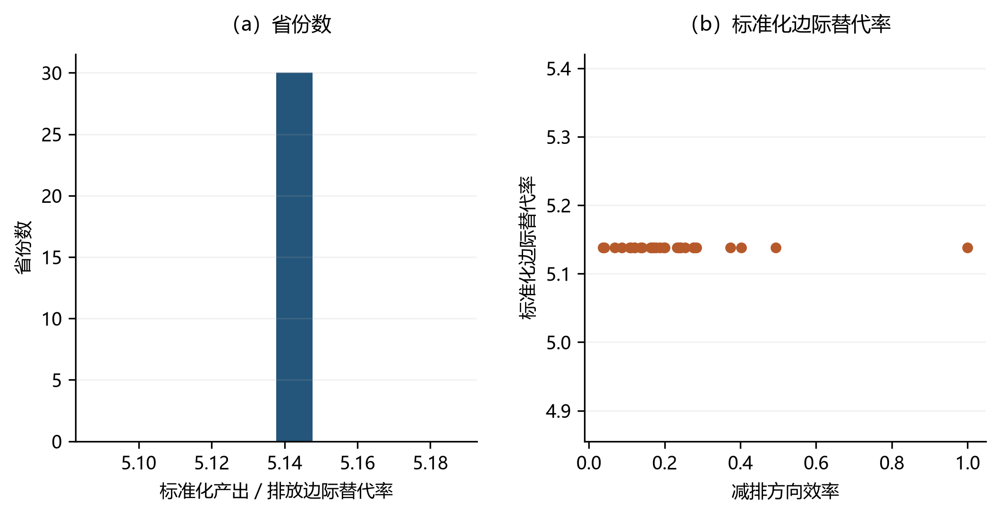

# 基于DEA对偶问题的影子价格估计 {#sec-13}

> **代码运行约定**：在项目根目录运行，先安装 `python -m pip install numpy pandas scipy matplotlib pyomo highspy openpyxl`。各段 Python 代码按本章顺序在同一会话执行，后文复用前文定义；默认采用 HiGHS。公式讲解片段另标为 `text`，不作为独立程序执行。

第[-@sec-3]章至第[-@sec-10]章依次建立了DEA的一系列原始模型——从径向的CCR/BCC，到非径向的SBM（第[-@sec-8]章）与方向性距离函数DDF（第[-@sec-7]章）——并通过包络形式（envelopment form）求解效率值；这些章节的重心始终在于"如何构建线性规划并测度效率"。需要指出的是，上述每一个包络形式都对应着一个等价的乘数形式，二者经线性规划对偶理论相互关联：对偶问题不改变最优值，却把"效率"这一无量纲测度转换为各投入与产出的**隐含价值**。本章即承接这一对偶关系展开。

本章将深入探讨对偶变量的经济含义，**影子价格（shadow price）**，以及如何稳健地估计和解释这些价格。在资源环境经济学中，影子价格具有特殊的重要性：当某些资源（如清洁空气、碳排放权）缺乏市场交易价格时，DEA对偶问题提供的影子价格成为估计其"隐含价值"的重要方法。

**原始问题测度效率，对偶问题揭示价值。** 这句话凝练地概括了DEA原始问题（包络形式）与对偶问题（乘数形式）的分工。具体而言：

- **包络形式（原始问题）**回答："在给定技术下，某个决策单元（DMU）最多能减少多少投入？或最多能增加多少产出？"——它测度的是**效率值**。
- **乘数形式（对偶问题）**回答："这些投入和产出的隐含价值（影子价格）是多少？"——它揭示的是**资源的边际价值**。

影子价格在资源环境经济学中的核心应用包括：

1. **非期望产出的定价**：当污染（如CO2、SO2）缺乏市场价格时，DEA影子价格可估计其减排的边际成本，为环境税（如碳税）的制定提供参考；
2. **资源错配诊断**：通过比较影子价格与市场价格，可以识别哪些资源被低估或高估；
3. **政策模拟**：基于影子价格构建边际减排成本曲线，评估不同减排目标的经济可行性。

本章将介绍如何应用Python编写基于DEA对偶问题的影子价格计算程序，并讨论影子价格估计中的数值稳定性问题、模型选择对价格估计的影响，以及重抽样敏感性诊断与置信区间的区别。

> **术语说明**：在DEA文献中，**对偶变量（dual variables）**与**乘数（multipliers）**是同义词，均指对偶线性规划问题中的决策变量。这些变量在经济上被解释为**影子价格（shadow prices）**，表示约束条件的边际价值。本章将统一使用"影子价格"这一术语。

## 线性规划的对偶问题 {#sec-13-1}

### 从经济学直觉出发：资源定价视角 {#sec-13-1-1}

在介绍数学推导之前，让我们先用一个具体的数值例子建立对偶问题的经济学直觉。

假设一个简单的单投入单产出生产系统：某工厂使用1单位能源（$x$）生产1单位产品（$y$）。现有A、B、C三个工厂的数据如下：

| 工厂 | 能源投入 $x$ | 产品产出 $y$ |
|:---:|:---:|:---:|
| A | 2 | 1 |
| B | 4 | 2 |
| C | 6 | 2 |

在投入导向的DEA模型中，原始问题（包络形式）旨在最小化工厂C的能源投入缩减比例 $\theta$：
$$
\begin{aligned}
\min_{\theta, \lambda} \quad & \theta \\
\text{s.t.} \quad & 2\lambda_A + 4\lambda_B + 6\lambda_C \leq 6\theta \\
& \lambda_A + 2\lambda_B + 2\lambda_C \geq 2 \\
& \lambda_A, \lambda_B, \lambda_C \geq 0
\end{aligned}
$$

求解该问题，得到 $\theta^* = 2/3$，即工厂C最多可缩减 $1/3$ 的能源投入而保持产出不变。这意味着工厂C的效率值为 $2/3$。

现在从另一个角度思考：假设不知道能源和产品的市场价格，而是要给它们各"标"一套内部价格（即影子价格）——能源的影子价格记为 $v$，产品的影子价格记为 $u$。这套价格需要满足两个要求：

- **参照集的可行性约束**：这套价格下，样本中没有任何工厂能"无本获利"，即每个工厂的产出价值不超过其投入成本：
  - 工厂A：$1\cdot u \leq 2v$，即 $u - 2v \leq 0$；
  - 工厂B：$2u \leq 4v$，即 $2u - 4v \leq 0$；
  - 工厂C：$2u \leq 6v$，即 $2u - 6v \leq 0$。
- **归一化约束**：影子价格只有相对大小有意义（把 $u,v$ 同时放大 $k$ 倍，上述约束不变），因此需固定一个尺度。投入导向的做法是把被评价单元C的投入总价值标准化为1，即 $6v = 1$。

在此基础上，我们为工厂C寻找**对它最有利**的一套价格，也就是让它的产出价值 $2u$ 尽可能大。这便构成了对偶问题（乘数形式）：
$$
\begin{aligned}
\max_{u, v} \quad & 2u \\
\text{s.t.} \quad & 6v = 1 \\
& u - 2v \leq 0 \\
& 2u - 4v \leq 0 \\
& 2u - 6v \leq 0 \\
& v \geq 0, \, u \geq 0
\end{aligned}
$$

其中 $v$ 是投入的影子价格，$u$ 是产出的影子价格。归一化约束给出 $v^* = 1/6$，最紧的一条参照约束是工厂A（$u \leq 2v$），故 $u^* = 1/3$，目标值 $2u^* = 2/3$——与包络形式的 $\theta^* = 2/3$ 相等，这验证了**强对偶定理（strong duality theorem）**：原始问题的最优值等于对偶问题的最优值。

需要强调归一化约束 $6v=1$ 不可省略。若把目标写成无归一化的 $\max\,(2u - 6v)$，则在 $u \leq 2v$ 下有 $2u - 6v \leq 4v - 6v = -2v \leq 0$，而 $u = v = 0$ 可行，最优值是 **0** 而不是 $2/3$，强对偶关系无从体现。一般地，投入导向CCR的乘数形式是 $\max\ \boldsymbol{\mu}'\boldsymbol{y}_0$ s.t. $\boldsymbol{\nu}'\boldsymbol{x}_0 = 1$、$\boldsymbol{\mu}'\boldsymbol{Y}_i - \boldsymbol{\nu}'\boldsymbol{X}_i \leq 0$、$\boldsymbol{\mu},\boldsymbol{\nu} \geq 0$，它是一个**带归一化约束的**加权产出最大化问题，而不是无约束的"虚拟利润"最大化。

通过这个例子，可以看到：
- **原始问题**告诉我们"工厂C可以缩减多少能源投入"（效率测度）；
- **对偶问题**告诉我们"每单位能源的影子价格是多少"（价值揭示）。

在市场竞争中，影子价格趋向于市场价格；在市场失灵（如污染无定价）时，影子价格提供了"社会最优价格"的估计——这正是DEA影子价格方法在环境经济学中的核心价值。

### DEA的两种形式：包络形式与乘数形式 {#sec-13-1-2}

在深入数学推导之前，有必要澄清DEA文献中的一对核心术语：包络形式与乘数形式是同一模型的两种表述，二者在数学上通过线性规划对偶理论相互关联，构成一对对偶线性规划问题。

| 特征 | 包络形式（Primal / Envelopment Form） | 乘数形式（Dual / Multiplier Form） |
|:---:|:---:|:---:|
| **决策变量** | 强度变量 $\lambda_i$（intensity variables） | 权重 $(\mu, \nu)$，即影子价格 |
| **约束条件** | 投入产出约束（参照集凸组合） | 权重非负约束、DMU效率约束 |
| **目标函数** | 最小化/最大化效率测度 | 最大化/最小化加权和比率 |
| **直观解释** | "参照哪个标杆DMU？" | "各指标值多少钱？" |
| **计算优势** | 通常变量更少（$N$个$\lambda$） | 有时约束更少（$M$个权重） |
| **经济学含义** | 效率值（距前沿的距离） | 影子价格（资源的隐含价值） |

> **术语澄清**：在DEA文献中，有时会将包络形式称为"对偶问题"、乘数形式称为"原始问题"——这是因为线性规划对偶理论中的原始-对偶关系与DEA的命名习惯恰好相反。本章遵循DEA文献的主流约定：包络形式为原始问题（envelopment primal），乘数形式为对偶问题（multiplier dual）。

### 线性规划对偶的数学推导 {#sec-13-1-3}

考虑如下问题：企业A拥有3种投入要素，最大可用量分别为8、16和12。企业计划生产2种商品，商品1每单位需要投入的3种生产要素分别为1、4和0，商品2每单位需要投入的3种生产要素分别为2、0和4。两种商品的市场价格分别为2和3。企业应如何安排生产，才能使其利润最大化？

上述问题可以总结为 @tbl-13-1：


|       | 商品1 | 商品2 | 要素最大可用量 |
|:---:|:---:|:---:|:---:|
| 要素1 | 1     | 2     | 8    |
| 要素2 | 4     | 0     | 16   |
| 要素3 | 0     | 4     | 12   |
| 市场价格 | 2     | 3     |      |
: 生产要素与商品信息 {#tbl-13-1}

设企业两种商品的产量分别为 $x_1$ 和 $x_2$，则企业的决策问题可以表示为：
$$
\begin{aligned}
\max \quad & z = 2x_1 + 3x_2 \\
\text{s.t.} \quad & x_1 + 2x_2 \leq 8 \\
& 4x_1 \leq 16 \\
& 4x_2 \leq 12 \\
& x_1 \geq 0, \, x_2 \geq 0
\end{aligned}
$$ {#eq-13-1}

现在换一个角度分析。假设企业B想将企业A的所有生产资源收买过来，其需要支付的最小代价是多少？换言之，企业A放弃其拥有的生产资源需要得到多少补偿？这要求企业A出让生产一单位某种商品的资源所获得的回报不低于该商品的价格，即 $y_1 + 4y_2 \geq 2$、$2y_1 + 4y_3 \geq 3$（$y_1, y_2, y_3$ 为一单位生产资源的影子价格）。由此得到以下线性规划问题：

$$
\begin{aligned}
\min \quad & w = 8y_1 + 16y_2 + 12y_3 \\
\text{s.t.} \quad & y_1 + 4y_2 \geq 2 \\
& 2y_1 + 4y_3 \geq 3 \\
& y_1 \geq 0, \, y_2 \geq 0, \, y_3 \geq 0
\end{aligned}
$$ {#eq-13-2}

以上即为线性规划的对偶问题。

接下来，从数学表达式的角度分析原问题的对偶问题。为了获得目标函数式([-@eq-13-1])的最大值，可以对式([-@eq-13-1])的约束条件进行线性组合，进而对目标函数进行放缩，获得目标函数的上限。例如，将第一个约束乘以 $3/2$、第二个约束乘以 $1/8$ 后相加，得 $2x_1 + 3x_2 = z \leq 14$，可知在这种组合情况下，目标函数的上限为14（这恰好是该问题的最优值）。

如何找到一个最佳的组合方式？可以设定三个约束分别乘上 $y_1$、$y_2$ 和 $y_3$，且 $y_1 \geq 0, y_2 \geq 0, y_3 \geq 0$，即考虑约束1 $\times y_1$ + 约束2 $\times y_2$ + 约束3 $\times y_3$，可得：

$$
(y_1 + 4y_2) \times x_1 + (2y_1 + 4y_3) \times x_2 \leq 8y_1 + 16y_2 + 12y_3
$$ {#eq-13-3}

要使式([-@eq-13-3])构成式([-@eq-13-1])目标函数的上界，需要限定式([-@eq-13-3])中 $x_1$ 的系数不小于式([-@eq-13-1])中 $x_1$ 的系数、$x_2$ 的系数不小于式([-@eq-13-1])中 $x_2$ 的系数，可得：

$$
z = 2x_1 + 3x_2 \leq (y_1 + 4y_2) \times x_1 + (2y_1 + 4y_3) \times x_2 \leq 8y_1 + 16y_2 + 12y_3
$$ {#eq-13-4}

若求得 $8y_1 + 16y_2 + 12y_3$ 的最小值，则 $z$ 的最大值即可确定。此时得到了另一个线性规划问题，即式([-@eq-13-2])。

### 对偶转换的一般规则 {#sec-13-1-4}

基于上述推导，可以总结得到以下要点：

（1）原问题有几个约束，对偶问题就有几个决策变量（用于在约束两边同时乘该决策变量）；原问题有几个决策变量，对偶问题就有几个约束。

（2）原问题的决策变量的系数对应对偶问题的右端项；原问题的右端项对应对偶问题的决策变量的系数（原问题的右端项乘了对偶问题的决策变量）。

（3）原问题的系数矩阵的转置对应对偶问题的系数矩阵（原问题的左端项乘了对偶问题的决策变量，合并同类项后便可得到对偶问题的系数矩阵）。

（4）原问题是最大化问题，对偶问题就是最小化问题；原问题是最小化问题，对偶问题就是最大化问题。

（5）原问题与对偶问题之间约束条件符号方向与决策变量符号范围的对应关系。其探讨的核心逻辑围绕"正常情况"展开，通过约束条件与变量符号的映射关系建立原问题与对偶问题的联系。

首先，线性规划问题的"正常情况"是其最基础形式，为对偶转换提供基准，主要包括：
- **最大化问题**的"正常情况"要求所有决策变量非负（$x_j \geq 0$），且约束条件为小于等于型（$\leq$）。这一设计的逻辑在于：最大化目标需上界约束以防止解趋向无穷大，而非负变量符合实际资源的物理意义（如投入不可为负）。
- **最小化问题**的"正常情况"则要求变量非负（$x_j \geq 0$），且约束为大于等于型（$\geq$），以确保资源投入满足最低需求的下界限制。

其次，原问题的约束类型按照以下规则直接决定对偶变量的符号范围：
- **原问题约束为 $\leq$（最大化）或 $\geq$（最小化）**：对偶变量 $y_i \geq 0$。此时约束代表资源的有效限制，影子价格反映其边际贡献或成本节省，非负性符合经济学直觉。
- **原问题约束为等式（$=$）**：对偶变量 $y_i$ 无约束（可正可负）。等式约束意味着资源被严格固定，其影子价格可能因冗余或短缺呈现不同符号。

在此基础上，可以进一步讨论原问题变量的符号范围如何决定对偶约束的方向：

（1）**原问题变量非负（$x_j \geq 0$）**：
   - 若原问题为**最大化**，对偶约束为 $\leq c_j$（资源消耗的边际收益上限）；
   - 若原问题为**最小化**，对偶约束为 $\geq c_j$（资源投入的边际成本下限）。

（2）**原问题变量非正（$x_j \leq 0$）**：需通过变量替换（如 $x_j' = -x_j \geq 0$）转化为非负形式。替换后原问题的目标系数与约束矩阵相应列符号反转，对偶约束方向随之反向。

（3）**原问题变量无约束**：对偶约束必须为等式（$=$）。无约束变量可自由取值，其对偶约束需严格平衡目标函数与资源消耗的关系，避免解无界。

除上述情况外，还可能遇到原问题包含非标准约束或变量符号的情况。此时需通过数学变形转化为正常情况：

（1）**约束条件符号不符合正常情况**：
   - 最大化问题中出现 $\geq$ 约束时，等式两边乘以 $-1$ 转化为 $\leq$；
   - 最小化问题中出现 $\leq$ 约束时，同样乘以 $-1$ 转化为 $\geq$。
   - 转化后，对偶变量仍按正常情况的符号规则处理。

例如，原问题为最大化但约束为 $\geq$ 时，乘以 $-1$ 后约束变为 $\leq$。按正常情况的规则，转化后这一行的对偶变量 $\hat{y}_i \geq 0$；而原约束行的对偶变量是它的相反数 $y_i = -\hat{y}_i \leq 0$（约束行整体乘以 $-1$ 等价于对应对偶变量变号），即最大化问题的 $\geq$ 约束对应对偶变量非正。

（2）**变量符号非正常**：
   - 非正变量（$x_j \leq 0$）通过替换 $x_j = -x_j'$（$x_j' \geq 0$）转化为非负形式，此时原问题的目标系数与约束矩阵对应列符号反转。
   - 变量无约束时直接对应对偶约束为等式，无需额外调整。

上述规则的本质是通过数学对称性揭示资源的隐含价值（影子价格）。可将原问题与对偶问题的符号对应归纳为以下原则：

**（1）原问题约束类型**：
   - $\leq$（最大化）或 $\geq$（最小化）$\rightarrow$ 对偶变量非负（$y_i \geq 0$）；
   - $=$ $\rightarrow$ 对偶变量无约束。

**（2）原问题变量符号**：
   - $x_j \geq 0$ $\rightarrow$ 对偶约束为 $\leq$（最大化）或 $\geq$（最小化）；
   - $x_j \leq 0$ $\rightarrow$ 对偶约束方向反向；
   - $x_j$ 无约束 $\rightarrow$ 对偶约束为等式。

### 强对偶定理与互补松弛条件 {#sec-13-1-5}

对于DEA模型对应的线性规划问题，**强对偶定理（Strong Duality Theorem）**适用，因为DEA模型满足线性规划的标准形式要求。强对偶定理保证了：若原始问题存在最优解，则对偶问题也存在最优解，且两者的最优目标函数值相等。

与强对偶定理密切相关的**互补松弛条件（Complementary Slackness Conditions）**具有重要的经济学含义。设 $s_i$ 为原始问题第 $i$ 个约束的松弛变量，$y_i$ 为对应的对偶变量，则互补松弛条件要求：

$$
s_i \cdot y_i = 0, \quad \forall i
$$

这一条件的经济含义极为直观：**如果某投入要素未充分发挥作用（存在松弛，即 $s_i > 0$），则其影子价格为零（$y_i = 0$）**——因为该资源不稀缺，增加一单位该资源不会改变最优效率。反之，如果某资源的影子价格为正（$y_i > 0$），则该约束必须是紧的（$s_i = 0$），即该资源被充分利用。

在DEA效率评价中，互补松弛条件意味着：处于生产前沿（效率值为1）的DMU，其至少一个投入或产出约束的影子价格为正；而存在松弛的DMU（即使是前沿上的DMU，也可能在某些维度上有松弛），对应松弛变量的影子价格必为零。

## SBM模型的对偶问题 {#sec-13-2}

了解如何从原问题导出对偶问题后，下面考察Tone（2003）提出的SBM模型的线性规划问题：
$$
\begin{aligned}
\min \quad & \tau = t - \frac{1}{P} \sum_{p=1}^{P} S_p^{\boldsymbol{X}} / \boldsymbol{X}_{0p} \\
\text{s.t.} \quad & 1 = t + \frac{1}{Q+R} \left( \sum_{q=1}^{Q} S_q^{\boldsymbol{Y}} / \boldsymbol{Y}_{0q} + \sum_{r=1}^{R} S_r^{\boldsymbol{B}} / \boldsymbol{B}_{0r} \right) \\
& t\boldsymbol{X}_{0p} = \sum_{i=1}^{N} \Lambda_i \boldsymbol{X}_{ip} + S_p^{\boldsymbol{X}}, \quad p=1,\dots,P \\
& t\boldsymbol{Y}_{0q} = \sum_{i=1}^{N} \Lambda_i \boldsymbol{Y}_{iq} - S_q^{\boldsymbol{Y}}, \quad q=1,\dots,Q \\
& t\boldsymbol{B}_{0r} = \sum_{i=1}^{N} \Lambda_i \boldsymbol{B}_{ir} + S_r^{\boldsymbol{B}}, \quad r=1,\dots,R \\
& \Lambda_i, S_p^{\boldsymbol{X}}, S_q^{\boldsymbol{Y}}, S_r^{\boldsymbol{B}} \geq 0, \quad t > 0
\end{aligned}
$$
首先，由于 $t > 0$ 已暗含在第一个约束条件中，可以去掉原线性规划中 $t > 0$ 的约束。此外，为便于从原问题写出对偶问题，可以将原问题的目标函数和约束条件中的决策变量按照固定的顺序排列，系数为0的项补0。从而得到如下线性规划问题：
$$
\begin{aligned}
\min \quad & \tau = \sum_{i=1}^{N} \Lambda_i \boldsymbol{0} - \frac{1}{P} \sum_{p=1}^{P} \frac{S_p^{\boldsymbol{X}}}{\boldsymbol{X}_{0p}} + S_q^{\boldsymbol{Y}}\boldsymbol{0} + S_r^{\boldsymbol{B}}\boldsymbol{0} + t \\
\text{s.t.} \quad & \sum_{i=1}^{N} \Lambda_i \boldsymbol{0} + S_p^{\boldsymbol{X}}\boldsymbol{0} + \frac{1}{Q+R} \sum_{q=1}^{Q} \frac{S_q^{\boldsymbol{Y}}}{\boldsymbol{Y}_{0q}} + \frac{1}{Q+R} \sum_{r=1}^{R} \frac{S_r^{\boldsymbol{B}}}{\boldsymbol{B}_{0r}} + t = 1 \\
& \sum_{i=1}^{N} \Lambda_i \boldsymbol{X}_{ip} + S_p^{\boldsymbol{X}} + S_q^{\boldsymbol{Y}}\boldsymbol{0} + S_r^{\boldsymbol{B}}\boldsymbol{0} - t\boldsymbol{X}_{0p} = 0, \quad p=1,\dots,P \\
& \sum_{i=1}^{N} \Lambda_i \boldsymbol{Y}_{iq} + S_p^{\boldsymbol{X}}\boldsymbol{0} - S_q^{\boldsymbol{Y}} + S_r^{\boldsymbol{B}}\boldsymbol{0} - t\boldsymbol{Y}_{0q} = 0, \quad q=1,\dots,Q \\
& \sum_{i=1}^{N} \Lambda_i \boldsymbol{B}_{ir} + S_p^{\boldsymbol{X}}\boldsymbol{0} + S_q^{\boldsymbol{Y}}\boldsymbol{0} + S_r^{\boldsymbol{B}} - t\boldsymbol{B}_{0r} = 0, \quad r=1,\dots,R \\
& \Lambda_i, S_p^{\boldsymbol{X}}, S_q^{\boldsymbol{Y}}, S_r^{\boldsymbol{B}} \geq 0
\end{aligned}
$$
下面根据原问题写出对偶问题。机械对偶得到的乘数中，投入等式的对偶变量本身取负号；为了让所有乘数都读作**经济价格**（投入、期望产出、非期望产出的边际价值均为正），下式统一取 $v = -v_{\text{机械}}$，并相应地把与之关联的约束一并变号。整套符号如下：
$$
\begin{aligned}
\max \quad & \xi \\
\text{s.t.} \quad & -\boldsymbol{v}'\boldsymbol{X}_i + \boldsymbol{u}^{g\prime}\boldsymbol{Y}_i - \boldsymbol{u}^{b\prime}\boldsymbol{B}_i \leq 0, \quad i=1,\dots,N \\
& v_p \geq \frac{1}{P\boldsymbol{X}_{0p}}, \quad p=1,\dots,P \\
& u_q^g \geq \frac{\xi}{(Q+R)\boldsymbol{Y}_{0q}}, \quad q=1,\dots,Q \\
& u_r^b \geq \frac{\xi}{(Q+R)\boldsymbol{B}_{0r}}, \quad r=1,\dots,R \\
& \xi + \boldsymbol{v}'\boldsymbol{X}_{0} - \boldsymbol{u}^{g\prime}\boldsymbol{Y}_{0} + \boldsymbol{u}^{b\prime}\boldsymbol{B}_{0} = 1 \\
& \xi \in \mathbb{R}
\end{aligned}
$$ {#eq-13-5}
其中，$\xi$ 为对偶问题的目标函数值，$\boldsymbol{v}$、$\boldsymbol{u}^g$ 和 $\boldsymbol{u}^b$ 分别为投入、期望产出和非期望产出的影子价格向量。原问题中 $t$ 是自由变量，故其对应的对偶约束（第五式）取等号；$\xi$ 在对偶中同样是自由变量，其非负性来自最优值 $\xi^*=\tau^*>0$ 而非人为施加。式([-@eq-13-5])的第五个约束对应原始问题中的Charnes-Cooper变换约束 $t + \frac{1}{Q+R}(\sum S^Y/Y_0 + \sum S^B/B_0) = 1$；第二至第四式则说明，只要 $\xi>0$，三类影子价格都自动严格为正，无需额外附加非负约束。

关于式([-@eq-13-5])有三点需要说明。

第一，**符号必须成套使用**。第一至第四个约束与第五个约束里的 $\boldsymbol{v}$ 是同一套变量，若把第一个约束写成 $+\boldsymbol{v}'\boldsymbol{X}_i$（机械对偶的符号），则第二个约束必须同时改为 $v_p \leq -1/(P\boldsymbol{X}_{0p})$、第五个约束改为 $\xi - \boldsymbol{v}'\boldsymbol{X}_0 - \cdots$。两套符号混写在同一个线性规划里，既推不出下一节的代码，也解不出正的投入影子价格。

第二，**非期望产出被当作投入处理**。第一个约束中 $\boldsymbol{B}_i$ 与 $\boldsymbol{X}_i$ 同号（都带负号），这正是Tone口径下"坏产出计入投入侧"的体现，因此 $\boldsymbol{u}^b$ 在本模型中与投入影子价格同类、取非负值（不同技术设定下坏产出对偶的符号差异见[-@sec-13-4-1]节）。

第三，**$\xi$ 就是效率值本身，不是它的倒数**。$\xi$ 与线性化SBM原问题的目标 $\tau$ 通过强对偶相等，而Charnes-Cooper变换又保证 $\tau^* = \rho^*$（分式形式的SBM效率），故 $\xi^* = \tau^* = \rho^* \in (0,1]$。

## 基于SBM模型对偶问题的影子价格计算程序 {#sec-13-3}

### 数值注意事项与数据预处理 {#sec-13-3-1}

本章与第12章共用2016—2019年中国省级面板。程序示范按各列全样本均值缩放K、L、E、Y、CO2，保留正值并避免相差过大的系数。缩放不含中心化；效率保持原定义，对偶乘数则随单位改变。若原变量除以s得到缩放变量，原单位乘数应为缩放乘数除以s。任何货币化解释还需要产出价格和物理单位，不能沿用其他数据文件的千克或万元口径。

```python
from deabook.example.book_cases.loaders import china
raw = china()
columns = ["K", "L", "E", "Y", "CO2"]
scale = raw[columns].mean()
data = raw.copy()
data[columns] = raw[columns] / scale
```

### 单个DMU的影子价格计算 {#sec-13-3-2}

在式([-@eq-13-5])给出SBM对偶问题之后，本节以 本章省级面板 数据为算例，展示如何借助Pyomo将该对偶问题转化为可求解的线性规划，并从中提取影子价格。代码首先读取同一省级面板并按列均值缩放（理由见[-@sec-13-3-1]节），随后将投入、期望产出与非期望产出整理为参照集与被评价单元的列块。实现沿用本章统一的技术约定：采用NumPy风格docstring与snake_case命名以增强可读性，求解器默认采用 `highs`，默认参数以 `None` 表示。模型中的 `px`、`py`、`pb`、`pomega` 四组变量正是式([-@eq-13-5])中的 $\boldsymbol{v}$、$\boldsymbol{u}^g$、$\boldsymbol{u}^b$ 与 $\xi$；五个约束 `first` 至 `fifth` 逐条对应式([-@eq-13-5])的五个条件。

```python
"""
基于SBM对偶问题的影子价格计算模块。

本模块提供基于SBM模型对偶问题估计投入、产出和非期望产出
影子价格的函数。求解器默认采用 highs。
"""
from pyomo.environ import (
    ConcreteModel, Set, Var, Objective, Constraint, Reals,
    maximize, minimize, SolverFactory, value
)
import pandas as pd
from deabook.example.book_cases.loaders import china, china_lower
import numpy as np
import re
import warnings

warnings.filterwarnings("ignore")

# 读取数据
ex4 = china(scaled=True)
data = ex4[["K", "L", "Y", "CO2"]].copy()  # 提取投入、期望产出和非期望产出变量

# 设定变量个数
K = 2  # 投入变量个数
L = 1  # 期望产出变量个数
M = 1  # 非期望产出变量个数

# 准备参照集数据
xref = data.iloc[:, 0:K]
yref = data.iloc[:, K:K+L]
bref = data.iloc[:, K+L:K+L+M]

# 准备被评价DMU数据（以第1个DMU为例）
x = data.iloc[0, 0:K]
y = data.iloc[0, K:K+L]
b = data.iloc[0, K+L:K+L+M]

# 构建Pyomo模型
model = ConcreteModel()
model.I = Set(initialize=range(xref.shape[0]))  # 参照决策单元集合
model.K = Set(initialize=range(len(x)))          # 投入变量集合
model.L = Set(initialize=range(len(y)))          # 期望产出变量集合
model.M = Set(initialize=range(len(b)))          # 非期望产出变量集合

# 定义影子价格变量（施加非负约束以确保经济学含义）
model.px = Var(model.K, bounds=(0, None), within=Reals, doc='投入的影子价格')
model.py = Var(model.L, bounds=(0, None), within=Reals, doc='期望产出的影子价格')
model.pb = Var(model.M, bounds=(0, None), within=Reals, doc='非期望产出的影子价格')
model.pomega = Var(bounds=(0, None), within=Reals, doc='SBM效率值（式(13.5)中的 xi）')

# 目标函数：最大化 pomega
def objective_rule(model):
    """返回目标函数表达式"""
    return model.pomega * 1

# 约束1：对偶约束（参照集加权影子价格之和非正）
def first_rule(model, i):
    """第i个参照DMU的对偶约束"""
    return (
        -sum(model.px[k] * xref.iloc[i, k] for k in model.K)
        + sum(model.py[l] * yref.iloc[i, l] for l in model.L)
        - sum(model.pb[m] * bref.iloc[i, m] for m in model.M)
        <= 0
    )

# 约束2：投入影子价格的下界约束
def second_rule(model, k):
    """第k个投入变量的影子价格下界"""
    return -model.px[k] <= -1 / (len(model.K) * x.iloc[k])

# 约束3：期望产出影子价格的上界约束
def third_rule(model, l):
    """第l个期望产出变量的影子价格上界"""
    return (
        model.pomega / (len(model.L) + len(model.M)) / y.iloc[l] - model.py[l]
        <= 0
    )

# 约束4：非期望产出影子价格的上界约束
def forth_rule(model, m):
    """第m个非期望产出变量的影子价格上界"""
    return (
        model.pomega / (len(model.L) + len(model.M)) / b.iloc[m] - model.pb[m]
        <= 0
    )

# 约束5：Charnes-Cooper变换的归一化约束
def fifth_rule(model):
    """归一化约束"""
    return (
        model.pomega
        + sum(model.px[k] * x.iloc[k] for k in model.K)
        - sum(model.py[l] * y.iloc[l] for l in model.L)
        + sum(model.pb[m] * b.iloc[m] for m in model.M)
        <= 1
    )

# 组装模型
model.obj = Objective(rule=objective_rule, sense=maximize, doc='目标函数')
model.first = Constraint(model.I, rule=first_rule, doc='对偶约束')
model.second = Constraint(model.K, rule=second_rule, doc='投入下界约束')
model.third = Constraint(model.L, rule=third_rule, doc='期望产出上界约束')
model.forth = Constraint(model.M, rule=forth_rule, doc='非期望产出上界约束')
model.fifth = Constraint(rule=fifth_rule, doc='归一化约束')

# 求解
opt = SolverFactory('highs')  # 指定 HiGHS 作为求解器
solution = opt.solve(model)   # 调用求解器求解

# 提取结果
px = np.asarray(list(model.px[:].value))
py = np.asarray(list(model.py[:].value))
pb = np.asarray(list(model.pb[:].value))
obj = value(model.obj)

print(f"投入影子价格 (px): {px}")
print(f"期望产出影子价格 (py): {py}")
print(f"非期望产出影子价格 (pb): {pb}")
print(f"最优目标值: {obj}")
```

需要特别指出的是，上述代码对决策变量施加了下界为0的约束，而机械对偶得到的乘数是自由变量。这一处理是**额外施加的**，而不是Tone对偶本身的要求，其依据是经济学含义：影子价格通常不应小于零——投入的影子价格为正表示资源的稀缺性，产出的影子价格为正表示其价值。在式([-@eq-13-5])的经济价格口径下，第二至第四个约束已经蕴含 $\boldsymbol{v}>0$、$\boldsymbol{u}^g>0$、$\boldsymbol{u}^b>0$，因此这组下界在正常数据下不会真正起作用，只是在数据含零值或求解退化时起到兜住符号的作用。

代码与式([-@eq-13-5])的另一处差别是第五个约束写成了 `<= 1` 而不是等号。二者的最优值相同：目标函数与第一至第四个约束在 $(\xi, \boldsymbol{v}, \boldsymbol{u}^g, \boldsymbol{u}^b)$ 上都是正齐次的（把整组变量同比例放大 $k>1$ 倍，第一式仍 $\le 0$，第二至第四式的下界要求同样满足），而第五式左端是一次齐次的。若最优解处第五式留有松弛（左端 $=1-s<1$，$s>0$），把整组变量放大 $1/(1-s)$ 倍即可得到更大的 $\xi$，与最优性矛盾。故最优解处该式必取等号，写成不等式只是给求解器留出数值余量。

> **命名说明**：代码中 `px`、`py`、`pb` 分别对应投入（$x$）、期望产出（$y$）和非期望产出（$b$）的影子价格。`pomega` 对应式([-@eq-13-5])中的 $\xi$，即**SBM效率值本身**（$\xi^*=\tau^*=\rho^*\in(0,1]$），不是效率的倒数。`first` 至 `fifth` 分别对应式([-@eq-13-5])的五个约束条件。

### 迭代求解所有DMU {#sec-13-3-3}

将单一DMU的求解推广至全部样本，只需在每次循环中对一个DMU按式([-@eq-13-5])重建并求解对偶线性规划，并把最优解存入字典 `px`、`py`、`pb` 与 `obj`。其中 `termination_condition == "optimal"` 用于过滤求解失败的情形；但须注意，如[-@sec-13-3-1]节所示，在量纲未校正的病态条件下求解器仍可能报 `optimal` 而返回错误价格，故该判断本身不足以保证估计质量。

```python
px, py, pb, obj = {}, {}, {}, {}

for j in range(data.shape[0]):
    x = data.iloc[j, 0:K]
    y = data.iloc[j, K:K+L]
    b = data.iloc[j, K+L:K+L+M]

    model = ConcreteModel()
    model.I = Set(initialize=range(xref.shape[0]))
    model.K = Set(initialize=range(len(x)))
    model.L = Set(initialize=range(len(y)))
    model.M = Set(initialize=range(len(b)))

    model.px = Var(model.K, bounds=(0, None), within=Reals, doc='投入的影子价格')
    model.py = Var(model.L, bounds=(0, None), within=Reals, doc='期望产出的影子价格')
    model.pb = Var(model.M, bounds=(0, None), within=Reals, doc='非期望产出的影子价格')
    model.pomega = Var(bounds=(0, None), within=Reals,
        doc='SBM效率值（式(13.5)中的 xi）')

    def objective_rule(model):
        return model.pomega * 1

    def first_rule(model, i):
        return (
            -sum(model.px[k] * xref.iloc[i, k] for k in model.K)
            + sum(model.py[l] * yref.iloc[i, l] for l in model.L)
            - sum(model.pb[m] * bref.iloc[i, m] for m in model.M)
            <= 0
        )

    def second_rule(model, k):
        return -model.px[k] <= -1 / (len(model.K) * x.iloc[k])

    def third_rule(model, l):
        return (
            model.pomega / (len(model.L) + len(model.M)) / y.iloc[
                l] - model.py[l]
            <= 0
        )

    def forth_rule(model, m):
        return (
            model.pomega / (len(model.L) + len(model.M)) / b.iloc[
                m] - model.pb[m]
            <= 0
        )

    def fifth_rule(model):
        return (
            model.pomega
            + sum(model.px[k] * x.iloc[k] for k in model.K)
            - sum(model.py[l] * y.iloc[l] for l in model.L)
            + sum(model.pb[m] * b.iloc[m] for m in model.M)
            <= 1
        )

    model.obj = Objective(rule=objective_rule, sense=maximize, doc='目标函数')
    model.first = Constraint(model.I, rule=first_rule, doc='对偶约束')
    model.second = Constraint(model.K, rule=second_rule, doc='投入下界约束')
    model.third = Constraint(model.L, rule=third_rule, doc='期望产出上界约束')
    model.forth = Constraint(model.M, rule=forth_rule, doc='非期望产出上界约束')
    model.fifth = Constraint(rule=fifth_rule, doc='归一化约束')

    opt = SolverFactory('highs')
    solution = opt.solve(model)

    # 终止条件判断：optimal（最优）、infeasible（不可行）、unbounded（无界）
    if solution.solver.termination_condition == "optimal":
        px[j] = np.asarray(list(model.px[:].value))
        py[j] = np.asarray(list(model.py[:].value))
        pb[j] = np.asarray(list(model.pb[:].value))
        obj[j] = value(model.obj)
```

### 面向复用的函数封装 {#sec-13-3-4}

为便于在实证研究中重复调用，上述逐DMU循环可被一般化为一个返回数据框的函数 `sbm_dual`。其函数首部以docstring说明参数与返回值，内部逻辑与[-@sec-13-3-3]节完全一致，仅将参照集与被评价单元的切片以 `varname`、`num_inputs`、`num_outputs` 一般化，使任意变量组合均可直接传入。

```python
from pyomo.environ import (
    ConcreteModel, Set, Var, Objective, Constraint, Reals,
    maximize, SolverFactory, value
)
import pandas as pd
from deabook.example.book_cases.loaders import china, china_lower
import numpy as np
import re


def sbm_dual(dataframe, varname, num_inputs, num_outputs):
    """
    基于SBM模型对偶问题估计影子价格。

    求解SBM模型的对偶问题（乘数形式），获得各决策单元的投入、
    期望产出和非期望产出的影子价格。

    Parameters
    ----------
    dataframe : pd.DataFrame
        待评价决策单元的投入产出数据框，变量按投入在前、
        期望产出在中、非期望产出在后的顺序排列。
    varname : list[str]
        投入变量、期望产出变量和非期望产出变量的名称列表，
        如 ["K", "L", "Y", "CO2"]。
    num_inputs : int
        投入变量的个数（P）。
    num_outputs : int
        期望产出变量的个数（Q）。

    Returns
    -------
    pd.DataFrame
        包含各DMU的影子价格估计结果的数据框。列包括：
        - 'obj': SBM效率值（式(13.5)中的 xi，取值于 (0, 1]）
        - 'shadow price <varname>': 各变量的影子价格

    Notes
    -----
    - 本函数对影子价格施加非负约束，以确保经济学含义的合理性。
    - 求解器默认使用 highs。
    - 关于SBM模型及其含非期望产出扩展的原问题形式，参见第8章（式(8.1)与式(8.3)）。

    Examples
    --------
    >>> ex4 = china(scaled=True)
    >>> result = sbm_dual(ex4, ["K", "L", "Y", "CO2"], 2, 1)
    >>> print(result.head())
    """
    data = dataframe.loc[:, varname]
    num_inputs_ = num_inputs
    num_outputs_ = num_outputs
    num_bad = data.shape[1] - num_inputs_ - num_outputs_

    xref = data.iloc[:, 0:num_inputs_]
    yref = data.iloc[:, num_inputs_:num_inputs_+num_outputs_]
    bref = data.iloc[:, num_inputs_+num_outputs_:num_inputs_+num_outputs_+num_bad]

    xcol = varname[0:num_inputs_]
    ycol = varname[num_inputs_:num_inputs_+num_outputs_]
    bcol = varname[num_inputs_+num_outputs_:num_inputs_+num_outputs_+num_bad]

    px, py, pb, obj = {}, {}, {}, {}

    for j in range(data.shape[0]):
        x = data.iloc[j, 0:num_inputs_]
        y = data.iloc[j, num_inputs_:num_inputs_+num_outputs_]
        b = data.iloc[j, num_inputs_+num_outputs_:num_inputs_+num_outputs_+num_bad]

        model = ConcreteModel()
        model.I = Set(initialize=xref.index)
        model.K = Set(initialize=range(len(x)))
        model.L = Set(initialize=range(len(y)))
        model.M = Set(initialize=range(len(b)))

        model.px = Var(model.K, bounds=(0, None), within=Reals, doc='投入的影子价格')
        model.py = Var(model.L, bounds=(0, None), within=Reals, doc='期望产出的影子价格')
        model.pb = Var(model.M, bounds=(0, None), within=Reals, doc='非期望产出的影子价格')
        model.pomega = Var(bounds=(0, None), within=Reals, doc='SBM效率值（式(13.5)中的 xi）')

        def objective_rule(model):
            return model.pomega * 1

        def first_rule(model, i):
            return (
                -sum(model.px[k] * xref.loc[i, xcol[k]] for k in model.K)
                + sum(model.py[l] * yref.loc[i, ycol[l]] for l in model.L)
                - sum(model.pb[m] * bref.loc[i, bcol[m]] for m in model.M)
                <= 0
            )

        def second_rule(model, k):
            return -model.px[k] <= -1 / (len(model.K) * x.iloc[k])

        def third_rule(model, l):
            return (
                model.pomega / (len(model.L) + len(model.M)) / y.iloc[l] - model.py[l]
                <= 0
            )

        def forth_rule(model, m):
            return (
                model.pomega / (len(model.L) + len(model.M)) / b.iloc[m] - model.pb[m]
                <= 0
            )

        def fifth_rule(model):
            return (
                model.pomega
                + sum(model.px[k] * x.iloc[k] for k in model.K)
                - sum(model.py[l] * y.iloc[l] for l in model.L)
                + sum(model.pb[m] * b.iloc[m] for m in model.M)
                <= 1
            )

        model.obj = Objective(rule=objective_rule, sense=maximize, doc='目标函数')
        model.first = Constraint(model.I, rule=first_rule, doc='对偶约束')
        model.second = Constraint(model.K, rule=second_rule, doc='投入下界约束')
        model.third = Constraint(model.L, rule=third_rule, doc='期望产出上界约束')
        model.forth = Constraint(model.M, rule=forth_rule, doc='非期望产出上界约束')
        model.fifth = Constraint(rule=fifth_rule, doc='归一化约束')

        opt = SolverFactory('highs')
        solution = opt.solve(model)

        if solution.solver.termination_condition == "optimal":
            px[j] = np.asarray(list(model.px[:].value))
            py[j] = np.asarray(list(model.py[:].value))
            pb[j] = np.asarray(list(model.pb[:].value))
            obj[j] = value(model.obj)

    objdf = pd.DataFrame(obj, index=["obj"]).T
    pxdf = pd.DataFrame(px, index=xcol).T
    pxdf.columns = pxdf.columns.map(lambda x: "shadow price " + str(x))
    pydf = pd.DataFrame(py, index=ycol).T
    pydf.columns = pydf.columns.map(lambda y: "shadow price " + str(y))
    pbdf = pd.DataFrame(pb, index=bcol).T
    pbdf.columns = pbdf.columns.map(lambda b: "shadow price " + str(b))

    pdf = pd.concat([pxdf, pydf], axis=1)
    pdf = pd.concat([pdf, pbdf], axis=1)
    redata = pd.concat([objdf, pdf], axis=1)

    return redata
```

以 本章省级面板 调用 `sbm_dual`，可得各DMU的影子价格估计数据框：

```python
import pandas as pd
from deabook.example.book_cases.loaders import china, china_lower

ex4 = china(scaled=True)
result = sbm_dual(ex4, ["K", "L", "Y", "CO2"], 2, 1)
print(result.head())
```

### 支持样本和参照集限定 {#sec-13-3-5}

实证分析中往往只需对部分DMU定价（如特定行业或时期），或希望以特定子集作为技术参照集。`sbm_dual_select` 在 `sbm_dual` 的基础上新增 `eval_query` 与 `ref_query` 两个参数，分别经 `pandas.query` 筛选待评价单元与参照集，从而使同一函数既能完成全样本估计，也能刻画受限技术前沿下的影子价格。

```python
def sbm_dual_select(dataframe, varname, num_inputs, num_outputs,
                    eval_query, ref_query):
    """
    基于SBM对偶问题估计影子价格（支持评价单元和参照集筛选）。

    Parameters
    ----------
    dataframe : pd.DataFrame
        待评价决策单元的投入产出数据框。
    varname : list[str]
        投入、期望产出和非期望产出变量的名称列表，
        如 ["K", "L", "Y", "CO2"]。
    num_inputs : int
        投入变量的个数。
    num_outputs : int
        期望产出变量的个数。
    eval_query : str
        传入数据框.query()方法的参数，用于筛选待评价DMU，
        如 "dmu==1"、"dmu==[1,2,3]"。
    ref_query : str
        传入数据框.query()方法的参数，用于筛选参照集DMU，
        如 "dmu==1"、"dmu==[1,2,3]"。

    Returns
    -------
    pd.DataFrame
        包含各DMU影子价格估计结果的数据框。
    """
    index_list = dataframe.query(eval_query).index
    index_list_ref = dataframe.query(ref_query).index

    data = dataframe.loc[index_list, varname]
    dataref = dataframe.loc[index_list_ref, varname]

    num_inputs_ = num_inputs
    num_outputs_ = num_outputs
    num_bad = data.shape[1] - num_inputs_ - num_outputs_

    xref = dataref.iloc[:, 0:num_inputs_]
    yref = dataref.iloc[:, num_inputs_:num_inputs_+num_outputs_]
    bref = dataref.iloc[:, num_inputs_+num_outputs_:num_inputs_+num_outputs_+
        num_bad]

    xcol = varname[0:num_inputs_]
    ycol = varname[num_inputs_:num_inputs_+num_outputs_]
    bcol = varname[num_inputs_+num_outputs_:num_inputs_+num_outputs_+num_bad]

    px, py, pb, obj = {}, {}, {}, {}

    for j in data.index:
        x = data.loc[j, xcol]
        y = data.loc[j, ycol]
        b = data.loc[j, bcol]

        model = ConcreteModel()
        model.I = Set(initialize=dataref.index)
        model.K = Set(initialize=range(len(x)))
        model.L = Set(initialize=range(len(y)))
        model.M = Set(initialize=range(len(b)))

        model.px = Var(model.K, bounds=(0, None), within=Reals, doc='投入的影子价格')
        model.py = Var(model.L, bounds=(0, None), within=Reals,
            doc='期望产出的影子价格')
        model.pb = Var(model.M, bounds=(0, None), within=Reals,
            doc='非期望产出的影子价格')
        model.pomega = Var(bounds=(0, None), within=Reals,
            doc='SBM效率值（式(13.5)中的 xi）')

        def objective_rule(model):
            return model.pomega * 1

        def first_rule(model, i):
            return (
                -sum(model.px[k] * xref.loc[i, xcol[k]] for k in model.K)
                + sum(model.py[l] * yref.loc[i, ycol[l]] for l in model.L)
                - sum(model.pb[m] * bref.loc[i, bcol[m]] for m in model.M)
                <= 0
            )

        def second_rule(model, k):
            return -model.px[k] <= -1 / (len(model.K) * x.iloc[k])

        def third_rule(model, l):
            return (
                model.pomega / (len(model.L) + len(model.M)) / y.iloc[
                    l] - model.py[l]
                <= 0
            )

        def forth_rule(model, m):
            return (
                model.pomega / (len(model.L) + len(model.M)) / b.iloc[
                    m] - model.pb[m]
                <= 0
            )

        def fifth_rule(model):
            return (
                model.pomega
                + sum(model.px[k] * x.iloc[k] for k in model.K)
                - sum(model.py[l] * y.iloc[l] for l in model.L)
                + sum(model.pb[m] * b.iloc[m] for m in model.M)
                <= 1
            )

        model.obj = Objective(rule=objective_rule, sense=maximize, doc='目标函数')
        model.first = Constraint(model.I, rule=first_rule, doc='对偶约束')
        model.second = Constraint(model.K, rule=second_rule, doc='投入下界约束')
        model.third = Constraint(model.L, rule=third_rule, doc='期望产出上界约束')
        model.forth = Constraint(model.M, rule=forth_rule, doc='非期望产出上界约束')
        model.fifth = Constraint(rule=fifth_rule, doc='归一化约束')

        opt = SolverFactory('highs')
        solution = opt.solve(model)

        if solution.solver.termination_condition == "optimal":
            px[j] = np.asarray(list(model.px[:].value))
            py[j] = np.asarray(list(model.py[:].value))
            pb[j] = np.asarray(list(model.pb[:].value))
            obj[j] = value(model.obj)

    objdf = pd.DataFrame(obj, index=["obj"]).T
    pxdf = pd.DataFrame(px, index=xcol).T
    pxdf.columns = pxdf.columns.map(lambda x: "shadow price " + str(x))
    pydf = pd.DataFrame(py, index=ycol).T
    pydf.columns = pydf.columns.map(lambda y: "shadow price " + str(y))
    pbdf = pd.DataFrame(pb, index=bcol).T
    pbdf.columns = pbdf.columns.map(lambda b: "shadow price " + str(b))

    pdf = pd.concat([pxdf, pydf], axis=1)
    pdf = pd.concat([pdf, pbdf], axis=1)
    redata = pd.concat([objdf, pdf], axis=1)

    return redata
```

> **命名说明**：`eval_query`（evaluation query）表示用于筛选待评价决策单元的查询条件字符串，`ref_query`（reference query）表示用于筛选参照集决策单元的查询条件字符串。使用下划线分隔的命名方式（snake_case）是Python的PEP 8标准命名规范。原稿中的 `evaquery` 和 `refquery` 已修正。

> **加入筛选后，索引必须"标签对标签、位置对位置"。** 一旦用 `query` 筛选参照集，`dataref.index` 里装的就是**原始行标签**（例如筛出第3期后可能是 60、61、…、89），而不再是 $0,1,\dots,N-1$。因此 `model.I = Set(initialize=dataref.index)` 之后，取参照单元的数据只能用标签索引 `xref.loc[i, xcol[k]]`；若沿用位置索引 `xref.iloc[i, k]`，标签会被当成行号：标签超出行数时抛 `IndexError`，没超出时更危险——程序照样跑完，但每一条对偶约束都对应了错误的参照DMU，影子价格与被评价单元完全对不上。反过来，若想用位置索引，就要先 `dataref = dataref.reset_index(drop=True)` 再令 `model.I = Set(initialize=range(xref.shape[0]))`，两者不能混搭（[-@sec-13-3-2]节的整段示例是"位置对位置"的写法，可以对照）。同理，被评价单元的 `x = data.loc[j, xcol]` 是以 `K`、`L` 等**列名**为索引的Series，`model.K` 里却是 $0,1,\dots$，所以要写 `x.iloc[k]`；`x[k]` 在pandas 2下只是靠"整数键回退按位置查找"的兼容行为侥幸可用，会触发 `FutureWarning`，pandas 3起将直接按标签查找并抛 `KeyError`。

### 支持公式字符串调用 {#sec-13-3-6}

为降低调用时的变量顺序约束，可进一步提供以公式字符串 `"期望产出变量:非期望产出变量=投入变量"` 声明模型结构的接口。`sbm_dual_formula` 解析该字符串自动完成变量分组，并同样支持 `eval_query`、`ref_query` 限定评价与参照范围，使模型设定与数据调用相分离。

```python
def sbm_dual_formula(formula, dataframe, eval_query=None, ref_query=None):
    """
    基于SBM对偶问题估计影子价格（支持公式字符串调用）。

    Parameters
    ----------
    formula : str
        公式字符串，格式为 "Y : CO2 = K L"。
        等号左边为产出变量（冒号前为期望产出，冒号后为非期望产出），
        等号右边为投入变量。
    dataframe : pd.DataFrame
        待评价决策单元的投入产出数据框。
    eval_query : str or None, default None
        传入数据框.query()方法的参数，用于筛选待评价DMU。
        若为None，则评价所有DMU。
    ref_query : str or None, default None
        传入数据框.query()方法的参数，用于筛选参照集DMU。
        若为None，则使用全部DMU作为参照集。

    Returns
    -------
    pd.DataFrame
        包含各DMU影子价格估计结果的数据框。
    """
    px, py, pb, obj = {}, {}, {}, {}

    if eval_query is None:
        index_list = dataframe.index
    else:
        index_list = dataframe.query(eval_query).index

    if ref_query is None:
        index_list_ref = dataframe.index
    else:
        index_list_ref = dataframe.query(ref_query).index

    # 解析公式字符串
    input_vars = formula.split('=')[1].strip(' ')
    xcol = re.compile(' +').sub(' ', input_vars).split(' ')
    output_vars = formula.split('=')[0].split(':')[0].strip(' ')
    ycol = re.compile(' +').sub(' ', output_vars).split(' ')
    unoutput_vars = formula.split('=')[0].split(':')[1].strip(' ')
    bcol = re.compile(' +').sub(' ', unoutput_vars).split(' ')

    data = dataframe.loc[index_list, xcol + ycol + bcol]
    dataref = dataframe.loc[index_list_ref, xcol + ycol + bcol]

    xref = dataref.loc[:, xcol]
    yref = dataref.loc[:, ycol]
    bref = dataref.loc[:, bcol]

    for j in data.index:
        x = data.loc[j, xcol]
        y = data.loc[j, ycol]
        b = data.loc[j, bcol]

        model = ConcreteModel()
        model.I = Set(initialize=dataref.index)
        model.K = Set(initialize=range(len(x)))
        model.L = Set(initialize=range(len(y)))
        model.M = Set(initialize=range(len(b)))

        model.px = Var(model.K, bounds=(0, None), within=Reals, doc='投入的影子价格')
        model.py = Var(model.L, bounds=(0, None), within=Reals,
            doc='期望产出的影子价格')
        model.pb = Var(model.M, bounds=(0, None), within=Reals,
            doc='非期望产出的影子价格')
        model.pomega = Var(bounds=(0, None), within=Reals,
            doc='SBM效率值（式(13.5)中的 xi）')

        def objective_rule(model):
            return model.pomega * 1

        def first_rule(model, i):
            return (
                -sum(model.px[k] * xref.loc[i, xcol[k]] for k in model.K)
                + sum(model.py[l] * yref.loc[i, ycol[l]] for l in model.L)
                - sum(model.pb[m] * bref.loc[i, bcol[m]] for m in model.M)
                <= 0
            )

        def second_rule(model, k):
            return -model.px[k] <= -1 / (len(model.K) * x.iloc[k])

        def third_rule(model, l):
            return (
                model.pomega / (len(model.L) + len(model.M)) / y.iloc[
                    l] - model.py[l]
                <= 0
            )

        def forth_rule(model, m):
            return (
                model.pomega / (len(model.L) + len(model.M)) / b.iloc[
                    m] - model.pb[m]
                <= 0
            )

        def fifth_rule(model):
            return (
                model.pomega
                + sum(model.px[k] * x.iloc[k] for k in model.K)
                - sum(model.py[l] * y.iloc[l] for l in model.L)
                + sum(model.pb[m] * b.iloc[m] for m in model.M)
                <= 1
            )

        model.obj = Objective(rule=objective_rule, sense=maximize, doc='目标函数')
        model.first = Constraint(model.I, rule=first_rule, doc='对偶约束')
        model.second = Constraint(model.K, rule=second_rule, doc='投入下界约束')
        model.third = Constraint(model.L, rule=third_rule, doc='期望产出上界约束')
        model.forth = Constraint(model.M, rule=forth_rule, doc='非期望产出上界约束')
        model.fifth = Constraint(rule=fifth_rule, doc='归一化约束')

        opt = SolverFactory('highs')
        solution = opt.solve(model)

        if solution.solver.termination_condition == "optimal":
            px[j] = np.asarray(list(model.px[:].value))
            py[j] = np.asarray(list(model.py[:].value))
            pb[j] = np.asarray(list(model.pb[:].value))
            obj[j] = value(model.obj)

    objdf = pd.DataFrame(obj, index=["obj"]).T
    pxdf = pd.DataFrame(px, index=xcol).T
    pxdf.columns = pxdf.columns.map(lambda x: "shadow price " + str(x))
    pydf = pd.DataFrame(py, index=ycol).T
    pydf.columns = pydf.columns.map(lambda y: "shadow price " + str(y))
    pbdf = pd.DataFrame(pb, index=bcol).T
    pbdf.columns = pbdf.columns.map(lambda b: "shadow price " + str(b))

    pdf = pd.concat([pxdf, pydf], axis=1)
    pdf = pd.concat([pdf, pbdf], axis=1)
    redata = pd.concat([objdf, pdf], axis=1)

    return redata
```

上述函数即可按公式字符串与查询条件直接调用，例如仅以第1—3期作为参照、评价第1—2期：

```python
import pandas as pd
from deabook.example.book_cases.loaders import china, china_lower

ex4 = china(scaled=True)
result = sbm_dual_formula("Y : CO2 = K L", ex4, "t==[1,2]", "t==[1,2,3]")
print(result)
```

## 影子价格的合理解释范围 {#sec-13-4}

### 影子价格的经济含义 {#sec-13-4-1}

影子价格是线性规划对偶问题的解，在经济上表示约束条件的边际价值。在DEA框架下，影子价格的具体含义如下：

- **投入的影子价格为正（$v > 0$）**：该投入是稀缺的，减少一单位该投入会带来效率的改善（或需要付出代价）。影子价格的绝对值越大，该投入越关键。
- **期望产出的影子价格为正（$u^g > 0$）**：该产出是有价值的，增加一单位该产出会提升效率评价。
- **非期望产出的影子价格**：符号取决于生产技术如何处理坏产出，见下文。

**非期望产出影子价格的符号取决于技术设定**。这一点在环境经济学应用中最容易被误读，必须分两种口径来看。

第一种是**Tone口径的SBM（坏产出计入投入侧）**，即本章13.2—[-@sec-13-3]节的模型：式([-@eq-13-5])第一个约束中 $\boldsymbol{B}_i$ 与 $\boldsymbol{X}_i$ 同号，坏产出与投入同类，其对偶 $u^b$ 在经济价格口径下**非负**（$u^b > 0$ 表示减少一单位污染可改善效率评价）。[-@sec-13-5]节NDDF对偶([-@eq-13-8])也采用同一口径：坏产出以 $+\boldsymbol{b}'\boldsymbol{u_b}$ 的形式进入"虚拟利润"，作为成本项，故 $u_b \geq 0$。此时边际减排成本直接取 $u_b/u_y$。

第二种是**Färe-Grosskopf弱可处置技术 / 方向距离函数**，即第6—7章使用的技术：坏产出作为产出出现在产出约束一侧，其对偶变量**一般为负**。这不是错误，而是"多产一单位坏产出必须以少产好产出为代价"的直接体现；此时边际减排成本报告为相对价格 $-u_b/u_y$（或 $-u_b/v$），负号是定义的一部分，并需注明单位（如元/吨）。文献中碳影子价格常被报告为负值，正是出自这一口径。

因此，判断 $u^b$ 的符号是否"正常"，第一步是确认所用技术属于上述哪一种，而不是先怀疑变量顺序设错。

### 异常值的识别与处理 {#sec-13-4-2}

在实际计算中，影子价格可能出现零值、负值或极端大值。这些异常值需要谨慎解释。


| 影子价格值 | 经济含义 | 常见原因 | 处理建议 |
|:---:|:---:|:---:|:---:|
| **正值** | 资源稀缺，具有边际价值 | 正常情况 | 直接使用 |
| **零值** | 资源不稀缺（约束非紧致） | 投入冗余；VRS模型中规模非有效区域 | 检查互补松弛条件；报告为"无定价" |
| **负值** | 投入与期望产出为负值时通常表示模型设定错误或数据问题；非期望产出为负值可能是技术设定的正常结果 | 投入产出方向设定错误；数据异常值；退化解；弱可处置/DDF技术下坏产出对偶本就为负 | 先按[-@sec-13-4-1]节区分技术口径；再检查数据方向；检查退化 |
| **极端大值** | 数值不稳定 | 数据量纲差异大；DMU数量少；约束近似线性相关 | 按列缩放数据（不中心化）；增加样本量；检查多重共线性 |
: 影子价格的合理解释范围 {#tbl-13-2}

**影子价格为零的解释**：

根据互补松弛条件，如果某投入变量存在松弛（即该投入未充分发挥作用，存在冗余），则其对应的影子价格必为零。这并不意味着该投入"没有价值"，而是在**当前生产前沿下**，该投入不制约效率提升。常见情况包括：
- **投入导向模型**中某些投入大量过剩的DMU；
- **VRS模型**中处于规模收益递增或递减区域的DMU；
- **非期望产出**对于某些已处于环境前沿的DMU。

**影子价格为负的解释**：

在本章的Tone口径（坏产出计入投入侧、影子价格施加非负下界）下，负影子价格通常表明模型设定或数据问题，可能原因包括：
1. **投入产出方向设定错误**：例如将投入误标为产出，或将产出误标为投入；
2. **数据中存在异常值**：某些DMU的数据与其他DMU显著不同，导致前沿面扭曲；
3. **对偶问题的退化解（degenerate solution）**：多个约束同时起作用，导致对偶变量不唯一，求解器可能返回负值。

但如[-@sec-13-4-1]节所述，若使用第6—7章的弱可处置/DDF技术，非期望产出的对偶为负是技术设定的正常结果，不应按上述三条排查。

### 退化问题与处理建议 {#sec-13-4-3}

**退化**（Degeneracy）是线性规划中的一个常见问题：当多个约束同时起作用（紧致）时，基变量的选择不唯一，导致对偶变量（影子价格）的解不唯一。在DEA中，退化非常常见，因为生产前沿由多个DMU共同构成，前沿上的DMU通常同时满足多个约束。

退化对影子价格估计的影响：
- 同一DMU使用不同求解器可能得到不同的影子价格；
- 即使使用同一求解器，不同的初始点也可能导致不同的解；
- 影子价格的点估计可能不可靠，需要报告区间估计。

**处理退化的建议**：

1. **微小扰动法**（Epsilon-perturbation）：在约束右端项添加微小扰动 $\epsilon$，使约束不再同时紧致，从而获得唯一的影子价格：
   $$\sum_{i} \lambda_i X_{ip} + S_p^X = X_{0p} + \epsilon$$
2. **报告影子价格区间而非点估计**：通过求解多个辅助线性规划，获得影子价格的可能范围。

3. **使用两阶段法**：
   - 第一阶段：求解原始DEA问题，固定效率值；
   - 第二阶段：在固定效率值下，以影子价格的平方和最小为目标，选择唯一的影子价格。

4. **施加非负约束**：如本章代码所示，对影子价格施加非负约束可以在一定程度上避免退化导致的负值。

### 在同一省级样本中检查退化 {#sec-13-4-4}

对偶乘数不唯一时，不应把一次求解器返回的数值当作唯一市场价格。主案例对同一2019年样本检查产出乘数是否接近零，并固定方向向量做约束右端有限差分。归一化不可用的观测保留缺失，检验结果见 @tbl-case-13，不另造第二套行业数据。

## NDDF模型的对偶问题 {#sec-13-5}

### NDDF模型的原始形式 {#sec-13-5-1}

下面给出用于估计非径向方向性距离函数（Non-radial Directional Distance Function, NDDF）的线性规划问题：
$$
\begin{aligned}
\vec{D}(\boldsymbol{x}, \boldsymbol{y}, \boldsymbol{b}; \boldsymbol{g}) = \max \quad & \boldsymbol{\omega_x' \beta_X} + \boldsymbol{\omega_y' \beta_Y} + \boldsymbol{\omega_b' \beta_B} \\
\text{s.t.} \quad & \sum_{i=1}^{N} \lambda_i \boldsymbol{X_i} \leq \boldsymbol{x} + \text{diag}(\boldsymbol{g_X})\boldsymbol{\beta_X} \\
& \sum_{i=1}^{N} \lambda_i \boldsymbol{Y_i} \geq \boldsymbol{y} + \text{diag}(\boldsymbol{g_Y})\boldsymbol{\beta_Y} \\
& \sum_{i=1}^{N} \lambda_i \boldsymbol{B_i} = \boldsymbol{b} + \text{diag}(\boldsymbol{g_B})\boldsymbol{\beta_B} \\
& \lambda_i \geq 0, \, \boldsymbol{\beta} \geq 0, \quad i=1, \ldots, N
\end{aligned}
$$ {#eq-13-6}
其中：
- $\boldsymbol{g} = (\boldsymbol{g_X}, \boldsymbol{g_Y}, \boldsymbol{g_B})$ 为方向向量，决定效率改进的方向；
- $\boldsymbol{\beta} = (\boldsymbol{\beta_X}, \boldsymbol{\beta_Y}, \boldsymbol{\beta_B})$ 为各变量沿方向 $\boldsymbol{g}$ 的改进量；
- $\boldsymbol{\omega} = (\boldsymbol{\omega_X}, \boldsymbol{\omega_Y}, \boldsymbol{\omega_B})$ 为各变量改进量的权重。

为便于确定对偶问题，将目标函数中决策变量 $\lambda_i$ 的系数补上 $\boldsymbol{0}$，把目标函数和约束条件中的决策变量按顺序排列，并将约束条件的符号统一变为 $\leq$。变换后的模型为：
$$
\begin{aligned}
\vec{D}(\boldsymbol{x}, \boldsymbol{y}, \boldsymbol{b}; \boldsymbol{g}) = \max \quad & \sum_{i=1}^{N} \lambda_i \boldsymbol{0} + \boldsymbol{\omega_x' \beta_X} + \boldsymbol{\omega_y' \beta_Y} + \boldsymbol{\omega_b' \beta_B} \\
\text{s.t.} \quad & \sum_{i=1}^{N} \lambda_i \boldsymbol{X_i} - \text{diag}(\boldsymbol{g_X})\boldsymbol{\beta_X} + \boldsymbol{0}\boldsymbol{\beta_Y} + \boldsymbol{0}\boldsymbol{\beta_B} \leq \boldsymbol{x} \\
& -\sum_{i=1}^{N} \lambda_i \boldsymbol{Y_i} + \boldsymbol{0}\boldsymbol{\beta_X} + \text{diag}(\boldsymbol{g_Y})\boldsymbol{\beta_Y} + \boldsymbol{0}\boldsymbol{\beta_B} \leq -\boldsymbol{y} \\
& \sum_{i=1}^{N} \lambda_i \boldsymbol{B_i} + \boldsymbol{0}\boldsymbol{\beta_X} + \boldsymbol{0}\boldsymbol{\beta_Y} - \text{diag}(\boldsymbol{g_B})\boldsymbol{\beta_B} = \boldsymbol{b} \\
& \lambda_i \geq 0, \, \boldsymbol{\beta} \geq 0, \quad i=1, \ldots, N
\end{aligned}
$$ {#eq-13-7}
### NDDF模型的对偶形式 {#sec-13-5-2}

根据线性规划原问题与对偶问题的对应关系，可写出如下对偶问题：
$$
\begin{aligned}
\min \quad & \boldsymbol{x' v_x} - \boldsymbol{y' u_y} + \boldsymbol{b' u_b} \\
\text{s.t.} \quad & \boldsymbol{X v_X} - \boldsymbol{Y u_Y} + \boldsymbol{B u_B} \geq \boldsymbol{0} \\
& -\text{diag}(\boldsymbol{g_X})\boldsymbol{v_X} \geq \boldsymbol{\omega_X} \\
& \text{diag}(\boldsymbol{g_Y})\boldsymbol{u_Y} \geq \boldsymbol{\omega_Y} \\
& -\text{diag}(\boldsymbol{g_B})\boldsymbol{u_B} \geq \boldsymbol{\omega_B} \\
& \boldsymbol{v_x}, \boldsymbol{u_y}, \boldsymbol{u_b} \geq 0
\end{aligned}
$$ {#eq-13-8}

其中，$\boldsymbol{v_x}$、$\boldsymbol{u_y}$ 和 $\boldsymbol{u_b}$ 分别为投入、期望产出和非期望产出的影子价格向量。对偶问题([-@eq-13-8])的经济含义是：在给定方向向量 $\boldsymbol{g}$ 和权重 $\boldsymbol{\omega}$ 的条件下，寻找一组影子价格，使得被评价DMU的"虚拟利润"（投入成本减产出价值加非期望产出成本）最小化，同时满足所有参照DMU的利润非正约束。

与SBM模型的对偶问题相比，NDDF对偶问题的特点在于：
1. 目标函数直接是被评价DMU的虚拟利润，无需Charnes-Cooper变换；
2. 影子价格的下界由方向向量 $\boldsymbol{g}$ 和权重 $\boldsymbol{\omega}$ 共同决定；
3. 方向向量的选择直接影响影子价格的估计结果。

## 基于NDDF模型对偶问题的影子价格计算程序 {#sec-13-6}

### 单个DMU的影子价格计算 {#sec-13-6-1}

式([-@eq-13-8])给出NDDF对偶问题后，本节以 同一省级面板（小写列名视图） 为算例，展示其Pyomo实现。与SBM对偶不同，NDDF对偶直接以"虚拟利润"为目标，无需Charnes-Cooper归一化，故模型仅含一个对偶约束（`first`）与三类由方向向量 $\boldsymbol{g}$ 和权重 $\boldsymbol{\omega}$ 决定的下界约束（`second`—`forth`）。代码先按默认方向（投入减少、期望产出增加、非期望产出减少）与等权重设定 $\boldsymbol{g}$ 与 $\boldsymbol{\omega}$，再将其映射为下界约束右端项的 `iweight`、`oweight`、`bweight`。

```python
from pyomo.environ import (
    ConcreteModel, Set, Var, Objective, Constraint, Reals,
    minimize, SolverFactory, value
)
import pandas as pd
from deabook.example.book_cases.loaders import china, china_lower
import numpy as np
import warnings

warnings.filterwarnings("ignore")

# 读取数据
ex5 = china_lower(scaled=True)
data = ex5[['labor', 'capital', 'energy', 'gdp', 'co2']]

# 设定变量个数
K = 3  # 投入变量个数（labor, capital, energy）
L = 1  # 期望产出变量个数（gdp）
M = 1  # 非期望产出变量个数（co2）

# 准备参照集数据
xref = data.iloc[:, 0:K]
yref = data.iloc[:, K:K+L]
bref = data.iloc[:, K+L:K+L+M]

# 准备被评价DMU数据（以第1个DMU为例）
x = data.iloc[0, 0:K]
y = data.iloc[0, K:K+L]
b = data.iloc[0, K+L:K+L+M]

# 变量名
xcol = xref.columns
ycol = yref.columns
bcol = bref.columns

# 设定方向向量（默认：投入减少、产出增加、非期望产出减少）
gx = [-1] * len(xcol)
gy = [1] * len(ycol)
gb = [-1] * len(bcol)

# 计算权重（默认等权重）
weight = []
denominator = int(gx[0] != 0) + int(gy[0] != 0) + int(gb[0] != 0)
for _ in range(len(xcol)):
    weight.append(1.0 / denominator / len(xcol))
for _ in range(len(ycol)):
    weight.append(1.0 / denominator / len(ycol))
for _ in range(len(bcol)):
    weight.append(1.0 / denominator / len(bcol))

iweight = weight[0:len(xcol)]
oweight = weight[len(xcol):len(xcol)+len(ycol)]
bweight = weight[len(xcol)+len(ycol):len(xcol)+len(ycol)+len(bcol)]

# 构建Pyomo模型
model = ConcreteModel()
model.I = Set(initialize=xref.index)             # 参照决策单元集合
model.K = Set(initialize=range(len(xcol)))       # 投入变量集合
model.L = Set(initialize=range(len(ycol)))       # 期望产出变量集合
model.M = Set(initialize=range(len(bcol)))       # 非期望产出变量集合

# 定义影子价格变量（施加非负约束）
model.px = Var(model.K, bounds=(0, None), within=Reals, doc='投入的影子价格')
model.py = Var(model.L, bounds=(0, None), within=Reals, doc='期望产出的影子价格')
model.pb = Var(model.M, bounds=(0, None), within=Reals, doc='非期望产出的影子价格')
model.pomega = Var(bounds=(0, None), within=Reals, doc='方向距离函数值')


# 目标函数：最小化虚拟利润
def objective_rule(model):
    """返回目标函数表达式（虚拟利润）"""
    return (
        sum(model.px[k] * x.iloc[k] for k in model.K)
        - sum(model.py[l] * y.iloc[l] for l in model.L)
        + sum(model.pb[j] * b.iloc[j] for j in model.M)
        + model.pomega * 1
    )

# 约束1：对偶约束（参照集加权影子价格之和非负）
def first_rule(model, i):
    """第i个参照DMU的对偶约束"""
    return (
        sum(model.px[k] * xref.loc[i, xcol[k]] for k in model.K)
        - sum(model.py[l] * yref.loc[i, ycol[l]] for l in model.L)
        + sum(model.pb[m] * bref.loc[i, bcol[m]] for m in model.M)
        + model.pomega * 1
        >= 0
    )

# 约束2：投入影子价格的下界约束
def second_rule(model, k):
    """第k个投入变量的影子价格下界"""
    return -gx[k] * x.iloc[k] * model.px[k] >= iweight[k]

# 约束3：期望产出影子价格的下界约束
def third_rule(model, l):
    """第l个期望产出变量的影子价格下界"""
    return gy[l] * y.iloc[l] * model.py[l] >= oweight[l]

# 约束4：非期望产出影子价格的下界约束
def forth_rule(model, j):
    """第j个非期望产出变量的影子价格下界"""
    return -gb[j] * b.iloc[j] * model.pb[j] >= bweight[j]

# 组装模型
model.obj = Objective(rule=objective_rule, sense=minimize, doc='目标函数')
model.first = Constraint(model.I, rule=first_rule, doc='对偶约束')
model.second = Constraint(model.K, rule=second_rule, doc='投入下界约束')
model.third = Constraint(model.L, rule=third_rule, doc='期望产出下界约束')
model.forth = Constraint(model.M, rule=forth_rule, doc='非期望产出下界约束')

# 求解
opt = SolverFactory('highs')
solution = opt.solve(model)

# 提取结果
px = np.asarray(list(model.px[:].value))
py = np.asarray(list(model.py[:].value))
pb = np.asarray(list(model.pb[:].value))
obj = value(model.obj)

print(f"投入影子价格 (px): {px}")
print(f"期望产出影子价格 (py): {py}")
print(f"非期望产出影子价格 (pb): {pb}")
print(f"最优目标值: {obj}")
```

在以上代码中，约束2-4是按照方向向量 $\boldsymbol{g}$ 和权重 $\boldsymbol{\omega}$ 设定的下界约束。与SBM模型的对偶问题不同，NDDF对偶问题不需要Charnes-Cooper变换的归一化约束，因此模型结构更简洁。

### 迭代求解所有DMU {#sec-13-6-2}

与SBM情形类似，将NDDF对偶推广至全部样本只需在循环中逐DMU重建并求解式([-@eq-13-8])，并把最优解存入 `px`、`py`、`pb` 与 `obj`：

```python
px, py, pb, obj = {}, {}, {}, {}

for j in range(data.shape[0]):
    x = data.iloc[j, 0:K]
    y = data.iloc[j, K:K+L]
    b = data.iloc[j, K+L:K+L+M]

    model = ConcreteModel()
    model.I = Set(initialize=xref.index)
    model.K = Set(initialize=range(len(xcol)))
    model.L = Set(initialize=range(len(ycol)))
    model.M = Set(initialize=range(len(bcol)))

    model.px = Var(model.K, bounds=(0, None), within=Reals, doc='投入的影子价格')
    model.py = Var(model.L, bounds=(0, None), within=Reals, doc='期望产出的影子价格')
    model.pb = Var(model.M, bounds=(0, None), within=Reals, doc='非期望产出的影子价格')
    model.pomega = Var(bounds=(0, None), within=Reals, doc='方向距离函数值')

    def objective_rule(model):
        return (
            sum(model.px[k] * x.iloc[k] for k in model.K)
            - sum(model.py[l] * y.iloc[l] for l in model.L)
            + sum(model.pb[jj] * b.iloc[jj] for jj in model.M)
            + model.pomega * 1
        )

    def first_rule(model, i):
        return (
            sum(model.px[k] * xref.loc[i, xcol[k]] for k in model.K)
            - sum(model.py[l] * yref.loc[i, ycol[l]] for l in model.L)
            + sum(model.pb[m] * bref.loc[i, bcol[m]] for m in model.M)
            + model.pomega * 1
            >= 0
        )

    def second_rule(model, k):
        return -gx[k] * x.iloc[k] * model.px[k] >= iweight[k]

    def third_rule(model, l):
        return gy[l] * y.iloc[l] * model.py[l] >= oweight[l]

    def forth_rule(model, jj):
        return -gb[jj] * b.iloc[jj] * model.pb[jj] >= bweight[jj]

    model.obj = Objective(rule=objective_rule, sense=minimize, doc='目标函数')
    model.first = Constraint(model.I, rule=first_rule, doc='对偶约束')
    model.second = Constraint(model.K, rule=second_rule, doc='投入下界约束')
    model.third = Constraint(model.L, rule=third_rule, doc='期望产出下界约束')
    model.forth = Constraint(model.M, rule=forth_rule, doc='非期望产出下界约束')

    opt = SolverFactory('highs')
    solution = opt.solve(model)

    if solution.solver.termination_condition == "optimal":
        px[j] = np.asarray(list(model.px[:].value))
        py[j] = np.asarray(list(model.py[:].value))
        pb[j] = np.asarray(list(model.pb[:].value))
        obj[j] = value(model.obj)
```

由此，NDDF对偶问题的逐DMU求解已完整给出。为便于重复使用，以下将其封装为函数。

### 面向复用的函数封装 {#sec-13-6-3}

```python
def nddf_dual(dataframe, varname, num_inputs, num_outputs):
    """
    基于NDDF模型对偶问题估计影子价格。

    求解NDDF模型的对偶问题（乘数形式），获得各决策单元的投入、
    期望产出和非期望产出的影子价格。

    Parameters
    ----------
    dataframe : pd.DataFrame
        待评价决策单元的投入产出数据框，变量按投入在前、
        期望产出在中、非期望产出在后的顺序排列。
    varname : list[str]
        投入变量、期望产出变量和非期望产出变量的名称列表，
        如 ["labor", "capital", "energy", "gdp", "co2"]。
    num_inputs : int
        投入变量的个数。
    num_outputs : int
        期望产出变量的个数。

    Returns
    -------
    pd.DataFrame
        包含各DMU的影子价格估计结果的数据框。

    Notes
    -----
    - 默认方向向量：投入减少(-1)、期望产出增加(+1)、非期望产出减少(-1)。
    - 默认权重：等权重分配。
    - 如需自定义方向向量和权重，请使用 nddf_dual_advanced 函数。
    """
    data = dataframe.loc[:, varname]
    num_inputs_ = num_inputs
    num_outputs_ = num_outputs
    num_bad = data.shape[1] - num_inputs_ - num_outputs_

    xref = data.iloc[:, 0:num_inputs_]
    yref = data.iloc[:, num_inputs_:num_inputs_+num_outputs_]
    bref = data.iloc[:, num_inputs_+num_outputs_:num_inputs_+num_outputs_+
        num_bad]

    xcol = xref.columns
    ycol = yref.columns
    bcol = bref.columns

    # 默认方向向量
    gx = [-1] * len(xcol)
    gy = [1] * len(ycol)
    gb = [-1] * len(bcol)

    # 默认权重
    weight = []
    denominator = int(gx[0] != 0) + int(gy[0] != 0) + int(gb[0] != 0)
    for _ in range(len(xcol)):
        weight.append(1.0 / denominator / len(xcol))
    for _ in range(len(ycol)):
        weight.append(1.0 / denominator / len(ycol))
    for _ in range(len(bcol)):
        weight.append(1.0 / denominator / len(bcol))

    iweight = weight[0:len(xcol)]
    oweight = weight[len(xcol):len(xcol)+len(ycol)]
    bweight = weight[len(xcol)+len(ycol):len(xcol)+len(ycol)+len(bcol)]

    px, py, pb, obj = {}, {}, {}, {}

    for j in range(data.shape[0]):
        x = data.iloc[j, 0:num_inputs_]
        y = data.iloc[j, num_inputs_:num_inputs_+num_outputs_]
        b = data.iloc[j, num_inputs_+num_outputs_:num_inputs_+num_outputs_+
            num_bad]

        model = ConcreteModel()
        model.I = Set(initialize=xref.index)
        model.K = Set(initialize=range(len(xcol)))
        model.L = Set(initialize=range(len(ycol)))
        model.M = Set(initialize=range(len(bcol)))

        model.px = Var(model.K, bounds=(0, None), within=Reals, doc='投入的影子价格')
        model.py = Var(model.L, bounds=(0, None), within=Reals,
            doc='期望产出的影子价格')
        model.pb = Var(model.M, bounds=(0, None), within=Reals,
            doc='非期望产出的影子价格')
        model.pomega = Var(bounds=(0, None), within=Reals, doc='方向距离函数值')

        def objective_rule(model):
            return (
                sum(model.px[k] * x.iloc[k] for k in model.K)
                - sum(model.py[l] * y.iloc[l] for l in model.L)
                + sum(model.pb[jj] * b.iloc[jj] for jj in model.M)
                + model.pomega * 1
            )

        def first_rule(model, i):
            return (
                sum(model.px[k] * xref.loc[i, xcol[k]] for k in model.K)
                - sum(model.py[l] * yref.loc[i, ycol[l]] for l in model.L)
                + sum(model.pb[m] * bref.loc[i, bcol[m]] for m in model.M)
                + model.pomega * 1
                >= 0
            )

        def second_rule(model, k):
            return -gx[k] * x.iloc[k] * model.px[k] >= iweight[k]


        def third_rule(model, l):
            return gy[l] * y.iloc[l] * model.py[l] >= oweight[l]

        def forth_rule(model, jj):
            return -gb[jj] * b.iloc[jj] * model.pb[jj] >= bweight[jj]

        model.obj = Objective(rule=objective_rule, sense=minimize, doc='目标函数')
        model.first = Constraint(model.I, rule=first_rule, doc='对偶约束')
        model.second = Constraint(model.K, rule=second_rule, doc='投入下界约束')
        model.third = Constraint(model.L, rule=third_rule, doc='期望产出下界约束')
        model.forth = Constraint(model.M, rule=forth_rule, doc='非期望产出下界约束')

        opt = SolverFactory('highs')
        solution = opt.solve(model)

        if solution.solver.termination_condition == "optimal":
            px[j] = np.asarray(list(model.px[:].value))
            py[j] = np.asarray(list(model.py[:].value))
            pb[j] = np.asarray(list(model.pb[:].value))
            obj[j] = value(model.obj)

    objdf = pd.DataFrame(obj, index=["obj"]).T
    pxdf = pd.DataFrame(px, index=xcol).T
    pxdf.columns = pxdf.columns.map(lambda x: "shadow price " + str(x))
    pydf = pd.DataFrame(py, index=ycol).T
    pydf.columns = pydf.columns.map(lambda y: "shadow price " + str(y))
    pbdf = pd.DataFrame(pb, index=bcol).T
    pbdf.columns = pbdf.columns.map(lambda b: "shadow price " + str(b))

    pdf = pd.concat([pxdf, pydf], axis=1)
    pdf = pd.concat([pdf, pbdf], axis=1)
    redata = pd.concat([objdf, pdf], axis=1)

    return redata
```

### 高级版本：支持方向向量、权重和查询条件 {#sec-13-6-4}

`nddf_dual_advanced` 进一步将方向向量、权重及评价/参照集筛选统一进一个接口，并以公式字符串 `"期望产出:非期望产出=投入"` 传递变量结构。方向向量 $\boldsymbol{g}$ 与权重 $\boldsymbol{\omega}$ 的默认值分别为投入减少、期望产出增加、非期望产出减少与等权重，用户可按研究问题覆盖；`eval_query`、`ref_query` 则用于限定评价单元与参照集。

```python
def nddf_dual_advanced(formula, dataframe, gx=None, gy=None, gb=None,
                       weight=None, eval_query=None, ref_query=None):
    """
    基于NDDF对偶问题估计影子价格（高级版本）。

    支持自定义方向向量、权重，以及评价单元和参照集的筛选。

    Parameters
    ----------
    formula : str
        公式字符串，格式为 "期望产出:非期望产出=投入1 投入2 ..."，
        如 "gdp : co2 = labor capital energy"。
    dataframe : pd.DataFrame
        待评价决策单元的投入产出数据框。
    gx : list or None, default None
        投入方向向量。默认为 [-1, -1, ...]，表示投入减少方向。
    gy : list or None, default None
        期望产出方向向量。默认为 [1, 1, ...]，表示期望产出增加方向。
    gb : list or None, default None
        非期望产出方向向量。默认为 [-1, -1, ...]，表示非期望产出减少方向。
    weight : list or None, default None
        各变量的权重向量。若为None，则使用等权重分配。
    eval_query : str or None, default None
        传入数据框.query()方法的参数，用于筛选待评价DMU。
        若为None，则评价所有DMU。
    ref_query : str or None, default None
        传入数据框.query()方法的参数，用于筛选参照集DMU。
        若为None，则使用全部DMU作为参照集。

    Returns
    -------
    pd.DataFrame
        包含各DMU影子价格估计结果的数据框。
    """
    px, py, pb, obj = {}, {}, {}, {}

    # 处理查询条件
    if eval_query is None:
        index_list = dataframe.index
    else:
        index_list = dataframe.query(eval_query).index

    if ref_query is None:
        index_list_ref = dataframe.index
    else:
        index_list_ref = dataframe.query(ref_query).index

    # 解析公式字符串
    input_vars = formula.split('=')[1].strip(' ')
    xcol = re.compile(' +').sub(' ', input_vars).split(' ')
    output_vars = formula.split('=')[0].split(':')[0].strip(' ')
    ycol = re.compile(' +').sub(' ', output_vars).split(' ')
    unoutput_vars = formula.split('=')[0].split(':')[1].strip(' ')
    bcol = re.compile(' +').sub(' ', unoutput_vars).split(' ')

    data = dataframe.loc[index_list, xcol + ycol + bcol]
    dataref = dataframe.loc[index_list_ref, xcol + ycol + bcol]

    xref = dataref.loc[:, xcol]
    yref = dataref.loc[:, ycol]
    bref = dataref.loc[:, bcol]

    # 处理方向向量（使用None判断默认值）
    if gx is None:
        gx = [-1] * len(xcol)
    if gy is None:
        gy = [1] * len(ycol)
    if gb is None:
        gb = [-1] * len(bcol)

    # 处理权重（使用None判断默认值）
    if weight is None:
        weight = []
        denominator = int(gx[0] != 0) + int(gy[0] != 0) + int(gb[0] != 0)
        for _ in range(len(xcol)):
            weight.append(1.0 / denominator / len(xcol))
        for _ in range(len(ycol)):
            weight.append(1.0 / denominator / len(ycol))
        for _ in range(len(bcol)):
            weight.append(1.0 / denominator / len(bcol))

    iweight = weight[0:len(xcol)]
    oweight = weight[len(xcol):len(xcol)+len(ycol)]
    bweight = weight[len(xcol)+len(ycol):len(xcol)+len(ycol)+len(bcol)]

    for j in data.index:
        x = data.loc[j, xcol]
        y = data.loc[j, ycol]
        b = data.loc[j, bcol]

        model = ConcreteModel()
        model.I = Set(initialize=xref.index)
        model.K = Set(initialize=range(len(xcol)))
        model.L = Set(initialize=range(len(ycol)))
        model.M = Set(initialize=range(len(bcol)))

        model.px = Var(model.K, bounds=(0, None), within=Reals, doc='投入的影子价格')
        model.py = Var(model.L, bounds=(0, None), within=Reals,
            doc='期望产出的影子价格')
        model.pb = Var(model.M, bounds=(0, None), within=Reals,
            doc='非期望产出的影子价格')
        model.pomega = Var(bounds=(0, None), within=Reals, doc='方向距离函数值')

        def objective_rule(model):
            return (
                sum(model.px[k] * x.iloc[k] for k in model.K)
                - sum(model.py[l] * y.iloc[l] for l in model.L)
                + sum(model.pb[jj] * b.iloc[jj] for jj in model.M)
                + model.pomega * 1
            )

        def first_rule(model, i):
            return (
                sum(model.px[k] * xref.loc[i, xcol[k]] for k in model.K)
                - sum(model.py[l] * yref.loc[i, ycol[l]] for l in model.L)
                + sum(model.pb[m] * bref.loc[i, bcol[m]] for m in model.M)
                + model.pomega * 1
                >= 0
            )

        def second_rule(model, k):
            return -gx[k] * x.iloc[k] * model.px[k] >= iweight[k]

        def third_rule(model, l):
            return gy[l] * y.iloc[l] * model.py[l] >= oweight[l]

        def forth_rule(model, jj):
            return -gb[jj] * b.iloc[jj] * model.pb[jj] >= bweight[jj]

        model.obj = Objective(rule=objective_rule, sense=minimize, doc='目标函数')
        model.first = Constraint(model.I, rule=first_rule, doc='对偶约束')
        model.second = Constraint(model.K, rule=second_rule, doc='投入下界约束')
        model.third = Constraint(model.L, rule=third_rule, doc='期望产出下界约束')
        model.forth = Constraint(model.M, rule=forth_rule, doc='非期望产出下界约束')

        opt = SolverFactory('highs')
        solution = opt.solve(model)

        if solution.solver.termination_condition == "optimal":
            px[j] = np.asarray(list(model.px[:].value))
            py[j] = np.asarray(list(model.py[:].value))
            pb[j] = np.asarray(list(model.pb[:].value))
            obj[j] = value(model.obj)

    objdf = pd.DataFrame(obj, index=["obj"]).T
    pxdf = pd.DataFrame(px, index=xcol).T
    pxdf.columns = pxdf.columns.map(lambda x: "shadow price " + str(x))
    pydf = pd.DataFrame(py, index=ycol).T
    pydf.columns = pydf.columns.map(lambda y: "shadow price " + str(y))
    pbdf = pd.DataFrame(pb, index=bcol).T
    pbdf.columns = pbdf.columns.map(lambda b: "shadow price " + str(b))

    pdf = pd.concat([pxdf, pydf], axis=1)
    pdf = pd.concat([pdf, pbdf], axis=1)
    redata = pd.concat([objdf, pdf], axis=1)

    return redata
```

> **命名说明**：`gx`、`gy`、`gb` 分别对应投入、期望产出和非期望产出的方向向量（g-direction），`iweight`、`oweight`、`bweight` 分别对应三者的权重。参数默认值使用 `None` 而非 `type(None)` 判断，这是Python的推荐做法。

该函数默认设置下即可直接调用，例如：

```python
import pandas as pd
from deabook.example.book_cases.loaders import china, china_lower

ex5 = china_lower(scaled=True)
result = nddf_dual_advanced(
    'gdp : co2 = labor capital energy',
    ex5,
    gx=[-1, -1, -1],
    gy=[1],
    gb=[-1],
    weight=None,
    eval_query=None,
    ref_query=None
)
print(result.head())
```

## 不同模型设定下的影子价格差异 {#sec-13-7}

影子价格的估计结果受模型设定的显著影响。本节系统比较不同模型设定（CRS vs VRS、投入导向 vs 产出导向）对影子价格的影响，并提供模型选择的决策参考。

### CRS与VRS的影响 {#sec-13-7-1}

**规模报酬不变（CRS）**假设所有DMU都在最优规模上运营，其影子价格因而隐含了最优规模的前提。在CRS下，影子价格反映的是技术效率与规模效率的综合效应。

**规模报酬可变（VRS）**放松了这一假设，允许DMU在不同规模水平上运营。在VRS下：
- 规模效率非有效的DMU，其影子价格还包含了**规模扭曲**的成分；
- VRS模型的影子价格通常更为分散，因为不同规模水平的DMU面临不同的边际替代率；
- 对于处于规模收益递增区域的DMU，投入的影子价格倾向于偏低（因为增加投入带来的产出增加超过比例）。

**实践建议**：资源定价分析通常偏好VRS，除非有充分理由相信所有DMU都在最优规模上运营（如高度竞争的市场）。这是因为VRS下的影子价格更准确地反映了各DMU面临的局部技术条件。

### 投入导向与产出导向的影响 {#sec-13-7-2}

导向的作用是决定**归一化约束放在哪一侧、目标函数取哪一侧的加权和**，而不是决定哪一侧的乘数存在。径向CCR/BCC乘数形式中，$\boldsymbol{\nu}$ 与 $\boldsymbol{\mu}$ 一般都严格为正：

**投入导向（Input-oriented）**：把被评价单元的投入价值归一化，$\boldsymbol{\nu}'\boldsymbol{x}_0 = 1$，目标为 $\max \boldsymbol{\mu}'\boldsymbol{y}_0$（见[-@sec-13-1-1]节的数值例子）。在这种导向下：
- 投入乘数由归一化约束标定其尺度，反映各投入在"单位投入预算"中所占的份额；
- 期望产出的影子价格进入目标函数，一般严格为正——虽然产出在包络形式中不做径向调整，但产出约束（参照集产出不得低于 $\boldsymbol{y}_0$）依然存在，其对偶不必为零；
- 非期望产出的影子价格反映减少该非期望产出的边际收益。

**产出导向（Output-oriented）**：把被评价单元的产出价值归一化，$\boldsymbol{\mu}'\boldsymbol{y}_0 = 1$，目标为 $\min \boldsymbol{\nu}'\boldsymbol{x}_0$。在这种导向下：
- 期望产出乘数由归一化约束标定尺度；
- 投入的影子价格进入目标函数，一般严格为正——投入约束（参照集投入不得超过 $\boldsymbol{x}_0$）同样存在；
- 非期望产出的影子价格反映增加期望产出时伴随的非期望产出的"代价"。

**什么时候影子价格才真正为零**：零影子价格来自**互补松弛条件**，而不是导向。某一维投入或产出在最优解处存在松弛（该约束不紧）时，对应的乘数为零；这种情况在两种导向下都可能出现，也可能都不出现。把"未选导向的那一侧乘数为零"当成一般规律，会让读者误以为投入导向下无法报告产出的影子价格（或反之），从而在环境定价中只敢报告一侧的结果。

**非期望产出影子价格的符号**：在环境绩效评估中，非期望产出影子价格的符号主要由**技术设定**（坏产出计入投入侧，还是弱可处置/DDF技术）决定，而不是由导向决定，详见[-@sec-13-4-1]节。

### 模型选择决策树 {#sec-13-7-3}

以下决策树为影子价格估计的模型选择提供参考：

```
影子价格估计的模型选择：
|
|-- 研究目的是估算投入要素的稀缺价值（如能源、资本的隐含成本）？
|   |-- 是 --> 投入导向
|   |-- 否 --> 继续
|
|-- 研究目的是估算产出的边际价值（如GDP的环境成本）？
|   |-- 是 --> 产出导向
|   |-- 否 --> 继续
|
|-- 样本包含多种规模的组织（如不同规模的企业、省份）？
|   |-- 是 --> VRS（规模报酬可变）
|   |-- 否 --> CRS（规模报酬不变）
|
|-- 需要区分技术效率与规模效率的影响？
|   |-- 是 --> VRS + 效率分解
|   |-- 否 --> 继续
|
|-- 价格估计用于政策模拟（如碳税、环境税的制定）？
|   |-- 是 --> 需专门的前沿统计推断；重抽样诊断见13.9节
|   |-- 否 --> 报告点估计即可
|
|-- 存在非期望产出（如CO2、SO2）？
|   |-- 是 --> 使用SBM模型或NDDF模型
|   |-- 否 --> 使用传统CCR/BCC模型
```


| 模型设定 | 投入影子价格 | 期望产出影子价格 | 非期望产出影子价格 | 适用场景 |
|:---:|:---:|:---:|:---:|:---:|
| CRS投入导向 | 由归一化约束标定（反映技术+规模效率） | 进入目标函数 | 减排边际成本 | 行业整体资源定价 |
| VRS投入导向 | 由归一化约束标定（反映纯技术效率） | 进入目标函数 | 减排边际成本 | 异质性组织资源定价 |
| CRS产出导向 | 进入目标函数 | 由归一化约束标定 | 增产的污染代价 | 产出价值评估 |
| VRS产出导向 | 进入目标函数 | 由归一化约束标定（含规模效应） | 增产的污染代价 | 异质性组织产出评估 |
| SBM非径向 | 综合反映 | 综合反映 | 综合反映 | 非期望产出定价 |
| NDDF | 方向依赖 | 方向依赖 | 方向依赖 | 政策模拟 |
: 模型设定对影子价格估计的影响 {#tbl-13-4}

> 表中"由归一化约束标定"指该侧乘数的尺度被 $\boldsymbol{\nu}'\boldsymbol{x}_0=1$ 或 $\boldsymbol{\mu}'\boldsymbol{y}_0=1$ 固定，"进入目标函数"指该侧乘数构成被优化的加权和。两侧乘数在四种设定下一般都为正；只有当对应的投入或产出约束在最优解处存在松弛时，该维乘数才由互补松弛条件取零。

## 案例应用：中国省级排放约束的边际价值 {#sec-13-8}

使用第12章同一省级数据的2019年截面，变量与样本均保持一致。以CRS碳排放方向DDF为主程序，读取产出约束与排放约束的对偶乘数。各列按样本均值缩放；表中的乘数比是标准化产出与排放之间的边际替代率，不是元/吨碳价。只有明确产出货币基年、排放物理单位和产出价格归一化，才能进一步换算货币影子价格。

```python
from deabook.example.book_cases.run import FUN
FUN[13]()  # 重新计算本章，输出完整CSV、摘要表与PNG/PDF图
```


| 统计量   |     效率 |   产出约束乘数 |   排放约束乘数 |   标准化边际替代率 |
|:------|-------:|---------:|---------:|-----------:|
| 有效样本数 | 30 |   30 |   30 |     30 |
| 均值    |  0.227 |    0.339 |    1.742 |      5.138 |
| 标准差   |  0.179 |    0.352 |    1.807 |      0.000 |
| 最小值   |  0.037 |    0.075 |    0.387 |      5.138 |
| P10   |  0.085 |    0.089 |    0.456 |      5.138 |
| 中位数   |  0.193 |    0.246 |    1.264 |      5.138 |
| P90   |  0.377 |    0.487 |    2.501 |      5.138 |
| 最大值   |  1.000 |    1.639 |    8.422 |      5.138 |


: 中国省级排放约束的边际价值：结果摘要 {#tbl-case-13}

{#fig-case-13 width=95%}

<!-- expanded-exhibit-note -->
表分别报告减排方向效率、产出与排放约束乘数及标准化边际替代率的分布。乘数比高度集中时，不应制作省份碳价排名；图如实保留这种集中性。乘数比仍是标准化变量间的边际替代率，不是元/吨价格。有限差分核验误差保存在完整结果中。
<!-- /expanded-exhibit-note -->

当前CRS单一坏产出设定下，可归一化的边际替代率几乎相同，图如实显示其集中程度，不据此制作省份“碳价排名”。对偶检验固定方向向量，只微调排放约束右端，比较目标值差商与对偶乘数；若同时改变方向向量，差商不再是同一个约束的影子价格。DEA给出生产技术的边际机会成本，不能直接等同于污染的边际社会损害或最优庇古税。

配套程序 `deabook/example/book_cases/run.py` 保存全部观测到 `results/ch13_full.csv`。表中P10和P90为第10和第90百分位数（如适用），展示分布而不占用逐个决策单元的行数。

## 影子价格的重抽样诊断与统计推断 {#sec-13-9}

### 为什么需要置信区间？ {#sec-13-9-1}

影子价格作为从样本数据估计得到的统计量，具有**样本不确定性**。仅报告点估计而不提供置信区间，会误导读者将估计值视为精确值。在环境政策制定中，了解影子价格的置信区间至关重要：

- 如果某污染物影子价格的95%置信区间包含零，则无法确认该污染物的边际成本显著为正；
- 如果两个地区的影子价格置信区间大幅重叠，则不能得出两地区边际成本显著不同的结论。

### 重抽样敏感性诊断及其边界 {#sec-13-9-2}

Simar-Wilson 的平滑 Bootstrap 需要处理前沿估计的边界偏差。简单有放回抽取数据行，不能直接称为该方法；重抽样后行号也不再对应原来的省份，不能按行位置计算各省置信区间。

### Python实现：样本中位数的重抽样诊断 {#sec-13-9-3}

下面程序只考察影子价格样本中位数对重抽样的敏感性，输出重复估计的分位数，不将其解释为省级置信区间。每次重新估计整个重抽样样本；失败次数和有效次数单独报告。

```python
import numpy as np
import pandas as pd

def resample_shadow_summary(dataframe, varname, num_inputs, num_outputs,
                            model_func, b=100, alpha=0.05, seed=42):
    if b < 2 or not 0 < alpha < 1 or dataframe.empty:
        raise ValueError("需至少两次重复、非空数据及合法alpha")
    rng = np.random.default_rng(seed)
    original = model_func(dataframe, varname, num_inputs, num_outputs)
    cols = [c for c in original if c.startswith('shadow price ')]
    estimates = []
    failures = 0
    for _ in range(b):
        sample = dataframe.iloc[rng.integers(len(dataframe), size=len(dataframe))]
        try:
            result = model_func(sample.reset_index(drop=True), varname,
                                num_inputs, num_outputs)
            if not np.isfinite(result[cols].to_numpy()).all():
                raise RuntimeError("重抽样结果含非有限值")
            estimates.append(result[cols].median())
        except RuntimeError:
            failures += 1
    if len(estimates) < 2:
        raise RuntimeError("有效重复不足，无法计算分位数")
    draws = pd.DataFrame(estimates)
    return pd.DataFrame({
        'sample_median': original[cols].median(),
        'resample_q_low': draws.quantile(alpha / 2),
        'resample_q_high': draws.quantile(1 - alpha / 2),
        'successful': len(estimates), 'failed': failures
    })

# 小规模教学运行；正式敏感性分析可提高重复次数。
resampling_result = resample_shadow_summary(
    china(scaled=True).query('t==4'), ['K', 'L', 'Y', 'CO2'],
    2, 1, sbm_dual, b=5)
print(resampling_result)
```

### Bootstrap在DEA中的特殊性 {#sec-13-9-4}

与传统统计方法的Bootstrap不同，DEA的Bootstrap需要特别注意以下几点：

1. **边界估计的偏差**：DEA是确定性前沿方法，效率估计量存在向上的固有偏差（因为样本前沿位于真实前沿之下）。Bootstrap需要修正这一偏差，Simar-Wilson方法通过反射法（reflection method）或平滑法（smoothed bootstrap）处理边界问题。

2. **前沿面支撑集特性**：Bootstrap样本的效率分布可能与原始样本不同，需要确保Bootstrap样本的前沿面与原始前沿面具有相同的支撑集特性。

3. **收敛性**：Bootstrap DEA的收敛速度较慢（$O(n^{-2/(p+q+1)})$，其中 $p$ 和 $q$ 分别为投入和产出的维度），这意味着在小样本或高维情况下，Bootstrap置信区间可能较宽。

4. **推荐实现**：Python生态中针对Bootstrap DEA的成熟专用包较少：`pyStoNED` 包提供了随机非参数方法（StoNED）的实现，`pyfrontier` 包提供了径向与SBM类DEA估计；偏差修正的Bootstrap DEA可参考R语言的 `rDEA` 包，或基于 `pyomo`/`deabook` 的框架自行实现。

## 数值稳定性与求解器选择 {#sec-13-10}

### 约束缩放 {#sec-13-10-1}

如[-@sec-13-3-1]节所述，DEA对偶问题的数值稳定性受数据量纲影响很大：投入产出数据的量纲差异显著时，约束矩阵的条件数变大，数值误差随之累积。因此，建议在建模前统一各列量纲。这里只能**按列缩放**（每列除以一个正常数），不能中心化——理由见[-@sec-13-3-1]节的说明。若变量本身有现成的自然单位，直接换单位最直观（如[-@sec-13-3-1]节按列均值缩放）；下面的函数用于没有合适单位可换时，按统一规则取缩放常数——注意 `method="std"` 只是除以标准差、不减均值，与z-score标准化不是一回事。具体实现如下：

```python
import numpy as np


def scale_for_shadow_price(data, input_cols, output_cols, bad_cols,
                           method="mean"):
    """
    按列缩放投入产出数据，以提高数值稳定性。

    只做缩放、不做中心化：SBM效率对列缩放严格不变，对平移则不然，
    因此不能使用z-score标准化（会把投入产出变成非正数）。

    Parameters
    ----------
    data : pd.DataFrame
        原始数据。
    input_cols, output_cols, bad_cols : list[str]
        投入、期望产出、非期望产出的列名。
    method : {"mean", "std", "max"}, default "mean"
        缩放基准：列均值、列标准差或列最大值，三者均为正常数。

    Returns
    -------
    scaled_data : pd.DataFrame
        缩放后的数据，各列量纲统一到1附近。
    scaler_params : dict
        缩放参数，键 'scale' 为各列除数（用于将影子价格反变换回
        原始尺度：price_original = price_scaled / scale）。
    """
    all_cols = input_cols + output_cols + bad_cols

    if method == "mean":
        scale = data[all_cols].mean()
    elif method == "std":
        scale = data[all_cols].std(ddof=0)
    elif method == "max":
        scale = data[all_cols].max()
    else:
        raise ValueError("method 只能取 'mean'、'std' 或 'max'")

    assert (scale > 0).all(), "缩放基准必须为正，请检查数据是否含非正列"

    scaled_data = data.copy()
    scaled_data[all_cols] = data[all_cols] / scale

    scaler_params = {
        'scale': scale,
        'input_cols': input_cols,
        'output_cols': output_cols,
        'bad_cols': bad_cols
    }

    return scaled_data, scaler_params
```

求解完成后，把各乘数除以对应列的缩放常数，再按已核实的产出价格归一化。结果是否稳定还需检查约束残差与对偶退化，不能只比较效率得分。

### 求解器选择与容差设置 {#sec-13-10-2}


| 求解器 | 安装与用途 |
| :-- | :-- |
| HiGHS | `pip install highspy`；本章线性规划默认求解器 |
| MOSEK / CPLEX | 需单独安装并配置相应许可证 |
| IPOPT / SCIP | 可用于非线性或整数扩展，须另行配置 |
: 求解器选择 {#tbl-13-5}

求解器容差设置建议：

```python
opt = SolverFactory('highs')

# 设置严格容差
opt.options['primal_feasibility_tolerance'] = 1e-9   # 原始可行性容差
opt.options['dual_feasibility_tolerance'] = 1e-9   # 对偶可行性容差
opt.options['ipm_optimality_tolerance'] = 1e-9  # 内点法最优性容差

solution = opt.solve(model)
```

### 退化检测与处理 {#sec-13-10-3}

检测DEA对偶问题是否退化的简单方法：

```python
def check_degeneracy(model, tol=1e-8):
    """
    检查DEA对偶问题是否存在退化。

    通过检查对偶约束的松弛变量是否接近零来判断退化。
    如果多个约束同时紧致，可能存在退化。

    Parameters
    ----------
    model : pyomo.environ.ConcreteModel
        已求解的Pyomo模型。
    tol : float, default 1e-8
        判断约束是否紧致的容差。

    Returns
    -------
    bool
        是否存在退化。
    """
    tight_count = 0
    for constr in model.first.values():
        slack = constr.uslack()  # 上界松弛
        if abs(slack) < tol:
            tight_count += 1

    # 如果超过维度数的约束同时紧致，可能存在退化
    is_degenerate = tight_count > len(model.K)
    return is_degenerate
```

## 进一步阅读与前沿方法 {#sec-13-11}

本章介绍了基于SBM和NDDF对偶问题的影子价格估计方法。以下列出影子价格估计领域的若干前沿方向，供读者深入学习：

### 超效率DEA的影子价格 {#sec-13-11-1}

传统DEA模型的一个局限是：**位于生产前沿上的DMU（效率值为1）的影子价格可能为零或不唯一**，因为这些DMU是参照集的组成部分，而非被评价对象。超效率（Super-efficiency）DEA模型通过将被评价DMU从参照集中排除，解决了这一问题，使得所有DMU（包括原本效率为1的DMU）都可以获得唯一的影子价格估计。

Andersen and Petersen（1993）提出的超效率模型是应用最广泛的方法。其思想是：在评价DMU $k$ 时，将DMU $k$ 从参照集中移除，从而使原本效率为1的DMU也能获得大于1的效率值和对应的影子价格。

### 网络DEA的影子价格 {#sec-13-11-2}

在多阶段生产系统中，**中间产品（intermediate products）**的影子价格具有特殊的经济含义。网络DEA（Network DEA）将生产过程分解为多个相互连接的子过程，每个子过程都有自己的投入、产出和中间产品。通过求解网络DEA的对偶问题，可以获得中间产品的影子价格，揭示生产系统内部的价值转移机制。

Tone and Tsutsui（2009）提出的松弛基础网络DEA（Network SBM）是应用最广泛的网络DEA模型之一。

### DEA与SFA影子价格的对比 {#sec-13-11-3}

随机前沿分析（Stochastic Frontier Analysis, SFA）与DEA是估计效率的两种主流方法，它们在影子价格估计上也各有优劣：

| 特征 | DEA影子价格 | SFA影子价格 |
|:---:|:---:|:---:|
| **函数形式** | 非参数（数据驱动） | 参数（需预设函数形式） |
| **统计推断** | 无（需Bootstrap辅助） | 有（渐近理论） |
| **噪声处理** | 无（所有偏离视为无效率） | 有（区分噪声与无效率） |
| **影子价格唯一性** | 可能不唯一（退化问题） | 通常唯一 |
| **样本要求** | 适用于小样本 | 需要较大样本 |
| **灵活性** | 高（不受函数形式限制） | 低（受函数形式约束） |

### StoNED的影子价格 {#sec-13-11-4}

凸非参数最小二乘法（Stochastic Non-smooth Envelopment of Data, StoNED）是Kuosmanen and Kortelainen（2012）提出的方法，它结合了DEA的非参数灵活性与SFA的统计推断能力。StoNED通过凸非参数最小二乘估计生产前沿，并允许存在随机噪声，因此其估计的影子价格既具有非参数方法的灵活性，又具有统计置信区间。

关于StoNED的详细方法，请参阅本书第[-@sec-10]章。

## 本章小结 {#sec-13-12}

当前CRS单一坏产出设定下，可归一化的边际替代率几乎相同，图如实显示其集中程度，不据此制作省份“碳价排名”。对偶检验固定方向向量，只微调排放约束右端，比较目标值差商与对偶乘数；若同时改变方向向量，差商不再是同一个约束的影子价格。DEA给出生产技术的边际机会成本，不能直接等同于污染的边际社会损害或最优庇古税。

## 参考文献 {.unnumbered}

Andersen, P., & Petersen, N. C. (1993). A procedure for ranking efficient units in data envelopment analysis. *Management Science*, 39(10), 1261-1264.

Charnes, A., Cooper, W. W., & Rhodes, E. (1978). Measuring the efficiency of decision making units. *European Journal of Operational Research*, 2(6), 429-444.

Du, L., Hanley, A., & Wei, C. (2015). Estimating the marginal abatement cost curve of CO₂ emissions in China: Provincial panel data analysis. *Energy Economics*, 48, 217-229.

Kuosmanen, T., & Kortelainen, M. (2012). Stochastic non-smooth envelopment of data: Semi-parametric frontier estimation subject to shape constraints. *Journal of Productivity Analysis*, 38(1), 11-28.

Pigou, A. C. (1920). *The Economics of Welfare*. Macmillan.

Revesz, R. L., Howard, P. H., Arrow, K., Goulder, L. H., Kopp, R. E., Livermore, M. A., ... & Sterner, T. (2014). Global warming: Improve economic models of climate change. *Nature*, 508(7495), 173-175.

Simar, L., & Wilson, P. W. (1998). Sensitivity analysis of efficiency scores: How to bootstrap in nonparametric frontier models. *Management Science*, 44(1), 49-61.

Simar, L., & Wilson, P. W. (2000). A general methodology for bootstrapping in non-parametric frontier models. *Journal of Applied Statistics*, 27(6), 779-802.

Tone, K. (2003). Dealing with undesirable outputs in DEA: A slacks-based measure (SBM) approach (GRIPS Discussion Paper No. I-2003-0005). GRIPS Policy Research Center. https://doi.org/10.24545/00000955

Tone, K., & Tsutsui, M. (2009). Network DEA: A slacks-based measure approach. *European Journal of Operational Research*, 197(1), 243-252.

Wei, C., Ni, J., & Du, L. (2012). Regional allocation of carbon dioxide abatement in China. *China Economic Review*, 23(3), 552-565.
