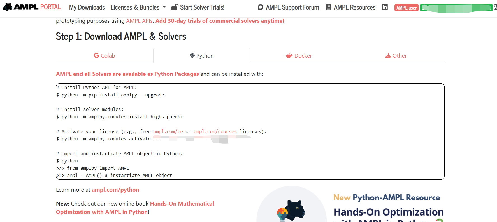

# 附录. Python编写的DEA程序的调试

第11—13章系统给出了本书各类DEA模型的Python实现，并借助 `deabook` 包逐项复现了正文中的数值算例。为使读者能够独立、可靠地重现已完成的全部计算，本附录提供一套与之配套的程序调试与错误排查方法。在将书中代码付诸实践的进程中，环境配置、模型构建、求解与结果提取的任一环节都可能引入错误；随着模型复杂度的提升，出错的概率与定位难度都会显著上升。因此，掌握系统化的调试手段，是将其转化为可复现研究结论的必要前提。

本附录从DEA编程实践出发，依次涵盖开发环境配置、常见错误排查、性能优化、代码质量保障等内容，旨在为读者提供一份可随时查阅的DEA编程排错参考。

---

**速查索引**

| 问题场景 | 参考章节 |
|:---------|:---------|
| Python环境安装与配置 | A.1 |
| 求解器安装与验证 | A.1.3 |
| Python基础语法错误（SyntaxError、IndentationError等） | A.2 |
| 包导入错误（ModuleNotFoundError） | A.2 |
| Pyomo模型构建失败 | A.3 |
| 约束条件返回None/约束不符合预期 | A.3.3 |
| 求解器报错或求解失败 | A.3.2 |
| 效率值超出合理范围（>1或<0） | A.3.1 |
| Jupyter Notebook内核/显示问题 | A.4 |
| 程序运行太慢（大规模DEA问题） | A.5 |
| 输入数据验证 | A.6.1 |
| 环境配置导出与复现 | A.7 |
| 获取社区帮助 | A.8 |

---

## A.1 开发环境配置指南

### A.1.1 Python环境管理

推荐使用 **Miniconda** 或 **Anaconda** 管理Python环境。Conda可以方便地创建隔离的虚拟环境，避免包版本冲突，特别适合科学计算和数据处理工作流。

**安装Miniconda**：

- **Windows**：下载安装程序（`.exe`）并运行，安装时勾选"Add to PATH"
- **macOS**：下载`.pkg`安装程序，或使用命令行：
  ```bash
  curl -O https://repo.anaconda.com/miniconda/Miniconda3-latest-MacOSX-x86_64.sh
  bash Miniconda3-latest-MacOSX-x86_64.sh
  ```
- **Linux**：
  ```bash
  wget https://repo.anaconda.com/miniconda/Miniconda3-latest-Linux-x86_64.sh
  bash Miniconda3-latest-Linux-x86_64.sh
  ```

**创建DEA专用环境**：

```bash
# 创建名为dea的Python 3.11环境
conda create -n dea python=3.11

# 激活环境（每次使用前必须执行）
conda activate dea
```

> **跨平台注意事项**：Windows用户使用`conda activate dea`，部分旧版本conda使用`activate dea`（无需`conda`前缀）。macOS/Linux用户如果在激活时遇到问题，可尝试先运行`source ~/miniconda3/etc/profile.d/conda.sh`。

---

### A.1.2 核心包安装

激活环境后，按以下顺序安装所需包：

```bash
# 基础科学计算包
conda install numpy pandas scipy matplotlib

# Pyomo和基础求解器（conda-forge渠道）
conda install -c conda-forge pyomo glpk

# Jupyter Notebook
conda install jupyter

# 注册Notebook内核（可选，便于在Jupyter中切换环境）
python -m ipykernel install --user --name=dea --display-name "Python (dea)"
```

如果使用`pip`安装：

```bash
pip install pyomo pandas numpy scipy matplotlib jupyter
```

**各包的作用说明**：

| 包名 | 用途 | 本书关联 |
|:-----|:-----|:---------|
| `pyomo` | Python优化建模语言 | 所有DEA模型的核心建模工具 |
| `pandas` | 数据处理与分析 | 数据框操作（第11章） |
| `numpy` | 数值计算 | 数组操作和线性代数 |
| `scipy` | 科学计算 | 辅助数值运算 |
| `matplotlib` | 数据可视化 | 效率分布图绘制 |
| `glpk` | 线性规划求解器 | 基础DEA求解 |

---

### A.1.3 求解器安装详细指南

Pyomo作为建模语言本身不包含求解器，需要额外安装。以下是本书涉及求解器的安装方法：

**（一）GLPK（GNU Linear Programming Kit）**

**特点**：开源免费，安装最简单，适合初学者和小规模问题。

```bash
# 通过conda-forge安装（推荐）
conda install -c conda-forge glpk

# 验证安装
python -c "from pyomo.environ import SolverFactory; print(SolverFactory('glpk').available())"
```

**（二）CBC（Coin-or Branch and Cut）**

**特点**：开源免费，比GLPK更稳定，求解速度更快，推荐作为免费求解器的首选。

```bash
conda install -c conda-forge coincbc
```

**（三）IPOPT（Interior Point OPTimizer）**

**特点**：开源免费，擅长处理非线性规划问题，适用于非线性DEA模型（如二次约束）。

```bash
conda install -c conda-forge ipopt
```

**（四）MOSEK（商业求解器）**

**特点**：求解速度最快，稳定性最高。提供免费学术许可证，是本书**推荐**的求解器。

**安装步骤**：

1. 访问 [MOSEK学术许可申请页面](https://www.mosek.com/products/academic-licenses/)申请免费许可证
2. 下载并安装MOSEK：
   ```bash
   pip install mosek
   ```
3. 将获得的许可证文件（`mosek.lic`）放置在`~/mosek/`目录下

> **求解器性能对比**：下表展示了各求解器求解单个DMU效率评价问题所需的时间。`mosek`求解器消耗的时间约为`glpk`的1/7.5、`ipopt`的1/4，因此**强烈推荐使用mosek**。
>
> | 求解器 | 时间 |
> | :--: | :--: |
> | glpk | 约 0.15s |
> | ipopt | 约 0.08s |
> | mosek | 约 0.02s |

**（五）Gurobi（商业求解器）**

**特点**：学术界广泛使用，性能优异。同样提供免费学术许可。

```bash
conda install -c gurobi gurobi
# 或使用 pip
pip install gurobipy
```

获取学术许可证需在Gurobi官网注册并验证学术身份。

**（六）AMPL/Knitro（商业求解器，经 amplpy 调用）**

**特点**：AMPL（A Mathematical Programming Language）是专为数学规划问题设计的高级代数建模语言，旨在通过抽象的代数表达式简化复杂优化模型的构建。AMPL本身不直接求解问题，而是将模型转换为标准格式（如`.nl`文件）后调用外部求解器，支持的求解器包括Knitro、Gurobi、MINOS、IPOPT等，涵盖线性、非线性、整数规划等多种问题类型。本书第 10 章的 CNLS/StoNED 类非线性模型可使用其分发的 Knitro 求解器求解——免费的 ipopt 虽能求解非线性规划，但速度较慢。AMPL 提供 30 天学术许可证，过期后可使用学生身份申请延长。

**安装步骤**：

1. 注册并登录：进入 [AMPL 门户](https://portal.ampl.com/account/ampl/)，使用教育邮箱注册并登录。

   

2. 登录后进入 [许可证列表页](https://portal.ampl.com/user/ampl/license/list)，可查看 AMPL 在 Python 环境中的安装步骤与许可证 UUID。

   

3. 在 anaconda 自带的 `Anaconda Powershell Prompt` 中依次执行以下命令（即官网给出的安装步骤）：
   ```bash
   # 安装 AMPL 的 Python API
   python -m pip install amplpy --upgrade
   # 安装求解器模块（含非线性求解器 knitro）
   python -m amplpy.modules install highs gurobi knitro
   # 激活许可证（UUID 见许可证列表页）
   python -m amplpy.modules activate <your-license-uuid>
   ```

安装完成后，求解器可执行文件位于 Python 环境的 `ampl_module_base` 目录下；在 pyomo 中以 `SolverFactory('knitro')` 调用时，需确保该目录已加入系统 PATH，并将 `AMPL_LICFILE` 指向许可证文件 `ampl.lic`。

**（七）SCIP（开源求解器）**

**特点**：开源免费，擅长混合整数规划问题（本书第 11 章求解器对比表中提及）。

```bash
conda install -c conda-forge scip
# 配合 Pyomo 使用需安装 PySCIPOpt 接口
pip install pyscipopt
```

安装后可通过 `SolverFactory('scip').available()` 验证是否可用。

---

### A.1.4 验证安装

安装完成后，运行以下代码验证所有组件是否正常工作：

```python
"""
DEA开发环境验证脚本
运行此脚本可检查Python环境、Pyomo和求解器是否正确安装。
"""
import sys

print("=" * 50)
print("DEA开发环境验证")
print("=" * 50)

# 1. Python版本
print(f"\nPython版本: {sys.version}")
assert sys.version_info >= (3, 9), "Python版本需>=3.9"

# 2. 核心包导入测试
try:
    import numpy as np
    print(f"numpy: {np.__version__}  导入成功")
except ImportError as e:
    print(f"numpy: 导入失败 - {e}")

try:
    import pandas as pd
    print(f"pandas: {pd.__version__}  导入成功")
except ImportError as e:
    print(f"pandas: 导入失败 - {e}")

try:
    from pyomo.environ import *
    print("pyomo: 导入成功")
except ImportError as e:
    print(f"pyomo: 导入失败 - {e}")

# 3. 求解器可用性测试
print("\n求解器可用性检查:")
from pyomo.environ import SolverFactory

for solver_name in ['glpk', 'cbc', 'ipopt', 'mosek']:
    solver = SolverFactory(solver_name)
    status = '可用' if solver.available() else '不可用'
    print(f"  {solver_name}: {status}")

# 4. 求解一个简单的LP测试
print("\n简单LP求解测试:")
model = ConcreteModel()
model.x = Var(within=NonNegativeReals)
model.y = Var(within=NonNegativeReals)
model.obj = Objective(expr=model.x + 2 * model.y, sense=minimize)
model.c1 = Constraint(expr=model.x + model.y >= 1)

for solver_name in ['mosek', 'cbc', 'glpk']:
    solver = SolverFactory(solver_name)
    if solver.available():
        result = solver.solve(model)
        print(f"  {solver_name}: 目标值 = {value(model.obj):.4f}")
        break

print("\n" + "=" * 50)
print("环境验证完成！")
print("=" * 50)
```

正常运行后，应输出各包版本号和求解器可用状态，以及简单线性规划的求解结果（目标值约为1.0）。

---

### A.1.5 跨平台注意事项

本书读者可能使用Windows、macOS或Linux等不同操作系统，以下为跨平台开发的关键注意事项：

**文件路径处理**：

不同操作系统使用不同的路径分隔符（Windows使用`\`，macOS/Linux使用`/`）。推荐使用Python的`pathlib`模块处理文件路径，它会自动适配当前操作系统：

```python
from pathlib import Path

# 自动使用正确的路径分隔符
data_path = Path('data') / 'Ex3.dta'
# Windows: data\Ex3.dta, macOS/Linux: data/Ex3.dta

# 兼容三种操作系统的写法
data_file = Path.home() / 'Documents' / 'dea_data' / 'sample.csv'
```

**终端命令差异**：

| 操作 | Windows (CMD) | Windows (PowerShell) | macOS/Linux |
|:-----|:--------------|:---------------------|:------------|
| 列出目录 | `dir` | `ls` | `ls` |
| 切换目录 | `cd` | `cd` | `cd` |
| 激活conda | `activate dea` | `conda activate dea` | `conda activate dea` |
| 安装包 | `conda install` | `conda install` | `conda install` |
| 路径分隔符 | `\` | `\`或`/` | `/` |

**Jupyter Notebook路径问题**：

在Jupyter Notebook中，`!`命令在当前环境的shell中执行。Windows用户若使用默认的CMD而非PowerShell，部分命令可能不兼容。建议在Jupyter中使用Python的`pathlib`或`os`模块处理文件路径，而非直接调用系统命令。


## A.2 Python基础错误速查

在环境就绪之后，调试工作通常始于对错误类型的识别。本节以速查表形式汇总DEA编程中最为常见的通用Python错误。这些错误本身与DEA建模无关，属Python语言基础问题；如需更详尽的解释，请参阅第2章或Python官方教程（docs.python.org/zh-cn/3/tutorial/errors.html）。

### A.2.1 常见错误速查表

| 错误类型 | 典型错误信息 | 常见原因 | 解决方案 |
|:---------|:-------------|:---------|:---------|
| `SyntaxError` | `invalid syntax` | 冒号遗漏、括号不匹配、中文标点 | 检查行末冒号（`:`）、括号匹配，确保使用英文标点 |
| `IndentationError` | `unexpected indent` | 缩进不一致（混用空格和Tab） | 统一使用4个空格缩进，编辑器设置"将Tab转为空格" |
| `NameError` | `name 'xxx' is not defined` | 变量名拼写错误、变量未定义就使用、作用域错误 | 检查拼写；确认变量在使用前已赋值；注意函数内/外作用域 |
| `TypeError` | `unsupported operand type` | 类型不匹配（如字符串+数字）、函数参数类型错误 | 使用`type()`检查变量类型；必要时进行类型转换 |
| `IndexError` | `list index out of range` | 索引超出序列范围 | 检查索引值和序列长度；使用`len()`确认 |
| `KeyError` | `'key' not found` | 字典中不存在该键 | 使用`.get()`方法或先检查键是否存在 |
| `ModuleNotFoundError` | `No module named 'xxx'` | 包未安装、环境未激活 | 激活正确环境；使用`conda install`或`pip install`安装 |
| `ImportError` | `cannot import name 'xxx'` | 包版本不兼容、循环导入 | 检查包版本；检查导入路径 |
| `FileNotFoundError` | `No such file or directory` | 文件路径错误、工作目录不对 | 使用绝对路径；检查`os.getcwd()`确认当前工作目录 |
| `ZeroDivisionError` | `division by zero` | 除数为0 | 添加除零保护（如`if denominator != 0`） |

### A.2.2 包导入错误的DEA场景

在DEA编程中，`ModuleNotFoundError`最常发生在以下场景：

```python
# 错误示例：环境未激活导致pyomo找不到
from pyomo.environ import *        # ModuleNotFoundError: No module named 'pyomo'

# 解决方法：
# 1. 确认已激活正确的conda环境：conda activate dea
# 2. 如果仍未解决，重新安装：conda install -c conda-forge pyomo
```

```python
# 错误示例：拼写错误
from pyomo.environ import Solverfactory
   # ImportError: cannot import name 'Solverfactory' from 'pyomo.environ'
# 正确应为 SolverFactory（注意F大写）

from pyomo.environ import ConcreteModel, Var, Objective, Constraint, maximize
```

### A.2.3 使用pathlib处理文件路径

数据读取时的路径问题是跨平台开发中最常见的错误来源。以下代码展示了DEA场景下的推荐做法：

```python
from pathlib import Path
import pandas as pd

# 推荐做法：使用pathlib自动适配操作系统
data_dir = Path('data')
ex3_path = data_dir / 'Ex3.dta'

# 检查文件是否存在
if not ex3_path.exists():
    raise FileNotFoundError(f"数据文件未找到: {ex3_path.absolute()}")

ex3 = pd.read_stata(ex3_path)
```

---

## A.3 Pyomo与DEA特有错误排查

通用Python错误之外，DEA程序最常见的故障源于Pyomo建模与DEA模型本身的特殊性。本节对这类特有错误作深入分析。从排查路径来看，它们通常依次出现在数据准备、模型构建、求解与结果提取四个阶段，因而需要结合DEA模型的专业知识逐一甄别。

### A.3.1 DEA程序调试决策树

当DEA程序运行出错时，可按以下决策树系统性地定位问题：

```
程序运行出错？
|
|-- 错误发生在导入阶段？
|   |-- ModuleNotFoundError --> 检查包安装（conda list / pip list）
|   |-- ImportError --> 检查Python路径和包版本兼容性
|
|-- 错误发生在数据读取阶段？
|   |-- FileNotFoundError --> 检查文件路径（使用pathlib.Path）
|   |-- UnicodeDecodeError --> 指定encoding='utf-8'或'gbk'
|   |-- KeyError --> 检查列名是否与代码中一致（注意空格、大小写）
|
|-- 错误发生在模型构建阶段？
|   |-- ValueError: Invalid constraint --> 检查变量维度是否匹配
|   |-- TypeError: Unsupported operand --> 检查Pyomo变量与Python原生类型混用
|   |-- NameError --> 检查约束规则函数中的变量名拼写
|   |-- 公式解析错误 --> 检查公式字符串格式
|
|-- 错误发生在求解阶段？
|   |-- SolverNotAvailable --> 安装/配置求解器（见A.1.3节）
|   |-- TerminationCondition.infeasible --> 检查数据是否有零/负值、方向是否正确
|   |-- TerminationCondition.unbounded --> 检查是否遗漏了关键约束
|   |-- 求解器崩溃/内存错误 --> 减少DMU数量或换用更高效的求解器
|
|-- 错误发生在结果提取阶段？
    |-- KeyError/AttributeError --> 检查Pyomo组件访问语法
    |-- 结果为空或全NaN --> 检查求解是否成功
    |-- 结果不合理（如效率>1或<0） --> 检查模型导向和RTS设定
```

### A.3.2 最小可复现示例（MRE）指南

前述决策树提供的是问题定位的思路；而要将故障清晰地呈现给他人（或提交至社区），还需将其凝练为可独立运行的最小片段。在向他人求助或自行调试时，构造**最小可复现示例（Minimum Reproducible Example, MRE）**是最有效的策略。

**MRE的构造原则**：

1. **最小数据**：用最少的DMU复现错误（通常2-3个DMU、1投入1产出即可）
2. **最小代码**：只保留能触发错误的最少代码行
3. **可独立运行**：他人复制粘贴即可运行

**DEA场景的MRE模板**：

```python
"""
最小可复现示例：DEA模型XX错误的复现
环境：Python 3.11, pyomo 6.6, glpk求解器
"""
from pyomo.environ import *
import pandas as pd

# 最小数据集（2个DMU, 1投入, 1产出）
data = pd.DataFrame({
    'dmu': [1, 2],
    'x': [1.0, 2.0],   # 投入
    'y': [1.0, 1.0]    # 产出
})

# 最小DEA模型
def minimal_dea(data, input_col, output_col, dmu0):
    """最小DEA模型（产出导向CRS），一次评价一个DMU，用于调试

    Parameters
    ----------
    data : pd.DataFrame
        含投入列与产出列的数据框。
    input_col, output_col : str
        投入、产出列名（本示例为单投入单产出）。
    dmu0 : int
        被评价DMU在 data 中的位置（0, 1, ...）。

    Returns
    -------
    float
        产出扩张倍数 theta（>=1），技术效率为 1/theta。
    """
    model = ConcreteModel()
    model.I = Set(initialize=range(len(data)))   # 参照集：全部DMU
    model.x = data[input_col].values
    model.y = data[output_col].values

    # 被评价DMU的观测值（标量）
    x0 = model.x[dmu0]
    y0 = model.y[dmu0]

    model.theta = Var(bounds=(0, None))          # 产出扩张倍数，非负
    model.intensity = Var(model.I, bounds=(0, None))

    model.obj = Objective(expr=model.theta, sense=maximize)

    # 投入约束：参照集加权投入不超过被评价DMU的投入（单投入，1条约束）
    model.input_con = Constraint(
        expr=sum(model.intensity[i] * model.x[i] for i in model.I) <= x0
    )

    # 产出约束：参照集加权产出不低于被评价DMU产出的theta倍（单产出，1条约束）
    model.output_con = Constraint(
        expr=sum(model.intensity[i] * model.y[i] for i in model.I)
        >= model.theta * y0
    )

    solver = SolverFactory('glpk')
    result = solver.solve(model)
    return value(model.theta)

# 运行测试：对每个DMU分别求解
try:
    for dmu0 in range(len(data)):
        theta = minimal_dea(data, 'x', 'y', dmu0)
        print(
            f"DMU {data.loc[dmu0, 'dmu']}: theta = {theta:.4f}, te = {1/theta:.4f}")
except Exception as e:
    print(f"错误: {type(e).__name__}: {e}")
```

这个模板的两个要点容易写错。第一，**DEA是"一个DMU一个线性规划"**：约束右端是被评价单元 $0$ 的观测值 $x_0$、$y_0$，约束条数等于投入维数加产出维数（这里各为1），而不是等于DMU个数。若把约束写成对所有 $i$ 成立的 $\sum_j\lambda_j x_j\le x_i$、$\sum_j\lambda_j y_j\ge\theta y_i$，就变成要求同一组 $\lambda$ 和同一个 $\theta$ 同时包络全部单元，返回的单个 `theta` 不是任何一个DMU的效率。评价多个单元要在函数外循环（如上），或在函数内对 `data.index` 循环。第二，**$\theta$ 需要下界**：产出导向下 $\theta\ge 0$（最优时 $\theta\ge1$），写成 `bounds=(None, None)` 在某些约束组合下会让LP无界。

如果遇到"infeasible"错误，先用上述2个DMU、1投入1产出的最小数据集测试。如果最小数据集可以正常运行，则逐步增加DMU数量和变量数量，直至定位触发错误的数据点。

### A.3.3 模型构建阶段错误

**（一）案例1：NameError——约束规则中的变量名拼写错误**

以下案例展示了DEA编程中因循环变量名不一致导致的`NameError`，以及如何通过阅读错误追踪信息定位问题。

```python
from pyomo.environ import *
import pandas as pd
import numpy as np
import re


def dea_debug_v1(formula, dataframe, rts, orient, eval_query=None,
    ref_query=None):
    """
    DEA效率计算函数（含调试示例的版本）

    Parameters
    ----------
    formula : str
        公式字符串，如 "Y=K L"
    dataframe : pd.DataFrame
        投入产出数据框
    rts : str
        规模报酬："crs" 或 "vrs"
    orient : str
        导向："oo"（产出导向）或 "io"（投入导向）
    eval_query : str or None, default None
        筛选待评价DMU的查询条件
    ref_query : str or None, default None
        筛选参照DMU的查询条件

    Returns
    -------
    pd.DataFrame
        包含theta和技术效率值的结果
    """
    theta_results = {}

    if eval_query is None:
        index_list = dataframe.index
    else:
        index_list = dataframe.query(eval_query).index

    if ref_query is None:
        index_list_ref = dataframe.index
    else:
        index_list_ref = dataframe.query(ref_query).index

    # 解析公式字符串
    input_vars = formula.split('=')[1].strip(' ')
    xcol = re.compile(' +').sub(' ', input_vars).split(' ')
    output_vars = formula.split('=')[0].strip(' ')
    ycol = re.compile(' +').sub(' ', output_vars).split(' ')

    data = dataframe.loc[index_list, xcol + ycol]
    dataref = dataframe.loc[index_list_ref, xcol + ycol]
    xref = dataref.loc[:, xcol]
    yref = dataref.loc[:, ycol]

    for j in data.index:
        x = data.loc[j, xcol]
        y = data.loc[j, ycol]

        model = ConcreteModel()
        model.I = Set(initialize=range(dataref.shape[0]))
        model.K = Set(initialize=range(len(xcol)))
        model.L = Set(initialize=range(len(ycol)))

        model.theta = Var(within=Reals, bounds=(None, None), doc='efficiency')
        model.intensity = Var(model.I, bounds=(0.0, None),
            doc='intensity variables')

        def obj_rule(model):
            return model.theta
        model.obj = Objective(
            rule=obj_rule,
            sense=(maximize if orient == "oo" else minimize),
            doc='objective function'
        )

        def input_rule(model, k):
            """Return the proper input constraint"""
            if orient == "oo":
                # BUG: 循环变量名为i2，但引用时使用i，导致NameError
                return (
                    sum(model.intensity[i] * xref.iloc[i, k]
                           for i2 in model.I)
                    <= x.iloc[k]
                )
            elif orient == "io":
                return (
                    sum(model.intensity[i] * xref.iloc[i, k]
                           for i in model.I)
                    <= model.theta * x.iloc[k]
                )

        def output_rule(model, l):
            """Return the proper output constraint"""
            if orient == "oo":
                return (
                    sum(model.intensity[i] * yref.iloc[i, l]
                           for i in model.I)
                    >= model.theta * y.iloc[l]
                )
            elif orient == "io":
                return (
                    sum(model.intensity[i] * yref.iloc[i, l]
                           for i in model.I)
                    >= y.iloc[l]
                )

        def vrs_rule(model):
            """Return the VRS constraint"""
            return sum(model.intensity[i] for i in model.I) == 1

        model.input = Constraint(model.K, rule=input_rule,
            doc='input constraint')
        model.output = Constraint(model.L, rule=output_rule,
            doc='output constraint')

        if rts == "vrs":
            model.vrs = Constraint(rule=vrs_rule, doc='VRS constraint')

        opt = SolverFactory('mosek')
        solution = opt.solve(model)

        theta = np.asarray(list(model.theta[:].value))
        theta_results[j] = theta[0]

    thetadf = pd.DataFrame(theta_results, index=["theta"]).T
    thetadf["te"] = (1 / thetadf["theta"] if orient == "oo" else thetadf[
        "theta"])
    return thetadf
```

运行上述函数：

```python
import pandas as pd
ex3 = pd.read_stata(r"Ex3.dta")
te = dea_debug_v1("Y=K L", ex3, "vrs", "oo", "dmu==[10,11,2,3,4,5,6,18]",
    "dmu<=20")
```

**错误信息分析**：

```
ERROR: Rule failed when generating expression for Constraint input with index 0:
    NameError: name 'i' is not defined
```

Python会自动追踪代码的执行路径，并按照由浅入深的代码层次报告错误位置：

1. 最顶层：`----> te = dea_debug_v1(...)` 指向第3行函数调用
2. 第二层：`dea_debug_v1`函数内部的`model.input = Constraint(...)`指向约束构建行
3. 第三层：`input_rule`函数内部的生成器表达式
4. 最底层：`NameError: name 'i' is not defined`

**排查方法**：

Pyomo由专业团队开发维护，与其本身相关的报错大概率并非Pyomo的问题，排查时应重点关注自己编写的代码。从上述分析可知，`input_rule`函数中`for i2 in model.I`使用了循环变量`i2`，而生成器表达式内部引用的却是`i`，两者不一致，将`i2`改为`i`即可修复：

```python
# 修复前（错误）
return (
    sum(model.intensity[i] * xref.iloc[i, k]
           for i2 in model.I)
    <= x.iloc[k]
)

# 修复后（正确）
return (
    sum(model.intensity[i] * xref.iloc[i, k]
           for i in model.I)
    <= x.iloc[k]
)
```

**（二）案例2：ValueError——约束规则返回None**

以下案例展示了因函数调用参数缺失导致约束规则返回`None`的错误。

在`dea_debug_v1`的调用代码中，如果遗漏了`orient`参数：

```python
import pandas as pd
ex3 = pd.read_stata(r"Ex3.dta")
# 错误：遗漏了 orient 参数（"oo" 或 "io"）
te = dea_debug_v1("Y= K L ", ex3, "vrs", "dmu==[10,11,2,3,4,5,6,18]",
    "dmu<=20")
```

此时，字符串`"dmu==[10,11,2,3,4,5,6,18]"`被传入`orient`参数，`eval_query`则接收了`"dmu<=20"`。在`input_rule`函数中，`if orient == "oo"`与`elif orient == "io"`两个分支均不满足，函数未执行任何`return`语句，因而隐式返回`None`。

**错误信息**：

```
ValueError: Constraint 'input[0]': rule returned None.

Constraint rules must return either a valid expression, a 2- or 3-member
tuple, or one of Constraint.Skip, Constraint.Feasible, or
Constraint.Infeasible. The most common cause of this error is forgetting
to include the "return" statement at the end of your rule.
```

**排查方法**：

1. 从错误信息定位到约束构建行：`model.input = Constraint(...)`
2. 检查`input_rule`函数的所有分支是否都有`return`语句
3. 在`input_rule`中添加`else`分支和调试`print`来定位问题：

```python
def input_rule(model, k):
    """Return the proper input constraint（带调试版）"""
    print(f"DEBUG: orient='{orient}', k={k}")   # 添加调试输出
    if orient == "oo":
        return (
            sum(model.intensity[i] * xref.iloc[i, k]
                   for i in model.I)
            <= x.iloc[k]
        )
    elif orient == "io":
        return (
            sum(model.intensity[i] * xref.iloc[i, k]
                   for i in model.I)
            <= model.theta * x.iloc[k]
        )
    else:
        raise ValueError(f"orient必须是'oo'或'io'，当前值为: {orient}")
```

通过`print`输出可以发现，`orient`的值并非预期的`"oo"`或`"io"`，由此可追溯至函数调用时参数缺失的问题。

**正确的调用方式**：

```python
te = dea_debug_v1("Y= K L ", ex3, "vrs", "oo",
                  "dmu==[10,11,2,3,4,5,6,18]", "dmu<=20")
```

**（三）案例3：使用pprint()检查约束条件**

在线性规划问题编程中，约束条件的正确设置至关重要。当不确定约束是否正确时，可以使用Pyomo模型的`pprint()`方法打印约束条件的具体表达式，检查系数和不等式方向是否符合预期。

```python
def build_single_model(
    formula, dataframe, rts, orient, eval_query=None, ref_query=None
):
    """
    构建单个DEA模型（用于pprint检查，仅循环一次后break）

    Parameters
    ----------
    formula, dataframe, rts, orient, eval_query, ref_query
        同 dea_debug_v1

    Returns
    -------
    ConcreteModel
        构建好的Pyomo模型（仅包含第一个DMU的模型）
    """
    if eval_query is None:
        index_list = dataframe.index
    else:
        index_list = dataframe.query(eval_query).index

    if ref_query is None:
        index_list_ref = dataframe.index
    else:
        index_list_ref = dataframe.query(ref_query).index

    input_vars = formula.split('=')[1].strip(' ')
    xcol = re.compile(' +').sub(' ', input_vars).split(' ')
    output_vars = formula.split('=')[0].strip(' ')
    ycol = re.compile(' +').sub(' ', output_vars).split(' ')

    data = dataframe.loc[index_list, xcol + ycol]
    dataref = dataframe.loc[index_list_ref, xcol + ycol]
    xref = dataref.loc[:, xcol]
    yref = dataref.loc[:, ycol]

    for j in data.index:
        x = data.loc[j, xcol]
        y = data.loc[j, ycol]

        model = ConcreteModel()
        model.I = Set(initialize=range(dataref.shape[0]))
        model.K = Set(initialize=range(len(xcol)))
        model.L = Set(initialize=range(len(ycol)))

        model.theta = Var(within=Reals, bounds=(None, None), doc='efficiency')
        model.intensity = Var(model.I, bounds=(0.0, None),
            doc='intensity variables')

        def obj_rule(model):
            return model.theta
        model.obj = Objective(
            rule=obj_rule,
            sense=(maximize if orient == "oo" else minimize),
            doc='objective function'
        )

        def input_rule(model, k):
            if orient == "oo":
                return (
                    sum(model.intensity[i] * xref.iloc[i, k]
                           for i in model.I)
                    <= x.iloc[k]
                )
            elif orient == "io":
                return (
                    sum(model.intensity[i] * xref.iloc[i, k]
                           for i in model.I)
                    <= model.theta * x.iloc[k]
                )

        def output_rule(model, l):
            if orient == "oo":
                return (
                    sum(model.intensity[i] * yref.iloc[i, l]
                           for i in model.I)
                    >= model.theta * y.iloc[l]
                )
            elif orient == "io":
                return (
                    sum(model.intensity[i] * yref.iloc[i, l]
                           for i in model.I)
                    >= y.iloc[l]
                )

        def vrs_rule(model):
            return sum(model.intensity[i] for i in model.I) == 1

        model.input = Constraint(model.K, rule=input_rule,
            doc='input constraint')
        model.output = Constraint(model.L, rule=output_rule,
            doc='output constraint')

        if rts == "vrs":
            model.vrs = Constraint(rule=vrs_rule, doc='VRS constraint')

        break    # 仅构建第一个DMU的模型后即退出

    return model
```

使用`pprint()`检查模型：

```python
import pandas as pd
ex3 = pd.read_stata(r"Ex3.dta")
model = build_single_model("Y=K L", ex3, "vrs", "oo",
                           "dmu==[10,11,2,3,4,5,6,18]", "dmu<=20")
model.pprint()
```

`pprint()`的输出包含以下几个关键部分：

1. **Set声明**：检查`I`、`K`、`L`的维度是否正确
2. **Var声明**：检查`theta`和`intensity`变量的定义域和边界
3. **Objective声明**：检查目标函数的方向（maximize/minimize）和表达式
4. **Constraint声明**：检查每个约束的Lower/Body/Upper值

**重点检查项**：

- 投入约束的Upper值应为**正数**（产出导向下，投入约束为`<=`被评价单元的投入值）
- 产出约束的Lower值应包含`theta`（产出导向下，产出约束为`>= theta * 被评价单元的产出值`）
- VRS约束的Lower和Upper都应为1.0（`sum(intensity) == 1`）

如果投入约束的Upper值为负数，说明公式中的符号可能写反了（如将`<= x[k]`误写为`<= -x[k]`），这将导致线性规划模型错误。

### A.3.4 数据相关错误

**（一）零值或负值导致求解失败**

DEA模型要求投入产出数据严格为正（部分模型允许非期望产出为0）。数据中存在零值或负值会导致线性规划无可行解或结果异常。

```python
def validate_data_for_dea(data, input_cols, output_cols,
    undesirable_cols=None):
    """
    验证DEA输入数据的合法性

    Parameters
    ----------
    data : pd.DataFrame
        投入产出数据
    input_cols : list[str]
        投入变量列名列表
    output_cols : list[str]
        产出变量列名列表
    undesirable_cols : list[str] or None, default None
        非期望产出变量列名列表

    Returns
    -------
    bool
        验证通过返回True，否则抛出AssertionError
    """
    assert isinstance(data, pd.DataFrame), "数据必须是pandas DataFrame"
    assert len(data) >= 2, "DEA分析至少需要2个DMU"

    for col in input_cols + output_cols:
        assert col in data.columns, f"变量 '{col}' 不在数据中"

    assert data[input_cols + output_cols].notna().all().all(), \
        "数据包含缺失值(NaN)，请先处理"

    assert np.isfinite(data[input_cols + output_cols].values).all(), \
        "数据包含无穷大(Inf)值，请先处理"

    # 投入必须严格为正
    assert (data[input_cols] > 0).all().all(), \
        f"投入变量存在零值或负值:\n{data[input_cols][(data[input_cols] <= 0).any(axis=1)]}"

    # 期望产出必须严格为正
    assert (data[output_cols] > 0).all().all(), \
        f"产出变量存在零值或负值:\n{data[output_cols][(data[output_cols] <= 0).any(axis=1)]}"

    if undesirable_cols:
        assert (data[undesirable_cols] >= 0).all().all(), \
            "非期望产出不能为负"

    return True
```

**（二）列名不匹配导致KeyError**

公式字符串中的变量名必须与DataFrame的列名完全一致（包括大小写、空格）：

```python
# 错误示例：列名大小写不匹配
ex3.columns  # Index(['dmu', 'K', 'L', 'Y'], dtype='object')
te = dea8("y=k l", ex3, "vrs", "oo")   # KeyError: 'y'（应为'Y'）

# 解决方法：
# 1. 打印data.columns确认列名
# 2. 使用 data.columns = data.columns.str.strip().str.upper() 统一格式
```

### A.3.5 求解阶段错误

**（一）求解器不可用**

```python
from pyomo.environ import SolverFactory

solver = SolverFactory('mosek')
if not solver.available():
    print("MOSEK不可用，尝试使用备选求解器CBC...")
    solver = SolverFactory('cbc')
    if not solver.available():
        raise RuntimeError("所有求解器均不可用，请安装求解器（参见A.1.3节）")
```

**（二）求解终止条件异常**

```python
from pyomo.opt import SolverStatus, TerminationCondition


def solve_with_check(model, solver_name='mosek'):
    """
    带状态检查的求解器调用

    Parameters
    ----------
    model : ConcreteModel
        Pyomo模型
    solver_name : str, default 'mosek'
        求解器名称

    Returns
    -------
    result
        求解结果对象

    Raises
    ------
    RuntimeError
        求解器不可用或求解失败时抛出
    """
    opt = SolverFactory(solver_name)

    if not opt.available():
        raise RuntimeError(
            f"求解器 '{solver_name}' 未安装或不可用。"
            f"请运行：conda install -c conda-forge {solver_name}"
        )

    result = opt.solve(model)

    # 检查求解状态
    if result.solver.status != SolverStatus.ok:
        raise RuntimeError(f"求解器状态异常: {result.solver.status}")

    # 检查终止条件
    tc = result.solver.termination_condition
    if tc != TerminationCondition.optimal:
        if tc == TerminationCondition.infeasible:
            raise RuntimeError(
                "线性规划无可行解——请检查：\n"
                "  1. 数据是否存在零值或负值\n"
                "  2. 投入产出变量方向是否正确\n"
                "  3. 约束条件不等式方向是否正确"
            )
        elif tc == TerminationCondition.unbounded:
            raise RuntimeError(
                "线性规划无界——请检查是否遗漏了关键约束（如投入上界、VRS约束）"
            )
        else:
            raise RuntimeError(f"求解未达到最优。终止条件: {tc}")

    return result
```

### A.3.6 结果相关错误

**（一）效率值超出[0, 1]范围**投入导向的CCR/BCC模型中，技术效率值应位于[0, 1]范围内；产出导向的效率值（te）为1/theta，同样应位于该范围内。若效率值超出此范围，可能的原因包括：

| 异常现象 | 可能原因 | 解决方案 |
|:---------|:---------|:---------|
| 效率值 > 1 | 导向参数设置错误；产出导向取了theta而非1/theta | 检查`orient`参数；产出导向使用`te = 1/theta` |
| 效率值 < 0 | 数据中存在负值；约束方向错误 | 检查数据；检查不等式方向（`<=` vs `>=`） |
| 所有DMU效率均为1.0 | 指标过多而DMU过少（维数灾难），或各单元均具独特投入产出组合，样本内无法区分 | 增加样本量、合并或删减指标；检查参照集是否过小（见A.6.1的 $n < m+s$ 警告） |
| 效率值全为NaN | 求解失败未被捕获 | 添加`solve_with_check`检查求解状态 |

> 注意"全体效率为1"不能靠补上VRS约束来纠正：VRS效率不低于CRS效率，加入 $\sum_i\lambda_i=1$ 只会让**更多**单元落在前沿上。零值或负值更常导致模型无可行解（见A.3.4），而不是全体有效。

**（二）松弛变量计算异常**

```python
# 计算投入冗余（slack）后验证
assert (slack_input >= 0).all(), "投入冗余不能为负——检查投入约束方向"
assert (slack_output >= 0).all(), "产出不足不能为负——检查产出约束方向"
```


## A.4 Jupyter Notebook特有问题

前述错误排查均假定代码运行于确定的执行环境之中；而本书以Jupyter Notebook作为主要编程环境，其交互式特性本身会引入一类独特问题。在Notebook中，单元格的可乱序执行与内核状态的可丢失性，往往使排查方向偏离真实成因。本节针对DEA编程中常见的Notebook问题予以说明。

### A.4.1 单元执行顺序混乱

**问题描述**：Jupyter Notebook的单元格（cell）可以按任意顺序执行。若来回跳转执行单元格，变量状态可能变得混乱——某个变量保存的可能是旧版本代码的计算结果。

**典型表现**：

```python
# 单元格1：定义函数
def calculate_efficiency(x, y):
    return x / y

# 单元格2：修改函数定义（添加了y=0保护）
def calculate_efficiency(x, y):
    if y == 0:
        return 0
    return x / y

# 单元格3：调用函数（如果先执行单元格2再执行单元格1，
#          则单元格1的旧版本会覆盖新版本）
result = calculate_efficiency(10, 0)   # 可能抛出ZeroDivisionError
```

**解决方案**：

1. **Kernel → Restart & Run All**：当结果异常时，重启内核并从头到尾重新执行所有单元格
2. **养成顺序执行习惯**：尽量从上到下依次执行单元格，避免来回跳转
3. **使用编号检查**：Notebook单元格左侧的`In [N]`编号可以反映执行顺序。如果编号不连续（如`In [1]`后直接`In [5]`），说明存在跳转执行

### A.4.2 内核重启后变量丢失

**问题描述**：Jupyter Notebook的所有变量存储在内存中。当内核重启（Kernel → Restart）或内核崩溃后，所有已定义的变量和导入的包都会丢失。

**对DEA编程的影响**：

```python
# 前面单元格已运行：
import pandas as pd
ex3 = pd.read_stata(r"Ex3.dta")

# 内核重启后，以下代码会报错：
te = dea8("Y=K L", ex3, "vrs", "oo")
# NameError: name 'pd' is not defined
# NameError: name 'ex3' is not defined
```

**最佳实践**：

1. **将所有import语句放在Notebook开头的第一个单元格**，确保内核重启后可以快速恢复
2. **将重要结果保存到文件**，不要仅依赖内存中的变量：

```python
# 计算完成后保存结果
te.to_csv('efficiency_results.csv', index=True)

# 后续需要时重新加载
te = pd.read_csv('efficiency_results.csv', index_col=0)
```

3. **使用`%who`魔术命令查看当前命名空间中的变量**：

```python
%who          # 列出所有变量
%whos         # 列出变量及其类型和值
```

### A.4.3 大数据集的内存问题

**问题描述**：处理大规模DEA问题（如>1000个DMU）时，Jupyter Notebook可能因为内存不足而卡顿甚至崩溃。

**症状**：
- 单元格执行时间异常长
- Notebook无响应（单元格左侧显示`*`长时间不消失）
- 浏览器页面崩溃
- 出现`MemoryError`异常

**解决方案**：

1. **使用`.py`脚本替代Notebook**：对于大规模计算，将代码保存为`.py`文件并在命令行运行：
   ```bash
   python dea_analysis.py
   ```

2. **及时释放不再需要的变量**：
   ```python
   # 计算完成后释放中间变量
   del model, xref, yref
   import gc
   gc.collect()   # 强制垃圾回收
   ```

3. **分批次处理**：将大规模DEA问题分批求解（详见A.5节）

4. **使用内存分析工具**：
   ```python
   # 查看变量内存占用
   import sys
   for name, obj in sorted(
       locals().items(), key=lambda x: sys.getsizeof(x[1]), reverse=True
   )[:10]:
       print(f"{name}: {sys.getsizeof(obj) / 1024**2:.2f} MB")
   ```

### A.4.4 图形不显示

**问题描述**：使用`matplotlib`绘制图形时，图形未在Notebook中内联显示。

**解决方案**：

```python
# 在Notebook开头添加魔术命令（推荐放在import之后）
%matplotlib inline

# 如果需要更高清的图像
%config InlineBackend.figure_format = 'retina'

import matplotlib.pyplot as plt

# 现在绘图会直接在Notebook中显示
plt.hist(te['te'], bins=20, edgecolor='black')
plt.xlabel('Technical Efficiency')
plt.ylabel('Frequency')
plt.title('Distribution of DEA Efficiency Scores')
plt.show()
```

**注意事项**：
- `%matplotlib inline`必须在任何`plt`调用之前执行
- 如果使用了`%matplotlib notebook`（交互式模式），每次只能有一个图形处于激活状态
- 对于静态出版质量图像，始终使用`%matplotlib inline`

---

## A.5 性能优化与大规模问题处理

当模型能够稳定求解后，研究对象规模往往成为新的瓶颈。DEA的计算量随决策单元数量近似线性累积，因此大规模实证分析对求解效率与内存管理提出了更高要求。本节围绕计算复杂度、求解器选择、并行与分批策略以及内存优化展开讨论，以应对DMU数量庞大的情形。

### A.5.1 DEA计算复杂度分析

DEA方法的计算复杂度随决策单元（DMU）数量呈多项式增长，这是DEA编程中最主要的性能瓶颈：

**计算量分析**：

- 对于$n$个DMU，传统DEA需要求解$n$个独立的线性规划（LP）问题
- 每个LP的变量数约为$n$（强度变量$\lambda_i$）加上效率变量数
- 每个LP的约束数约为投入变量数 + 产出变量数 + RTS约束数

| DMU数量 | 需要求解的LP数量 | 每个LP的变量数 | 预估总求解时间（GLPK） |
|:--------|:-----------------|:---------------|:----------------------|
| 100 | 100 | ~100 | ~6秒 |
| 500 | 500 | ~500 | ~35秒 |
| 1,000 | 1,000 | ~1,000 | ~2分钟 |
| 5,000 | 5,000 | ~5,000 | ~25分钟 |
| 10,000 | 10,000 | ~10,000 | ~1.5小时 |

> **实际影响因素**：求解时间还受投入产出变量数量、RTS设定（VRS比CRS多一个约束）、求解器选择等因素影响。上表为产出导向VRS模型（3个投入、1个期望产出）在 pyomo + glpk 4.65 环境下的实测结果：每个规模求解若干个LP（n=100为全量100个，更大规模抽样5—50个）取平均后按LP数量外推，含pyomo建模开销；绝对数值随硬件与数据结构而异，量级供参考。

### A.5.2 提升求解速度的实用技巧

**（一）使用更快的求解器**求解器选择对DEA计算速度的影响最大，推荐优先级如下：

1. **MOSEK**（最快，需学术许可）：求解速度约为GLPK的6-8倍
2. **Gurobi**（快，需学术许可）：与MOSEK性能接近
3. **CBC**（免费，较快）：比GLPK稳定，推荐作为免费首选
4. **GLPK**（免费，最慢）：适合小规模问题和教学演示

```python
from pyomo.environ import SolverFactory

# 尝试使用最快的可用求解器
for solver_name in ['mosek', 'gurobi', 'cbc', 'glpk']:
    solver = SolverFactory(solver_name)
    if solver.available():
        print(f"使用求解器: {solver_name}")
        break
else:
    raise RuntimeError("没有可用的求解器")
```

**（二）并行计算**由于每个DMU的DEA模型是独立求解的，可以使用并行计算同时求解多个DMU。以下示例使用`joblib`库实现并行DEA计算：

```python
from joblib import Parallel, delayed
from pyomo.environ import *
import pandas as pd
import numpy as np


def solve_single_dmu(dmu_idx, data, xcol, ycol, orient='oo', rts='crs'):
    """
    求解单个DMU的DEA模型

    Parameters
    ----------
    dmu_idx : int
        当前评价DMU的索引
    data : pd.DataFrame
        全部DMU的投入产出数据
    xcol : list[str]
        投入变量列名
    ycol : list[str]
        产出变量列名
    orient : str, default 'oo'
        导向类型："oo"（产出导向）或 "io"（投入导向）
    rts : str, default 'crs'
        规模报酬

    Returns
    -------
    tuple
        (dmu_idx, theta_value)
    """
    x = data.loc[dmu_idx, xcol]
    y = data.loc[dmu_idx, ycol]
    xref = data.loc[:, xcol]
    yref = data.loc[:, ycol]

    if orient not in ("oo", "io"):
        raise ValueError(f"orient必须是'oo'或'io'，当前值为: {orient}")

    model = ConcreteModel()
    model.I = Set(initialize=data.index)
    model.K = Set(initialize=range(len(xcol)))
    model.L = Set(initialize=range(len(ycol)))

    # theta 非负：产出导向下为产出扩张倍数（>=1），投入导向下为投入收缩比（(0,1]）
    model.theta = Var(bounds=(0, None))
    model.intensity = Var(model.I, bounds=(0, None))

    model.obj = Objective(expr=model.theta,
                          sense=(maximize if orient == 'oo' else minimize))

    # 投入约束：产出导向下右端为 x_0，投入导向下右端为 theta * x_0
    def input_rule(model, k):
        lhs = sum(model.intensity[i] * xref.loc[i, xcol[k]] for i in model.I)
        if orient == "oo":
            return lhs <= x.loc[xcol[k]]
        else:
            return lhs <= model.theta * x.loc[xcol[k]]
    model.input_con = Constraint(model.K, rule=input_rule)

    # 产出约束：产出导向下右端为 theta * y_0，投入导向下右端为 y_0
    def output_rule(model, l):
        lhs = sum(model.intensity[i] * yref.loc[i, ycol[l]] for i in model.I)
        if orient == "oo":
            return lhs >= model.theta * y.loc[ycol[l]]
        else:
            return lhs >= y.loc[ycol[l]]
    model.output_con = Constraint(model.L, rule=output_rule)

    if rts == 'vrs':
        model.vrs = Constraint(
            expr=sum(model.intensity[i] for i in model.I) == 1)

    solver = SolverFactory('mosek')
    solver.solve(model, tee=False)

    theta = value(model.theta)
    return (dmu_idx, theta)


def parallel_dea(data, xcol, ycol, orient='oo', rts='crs', n_jobs=-1):
    """
    并行计算DEA效率

    Parameters
    ----------
    data : pd.DataFrame
        投入产出数据
    xcol : list[str]
        投入变量列名
    ycol : list[str]
        产出变量列名
    orient : str, default 'oo'
        导向类型
    rts : str, default 'crs'
        规模报酬
    n_jobs : int, default -1
        并行进程数，-1表示使用所有CPU核心

    Returns
    -------
    pd.DataFrame
        包含theta值和技术效率值的结果
    """
    results = Parallel(n_jobs=n_jobs, backend='loky')(
        delayed(solve_single_dmu)(idx, data, xcol, ycol, orient, rts)
        for idx in data.index
    )

    theta_results = {idx: theta for idx, theta in results}
    thetadf = pd.DataFrame(theta_results, index=["theta"]).T
    thetadf["te"] = (1 / thetadf["theta"] if orient == "oo" else thetadf[
        "theta"])
    return thetadf
```

**使用示例**：

```python
# 使用4个核心并行计算（假设data已定义）
tresults = parallel_dea(data, ['K', 'L'], ['Y'], orient='oo', rts='vrs',
    n_jobs=4)
```

> **注意事项**：当DMU数量较少时，并行计算的开销可能得不偿失，建议在DMU数量大于100时再考虑并行化。`n_jobs`参数建议不超过CPU核心数。

> **导向切换不只是改 max/min**：投入导向的模型是 $\min\theta$、$\sum_i\lambda_i X_{ik}\le\theta x_{0k}$、$\sum_i\lambda_i Y_{il}\ge y_{0l}$，$\theta$ 乘在**投入**一侧；产出导向则是 $\max\theta$，$\theta$ 乘在**产出**一侧。若只把目标函数从 `maximize` 改成 `minimize` 而让 $\theta$ 留在产出约束上，得到的既不是Farrell投入效率，在 $\theta$ 无下界时还会使LP无界（$\theta\to-\infty$）。上面的 `input_rule` / `output_rule` 按 `orient` 切换 $\theta$ 所在侧，与A.3.3和第11章的 `dea8` 一致。

**（三）减少不必要的约束**如果确定使用CRS模型，不要添加VRS的凸性约束，可以减少每个LP的约束行数：

```python
# 每个LP的技术约束行数（与A.5.1一致）：
#   CRS模型：投入变量数 P + 产出变量数 Q
#   VRS模型：P + Q + 1（多一条凸性约束 sum(lambda_i) == 1）
# 强度变量的 lambda_i >= 0 是变量边界，不计入约束行。
# 规模差异主要来自可行域：VRS多一条等式，可行域更小但需处理额外的等式约束，
# 因此大规模问题上CRS通常快于VRS。
```

**（四）分解大问题**对于超大规模DEA问题（如>5000 DMU），可按以下策略分解：

```python
def batch_dea(data, xcol, ycol, batch_size=500, orient='oo', rts='crs'):
    """
    分批计算DEA效率，适用于超大规模问题

    Parameters
    ----------
    data : pd.DataFrame
        全部DMU的投入产出数据
    xcol : list[str]
        投入变量列名
    ycol : list[str]
        产出变量列名
    batch_size : int, default 500
        每批处理的DMU数量
    orient, rts : str
        导向和规模报酬设置

    Returns
    -------
    pd.DataFrame
        合并后的效率结果
    """
    all_results = []
    n_batches = (len(data) + batch_size - 1) // batch_size

    for i in range(n_batches):
        start_idx = i * batch_size
        end_idx = min((i + 1) * batch_size, len(data))
        batch_data = data.iloc[start_idx:end_idx]

        print(f"处理第 {i+1}/{n_batches} 批 (DMU {start_idx}-{end_idx-1})")

        batch_result = parallel_dea(batch_data, xcol, ycol, orient, rts,
            n_jobs=4)
        all_results.append(batch_result)

    return pd.concat(all_results)
```

### A.5.3 内存优化建议

**（一）使用生成器代替列表**

```python
# 不推荐：列表推导式一次性存储所有中间结果
all_models = [build_model(data, i) for i in range(n)]  # 占用大量内存

# 推荐：使用生成器逐个产生模型，逐个求解
def model_generator(data):
    for i in data.index:
        yield build_model(data, i)

for model in model_generator(data):
    solve_model(model)
    # 模型在使用后自动释放
```

**（二）使用更高效的数据类型**

```python
# 对于大规模数据，使用float32代替float64可节省一半内存
data_float32 = data.astype('float32')

# 如果数据值范围有限，可使用更紧凑的类型
data_int16 = data.astype('int16')   # 仅适用于整数数据

```

### A.5.4 性能优化决策流程

```
DEA程序运行太慢？
|
|-- DMU数量 < 100？
|   |-- 更换求解器（GLPK -> MOSEK/Gurobi）
|   |-- 足够快，无需进一步优化
|
|-- DMU数量 100-1000？
|   |-- 使用MOSEK/Gurobi求解器
|   |-- 考虑并行计算（joblib）
|
|-- DMU数量 > 1000？
|   |-- 使用MOSEK求解器 + 并行计算
|   |-- 分批处理 + 保存中间结果
|   |-- 考虑使用专门的DEA软件包（如pyStoNED、pyfrontier）
|
|-- 仍然太慢？
    |-- 检查是否可以减少投入产出变量数量
    |-- 检查是否可以使用CRS代替VRS
    |-- 考虑使用参数化/非参数化替代方法
```


## A.6 防御式编程与单元测试

前述各节侧重于错误发生后的排查，而更稳健的取向是在代码编写阶段即主动预防。编写"能运行"的代码只是第一步，编写"能正确运行"的代码才是目标。在DEA建模中，后一类问题尤为隐蔽：由于模型本身缺乏显式报错机制，参数误置或约束方向颠倒常表现为"静默错误"——代码正常结束，计算结果却已失真。本节介绍**防御式编程**（Defensive Programming）与**单元测试**（Unit Testing）两项技能，以帮助读者在事前消弭此类错误。

### A.6.1 输入验证函数

在DEA函数的开头添加输入验证，可以在问题发生的最早阶段捕获错误，避免将错误数据传播到复杂的模型求解流程中。

```python
import pandas as pd
import numpy as np


def validate_dea_inputs(data, input_cols, output_cols, undesirable_cols=None,
                        orient='oo', rts='crs'):
    """
    验证DEA输入数据的完整性和合法性

    在调用DEA模型之前运行此验证函数，可提前发现数据问题，
    避免在Pyomo建模阶段出现难以理解的错误。

    Parameters
    ----------
    data : pd.DataFrame
        包含投入产出数据的DataFrame
    input_cols : list[str]
        投入变量列名列表
    output_cols : list[str]
        产出变量列名列表
    undesirable_cols : list[str] or None, default None
        非期望产出变量列名列表
    orient : str, default 'oo'
        导向类型：'oo'（产出导向）或 'io'（投入导向）
    rts : str, default 'crs'
        规模报酬：'crs' 或 'vrs'

    Returns
    -------
    bool
        验证通过返回True

    Raises
    ------
    TypeError
        数据类型不正确
    ValueError
        数据内容不合法（缺失值、负值等）
    KeyError
        指定的列名不存在于数据中
    """
    # 类型检查
    if not isinstance(data, pd.DataFrame):
        raise TypeError(f"数据必须是pandas DataFrame，当前类型: {type(data)}")

    if not isinstance(input_cols, (list, tuple)):
        raise TypeError("input_cols必须是列表或元组")

    if not isinstance(output_cols, (list, tuple)):
        raise TypeError("output_cols必须是列表或元组")

    # 参数值检查
    if orient not in ('oo', 'io'):
        raise ValueError(f"orient必须是'oo'或'io'，当前值: {orient}")

    if rts not in ('crs', 'vrs'):
        raise ValueError(f"rts必须是'crs'或'vrs'，当前值: {rts}")

    # 列名存在性检查
    all_cols = list(input_cols) + list(output_cols)
    if undesirable_cols:
        all_cols.extend(undesirable_cols)

    missing_cols = [col for col in all_cols if col not in data.columns]
    if missing_cols:
        raise KeyError(
            f"以下列名不存在于数据中: {missing_cols}\n"
            f"数据中的列名: {list(data.columns)}"
        )

    # 样本量检查
    if len(data) < 2:
        raise ValueError(f"DEA分析至少需要2个DMU，当前数据只有{len(data)}个")

    # DMU数量与变量数量的合理性检查
    n_dmu = len(data)
    n_inputs = len(input_cols)
    n_outputs = len(output_cols)
    if n_dmu < n_inputs + n_outputs:
        import warnings
        warnings.warn(
            f"DMU数量({n_dmu})少于投入产出变量总数({n_inputs + n_outputs})，"
            f"可能导致大量DMU位于效率前沿上。",
            UserWarning
        )

    # 缺失值检查
    check_cols = input_cols + output_cols
    if data[check_cols].isna().any().any():
        na_rows = data[check_cols][data[check_cols].isna().any(axis=1)]
        raise ValueError(f"数据包含缺失值(NaN)，请处理:\n{na_rows}")

    # 无穷大值检查
    if not np.isfinite(data[check_cols].values).all():
        raise ValueError("数据包含无穷大(Inf)值，请处理")

    # 零值和负值检查
    invalid_input = data[input_cols] <= 0
    if invalid_input.any().any():
        bad_rows = data[input_cols][invalid_input.any(axis=1)]
        raise ValueError(
            f"投入变量存在零值或负值（DEA要求投入严格为正）:\n{bad_rows}"
        )

    invalid_output = data[output_cols] <= 0
    if invalid_output.any().any():
        bad_rows = data[output_cols][invalid_output.any(axis=1)]
        raise ValueError(
            f"期望产出变量存在零值或负值（DEA要求期望产出严格为正）:\n{bad_rows}"
        )

    if undesirable_cols:
        if (data[undesirable_cols] < 0).any().any():
            raise ValueError("非期望产出变量不能为负")

    return True
```

**使用示例**：

```python
# 在DEA函数开头调用验证
def my_dea_model(data, input_cols, output_cols, orient='oo', rts='crs'):
    # 防御式编程：先验证输入
    validate_dea_inputs(data, input_cols, output_cols, orient=orient, rts=rts)

    # 继续构建模型...
    model = ConcreteModel()
    # ...
```

### A.6.2 断言（Assertion）的使用

断言是验证程序中间状态的利器。在关键步骤插入`assert`语句，可以在错误发生时立即停止执行并给出明确提示。

```python
def extract_results(model, orient='oo'):
    """提取DEA求解结果并验证合理性"""
    theta = value(model.theta)

    # 断言：theta必须是有限数值
    assert np.isfinite(theta), f"theta值为非有限数: {theta}"

    # 断言：theta的范围应合理（通常theta > 0）
    assert theta > 0, f"theta值应为正，当前: {theta}"

    # 计算技术效率
    te = 1 / theta if orient == 'oo' else theta

    # 断言：技术效率应在(0, 1]范围内
    assert 0 < te <= 1, f"技术效率 {te} 超出合理范围(0, 1]"

    return te
```

> **注意事项**：`assert`语句在Python以优化模式运行（`python -O`）时会被忽略。对于生产环境的关键检查，建议使用`if ...: raise ValueError(...)`代替`assert`。

### A.6.3 单元测试入门

单元测试是对代码的最小可测试单元（如函数、方法）进行验证的自动化测试。**pytest**是Python最流行的单元测试框架，使用简单但功能强大。

**（一）安装pytest**

```bash
conda install pytest
# 或
pip install pytest
```

**（二）DEA函数的单元测试示例**

```python
"""
test_dea_functions.py
DEA函数的单元测试
运行命令：pytest test_dea_functions.py -v
"""
import pytest
import pandas as pd
import numpy as np
from pyomo.environ import *


# ---------- 测试夹具（Fixture）：共享的测试数据 ----------

@pytest.fixture
def sample_data():
    """提供标准测试数据集（5个DMU, 2投入, 1产出）"""
    return pd.DataFrame({
        'dmu': ['A', 'B', 'C', 'D', 'E'],
        'x1': [5.0, 5.0, 8.0, 34.0, 9.0],
        'x2': [6.0, 9.0, 6.0, 67.0, 6.0],
        'y': [23.0, 14.0, 45.0, 11.0, 31.0]
    })


@pytest.fixture
def tiny_data():
    """提供最小测试数据集（2个DMU, 1投入, 1产出）"""
    return pd.DataFrame({
        'dmu': [1, 2],
        'x': [1.0, 2.0],
        'y': [1.0, 1.0]
    })


# ---------- 输入验证测试 ----------

class TestInputValidation:
    """测试输入验证功能"""

    def test_empty_dataframe(self):
        """空DataFrame应抛出ValueError"""
        empty_df = pd.DataFrame()
        with pytest.raises((ValueError, KeyError)):
            validate_dea_inputs(empty_df, ['x'], ['y'])

    def test_single_dmu(self):
        """只有一个DMU时应抛出ValueError"""
        single = pd.DataFrame({'x': [1.0], 'y': [1.0]})
        with pytest.raises(ValueError, match="至少"):
            validate_dea_inputs(single, ['x'], ['y'])

    def test_missing_column(self):
        """列名不存在时应抛出KeyError"""
        data = pd.DataFrame({'x1': [1.0, 2.0], 'y1': [1.0, 1.0]})
        with pytest.raises(KeyError):
            validate_dea_inputs(data, ['x'], ['y'])  # x和y都不存在

    def test_negative_input(self):
        """投入为负时应抛出ValueError"""
        data = pd.DataFrame({'x': [1.0, -2.0], 'y': [1.0, 1.0]})
        with pytest.raises(ValueError, match="零值或负值"):
            validate_dea_inputs(data, ['x'], ['y'])

    def test_zero_input(self):
        """投入为零时应抛出ValueError"""
        data = pd.DataFrame({'x': [1.0, 0.0], 'y': [1.0, 1.0]})
        with pytest.raises(ValueError, match="零值或负值"):
            validate_dea_inputs(data, ['x'], ['y'])

    def test_nan_value(self):
        """数据含NaN时应抛出ValueError"""
        data = pd.DataFrame({'x': [1.0, np.nan], 'y': [1.0, 1.0]})
        with pytest.raises(ValueError, match="缺失值"):
            validate_dea_inputs(data, ['x'], ['y'])

    def test_invalid_orient(self):
        """orient参数无效时应抛出ValueError"""
        data = pd.DataFrame({'x': [1.0, 2.0], 'y': [1.0, 1.0]})
        with pytest.raises(ValueError, match="orient"):
            validate_dea_inputs(data, ['x'], ['y'], orient='invalid')

    def test_valid_data(self, tiny_data):
        """合法数据应返回True"""
        result = validate_dea_inputs(tiny_data, ['x'], ['y'])
        assert result is True


# ---------- DEA模型测试 ----------

class TestDEAModel:
    """测试DEA模型的计算结果"""

    def test_efficiency_range(self, tiny_data):
        """效率值应在(0, 1]范围内"""
        # 使用最小数据集计算效率
        result = simple_dea_solve(tiny_data, ['x'], ['y'], orient='oo',
            rts='crs')
        efficiencies = result['te'].values

        assert all(0 < e <= 1 for e in efficiencies), \
            f"效率值超出范围: {efficiencies}"

    def test_efficient_dmu(self, tiny_data):
        """在最小数据集中，投入最少的DMU效率应为1"""
        result = simple_dea_solve(tiny_data, ['x'], ['y'], orient='oo',
            rts='crs')
        # DMU 1的投入x=1最少，应为效率前沿
        assert result.loc[0, 'te'] == 1.0, "投入最少的DMU效率应为1"

    def test_crs_vs_vrs(self, sample_data):
        """VRS效率不应低于CRS效率"""
        crs_result = simple_dea_solve(sample_data, ['x1', 'x2'], ['y'],
                                       orient='oo', rts='crs')
        vrs_result = simple_dea_solve(sample_data, ['x1', 'x2'], ['y'],
                                       orient='oo', rts='vrs')

        for idx in sample_data.index:
            assert vrs_result.loc[idx, 'te'] >= crs_result.loc[idx, 'te'], \
                f"DMU {idx}: VRS效率({vrs_result.loc[idx, 'te']}) " \
                f"不应低于CRS效率({crs_result.loc[idx, 'te']})"

    def test_io_vs_oo(self, sample_data):
        """投入导向和产出导向：CRS下两者的技术效率应相等"""
        oo_result = simple_dea_solve(sample_data, ['x1', 'x2'], ['y'],
                                      orient='oo', rts='crs')
        io_result = simple_dea_solve(sample_data, ['x1', 'x2'], ['y'],
                                      orient='io', rts='crs')

        # 两种导向的效率都应在(0, 1]范围内
        assert all(0 < e <= 1 for e in oo_result['te']), "产出导向效率超出范围"
        assert all(0 < e <= 1 for e in io_result['te']), "投入导向效率超出范围"

        # CRS下径向CCR的投入导向与产出导向效率相等（1/theta_oo = theta_io）；
        # 若投入导向的 theta 仍乘在产出约束上，这一断言会失败——它正是用来
        # 检出"只改了max/min、没改theta所在侧"的错误。
        for idx in sample_data.index:
            assert abs(io_result.loc[idx, 'te']
                       - oo_result.loc[idx, 'te']) < 1e-6, \
                f"DMU {idx}: CRS下两种导向的技术效率应相等"


# ---------- 辅助函数：最小DEA求解 ----------

def simple_dea_solve(data, xcol, ycol, orient='oo', rts='crs'):
    """
    最小化的DEA求解函数（仅用于测试）

    Parameters
    ----------
    data : pd.DataFrame
        投入产出数据
    xcol : list[str]
        投入变量列名
    ycol : list[str]
        产出变量列名
    orient : str
        导向
    rts : str
        规模报酬

    Returns
    -------
    pd.DataFrame
        包含te列的结果DataFrame
    """
    validate_dea_inputs(data, xcol, ycol, orient=orient, rts=rts)

    theta_results = {}

    for j in data.index:
        x = data.loc[j, xcol]
        y = data.loc[j, ycol]
        xref = data.loc[:, xcol]
        yref = data.loc[:, ycol]

        model = ConcreteModel()
        model.I = Set(initialize=data.index)
        model.K = Set(initialize=range(len(xcol)))
        model.L = Set(initialize=range(len(ycol)))

        model.theta = Var(bounds=(0, None))
        model.intensity = Var(model.I, bounds=(0, None))

        model.obj = Objective(
            expr=model.theta,
            sense=(maximize if orient == 'oo' else minimize)
        )

        # 投入约束：投入导向时右端乘 theta
        def input_rule(model, k):
            lhs = sum(model.intensity[i] * xref.loc[i, xcol[k]]
                      for i in model.I)
            if orient == "oo":
                return lhs <= x.iloc[k]
            else:
                return lhs <= model.theta * x.iloc[k]
        model.input_con = Constraint(model.K, rule=input_rule)

        # 产出约束：产出导向时右端乘 theta
        def output_rule(model, l):
            lhs = sum(model.intensity[i] * yref.loc[i, ycol[l]]
                      for i in model.I)
            if orient == "oo":
                return lhs >= model.theta * y.iloc[l]
            else:
                return lhs >= y.iloc[l]
        model.output_con = Constraint(model.L, rule=output_rule)

        if rts == 'vrs':
            model.vrs = Constraint(
                expr=sum(model.intensity[i] for i in model.I) == 1)

        solver = SolverFactory('glpk')
        solver.solve(model)

        theta_results[j] = value(model.theta)

    thetadf = pd.DataFrame(theta_results, index=["theta"]).T
    thetadf["te"] = (1 / thetadf["theta"] if orient == "oo" else thetadf[
        "theta"])
    return thetadf
```

**运行测试**：

```bash
# 运行所有测试并显示详细信息
pytest test_dea_functions.py -v

# 只运行特定测试类
pytest test_dea_functions.py::TestInputValidation -v

# 只运行包含特定关键词的测试
pytest test_dea_functions.py -v -k "efficiency"
```

> **教学建议**：读者在修改DEA函数后，应首先运行测试套件确认修改没有破坏现有功能。这是专业软件开发的标准实践，也是确保研究结果可靠性的重要保障。

---

## A.7 环境可复现性与版本管理

### A.7.1 为什么需要版本管理

调试与优化之余，研究结论的可复现性还取决于计算环境的长期一致性。Python包版本更新频繁，API可能在不同版本间发生变化。读者日后运行本书代码时，可能因包版本不兼容而导致代码失效。因此，记录并固定开发环境的版本信息，是保证他人（以及未来的自己）能够重现已得结果的关键环节。

### A.7.2 导出环境配置

**使用conda导出**：

```bash
# 导出当前环境的精确配置（包含所有包及其版本）
conda env export > environment.yml

# 他人可使用此文件重建完全相同的环境
conda env create -f environment.yml
```

**使用pip导出**：

```bash
# 只导出通过pip安装的包
pip freeze > requirements.txt

# 重建环境
pip install -r requirements.txt
```

### A.7.3 本书推荐的environment.yml

以下配置文件包含了运行本书DEA代码所需的所有依赖：

```yaml
# environment.yml
# 本书DEA分析推荐环境配置
# 使用方法: conda env create -f environment.yml

name: dea-book
channels:
  - conda-forge
  - defaults
dependencies:
  - python=3.11
  - numpy=1.24
  - pandas=2.0
  - scipy=1.10
  - matplotlib=3.7
  - jupyter
  - pytest
  - joblib
  - glpk
  - coincbc
  - pip
  - pip:
    - pyomo==6.6
```

将此文件保存为`environment.yml`，然后运行：

```bash
conda env create -f environment.yml
conda activate dea-book
```

### A.7.4 在代码中记录版本信息

在研究代码的开头记录关键包的版本，有助于日后排查因版本变化导致的问题：

```python
"""
DEA效率分析脚本
运行环境：Python 3.11, pyomo 6.6, pandas 2.0
"""
import sys
import numpy as np
import pandas as pd
import pyomo

print(f"Python: {sys.version}")
print(f"numpy: {np.__version__}")
print(f"pandas: {pd.__version__}")
print(f"pyomo: {pyomo.__version__}")
```

---

## A.8 获取帮助的渠道

尽管本附录力图覆盖DEA编程中的主要故障类型，仍不免有未尽之处。当遇到本书未涵盖的问题时，借助外部社区与学术资源往往是更高效的解决路径。以下渠道可作为获取帮助的优先选择：

### A.8.1 在线社区与资源

下列在线资源按适用场景分类，便于读者快速定位：

| 资源 | 网址/关键词 | 适用问题 |
|:-----|:------------|:---------|
| Pyomo官方文档 | https://pyomo.readthedocs.io/ | Pyomo建模语法、API参考 |
| Pyomo论坛 | Stack Overflow标签 `[pyomo]` | Pyomo具体编程问题 |
| DEA学术社区 | Stack Overflow标签 `[data-envelopment-analysis]` | DEA方法论问题 |
| Pyomo GitHub Issues | https://github.com/Pyomo/pyomo/issues | Pyomo的Bug报告和功能请求 |
| Pandas文档 | https://pandas.pydata.org/docs/ | 数据处理相关问题 |
| Python官方文档 | https://docs.python.org/zh-cn/3/ | Python语言问题 |
| Google Scholar | scholar.google.com | DEA学术论文和方法查询 |

### A.8.2 提问的最佳实践

向社区提问时，提供清晰、完整的信息可以显著提高获得帮助的概率。一个好的问题应包含以下要素：

**1. 最小可复现代码（MRE）**

将问题简化为最短的可运行代码（参见A.3.2节）。去除与问题无关的数据和代码。

**2. 完整的错误回溯（Traceback）**

不要只提供最后一行错误信息，而应提供完整的Traceback：

```
# 好的示例（完整Traceback）
---------------------------------------------------------------------------
ValueError                                Traceback (most recent call last)
Cell In[5], line 2
      1 model = build_model(data)
----> 2 result = solver.solve(model)
...
ValueError: Constraint 'input[0]': rule returned None.

# 不好的示例（只提供最后一行）
"我的代码报错了：rule returned None"
```

**3. 环境信息**

在提问时附上环境信息：

```python
import sys, platform
import numpy, pandas, pyomo

print(f"操作系统: {platform.system()} {platform.release()}")
print(f"Python: {sys.version}")
print(f"numpy: {numpy.__version__}")
print(f"pandas: {pandas.__version__}")
print(f"pyomo: {pyomo.__version__}")
```

**4. 已尝试的解决方案**

说明为解决该问题已尝试过哪些方法及其结果，以避免他人重复建议已验证无效的方案。

### A.8.3 学术资源

对于DEA方法论层面的问题，以下学术资源可能有所帮助：

- **DEA国际会议**：European Workshop on Efficiency and Productivity Analysis (EWEPA)、Asia-Pacific Productivity Conference (APPC)等
- **主要期刊**：*European Journal of Operational Research*、*Journal of Productivity Analysis*、*Omega*、*Annals of Operations Research*
- **经典教材**：Coelli et al. (2005) *An Introduction to Efficiency and Productivity Analysis*; Cooper et al. (2007) *Data Envelopment Analysis*

---

## 附录末：运行DEA程序前的检查清单

为便于将上述方法付诸实践，以下清单将本附录的关键检查点汇总为可操作的通行步骤。在运行DEA分析之前，逐项核对以下内容，可以避免大部分常见错误：

- [ ] **Python环境已激活**：`conda activate dea`
- [ ] **所需包已安装且可导入**：运行`import pyomo, pandas, numpy`无错误
- [ ] **求解器可用**：运行A.1.4节的验证脚本，至少有一个求解器显示"可用"
- [ ] **数据文件路径正确**：使用`Path.exists()`确认文件存在
- [ ] **数据无缺失值**：使用`data.isna().sum()`检查
- [ ] **数据无零值/负值**：投入产出数据严格为正
- [ ] **变量名与公式字符串一致**：检查大小写和空格
- [ ] **模型导向（orient）设定正确**：`"oo"`表示产出导向，`"io"`表示投入导向
- [ ] **规模报酬（rts）设定正确**：`"crs"`表示规模报酬不变，`"vrs"`表示规模报酬可变
- [ ] **Jupyter单元按顺序执行**：Kernel → Restart & Run All 无报错
- [ ] **保存了重要结果**：关键结果已导出为CSV或Excel文件

---

## 术语表

为降低阅读门槛，以下汇总本附录及全书DEA编程语境中频繁出现的术语：

| 英文术语 | 中文翻译 | 说明 |
|:---------|:---------|:-----|
| traceback | 回溯/堆栈跟踪 | Python错误发生时的调用链信息 |
| debugger | 调试器 | 用于逐步执行代码、检查变量状态的工具 |
| constraint rule | 约束规则 | Pyomo中定义约束的函数 |
| solver | 求解器 | 求解优化问题的软件（如GLPK、MOSEK） |
| intensity variable | 强度变量 | DEA模型中的$\lambda_i$变量 |
| feasible solution | 可行解 | 满足所有约束条件的解 |
| optimal solution | 最优解 | 使目标函数最优的可行解 |
| termination condition | 终止条件 | 求解器结束求解时的状态 |
| Minimum Reproducible Example (MRE) | 最小可复现示例 | 简化到能复现问题的最少代码和数据 |
| defensive programming | 防御式编程 | 在代码中添加验证和异常处理的编程风格 |
| unit test | 单元测试 | 对代码最小单元进行自动化验证 |
| snake_case | 蛇形命名法 | 小写下划线分隔的命名方式（如`eval_query`） |

